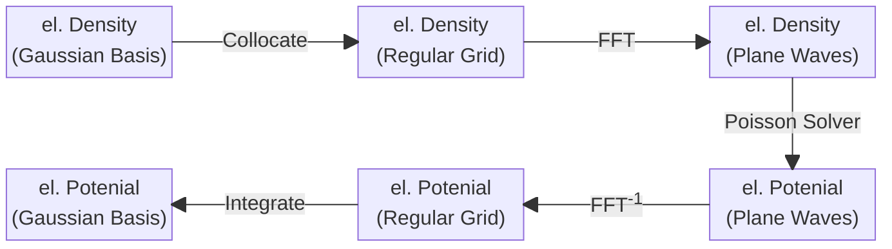

# CP2K — Manual compilado (narrativa + referência de input)

- Fonte narrativa: https://github.com/cp2k/cp2k/tree/master/docs (commit `fcab26e`, 2026-10-22)
- Referência de input: gerada de `cp2k_input.xml` do manual oficial (trunk): CP2K version 2026.2 (Development Version), rev git:50c68ef, compilado 2026-10-22 00:36:25
- Conversão: MyST limpo (toctree/figuras removidos, figuras viram `[figura omitida: ...]`); referência de input compactada
  (1 linha por keyword; subárvores idênticas, ex. `XC_FUNCTIONAL` replicado em dezenas de lugares, aparecem 1 vez e as demais apontam para a primeira).
- Não incluídos: `index.md`, `README.md`, `versions.md` (só toctree/instruções de build do site).
- Versões em uso: access = cp2k/2026.1, coaraci = 2025.1 psmp / 2026.2 ssmp. Keyword que não existir na sua versão: checar `cp2k --xml`/o `.out`.
- Uso: `grep -n -i` neste arquivo (nunca ler inteiro). Parte II: procurar `^#+ &FORCE_EVAL/&DFT/&QS` ou ``^- `KEYWORD` ``.

## Índice (linha no arquivo)

Parte I:
- L152: getting-started/foreword-and-faq.md
- L335: getting-started/installation.md
- L402: getting-started/build-from-source.md
- L881: getting-started/build-with-spack.md
- L1054: getting-started/distributions.md
- L1195: getting-started/macos.md
- L1464: getting-started/first-calculation.md
- L1608: getting-started/troubleshooting.md
- L1846: methods/dft/index.md
- L1868: methods/dft/gpw.md
- L1913: methods/dft/gapw.md
- L1997: methods/dft/electrostatics/index.md
- L2131: methods/dft/hartree-fock/index.md
- L2138: methods/dft/hartree-fock/admm.md
- L2234: methods/dft/hartree-fock/ri_gamma.md
- L2519: methods/dft/hartree-fock/ri_kpoints.md
- L2782: methods/dft/basis_sets.md
- L2888: methods/dft/pseudopotentials.md
- L3012: methods/dft/k-points.md
- L3394: methods/dft/orbital_transformation.md
- L3551: methods/dft/convergence.md
- L3733: methods/dft/cutoff.md
- L4413: methods/dft/local_ri.md
- L4514: methods/dft/constrained.md
- L5352: methods/dft/cneo.md
- L5510: methods/dft/linear_scaling.md
- L5523: methods/dft/gauxc.md
- L5856: methods/post_hartree_fock/index.md
- L5876: methods/post_hartree_fock/preliminaries.md
- L6040: methods/post_hartree_fock/mp2.md
- L6292: methods/post_hartree_fock/rpa.md
- L6412: methods/post_hartree_fock/low-scaling.md
- L6751: methods/semiempiricals/index.md
- L6756: methods/semiempiricals/xtb.md
- L7301: methods/semiempiricals/dftb.md
- L7307: methods/machine_learning/index.md
- L7312: methods/machine_learning/nequip.md
- L7401: methods/machine_learning/mace.md
- L7463: methods/machine_learning/nnp.md
- L7555: methods/machine_learning/pao-ml.md
- L7756: methods/machine_learning/deepmd.md
- L7806: methods/machine_learning/ace.md
- L7852: methods/embedding/index.md
- L7857: methods/embedding/kim-gordon.md
- L8000: methods/embedding/qm_qm.md
- L8010: methods/qm_mm/index.md
- L8022: methods/qm_mm/builtin.md
- L8373: methods/qm_mm/gromacs.md
- L8414: methods/qm_mm/polarizable_force_field.md
- L8424: methods/qm_mm/implicit_solvation.md
- L8430: methods/qm_mm/image_charges.md
- L8569: methods/sampling/index.md
- L8574: methods/sampling/molecular_dynamics.md
- L8939: methods/sampling/constrained_dynamics.md
- L9169: methods/sampling/metadynamics.md
- L9403: methods/sampling/path_integrals.md
- L9409: methods/sampling/newton-x.md
- L9806: methods/sampling/i-pi.md
- L9952: methods/sampling/monte_carlo.md
- L10176: methods/sampling/langevin_dynamics.md
- L10332: methods/sampling/ehrenfest.md
- L10853: methods/optimization/index.md
- L10858: methods/optimization/geometry_and_cell_opt.md
- L11388: methods/optimization/nudged_elastic_band.md
- L11403: methods/electronic_structure/index.md
- L11414: methods/electronic_structure/molecular_orbitals.md
- L11885: methods/electronic_structure/band/index.md
- L11894: methods/electronic_structure/band/gw.md
- L12181: methods/electronic_structure/dos.md
- L12471: methods/electronic_structure/fod.md
- L12535: methods/electronic_structure/population/index.md
- L12544: methods/electronic_structure/population/resp.md
- L12933: methods/electronic_structure/wannier90.md
- L13349: methods/electronic_structure/phason-topology.md
- L13490: methods/properties/index.md
- L13495: methods/properties/optical/index.md
- L13556: methods/properties/optical/tddft.md
- L14073: methods/properties/optical/bethe-salpeter.md
- L14760: methods/properties/optical/rtbse.md
- L15089: methods/properties/optical/vibronicspec.md
- L15542: methods/properties/x-ray/index.md
- L15547: methods/properties/x-ray/delta-scf.md
- L16009: methods/properties/x-ray/tddft.md
- L16646: methods/properties/x-ray/delta-kick.md
- L16925: methods/properties/x-ray/correction_scheme.md
- L17331: methods/properties/infrared.md
- L17342: methods/properties/raman.md
- L17348: methods/properties/nmr.md
- L17354: methods/properties/stm_images.md
- L17476: methods/properties/inversion_topology.md
- L17640: methods/properties/spectral_localizer.md
- L17713: methods/properties/quadratic_pseudospectrum.md
- L17778: methods/restarting.md
- L18271: technologies/eigensolvers/index.md
- L18279: technologies/eigensolvers/cusolvermp.md
- L18325: technologies/eigensolvers/dlaf.md
- L18418: technologies/eigensolvers/elpa.md
- L18438: technologies/accelerators/index.md
- L18443: technologies/accelerators/cuda.md
- L18467: technologies/accelerators/hip.md
- L18491: technologies/accelerators/opencl.md
- L18566: technologies/libraries.md
- L19016: technologies/python.md
- L19666: acronyms.md
- L20066: development/onboarding.md
- L20230: development/under-the-hood.md
- L20235: development/code-structure.md
- L20335: development/code-formatting.md
- L20436: development/coding-conventions.md
- L20699: development/error-handling.md
- L20773: development/print-keys.md
- L20820: development/preprocessing.md
- L20886: development/regtesting.md
- L21213: development/dependencies.md
- L21252: development/profiling.md
- L21438: development/reference-counting.md
- L21536: changelog.md

Parte II (seções de 1º nível):
- L22411: &GLOBAL
- L22659: &TEST
- L22951: &DEBUG
- L22989: &MOTION
- L26563: &MULTIPLE_FORCE_EVALS
- L26569: &FORCE_EVAL
- L48540: &FARMING
- L48611: &OPTIMIZE_INPUT
- L48739: &OPTIMIZE_BASIS
- L48860: &SWARM
- L49032: &EXT_RESTART
- L49074: &VIBRATIONAL_ANALYSIS
- L49297: &NEGF
- L49515: &ATOM

Parte III e Apêndice: ver cabeçalhos `# PARTE III` e `# APÊNDICE`.

# PARTE I — Manual (narrativa)

## [[getting-started/foreword-and-faq.md]]

### Foreword and FAQ

It is our great pleasure to present CP2K, an open-source software package for _ab initio_ electronic
structure calculations in atomistic simulations. The code is written in Fortran 2008 and has been
geared towards large-scale, high-performance CPU and GPU computation with multi-threading, MPI, CUDA
and HIP parallelization. For an overview of the capabilities, see
[Features](https://www.cp2k.org/features).

While CP2K started as an implementation of quantum chemical methods (more specifically, the
`QUICKSTEP` module, as presented at (VandeVondele2005)) for molecular dynamics simulation,
decades of ensuing development has witnessed a vast team of collaborators with their innumerable
contributions and the ever-growing user base with their valuable feedbacks, to whom we wish to
express sincere gratitude. As CP2K is freely available in various ways and does not requite
registration to use, it is difficult to gather accurate usage stats; but the
[list of publications using CP2K](https://www.cp2k.org/science) speaks for itself.

We would like to ask you, users of CP2K, to acknowledge our work by citing the publications as
listed on the [Bibliography](../bibliography) page and printed as REFERENCES at the end of output
log of the program, in particular the review articles:

- (K%C3%BChne2020), on the theoretical background and algorithms;
- Luber2025, on DFT-based excited-state, spectroscopic, and nonadiabatic dynamics
  methods;
- (Iannuzzi2026), on the practical usage and applications.

We have prepared a list of Q&A for frequently asked things below, which we hope can be helpful for
the experience with the CP2K package and the art of computational chemistry in general.

This program is provided "as-is" without any expressed or implied warranty.

#### Firstly, what does the name CP2K stand for?

Simply put, "CP" means Car-Parrinello, the initials of two scientists, and "2K" means year 2000.

Historically there were two formulations developed for _ab initio_ molecular dynamics (`MD`):
the Car-Parrinello Molecular Dynamics (`CPMD`), and the Born-Oppenheimer Molecular Dynamics
(`BOMD`). A program named simply also as `CPMD` began its development back in the 1990s
featuring the Car-Parrinello Molecular Dynamics; the sister project, named as CP2K, would become its
spiritual successor in the wake of the New Millenium.

Due to the fact that the original CPMD formulation has not actually been implemented yet, the name
CP2K may sound slightly non-indicative. The BOMD formulation is the major one employed by CP2K and
has seen mainstream applications in a variety of fields in the 21st century.

#### Can I try CP2K out somewhere before installation?

Yes. The [CP2K Lab](https://lab.cp2k.com/) is a spin-off commercial platform set up by developers
for building structures, writing input files, executing jobs on the cloud and analyzing the outputs.
Once signed up for free, the free-tier features already allow for experiments with lightweight
computation like the one in [](./first-calculation). For those in need of more resources and
functionalities, the platform offers paid tier, site license and on-premise enterprise support.

#### What preliminary knowledge does using CP2K need?

Practically CP2K is built and executed in some Linux-based operating systems, ranging from on
physical high-performance computers for production to in virtual machines for quick small tests.
This implies the need of Linux knowledge including its file system, paths, user privileges and
permissions, environment variables, shells (most commonly Bash and POSIX), utility commands,
stdin/stdout/stderr, piping and redirects, shell scripts, and modules and library files. In
addition, having some experience with Fortran, C, and C++ compilers as well as CMake will be helpful
for configuration and installation. Optionally, learn about upper-level management via job
schedulers and queue systems.

On the science side, introductory courses on chemistry, solid-state physics, and statistical
mechanics are vital prerequisites before carrying out computer simulations just as before performing
experiments in real life. Moreover, it is mandatory to have a clear understanding about the
theoretical methods in simulation; their characteristics and performance, strengths and limitations
should be described in the publications in the original conception and follow-up benchmarks. There
are two polar opposite pitfalls to be avoided: it is easy to overlook the subtleties and adjust
input settings mindlessly hoping that the black box somehow works, but it is also easy to become
absorbed in the maths and spend a lot of time trying to work out the equations that is not the focus
of the actual research project.

**NOTE:**
Worth stressing are two overarching aspects of computer simulation:

- In spite of ever-growing scientific computing power, most of the time it is not affordable to have
  an exact 1:1 computational model of the real-life phenomena of interest. The usual practice is to
  use a much scaled-down model with limited number of atoms and finite length of trajectory for the
  simulation, which should achieve the delicate balance between representativeness and feasibility.
  The discrepancy of space and time scales between simulation and reality can be easily neglected due
  to a lack of awareness of the kinetics, especially for slow, rare events with high energy barrier
  that can only be observed in an extended period of time in real life.
- There is no need to worry if a theoretical method is strictly *ab initio* or not; both styles of
  deriving methods, "starting from physically rigorous and universal first principles" and "taking
  empirical results into account by fitting parameters with extra data", are capable of producing
  useful algorithms and accurate results depending on the case. The real concern is better put on
  the performance of methods on the target system of interest, which should have been benchmarked
  in existing works of the particular subdivision of science; also, the similarity between primitive
  datasets on which empirical parameters of the method (if any) are fitted and the target system
  of interest can be telling.

#### How do I create the atomistic model for CP2K input?

This is done with external visualization and construction programs. Considering that a task of
geometry and/or cell optimization is usually the very first CP2K job, some general rules are
discussed on the
[relevant documentation page](../methods/optimization/geometry_and_cell_opt.md#starting-structure-and-cell).

If available, *computational* databases and benchmark sets are the most recommended avenue to obtain
structures due to having already been subject to some electronic-structure calculation. Even the
cheap methods and loose thresholds in a high-throughput screening and optimization can make the
structure qualitatively reasonable by chemical and physical intuitions, although further
optimization is still needed.

On the other hand, structures that are from *experimental* characterization are frequently not
"computation-ready", and thus should not be subject to computation without careful validation in
pre-processing. This can be prominent for `cif` and `pdb` structures determined by powder or single-
crystal XRD which can be affected by sample quality and thermal motion.

- Watch out for crystallographic disorder and atoms with low resolution or fractional occupation:
  using the superposition of all atoms as if every occupancy is 1.00 is highly likely to introduce
  contacting or even overlapping atoms.
- Beware of composition: the atomic structure may not match the intended macroscopic, charge-neutral
  chemical formula, owing to missing or duplicated hydrogen atoms, small counter ions, solvent or
  ligand molecules.

Possible resolutions vary from simple manual editing in the modelling stage, to utilization of
supercells and enumeration of special quasirandom structures (common for materials with dopants),
and to more rigorous XRD refinement and application of quantum crystallography methods. It is
believed that further advancements in instrumental analysis and structure resolution techniques
would eventually benefit computational chemistry greatly.

#### Do I need PBC for my model?

**Periodic boundary condition** (`PBC`) is a fundamental feature of CP2K, covering the full
range of dimensionalities of translational symmetry from 3D, 2D, 1D to 0D. The key distinction is
how connectivity, neighbor lists and integration grids are generated, how the Poisson solver handles
the electrostatic interaction, and how translational and rotational degrees of freedom of the center
of mass (i.e. collective motion as a whole) are treated.

If the structure involves condensed-phase matter, such as liquid solution, solid crystal, surface
slab and other one- and two-dimensional nano-materials, then generally PBC is used. This is also
applicable to systems with no actual well-defined repeating units like the bulk solutions. A huge
liquid droplet in the gaseous phase, where the diameter is so large that the gas-liquid interface is
almost flat and surface tension is negligible, may just as well be modelled as a combination of a
bulk solution system and an interface between a gaseous/vacuum region and a thin layer of solution,
both of which make use of PBC even though the liquid droplet itself is not periodic. However, it may
be necessary to validate the size of PBC against target properties to confirm that it is
sufficiently large for sampling, sometimes with the minimum image convention in mind.

Isolated molecular clusters in the gaseous phase or vacuum, where external pressure is irrelevant,
can be simulated without PBC. A frequent question is why a molecule optimized in vacuum does not
match its crystal structure; this is because the ordered packing pattern in the crystalline form
creates an environment capable of driving conformational changes. Oftentimes literatures convert a
periodic structure to an isolated model of finite size and apply modifications on the edge in the
form of terminal capping atoms/groups or point charges; these treatments are usually intended to
adapt the structure to quantum chemical softwares with no PBC support, but in CP2K they may not
offer extra advantages over an appropriate PBC for translational symmetry.

In certain cases, the same process can be simulated both with and without PBC. For example, the
reaction between hydroxyl and hydrogen may be modelled as a single $\mathrm{H_2}$ molecule colliding
with a single $\mathrm{OH}$ molecule with different relative orientations, distances and velocities,
which does not need PBC, or modelled as a mixture of numerous $\mathrm{H_2}$ and $\mathrm{OH}$
molecules, which needs PBC. Their behavior regarding responses to external conditions including
temperature, pressure, and any form of energy input may be different, but they provide insights from
distinct perspectives.

#### Does CP2K support k-points?

As an essential element for solid-state electronic structure, k-point sampling is supported for some
features in the `QUICKSTEP` module of CP2K, as elaborated on [](../methods/dft/k-points). This is an
very active field of development, with many new implementations and performance enhancement becoming
available only recently; so, stay tuned and do not get distracted by outdated unofficial accounts.

#### What is the software ecosystem of CP2K like?

There is a large arsenal of third-party auxiliary programs and libraries, interfaced with CP2K in
one form or another, that offer supplementary utilities and can be readily integrated into the
computation and pre- and post-processing workflow. See for instance:

- The aforementioned (Iannuzzi2026) that mentions in section 11.1.3 a number of such tools;
- The list of [tools for simplifying your life with CP2K](https://www.cp2k.org/tools) on cp2k.org;
- And the `technologies` section of this manual.

#### Where can I reach out to the community for asking questions, making contributions, etc.?

Please find the `SUPPORT.md` document for discussion venues, recommended practice for requesting
help, and possible ways of contribution. These contents are previously on this page but have been
refactored for brevity.

## [[getting-started/installation.md]]

### Installation

The first pivotal step with CP2K is a correct installation, comprising preparation of dependencies
and linking and building to CP2K itself, for which there are several workflows available. This page
gives an overview of considerations before linking the detailed instruction pages at the end.

For visibility, the soft link `./INSTALL.md` redirects to this page.

#### Considerations

Here is a checklist for crucial premises and factors. The label "(assumed)" marks the conditions
implied for most of the documentation.

1. Which flavor of operating system is the target machine?
   - **Linux** (assumed): the workhorse for high-performance computing, a majority of compiling and
     regression tests are hosted in some Linux distribution.
   - **Darwin**: MacOS on Apple Silicon M1 is also regularly tested, and installation methods based
     on Spack or Homebrew are recommended. Alternatively, a pre-built Linux container can be run
     with Podman, see [](./macos).
   - **Windows**: for lightweight beginner experiments, the Windows Subsystem for Linux (WSL) or any
     other virtual machine platforms can provide a Linux environment on Windows.
1. Does the user have root privilege or sudo power on the machine?
   - **Yes**: proceed with caution, especially if the privilege means that actions may disrupt the
     environment for other users and softwares.
   - **No** (assumed): it is totally fine to install as a normal user in a convenient directory with
     read and write permission as well as sufficient disk space.
1. Does the machine have internet connection?
   - **Yes** (assumed): okay, new packages will be downloaded automatically to prepare dependencies;
     however, once ready, running CP2K itself does not require internet connection.
   - **No**: if access to external public websites is restricted, unstable or outright unavailable,
     an offline installation may start with downloading all packages elsewhere, transferring them to
     designated directory on the machine and validating file integrity (such as with `sha256sum`).
1. Does the machine have a module system that manages multiple existing compilers, MPI libraries,
   math libraries and other dependent packages? (Module systems like LMod and Environment Module
   enable loading or unloading modules to control active environment variables and paths in runtime
   without conflicts; one can check with `module avail`, `module show` or commands alike.)
   - **Yes**: it is recommended to check for availability and compatibility beforehand and activate
     relevant modules for installation and execution; this not only avoids having multiple copies of
     the same package, but also get to leverage custom optimizations tailored to the machine, in
     particular hardware-dependent libfabric and MPI configurations for parallel execution.
   - **No** (assumed): if no such modules exists, or the modules are outdated or incompatible, there
     is of course the option to prepare everything from scratch with default configuration.
1. Does the machine have distinct types of nodes? (For instance, "login node" where users log in to
   perform tasks with low workload including compiling programs, and "compute node" where the more
   resource-intensive computation jobs are carried out; the key is whether program environment and
   hardware specification are consistently the same.)
   - **Yes**: heterogeneous computing with distinct CPU architecture and supported instruction sets
     require extra care for the optimization target, and effective environment variables and paths
     seen in one environment may need to be explicitly activated in another via submission scripts.
   - **No** (assumed): optimization against native (host) CPU is appropriate, and environment setup
     is easier.
1. Does the machine have some workstation GPU? (A "workstation GPU" or "professional GPU" focuses on
   the double-precision float-point arithmetic and is suitable for scientific computing, in contrast
   to a "gaming GPU" or "consumer GPU" with less optimized double-precision performance.)
   - **Yes**: some of the [eigensolvers](../technologies/eigensolvers/index),
     [accelerators](../technologies/accelerators/index) and other
     [libraries](../technologies/libraries) have GPU acceleration support ready or under development
     for matrix operations in CP2K's quantum chemical calculations; note that the requirement for
     CP2K is different from that for other molecular dynamics codes based on molecular mechanics.
   - **No** (assumed): on the safe side, a CPU-only build is always possible and is not necessarily
     slower without GPU.

#### Instructions


## [[getting-started/build-from-source.md]]

### Build from Source

CP2K uses the [CMake](https://cmake.org) build system, which detects dependencies and controls the
compilation process. This page describes how to obtain a complete CP2K source tree, prepare the
dependencies and build and install CP2K.

**NOTE:**
Historical releases from 2025 or prior used a custom system based on GNU Make and ARCH files, which
has been deprecated due to portability and maintenance difficulties. There is no longer interest in
providing tech support and documentation for it outside of legacy materials.

The 2026.1 release was the first to exclusively rely on the CMake build system, but the appropriate
[](./build-from-source.md#cmake-configuration-options) had to be assembled manually due to a lack
of automation. The inconvenience has been addressed since the subsequent 2026.2 release, which
introduced the scripts `build_cp2k.sh` (for a [](./build-from-source.md#toolchain-based-build)) and
`make_cp2k.sh` (for a [](./build-from-source.md#spack-based-build-via-make_cp2ksh)).

As such, the following documentation applies to the current CP2K master branch and release versions
`2026.2` and newer.

#### Obtaining source code

CP2K is available as a versioned release tarball or through the Git repository. The directory
produced by either method is the root of the CP2K source tree, referred to below as `CP2K_ROOT`.

##### Release tarballs

For a stable released version, download the versioned `cp2k-{version}.tar.bz2` asset from the
[CP2K releases](https://github.com/cp2k/cp2k/releases) page and unpack it:

```shell
tar -xjf cp2k-{version}.tar.bz2
cd cp2k-{version}
```

**TIP:**
It is strongly recommended to use the versioned release tarball rather than GitHub's automatically
generated `Source code` archive, especially for version \<=2025.2. The versioned tarball is the
release artifact and contains any source components bundled for that release.

A good practice for downloading anything from the Internet is to verify the file integrity with a
checksum. Use `sha256sum cp2k-{version}.tar.bz2` (or the equivalent on other Linux distro) to get
the SHA256 string of the downloaded file, and compare it with what is provided on the releases page
for the version tarball; only when they match should the file be trusted.

##### Git checkout

A Git checkout is appropriate for development builds or when a particular branch is required:

```shell
git clone https://github.com/cp2k/cp2k.git cp2k
cd cp2k
```

To check out a supported release branch, replace the branch name as appropriate:

```shell
git clone --recursive -b support/v{version} https://github.com/cp2k/cp2k.git cp2k
cd cp2k
```

The `--recursive` is important for versions \<=2025.2, since it includes the DBCSR submodule. If the
repository was cloned without `--recursive`, initialize the required submodule before building:

```shell
git submodule update --init --recursive
```

**WARNING:**
When configuring CP2K with CMake after building the toolchain inside a CP2K Git checkout with tags,
DBCSR revision detection can use the enclosing CP2K repository and generate incorrect DBCSR version
metadata, causing CMake report an error regarding the DBCSR package discovery; see
[issue #5184](https://github.com/cp2k/cp2k/issues/5184). Therefore, use the versioned release
artifact rather than a Git tag for released CP2K versions.

#### Setting up dependencies and building CP2K

At a minimum, CP2K requires a modern suite of Fortran and C compiler compliant with the F2008
(`-std=f2008`) and C2011 (`-std=c11`) standards respectively. For an up-to-date list of supported
compiler flavors, versions and known limitations, see the GitHub Wiki page on
[Compiler Support](https://github.com/cp2k/cp2k/wiki/Compiler-Support).

In addition, CP2K requires [DBCSR](https://github.com/cp2k/dbcsr/), BLAS, LAPACK, FFTW, and
[libwignernj](https://github.com/susilehtola/libwignernj) 0.8 or newer; on top of these, MPI builds
require MPI and ScaLAPACK.

Detailed descriptions of available dependencies can be found in the technologies section:

- **[](../technologies/eigensolvers/index)**
- **[](../technologies/accelerators/index)**
- **[](../technologies/libraries)**

Utilities available from package managers `apt-get`, `dnf` and the like, such as `python3`, `pip`,
`git`, `less`, `make`, `sed`, `tar`, `wget`, `zlib`, `unzip`, `bzip2`, and `xz` (this is not an
exhaustive list) are assumed to be readily available infrastructure.

The following two methods provide a CP2K-managed dependency stack. For a manually managed
environment, use the CMake configuration described at the end.

##### Toolchain-based build

The toolchain scripts under the `tools/toolchain` directory build a CP2K-compatible, self-contained
dependency stack and prepare the environment for a subsequent CP2K build. It is operated from the
`install_cp2k_toolchain.sh` script and accompanied by `build_cp2k.sh`. To enter the directory from
`CP2K_ROOT` and read help messages and the complete list of options, run:

```shell
cd ./tools/toolchain/
./install_cp2k_toolchain.sh --help
./build_cp2k.sh --help
```

To configure and install the dependencies requested by default options, run:

```shell
./install_cp2k_toolchain.sh
```

By default, the dependencies will be built under `tools/toolchain/build/` and installed under
`tools/toolchain/install/`. After completion, run the suggested command in the same working
directory to build and install a copy of CP2K that is linked against them:

```shell
./build_cp2k.sh -j {nprocs} --preset native-gnu-x86_64
```

The `-j {nprocs}` argument sets the number of parallel build jobs; it can be omitted for automatic
detection of all available CPUs on the current machine, or it can be specified to overwrite the
default value. The `--preset` argument specifies a CMake preset, which will be explained below at
(cmake-configuration-options); here, the `install_cp2k_toolchain.sh` option `--target-cpu=native`
(default if omitted) will suggest an appropriate preset based on the compiler and architecture.

Everything is under the `CP2K_ROOT` directory mentioned above by default: the CP2K build tree in
`build/`, and the headers, modules, binary executables and a `cp2k_env` file in `install/`. Options
are also available to make installed dependencies and program outside of the source tree.

```shell
./install_cp2k_toolchain.sh --install-dir=/opt/cp2k/toolchain
./build_cp2k.sh --prefix /opt/cp2k -j {nprocs} --preset native-gnu-x86_64
```

Remember to always source the `cp2k_env` file before starting the program in the current shell and
session. (This is easy to miss on a HPC server where one submits jobs from a login node to another
computing node with job scripts!) For instance, if `CP2K_ROOT` is `/opt/cp2k`, the `--prefix` option
of `build_cp2k.sh` is the default (i.e. `install`), then a quick look at the version information
would use the commands below (as input to the command line prompt or as part of the job script).

```shell
source /opt/cp2k/install/cp2k_env
cp2k.psmp -v
```

The intended output is something like this, with the block of compiler options omitted for brevity.

```text
 CP2K version 2026.2
 Source code revision git:c92cc08
 cp2kflags: omp libint fftw3 libxc elpa parallel scalapack mpi_f08 cosma libxs spglib openblas libdftd4 s_dftd3 mctc-lib tblite libvori libbqb
 compiler: GCC version 14.3.1 20251022 (Red Hat 14.3.1-4)
 compiler target: cpuid   1002 (x86_avx2)
 compiler options:
   [...]
```

###### Pros and Cons

The toolchain-based build is suitable for cases where only the (near-)minimal essential dependencies
are desired. Its reliance and interference with external package managers and internet connection is
also minimal, and as such it comes in more handy in an offline scenario.

The toolchain does not cover every optional dependency or feature combination, such as DLA-Future,
PEXSI, and optional SIRIUS features including NLCG. Its support for GPU-accelerated builds is also
limited. If these features are needed, the Spack-based build as detailed in the next section is the
more recommended method. In fact, due to difficulties in extending the toolchain for increasingly
sophisticated configurations involving nested dependencies, it _may_ be slimmed down or retired in
favor of the modern, well-maintained Spack workflow in the future.

##### Spack-based build via `make_cp2k.sh`

`make_cp2k.sh` installs the selected dependency stack with [Spack](https://spack.readthedocs.io) and
then configures, builds, and installs CP2K with CMake. It operates in `CP2K_ROOT`, the root of the
CP2K source tree.

Run the script with its default options to perform a full build including (almost) all features:

```shell
./make_cp2k.sh
```

For a minimal build from scratch, run:

```shell
./make_cp2k.sh -bd -df all
```

Based on which desired features can be added explicitly for building a tailored CP2K binary.

```shell
./make_cp2k.sh -bd -df all -ef libint2 -ef libxc -ef spglib -ef tblite
```

Use `./make_cp2k.sh --help` to display the complete list of options:

<details>

<summary>Click to see all options (version 2.4)</summary>

```
Usage: make_cp2k.sh [-bd | --build_deps]
                    [-ase ASE_VERSION]
                    [-bd_only | --build_deps_only]
                    [-bp | --build_path PATH]
                    [-bsl | --build_static_libcp2k]
                    [-bt | --build_type (Debug | Release | RelWithDebInfo)]
                    [-cc | --check_conventions]
                    [-cray]
                    [-cv | --cp2k_version (pdbg | psmp | sdbg | ssmp | ssmp-static)]
                    [-df | --disable | --disable_feature (all | FEATURE | PACKAGE | none)]
                    [-ef | --enable | --enable_feature (all | FEATURE | PACKAGE | none)]
                    [-gm | -gpu  | --gpu_model (<CUDA SM code> | P100 | V100 | T400 | A100 | H100 | H200 | GH200 | B200 | none)]
                    [-gromacs GROMACS_VERSION]
                    [-gv | --gcc_version (10 | 11 | 12 | 13 | 14 | 15 | 16)]
                    [-h | --help]
                    [-ip | --install_path PATH]
                    [-j #PROCESSES]
                    [-mpi | --mpi_mode (mpich | no | openmpi)]
                    [-np | --num_packages #PACKAGES]
                    [-opencl]
                    [-preset (native-gnu-x86_64 | native-gnu-arm64 | native-intel | none)]
                    [-rc | --rebuild_cp2k]
                    [-t | --test "TESTOPTS"]
                    [-ta | --test_ase]
                    [-tc | --test_coverage]
                    [-tg | --test_gromacs]
                    [-tp | --test_performance "BENCHMARK_PROFILE"]
                    [-uc | --use_cache (folder | minio | no | none)]
                    [-ue | --use_externals]
                    [-v | --verbose]

Flags:
 -ase                  : Build CP2K with ASE support
 --build_deps          : Force a rebuild of all CP2K dependencies from scratch (removes the spack folder)
 --build_deps_only     : Rebuild ONLY the CP2K dependencies from scratch (removes the spack folder)
 --build_path          : Define the CP2K build path (default: ${CP2K_ROOT})
 --build_static_libcp2k: Build a static CP2K library libcp2k.a instead of the default shared one libcp2k.so
 --build_type          : Set preferred CMake build type for CP2K (default: "Release")
 --check_conventions   : Check compliance with CP2K's coding conventions
 --cp2k_version        : CP2K version to be built (default: "psmp")
 -cray                 : Use Cray specific spack configuration
 --enable_feature      : Enable feature or package (default: all)
 --disable_feature     : Disable feature or package
 -gromacs              : Build GROMACS with CP2K support
 --help                : Print this help information
 --gcc_version         : Use the specified GCC version (default: automatically decided by spack)
 --gpu_model           : Select GPU model (default: none)
 --install_path        : Define the CP2K installation path (default: ./install)
 -j                    : Maximum number of processes (CPU cores) used in parallel
                         If the variable OMP_NUM_THREADS is set and the -j flag is not supplied, then
                         the maximum number of processes is defined by OMP_NUM_THREADS
 --mpi_mode            : Set preferred MPI mode (default: "mpich")
 --num_packages        : Maximum number of packages built by spack in parallel (default: 4)
 -opencl               : Enable the use of the Open Computing Language (OpenCL)
 -preset               : Use a CMake configure preset, see "cmake --list-presets" (default: native-gnu-x86_64)
 --rebuild_cp2k        : Rebuild CP2K: removes the build folder (default: no)
 --test                : Perform a regression test run after a successful build
 --test_ase            : Build and test CP2K with ASE support
 --test_coverage       : Analyse the code coverage and generate a coverage report
 --test_gromacs        : Build and test GROMACS with CP2K support
 --test_performance    : Perform a benchmark run after a successful build
 --use_cache           : Use a "folder", a "MinIO" object storage container (requires podman) or "no" cache
                         Set the environment variable SPACK_CACHE to specify the folder name, e.g.
                         SPACK_CACHE="file://${CP2K_ROOT}/spack_cache" (default)
 --use_externals       : Use external packages installed on the host system. This results in much
                         faster build times, but it can also cause conflicts with outdated packages
                         pulled in from the host system, e.g. old python or gcc versions
 --verbose             : Write verbose output

Hints:
 - Remove the folder ${CP2K_ROOT}/build to (re)build CP2K from scratch
   (see also --rebuild_cp2k flag)
 - Remove the folder ${CP2K_ROOT}/spack to (re)build CP2K and all its dependencies from scratch
   (see also --build_deps flag)
 - The folder ${CP2K_ROOT}/install is updated after each successful run

Packages: all | ace | cosma | deepmd | dftd4 | dlaf | elpa | fftw3 | gauxc | greenx | hdf5 | libfci |
          libgint | libint2 | libsmeagol | libtorch | libvdwxc | libxs | mimic | openpmd | pexsi | plumed |
          sirius | spfft | spglib | spla | tblite | trexio | vori 

Features: cray_pm_accel_energy | cusolver_mp | dbm_gpu | elpa_gpu | grid_gpu | pw_gpu |
          spla_gemm_offloading | unified_memory
```

</details><br>

**NOTE:**
If the variable `OMP_NUM_THREADS` is set and the `-j` flag is not supplied, then the maximum number of processes
is defined by `OMP_NUM_THREADS`

`make_cp2k.sh` creates and reuses a `spack/` directory under the `CP2K_ROOT`. It contains the local
Spack installation and dependency stack. Remove or rename it to rebuild all dependencies from
scratch; `--build_deps` and `--build_deps_only` provide the same behavior from the script.

By default, compiled packages are also stored in a local cache. This significantly accelerates later
dependency builds; see `--use_cache` for the available cache backends.

**NOTE:**
The way Spack resolves a dependency stack is very different from that in a toolchain-based build;
even with the same set of libraries intended to be freshly installed and linked to CP2K, the package
download and disk usage can still make an overall difference.

The CP2K built with Spack can be started with the launcher script `install/bin/launch`. Suppose
`CP2K_ROOT` is `/opt/cp2k`, then a version check goes as follows.

```shell
/opt/cp2k/install/bin/launch cp2k.psmp -v
```

###### Testing

To run a regression test immediately after a successful build, add `-t` or `--test` followed by test
options surrounded by double quotes (`"TESTOPTS"`). The test options will be passed to the script
`tests/do_regtest.py` as arguments.

```shell
./make_cp2k.sh --test "--maxtasks 16 --flagslow"
# Alternatively: in case no options are needed, use an empty quote string
./make_cp2k.sh --test ""
```

Alternatively, the script `install/bin/run_tests` produced after a successful build can be used to
start a regression test later. The script prints usage examples at the end of a successful run.

###### ASE/CP2K

CP2K (>2026.2) can be built and tested with support for the
[Atomic Simulation Environment (ASE)](https://ase.gitlab.io/ase/index.html) using

```shell
./make_cp2k.sh -bd --test_ase
```

A Dockerfile for building ASE/CP2K within a container with `podman` is also available. A usage
example is given in the header of that
[Dockerfile](https://raw.githubusercontent.com/cp2k/cp2k/refs/heads/master/tools/docker/Dockerfile.test_spack_ase).

By default, ASE/CP2K is built using the ASE [master branch](https://gitlab.com/ase/ase/).
Alternatively, the ASE version can be specified explicitly using the `-ase` flag

```shell
./make_cp2k.sh -bd -ase 3.29.0 --test_ase
```

but note that the current CP2K development works only with the ASE master branch.


###### GROMACS/CP2K QM/MM

The latest supported [GROMACS release](https://manual.gromacs.org/) (currently v2026.3) for
GROMACS/CP2K QM/MM simulations can be built and tested with

```shell
./make_cp2k.sh -bd --test_gromacs
```

for CP2K versions newer than v2026.2. Other (older) GROMACS versions can be built and tested with

```shell
./make_cp2k.sh -bd -gromacs v2025.2 --test_gromacs
```

A Dockerfile for building GROMACS/CP2K within a container with `podman` is also available. A usage
example is given in the header of that
[Dockerfile](https://raw.githubusercontent.com/cp2k/cp2k/refs/heads/master/tools/docker/Dockerfile.test_spack_gromacs).

#### CMake configuration options

Both toolchain and Spack utilize CMake configurations automatically for convenience after preparing
the dependencies. Many of these options allow for CP2K to be built with support of a linked library;
refer to the technologies section for details together with description of available dependencies.

Here are some other important general options you may want to know:

- `-S ` Specifies the path to source tree that contains the `src` directory and the
  `CMakeLists.txt` file. With `CP2K_ROOT` as the working directory, simply use `-S .` for it.
- `-B {Build}` Specifies the path to build. CMake is typically run *out-of-tree* in a separate
  `build/` directory under the `CP2K_ROOT`, corresponding to the `-B build` usage. Note that any
  in-source build or build in any directory with a `CMakeLists.txt` file is strictly *forbidden*.
- `-G {Generator}` Specifies which type of build files would be generated. Default is
  `Unix Makefiles`, which generates a GNU Makefile and allows you to build with running `make` in
  the build directory. For GPU-accelerated builds, it is strongly advised to use `Ninja` as
  generator, which is also used by `make_cp2k.sh`; in this case, please ensure that Ninja is
  installed on your host system.
- `-DCMAKE_BUILD_TYPE` Valid vaules are `Release` (default) and `Debug` (enables debug settings and
  generates `pdbg` or `sdbg` instead of `psmp` or `ssmp`; recommended for development).
- `-DCMAKE_INSTALL_PREFIX` Specifies the installation path.
- `-DCMAKE_INSTALL_LIBDIR` Specifies the library path under the installation path. The default is
  defined by CMake's `GNUInstallDirs` module and is dependent on the host system and architecture.
  Both toolchain `build_cp2k.sh` and Spack-based `make_cp2k.sh` set `-DCMAKE_INSTALL_LIBDIR=lib` for
  convenience, while an install from [package manager distributions](./distributions) respects the
  `GNUInstallDirs` convention.
- `-DBUILD_SHARED_LIBS` Specifies if shared libraries (e.g. `libcp2k.so`) will be built. Default is
  `ON`; if set `OFF`, static libraries (e.g. `libcp2k.a`) will be built instead.
- `-DCMAKE_POSITION_INDEPENDENT_CODE` Specifies if position-independent code is enabled.

Along with some options with CP2K:

- `-DCP2K_USE_EVERYTHING` Enables all dependencies or not.
- `-DCP2K_DATA_DIR` Specifies the location of the data for basis sets, pseudopotentials, etc. Any
  data filename specified in the CP2K input without absolute path will be interpreted as under this
  directory, which CP2K prioritizes when attempting to retrieve the data. It should *always* be
  specified as an absolute path. It is created by copying over the existing `data` directory to the
  location during installation. Default is `share/cp2k/data` under `-DCMAKE_INSTALL_PREFIX`.
- `-DCP2K_ENABLE_CONSISTENCY_CHECKS` Only used for
  [testing](https://dashboard.cp2k.org/archive/misc/index.html).
- `-DCP2K_USE_CRAY_PM_ENERGY` Enables power monitoring on Cray systems.
- `-DCP2K_USE_CRAY_PM_ACCEL_ENERGY` Enables power monitoring of accelerators on Cray systems.
- `-DCP2K_USE_DBCSR_CONFIG` Make dbcsr cmake options (`DBCSR_USE_BLA`) available.

The options above do not cover architecture- and compiler-specific optimization profiles. Instead,
they are handled by [CMake presets](https://cmake.org/cmake/help/latest/manual/cmake-presets.7.html)
as defined in `CMakePresets.json`. For instance, the preset `native-gnu-x86_64` applies the flag
`-march=native` to the GNU compilers (namely `gfortran`, `gcc`, `g++`; use `--help=target` on any of
these, say `gfortran --help=target`, for more information on the flag) via `CMAKE_{LANG}_FLAGS`
variables. It will produce binary executables that are optimized against the *host* machine by
detecting and utilizing the appropriate native CPU instruction sets on the target x86_64
architecture. (Again, be careful on a HPC server where login node and computing node are distinct!)

Currently available CMake presets are listed with the command `cmake -S . --list-presets` under the
`CP2K_ROOT`; the `native-*` ones are more relevant to practical use, while others are meant for
specific developer instrumentation. For non-native optimization, just fall back to the preset `none`
which does not apply any extraneous compiler flags.

##### Example

The following example builds CP2K on a x86_64 machine with native optimization in GNU compilers,
also enabling CUDA acceleration for Nvidia A100 GPUs and a few optional dependencies:

```bash
cd {CP2K_ROOT}
mkdir build/
cmake -S . -B build --preset native-gnu-x86_64 \
    -GNinja \
    -DCMAKE_INSTALL_PREFIX=install \
    -DCMAKE_INSTALL_LIBDIR=lib \
    -DCP2K_USE_MPI=ON \
    -DCP2K_USE_LIBXC=ON \
    -DCP2K_USE_LIBINT2=ON \
    -DCP2K_USE_SPGLIB=ON \
    -DCP2K_USE_ELPA=ON \
    -DCP2K_USE_SPLA=ON \
    -DCP2K_USE_SIRIUS=ON \
    -DCP2K_USE_COSMA=ON \
    -DCP2K_USE_ACCEL=CUDA \
    -DCP2K_WITH_GPU=A100

cmake --build build -j 32
cmake --install build
```

**TIP:**
The commands `cmake --build build -j 32` and `cmake --install build` can be replaced by a single
command `cmake --build build --target install -j 32`.

Two directories will be created under `CP2K_ROOT` in this procedure.

- `build/` (name determined by CMake `-B` or `--build` options) contains the CMake build tree and
  cache. It can be preserved for future rebuilds of CP2K with the same configuration. It can also be
  removed after installation in order to save disk space or to make way for reconfiguring and
  rebuilding from scratch; either the CMake command `cmake --build build --target clean` or the
  generic `rm -r build/` will work.
- `install/` (name determined by `-DCMAKE_INSTALL_PREFIX`) contains the installed CP2K files. Unlike
  `build/`, `install/` must be kept in place as it includes several important subdirectories:
  - `bin` for binary executables like `cp2k.psmp` and soft links;
  - `include` for module files and headers;
  - `lib` or `lib64` (name determined by `-DCMAKE_INSTALL_LIBDIR`) for libraries; and
  - `share` for some other files such as basis data (`-DCP2K_DATA_DIR`).

## [[getting-started/build-with-spack.md]]

### Build with Spack

CP2K can be built and installed with [Spack]. [Spack] is a package manager designed to support
multiple versions and configurations on a wide variety of platforms and environments, with focus on
HPC.

To install CP2K with [Spack], you need to [install Spack].

**NOTE:**
If it is the first time you use [Spack], you might have to run `spack compiler find` to setup the
compilers. See [Spack Compiler Configuration](https://spack.readthedocs.io/en/latest/getting_started.html#compiler-configuration)
for more information.

#### Install CP2K with Spack

A barebone version of CP2K can be installed with [Spack] as follows:

```bash
spack install cp2k
```

This command will build CP2K, as well as all the necessary dependencies. If it is the first time you
run this command, building all the dependencies might take a while.

In order to use CP2K installed with [Spack], you can simply type

```bash
spack load cp2k
```

This command will add the appropriate directories to `PATH` and `MANPATH`. See
[using installed Spack packages] for more information.

##### Customizing Installation

###### Variants

[Spack] allows to fully customize an installation. The [CP2K Spack package] has several options for
customization (called "variants", see [Spack package variants]). For example, to install CP2K with
`libint` and `libxc`, one can type

```bash
spack install cp2k +libint +libxc
```

`+VARIANT` will enable a boolean variant, while `~VARIANT` will disable a boolean variant. Non
boolean variants can be specified with the `VARIANT=VALUE` syntax (see [Spack package variants] for
more details). The previous installation command takes care of building CP2K with `libint` and
`libxc` support. More importantly, it takes care of building the appropriate versions of `libint`
and `libxc` to work with CP2K (Fortran support, ...).

###### Versions

Versions in [Spack] can be specified with `@` following the package name (see \[version
specifier\]). The following installs version `2023.2` of CP2K:

```bash
spack install cp2k@2023.2
```

A more complete installation of CP2K can be installed with the following:

```bash
spack install cp2k@2023.2 +libint +libxc +dlaf +sirius +cosma +spglib lmax=6 
```

The `cp2k@2023.2 +libint +libxc +dlaf +sirius +cosma +spglib lmax=6` string is called a [spec] in
[Spack] lingo.

###### CUDA and ROCm Support

The `cuda` and `rocm` variants are available for CP2K. Therefore, CUDA support can be enabled with
`+cuda` and ROCm support can be enabled with `+rocm`. `cuda_arch` and `amdgpu_target` allow
specifying the GPU architecture:

```bash
spack install cp2k +cuda cuda_arch=80
spack install cp2k +rocm amdgpu_target=gfx90a
```

[Spack] is designed to support the installation of different versions of the same software,
therefore there is no problem with running _both_ commands above. However, `spack load cp2k` will no
longer work, you will need to be a bit more specific:

```bash
spack load cp2k +cuda
```

##### Managing Dependencies

Sometimes you need to control dependencies too. Dependencies are also [Spack] packages, and their
installation can be configured in the same way as for CP2K. A dependency spec is defined by `^`.

For example, if you want to install CP2K with CUDA support but [DBCSR] without CUDA support you can
do

```bash
spack install cp2k +cuda cuda_arch=80 ^dbcsr ~cuda
```

Another example, is the choice of vendor libraries. In order to use Intel oneAPI MKL, it can be
specified as a dependency:

```bash
spack install cp2k ^intel-oneapi-mkl +cluster
```

This command will build CP2K with Intel oneAPI MKL. `+cluster` is a variant of the
[Intel oneAPI Spack package] enabling cluster support (ScaLAPACK, BLACS, ...).

#### Developer Workflow

[Spack] has support for developer workflows. One way to use [Spack] to develop CP2K, is to use
[Spack] to install all the necessary dependencies and then build CP2K manually.

To install only the dependencies of CP2K (and not CP2K itself) you can use

```bash
spack install --only=dependencies CP2K_SPEC
```

Once all dependencies are installed, you can get a shell with all the dependencies set up:

```bash
spack build-env CP2K_SPEC -- bash
```

From here, you can iterate CP2K development using the native build system as Spack would use it.

##### Spack and CP2K Docker Containers

Some CP2K Docker containers install all the necessary dependencies with Spack. Building with Spack
can be time-consuming, because all dependencies are built from source. In order to speed-up
development and testing with the Spack-based Docker containers, you should enable a [Spack cache]
locally:

```bash
./tools/docker/spack_cache_start.sh
```

This command starts a local [MinIO] server that can be used as cache for the Spack packages. The
`spack_cache_stop.sh` script stops the server.

You can then build the Docker container (here the `test_spack` container, as an example) with the
following command:

```bash
podman build -f tools/docker/Dockerfile.test_spack -t cp2k_test_spack --shm-size=1G --network=host .
```

The first build after enabling the cache will be as slow as usual, but all subsequent builds will be
much faster.

The cache is expected, as it dramatically improves build times. Should you need to build without
using the Spack cache, you can set it to an empty string as follows:

```bash
podman build -f tools/docker/Dockerfile.test_spack -t cp2k_test_spack --shm-size=1G --build-arg SPACK_CACHE="" .
```

[cp2k spack package]: https://packages.spack.io/package.html?name=cp2k
[dbcsr]: https://cp2k.github.io/dbcsr/develop/
[install spack]: https://spack.readthedocs.io/en/latest/getting_started.html#installation
[intel oneapi spack package]: https://packages.spack.io/package.html?name=intel-oneapi-mkl
[minio]: https://min.io/
[spack]: https://spack.readthedocs.io/en/latest/
[spack cache]: https://spack-tutorial.readthedocs.io/en/latest/tutorial_binary_cache.html
[spack package variants]: https://spack.readthedocs.io/en/latest/basic_usage.html#variants
[spec]: https://spack.readthedocs.io/en/latest/basic_usage.html#specs-dependencies
[using installed spack packages]: https://spack.readthedocs.io/en/latest/basic_usage.html#using-installed-packages

## [[getting-started/distributions.md]]

### Install from Distribution

The easiest way to get started with CP2K is to install it from a distribution.

**NOTE:**
The pre-compiled package from distributions may not performs as well as package
built from source, as it usually adopts a conservative compilation strategy to
ensure broad compatibility.

#### Arch

```shell
pacman -S cp2k
```

See also [archlinux.org](https://aur.archlinux.org/packages/cp2k).

#### Conda

[Download](https://conda-forge.org/download/) and install [conda](https://conda-forge.org/). The
available CP2K versions can be listed with

```shell
conda search conda-forge::cp2k
```

It is recommended to select the latest CP2K version and to install it into a new, dedicated conda
environment, e.g. `cp2k_env`, to avoid dependency conflicts.

```shell
conda create -n cp2k_env conda-forge::cp2k
```

Alternatively, a specific CP2K version can be installed with

```shell
conda create -n cp2k_env conda-forge::cp2k=2026.2=mpi_openmpi_hea898a9_5
```

Activate the new conda environment, and then cp2k can be executed

```shell
conda activate cp2k_env
cp2k -h -v
```

See also [conda-forge.org](https://conda-forge.org/packages/) and
[conda-metadata-app.streamlit.app](https://conda-metadata-app.streamlit.app/?q=conda-forge/cp2k).

#### Debian / Ubuntu

```shell
apt-get install cp2k
```

See also [debian.org](https://packages.debian.org/search?keywords=cp2k) and
[ubuntu.com](https://packages.ubuntu.com/search?keywords=cp2k).

#### Docker / Podman

CP2K container images are available from Docker Hub and can be pulled with either
[Docker](https://www.docker.com/) or [Podman](https://podman.io/). Podman is recommended, because it
is a daemonless container engine that runs containers rootless by default, i.e. without requiring
root privileges or membership in a privileged group like the `docker` group, which is effectively
equivalent to root access on the host. Files written to mounted host directories are owned by the
invoking user. Its command line interface is compatible with Docker's.

```shell
podman pull docker.io/cp2k/cp2k:latest
```

or

```shell
docker pull cp2k/cp2k:latest
```

On macOS with Apple Silicon, see [](./macos) for a step-by-step guide.

See also [hub.docker.com](https://hub.docker.com/r/cp2k/cp2k),
[podman.io](https://podman.io/docs/installation), and
[cp2k-containers](https://github.com/cp2k/cp2k-containers).

#### Easybuild

```shell
eb --software-name=CP2K --toolchain=foss,2023a
```

See also [easybuild.io](https://docs.easybuild.io/version-specific/supported-software/c/CP2K/).

#### Fedora

```shell
dnf install cp2k
```

See also [fedoraproject.org](https://src.fedoraproject.org/rpms/cp2k)

#### FreeBSD

```shell
pkg install cp2k
```

See also [freshports.org](https://www.freshports.org/science/cp2k/).

#### Homebrew

```shell
brew install cp2k
```

See also [brew.sh](https://formulae.brew.sh/formula/cp2k).

#### NixOS

```shell
nix-shell -p cp2k
```

See also [nixos.org](https://search.nixos.org/packages?query=cp2k).

#### Nvidia GPU Cloud

```shell
docker pull nvcr.io/hpc/cp2k:v2023.2
```

See also [ngc.nvidia.com](https://catalog.ngc.nvidia.com/orgs/hpc/containers/cp2k).

#### Spack

```shell
spack install cp2k
```

See also [spack.io](https://packages.spack.io/package.html?name=cp2k) and [](./build-with-spack).

## [[getting-started/macos.md]]

### Install on macOS

This page describes how to run CP2K on a Mac with Apple Silicon (M1, M2, M3, M4, and later) using a
pre-built CP2K container image and [Podman](https://podman.io/). The steps are:

1. Install Homebrew, the package manager for macOS
1. Install Podman and create a Podman machine
1. Install CP2K by pulling the CP2K container image
1. Run CP2K

The CP2K container image `docker.io/cp2k/cp2k:2026.2_mpich_aarch64_psmp` contains a Linux `aarch64`
(ARM 64-bit) build of CP2K 2026.2 with MPICH and OpenMP support (`psmp`). On macOS, Podman runs this
container in a lightweight Linux virtual machine, the so-called Podman machine, which uses the
native virtualization framework of macOS. No emulation is involved, i.e. CP2K runs at the native
speed of the Apple Silicon CPU cores. The same container image runs on all Apple Silicon Macs.

**NOTE:**
A native macOS build of CP2K is also available via [Homebrew](./distributions.md#homebrew)
(`brew install cp2k`). The container provides a Linux environment that is identical on every
machine, which is convenient for reproducible results and for testing input files before running
them on a Linux cluster.

#### Install Homebrew

Skip this step if Homebrew is already installed, i.e. if `brew --version` prints a version number.

Open the Terminal app and run the installation script from [brew.sh](https://brew.sh/)

```shell
/bin/bash -c "$(curl -fsSL https://raw.githubusercontent.com/Homebrew/install/HEAD/install.sh)"
```

The script asks for the password of your macOS user account, which needs administrator rights, and
installs the Xcode Command Line Tools if they are missing. On Apple Silicon, Homebrew is installed
in `/opt/homebrew`. Follow the "Next steps" printed at the end of the installation to add Homebrew
to your `PATH`.

Check the installation with

```shell
brew --version
brew doctor
```

#### Install Podman

Install Podman with Homebrew

```shell
brew install podman
podman --version
```

**NOTE:**
Alternatively, Podman can be installed with the official macOS installer package available from
[podman.io](https://podman.io/docs/installation#macos). Podman Desktop provides an optional
graphical user interface, but it is not needed for the steps below.

##### Create a Podman machine

Containers on macOS run inside a Linux virtual machine. Its resources, i.e. the number of CPU cores,
the memory, and the disk size, are set when the machine is created. Check the number of CPU cores
and the memory (in bytes) of your Mac with

```shell
sysctl -n hw.ncpu hw.perflevel0.physicalcpu hw.perflevel1.physicalcpu hw.memsize
```

which prints the total number of CPU cores, the number of performance cores, the number of
efficiency cores, and the memory size. Then create and start a Podman machine with, e.g., all CPU
cores and 12 GiB of memory (`--memory` is given in MiB and `--disk-size` in GiB)

```shell
podman machine init --cpus $(sysctl -n hw.ncpu) --memory 12288 --disk-size 100
podman machine start
```

Leave at least 4 GiB of memory to macOS, e.g. use up to 12 GiB on a Mac with 16 GiB of memory. The
memory of the Podman machine limits the size of the systems that can be calculated with CP2K.

Check that Podman machine is up and working with

```shell
podman machine list
podman run --rm docker.io/library/hello-world
```

The architecture should be reported as `arm64`.

The resources of an existing Podman machine can be changed after stopping it, e.g.

```shell
podman machine stop
podman machine set --cpus 8 --memory 16384
podman machine start
```

**NOTE:**
The Podman machine does not start automatically after a reboot of the Mac. Run
`podman machine start` before using CP2K, and `podman machine stop` to release its memory when
CP2K is not needed.

#### Install CP2K

Pull the CP2K container image from Docker Hub (download size about 1.6 GB)

```shell
podman pull docker.io/cp2k/cp2k:2026.2_mpich_aarch64_psmp
```

Run the container without arguments to check the installation

```shell
podman run --rm docker.io/cp2k/cp2k:2026.2_mpich_aarch64_psmp
```

which prints the CP2K help message and the version information, including `CP2K version 2026.2`.
Other CP2K versions are available from [hub.docker.com](https://hub.docker.com/r/cp2k/cp2k/tags).
Select only tags containing `aarch64`.

##### Build the container image locally

Alternatively, a CP2K container image can be built locally from the CP2K source code, e.g. to run
the current development version of CP2K. Clone the CP2K repository from GitHub and change to the
`tools/docker` directory

```shell
git clone https://github.com/cp2k/cp2k.git
cd cp2k/tools/docker
```

The Dockerfile
[Dockerfile.test_spack_psmp-gcc15](https://github.com/cp2k/cp2k/blob/master/tools/docker/Dockerfile.test_spack_psmp-gcc15)
builds CP2K (`psmp`) with GCC 15 and MPICH, and all its dependencies with
[Spack](https://spack.readthedocs.io) using `make_cp2k.sh` (see
[](./build-from-source.md#spack-based-build-via-make_cp2ksh)). The Spack packages built are stored
in a local Spack cache, which is provided by a [MinIO](https://min.io/) server running in a separate
container. Start this Spack cache container first with

```shell
./spack_cache_start.sh
```

and then build the CP2K container image with

```shell
podman build --shm-size=1g -t spack_psmp-gcc15 -f ./Dockerfile.test_spack_psmp-gcc15 ../../
```

The last argument `../../` passes the root directory of the CP2K source code as build context.
Building all dependencies from scratch takes a while (up to a few hours, depending on the number of
CPU cores of the Podman machine). Subsequent builds, e.g. after a `git pull`, are much faster, since
the Spack packages are taken from the Spack cache, if they have not changed. As a final build step,
the CP2K regression tests are run. Their summary can be checked with

```shell
podman run --rm spack_psmp-gcc15 tail -n 20 /opt/cp2k/report.log
```

The resulting image `localhost/spack_psmp-gcc15` can be used like the image downloaded from Docker
Hub, i.e. just replace `docker.io/cp2k/cp2k:2026.2_mpich_aarch64_psmp` with `spack_psmp-gcc15` in
the `podman` commands below, e.g.

```shell
podman run --rm spack_psmp-gcc15
```

The Spack cache container can be stopped with `./spack_cache_stop.sh` and its content listed with
`./spack_cache_list.sh`. The script `./spack_cache_remove.sh` removes the stopped Spack cache
container including all cached Spack packages.

**NOTE:**
Without a running Spack cache container, the build stops with an error message. The Spack cache can
be disabled by adding the option `--build-arg SPACK_CACHE=""` to the `podman build` command. In
that case, all dependencies are rebuilt from scratch for each new build.

#### Run CP2K

Podman shares the `/Users` directory of the Mac with the Podman machine. Therefore, the input files
must be located in a directory below `/Users`, e.g. in your home directory. As an example, create a
working directory and save the input file `h2o.inp` from [](./first-calculation) in it

```shell
mkdir -p ~/cp2k-work/h2o
cd ~/cp2k-work/h2o
```

Run CP2K with 4 MPI processes and 2 OpenMP threads per process

```shell
podman run --rm --shm-size=1g -v "$PWD:/mnt" docker.io/cp2k/cp2k:2026.2_mpich_aarch64_psmp \
  mpiexec -n 4 -genv OMP_NUM_THREADS=2 cp2k -i h2o.inp -o h2o.out
```

with

- `--rm` removes the container after CP2K has finished
- `--shm-size=1g` increases the shared memory size needed for the MPI communication
- `-v "$PWD:/mnt"` mounts the current directory in the container at `/mnt`, which is the working
  directory of CP2K within the container
- `mpiexec -n 4 -genv OMP_NUM_THREADS=2` starts 4 MPI processes with 2 OpenMP threads each using the
  MPICH of the container

All output files, like `h2o.out`, are written to the current directory and are owned by your macOS
user. The final energy can be found with

```shell
grep "Total energy:" h2o.out
```

The CP2K data files, like basis sets and pseudopotentials, are included in the container image. Add
the option `-it` to be able to interrupt a running calculation with `Ctrl-C`.

##### Choice of MPI processes and OpenMP threads

The number of MPI processes times the number of OpenMP threads should not exceed the number of CPU
cores of the Podman machine. Apple Silicon CPUs have fast performance cores and slower efficiency
cores. In parallel runs, all processes wait for the slowest one. Therefore, using only the
performance cores is often as fast as or faster than using all cores.

It is worth trying a few combinations for your system, e.g. with the
[benchmarks](https://github.com/cp2k/cp2k/tree/master/benchmarks), before starting production runs.

##### Regression tests

The CP2K regression tests included in the container can be run with

```shell
podman run -it --rm --shm-size=1g docker.io/cp2k/cp2k:2026.2_mpich_aarch64_psmp run_tests
```

The full test suite takes a while to complete.

#### Update and Uninstall

To switch to a newer CP2K version, pull the corresponding image and remove the old one, e.g.

```shell
podman images
podman rmi docker.io/cp2k/cp2k:2026.2_mpich_aarch64_psmp
```

To remove the Podman machine including all images and containers, and then Podman itself, run

```shell
podman machine rm
brew uninstall podman
```

#### Troubleshooting

- **Cannot connect to Podman**: the Podman machine is not running. Start it with
  `podman machine start`, and check its state with `podman machine list`.
- **Input file not found**: the current directory is not below `/Users`, e.g. it is in `/Volumes` on
  an external disk, which is not shared with the Podman machine by default. Move the input files to
  a directory in your home directory.
- **CP2K is killed or exits with code 137**: the Podman machine ran out of memory. Increase its
  memory with `podman machine set --memory` as shown above, or reduce
  the number of MPI processes.
- **MPI errors about shared memory** (`/dev/shm`): the `--shm-size=1g` option is missing or too
  small for the number of MPI processes.
- **Calculations are very slow**: check that the image tag contains `aarch64` and that
  `podman image inspect --format '{{.Architecture}}' <image>` prints `arm64`.

See also [](./troubleshooting), [podman.io](https://podman.io/docs/installation#macos), and
[cp2k-containers](https://github.com/cp2k/cp2k-containers).

## [[getting-started/first-calculation.md]]

### Run a First Calculation

This page walks through a small single-point energy calculation for a water molecule. It uses the
`Quickstep` module, the Gaussian and plane wave (`GPW`) method, a molecular Gaussian
basis set, and Goedecker-Teter-Hutter (`GTH`) pseudopotentials. The example is intentionally
small enough to run in a few seconds while still showing the parts of a typical CP2K input file that
matter for larger calculations.

#### Input File

Save the following input as `h2o.inp`. The same file is also available as [](h2o.inp).

```text
&GLOBAL
  PROJECT h2o
  RUN_TYPE ENERGY
&END GLOBAL

&FORCE_EVAL
  METHOD Quickstep
  &DFT
    BASIS_SET_FILE_NAME BASIS_MOLOPT
    POTENTIAL_FILE_NAME GTH_POTENTIALS
    &MGRID
      CUTOFF 400
      REL_CUTOFF 50
    &END MGRID
    &POISSON
      PERIODIC NONE
      PSOLVER MT
    &END POISSON
    &SCF
      EPS_SCF 1.0E-6
      MAX_SCF 50
    &END SCF
    &XC
      &XC_FUNCTIONAL PBE
      &END XC_FUNCTIONAL
    &END XC
  &END DFT
  &SUBSYS
    &CELL
      ABC 10.0 10.0 10.0
      PERIODIC NONE
    &END CELL
    &COORD
      O  5.0000  5.0000  5.0000
      H  5.7586  5.0000  5.5043
      H  4.2414  5.0000  5.5043
    &END COORD
    &KIND O
      BASIS_SET DZVP-MOLOPT-GTH
      POTENTIAL GTH-PBE-q6
    &END KIND
    &KIND H
      BASIS_SET DZVP-MOLOPT-GTH
      POTENTIAL GTH-PBE-q1
    &END KIND
  &END SUBSYS
&END FORCE_EVAL
```

#### Running CP2K

Run the calculation with one of the installed CP2K binaries:

```bash
OMP_NUM_THREADS=1 cp2k.psmp -i h2o.inp -o h2o.out
```

The executable name depends on how CP2K was built:

| executable  | meaning                     |
| ----------- | --------------------------- |
| `cp2k.psmp` | MPI + OpenMP parallel build |
| `cp2k.pdbg` | MPI + OpenMP debug build    |
| `cp2k.ssmp` | serial/OpenMP build         |
| `cp2k.sdbg` | serial/OpenMP debug build   |

For MPI-parallel runs, launch CP2K through the MPI launcher used on your system, for example:

```bash
mpirun -np 2 -x OMP_NUM_THREADS=1 cp2k.psmp -i h2o.inp -o h2o.out
```

`cp2k.psmp` supports both MPI and OpenMP. Setting `OMP_NUM_THREADS=1` keeps this first example in a
simple MPI-only layout. To see the output on screen while also saving it, replace `-o h2o.out` with
`| tee h2o.out`.

#### What the Input Does

RUN_TYPE is set to `ENERGY`, so CP2K evaluates the electronic ground
state energy without moving the atoms.

METHOD selects `Quickstep`, CP2K's electronic-structure module for
Gaussian-based density functional theory and related methods.

`BASIS_SET_FILE_NAME` and `POTENTIAL_FILE_NAME` tell CP2K where to find the basis-set and
pseudopotential libraries. The matching KIND sections then
choose one Gaussian basis set and one GTH pseudopotential for each element.

CUTOFF and
REL_CUTOFF control the real-space integration grids
used by the GPW method. They are not a replacement for increasing the Gaussian basis quality; for
accurate work the basis set and grid parameters should be converged together.

The POISSON section and the
CELL section both use `PERIODIC NONE`, which is appropriate
for this isolated molecule in a large non-periodic box.

#### Checking the Result

At the end of `h2o.out`, CP2K prints the total energy in Hartree:

```text
ENERGY| Total FORCE_EVAL ( QS ) energy [hartree]
```

You should also see a line stating that the self-consistent field (`SCF`) cycle converged. If
the SCF cycle does not converge, increase `MAX_SCF`, improve the initial guess, or use a more robust
SCF setup.

The timing table printed at the end of every CP2K run is useful for a first performance check. For
larger calculations, compare timings between MPI/OpenMP layouts and watch whether most of the time
is spent in grid operations, sparse matrix operations, diagonalization, or communication.

#### Next Steps

- If this example calculation has been executed on the cloud, consider building or installing CP2K
  on your server: [](installation)
- Learn the idea behind GPW: [](../methods/dft/gpw)
- Learn about basis sets and pseudopotentials: [](../methods/dft/basis_sets),
  [](../methods/dft/pseudopotentials)
- Converge CUTOFF and
  REL_CUTOFF: [](../methods/dft/cutoff)
- Proceed to geometry optimization: [](../methods/optimization/geometry_and_cell_opt)
- Proceed to molecular dynamics simulation: [](../methods/sampling/molecular_dynamics)
- Explore more complete examples: <https://github.com/cp2k/cp2k-examples>
- Use heavier tasks to benchmark performance: see `benchmarks` directory

[video youtube: qMR-NAaUheg]

## [[getting-started/troubleshooting.md]]

### Troubleshooting

True to any advanced computational task, encounters to warnings and errors can be frequent and
inevitable when working with CP2K due to various reasons. Don't panic: this page analyzes a selected
catalog of possible issues and provides hints on how to address them.

This is a dynamic list attempting to cover more topics of interest; feel free to open requests for
expansion, but please read first and bear in mind the recommendations about asking questions on the
`SUPPORT.md` document. Moreover, here is a gentle reminder that the normal termination of a
computational task does not inherently guarantee scientifically meaningful, accurate, rigorous and
publishable results.

#### The Whereabouts of Input & Output

Before diving into the CP2K problems and solutions, here is a quick recap of basics about
input/output of computer programming in general and of CP2K in particular. Well-versed or impatient
readers can skip to (problems-and-solutions) below.

The [standard streams](https://en.wikipedia.org/wiki/Standard_streams) of input/output connections
include **standard input** (`stdin`) for reading data, **standard output** (`stdout`) for writing
data and **standard error** (`stderr`) for writing error messages. In linux systems, they are
represented by [file descriptors](https://en.wikipedia.org/wiki/File_descriptor), standardized as
integer values 0 for `stdin`, 1 for `stdout` and 2 for `stderr`. During program execution, message
passing is controlled by [redirection](<https://en.wikipedia.org/wiki/Redirection_(computing)>) with
the `>` or `>>` syntax, and [pipeline](<https://en.wikipedia.org/wiki/Pipeline_(Unix)>) with the `|`
syntax.

A typical MPI-parallel CP2K run with the command below specifies the file `project.out` as `stdout`
to which a majority of log data is written, and the command-line interface (CLI) screen as `stderr`
to which error message is written if any.

```bash
mpirun -np 2 -x OMP_NUM_THREADS=1 cp2k.psmp -i project.inp -o project.out
```

With the following command, the file `project.out` is still `stdout` due to `1>` redirection, but at
the same time it is also `stderr` due to the subsequent `2>&1` redirection.

```bash
mpirun -np 2 -x OMP_NUM_THREADS=1 cp2k.psmp -i project.inp 1>project.out 2>&1
```

Replacing `-o project.out` with `| tee project.out` as follows, the `stdout` from CP2K will be piped
to the linux [`tee`](https://www.gnu.org/software/coreutils/manual/coreutils.html#tee-invocation)
utility, which prints log data to the CLI screen and the file `project.out` simultaneously. The
`stderr` is still the CLI screen as it is not redirected or piped.

```bash
mpirun -np 2 -x OMP_NUM_THREADS=1 cp2k.psmp -i project.inp | tee project.out
```

If CP2K is launched by job scheduling systems in a queue, the `stdout` and `stderr` may be set up
with its own configurations; for instance, the Slurm Workload Manager defines `--output=<filename>`
and `--error=<filename>` options for the [`srun` command](https://slurm.schedmd.com/srun.html).

A CP2K input file usually contains some sections named `PRINT` that dictates whether and where a
chunk of information will be printed. Take
FORCE_EVAL/PRINT/FORCES as an example, which prints
`ATOMIC FORCES` if defined:

```text
&FORCE_EVAL
  &PRINT
    &FORCES ON
    &END FORCES
  &END PRINT
&END FORCE_EVAL
```

The `FILENAME` keyword inside the `&FORCES` section determines where the `ATOMIC FORCES` output
should go. As stated in the manual, the default value if not explicitly defined is a string written
as `__STD_OUT__` for "the screen or standard logger", which is synonymous with the `stdout`
described above. Setting `FILENAME` in other ways will create a separate file to write the output.

Note that certain types of tasks like vibrational analysis, nudged elastic band, swarm, farming,
..., have ***multiple*** output logs depending on the replica and parallelization in use; sometimes
the single primary log (specified by `-o` option above) may not be as informative or primitive as
the secondary logs (automatically generated per replica under the working directory) and it is
necessary to locate the exact issue(s) from the latter. This applies to warnings and errors too,
which in addition are typically issued on the first MPI rank of each replica.

In the rare cases of a lack of identifiable error messages, try rerunning the task with the
[GNU Debugger](https://sourceware.org/gdb/) to capture more information:

```shell
gdb --args cp2k.psmp -i project.inp
```

#### Problems and Solutions

Faulty libraries are unfortunately very common that problems may be localized to a machine X or with
a dependency Y, or even in a period of time Z with certain external concurrent processes or other
users intervening; try ruling out these factors first with a separate installation, environment or
even other machines.

##### Program is stuck or killed for unknown reason

When the program appears to freeze and stop updating any of the logs for outputs, check immediately
whether it is still running with `ps aux` or `top`/`htop` commands or with the job scheduler.

An out-of-memory (OOM) error can occur if the memory allocation for the program fails to meet the
actual requirement during execution. This may or may not have a clear-cut message due to uncertainty
in the timing, but may be confirmed in a re-run with the `free` or `ps aux` commands monitoring the
memory consumption. If allocating more memory is not viable, reducing the number of MPI parallel
processes or switching to MPI + OpenMP hybrid parallelism for the `psmp` build can reduce the total
memory consumption as a compromise.

If CP2K is built with [ELPA](../technologies/eigensolvers/elpa), it would be the default
diagonalization library. Setting PREFERRED_DIAG_LIBRARY
to `SCALAPACK` can probably circumvent some bugs like in github issue
[#4484](https://github.com/cp2k/cp2k/issues/4484).

When running a hybrid DFT calculation, where it is well-known that the evaluation of `ERI` for
[Hartree-Fock exchange](../methods/dft/hartree-fock/index) and the in-core storage tends to be very
memory-intensive, the upper bound of memory requirement depends on the number of MPI parallel
processes and the value of MAX_MEMORY in MB.
The first SCF cycle is usually very time-consuming due to the necessary initial evaluation of ERI,
and so do not terminate the program too early as long as the memory is fine.

There are heavy tasks like optimization and nudged elastic band that have been reported to stuck for
indeterminate time, which have rarely been reproduced reliably. In case it happens, chances are that
adjusting the OPTIMIZER or
OPT_TYPE can help, and utilizing the latest
restart file to re-run the job until convergence is recommended.

##### Interleaved multiplicated output messages

A normal MPI parallel execution started as follows will be shown as 4 processes in `ps aux` or
`top`/`htop`, with the output log `project.out` reflecting the parallelization setup.

```bash
mpirun -np 4 -x OMP_NUM_THREADS=1 cp2k.psmp -i project.inp -o project.out
```

```text
 DBCSR| MPI: Number of processes                                               4
 DBCSR| OMP: Current number of threads                                         1
```

If instead 4 instances of the same message appear...

```text
 DBCSR| MPI: Number of processes                                               1
 DBCSR| OMP: Current number of threads                                         1
```

... along with many other interleaved and multiplicated lines like `PROGRAM STARTED AT {time}` and
`PROGRAM PROCESS ID {pid}`, then CP2K is not parallelized as intended, but run as several
independent processes that are all writing to a common output log in some indeterminate order. This
means that the environment is not configured properly and the active MPI library (as shown by
`which mpirun`) is not the one that CP2K has been linked to (as shown by `ldd cp2k.psmp`).

Check everything that determines the environment variables and paths, including but not limited to
`~/.bashrc` and `/etc/profile` files, modules, and conda envs. If the CP2K is built from source
[with toolchain](./build-from-source.md#toolchain-based-build), do not forget to source the
`cp2k_env` to load the dependencies as instructed.

##### Asterisks, NaN or Inf in the output

This is a general fortran behavior about how a fixed-width field format handles a numeric value that
cannot be fitted in. For example, the edit descriptor `F12.6` specifies a real float-type field with
exactly 12 characters, including 6 for the fractional part and 1 for the decimal point (and 1 for
the minus sign if negative), thus leaving only 5 places for the integer part; if the value to be
printed is larger than 99999.999999 or smaller than -9999.999999, it would not fit in and a string
of asterisks `************` would be shown instead. Most of these field formats are designed with
output layout, value precision and possible range in mind, so the presence of a string of asterisks
in the place of numeric output should invoke some doubts on the reliability of very large or very
small numeric results, even if the calculation looks fine otherwise. Note that there are some format
specifications like the PDB file and the Gaussian cube file where the entries have some restricted
fixed-width field formats for writing or reading, while others like the XYZ file are more lenient.

Beyond that, abnormal values may be represented as `NaN` for "Not a Number" or `Inf` for Infinity,
padded with whitespaces to satisfy the width of the edit descriptor. Sometimes they may be caught
with an error message like `{something} is an abnormal value (NaN/Inf)` instead. These marks in the
output suggest that something numerically unstable has gone haywire and needs developer attention.

##### A certain type object was expected, found something else

```text
A (integer|floating point|string) type object was expected, found (end of line|<something>),
File: <filename>, Line: <line>, Column: <col>
```

This kind of error arises from the parser of input files, and naturally is resolved by preparing or
editing the file in accordance with the manual. Say, a structure input requiring XYZ format should
not use CIF, and the XYZ file should have number of atoms on the first line, comments on the second
line and each of the rest of (number of atoms) lines in a format of
`element-symbol X-coordinate Y-coordinate Z-coordinate`.

##### CPASSERT failed

`CPASSERT` is one of the [](../development/error-handling) mechanisms in CP2K intended for
conditions that should hold most of the time, like some basic sanity checks for correct data types,
matching matrix dimensions, or availability of essential elements for a certain routine. Therefore,
`CPASSERT failed` is a minimal blanket statement for these unlikely events, only indicating the code
location at the lower right corner of the message box.

When `CPASSERT failed` occur for a valid input file strictly following documentation, report to
developers and justify the situation where the condition fails. The message may be revised for a
clearer user-oriented phrasing upon reasonable request.

##### GEOMETRY wrong or EMAX_SPLINE too small

This error originates from closely contacting or outright overlapping atoms in the geometry that are
detected while building a neighbor list. Although the keyword `EMAX_SPLINE` is for a Molecular
Mechanics (MM) calculation with classical force fields, this error does not necessarily come from a
MM or QM/MM task because neighbor lists are also widely used in quantum mechanics (QM).

Always remember to inspect the input structure in a visualization program as said in the section
[](../methods/optimization/geometry_and_cell_opt.md#starting-structure-and-cell). Among the many
possibilities of modelling errors, there are three frequently relevant pitfalls:

- The file conversion procedure during structure preparation involve formats that do not record any
  information about periodicity or cell definition, or whose record is not yet universally
  recognized such as the extended XYZ specification;
- The redefinition of cell vectors (most commonly by means of linear transformation) and the
  construction of surface slabs or supercells violate the original periodicity, or fail to
  deduplicate atoms sent to the same coordinate dictated by symmetry-equivalent positions;
- The structure contains crystallographic disorder where one site has more than one possible type of
  atom, and the fractional occupancy is not handled well when creating the model, as discussed in
  [a FAQ](./foreword-and-faq.md#how-do-i-create-the-atomistic-model-for-cp2k-input).

##### Messages mentioning LSD

`LSD` is an alias for UKS in some error messages such as
`Use the LSD option for an odd number of electrons` and `LSD: try to use a different multiplicity`.
CHARGE and
MULTIPLICITY options should be set correctly based on the
chemistry to be modelled. If the system is intended to be closed-shell, broken geometry like missing
or duplicated hydrogen atoms may give rise to the errors.

##### SCF convergence trouble

`SCF run NOT converged` has a wide variety of causes and possible solutions, as discussed separately
on [](../methods/dft/convergence).

## [[methods/dft/index.md]]

### Density Functional Theory


Density functional theory in CP2K is primarily provided by the Quickstep module. Most production
calculations use the Gaussian and plane waves (GPW) method with Gaussian basis sets,
pseudopotentials, and real-space grids for densities and potentials. The Gaussian augmented plane
waves (GAPW) method extends the same framework to all-electron and more core-sensitive calculations.

For new inputs, first choose a consistent basis-set and potential pair, then converge the MGRID
cutoffs and the SCF settings for the target property. The pages in this section collect the main
Quickstep ingredients: GPW/GAPW, hybrid functionals and ADMM, local RI, constraints, k-points, basis
sets, pseudopotentials, and grid convergence.

#### References

- (K%C3%BChne2020)
- (Iannuzzi2026)

[video youtube: 3Cw4h3MrZ8k]

## [[methods/dft/gpw.md]]

### Gaussian Plane Wave

The primary basis in CP2K consists of Gaussian Type Orbital (GTO) functions. To take advantage of
the efficient FFT algorithm for solving the Poisson equation, the electronic density must first be
transferred from the GTO representation to a regular grid. This is referred to as _collocation_.
After solving the Poisson equation the obtained electrostatic potential has to be transferred back
into the GTO basis, which is referred to as _integration_. This ”opportunistic” switching between a
Gaussian and a plane wave representation is the core idea of the Gaussian and Plane Waves (GPW)
method. Its high-level operations are illustrated in the following flowchart:



#### See also

- <https://www.cp2k.org/gpw>
- <https://www.cp2k.org/quickstep>
- (Lippert1997)
- (K%C3%BChne2020)

[video youtube: v2vnZbhNEpw]

## [[methods/dft/gapw.md]]

### Gaussian Augmented Plane Waves

The Gaussian augmented plane wave (`GAPW`) method extends GPW so that all-electron
calculations and calculations with very small-core pseudopotentials become practical in CP2K. The
central idea is to keep the smooth part of the density on the regular GPW grids while treating the
rapidly varying density close to the nuclei with atom-centered contributions.

GAPW is useful when the core electron density matters, for example in all-electron calculations,
core-level spectroscopy, magnetic properties, and some small-core pseudopotential setups. For
standard valence-only pseudopotential DFT calculations, GPW is usually simpler and faster.

#### Activating GAPW

GAPW is activated in the QS section:

```text
&FORCE_EVAL
  METHOD Quickstep
  &DFT
    &QS
      METHOD GAPW
    &END QS
  &END DFT
&END FORCE_EVAL
```

All-electron GAPW calculations also require all-electron basis sets and `POTENTIAL ALL` for the
corresponding atomic kinds:

```text
&KIND O
  BASIS_SET SVP-MOLOPT-GGA-ae
  POTENTIAL ALL
  LEBEDEV_GRID 110
  RADIAL_GRID 80
&END KIND
```

A complete tested water example is available as [](gapw_h2o.inp). It is intentionally small and is
meant as a starting point rather than as a production-quality benchmark.

#### Accuracy Parameters

Several GAPW-specific tolerances control the split between soft grid-based and hard atom-centered
contributions:

- EPSFIT controls how Gaussian exponents are split into the
  hard and soft parts. Lowering it includes harder functions in the soft density and usually
  requires a larger CUTOFF.
- EPSRHO0 controls the range used for the hard compensation
  density contribution.
- EPSSVD controls the singular value decomposition tolerance
  used for projector matrices.

The atom-centered integration grid is controlled per kind with
LEBEDEV_GRID and
RADIAL_GRID. Increasing these values can improve
the electron count and the accuracy of properties that depend on the near-core density, but it also
increases cost.

#### Practical Guidance

When setting up a GAPW calculation:

- Use an all-electron basis set for `POTENTIAL ALL`, or a basis set designed for the chosen
  small-core pseudopotential.
- Inspect the electron count printed by CP2K after SCF convergence. It is a useful diagnostic for
  the quality of the hard/soft density split.
- Tighten `EPSFIT`, `EPSRHO0`, `EPSSVD`, and the atomic grids only as much as needed for the target
  property.
- Increase the density CUTOFF when harder Gaussian
  exponents are included in the soft density.
- Prefer GPW when the calculation does not need all-electron or near-core accuracy.

#### See Also

- (Lippert1999)
- (Krack2000)
- (Iannuzzi2026)

[video youtube: L0hKLjvjIFU]

## [[methods/dft/electrostatics/index.md]]

### Electrostatics and Poisson Solvers

The electrostatic boundary conditions are part of the physical model, not just a numerical setting.
They determine which periodic images interact, whether a charged calculation needs a compensating
charge, and which total-energy differences are meaningful. Set them explicitly before converging the
cell size.

#### Periodicity settings

Two settings have to be distinguished:

- CELL/PERIODIC controls the periodicity used for the
  atomic system, including geometry and pair lists.
- POISSON/PERIODIC selects the periodic directions of
  the electrostatic Green's function.

They should normally describe the same physical system. CP2K permits different values because some
specialized workflows need them, but a mismatch can make different parts of a calculation use
different images. Do not use a mismatch merely to suppress interactions in a vacuum direction.

The generalized IMPLICIT solver has an additional,
independent BOUNDARY_CONDITIONS
keyword. Its default is `PERIODIC`, so `POISSON_SOLVER IMPLICIT` does not become a 1D or 2D solver
solely because `POISSON/PERIODIC` was set to `X`, `XY`, or another reduced periodicity. Configure
the `IMPLICIT` subsection explicitly when nonperiodic, mixed, or dielectric boundary conditions are
required.

For example, a slab that is periodic in the $x$ and $y$ directions can use the analytic 2D Green's
function as follows:

```
&SUBSYS
  &CELL
    ABC 10.0 10.0 20.0
    PERIODIC XY
  &END CELL
  # ...
&END SUBSYS

&DFT
  &POISSON
    PERIODIC XY
    POISSON_SOLVER ANALYTIC
  &END POISSON
  # ...
&END DFT
```

#### Solver overview

Choose POISSON_SOLVER from the intended
periodicity and boundary conditions. The input reference is the authoritative list of currently
supported combinations.

| Solver      | Supported periodicity         | Main considerations                                                                                                                                                         |
| ----------- | ----------------------------- | --------------------------------------------------------------------------------------------------------------------------------------------------------------------------- |
| `PERIODIC`  | 3D                            | Standard fully periodic reciprocal-space solution.                                                                                                                          |
| `ANALYTIC`  | 0D, 1D, 2D                    | Analytic reciprocal-space Green's functions; convergence can be slow.                                                                                                       |
| `MT`        | 0D, 2D                        | Martyna--Tuckerman image decoupling. The cell must be at least twice the extent of the complete electronic density. (Martyna1999)                                        |
| `MULTIPOLE` | 0D                            | Fits the total charge with atom-centred Gaussians to decouple periodic images. (Bl%C3%B6chl1995)                                                                         |
| `WAVELET`   | 0D, 2D, 3D                    | The density must decay to zero at nonperiodic cell faces. (Genovese2006) (Genovese2007)                                                                               |
| `IMPLICIT`  | Generalized 0D--3D conditions | Supports periodic, Neumann, and mixed Dirichlet/periodic conditions and spatially varying dielectrics. Configure its boundary conditions explicitly. (BaniHashemian2016) |

**WARNING:**
`MT` can return completely wrong results when the electronic density reaches beyond half the cell.
The relevant extent includes diffuse density tails, not only the nuclear coordinates.

For an isolated, localized molecule or cluster, `MT`, `WAVELET`, or `MULTIPOLE` are common 0D
choices; `ANALYTIC` and `IMPLICIT` provide further options. A slab normally needs a genuine 2D
solver or explicitly constructed mixed boundary conditions. For a wire, use a solver that supports
1D periodicity. Fully periodic bulk calculations normally use `PERIODIC`.

#### Systems with a net charge

The electrostatic energy of a non-neutral periodic cell is not defined without an additional
convention. With the 3D `PERIODIC` solver, CP2K uses a homogeneous compensating background and omits
the singular zero reciprocal-space component. The electronic density, ionic charge, and background
therefore form one electrostatic problem; separate electron--background or ion--background energies
are not independently meaningful.

Increasing the cell volume reduces the background density but also changes the interaction with
periodic images. Consequently, a charged 3D calculation has a cell-size- and cell-shape-dependent
finite-size error that usually decays only algebraically. CP2K does not infer a universal physical
correction merely from CHARGE. Compare energies only between
calculations that use the same boundary-condition and potential-zero convention, or apply a
correction appropriate to the physical model.

An isolated 0D solver can give a finite energy for a localized charged cluster without a periodic
background, provided that the density is contained in the numerical cell. The situation differs for
partially periodic systems: a net charge per unit length or area produces a long-ranged field.
Without an explicit countercharge, electrode, electrolyte, or other compensating model, the energy
of a charged 1D wire or 2D slab generally has no vacuum-independent isolated limit. Increasing the
vacuum can then change the reported energy rather than converge it.

**IMPORTANT:**
Total energies from different Poisson solvers are not automatically on the same reference for a
charged system. A constant shift of the electrostatic potential is irrelevant for a neutral cell
but changes the energy assigned to a cell with nonzero net charge. Solver-to-solver agreement is
therefore not, by itself, a valid correctness test.

Implicit solvent, planar countercharges, and electrode models can make a charged interface a
well-defined physical problem, but they describe different systems. Select such a model from the
experimental or thermodynamic boundary conditions rather than as a numerical correction applied
afterwards.

#### Converging vacuum and cell size

Use a convergence series that preserves the physical model:

1. Choose the periodic directions, Poisson solver, charge-compensation model, and potential
   reference first.
1. Converge CUTOFF and
   REL_CUTOFF separately.
1. For a 0D system, enlarge every nonperiodic direction. For a slab or wire, enlarge only the
   nonperiodic direction or directions. Keep the structure centred and keep the basis, functional,
   SCF thresholds, and periodic cell vectors fixed.
1. Record energy differences relative to the largest cell together with forces and, where relevant,
   the planar-averaged potential and charge density. Check that the density is negligible at every
   nonperiodic boundary required by the solver.
1. Repeat at a higher grid cutoff if changes in the FFT grid could be confused with a vacuum-size
   trend.

For a neutral localized system, the total energy should reach a plateau once image interactions,
density truncation, and grid changes are below the target accuracy. For a charged 3D supercell,
analyse the finite-size trend under the homogeneous-background convention. For a charged 1D or 2D
system, do not interpret the absence of a plateau as a numerical failure until the electrostatic
model contains the physically required compensation.

Diffuse basis functions can create states concentrated in the vacuum, especially for charged
surfaces. Inspect orbitals and density when adding vacuum or diffuse functions: changing the cell
may otherwise change the electronic state as well as its electrostatic finite-size error.

## [[methods/dft/hartree-fock/index.md]]

### Hartree-Fock Exchange


[video youtube: snG4fbpI0_g]

## [[methods/dft/hartree-fock/admm.md]]

### HFX with ADMM

The auxiliary density matrix method (`ADMM`) reduces the cost of Hartree-Fock exchange in
hybrid DFT calculations by projecting the density matrix from the primary orbital basis onto a
smaller auxiliary basis. CP2K evaluates exact exchange in the auxiliary basis and adds a correction
term for the difference between the primary and auxiliary exchange descriptions.

ADMM is most useful when exact exchange is the bottleneck, especially with larger or more diffuse
Gaussian basis sets. It is commonly used for hybrid DFT, and the ADMM2 variant is also supported by
several post-SCF methods that reuse exact-exchange machinery.

#### Basic Setup

An ADMM calculation needs three pieces of input:

- a hybrid functional or another setup that evaluates Hartree-Fock exchange,
- an auxiliary basis set for each atomic kind, specified with `BASIS_SET AUX_FIT`,
- an AUXILIARY_DENSITY_MATRIX_METHOD
  section that selects the ADMM variant and correction functional.

For example:

```text
&DFT
  BASIS_SET_FILE_NAME BASIS_MOLOPT_UZH
  BASIS_SET_FILE_NAME BASIS_ADMM_UZH
  POTENTIAL_FILE_NAME POTENTIAL_UZH
  &AUXILIARY_DENSITY_MATRIX_METHOD
    ADMM_TYPE ADMMS
    EXCH_CORRECTION_FUNC PBEX
  &END AUXILIARY_DENSITY_MATRIX_METHOD
  &XC
    &XC_FUNCTIONAL PBE
    &END XC_FUNCTIONAL
    &HF
      FRACTION 0.25
    &END HF
  &END XC
&END DFT

&SUBSYS
  &KIND O
    BASIS_SET ccGRB-D-q6
    BASIS_SET AUX_FIT admm-dz-q6
    POTENTIAL GTH-HYB-q6
  &END KIND
&END SUBSYS
```

#### Choosing the Auxiliary Basis

The auxiliary basis should be chosen for the primary basis family and for the intended accuracy. For
MOLOPT-style calculations, the `BASIS_ADMM_MOLOPT` family provides compact auxiliary bases. The
newer UZH basis-set collection includes `BASIS_ADMM_UZH` and related basis files for correlation
consistent setups. All-electron calculations can use all-electron auxiliary basis sets when
available.

The auxiliary basis is part of the approximation. A too small auxiliary basis can make the exchange
correction large and reduce accuracy; a too large one gives back less speedup. For production work,
test at least one larger auxiliary basis or compare against a smaller reference system without ADMM.

#### Choosing the ADMM Variant

ADMM_TYPE is a shortcut that
sets the projection, purification, and scaling options consistently. `ADMM1` and `ADMM2` are the
original variants, while `ADMMS`, `ADMMP`, and `ADMMQ` use additional models introduced later.
`ADMM2` is often the most broadly supported variant for workflows beyond ground-state hybrid DFT.

The
EXCH_CORRECTION_FUNC
keyword selects the exchange functional used for the ADMM correction. It should be chosen
consistently with the exchange part of the main exchange-correlation setup; `PBEX` is a common
choice for PBE-based hybrid calculations.

#### Practical Checks

When using ADMM:

- keep the same primary basis and potential convergence checks that would be used without ADMM,
- check the sensitivity to the auxiliary basis size,
- compare total energies, forces, or target properties against a non-ADMM reference for a small
  representative system,
- remember that ADMM accelerates the exchange calculation but does not replace convergence of the
  primary Gaussian basis, real-space grid, or SCF thresholds.

#### See Also

- (Guidon2009)
- (Guidon2010)
- (Merlot2014)
- (Iannuzzi2026)

[video youtube: snG4fbpI0_g]

## [[methods/dft/hartree-fock/ri_gamma.md]]

### HFX-RI for Γ-Point (non-periodic)

The resolution-of-the-identity (RI) technique is implemented for various methods in CP2K, each time
in a slightly different flavor. Hartree-Fock exchange (HFX) has two distinct RI implementations: One
for [k-point sampling](./ri_kpoints) and one for $\Gamma$-point calculations, which is covered on
this page.

The implementations for standard RI-HFX is described in (Bussy2023). All files necessary to run
the examples discussed below can be found
[here](https://github.com/cp2k/cp2k-examples/tree/master/RI_HFX).

#### Application domain

The CP2K RI-HFX implementation has proven to be particularly efficient for the calculation of
molecules with large basis sets, and small/medium size solids. For large and sparse periodic systems
(such as water), the original 4-center HFX implementation is more efficient. The ADMM method, known
for greatly speeding up HFX calculations, can be seamlessly used with RI-HFX. Nuclear forces and
stress tensors are available.

#### Brief theory recap

For $\Gamma$-point calculations, the exact-exchange contribution to the KS matrix is obtained by
contraction of the density matrix with 2-electron 4-center electron repulsion integrals (ERIs):

$$
K_{\mu\nu} = P_{\sigma\lambda} \sum_{\mathbf{a, b, c}}(\mu^\mathbf{0}\sigma^\mathbf{a}|\nu^\mathbf{b}\lambda^\mathbf{a+c})
$$

where the AO indices are implicitly summed (Einstein convention). $\mathbf{a, b, c}$ correspond to
periodic images of the simulation cell. The sum over periodic images can be done once and for all,
resulting in a single 4-center quantity $(\mu\sigma|\nu\lambda)$. For molecules in non-periodic
boundary conditions, $\mathbf{a}=\mathbf{b}=\mathbf{c}=\mathbf{0}$. In the RI approximation, 2- and
3-center ERIs are used instead:

$$
K_{\mu\nu} = P_{\sigma\lambda} \Big[ (\mu\sigma\lfloor P)\ (P\lfloor Q)^{-1}\ (Q|R)\ (R\lfloor S)^{-1}\ (S\lfloor \nu\lambda) \Big]
$$

with $P,Q,R,S$ GTOs forming a global RI basis, ideally covering the same space as all possible AO
products. $\lfloor$ represents the RI metric, typically taken to have a smaller range than the HFX
potential. The shortest range RI metric is the overlap, resulting in the well known RI-SVS
approximation.

When using RI-HFX, the computational bottleneck shifts from calculating 4-center 2-electron ERIs to
sparse-tensor contraction. Typically, RI-HFX is less memory intensive and GPU accelerated. However,
it's asymptotical scaling is $\sim\mathcal{O}(N^3)$, while 4-center HFX is linear. Therefore, RI-HFX
is more suitable for smaller dense systems and molecules.

#### Simple examples

The following two examples illustrate the use of RI-HFX where it is most efficient: for a molecule
with a large basis, and a small dense system. Different input options are shown for maximum coverage
(ADMM, hybdrid-DFT, short range RI metric, automatically generated RI basis, etc.)

##### Molecule

In this example, a geometry optimization of the glycine molecule is calculated at the Hartree-Fock
level of theory, with the cc-pVQZ basis set (taken from https://www.basissetexchange.org). The RI
basis set, referred to as `RI_HFX` in the KIND input section,
is explicitly provided by the user in this example. It takes about 70 seconds to run on 16 CPUs, per
geometry optimization step.

There are a couple take home messages with this example:

- If optimized RI basis sets (such as cc-pVQZ-JKFIT in this case) exist, one should use them for
  more efficiency. They are smaller than their automatically generated counter parts, albeit
  sometimes not as accurate.
- In non-periodic calculations, use the 1/r default Coulomb interaction for the HFX potential and
  the RI metric. Short range RI metric introduce sparsity and reduces the cost of calculating
  $(\mu\sigma\lfloor P)$, which is only really useful in PBCs.

In this specific example, RI-HFX is much more efficient than the original 4-center implementation.
You can try running the same input with the HF/RI section
commented out for a demonstration.

```none
&GLOBAL
  PROJECT glycine
  PRINT_LEVEL MEDIUM
  RUN_TYPE GEO_OPT
&END GLOBAL
&FORCE_EVAL
  METHOD Quickstep
  &DFT
    BASIS_SET_FILE_NAME BASIS_cc-pVQZ
    POTENTIAL_FILE_NAME POTENTIAL
    !Sort basis function accoring to their exponent for more sparsity
    SORT_BASIS EXP

    &MGRID
      CUTOFF 500
      REL_CUTOFF 50
      NGRIDS 5
    &END MGRID

    &QS
      !all-electron calculations require GAPW
      METHOD GAPW
    &END QS

    &POISSON
      !non-periodic calculation for this molecule
      PERIODIC NONE
      PSOLVER WAVELET
    &END

    &SCF
      EPS_SCF 1.0E-6
      MAX_SCF 50
      &END SCF
    &XC
      &XC_FUNCTIONAL NONE
      &END XC_FUNCTIONAL
      &HF
        !Pure RI Hartree-Fock calculation using only defaults:
        ! -HFX potential is the 1/r Coulomb interaction
        ! -RI metric is also the 1/r Coulomb interaction
        ! -Default accuracy parameters (good in most cases)
        &RI
        &END RI
      &END HF
    &END XC
  &END DFT
  &SUBSYS
    &CELL
      ABC 10.0 10.0 10.0
      PERIODIC NONE
    &END CELL
    &COORD
      C -0.04879702 -0.00000000 1.40419128
      N -1.35021542 0.00000000 2.04225544
      C -0.04354337 0.00000000 -0.12235209
      O -1.02422569 -0.00000000 -0.83489570
      O 1.22983691 0.00000000 -0.61028238
      H 1.14837668 -0.00000000 -1.58391528
      H 0.53209836 -0.87421885 1.73662058
      H 0.53209836 0.87421885 1.73662058
      H -1.88873390 0.81280508 1.74087629
      H -1.88873390 -0.81280508 1.7408762
    &END COORD
    &TOPOLOGY
      !Always a good idea to put the molecule in the middle of the simulation cell in non-PBCs
      &CENTER_COORDINATES
      &END CENTER_COORDINATES
    &END TOPOLOGY
    &KIND C
      BASIS_SET cc-pVQZ
      BASIS_SET RI_HFX cc-pVQZ-JKFIT
      POTENTIAL ALL
    &END KIND
   &KIND O
      BASIS_SET cc-pVQZ
      BASIS_SET RI_HFX cc-pVQZ-JKFIT
      POTENTIAL ALL
    &END KIND
    &KIND N
      BASIS_SET cc-pVQZ
      BASIS_SET RI_HFX cc-pVQZ-JKFIT
      POTENTIAL ALL
    &END KIND
    &KIND H
      BASIS_SET cc-pVQZ
      BASIS_SET RI_HFX cc-pVQZ-JKFIT
      POTENTIAL ALL
    &END KIND
  &END SUBSYS
&END FORCE_EVAL
```

##### Solid

In this example, the energy of a 64 atoms cell of bulk silicon is calculated at the ADMM-PBE0 level.
Because there exists no pre-optimized RI basis set corresponding to `admm-dzp`, the RI basis is
generated on the fly. Here, the 25% exact-exchange fraction of the PBE0 functional is calculated
with RI-HFX and ADMM. The HFX potential is taken to be the truncated Coulomb potential with a cutoff
radius of 5.4 Angstroms, which is smaller than half the cell size (as necessary for all periodic HFX
calculations). In this case, the RI metric is selected to be the overlap, for optimal computational
efficiency. Note that sparser systems might require a longer ranged RI metric (see discussion in
(Bussy2023)). This example runs in about 10 minutes on 32 CPUs.

There are a handful of take home messages with this example:

- Always use HFX potentials that decay within half the simulation cell in periodic HFX calculations
- Using short range RI metrics is crucial for performance
- ADMM is available in all its flavors, and it helps reducing computational costs
- Setting the keyword SORT_BASIS to `EXP` helps create
  sparsity and improves performance
- Automatically generated RI basis sets are very accurate, although larger and less efficient than
  pre-optimized ones

```none
&GLOBAL
  PROJECT Si64
  RUN_TYPE ENERGY
&END GLOBAL
&FORCE_EVAL
  &DFT
    BASIS_SET_FILE_NAME BASIS_ccGRB_UZH
    BASIS_SET_FILE_NAME BASIS_ADMM_UZH
    POTENTIAL_FILE_NAME POTENTIAL_UZH
    !sort the basis function according to their exponent for more sparsity
    SORT_BASIS EXP
    !generate the RI_HFX basis set on the fly
    AUTO_BASIS RI_HFX SMALL

    !turn on ADMM
    &AUXILIARY_DENSITY_MATRIX_METHOD
      ADMM_TYPE ADMMS
    &END AUXILIARY_DENSITY_MATRIX_METHOD

    &MGRID
      CUTOFF 600
      REL_CUTOFF 50
      NGRIDS 5
    &END MGRID

    &SCF
      EPS_SCF 1.0E-6
      MAX_SCF 40
    &END SCF

    &XC
      &XC_FUNCTIONAL
        &PBE
          SCALE_X 0.75
        &END PBE
            &END XC_FUNCTIONAL
            &HF
                FRACTION 0.25
                &INTERACTION_POTENTIAL
                  !Important to use a limited range potential in periodic HFX
                    POTENTIAL_TYPE TRUNCATED
                    !5.4 < half cell dimension
                    CUTOFF_RADIUS 5.4
                &END
                &RI
                  !overlap metric for maximal efficiency
                    RI_METRIC IDENTITY
                &END RI
            &END HF
        &END XC
    &END DFT
    &SUBSYS
        &CELL
            ABC 10.861395 10.861395 10.861395
        &END CELL
        &TOPOLOGY
            COORD_FILE_FORMAT XYZ
            COORD_FILE_NAME ./Si64.xyz
        &END TOPOLOGY
        &KIND Si
            BASIS_SET ccGRB-D-q4
            BASIS_SET AUX_FIT admm-dzp-q4
            POTENTIAL GTH-PBE0-q4
        &END KIND
    &END SUBSYS
&END FORCE_EVAL
```

#### Important input parameters

There are some few input parameters of particular importance when running RI-HFX, mostly concerning
the efficiency to accuracy balance. Here is a list:

- RI_METRIC: the choice of RI metric is crucial for
  performance in periodic calculations. A shorter ranged RI metric will generally be more efficient,
  while a longer ranged metric (e.g. TC with a cutoff radius of 1.5 Angstrom) can be more accurate.
  See (Bussy2023) for a full discussion.
- EPS_FILTER: the bottleneck of the RI-HFX
  calculation consists of sparse tensor contractions. This parameter is the threshold for block
  sparsity during calculations, with a safe default of $1.0\times10^{-9}$. A looser threshold might
  significantly speedup calculations (not recommended to go higher than $1.0\times10^{-8}$).
- MEMORY_CUT: this keyword influences the batching
  strategy for large tensor contractions. In RI-HFX, some tensor contractions are done in multiple
  steps, with large intermediate results. Storing these intermediates can lead to memory shortage.
  The value of MEMORY_CUT (default of 3) indicates
  how large tensors are split into batches, such that smaller intermediates can be stored. Note that
  `MEMORY_CUT 3` does not mean that the total memory consumption of the program is divided by three
  (initial and final tensors are not affected, as well as the data concerning the rest of the
  calculation). A higher value reduces the memory footprint, but leads to performance overheads.

Most other keywords have little to no importance, and their default values are fine.

## [[methods/dft/hartree-fock/ri_kpoints.md]]

### HFX-RI with k-Points

The resolution-of-the-identity (RI) technique is implemented for various methods in CP2K, each time
in a slightly different flavor. Hartree-Fock exchange (HFX) has two distinct RI implementations: One
for [$\Gamma$-point calculations](./ri_gamma), and one for k-point sampling, which is covered on
this page.

The implementation for RI-HFXk (with k-point sampling) is described in (Bussy2024). All files
necessary to run the examples discussed below can be found
[here](https://github.com/cp2k/cp2k-examples/tree/master/RI_HFX).

#### Application domain

The RI-HFX implementation with k-point sampling (RI-HFXk) is optimized for the simulation of small
unit cells and dense k-point meshes. It is much more efficient than equivalent $\Gamma$-point
supercell calculations.

#### Brief theory recap

In HFX calculations with k-point sampling, the exact-exchange contribution to the KS matrix at a
given k-point is expressed as

$$
K_{\mu\nu}^\mathbf{k} = \sum_\mathbf{k'} P_{\sigma\lambda}^{\mathbf{k'}} (\mu^\mathbf{k}\sigma^{\mathbf{k'}} | \nu^\mathbf{k}\lambda^{\mathbf{k'}})
$$

In CP2K, most k-space matrices are obtained via a Fourier transform of their real-space counterpart.
This is also the case for the exact-exchange matrix:

$$
K_{\mu\nu}^{\mathbf{k}} = \sum_\mathbf{R} e^{i\mathbf{k}\cdot\mathbf{R}}\ K^\mathbf{R}_{\mu\nu}
$$

where $\mathbf{R}$ is the translation vector for a periodic image of the simulation cell. The
real-space matrix is expressed as:

$$
K^\mathbf{b}_{\mu\nu} = \sum_{\mathbf{a},\mathbf{c}}\ P_{\sigma,\lambda}^{\mathbf{c}}\ (\mu^\mathbf{0}\sigma^\mathbf{a}| \nu^\mathbf{b}\lambda^\mathbf{a+c})
$$

where $\mathbf{a, b, c}$ are periodic image indices. Note that in $\Gamma$-point calculations, there
is a single k-point with $\mathbf{k} = 0$, leading to the same density matrix for all $\mathbf{c}$.
It can then be taken out of the sum, and the $\Gamma$-point formula from far above is recovered.

In the RI-HFXk method, the real-space exact-exchange matrices are calculated with a local
atom-specific RI basis:

$$
K_{\mu i,\nu j}^\textbf{b} = \sum_{\mathbf{a}, \mathbf{c}} \ &P^\mathbf{c}_{\sigma,\lambda} \ (\mu^\mathbf{0}_i\sigma^\mathbf{a}\lfloor P^\mathbf{0}_i)\ (P^\mathbf{0}_i\lfloor R^\mathbf{0}_i)^{-1}\ (R^\mathbf{0}_i | S^\mathbf{b}_j)\\
&(S^\mathbf{b}_j\lfloor Q^\mathbf{b}_j)^{-1}\ (Q^\mathbf{b}_j\lfloor \nu^\mathbf{b}_j \lambda^{\mathbf{a}+\mathbf{c}})
$$

where indices $i,j$ refer to atoms, and $K^\mathbf{b}_{\mu i,\nu j}$ correspond to the $\mu,\nu$ AO
pair in the $i,j$ atomic block of the matrix for periodic image $\mathbf{b}$. The local RI basis
{$P^\mathbf{0}_i$} for atom $i$ in the reference cell is composed of RI basis elements coming from
all atoms within a sphere a radius $R_\text{max}$ centered on atom $i$. $R_\text{max}$ is the extent
of the most diffuse AO in the system. You can find more details in the paper accepted, not yet
published paper.

Because building the real-space exchange matrices is the most expensive part of the calculation, the
method has a constant cost regardless of the k-point mesh. When the number of k-point becomes high
(~1000), that scaling becomes linear because a matrix has to be diagonalized at each k-point. The
ADMM method can be seamlessly used with RI-HFXk.

#### Simple example (graphene band structure)

In this example, the band structure of graphene at the ADMM-PBE0 level of theory is calculated. We
use the `pob-TZVP-rev2` basis set because it is not diffuse, and therefore efficient. Note that more
diffuse basis sets, such as the `ccGRB` family distributed with CP2K, seem to produce more robust
results. As the ADMM auxiliary basis set, we use the lower quality `pob-DZVP-rev2`.

To calculate a band structure, we first converge a SCF cycle with a dense, general k-point mesh. In
this case, we use a 19x19x1 Monkhorst-Pack mesh. Note that the special point K where the Dirac cone
is located is not explicitly in the mesh. This allows for a simpler calculation since the system is
treated as a semi-conductor. The mesh is however dense enough that the physics is well captured.
After the SCF is converged, the collection of real-space KS matrices $F^\textbf{b}_{\mu\nu}$ is back
Fourier transformed to $F^\textbf{k}_{\mu\nu}$ along the k-point path of interest specified in the
input. The matrices are diagonalized, and their eigenvalues used as band energies. You can used the
[cp2k_bs2csv](https://github.com/cp2k/cp2k-output-tools) to transform the resulting CP2K output to a
more workable CSV file.

Note that in this input file, we select a value of $1.0\times 10^{-6}$ for
EPS_PGF_ORB. This parameter controls the range of
AOs, and therefore the extent of the local atom-specific RI basis sets. This value leads to
particularly high accuracy. The default of $1.0\times 10^{-5}$ is typically enough.

The HFX potential was selected as the Truncated Coulomb operator with a cutoff radius of $R_C = 5.0$
Angstroms. As for all periodic HFX calculations, a limited range potential is required. In case of
k-point calculations, a sphere with the radius of $R_C$ must fit the in the BvK supercell
(equivalent of L/2 requirement in $\Gamma$-point calculations). If the requirement is not met, a
warning is issued. The ideal truncation radius to be used for converged results is system dependend,
and careful testing should be done. In practice, most calculations are converged from $R_C = 6.0$
Angstroms on.

Note that there is no specification for the RI metric in the input file below. The default is to use
the same operator for the HFX potential and the RI metric (TC with $R_C = 5.0$ Angstroms, in this
case). Contrary to $\Gamma$-point calculations, using longer ranged RI metric does not dramatically
affect speed in RI-HFXk, while insuring best possible accuracy.

As for most HFX calculations, the SCF convergence can be spedup by restarting from a converged PBE
wavefunction. Note that in k-point restart files, the real-space density matrices are dumped.
However, many more images are required for HFX calculation than for PBE, due to the non-locality of
exact-exchange. Using a very tight value of
EPS_PGF_ORB (e.g. $1.0\times 10^{-12}$) in the
initial PBE calculation leads to a lot of images there as well. An example is provided in the
example file [bundle](https://github.com/cp2k/cp2k-examples/tree/master/RI_HFX). The example below
takes about 5 minutes to run on 32 CPUs if restarted from a PBE wavefunction, and 10 minutes
otherwise. For detailed k-point restart parameters, see the
[K-Point Wavefunction Restart](../../restarting.md#k-points) section.

```none
&GLOBAL
  PROJECT graphene_kp
  RUN_TYPE ENERGY
&END GLOBAL
&FORCE_EVAL
  &DFT
    BASIS_SET_FILE_NAME BASIS_pob
    POTENTIAL_FILE_NAME POTENTIAL
    SORT_BASIS EXP
    AUTO_BASIS RI_HFX MEDIUM
    !restarting from a converged PBE calculation lead to less SCF steps
    WFN_RESTART_FILE_NAME graphene_pbe-RESTART.kp

    !Turning on the ADMM approximation
    &AUXILIARY_DENSITY_MATRIX_METHOD
      ADMM_TYPE ADMMS
    &END AUXILIARY_DENSITY_MATRIX_METHOD

    &QS
      !sometimes necessary when running small systems with a lot of CPUs
      PW_GRID_BLOCKED FALSE
      METHOD GAPW
      !needs to be the same value as that in RI%EPS_PGF_ORB
      EPS_PGF_ORB 1.0E-6
    &END  QS

    &MGRID
      CUTOFF 600
      REL_CUTOFF 60
      NGRIDS 5
    &END MGRID

    &SCF
      EPS_SCF 1.0E-06
      MAX_SCF 50
      !typically need lower threshold to start DIIS with k-points
      EPS_DIIS 0.05
      SCF_GUESS RESTART
    &END SCF

    &XC
      &XC_FUNCTIONAL
        &PBE
          SCALE_X 0.75
        &END
      &END XC_FUNCTIONAL
      &HF
        FRACTION 0.25
        &RI
          KP_NGROUPS 16
          !using a smaller than default EPS_PGF_ORB allows for a
          !more accurate calculation with a larger local RI basis
          EPS_PGF_ORB 1.0E-6
          &PRINT
            !prints an estimate of required memory per MPI rank
            KP_RI_MEMORY_ESTIMATE
            !prints a progress bar for the current SCF step
            KP_RI_PROGRESS_BAR
          &END PRINT
        &END RI
        &INTERACTION_POTENTIAL
          !Always use a limited ranged potential in PBCs
          POTENTIAL_TYPE TRUNCATED
          CUTOFF_RADIUS 5.0
        &END INTERACTION_POTENTIAL
      &END HF
    &END XC
    &KPOINTS
      SCHEME MONKHORST-PACK 19 19 1
    &END KPOINTS
    &PRINT
      &BAND_STRUCTURE
        ADDED_MOS 5
        &KPOINT_SET
          NPOINTS 50
          SPECIAL_POINT GAMMA 0.0000000000 0.0000000000 0.0000000000
          SPECIAL_POINT M 0.5000000000 0.0000000000 0.0000000000
          SPECIAL_POINT K 0.3333333333 0.3333333333 0.0000000000
          SPECIAL_POINT GAMMA 0.0000000000 0.0000000000 0.0000000000
        &END  KPOINT_SET
        FILE_NAME graphene_kp.bs
      &END BAND_STRUCTURE
    &END PRINT
  &END DFT
  &SUBSYS
    &CELL
      !enough space between 2 sheets of graphene not to interact
      ABC 2.46 2.46 20.000
      ALPHA_BETA_GAMMA 90.0 90.0 120.0
    &END CELL
    &COORD
      SCALED
      C 0.3333333 0.6666667 0.000
      C 0.6666667 0.3333333 0.000
    &END COORD
    &KIND C
      BASIS_SET pob-TZVP-rev2
      BASIS_SET AUX_FIT pob-DZVP-rev2
      POTENTIAL ALL
    &END KIND
  &END SUBSYS
&END FORCE_EVAL
```

#### Important input parameters

There are a few important input parameters for RI-HFXk calculations:

- EPS_FILTER: the filtering threshold for sparse
  tensors. Works the same way as for $\Gamma$-point calculations (see above).
- RI_METRIC: using the default value for the RI
  metric, which correspond to the choice of HFX potential, is the way to go. It insures best
  possible accuracy, while only marginally increasing the costs.
- KP_NGROUPS: this is a performance keyword.
  During the calculation of the real-space exact-exchange matrices, the work is split among MPI
  subcommunicators. Using more groups drastically speeds up the calculation (efficienctly up to 16
  groups, reasonably up to 32). This comes with a memory overhead though, as some data must be
  replicated on each subgroup. The total number of MPI ranks must be divisible by the number of
  groups.
- EPS_PGF_ORB: generally determines the range of
  GTOs in the AO basis. As such, it also determines the extent of the local atom-specific RI basis
  used for RI-HFXk. The default value of $1.0\times 10^{-5}$ has proven to be accurate and fast.
- KP_USE_DELTA_P: when set to .TRUE. (default
  value), the next SCF step is calculated using the density matrix difference, rather than the full
  new density matrix. This helps with computational efficiency by increasing sparsity. If your
  calculation struggles to converge, you can try to turn this off.

The rest of the HF/RI input parameters related to k-point
sampling (all with a KP\_ prefix) have little to no impact, and their default values are good
enough.

#### Useful PRINT keywords

To track the calculation cost and progress, the following keywords are recommended:

- PRINT_LEVEL MEDIUM: In the &GLOBAL input section, it is
  recommended to run with `PRINT_LEVEL MEDIUM` or higher. A bunch of RI-HFXk specific metrics will
  be printed, some of them with a heavy impact on performance. For example, one can track the number
  of periodic images involved (should be as small as possible), or the average atom specific RI
  basis size (should also be as small as possible).
- KP_RI_MEMORY_ESTIMATE: This
  keyword triggers the printing of an estimate of the required memory to run the RI-HFXk
  calculation, per MPI rank. This is really useful to maximize resource usage, and to tune
  performance keywords such as KP_NGROUPS or KP_STACK_SIZE. Note that some calculations must take
  place before the estimate can be printed: in some extreme cases, the calculation will run out of
  memory before the message is printed.
- KP_RI_PROGRESS_BAR: This keyword
  prints a progress bar for the current SCF step. Large calculations (large cells, diffuse basis,
  long range exchange operators, etc.) can be rather slow. This keywords helps tracking progress.

## [[methods/dft/basis_sets.md]]

### Basis Sets

In CP2K's `Quickstep` module, the Kohn-Sham orbitals are expanded in atom-centered Gaussian
basis functions. This is different from pure plane-wave codes: increasing the real-space grid
CUTOFF improves the auxiliary plane-wave representation
of densities and potentials, but it does not by itself reach the complete basis set limit. For
systematic convergence, the Gaussian basis quality and the grid parameters have to be considered
together.

Basis sets are selected for each atomic KIND. The files that
contain the basis definitions are listed in
BASIS_SET_FILE_NAME. CP2K searches these files in
the current directory and in the configured CP2K data directory.

```text
&FORCE_EVAL
  &DFT
    BASIS_SET_FILE_NAME BASIS_MOLOPT
  &END DFT
  &SUBSYS
    &KIND O
      BASIS_SET DZVP-MOLOPT-GTH
    &END KIND
    &KIND H
      BASIS_SET DZVP-MOLOPT-GTH
    &END KIND
  &END SUBSYS
&END FORCE_EVAL
```

#### Basis Set Names

Many CP2K basis sets encode their purpose in the name:

- `SZV`, `DZVP`, `TZVP`, `TZV2P`, and `QZVPP` indicate increasing basis quality.
- `MOLOPT` basis sets are molecularly optimized Gaussian basis sets commonly used with GPW.
- `SR` indicates short-range MOLOPT variants. They are less diffuse and often more efficient for
  large condensed-phase systems when the target property does not require diffuse functions.
- `GTH` basis sets are intended for GTH pseudopotential calculations.
- `q1`, `q4`, `q6`, and similar suffixes indicate the number of valence electrons represented by the
  matching pseudopotential.
- `ae` basis sets are all-electron basis sets, commonly used with the GAPW method and
  `POTENTIAL ALL`.

For production calculations, use basis sets and pseudopotentials that were designed to work
together. For example, `DZVP-MOLOPT-GTH` for oxygen is normally paired with `GTH-PBE-q6` in a PBE
calculation, while UZH protocol basis sets from `BASIS_MOLOPT_UZH` are paired with corresponding
entries from `POTENTIAL_UZH`. For new GPW production inputs, these UZH protocol pairs are the
preferred starting point where available; the older MOLOPT/GTH libraries remain useful for
compatibility and comparison with established inputs. The same `BASIS_MOLOPT_UZH` file also contains
all-electron MOLOPT basis sets for GAPW simulations, such as `SVP-MOLOPT-GGA-ae`,
`TZVPP-MOLOPT-GGA-ae`, and `QZVPP-MOLOPT-GGA-ae`, to be used with `POTENTIAL ALL`.

#### Basis Set Roles

The keyword BASIS_SET can carry an optional basis
type. Without an explicit type, CP2K uses the primary orbital basis:

```text
&KIND O
  BASIS_SET ORB DZVP-MOLOPT-GTH
&END KIND
```

This is equivalent to the more common short form:

```text
&KIND O
  BASIS_SET DZVP-MOLOPT-GTH
&END KIND
```

Other basis roles are used by specific methods, for example:

- `AUX_FIT` for the auxiliary density matrix method.
- `RI_AUX` for resolution-of-the-identity correlation methods.
- `LRI` for local resolution-of-the-identity approaches.

The method-specific documentation usually states which auxiliary basis is required.

#### Convergence and Practical Choices

Start with a basis set that is appropriate for the target accuracy, then converge the grid
parameters. For many routine condensed-phase GPW calculations, double-zeta or triple-zeta MOLOPT
basis sets are common starting points. For new setups, first check whether a matching UZH protocol
basis and pseudopotential pair is available. Accurate energy differences, weak interactions,
response properties, and post-Hartree-Fock methods may require larger or more specialized basis
sets.

Diffuse basis functions can improve accuracy for molecular anions, excited states, polarizabilities,
and weak interactions, but they also increase the cost and may make the overlap matrix more
ill-conditioned. In periodic calculations, diffuse functions can also increase the number of
periodic images that have to be considered.

For a simple tested example, see [](../../getting-started/first-calculation).

#### See Also

- <https://en.wikipedia.org/wiki/Gaussian_orbital>
- <https://www.cp2k.org/basis_sets>
- <https://www.cp2k.org/tools:cp2k-basis>
- (VandeVondele2007)
- (Iannuzzi2026)

## [[methods/dft/pseudopotentials.md]]

### Pseudopotentials

Most GPW calculations in CP2K use norm-conserving Goedecker-Teter-Hutter (`GTH`)
pseudopotentials. A pseudopotential removes chemically inactive core electrons from the explicit
electronic problem and represents their effect on the valence electrons through an effective
potential. This reduces the number of electrons and avoids the very hard core density that would
otherwise require extremely fine grids.

Pseudopotential files are selected in
POTENTIAL_FILE_NAME, and the actual potential is
selected for each atomic KIND with
POTENTIAL:

```text
&FORCE_EVAL
  &DFT
    POTENTIAL_FILE_NAME GTH_POTENTIALS
  &END DFT
  &SUBSYS
    &KIND O
      POTENTIAL GTH-PBE-q6
    &END KIND
    &KIND H
      POTENTIAL GTH-PBE-q1
    &END KIND
  &END SUBSYS
&END FORCE_EVAL
```

Do not confuse the POTENTIAL *keyword* with the
identically-named POTENTIAL *section* that
also defines a pseudopotential. Their distinction is that the *keyword* takes the type and name of
the potential, while the *section* takes the complete specification and data in an internal format.
Specifying only the *keyword* as is done above suffices for most practical usage. For those curious,
CP2K will resolve user-provided inputs and compose restart files with more verbose but otherwise
equivalent syntax as a new input (see MOTION/PRINT/RESTART), and
such a restart file gives a glimpse of the usage of both the *keyword* and the *section*:

```
     &KIND "O"
       POTENTIAL "GTH-PBE-q6"
       &POTENTIAL
         2 4
           2.4455430000000000E-001 2 -1.6667214800000000E+001  2.4873113199999999E+000
         2
           2.2095592000000000E-001 1  1.8337458110000000E+001
           2.1133246999999999E-001 0
         # Potential name: GTH-PBE-Q6 for element symbol: O
         # Potential read from the potential filename: GTH_POTENTIALS
       &END POTENTIAL
     &END KIND
     &KIND "H"
       POTENTIAL "GTH-PBE-q1"
       &POTENTIAL
         1
           2.0000000000000001E-001 2 -4.1789004399999996E+000  7.2446330999999997E-001
         0
         # Potential name: GTH-PBE-Q1 for element symbol: H
         # Potential read from the potential filename: GTH_POTENTIALS
       &END POTENTIAL
     &END KIND
```

The suffix `q6` in `GTH-PBE-q6`, for example, means that six valence electrons are treated
explicitly. The chosen basis set should match this valence configuration; for oxygen, the common
basis sets with the same suffix in the full name like `DZVP-MOLOPT-GTH-q6` can be used. If some
pseudopotentials without corresponding basis sets, or vice versa, are spotted in the built-in data
files, consult developers for help.

#### Choosing a Pseudopotential

Use a pseudopotential generated for the exchange-correlation functional family used in the
calculation. For example, `GTH-PBE-q6` is a natural choice for PBE calculations with oxygen. Mixing
functional families can be acceptable for exploratory work in some cases, but it is not a systematic
route to high accuracy.

The CP2K data directory contains several pseudopotential libraries:

- `GTH_POTENTIALS` contains widely used GTH potentials for common GPW calculations.
- `POTENTIAL_UZH` contains the UZH protocol GTH potentials designed to be used with matching UZH
  basis sets.
- `NLCC_POTENTIALS` and `GTH_SOC_POTENTIALS` contain more specialized potentials.
- `ECP_POTENTIALS` contains effective core potentials for Gaussian integral based calculations.

For new GPW production inputs, prefer a matching UZH protocol pair from `POTENTIAL_UZH` and
`BASIS_MOLOPT_UZH` when it is available for the element and functional family. The older
`GTH_POTENTIALS` library remains important for reproducing established calculations and for cases
where a matching UZH setup is not available.

For all-electron calculations, use `POTENTIAL ALL` together with an all-electron basis set and the
GAPW method:

```text
&KIND O
  BASIS_SET SVP-MOLOPT-GGA-ae
  POTENTIAL ALL
&END KIND
```

#### Consistency Checks

Useful checks when setting up a calculation are:

- The basis set and pseudopotential should be available in the files named in the `DFT` section.
- The pseudopotential valence charge should match the basis set suffix where such a suffix is used.
- The exchange-correlation functional should be consistent with the pseudopotential family.
- For heavy elements, decide whether a large-core, medium-core, small-core, or all-electron
  description is appropriate for the property of interest.

For a tested minimal GPW input using GTH pseudopotentials, see
[](../../getting-started/first-calculation).

#### See Also

- <https://en.wikipedia.org/wiki/Pseudopotential>
- <https://cp2k.org/static/potentials/>
- <https://www.cp2k.org/tools:cp2k-basis>
- (Goedecker1996)
- (Hartwigsen1998)
- (Krack2005)
- (Iannuzzi2026)

## [[methods/dft/k-points.md]]

### K-Points

Periodic Quickstep calculations approximate Brillouin-zone integrals with a finite, weighted set of
k-points. The sampling set used for the self-consistent-field (SCF) calculation is defined in
&DFT%KPOINTS.

This page introduces k-point sampling in CP2K, explains the available sampling schemes, and
summarizes the experimental atomic-symmetry reduction path. A band-structure path is a different
object from the SCF integration mesh; it is defined through
&DFT%PRINT%BAND_STRUCTURE, not through an
arbitrary `SCHEME GENERAL` list.

#### Why k-points are needed

##### Brillouin-zone integration

For a periodic system, Bloch's theorem labels the one-electron states by a crystal momentum
$\mathbf{k}$ in the Brillouin zone. Quantities such as the electronic density, total energy, and
occupations contain integrals over this zone. In a numerical calculation, CP2K replaces such an
integral by a weighted sum over a finite set of k-points,

$$
  \frac{1}{\Omega_\mathrm{BZ}}\int_\mathrm{BZ} f(\mathbf{k})\,d\mathbf{k}
  \approx \sum_{\mathbf{k}} w_{\mathbf{k}} f(\mathbf{k}),
$$

where $w_{\mathbf{k}}$ are normalized k-point weights.

A Gamma-only calculation samples only $\mathbf{k}=0$. It is often appropriate for isolated systems,
large supercells, or other cases where the Brillouin zone is sufficiently small. Smaller primitive
cells, metals, and systems with strongly dispersive bands usually need a converged k-point mesh.

##### K-points in CP2K

For every sampled k-point, CP2K solves a k-dependent Kohn--Sham problem and combines the resulting
quantities with the k-point weights. The `&KPOINTS` section therefore describes the sampling used
during the SCF calculation, rather than a post-processing path through selected high-symmetry
points.

Omitting `&KPOINTS` gives the usual Gamma-only calculation (`SCHEME NONE`). `SCHEME GAMMA` instead
creates an explicit one-point k-point set at Gamma. The physical sampling is the same in most cases,
but the two inputs use different implementation paths.

Complex wavefunctions are the default for k-point calculations; see
WAVEFUNCTIONS. Real wavefunctions are only valid
for Gamma and special k-points whose Bloch phases can be represented as real. Use complex
wavefunctions for a general mesh or for atomic k-point symmetry reduction.

###### Feature compatibility

Compatibility with k-point sampling depends on the selected CP2K feature and implementation path.
The following table summarizes selected common cases for `DFT%KPOINTS`; it is not exhaustive. Refer
to the documentation of the relevant feature for detailed requirements and limitations or see issue
[#4854](https://github.com/cp2k/cp2k/issues/4854) which tracks the current status of k-points
support.

| Feature                       | Compatibility and limitations                                           |
| ----------------------------- | ----------------------------------------------------------------------- |
| Standard diagonalization      | **Supported.**                                                          |
| Orbital transformation (OT)   | **Supported.** See [](orbital_transformation.md).                       |
| Atomic symmetry reduction     | **Experimental.** Validate against an equivalent unreduced calculation. |
| WFN extrapolation             | **Supported.**                                                          |
| Other diagonalization methods | **Unsupported.** No k-point path available.                             |
| Hybrid functionals            | **Supported via [RI-HFXk](hartree-fock/ri_kpoints).**                   |
| DFT+U                         | **Limited.** Mulliken populations only.                                 |
| SCCS                          | **Not validated.** Use with caution.                                    |
| Constrained DFT (CDFT)        | **Unsupported.** No k-point path available.                             |
| TDDFPT                        | **Limited.** Independent-particle response only (`KERNEL NONE`).        |
| XAS and RIXS                  | **Unsupported.** No k-point path available.                             |
| Linear response / DFPT        | **Unsupported.** No k-point path available.                             |
| GW                            | **Support with separate workflow.** Does not rely on `DFT%KPOINTS`.     |
| Periodic electric field       | **Unsupported.** Requires OT first.                                     |
| Active-space calculations     | **Unsupported.** Only `SCHEME NONE` and `SCHEME GAMMA` available.       |

The reason why a specialized feature does not have support for k-point sampling is twofold: it is
possible that code implementation in CP2K is not present, complete, or verified yet, but it is also
possible that the underlying theories and algorithms do not have an updated k-point version
(compared with an isolated, non-periodic formalism) to begin with. In the latter case it is not a
far stretch to think that a novel k-point generalization to existing methods is worthy of academic
publications and takes serious collaboration and devoted efforts to investigate. It is therefore
strongly suggested that reference implementation of k-point formalism in other softwares be provided
whenever making a feature request of this kind.

Note that a successful calculation does not by itself establish that a feature--k-point combination
is reliable for a particular system or property. For a new workflow, converge the k-point mesh and,
where appropriate, compare with an equivalent real-space supercell calculation.

#### Choosing and converging a mesh

Although rules of thumb can provide a useful starting point, reliable results require converging the
k-point mesh for the specific system and property of interest. Total energies, forces, stresses,
metallic occupations, density of states, and band edges can converge at different rates. Increase
the mesh density until the relevant quantity no longer changes at the accuracy required for the
calculation.

For slabs, wires, and other low-dimensional systems, sample the periodic directions and normally use
one k-point in a non-periodic or vacuum direction. Enlarging a real-space supercell reduces the
Brillouin zone and can reduce the required k-point density, but does not by itself remove
finite-size effects.

**IMPORTANT:**
Electronic smearing and DOS broadening do not replace k-point convergence. In particular, a smooth
DOS obtained from a sparse mesh may still be physically unconverged. See
[](../electronic_structure/dos.md#broadening-k-points-and-gaps).

For a conventional band structure, first converge the SCF calculation on an appropriate integration
mesh. Then use &BAND_STRUCTURE and
&KPOINT_SET to define the path.

#### Sampling schemes

SCHEME selects one of the schemes described below.
Regular meshes are evaluated as full meshes by default: atomic symmetry reduction is only requested
when SYMMETRY is explicitly enabled.

##### Gamma-only sampling

For the conventional Gamma-only calculation, omit `&KPOINTS` entirely:

```text
&DFT
  ...
&END DFT
```

An explicit Gamma-point set can be requested when a k-point calculation path is required by the
workflow:

```text
&DFT
  &KPOINTS
    SCHEME GAMMA
  &END KPOINTS
&END DFT
```

##### Monkhorst--Pack meshes

A Monkhorst--Pack mesh is the usual regular sampling scheme for periodic calculations:

```text
&DFT
  &KPOINTS
    SCHEME MONKHORST-PACK 6 6 6
  &END KPOINTS
&END DFT
```

The three integers specify the mesh dimensions along the reciprocal lattice vectors. Use
GAMMA_CENTERED to generate a Gamma-centered
variant:

```text
&KPOINTS
  SCHEME MONKHORST-PACK 6 6 6
  GAMMA_CENTERED T
&END KPOINTS
```

Gamma centering is supported for Monkhorst--Pack meshes. It is most useful when an even number of
subdivisions is used and the mesh is required to include Gamma point.

##### MacDonald meshes

A MacDonald mesh specifies both the mesh dimensions and an explicit shift:

```text
&KPOINTS
  SCHEME MACDONALD 4 4 4 0.25 0.25 0.25
&END KPOINTS
```

The first three values define the mesh dimensions; the final three define the shift.

##### Explicit k-point sets

`SCHEME GENERAL` accepts an explicitly supplied weighted set of k-points:

```text
&KPOINTS
  SCHEME GENERAL
  KPOINT 0.0 0.0 0.0 1.0
  KPOINT 0.5 0.0 0.0 1.0
&END KPOINTS
```

Each KPOINT line contains three coordinates and one
weight. CP2K normalizes the supplied weights internally.

By default, UNITS is `B_VECTOR`, so the coordinates are
expressed in reciprocal-lattice-vector coordinates. Cartesian coordinates can instead be selected
with `CART_BOHR` or `CART_ANGSTROM`; their units are $2\pi/\mathrm{Bohr}$ and $2\pi/\mathrm{\AA}$,
respectively.

**NOTE:**
`SCHEME GENERAL` defines an integration set for the SCF calculation. It is not the usual interface
for a high-symmetry band path. Use `&DFT%PRINT%BAND_STRUCTURE` for that purpose.

##### Parallelization over k-points

PARALLEL_GROUP_SIZE controls how MPI
processes are grouped for a k-point calculation. Its value is the number of MPI processes assigned
to one k-point group. The group size must divide the total number of MPI processes, and the
resulting number of groups must divide the number of k-points.

The default `-1` selects the smallest valid number of processes per group. `0` uses all processes
for each k-point, while a positive value requests that exact group size. This setting is a
parallelization choice and does not change the physical k-point mesh.

#### Related workflows and output

The k-point mesh used for SCF can also be used by several electronic-structure workflows. Their
additional requirements are documented separately:

- [](../electronic_structure/dos) explains DOS and PDOS output. DOS/PDOS commonly need a denser mesh
  than a geometry optimization.
- [](../electronic_structure/molecular_orbitals.md#k-point-mo-output-mokp) documents the `.mokp`
  k-point MO output. Molden output is not available for k-point calculations.
- [](hartree-fock/ri_kpoints) documents RI-HFX with k-point sampling and includes a band-structure
  example.
- [](../electronic_structure/wannier90) documents the experimental Wannier90 interface, including
  export from the SCF k-point mesh and the treatment of symmetry-reduced SCF meshes.
- [](../optimization/geometry_and_cell_opt) describes geometry and cell optimization. Their
  interaction with experimental atomic k-point symmetry is discussed below.

#### K-point symmetry reduction

For regular Monkhorst--Pack and MacDonald meshes, CP2K distinguishes two levels of k-point
reduction:

1. **k-space inversion (time-reversal) reduction**, which pairs $\mathbf{k}$ and $-\mathbf{k}$ and
   is used by default for regular meshes; and
1. **atomic (space-group) symmetry reduction**, which uses additional operations that map the
   current periodic structure onto itself.

The SYMMETRY keyword controls the second level. It is
off by default; this does **not** disable the default time-reversal reduction for regular meshes.

##### Time-reversal reduction

For a regular Monkhorst--Pack or MacDonald mesh, CP2K normally combines inversion-related
$\mathbf{k}$ and $-\mathbf{k}$ points. This is the standard reduction path when both `SYMMETRY F`
(the default) and `FULL_GRID F` (the default) are used:

```text
&KPOINTS
  SCHEME MONKHORST-PACK 8 8 8
&END KPOINTS
```

The reduction can also be requested explicitly with
INVERSION_SYMMETRY_ONLY. This is
useful when `SYMMETRY T` is present in a shared input template, but only time-reversal reduction is
desired:

```text
&KPOINTS
  SCHEME MONKHORST-PACK 8 8 8
  SYMMETRY T
  INVERSION_SYMMETRY_ONLY T
&END KPOINTS
```

`SCHEME GENERAL` preserves the supplied list by default. When inversion-only reduction is requested
for an explicit list, each $\mathbf{k}$/$-\mathbf{k}$ pair must be present with equal weights.

To calculate every point of a regular mesh explicitly, disable atomic symmetry and request the full
mesh:

```text
&KPOINTS
  SCHEME MONKHORST-PACK 8 8 8
  SYMMETRY F
  FULL_GRID T
&END KPOINTS
```

**NOTE:**
For Monkhorst--Pack and MacDonald meshes, `FULL_GRID T` together with `SYMMETRY T` disables atomic
symmetry reduction but retains k-space inversion (time-reversal) reduction. Use both `SYMMETRY F`
and `FULL_GRID T` to obtain a strict full-mesh reference calculation.

##### Atomic (space-group) symmetry reduction

**WARNING:**
Atomic k-point symmetry reduction is experimental. Validate the energy, forces, stress, and any
other target property against an equivalent full-mesh calculation before using it for production.

Atomic symmetry reduction further groups regular-grid k-points that are related by operations of the
current atomic structure. Enable it with `SYMMETRY T`:

```text
&KPOINTS
  SCHEME MONKHORST-PACK 8 8 8
  SYMMETRY T
  WAVEFUNCTIONS COMPLEX
&END KPOINTS
```

This combines the default time-reversal reduction with the additional atomic symmetry operations.
Complex wavefunctions are required for general atomic symmetry operations with nontrivial Bloch
phases.

###### Compatible sampling sets

Atomic symmetry reduction applies to regular Monkhorst--Pack and MacDonald meshes. It can also be
used with `SCHEME GENERAL`, provided that all explicit weights are equal and that the complete set
is closed under every requested symmetry operation. A nonuniform `GENERAL` list, including a band
path, should keep `SYMMETRY F`.

###### Cell requirements

For regular Monkhorst--Pack and MacDonald meshes, full atomic reduction currently requires a cell
matrix in the standard CP2K lower-triangular convention. If a full atomic reduction is requested for
a non-orthogonal cell or for a cell matrix outside that convention, CP2K warns and falls back to
INVERSION_SYMMETRY_ONLY.

Defining the cell through ABC and
ALPHA_BETA_GAMMA, or reading a suitable CIF
structure, lets CP2K construct the standard cell orientation from orientation-independent lattice
parameters.

###### Symmetry backends

K290 is the established default backend. The
optional `SPGLIB` backend uses symmetry operations returned by spglib, including fractional
translations:

```text
&KPOINTS
  SCHEME MONKHORST-PACK 8 8 8
  SYMMETRY T
  SYMMETRY_BACKEND SPGLIB
  WAVEFUNCTIONS COMPLEX
&END KPOINTS
```

This option requires CP2K to be built with
[spglib](../../technologies/libraries.md#spglib-crystal-symmetries-tools). If `SYMMETRY_BACKEND` is
specified and
SYMMETRY_REDUCTION_METHOD is
omitted, the reduction method follows the selected backend.

`SYMMETRY_REDUCTION_METHOD SPGLIB` together with `SYMMETRY_BACKEND K290` is a comparison mode:
SPGLIB proposes the k-point orbits, while K290 operations are used for the actual transformations.
It is primarily useful for validation and development rather than as a default production setup.

###### Moving geometries

For `GEO_OPT`, `CELL_OPT`, molecular dynamics, and related calculations, CP2K determines atomic
k-point symmetry from the current cell and coordinates rather than assuming that the initial
operations remain valid. The irreducible k-point set can consequently change as the geometry
evolves. A `SCHEME GENERAL` list must remain symmetry-closed at every step or it is rejected.

When a geometry or cell optimization is intended to preserve the full space group, use the relevant
KEEP_SPACE_GROUP setting. For `CELL_OPT`, see also
the discussion of KEEP_SYMMETRY in
[](../optimization/geometry_and_cell_opt.md#constraints-cell-degrees-of-freedom-and-symmetry).

###### Validation and troubleshooting

For every new system or workflow, compare an atomic-symmetry-reduced calculation with the strict
full-mesh reference:

```text
&KPOINTS
  SCHEME MONKHORST-PACK 8 8 8
  SYMMETRY F
  FULL_GRID T
  WAVEFUNCTIONS COMPLEX
&END KPOINTS
```

&DFT%PRINT%KPOINTS prints k-point information and is
useful for checking the generated set. For further diagnostics, use
VERBOSE and, where necessary, adjust
EPS_SYMMETRY. The
DEBUG_FULL_KPOINT_SYMMETRY option
is intended for expert finite-difference debugging.

## [[methods/dft/orbital_transformation.md]]

### Orbital Transformation

Orbital transformation (OT) minimizes the electronic energy while maintaining an orthonormal orbital
subspace. It avoids a full diagonalization and is often efficient for large insulating systems. CP2K
also supports complex k-point orbitals, fractional occupations, and finite-temperature free-energy
minimization with OT.

Two input sections expose related but distinct algorithms:

- &SCF%OT is a direct SCF method. The orbitals and, when
  requested, their rotations and auxiliary energies are optimization variables.
- &SCF%DIAGONALIZATION%OT is an iterative
  eigensolver for a fixed Kohn--Sham matrix. The surrounding diagonalization SCF path assigns
  occupations, constructs the density, and performs density mixing.

The distinction is important for metallic calculations because only direct OT needs explicit
rotation and auxiliary-energy variables.

#### Fixed occupations

The conventional direct OT setup is appropriate when the occupied subspace is separated from the
virtual space and the occupations remain fixed:

```text
&SCF
  &OT
    ALGORITHM STRICT
    MINIMIZER CG
    PRECONDITIONER FULL_SINGLE_INVERSE
  &END OT
&END SCF
```

`STRICT` is the default algorithm and `CG` is the default, generally robust minimizer. The
preconditioner controls the orbital part of the optimization. Its suitability and cost depend on the
system, basis, and electronic-structure method; it should therefore be tested for the target
calculation rather than selected solely from a nominal hierarchy.

The same direct OT formulation supports complex, weighted k-point sets, including symmetry-reduced
meshes. Converge the k-point mesh for every target property and validate experimental atomic
symmetry reduction against an equivalent full mesh; see [](k-points.md).

#### Fractional occupations and metals

At finite electronic temperature, direct OT minimizes a fixed-electron-number free-energy
functional. It optimizes the orbital subspace together with rotations inside that subspace and
auxiliary orbital energies that determine the occupations. A representative input is:

```text
&SCF
  ADDED_MOS AUTO
  &SMEAR ON
    METHOD FERMI_DIRAC
    ELECTRONIC_TEMPERATURE 500
  &END SMEAR
  &OT
    ALGORITHM STRICT
    MINIMIZER CG
    PRECONDITIONER FULL_ALL
    ROTATION
    ENERGIES
    OCCUPATION_PRECONDITIONER
  &END OT
&END SCF
```

ROTATION makes occupied-column rotations variational.
This is required when the energy is not invariant under such rotations, including fractional
occupations. ENERGIES adds the auxiliary-energy
variables needed to optimize occupations consistently with the free-energy functional. For direct OT
with smearing, use both options together.

OCCUPATION_PRECONDITIONER augments
the orbital metric with the coupled, fixed-electron-number occupation response. It is optional and
is combined with, rather than substituted for, the independently selected
PRECONDITIONER. It can improve difficult
metallic response modes, but its effect on convergence remains system dependent.

##### Virtual-state buffer

Smearing requires enough virtual states to contain the partially occupied tail. A fixed positive
ADDED_MOS value adds that many states per spin channel;
`ADDED_MOS -1` requests all states available in the atomic-orbital basis. `ADDED_MOS AUTO` selects
an initial buffer for finite-temperature k-point OT and grows it when the highest available band is
still appreciably occupied. It stops with a diagnostic if the atomic-orbital basis is exhausted.

`AUTO` removes most manual trial and error, but it cannot create states beyond the basis. A warning
about occupation of the highest band therefore calls for checking the basis, electronic temperature
or smearing width, and the physical electron count, not merely increasing an arbitrary integer
indefinitely.

##### Smearing distributions

Direct finite-temperature OT supports `FERMI_DIRAC`, `GAUSSIAN`, `METHFESSEL_PAXTON`, and
`MARZARI_VANDERBILT`. `FERMI_DIRAC` has the direct thermodynamic interpretation: the optimized
quantity is the Helmholtz free energy at fixed electron number, with a common chemical potential
chosen to enforce that number across spin and k-point channels. For the other distributions, CP2K
uses their corresponding generalized free-energy corrections. Follow the interpretation and
extrapolation guidance in &SMEAR, especially for forces and
stress.

Omitting `&KPOINTS` uses the natural Gamma-only implementation. General k-point meshes use complex
orbitals and normalized irreducible-point weights. In both cases the reported free-energy objective,
rather than the uncorrected potential energy alone, determines convergence under smearing.

#### OT as an iterative eigensolver

To use OT inside the conventional diagonalization SCF workflow, select it below `DIAGONALIZATION`:

```text
&SCF
  ADDED_MOS AUTO
  &SMEAR ON
    METHOD FERMI_DIRAC
    ELECTRONIC_TEMPERATURE 500
  &END SMEAR
  &DIAGONALIZATION ON
    ALGORITHM OT
    &OT
      ALGORITHM STRICT
      MINIMIZER CG
      PRECONDITIONER FULL_ALL
    &END OT
  &END DIAGONALIZATION
  &MIXING
    METHOD BROYDEN_MIXING
  &END MIXING
&END SCF
```

Here OT solves only the fixed-Hamiltonian eigenspace problem. The parent SCF driver canonicalizes
that eigenspace, assigns occupations, constructs the density, and applies the selected density
mixing. Consequently, `DIAGONALIZATION%OT` does not use `ROTATION`, `ENERGIES`,
`OCCUPATION_PRECONDITIONER`, or `NONDIAG_ENERGY`; setting them does not turn them into additional
eigensolver variables.

This path can be useful when robust density mixing is more important than avoiding all
diagonalization-style outer iterations. It is not mathematically identical to simultaneous direct
OT, even when both calculations use the same inner OT algorithm, minimizer, and preconditioner.

#### Practical checks

For a new metallic calculation:

1. Converge the basis, cutoff, k-point mesh, and smearing parameter for the target property.
1. Confirm that the first and highest available bands do not carry unintended partial occupation.
1. Compare the free energy, electron count, chemical potential, and spin moment between MPI layouts.
1. Compare at least one representative result with conventional diagonalization and density mixing.
1. Treat step counts as a performance indicator, not as evidence that two methods found the same
   electronic state.

The free energy, entropy contribution, and extrapolated energy serve different purposes. Forces and
stress under smearing are derivatives of the documented free-energy functional; use the matching
quantity when validating finite differences or comparing structures.

## [[methods/dft/convergence.md]]

### How to make a SCF run converge

Since CP2K version 2024.1, a failure in SCF convergence in a Quickstep calculation will abort the
program by default. This means that after reaching MAX_SCF
cycles (default 50), the value printed under the `Convergence` column does not meet
EPS_SCF.

```text
 *******************************************************************************
 *   ___                                                                       *
 *  /   \                                                                      *
 * [ABORT]                                                                     *
 *  \___/     SCF run NOT converged. To continue the calculation regardless,   *
 *    |             please set the keyword IGNORE_CONVERGENCE_FAILURE.         *
 *  O/|                                                                        *
 * /| |                                                                        *
 * / \                                                            qs_scf.F:702 *
 *******************************************************************************
```

This page discusses a variety of measures available for addressing these errors and converging to a
reasonable SCF solution with good precision. It is assumed that the reader has read beforehand
[](../../getting-started/foreword-and-faq) and the other documentations under [](./index).

**DANGER:**
**Take your own risk and responsibility for ignoring convergence failure !!**

Setting IGNORE_CONVERGENCE_FAILURE
will instead emit a warning ` *** WARNING in qs_scf.F:700 :: SCF run NOT converged ***` and proceed
to other calculation. Unfortunately, few do realize the necessity to scrutinize subsequent outcomes
for accuracy, let alone precision. It can lead to qualitatively and quantitatively incorrect results
including but not limited to strange electronic occupation and band structure, unphysical response
properties, and wild atomic motion and out-of-control temperature. These are not credible and useful.

Therefore, `IGNORE_CONVERGENCE_FAILURE` should only be considered as a **last resort** out of
desperation, rather than a universal remedy used on a regular basis or even as the default.
Please try achieving SCF convergence on the starting structure in a single-point energy calculation
in the first place; any other tasks not preceded by it is like putting the cart before the ponies.

#### General considerations

The very first ingredient of SCF convergence is a sensible input structure, applicable to every type
of computation task including geometry and cell optimization, as elaborated on
[](../optimization/geometry_and_cell_opt.md#starting-structure-and-cell). A good initial structure
and a sufficiently small step size of structure evolution are favorable for the task types that
involve atomic motion, as the EXTRAPOLATION of
wavefunction works best this way. Its usage is detailed elsewhere for
[optimization](../optimization/geometry_and_cell_opt.md#extrapolation) and
[molecular dynamics](../sampling/molecular_dynamics.md#extrapolation-of-the-electronic-initial-guess)
and the rest of this page will focus on a single-point calculation without such convenience.

On top of a reasonable structure, there is also the net charge and electronic spin multiplicity as
specified by a pair of keywords CHARGE and
MULTIPLICITY respectively, that should represent a
realistic electronic state. Use the UKS keyword (`UKS` can be
equivalently written as `LSD`) to request for an unrestricted, spin-polarized calculation of
open-shell systems. For instance, it is well-known that the dioxygen molecule $\mathrm{O_2}$ has a
[triplet](https://en.wikipedia.org/wiki/Triplet_oxygen) ground state, and even the lowest
[singlet](https://en.wikipedia.org/wiki/Singlet_oxygen) state is an excited state available from
energetic conditions like in photochemical systems; unless singlet oxygen is really intended, the
calculation of a dioxygen molecule should normally use `MULTIPLICITY 3` together with `UKS` so as to
allow for two alpha electrons that do not get paired with beta electrons. But for more complicated
cases such as multiple dioxygen molecules coexisting or a dioxygen molecule adsorbed on a surface,
simply setting `MULTIPLICITY` may not be enough; this is where a delicate preparation of SCF initial
guess would be necessary.

The default of SCF_GUESS is `ATOMIC`, meaning that the
initial wavefunction and density matrix is generated from the atomic density of each kind of atom.
In this case the MAGNETIZATION keyword and the
BS section can be used to provide the orbital occupation
pattern of different spin channels and quantum numbers, which is especially crucial for systems with
certain magnetic order like ferromagnetic, ferrimagnetic and antiferromagnetic materials. Relevant
literature or materials database entry often give information about the atomic magnetization. As for
how the keywords and sections are set up, prior discussions can be found at a
[google group thread](https://groups.google.com/g/cp2k/c/8fTVlCEjSME) and page 34-36 of
[a 2015 tutorial](https://www.cp2k.org/_media/events:2015_cecam_tutorial:ling_hybrids.pdf).

For a spin-restricted GPW calculation, a scalar electron density on the real-space grid can instead
initialize the first Kohn--Sham Hamiltonian directly. Set `SCF_GUESS EXTERNAL_DENSITY` and provide a
Gaussian cube file with
EXTERNAL_DENSITY_FILE_NAME. The cube
grid must coincide with the finest CP2K grid. CP2K consumes this density only once; after the first
solver step, the ordinary SCF procedure generates and mixes its own AO density matrices. This avoids
an ill-posed fit of a scalar density to an AO density matrix. The current implementation supports
semilocal GPW calculations without kinetic-energy-density functionals, DFT+U, or
`DRHO_BY_COLLOCATION`; exact exchange still requires an AO density matrix. The guess is independent
of and cannot be combined with `HARRIS_METHOD` or the ZMP-oriented `DFT%EXTERNAL_DENSITY` section.

Setting SCF_GUESS to `RESTART` and specifying a wavefunction restart file for the keyword
WFN_RESTART_FILE_NAME will instead parse the
file for the initial density matrix. If some preliminary cheap calculation can converge, restarting
from the wavefunction is highly recommended for going to advanced, expensive ones:

- Having used the 2-zeta DZVP-MOLOPT-SR-GTH basis set in a gamma-only calculation, restart another
  gamma-only calculation with the 3-zeta TZVP-MOLOPT-SR-GTH basis set (note that both should use the
  same pseudopotential);
- Having used the pure GGA functional PBE, restart a calculation with hybrid functional PBE0 (which
  also makes SCREEN_ON_INITIAL_P
  reasonable);
- After a plain calculation, restart another with special external environments such as a periodic
  electric field or an implicit solvation model;
- After a single-point energy evaluation, restart a geometry or cell optimization task, and then
  after that restart a vibrational analysis task;
- After a ground-state calculation, use WFN_MIX to
  manipulate MO coefficients and restart an excited-state calculation;
- ...

**NOTE:**
The format and suffix of wavefunction restart files differ between a gamma-only formalism and
a k-point sampling scheme: the former is typically `<project>-RESTART.wfn` while the latter is
typically `<project>-RESTART.kp`. They cannot be interchanged for the purpose of restarting.

Starting from CP2K version 2026.2, it is possible to produce a `<project>-RESTART.kp` from a
gamma-only calculation by using the Harris functional for energy correction under section
DFT/ENERGY_CORRECTION.

With the structure, electronic state and initial guess cleared, the next step is to check if the
XC section or the respective section of model Hamiltonian has been
set up correctly. Try searching the regtest input files for a reference.

Some parameters that control the accuracy for Quickstep calculation, such as
EPS_DEFAULT,
CUTOFF and
REL_CUTOFF, can also help convergence when chosen as
good as necessary. The overall time cost is not necessarily increased with the parameters leaning on
the more accurate and expensive side: even if each SCF iteration takes longer, the total number of
iterations to reach convergence may still be reduced.

Similarly, higher number or density of k-points for the Brillouin-zone sampling may be beneficial,
in particular if the cell is small (corresponding to long reciprocal-space lattice vectors) and the
system is an electronic conductor or semi-conductor. A convergence test for k-points with respect to
the target property does not need to start with what is too low to make SCF converge.

#### Algorithm-specific considerations

At the moment, the convergence criterion does not take the absolute change in energy into account,
and the convergence of the diagonalization algorithm differs from that of the OT algorithm. Thus,
these two algorithms are examined separately below.

##### For diagonalization

The standard diagonalization algorithm for the Kohn-Sham matrix is activated by setting the
DIAGONALIZATION section, with full support for the
mixing and smearing techniques.

The mixing procedures of the density matrix in MIXING
supports several methods in the keyword METHOD. The
default conservative `DIRECT_P_MIXING` option may be swapped with `BROYDEN_MIXING`, `PULAY_MIXING`,
`KERKER_MIXING`, etc.

Fractional occupation of molecular orbitals, or smearing, is enabled by the section
SMEAR which is very useful for systems with small to none
band gap and strong static correlation. The possibilities provided by the keyword
METHOD include Fermi-Dirac distribution and several
broadening methods like Gaussian broadening. An elevated
ELECTRONIC_TEMPERATURE for the
Fermi-Dirac smearing can handle difficult systems, but extrapolation to 0 is required to obtain
results comparable with what without smearing. Likewise, the Gaussian broadening should use a width
SIGMA systematically reduced to 0. Also note that some
algorithms is compatible only with the uniform occupation.

##### For OT

Alternative to the diagonalization is the minimization-based orbital transformation (`OT`)
method, activated by setting the OT section. The most important
settings are ALGORITHM for the algorithm,
LINESEARCH and
MINIMIZER for the minimization, and
PRECONDITIONER.

The OUTER_SCF section controls an outer loop where the
OT preconditioner is updated. The conventional loop for updating Kohn-Sham matrix is the inner loop
now: if SCF/MAX_SCF is met without satisfying
SCF/EPS_SCF, the program leaves the inner loop, updates
the OT preconditioner as one iteration of the outer loop, then starts another inner loop. In this
scenario, SCF/MAX_SCF can be reduced to about 16 to 32 so
as to invoke the preconditioner maker with an adequate frequency balancing time cost and convergence
behavior. Setting SCF/OUTER_SCF/MAX_SCF to about
8 to 16 suffices for most situations.

## [[methods/dft/cutoff.md]]

### How to Converge the CUTOFF and REL_CUTOFF

#### Introduction

`QUICKSTEP`, as with nearly all ab initio Density Functional Theory simulation packages, requires
the use of a real-space (RS) integration grid to represent certain functions, such as the electron
density and the product Gaussian functions. `QUICKSTEP` uses a multi-grid system for mapping the
product Gaussians onto the RS grid(s), so that wide and smooth Gaussian functions are mapped onto a
coarser grid than narrow and sharp Gaussians. The electron density is always mapped onto the finest
grid.

Choosing a fine enough integration grid for a calculation is crucial in obtaining meaningful and
accurate results. In this tutorial, we will show the reader how to systematically find the correct
settings for obtaining a sufficiently fine integration grid for his/her calculation.

This tutorial assumes the reader already has some knowledge of how to perform a simple energy
calculation using `QUICKSTEP` (this can be found in tutorial:
[Calculating Energy and Forces using Quickstep](https://www.cp2k.org/howto:static_calculation)).

A completed example from an earlier calculation can be obtained from
[here](https://github.com/cp2k/cp2k-examples/tree/master/converging_grid). The calculations were
carried out using CP2K version 2.4.

#### "QUICKSTEP" Multi-Grid

Before we go through the input file, it is worthwhile to explain how the multi-grid is constructed
in QUICKSTEP, and how the Gaussians are mapped onto the different grid levels. Hopefully this will
offer the reader a clear picture of how the key control parameters affect the grids, and thus the
overall accuracy of a calculation.

All multi-grid related settings for a calculation is controlled via keywords in
MULTIGRID subsection of DFT
subsection in FORCE_EVAL. The number of levels for the multi-grid is
defined by NGRIDS, and by default this is set to 4. The
keyword CUTOFF defines the planewave cutoff (default unit
is in Ry) for the *finest* level of the multi-grid. The higher the planewave cutoff, the finer the
grid. The corresponding planewave cutoffs for the subsequent grid levels (from finer to coarser) are
defined by the formula:

$$
E_{\mathrm{cut}}^{\mathrm{i}} = \frac{E_{\mathrm{cut}}^{\mathrm{1}}}{\alpha^{\mathrm{i-1}}}
$$

where $\alpha$ has a default value of 3.0, and since `CP2K` versions 2.0, can be configured by the
keyword PROGRESSION_FACTOR(#CP2K_INPUT.FORCE_EVAL.DFT.MGRID.PROGRESSION_FACTOR). Therefore, the
higher the value of CUTOFF the finer grid for all
multi-grid levels.

Having constructed the multi-grid, `QUICKSTEP` then needs to map the Gaussians onto the grids. The
keyword REL_CUTOFF controls which product Gaussians
are mapped onto which level of the multi-grid. `CP2K` tries to map each Gaussian onto a grid such
that the number of grid points covered by the Gaussian—no matter how wide or narrow—are roughly the
same. REL_CUTOFF defines the planewave cutoff of a
reference grid covered by a Gaussian with unit standard deviation
$(e^{\mathrm{|\overrightarrow{r}|^{2}}})$. A Gaussian is mapped onto the coarsest level of the
multi-grid, on which the function will cover number of grid points greater than or equal to the
number of grid points $e^{\mathrm{|\overrightarrow{r}|^{2}}}$ will cover on a reference grid defined
by REL_CUTOFF.

Therefore, the two most important keywords effecting the integration grid and the accuracy of a
calculation are CUTOFF and
REL_CUTOFF. If
CUTOFF is too low, then all grids will be coarse and the
calculation may become inaccurate; and if REL_CUTOFF
is too low, then even if you have a high CUTOFF, all
Gaussians will be mapped onto the coarsest level of the multi-grid, and thus the effective
integration grid for the calculation may still be too coarse.

#### Example: Bulk Si with 8 atoms in a cubic cell

We demonstrate the process using an example based on Bulk Si with 8 atoms in a face centred cubic
unit cell.

##### Template Input File

To systematically find the best CUTOFF and
REL_CUTOFF values which are sufficient for a given
accuracy (say, $10^{−6}$ Ry in total energy), we need to perform a series of single point energy
calculations. It is much easier to use a set of scripts that can automate this process.

To do this, we first write a template input file: `template.inp`, as shown below:

```
&GLOBAL
  PROJECT Si_bulk8
  RUN_TYPE ENERGY
  PRINT_LEVEL MEDIUM
&END GLOBAL
&FORCE_EVAL
  METHOD Quickstep
  &DFT
    BASIS_SET_FILE_NAME  BASIS_SET
    POTENTIAL_FILE_NAME  GTH_POTENTIALS
    &MGRID
      NGRIDS 4
      CUTOFF LT_cutoff
      REL_CUTOFF LT_rel_cutoff
    &END MGRID
    &QS
      EPS_DEFAULT 1.0E-10
    &END QS
    &SCF
      SCF_GUESS ATOMIC
      EPS_SCF 1.0E-6
      MAX_SCF 1
      ADDED_MOS 10
      CHOLESKY INVERSE
      IGNORE_CONVERGENCE_FAILURE TRUE
      &SMEAR ON
        METHOD FERMI_DIRAC
        ELECTRONIC_TEMPERATURE [K] 300
      &END SMEAR
      &DIAGONALIZATION
        ALGORITHM STANDARD
      &END DIAGONALIZATION
      &MIXING
        METHOD BROYDEN_MIXING
        ALPHA 0.4
        BETA 0.5
        NBROYDEN 8
      &END MIXING
    &END SCF
    &XC
      &XC_FUNCTIONAL PADE
      &END XC_FUNCTIONAL
    &END XC
  &END DFT
  &SUBSYS
    &KIND Si
      ELEMENT   Si
      BASIS_SET SZV-GTH-PADE
      POTENTIAL GTH-PADE-q4
    &END KIND
    &CELL
      SYMMETRY CUBIC
      A     5.430697500    0.000000000    0.000000000
      B     0.000000000    5.430697500    0.000000000
      C     0.000000000    0.000000000    5.430697500
    &END CELL
    &COORD
      Si    0.000000000    0.000000000    0.000000000
      Si    0.000000000    2.715348700    2.715348700
      Si    2.715348700    2.715348700    0.000000000
      Si    2.715348700    0.000000000    2.715348700
      Si    4.073023100    1.357674400    4.073023100
      Si    1.357674400    1.357674400    1.357674400
      Si    1.357674400    4.073023100    4.073023100
      Si    4.073023100    4.073023100    1.357674400
    &END COORD
  &END SUBSYS
  &PRINT
    &TOTAL_NUMBERS  ON
    &END TOTAL_NUMBERS
  &END PRINT
&END FORCE_EVAL
```

We go through this input file quickly. Readers who have gone through the
[tutorial on how to perform a simple static energy and force calculation](https://www.cp2k.org/howto:static_calculation)
using `QUICKSTEP` should have no trouble in understanding most parts the above input.

Some noticeable settings are:

```
&GLOBAL
  PROJECT Si_bulk8
  RUN_TYPE ENERGY
  PRINT_LEVEL MEDIUM
&END GLOBAL
```

The keyword RUN_TYPE is set to `ENERGY`, this tells `CP2K` to only
calculate the energies of the system, forces will not be calculated. Since we are only interested in
the convergence of the integration grid, just looking at the total energy usually suffices; and
since we will be performing a series of computations, the cheaper each run is the better. We set
PRINT_LEVEL to `MEDIUM`, so that the information about how many
Gaussian functions are mapped onto which grid are printed. We need this information to analyse the
suitability of the chosen REL_CUTOFF value.

The most important part in the template input is:

```
&MGRID
  NGRIDS 4
  CUTOFF LT_cutoff
  REL_CUTOFF LT_rel_cutoff
&END MGRID
```

The symbols `LT_cutoff` and `LT_rel_cutoff` are markers, which the automated scripts will search for
and replace with the relevant values. The default units for both
CUTOFF and
REL_CUTOFF are Ry.

In SCF subsection, we have set

```
MAX_SCF 1
```

So that no self-consistent loops will be performed. This is okay for checking the integration grid,
because irrespective of self-consistency, grid settings with fine enough meshes should give
consistent energies.

#### Converging ''CUTOFF''

We start by setting REL_CUTOFF to a relatively high
number, and systematically vary CUTOFF. Setting
REL_CUTOFF to 60 Ry is usually sufficient for most
calculations, and in any case this will be checked later when we vary
REL_CUTOFF.

##### Generating Inputs

We want to perform a series of calculations, with CUTOFF
ranging from 50 Ry to 500 Ry in steps of 50 Ry. From experience, the desired
CUTOFF for an accuracy of $10^{−6}$ Ry for the total
energy should be well within this range. To do this, we first need to make sure the basis and
pseudopotential parameter files `BASIS_SET` and `GTH_POTENTIALS` (you can copy them from
`../cp2k/data/`) are in the working directory together with `template.inp`, then one can write a
bash script, such as the file `cutoff_inputs.sh` shown below:

```
#!/bin/bash
 
cutoffs="50 100 150 200 250 300 350 400 450 500"
 
basis_file=BASIS_SET
potential_file=GTH_POTENTIALS
template_file=template.inp
input_file=Si_bulk8.inp
 
rel_cutoff=60
 
for ii in $cutoffs ; do
    work_dir=cutoff_${ii}Ry
    if [ ! -d $work_dir ] ; then
        mkdir $work_dir
    else
        rm -r $work_dir/*
    fi
    sed -e "s/LT_rel_cutoff/${rel_cutoff}/g" \
        -e "s/LT_cutoff/${ii}/g" \
        $template_file > $work_dir/$input_file
    cp $basis_file $work_dir
    cp $potential_file $work_dir
done
```

The user should remember to set the permission of the new script file to be executable:

```
chmod u+x ./cutoff_inputs.sh
```

Entering the command line

```
./cutoff_inputs.sh
```

generates directories `cutoff_50Ry`, `cutoff_100Ry`, …, each containing `BASIS_SET`,
`GTH_POTENTIALS` and an input file `Si_bulk8.inp`, which is exactly the same as `template.inp`,
except that REL_CUTOFF is set to 60, and
CUTOFF is set to the respective values in the range
between 50 Ry and 500 Ry.

##### Running Calculations

With the input files generated and checked, the next step is to run them. A bash script such as
`cutoff_run.sh` shown below does the job:

```
#!/bin/bash
 
cutoffs="50 100 150 200 250 300 350 400 450 500"
 
cp2k_bin=cp2k.popt
input_file=Si_bulk8.inp
output_file=Si_bulk8.out
no_proc_per_calc=2
no_proc_to_use=16
 
counter=1
max_parallel_calcs=$(expr $no_proc_to_use / $no_proc_per_calc)
for ii in $cutoffs ; do
    work_dir=cutoff_${ii}Ry
    cd $work_dir
    if [ -f $output_file ] ; then
        rm $output_file
    fi
    mpirun -np $no_proc_per_calc --bind-to none $cp2k_bin -o $output_file $input_file &
    cd ..
    mod_test=$(echo "$counter % $max_parallel_calcs" | bc)
    if [ $mod_test -eq 0 ] ; then
        wait
    fi
    counter=$(expr $counter + 1)
done
wait
```

The above script is slightly complex, because it allows several jobs to run in parallel. Setting the
variable `cp2k_bin` defines the path to the `CP2K` binary. In this case, the parallel version
`cp2k.popt` is found in the system `PATH`. `no_proc_per_calc` sets the number of `MPI` processes to
be used in parallel for each job. `no_proc_to_use` sets the total number of processors to be used
for running all of the jobs. Since the calculations are launched under one process, the
`bind-to none` option is required for `mpirun` to not assign each calculation to the same two
processors. Note that when using a Resource Manager for submitting jobs, *e.g. SLURM*, this command
should not be used. In the above example, the jobs are run on a 24 core local workstation, a total
of 16 cores are used for performing the CUTOFF
convergence test calculations, and 2 cores are used for each calculation. This means up to 8 jobs
will run in parallel, until the jobs are exhausted from the list given in `cutoffs`.

The reader can write their own script where they see fit, and if he/she just want the jobs to run in
serial, then there is no need for this complexity.

Again

```
chmod u+x ./cutoff_run.sh
```

followed by

```
./cutoff_run.sh &
```

runs the calculations in the background. This calculation only took a couple of minutes to complete
on our local workstation.

##### Analysing Results

After all of the calculations have finished, all the information about total energies and
distribution of Gaussians on the multi-grid are written in the `Si_bulk8.out` files in each job
directories.

The total energy can be found in the section of the output shown below (in this example from
`cutoff_100Ry/Si_bulk8.out`):

```
SCF WAVEFUNCTION OPTIMIZATION

 Step     Update method      Time    Convergence         Total energy    Change
 ------------------------------------------------------------------------------

 Trace(PS):                                   32.0000000000
 Electronic density on regular grids:        -31.9999999980        0.0000000020
 Core density on regular grids:               31.9999999944       -0.0000000056
 Total charge density on r-space grids:       -0.0000000036
 Total charge density g-space grids:          -0.0000000036

    1 NoMix/Diag. 0.40E+00    0.4     1.10090760       -32.3804557631 -3.24E+01
    1 NoMix/Diag. 0.40E+00    0.4     1.10090760       -32.3804557631 -3.24E+01

 *** SCF run NOT converged ***


 Electronic density on regular grids:        -31.9999999980        0.0000000020
 Core density on regular grids:               31.9999999944       -0.0000000056
 Total charge density on r-space grids:       -0.0000000036
 Total charge density g-space grids:          -0.0000000036

 Overlap energy of the core charge distribution:               0.00000000005320
 Self energy of the core charge distribution:                -82.06393942512820
 Core Hamiltonian energy:                                     16.92855916540793
 Hartree energy:                                              42.17635056223367
 Exchange-correlation energy:                                 -9.42142606564066
 Electronic entropic energy:                                   0.00000000000000
 Fermi energy:                                                 0.00000000000000

 Total energy:                                               -32.38045576307407
```

Regexp search

```
"^[ \t]*Total energy:"
```

will find the relevant line.

Similarly, information on distribution of Gaussians on the multi-grid can be found in the section:

```
-------------------------------------------------------------------------------
----                             MULTIGRID INFO                            ----
-------------------------------------------------------------------------------
count for grid        1:           2720          cutoff [a.u.]           50.00
count for grid        2:           5000          cutoff [a.u.]           16.67
count for grid        3:           2760          cutoff [a.u.]            5.56
count for grid        4:             16          cutoff [a.u.]            1.85
total gridlevel count  :          10496
```

which tells us that for CUTOFF of 100 Ry and
REL_CUTOFF of 60 Ry, 2720 product Gaussians has been
distributed to grid level 1, the finest level, 5000 for level 2, 2760 for level 3 and 16 for level
4, the coarsest. The planewave cutoff for each multi-grid level can be read from the right-hand-side
columns. Here `[a.u.]` means the Hartree energy unit, 1 Ha = 2 Ry.

It is much easier if we can gather all the information together into one file, which allows us to
plot the results. This can be done, again, by using a simple script. `cutoff_analyse.sh` shown below
is such an example:

```
#!/bin/bash
 
cutoffs="50 100 150 200 250 300 350 400 450 500"
 
input_file=Si_bulk8.inp
output_file=Si_bulk8.out
plot_file=cutoff_data.ssv
 
rel_cutoff=60
 
echo "# Grid cutoff vs total energy" > $plot_file
echo "# Date: $(date)" >> $plot_file
echo "# PWD: $PWD" >> $plot_file
echo "# REL_CUTOFF = $rel_cutoff" >> $plot_file
echo -n "# Cutoff (Ry) | Total Energy (Ha)" >> $plot_file
grid_header=true
for ii in $cutoffs ; do
    work_dir=cutoff_${ii}Ry
    total_energy=$(grep -e '^[ \t]*Total energy' $work_dir/$output_file | awk '{print $3}')
    ngrids=$(grep -e '^[ \t]*QS| Number of grid levels:' $work_dir/$output_file | \
             awk '{print $6}')
    if $grid_header ; then
        for ((igrid=1; igrid <= ngrids; igrid++)) ; do
            printf " | NG on grid %d" $igrid >> $plot_file
        done
        printf "\n" >> $plot_file
        grid_header=false
    fi
    printf "%10.2f  %15.10f" $ii $total_energy >> $plot_file
    for ((igrid=1; igrid <= ngrids; igrid++)) ; do
        grid=$(grep -e '^[ \t]*count for grid' $work_dir/$output_file | \
               awk -v igrid=$igrid '(NR == igrid){print $5}')
        printf "  %6d" $grid >> $plot_file
    done
    printf "\n" >> $plot_file
done
```

Type

```
chmod u+x ./cutoff_analyse.sh
```

and then run it using

```
./cutoff_analyse.sh
```

will produce a file named `cutoff_data.ssv`, which looks like:

```
# Grid cutoff vs total energy
# Date: Mon Jan 20 21:20:34 GMT 2014
# PWD: /home/tong/tutorials/converging_grid/sample_output
# REL_CUTOFF = 60
# Cutoff (Ry) | Total Energy (Ha) | NG on grid 1 | NG on grid 2 | NG on grid 3 | NG on grid 4
     50.00   -32.3795329864    5048    5432      16       0
    100.00   -32.3804557631    2720    5000    2760      16
    150.00   -32.3804554850    2032    3016    5432      16
    200.00   -32.3804554982    1880    2472    3384    2760
    250.00   -32.3804554859     264    4088    3384    2760
    300.00   -32.3804554843     264    2456    5000    2776
    350.00   -32.3804554846      56    1976    5688    2776
    400.00   -32.3804554851      56    1976    3016    5448
    450.00   -32.3804554851       0    2032    3016    5448
    500.00   -32.3804554850       0    2032    3016    5448
```

The data shows that given the REL_CUTOFF value of 60
Ry, setting CUTOFF to 250 Ry and above would give an
error in total energy less than $10^{−8}$ Ha. The reader may also notice that as
CUTOFF increases, the number of Gaussians being assigned
to the finest grids decreases. Therefore, simply increasing
CUTOFF without increasing
REL_CUTOFF may eventually lead to a slow convergence
in energy, as more and more Gaussians get pushed to coarser grid levels, negating the increase in
CUTOFF.

In this example, the test results point to 250 Ry as a good choice for
CUTOFF, as the total energy is converged, and the
distribution of Gaussian functions on the grids are reasonable: it is the lowest cutoff energy where
the finest grid level is used, but at the same time with the majority of the Gaussians on the
coarser grids.

#### Converging "REL_CUTOFF"

In the next step, we vary the value of REL_CUTOFF
while keeping CUTOFF fixed at 250 Ry.

##### Generating Inputs

For the energy convergence test with varying
REL_CUTOFF, we follow a similar procedure as that for
CUTOFF. Using the same template input file
`template.inp`, we can write a script called `rel_cutoff_inputs.sh`:

```
#!/bin/bash
 
rel_cutoffs="10 20 30 40 50 60 70 80 90 100"
 
basis_file=BASIS_SET
potential_file=GTH_POTENTIALS
template_file=template.inp
input_file=Si_bulk8.inp
 
cutoff=250
 
for ii in $rel_cutoffs ; do
    work_dir=rel_cutoff_${ii}Ry
    if [ ! -d $work_dir ] ; then
        mkdir $work_dir
    else
        rm -r $work_dir/*
    fi
    sed -e "s/LT_cutoff/${cutoff}/g" \
        -e "s/LT_rel_cutoff/${ii}/g" \
        $template_file > $work_dir/$input_file
    cp $basis_file $work_dir
    cp $potential_file $work_dir
done
```

and again running

```
chmod u+x ./rel_cutoff_inputs.sh
./rel_cutoff_inputs.sh
```

Setting the permission for the script to “executable”, and running it produces directories
`rel_cutoff_10Ry`, `rel_cutoff_20Ry`, …, each containing files `BASIS_SET`, `GTH_POTENTIALS` and an
input `Si_bulk8.inp`, which is identical to `template.inp`, except that
CUTOFF is set to 250, and
REL_CUTOFF is set to 10, 20, …, 100 respectively.

##### Running Calculations

Again to run the calculations, we can use the script `rel_cutoff_run.sh`, as shown below:

```
#!/bin/bash
 
rel_cutoffs="10 20 30 40 50 60 70 80 90 100"
 
cp2k_bin=cp2k.popt
input_file=Si_bulk8.inp
output_file=Si_bulk8.out
no_proc_per_calc=2
no_proc_to_use=16
 
counter=1
max_parallel_calcs=$(expr $no_proc_to_use / $no_proc_per_calc)
for ii in $rel_cutoffs ; do
    work_dir=rel_cutoff_${ii}Ry
    cd $work_dir
    if [ -f $output_file ] ; then
        rm $output_file
    fi
    mpirun -np $no_proc_per_calc --bind-to none $cp2k_bin -o $output_file $input_file &
    cd ..
    mod_test=$(echo "$counter % $max_parallel_calcs" | bc)
    if [ $mod_test -eq 0 ] ; then
        wait
    fi
    counter=$(expr $counter + 1)
done
wait
```

In the above example, again, we have used 16 cores in total, and with each job using 2 `MPI`
processes. To run the jobs, use:

```
chmod u+x ./rel_cutoff_run.sh
./rel_cutoff_run.sh &
```

Total energies and distribution of Gaussian functions on the multi-grid are obtained the same way
from the results as that for the CUTOFF calculations.

To put all of the results from the REL_CUTOFF
calculations in one place, we can make some minor modifications to `cutoff_analyse.sh` and save it
as `rel_cutoff_analyse.sh`:

```
#!/bin/bash
 
rel_cutoffs="10 20 30 40 50 60 70 80 90 100"
 
input_file=Si_bulk8.inp
output_file=Si_bulk8.out
plot_file=rel_cutoff_data.ssv
 
cutoff=250
 
echo "# Rel Grid cutoff vs total energy" > $plot_file
echo "# Date: $(date)" >> $plot_file
echo "# PWD: $PWD" >> $plot_file
echo "# CUTOFF = ${cutoff}" >> $plot_file
echo -n "# Rel Cutoff (Ry) | Total Energy (Ha)" >> $plot_file
grid_header=true
for ii in $rel_cutoffs ; do
    work_dir=rel_cutoff_${ii}Ry
    total_energy=$(grep -e '^[ \t]*Total energy' $work_dir/$output_file | awk '{print $3}')
    ngrids=$(grep -e '^[ \t]*QS| Number of grid levels:' $work_dir/$output_file | \
             awk '{print $6}')
    if $grid_header ; then
        for ((igrid=1; igrid <= ngrids; igrid++)) ; do
            printf " | NG on grid %d" $igrid >> $plot_file
        done
        printf "\n" >> $plot_file
        grid_header=false
    fi
    printf "%10.2f  %15.10f" $ii $total_energy >> $plot_file
    for ((igrid=1; igrid <= ngrids; igrid++)) ; do
        grid=$(grep -e '^[ \t]*count for grid' $work_dir/$output_file | \
               awk -v igrid=$igrid '(NR == igrid){print $5}')
        printf "  %6d" $grid >> $plot_file
    done
    printf "\n" >> $plot_file
done
```

Making the script executable, and running the script using

```
chmod u+x rel_cutoff_analyse.sh
./rel_cutoff_analyse.sh
```

produces the following results written in file `rel_cutoff_data.ssv`:

```
# Rel Grid cutoff vs total energy
# Date: Mon Jan 20 00:45:14 GMT 2014
# PWD: /home/tong/tutorials/converging_grid/sample_output
# CUTOFF = 250
# Rel Cutoff (Ry) | Total Energy (Ha) | NG on grid 1 | NG on grid 2 | NG on grid 3 | NG on grid 4
     10.00   -32.3902980020       0       0    2032    8464
     20.00   -32.3816384686       0     264    4088    6144
     30.00   -32.3805115576       0    2032    3016    5448
     40.00   -32.3805116025      56    1976    3016    5448
     50.00   -32.3804555002     264    2456    5000    2776
     60.00   -32.3804554859     264    4088    3384    2760
     70.00   -32.3804554859    1880    2472    3384    2760
     80.00   -32.3804554859    1880    2472    3384    2760
     90.00   -32.3804554848    2032    3016    5432      16
    100.00   -32.3804554848    2032    3016    5432      16
```

The results show that as one increases the value of
REL_CUTOFF, more Gaussians get mapped onto the finer
grids. The error in total energy reduces to less than $10^{−8}$ Ha when
REL_CUTOFF is greater or equal to 60 Ry. The results
thus indicate that 60 Ry is indeed a suitable choice for the value of
REL_CUTOFF.

So finally we conclude that the setting

```
&MGRID
  CUTOFF 250
  REL_CUTOFF 60 
&END MGRID
```

is sufficient for a calculation with the required accuracy.

## [[methods/dft/local_ri.md]]

### Local Resolution of Identity

#### Introduction

Density functional theory (DFT) calculations in CP2K employ the Gaussian and plane waves (GPW)
method. In GPW, the description of the total density on realspace grids is typically the
computationally most expensive part. By introducing a local resolution-of-the-identity (LRI)
approach, the linear scaling of the GPW approach can be retained, while reducing the prefactor for
the grid operations. The combined approach, LRIGPW, is comprehensively described in (Golze2017b).

In LRIGPW, the atomic pair densities $\rho_{\mathrm{AB}}$ are approximated by an expansion in a set
of fit functions centered at atom A $\{f_i^{\mathrm{A}}(\mathbf{r})\}$ and atom B
$\{f_j^{\mathrm{B}}(\mathbf{r})\}$,

$$
\rho_{\mathrm{AB}}\approx \sum_i{a_i^{\mathrm{A},(\mathrm{AB})}f_i^{\mathrm{A}}}(\mathbf{r}) +
\sum_j{a_j^{\mathrm{B},(\mathrm{AB})}f_j^{\mathrm{B}}}(\mathbf{r}).
$$

The fit functions are also Gaussian-type functions and provided as auxiliary basis set.

#### How to use it

LRIGPW is specified in the QS section by setting METHOD LRIGPW.

```
&QS
  METHOD LRIGPW
  &LRIGPW
     LRI_OVERLAP_MATRIX INVERSE
     SHG_LRI_INTEGRALS
  &END
&END QS
```

Further specifications can be given in the LRIGPW
subsection. LRIGPW requires additionally an auxiliary basis set as input.

```
 &DFT
    BASIS_SET_FILE_NAME BASIS_LRIGPW_AUXMOLOPT
    BASIS_SET_FILE_NAME BASIS_MOLOPT
    ...
 &END DFT
 &SUBSYS
    &KIND O
      BASIS_SET DZVP-MOLOPT-GTH
      POTENTIAL GTH-PBE-q6
      LRI_BASIS_SET LRI-DZVP-MOLOPT-GTH-MEDIUM
    &END KIND
    ...
 &END SUBSYS
```

Auxiliary basis sets are available for the MOLOPT basis sets. All auxiliary basis sets have been
generated by simple geometric progression without any need for further optimization. These basis
sets are available in different sizes: `MEDIUM` and `LARGE`. Using the large auxiliary basis sets,
the accuracy is improved, but the computational overhead increases.

The LRI auxiliary basis sets are generally quite large leading to a potentially ill-conditioned
overlap matrix, Equation (10) in (Golze2017b). The inversion of this matrix can thus be numerical
instable.

If the SCF is not converging, set
LRI_OVERLAP_MATRIX to `AUTOSELECT`. In
this case, the atomic pairs are identified that have extremely large condition numbers. For these
pairs, the pseudoinverse instead of the regular inverse is calculated. The threshold for the
condition number can be given by
MAX_CONDITION_NUM.

The LRI integrals, Equations (31)-(34) in (Golze2017b), are calculated prior to the SCF. The
traditionally used Obara-Saika scheme is computationally too demanding here. Therefore, a more
efficient integral scheme based on solid harmonic Gaussians (SHG) is employed and invoked by
SHG_LRI_INTEGRALS, see (Golze2017) for
details.

#### When to use it

LRIGPW is only beneficial when the operations on the realspace grids, i.e. collocation of the
density and integration of the potential, are dominating the timings. This is typically not the case
for metallic systems, where the diagonalization of the Kohn-Sham matrix contributes strongly to the
computational cost. LRIGPW is efficient for condensed phase systems such as liquids, molecular
crystals etc. Particularly large speed-ups can be obtained for:

- non-orthorhombic cells
- large grid cutoffs
- many SCF steps

Using LRI, the SCF step is accelerated and therefore single point calculations profit most. For
molecular dynamics, where the wave function can be extrapolated from the previous step, the SCF
converges quickly. Also in this case speed-ups can be obtained depending on the grid cutoff and
system. Note that LRIGPW comes with higher memory requirements than the standard GPW scheme.
However, this is typically not a problem on HPC platforms, but might limit the usage on smaller
clusters.

#### Example input files

- Ice XV: <path:lrigpw_example.inp>

## [[methods/dft/constrained.md]]

### Constrained DFT

This tutorial demonstrates how to perform constrained DFT (CDFT) simulations with CP2K. No previous
experience with CDFT simulations is required to complete this tutorial. However, a good
understanding of running DFT simulations with CP2K/QS is recommended before proceeding.

This tutorial is divided as follows. First, a brief overview of the underlying theory behind CDFT
will be presented. Typical applications where CDFT simulations have been used will also be
highlighted. The CDFT implementation in CP2K will then be described in detail in the next section
with the aid of realistic example calculations. The last part of this tutorial covers how to
calculate properties involving multiple CDFT states.

______________________________________________________________________

#### CDFT in summary

CDFT is a tool for constructing charge and/or spin localized states. Such localized states are
needed in a number of applications. These include for example the following

- studying charge transfer phenomena and calculating electronic couplings (e.g. using the Marcus
  theory approach)
- correcting spurious charge delocalization due to self-interaction error
- parametrizing model Hamiltonians (e.g. the Heisenberg spin Hamiltonian)

A more exhaustive list of potential applications has been presented in this
[review article](https://dx.doi.org/10.1021/cr200148b).

The charge and spin localized states are created by enforcing electron and spin density localization
within atom centered regions of space. The relevant theory has been derived by Wu and Van Voorhis in
a series of key papers: [paper 1](https://dx.doi.org/10.1103/PhysRevA.72.024502),
[paper 2](https://dx.doi.org/10.1063/1.2360263), [paper 3](https://dx.doi.org/10.1063/1.2360263).
Further useful references can be found in the aforementioned review article. The CDFT implementation
of CP2K has been throughly described in these two papers: (Holmberg2017) and (Holmberg2018).

In this tutorial, only the main theoretical aspects needed to understand what is happening during a
CDFT simulation will be summarized. The charge/spin localized states can be generated by augmenting
the Kohn-Sham energy functional, $E_\mathrm{KS}$, by additional constraint potentials

$$
E_\mathrm{CDFT}[\rho, \vec{\lambda}] = \max_\vec{\lambda} \min_\rho \left( E_\mathrm{KS}[\rho] + \sum_c \lambda_c \left[\sum_{i = \uparrow, \downarrow} \int w_c^i(\mathbf{r})\rho^i(\mathbf{r})d\mathbf{r} - N_c \right] \right)
$$

where $\vec\lambda = [\lambda_1, \lambda_2, \cdots]^T$ are the constraint Lagrangian multipliers
("strength(s) of the constraint potential(s)"), $w^i(\mathbf{r})$ is an atom centered weight
function, and $N_c$ is the target value of the constraint. Multiple constraints can be included in a
CDFT simulation (the sum over $c$ above). The weight function is constructed as a normalized sum
over select constraint atoms $\mathcal{C}$

$$
w^i(\mathbf{r}) = \frac{\sum_{j \in \mathcal{C}}c_jP_j(\mathbf{r})}{\sum_{j \in \mathcal{N}}P_j(\mathbf{r})}
$$

where $c_j$ are atomic coefficients which determine how each atom is included in the constraint
(more on this later), $P_j$ is the so-called cell function which determines the volume occupied by
atom $j$ according to some population analysis method, and $\mathcal{N}$ is the set of all atoms in
a system. Different types of constraints can be constructed by modifying the weight function
according to the following conventions

- charge density constraint ($\rho^\uparrow + \rho^\downarrow$): $w^\uparrow = w^\downarrow = w$
- magnetization density constraint ($\rho^\uparrow - \rho^\downarrow$):
  $w^\uparrow = -w^\downarrow = w$
- spin specific constraint ($\rho^{\uparrow/\downarrow}$):
  $w^{\uparrow/\downarrow} = w, w^{\downarrow/\uparrow} = 0$

The Becke and Hirshfeld space partitioning schemes can be used as constraint weight functions in
CP2K. The main differences between these two constraints will be explained in a subsequent section.

When CDFT is used in a molecular dynamics or a geometry optimization simulation, additional force
terms arising from the constraints are calculated

$$
\mathbf{F}_{c,i} = -\lambda_c \int \frac{\partial w(\mathbf{r})}{\partial \mathbf{R}_i}\rho(\mathbf{r})d\mathbf{r}
$$

The CDFT energy expression, $E_\mathrm{CDFT}$, is solved self-consistently using a two-tiered
approach: one external optimization loop for the constraints, and an inner loop to converge the
electronic structure. In practice, three SCF loops are needed to integrate CDFT with the OT method,
which uses its own outer loop to reset the OT preconditioner. This process has been schematically
illustrated in Figure 1.

[figura omitida: cdftscf.png — Schematic of the CDFT SCF procedure]{align=center}

**Figure 1.** Schematic of the CDFT SCF procedure. The constraint Lagrangians $\vec\lambda$ are
first optimized in the outer CDFT loop, their values are subsequently fixed, and the electron
density corresponding to these fixed values is solved like in traditional CP2K DFT simulations. The
control is then returned to the outer CDFT loop where convergence of the constraints is checked.
This iteration process is repeated until convergence is achieved or until the number of maximum CDFT
SCF steps is reached. The structure of the CDFT loop will be further described below.

By definition, all constraints are satisfied when

$$
\vec c(\vec\lambda) = \left[ \sum_{i = \uparrow, \downarrow} \int w_1^i(\mathbf{r})\rho^i(\mathbf{r})d\mathbf{r} - N_1, \cdots \right]^T = \vec 0
$$

The constraint Lagrangian multipliers $\vec\lambda$ can therefore be optimized by minimizing the
constraint error expression $\max |\vec c(\vec\lambda)|$ until the largest element decreases below a
threshold $\varepsilon$. Root-finding algorithms are used to optimize $\lambda$. For Newton and
quasi-Newton class optimizers, a new guess for $\vec\lambda$ at step $n$ is generated according to
the following iteration formula

$$
\vec\lambda_n = \vec\lambda_{n-1} - \alpha \mathbf{J}_n^{-1}\vec c(\vec\lambda_{n-1})
$$

where $\alpha \in (0, 1]$ is the step size and $\mathbf{J}^{-1}$ is the inverse Jacobian matrix. The
step size $\alpha$ can be fixed or its value can be optimized with backtracking line search, where
the value of $\lambda$ is successively reduced if it decreases the constraint error function. The
Jacobian matrix is approximated with finite differences, e.g. using a first order forward difference
stencil, by perturbing each element of $\vec\lambda$ slightly and re-evaluating the value of
$\vec c$ self-consistently (an SCF energy optimization)

$$
\mathbf{J}_{ij} = \frac{\partial \vec c_i(\vec\lambda)}{\partial \lambda_j} \approx \frac{\vec c_i(\vec\lambda+\vec\delta_j)-\vec c_i(\vec\lambda)}{\left|\vec\delta_j\right|}
$$

where $\vec\delta_j$ is a small perturbation of the $j$th component of $\vec\lambda$.

______________________________________________________________________

#### Using the CDFT module

The input section (CP2K_INPUT.FORCE_EVAL.DFT.QS.CDFT) is used to set up a CDFT simulation. A
brief description of this input section will be given in the next two subsections. Subsequently,
various aspects of running CDFT simulations will be explored through example calculations.

##### Defining CDFT SCF parameters

Settings for the CDFT SCF loop are controlled by the input section
(CP2K_INPUT.FORCE_EVAL.DFT.QS.CDFT). An example of a typical CDFT input is given below. These
parameter selections should be suitable for most systems.

```
&QS
  ...
  ! CDFT loop settings
  ! Please note that prior to CP2K version 7.0,
  ! Becke constraints were separate from the CDFT section
  &CDFT
    TYPE_OF_CONSTRAINT BECKE
    ! Compute CDFT charges?
    ATOMIC_CHARGES  TRUE
    ! Constraint strength and target values
    ! Give one value per constraint
    STRENGTH        ${BECKE_STR}
    TARGET          ${BECKE_TARGET}
    ! Constraint definitions, each repetition defines a new constraint
    &ATOM_GROUP
      ATOMS 1
      COEFF 1
      CONSTRAINT_TYPE CHARGE
    &END ATOM_GROUP
    ! No constraint applied but calculate charges
    &DUMMY_ATOMS
      ATOMS 2
    &END DUMMY_ATOMS
    ! CDFT convergence and optimizer settings
    &OUTER_SCF ON
      TYPE CDFT_CONSTRAINT
      EXTRAPOLATION_ORDER 2
      MAX_SCF 10
      ! Convergence threshold
      EPS_SCF 1.0E-3
      ! Optimizer selection:
      ! Now Newton's method with backtracking line search
      OPTIMIZER NEWTON_LS
      ! Optimizer (initial) step size
      STEP_SIZE -1.0
      ! Note that the section CDFT_OPT exists in CP2K version >= 6.1
      ! Remove section for CP2K version 5.1 (keywords are unchanged)
      &CDFT_OPT ON
        ! Line search settings
        MAX_LS 5
        CONTINUE_LS
        FACTOR_LS 0.5
        ! Finite difference settings for Jacobian matrix
        JACOBIAN_STEP 1.0E-2
        JACOBIAN_FREQ 1 1
        JACOBIAN_TYPE FD1
        JACOBIAN_RESTART FALSE
      &END CDFT_OPT
    &END
    ! Settigs specific to Becke constraints
    &BECKE_CONSTRAINT
      ...
    &END BECKE_CONSTRAINT
    ! Print information about CDFT calculation
    &PROGRAM_RUN_INFO ON
      &EACH
        QS_SCF 1
      &END EACH
      COMMON_ITERATION_LEVELS 2
      ADD_LAST NUMERIC
      FILENAME ./${NAME}
    &END PROGRAM_RUN_INFO
  &END CDFT
&END QS
```

The structure of this input section is quite straightforward and consists of three parts:

- Constraint definitions (type, which atoms to include, constraint target, etc)
- CDFT SCF loop settings (solver, convergence criterion, etc)
- Constraint weight function specific settings (Becke/Hirshfeld subsections)

In the above example, a Becke constraint is selected using the keyword
TYPE_OF_CONSTRAINT. The actual constraints
are defined using the section ATOM_GROUP. Each
repetition of this section defines a new constraint. The constraint atoms are selected with the
keyword ATOMS and the keyword
COEFF determines how the atoms are summed up
to form the constraint. Usually all coefficients are set to +1, but mixing +1 and -1 coefficients
would define the constraint as the difference between two groups of atoms. The keywords
TARGET and
STRENGTH define the constraint target values and the
initial constraint strengths $\vec\lambda$, respectively. The constraint target value should be the
desired number of valence electrons on the constraint atoms, suitably multiplied by atomic
coefficients in case a relative constraint between two atom groups has been used. The constaint type
is selected with the keyword
CONSTRAINT_TYPE. It is also
possible to use fragment based constraints
FRAGMENT_CONSTRAINT, in which
case the constraint target value is calculated from the superposition of isolated fragment densities
according to the scheme in Figure 2.

[figura omitida: cdft-fragment-constraint.png — ]{align=center width=350px}

**Figure 2.** Using a fragment based CDFT constraint. The system is first divided into two fragments
with atomic positions fixed in the same configuration as in the full system. The electron and spin
densities of the fragment systems are then saved to cube files and subsequently used as input files
for the CDFT calculation, where the constraint target value is calculated from the superimposed
fragment densities.

The OUTER_SCF section within the CDFT section defines settings for the CDFT SCF loop. The keyword
EPS_SCF defines the CDFT constraint
convergence threshold $\varepsilon$ and
OPTIMIZER selects the CDFT optimizer.
Using Newton or quasi-Newton optimizers (Broyden methods) is recommended for most applications.
These optimizers accept additional control settings that define how the Jacobian matrix is
calculated (keywords `JACOBIAN_*`) and how to optimize the step size $\alpha$ (keywords `*_LS`).
These keywords are available in the
CDFT_OPT section. MD simulations with a
single constraint might benefit from using the bisect optimizer, which avoids building the Jacobian
matrix, in case a considerable amount of the total time per MD step is spent in building the
Jacobian. Notice, however, that the frequency of Jacobian rebuilds
JACOBIAN_FREQ can be
controlled on a per MD step and per CDFT SCF step basis. The Broyden optimizers require less
frequent rebuilds of the Jacobian matrix because the matrix is
[rank-one updated](https://en.wikipedia.org/wiki/Broyden%27s_method) every iteration, although the
stability of the method with respect to the rebuild frequency needs to be carefully studied.

Above, for instance, the Jacobian is explicitly calculated every CDFT SCF iteration and MD step by
perturbing each constraint Lagragian using a first order forward difference stencil with a step size
of $10^{-2}$. The Newton step size is optimized with backtracking line search using the update
formula $\alpha_n = 0.5*\alpha_{n-1}$ for a maximum of 5 steps as long as the CDFT constraint error
decreases.

##### Available constraints

The CDFT module in CP2K currently supports using Becke or Hirshfeld based constraints. The main
aspects of these weight functions and their use as CDFT constraints will be explained in this
section. Weight function specific settings are defined in the sections
BECKE_CONSTRAINT
HIRSHFELD_CONSTRAINT. If you want to
visualize the weight functions to e.g. see the effects of using different parameters, you can use
the section WEIGHT_FUNCTION
to print the CDFT weight function to a cube file.

###### Becke constraints

The Becke density partitioning method can be considered as a smoothed Voronoi scheme. In Voronoi
partitioning, the volume occupied by each atom is the set of real space grid points $\mathbf{r}$
which are closer to that particular atom than to any other atom in the system. An example Voronoi
diagram is given below in Figure 3. The line segments in this figure define real space points which
are equidistant from two atoms, while vertices correspond to grid points which are equidistant from
three or more atoms. The Becke cell function $P_i$ is overlayed on top of the Voronoi diagram and it
decays smoothly from 1 to 0 across the Voronoi polyhedron boundary. Using a smooth density
partitioning function improves numerical stability in simulations.

[figura omitida: cdft-becke-atomicsize.png — ]{align=center width=400px}

[figura omitida: cdft-becke.png — ]{align=center width=400px}

**Figure 3.** Comparison of the Voronoi (lines) and Becke partitioning (contours) schemes. At left,
the Becke partitioning is performed without atomic size information. At right, the size of the red
atom is 30 % larger than the black atoms, and the contours of the red atom extend farther than
without atomic size adjustments.

The Voronoi and, by extension, the Becke partitioning methods treat each element equally. This leads
to unphysical partial charges in most systems. For example, the Becke scheme predicts a positive
charge on oxygen and a negative charge on hydrogen in water (see examples for input files). This
problem can be remedied by accounting for atomic radii during the partitioning. This behavior is
activated by the keyword
ADJUST_SIZE and the atomic radii
are defined with the keyword
ATOMIC_RADII. The atomic radii
should be set to values that reflect the system under simulation, e.g. using additive covalent radii
for covalent molecules or Shannon's ionic radii for ionic compounds. An example on how atomic size
adjustments affect the Becke cell functions has been visualized above in Figure 3 at right, where
the size of the red atom is set to a value 30 % larger than the black atoms causing the red atom's
contours to extend farther than without atomic size adjustments.

The algorithmic implementation of the Becke density partitioning method has been detailed in
(Holmberg2017). In brief, this involves iterating over each atom pair permutation
$\{\mathbf{R}_i, \mathbf{R}_j\}, j\neq i$ at every real space grid point $\mathbf{r}$. This leads to
a poor scaling with respect to the system size (cell size and planewave cutoff) and the number of
atoms within the system, and is particularly troublesome for solvated system simulations. The
computational cost of the Becke method can be considerably decreased by noting that only the grid
points within a cutoff distance $R_{cutoff}$
(CUTOFF_TYPE) of atoms involved
in constraints actually need to be considered. The other grid points can be efficiently screened
with constraint atom centered spherical Gaussian functions, activated by the keyword
CAVITY_CONFINE and controlled
by other keywords of the form `CAVITY_*`. The exact details of this confinement scheme and why it
can be used are explained in the implementation paper.

An example of a Becke constraint input section is given below. This choice of parameters should be
reasonable for most systems, ignoring the atomic radii and constraint definitions which are system
dependent. Decreasing the partitioning cutoff might be useful for solvated system MD simulations,
but extensive testing is always necessary before starting production simulations.

```none
&CDFT
  ...
  &BECKE_CONSTRAINT
    ! Take atomic radii into account?
    ADJUST_SIZE     FALSE
    ATOMIC_RADII    0.63 0.32
    ! Cutoff scheme
    CUTOFF_TYPE     ELEMENT
    ELEMENT_CUTOFF  6.0
    ! Perform Becke partitioning only within the space
    ! spanned by constraint atom centered spherical Gaussians
    ! (reduces cost for solvated systems)
    CAVITY_CONFINE  TRUE
    CAVITY_SHAPE    VDW
    EPS_CAVITY      1.0E-7
    IN_MEMORY       TRUE
    SHOULD_SKIP     TRUE
&END CDFT
```

###### Hirshfeld constraints

Hirshfeld constraints are cheaper to construct than Becke constraints in large systems because
Hirshfeld constraints are essentially just weighted sums of spherical Gaussian functions. The
keywords SHAPE_FUNCTION
and GAUSSIAN_SHAPE define
which type of Hirshfeld constraint to apply to the system, consistent with the options for printing
of Hirshfeld atomic charges (see
SHAPE_FUNCTION).

The shape function keyword accepts two values: Gaussian or Density.

- The first choice implies that the CDFT weight function for each atom is a single Gaussian function
  whose radius is controlled by the GAUSSIAN_SHAPE keyword. By default, tabulated covalent radii are
  used as the radii of the Gaussian, but it is also possible to select van der Waals radii or to
  define custom radii.
- The latter choice implies that the atomic weight function are constructed from isolated atomic
  densities which are expanded in terms of multiple spherical Gaussians. This choice avoids the
  introduction of any empirical parameters, and generally provides a more robust description of
  atomic charges than either Becke or Gaussian based Hirshfeld charge partitioning.

##### Selected examples


###### Zn dimer cation

In this example, we will perform two CDFT simulations for the Zn dimer cation $\mathrm{Zn}_2^+$. As
the distance $R$ between the two atoms is increased, the excess charge in the system should localize
onto one of the Zn atoms forming $\mathrm{Zn}^+ + \mathrm{Zn}$. With standard GGA and hybrid
functionals, such as PBE, PBE0, BLYP or B3LYP, this is however not the case. The excess charge will
instead be equally shared among the two atoms $\mathrm{Zn}^{0.5+} + \mathrm{Zn}^{0.5+}$ regardless
of separation. We can force the charge to localize onto one of these atoms with CDFT.

You can download the input files from
[here](https://github.com/cp2k/cp2k-examples/tree/master/cdft/zn). Unzip the folder and execute the
file `energy.bash` (use flag `-h` for usage instructions) to run a standard DFT calculation,
followed by two CDFT simulations where the first Zn atom is constrained to charges +1 and 0,
respectively. The script will also run a mixed CDFT calculation, which will be analyzed in a
subsequent section. Modify paths to basis sets and other CP2K
data files in the file `dft-common-params.inc` in case they are in non-standard paths relative to
the CP2K binary. The calculations will take a while to run. In the meanwhile, you can

- Check the calculated partial charges in the standard DFT output file
- Study the script file to understand how it works
- Study the generated output files from the CDFT simulations

Assuming the CDFT simulations have finished, the following files were generated

- `*.out`
  - This is the standard CP2K output file and now also contains all the output from the CDFT SCF
    iterations. Each iteration step starts a new DFT energy optimization using new values of the
    constraint Lagrangian multipliers $\vec{\lambda}$, as generated by the selected CDFT optimizer.
  - An example output from the end of one the CDFT simulations is provided below.
  - Information about the CDFT SCF iteration process and the constraints and their convergence is
    printed alongside the usual CP2K SCF iteration information.
  - With CDFT optimizers that support backtracking line search, the density optimization process at
    each CDFT SCF step is restarted from the optimized constraint strength and density obtained
    previously during line search. Consequently, when the line search was successful (i.e. the
    energy optimization converged), the density optimization should converge terminate in exactly 1
    step each CDFT SCF iteration (refer to the output files, as this should now be the case).
- `*-LineSearch.out`
  - The progress of the optimization of the Newton step size $\alpha$ using backtracking line search
    is reported in this file. Observe that the step size is halved on each iteration if the CDFT
    constraint error ("Deviation from target" in the output) decreases.
- `*.cdftLog`
  - CDFT parameters (atomic radii, constraint definitions and cutoffs) and Becke partial charges are
    printed in these files.
- `*-JacobianInfo.out`
  - The output from the calculation of the Jacobian matrix $\mathbf{J}$ is reported in this file.
- `*.inverseJacobian`
  - This is a restart file for the inverse Jacobian matrix.

Using the above list, study the generated output files to understand how the CDFT SCF loop is
integrated with the standard CP2K DFT SCF process.

```none
  SCF WAVEFUNCTION OPTIMIZATION

  ----------------------------------- OT ---------------------------------------
  Minimizer      : DIIS                : direct inversion
                                         in the iterative subspace
                                         using   7 DIIS vectors
                                         safer DIIS on
  Preconditioner : FULL_ALL            : diagonalization, state selective
  Precond_solver : DEFAULT
  stepsize       :    0.15000000                  energy_gap     :    0.08000000
  ortho_irac     : CHOL                           irac_degree        :             4
  max_irac       :            50                  eps_irac           :   0.10000E-09
  eps_irac_switch:   0.10000E-01                  eps_irac_quick_exit:   0.10000E-04
  on_the_fly_loc     : F
  ----------------------------------- OT ---------------------------------------

  Step     Update method      Time    Convergence         Total energy    Change
  ------------------------------------------------------------------------------
qs_ot_get_orbitals_ref  0: ||P-I||= 0.10493E-10, ortho_irac = POLY
qs_ot_ref_poly  1: quick exit!
qs_ot_get_orbitals_ref  0: ||P-I||= 0.11959E-12, ortho_irac = POLY
qs_ot_ref_poly  1: quick exit!
     1 OT DIIS     0.15E+00    2.5     0.00000022      -120.6126709217 -1.21E+02

  *** SCF run converged in     1 steps ***


  Electronic density on regular grids:        -22.9999999253        0.0000000747
  Core density on regular grids:               24.0000000000       -0.0000000000
  Total charge density on r-space grids:        1.0000000746
  Total charge density g-space grids:           1.0000000746

  Overlap energy of the core charge distribution:               0.00000000000000
  Self energy of the core charge distribution:               -159.30058829583706
  Core Hamiltonian energy:                                     50.63132167014943
  Hartree energy:                                               5.66516329750697
  Exchange-correlation energy:                                -17.60803221234604
  Dispersion energy:                                           -0.00058223840320

  Total energy:                                              -120.61267092172808

  outer SCF iter =    1 RMS gradient =   0.22E-06 energy =       -120.6126709217
  outer SCF loop converged in   1 iterations or    1 steps


  CDFT SCF iter =     5 RMS gradient =   0.13E-03 energy =       -120.6126709217
  CDFT SCF loop converged in   5 iterations or   37 steps


  --------------------- Becke constraint information ---------------------
  Atomic group                :                                          1
  Type of constraint          :                  Charge density constraint
  Target value of constraint  :                            11.000000000000
  Current value of constraint :                            11.000126158558
  Deviation from target       :                                  1.262E-04
  Strength of constraint      :                             0.371415167271
  ------------------------------------------------------------------------
```

###### Charge transfer energy in water dimer

In this example, we will calculate the charge transfer energy, $-\Delta E_\mathrm{CT}$, of water
dimer. This quantity is conveniently defined in CDFT as (see
[here](https://dx.doi.org/10.1039/C6CP07475H))

$$
-\Delta E_\mathrm{CT} = E_\mathrm{CDFT}-E_\mathrm{DFT}
$$

where $E_\mathrm{DFT}$ is the DFT total energy of the system, and $E_\mathrm{CDFT}$ is the CDFT
energy of the system when charge transfer between the two molecules is prevented.

We will calculate the charge transfer energy with four different constraints: default Becke
constraint, Becke constraint with atomic size adjustments using covalent radii from
[this publication](https://dx.doi.org/10.1002/chem.200800987), and a fragment based Becke constraint
with and without the same atomic size adjustments. The input files can be downloaded from
[here](https://github.com/cp2k/cp2k-examples/tree/master/cdft/water). Execute the file `energy.bash`
to run all the simulations: standard DFT simulations for the full and two fragment systems, and the
aforementioned CDFT simulations with different constraints. Modify the include (`.inc`) file if
necessary as you would have before. Study the input files while the calculations are running.

After the calculations have finished, answer the following questions

- Compare the partial charges of unconstrained PBE water as predicted by the Becke population
  analysis method with and without atomic size adjustments (Hint: the CDFT calculations were
  restarted from the DFT wavefunction)
- How much charge is transferred between the two water molecules according to the different
  constraint methods? Note that net charges for fragment based constraints are not reported with
  respect to the core charge, but they can be recovered by post-processing the reported absolute
  populations. Instead, each atomic charge is referenced to the number of electrons per atom in the
  system where the isolated densities are superimposed.
- Compare the calculated charge transfer energies to the
  [reference value 1.7 mHa](https://dx.doi.org/10.1039/C6CP07475H), calculated at the
  PBE0/def-QZVP/CDFT level of theory using a different code and constraint. Which is closest to the
  reference value? Why? (Hint: Look at previous question)

###### Zn dimer cation with Hirshfeld constraints

<note important>This simulation requires CP2K version 7.0 or later.</note>

This tutorial is exactly the same as the Zn dimer example above but using Hirshfeld partitioning
based constraints instead of Becke constraints. You can find the input files
[here](https://github.com/cp2k/cp2k-examples/tree/master/cdft/hirshfeld).

It might be instructive to visualize how the Becke and Hirshfeld weight function schemes differ, in
particular, how the methods assign a volume to each atom in the system. You can activate the section
WEIGHT_FUNCTION to output the
weight function as a cube file which you can visualize with e.g. VMD. Feel free to modify the water
tutorial above to look at the differences between Becke and Hirshfeld constraints in a system with
different chemical elements.

______________________________________________________________________

#### Using the mixed CDFT module

Additional properties can be calculated from the interactions between CDFT states. In CP2K, these
types of simulations are called mixed CDFT simulations because the module leverages the
MIXED FORCE_EVAL type to efficiently treat multiple CDFT states in
parallel. Mixed CDFT calculations are useful in a number of applications including

- Calculating charge transfer kinetics parameters
- Performing configuration interaction calculations within the basis of CDFT states

In this part of the tutorial, the theoretical basis for mixed CDFT will first be established. The
quantities accessible through such simulations will also be introduced. The structure of a mixed
CDFT input file will then be discussed. For information on restarting mixed CDFT calculations, see
[CDFT](../restarting.md#cdft). The tutorial is concluded with a walk through of an example
calculation.

##### Theoretical basis

The theoretical concepts related to mixed CDFT calculations are best introduced through an example.
Consider the following one electron transfer processs <chem>X^- + Y -> X + Y^-</chem>. Denote the
initial and final states of this reaction as A and B, respectively. Now, according to the Marcus
theory of electron transfer, the charge transfer rate of this reaction is given by the rate equation

$$
k_\mathrm{ab}=\frac{2\pi}{\hbar}\frac{\left<\left|\mathbf{H}_\mathrm{ab}\right|^2\right>_T}{\sqrt{4\pi k_bT\xi}}\exp\left(-\frac{(\xi+\Delta A)^2}{4\pi k_bT\xi} \right)
$$

where $\Delta A$ is the reaction free energy, $\xi$ is the solvent reorganization energy, and
$\left|\mathbf{H}_\mathrm{ab}\right|$ is the electronic coupling. The first two quantities can be
obtained from free energy simulations as discussed e.g. in (Holmberg2017). The electronic
coupling is rigorously defined as the interaction energy between wavefunctions $\Psi$ representing
the two reaction states

$$
\mathbf{H}_\mathrm{ab} = \left<\Psi_\mathrm{a}\left| \mathcal{H}\right|\Psi_\mathrm{b}\right>
$$

where $\mathcal{H}$ is the many-electron Hamiltonian operator. The usefulness of the electronic
coupling quantity is not limited to the Marcus rate equation, but it also a central quantity in
other charge transfer theories as well as in CDFT based
[configuration interaction](https://dx.doi.org/10.1063/1.2800022).

The true, interacting many-electron wavefunctions or the Hamiltonian are not available in CDFT
simulations. The electronic coupling is instead approximated using the CDFT surrogates

$$
\mathbf{H}_\mathrm{AB} \approx \left<\Phi_\mathrm{A}\left| \mathcal{H}_\mathrm{KS}\right|\Phi_\mathrm{B}\right> = E_\mathrm{B}S_\mathrm{AB}-\sum_c \lambda_c^\mathrm{B} \mathbf{W}_c^\mathrm{AB} \\
\mathbf{H}_\mathrm{BA} \approx \left<\Phi_\mathrm{B}\left| \mathcal{H}_\mathrm{KS}\right|\Phi_\mathrm{A}\right> = E_\mathrm{A}S_\mathrm{BA}-\sum_c \lambda_c^\mathrm{A} \mathbf{W}_c^\mathrm{BA}
$$

where $\Phi$ are the CDFT Kohn-Sham determinants,
$S_\mathrm{AB}= \left<\Phi_\mathrm{A}|\Phi_\mathrm{B}\right>$, $E_\mathrm{I}$ is the CDFT energy of
state $\mathrm{I}$, and $\mathbf{W}_c^\mathrm{AB}$ are the weight function matrices defined by

$$
\mathbf{W}_c^\mathrm{AB} = \left<\Phi_\mathrm{A}\left| w_c^\mathrm{B}(\mathbf{r}) \right|\Phi_\mathrm{B}\right>
$$

In the above expressions, capital subscripts have been used to emphasize the fact that the CDFT
determinants are in general nonorthogonal. The electronic couplings and overlaps are collected into
matrices $\mathbf{H}$ and $\mathbf{S}$, respectively. The off-diagonal elements of $\mathbf{H}$ are
not symmetric. The matrix is converted to symmetric form by setting

$$
\mathbf{H'}_\mathrm{AB}=\frac{\mathbf{H}_\mathrm{AB}+\mathbf{H}_\mathrm{BA}}{2} = \frac{E_\mathrm{A}+E_\mathrm{B}}{2}S_\mathrm{AB}-\sum_c \left<\Phi_\mathrm{A}\left|\frac{\lambda_c^\mathrm{A}w_c^\mathrm{A}(\mathbf{r})+\lambda_c^\mathrm{B}w_c^\mathrm{B}(\mathbf{r})}{2} \right|\Phi_\mathrm{B}\right>
$$

and setting $\mathbf{H'}_\mathrm{BA}=\mathbf{H'}_\mathrm{AB}$.

The resulting matrix $\mathbf{H'}$ is then orthogonalized to yield the final electronic coupling.
The following orthogonalization methods are available:

- Rotate CDFT states to eigenstates of the weight matrix $\mathbf{W}$. This is the default behavior
  for systems with only one constraint that is identically defined across all CDFT states, not
  applicable otherwise.
- Löwdin's symmetrical orthogonalization
  $\mathbf{H} = \mathbf{S}^{-1/2}\mathbf{H}'\mathbf{S}^{-1/2}$. This is the default behavior for
  systems with multiple constraints and can always be activated with the keyword
  LOWDIN.
- The so-called wavefunction overlap method where the ground state Kohn-Sham solution is represented
  as the linear combination of CDFT states, see keyword
  WFN_OVERLAP.

##### Structure of input file

Mixed CDFT calculations are activated through the MIXED FORCE_EVAL
section by setting MIXING_TYPE to MIXED_CDFT and
providing an appropriate MIXED_CDFT input section. The
individual CDFT states involved in a mixed CDFT calculation should correspond to different
localizations of charge and/or spin in the same system. The constraint definitions do not have to be
identical (i.e. defined using the same sets of atoms) in all states as long as the number of
constraints is the same.

The CDFT states are included as their own FORCE_EVAL sections. It is
highly recommended that the CDFT states are first converged in separate simulations, the
FORCE_EVAL sections from these simulations are then copy-pasted into the
mixed CDFT input file, and the mixed CDFT method is used as post-processing analysis tool. The
converged wavefunctions and constraint strengths $\vec\lambda$ should be supplied as restart
quantities for the mixed CDFT calculation. Using templates and the CP2K `@include` and `@set`
directives is strongly encouraged to keep the mixed CDFT input tidy, see the example input file
below

```none
&FORCE_EVAL
  METHOD MIXED
  &MIXED
    MIXING_TYPE MIXED_CDFT
    NGROUPS  1
    &MIXED_CDFT
      ! Calculate mixed CDFT properties every COUPLING step
      COUPLING     1
      ! Settings determining how forces are mixed
      FORCE_STATES 1 2
      LAMBDA       1.0
      ! Orthogonalize CDFT states using Lowdin's method
      ! in addition to standard method
      LOWDIN      TRUE
      ! Configuration interaction?
      CI          FALSE
      ! Turn on printing
      &PRINT
        &PROGRAM_RUN_INFO ON
        &END
      &END PRINT
    &END MIXED_CDFT
  &END MIXED
  @include subsys.inc
&END FORCE_EVAL
# Zn+ Zn
&FORCE_EVAL
  @SET WFN_FILE       ${WFN_FILE_1}
  @SET RESTART        ${RESTART_1}
  @SET NAME           ${PROJECT_NAME}-state1
  @SET BECKE_TARGET   ${BECKE_TARGET_1}
  @SET BECKE_STR      ${BECKE_STR_1}
  METHOD QS
  @include ${DFT_FILE}
&END FORCE_EVAL
# Zn Zn+
&FORCE_EVAL
  @SET WFN_FILE       ${WFN_FILE_2}
  @SET RESTART        ${RESTART_2}
  @SET NAME           ${PROJECT_NAME}-state2
  @SET BECKE_TARGET   ${BECKE_TARGET_2}
  @SET BECKE_STR      ${BECKE_STR_2}
  METHOD QS
  @include ${DFT_FILE}
&END FORCE_EVAL
```

In the above example input file, a common file `${DFT_FILE}` is used as a template for the
DFT subsection. The CDFT state specific constraint settings and the
wavefunction filename are passed through variables. The electronic coupling is calculated using the
default weight function matrix and Löwdin orthogonalization methods. If molecular dynamics were
performed with the above input file, the forces would be mixed according to linear mixing scheme
$F = \lambda F_1 + (1-\lambda) F_2$, where the states $F_i$ are selected with the keyword
FORCE_STATES and the mixing parameter
$\lambda$ with LAMBDA. No configuration
interaction calculation is performed. The MIXED_CDFT
section accepts some additional keywords, which have been described in the manual.

The keyword NGROUPS is set to 1, which implies that the two
CDFT states are treated sequentially utilizing the full set of $N$ MPI processes for the simulation.
The CDFT weight function and its gradients are copied from state to state if the constraints
definitions are identical in each CDFT state, because construction of these terms might be expensive
in large systems.

The keyword NGROUPS could also be set to 2 or a larger value
if using more than 2 CDFT states. In this case, each CDFT state is solved in parallel using
$N/N_\mathrm{groups}$ processors. This will likely reduce the wall clock time of your simulation at
the expense of more computing resources. However, you should note that the weight function and its
gradients are computed separately for each state instead of copied from state to state (if
possible). This can be costly for large solvated systems.

A special run type is available for `NGROUPS 2` if the keyword
PARALLEL_BUILD is activated. In this case,
the CDFT weight function and gradients are first built in parallel on $N$ MPI processes, which are
subsequently copied onto the two MPI processor groups of size $N/2$ which solve the CDFT states in
parallel. This operating mode is limited to two CDFT states with one identically defined total
charge density constraint. This operating mode is an advanced feature which might be useful for
large scale MD simulations to save computational wallclock time at the expense of higher CPU core
usage. The operating mode should only be used in conjuction with
dynamic load balancing if possible, and will likely
require tweaking the load balancing parameters.


##### Example: Electronic coupling of Zn cation dimer

In this example, we will calculate the electronic coupling for the reaction
$\mathrm{Zn}^+ +\mathrm{Zn} \rightleftharpoons \mathrm{Zn}+ \mathrm{Zn}^+$. The initial and final
states of this reaction were already converged with CDFT in a
previous section of this tutorial. That part of the tutorial must be
completed before proceeding. The full input files, in particular the mixed CDFT input file
`energy_mixed.inp`, were also given in that section.

The converged CDFT states are used as input for the mixed CDFT calculation. The calculation does not
take long to run as a result. The mixed CDFT input file uses template files to keep the input tidy,
as was discussed in the previous section. Find and study the corresponding section in the
`energy.bash` script file to see how variables in the main mixed CDFT template `energy_mixed.inp`
are initialized.

A number of files are generated by the mixed CDFT calculation. The main output from the calculation
can be found in the file `Zn-5A-mixed-cdft.out`. The relevant part of the output is included below.
The mixed CDFT analysis is printed after the header lines `MIXED_CDFT|`. For each unique CDFT state
permutation $\{i,j\}, i<j$, the constraint information is first summarized, the overlap and charge
transfer energies are printed, and the calculated electronic coupling(s) (and possibly other
quantities) are outputted. Here, both tested orthogonalization methods yield an electronic coupling
of 5.67 mHa, in agreement with the [5.49 mHa estimate](https://dx.doi.org/10.1063/1.4867077) from
the more expensive wavefunction based method CASSCF/MRCI+Q.

```none
 MIXED_CDFT| Activating mixed CDFT calculation
 MIXED_CDFT| Number of CDFT states:                                            2
 MIXED_CDFT| CDFT states calculation mode: serial
 MIXED_CDFT| Becke constraint is built before the SCF procedure of the first
             CDFT state and subsequently copied to other states
 MIXED_CDFT| Calculating electronic coupling between states:                   T
 MIXED_CDFT| Calculating electronic coupling reliability metric:               F
 MIXED_CDFT| Configuration interaction (CDFT-CI) was requested:                F
 MIXED_CDFT| Block diagonalizing the mixed CDFT Hamiltonian:                   F
 MIXED_CDFT| Dynamic load balancing enabled:                                   F
 MIXED_CDFT| Matrix inversions calculated with LU decomposition.

  ------------------------- CDFT coupling information --------------------------
  Information at step (fs):                                                 0.00

  ############################################
  ###### CDFT states I =  1 and J =   2 ######
  ############################################
  Atomic group:                                                                1
  Strength of constraint I:                                       0.371415167271
  Strength of constraint J:                                      -0.378315361740
  Final value of constraint I:                                   11.000125488935
  Final value of constraint J:                                   11.999828674539

  Overlap between states I and J:                                 0.030261294466
  Charge transfer energy (J-I) (Hartree):                         0.000739539045

  Diabatic electronic coupling (rotation, mHartree):              5.674875246867
  Diabatic electronic coupling (Lowdin, mHartree):                5.674714192287
  ------------------------------------------------------------------------------
 NO FORCE_EVAL section calculated the dipole

 ENERGY| Total FORCE_EVAL ( MIXED ) energy (a.u.):          -120.612670921735003
```

Other files created during the execution are related to the individual CDFT states. The `*-r-1.out`,
`*-r-2.out`, ... files are the main output files for the CDFT simulations of the studied states.
Because preconverged solutions were employed, these CDFT simulations terminate immediately after the
first SCF step, and any matrices that are subsequently needed in the mixed CDFT analysis are stored
in memory. In the input file, the full project name and CDFT state ID number were stored in the
variable `${NAME}` on a per state basis. This variable was used to prepend the name of any other
output files (e.g. the cdftLog files) that are created during the CDFT simulation of the individual
CDFT states. The output files from different CDFT states are therefore straightforward to
distinguish. The content of the additional files was discussed in a
previous section.

##### Example: Configuration interaction calculations with CDFT (CDFT-CI): The case of $\mathrm{H}_2^+$

DFT exchange-correlation functionals suffer from varying degrees of self-interaction error (SIE). A
pathological example of a system where SIE leads to unphysical results with DFT is the simple
dissociation reaction

$\mathrm{H}_2^+ \rightarrow \mathrm{H}^+ + \mathrm{H}$.

Even though this system contains only 1 electron, the dissociation profile obtained with PBE notably
deviates from the exact Hartree-Fock profile as shown in Figure 4 below.

[figura omitida: cdftci-h2-dissociation.png — ]{align=center width=450px}

**Figure 4.** Illustration of DFT self-interaction error for the reaction
$\mathrm{H}_2^+ \rightarrow \mathrm{H}^+ + \mathrm{H}$. PBE notably deviates from the exact
Hartree-Fock dissociation profile. The correct profile can be recovered with constrained DFT
configuration interaction (CDFT-CI) using fragment constraint states $|\mathrm{H^+H}>$ and
$|\mathrm{HH^+}>$ as the basis.

We can use CDFT states as the basis of a configuration interaction (CI) simulation to correct for
SIE in this system. As the figure above shows, CDFT-CI using the PBE functional is able to reproduce
the exact dissociation profile. You can read up on the theory behind CDFT-CI simulations from the
references given at the start of this tutorial. Very briefly, CDFT-CI simulations involve
representing the system's wavefunction as a linear combination of multiple CDFT states where the
charge/spin density is constrained differently in different states. The CI expansion coefficients
and energies are then obtained by solving a generalized eigenvalue equation where the effective
Hamiltonian matrix describes how the CDFT states interact with each other.

In this tutorial, you will reproduce the DFT and CDFT results from the figure above. You can find
the input files [here](https://github.com/cp2k/cp2k-examples/tree/master/cdft/h2). The reference
data used to plot Figure 4 are also included in the zip-folder. Please note that the reference
results were obtained with a larger basis set and planewave cutoff as well as tighter convergence
criteria than the settings you will be using in this tutorial.

- Start by examining the simulation script `energy.bash`. This tutorial involves a rather large
  number of simulations so running them will take a while. You can use the flag `-x` to separately
  run the different types of simulations (DFT, CDFT, CDFT-CI) needed in this tutorial.
- While the CDFT simulations are running, look at the results from the DFT simulations with PBE. Can
  you figure out the reason why PBE predicts an unphysical dissociation profile? (Hint. Compute the
  partial charges).
- Inspect the output files produced by the CDFT-CI simulations once they are done. Find the output
  from the CDFT-CI module in the main output files. Look at the CI expansion coefficients in terms
  of the CDFT states. How would you characterize the CI wavefunction? Is the result sensible? What
  about the atomic partial charges in different CDFT states as a function of distance?
- Plot the CDFT-CI and DFT dissociation profiles with your favorite plotting tool. Use the
  Hartree-Fock data from the provided data file as a reference. You can produce a similar data file
  from your simulations by calling `energy.bash` with the flag `-x results`.

## [[methods/dft/cneo.md]]

### Constrained Nuclear-Electronic Orbital DFT

#### Introduction

Constrained nuclear-electronic orbital density functional theory (CNEO-DFT)[^1] treats some or all
nuclei quantum mechanically while maintaining well-defined molecular geometries/crystal structures.
The method applies position constraints to quantum nuclei, creating effective potential energy
surfaces that incorporate nuclear quantum effects, particularly zero-point energies due to quantum
delocalization. Standard geometry optimization, vibrational analysis and classical molecular
dynamics can then be performed on these effective potential energy surfaces in place of conventional
Born-Oppenheimer surfaces.

#### Theory

CNEO-DFT applies position constraints to quantum nuclear densities within the multicomponent DFT
framework. The energy functional depends on both the electronic density
$\rho^{\text{e}}(\mathbf{r})$ and nuclear densities $\rho^{\text{n}}_I(\mathbf{r})$:

$$
E[ \rho^{\text{e}}, \{ \rho^{\text{n}}_I \} ] = T_{\text{s}}^{\text{e}} [ \rho^{\text{e}} ] + \sum_I T_{\text{s}}^{\text{n}, I} [ \rho^{\text{n}}_I ] + \int \text{d} \mathbf{r} V_{\text{ext}} (\mathbf{r}) \left[ \rho^{\text{e}} (\mathbf{r}) - \sum_I Z_I \rho^{\text{n}}_I (\mathbf{r}) \right] \\ + E_{\text{H}} [ \rho^{\text{e}}, \{ \rho^{\text{n}}_I \} ] + E_{\text{xc}}^{\text{e}} [ \rho^{\text{e}} ] + E_{\text{c}} [ \rho^{\text{e}}, \{ \rho^{\text{n}}_I \} ]
$$

The position constraint for each quantum nucleus $I$ is:

$$
{\langle \mathbf{r} \rangle}_I = \int \mathbf{r} \rho^{\text{n}}_I (\mathbf{r}) \text{d} \mathbf{r} = \mathbf{R}_I
$$

where $\mathbf{R}_I$ is the position expectation value corresponding to classical molecular/crystal
geometries. This constraint is enforced through Lagrange multipliers $\mathbf{f}_I$ in the CNEO
nuclear Kohn-Sham equation:

$$
\left[ -\frac{1}{2M_I}\nabla^2 + v_{\text{eff}}^{\text{n}, I} + \mathbf{f}_I \cdot (\mathbf{r} - \mathbf{R}_I) \right] \phi_i^{\text{n}, I} = \varepsilon_i^{\text{n}, I} \phi_i^{\text{n}, I}
$$

Self-consistent solution at each nuclear geometry generates a point on the CNEO effective energy
surface, which can be interpreted as a constrained minimized energy surface (CMES). The CMES
theoretical framework[^2] provides the theoretical justification for performing dynamics
propagations on these effective energy surfaces.

Analytic gradients of the CNEO energy with respect to quantum nuclear position expectation values as
well as with respect to classical nuclear positions provide the forces needed for geometry
optimization, vibrational analysis, and molecular dynamics simulations.

#### How to Use Periodic CNEO-DFT

##### Prerequisites

Periodic CNEO-DFT requires GAPW for atoms containing quantum nuclei. Users should be
familiar with GAPW setup in CP2K.

##### Basic Input Structure

In addition to electronic basis set files, nuclear basis set files also need to be specified. For
example, using `NUCLEAR_BASIS_SETS` for PB series protonic basis sets.[^3]

```
&DFT
  BASIS_SET_FILE_NAME NUCLEAR_BASIS_SETS  ! Nuclear basis
  &QS
    METHOD GAPW               ! GAPW is required for CNEO
  &END QS
&END DFT
```

Users can also provide other basis files with custom nuclear basis functions.

##### Defining Quantum Nuclei

Atoms with quantum nuclei are specified by setting `POTENTIAL CNEO`, which activates the CNEO-DFT
treatment for those atoms. These atoms require both electronic and nuclear basis sets: the
electronic basis must be suitable for all-electron calculations to properly describe
electron-nuclear interactions in the core region, while nuclear basis functions describe the quantum
nuclear orbitals:

```
&KIND H
  BASIS_SET Ahlrichs-def2-TZVP   ! All-electron electronic basis
  BASIS_SET NUC PB4-D            ! Nuclear basis
  POTENTIAL CNEO                 ! This enables CNEO-DFT calculation
&END KIND
```

##### Classical Nuclei

Classical nuclei use standard setup with either pseudopotentials or all-electron treatments. Users
may choose to skip GAPW treatment for atoms with classical nuclei by setting `GPW_TYPE .TRUE.` as
only atoms with quantum nuclei strictly require GAPW.

##### Nuclear Basis Sets

PB series[^3] (PB4-D to PB6-H) protonic basis sets are provided in `NUCLEAR_BASIS_SETS`. It also
contains two versions with scaled exponents as examples for quantum nuclei other than protons:

- **PB4-D** to **PB6-H**: Optimized basis functions for protons (with spherical harmonics)
- **PB4-D_D**: Scaled exponents of PB4-D for deuterium
- **PB4-D_Mu**: Scaled exponents of PB4-D for muonium (for testing purposes)

Although scaled versions for basis sets other than `PB4-D` are not provided, users can manually
scale the exponents by $\sqrt{m_{\text{deuteron}}/m_{\text{proton}}}$ if they wish to use those
basis sets to study deuterium. However, this simple modification may not be optimal. For quantum
nuclei with general masses and charges, basis development remains very limited, and one may need to
construct basis functions on their own (e.g., even-tempered basis).

##### Mass Specification

For hydrogen atoms, the program automatically assumes $^1\text{H}$ isotope and uses the
corresponding nuclear mass (proton mass = 1.007825 u minus electron mass). For isotopes or other
quantum nuclei, specify the neutral atom mass explicitly:

```
&KIND H
  BASIS_SET Ahlrichs-def2-TZVP
  BASIS_SET NUC PB4-D_D          ! Nuclear basis suitable for the mass
  POTENTIAL CNEO
  MASS 2.01410177811             ! Neutral deuterium atom mass
&END KIND
```

The program automatically subtracts the electron mass to obtain the nuclear mass. For elements
beyond hydrogen, use pure isotope masses rather than average atomic masses. Note that the mean-field
treatment of electron-nuclear interactions has been benchmarked primarily for hydrogen systems,[^4]
though preliminary full-quantum studies without correlation exist.[^5] The lack of optimized nuclear
basis sets is another possible issue.

##### K-Point Sampling

Electronic degrees of freedom support standard k-point sampling for extended systems. K-point
sampling affects only the electronic subsystem, while quantum nuclei, due to their highly-localized
picture, remain described by localized basis functions and are independent of the k-point grid.

#### When to Use CNEO-DFT

**Hydrogen-containing systems** where proton quantum effects significantly influence molecular
properties. Key applications include:

- **Vibrational spectroscopy** for improved frequency predictions that capture anharmonic
  contributions from quantum nuclear motion
- **Isotope effect studies** to understand how nuclear mass changes (H/D) affect molecular
  properties through altered zero-point energies and quantum delocalization
- **Surface chemistry** involving adsorption, diffusion, or transfer processes where nuclear quantum
  effects alter thermodynamic and kinetic behavior
- **Reaction dynamics** where zero-point energy and nuclear shallow tunneling influence barrier
  heights and reaction rates

[^1]: https://doi.org/10.1063/1.5143371

[^2]: https://doi.org/10.1021/acs.jpclett.2c02905

[^3]: https://doi.org/10.1063/5.0009233

[^4]: https://doi.org/10.1063/5.0243086

[^5]: https://doi.org/10.1063/5.0014001

## [[methods/dft/linear_scaling.md]]

### Linear Scaling DFT

Unfortunately no one has gotten around to writing this page yet :-(

In the meantime, the following links might be helpful:

- (VandeVondele2012)
- <https://www.cp2k.org/exercises:2017_ethz_mmm:ls_scf>

[video youtube: teHVWKwBOTU]

## [[methods/dft/gauxc.md]]

### GauXC

[GauXC](https://github.com/wavefunction91/GauXC) provides an external exchange-correlation (XC)
integrator for Quickstep. It can evaluate selected conventional functionals and GauXC Skala models
through the GAUXC section.

The CP2K interface currently provides two distinct paths:

- The default molecular-quadrature path evaluates the XC contribution through GauXC's atom-centered
  molecular grid. It is intended primarily for isolated calculations.
- The experimental native-grid path (`NATIVE_GRID T`) evaluates SKALA TorchScript models from the
  CP2K GPW real-space grid. It has a different support scope and should be treated separately from
  the molecular-quadrature path.

#### Basic Input

GauXC is selected as the only XC functional in the
XC_FUNCTIONAL section. The following fragment selects
a conventional functional evaluated by GauXC:

```text
&XC
  &XC_FUNCTIONAL
    &GAUXC
      FUNCTIONAL PBE
    &END GAUXC
  &END XC_FUNCTIONAL
&END XC
```

A non-`NONE` model selects a GauXC Skala model. The model can be a `.fun` file or an installed model
name. The underlying functional is optional in this case and defaults to `PBE`:

```text
&XC
  &XC_FUNCTIONAL
    &GAUXC
      MODEL path/to/model.fun
    &END GAUXC
  &END XC_FUNCTIONAL
&END XC
```

The `.fun` format and available model checkpoints are defined by GauXC rather than CP2K. `.fun`
files use TorchScript serialization. The official Skala 1.1 Rev1 checkpoints can be downloaded
together with GauXC in the toolchain, or from Hugging Face with the `hf` command provided by the
`huggingface_hub` package:

```bash
hf download microsoft/skala-1.1 skala-1.1-rev1.fun --local-dir .
hf download microsoft/skala-1.1 skala-1.1-rev1-cuda.fun --local-dir .
```

Select a downloaded checkpoint explicitly with `MODEL ./skala-1.1-rev1.fun`. Alternatively, set
`SKALA_MODEL` to the CPU checkpoint and use `MODEL SKALA` for host execution. For
`INT_EXECUTION_SPACE DEVICE`, set `SKALA_CUDA_MODEL` to the CUDA checkpoint. CP2K falls back to
`SKALA_MODEL` for compatibility with existing configurations where that variable already points to a
device-compatible checkpoint; the CPU checkpoint itself is not device-compatible. For the model
interface and available checkpoints, consult
[GauXC/Skala model documentation](https://microsoft.github.io/skala/gauxc/c-library.html#download-checkpoint-from-huggingface)
and obtain `.fun` files only from trusted sources.

The molecular-quadrature Skala path defaults to `GRID SUPERFINE` and `PRUNING_SCHEME UNPRUNED`
unless these settings are provided explicitly. These settings are recommended for force checks;
coarser grids are accuracy settings and should be converged for the target calculation.

#### Molecular-Quadrature Path

The default path uses GauXC's molecular quadrature. It is the established interface for isolated
Quickstep calculations, including energy, XC potential, and nuclear-gradient calculations within its
supported scope.

##### Periodic Reference Calculations

Periodic inputs are not a compact periodic GauXC implementation. To use the molecular path in a
periodic input as an isolated-cell reference calculation, explicitly set `PERIODIC_REFERENCE` to
`T`:

```text
&GAUXC
  PERIODIC_REFERENCE T
&END GAUXC
```

This reference path is restricted to all of the following:

- `PERIODIC XYZ`;
- Gamma-point calculations with one AO image;
- `METHOD GPW` with GTH pseudopotentials.

It uses a molecular quadrature and must not be used to validate compact periodic materials. Periodic
neighbor-cell AO blocks, k-points, compact-cell quadrature, and periodic stress tensors require a
dedicated periodic GauXC interface.

##### Skala Runtime Controls

`MODEL_ATOM_CHUNK_SIZE` controls atom-blocked Torch inference. A positive value selects the number
of atoms per block, zero disables chunking, and the default lets GauXC or the
`GAUXC_ONEDFT_ATOM_CHUNK_SIZE` environment variable choose the policy.

For MPI calculations, `SKALA_RUNTIME` controls the communicator used for Skala energy and potential
evaluation. `AUTO` uses the force-evaluation communicator for closed-shell calculations and a
replicated rank-local runtime for open-shell calculations. The corresponding
`MODEL_GRADIENT_RUNTIME AUTO` uses distributed analytical gradients when energy/VXC uses MPI and the
GauXC OneDFT gradient fix from [PR #222](https://github.com/wavefunction91/GauXC/pull/222) is
verified at build time. Otherwise it retains rank-local gradients. `SELF` explicitly keeps the
rank-local gradient route. `MPI` requires verified support and an MPI energy/VXC runtime; an
incompatible request is rejected, not silently downgraded. The open-shell `SKALA_RUNTIME AUTO`
safeguard is unchanged.

The toolchain pins GauXC commit `2c236c4ac9133dc70a7d668af5750eb6017a2aa4` and exports
`GAUXC_HAS_ONEDFT_GRADIENT_FIX` in its CMake package. GauXC's package version alone does not
identify this fix. Unmarked external installations retain the legacy high-angular-momentum and MPI
safeguards. Analytical high-angular-momentum and distributed OneDFT gradients require a GauXC
package that advertises this capability.

##### GAPW Density Representations

Conventional GauXC with `METHOD GAPW` requires all-electron potentials. Skala models additionally
support pseudopotential GAPW calculations. `PSEUDOPOTENTIAL_GAPW_REPRESENTATION` selects their
density representation explicitly:

- `DIRECT_VALENCE` is the default. It evaluates the model on the direct valence density and is the
  GPW-like route for GTH/ECP kinds, irrespective of the kind's `GPW_TYPE` setting.
- `PAW_ONE_CENTER` reconstructs density, density gradient, and kinetic-energy density as smooth plus
  hard minus soft before Skala evaluation. Forming the nonlinear features after this sum retains all
  15 pairwise cross terms among the six smooth, hard, and soft spin-gradient components. Fourteen
  are additional to the smooth-density baseline. The same construction also retains the non-local
  couplings.
- `PAW_ONE_CENTER_SPLIT` keeps the legacy separately evaluated smooth plus hard-minus-soft energy as
  an explicit diagnostic. This expression is exact for semilocal GAPW XC but is not a mathematical
  identity for the non-local Skala model.
- `CP2K_DEFAULT` recovers the representation implied by the pre-existing `GPW_TYPE`, basis, and
  `FORCE_PAW` kind settings.

The selector applies only to pseudopotential GAPW kinds. All-electron `METHOD GAPW` retains its
all-electron AO density representation, and `METHOD GAPW_XC` selects CP2K's `rho_xc` density before
the corresponding one-center reconstruction. Mixed all-electron and pseudopotential systems use the
same selector without additional mixed-system input: all-electron kinds contribute their one-center
primitive fields, while each pseudopotential kind follows `DIRECT_VALENCE`, `PAW_ONE_CENTER`, or the
legacy `CP2K_DEFAULT` rule.

`NATIVE_GRID_GAPW_DENSITY_PARTITION` controls the legacy one-center diagnostic; its default,
`HARD_MINUS_SOFT`, follows the CP2K GAPW XC construction. `HARD_ONLY`, `SOFT_ONLY`, and `NONE` are
diagnostic choices. The similarly named `NATIVE_GRID_ATOM_PARTITION` controls a native-grid atom
partition and does not affect GauXC molecular quadrature.

The one-center representation inherits the kind-dependent `RADIAL_GRID`, `LEBEDEV_GRID`, and
`HARD_EXP_RADIUS` controls, and established tighter settings should not be reduced for a Skala
calculation. `GAPW_ACCURATE_XCINT` keeps its normal role for classical GAPW XC, `CP2K_DEFAULT`, and
the split diagnostic. The combined `PAW_ONE_CENTER` Skala term instead uses its common reconstructed
quadrature and is independent of the legacy accurate-XCINT hard/soft weights and their derivatives.

The reconstructed expression conserves the electron number at the density-representation level. Its
numerical integral on the finite radial/Lebedev quadrature retains the usual molecular-grid error
and converges with the kind-dependent grid settings. CP2K does not rescale the density to force an
exact numerical integral: a density-dependent rescaling would modify the Skala functional and would
require additional VXC, force, and virial derivatives. `NATIVE_GRID_DIAGNOSTICS T` prints the
atom-composite electron integral for convergence checks.

Molecular Skala forces are available for these GAPW and GAPW_XC cases. The direct molecular GauXC
route uses analytical XC nuclear gradients, including g functions, when the OneDFT gradient fix is
verified. Unknown/older GauXC installations retain the central finite-difference fallback for
GAPW/GAPW_XC bases beyond f shells. The separate conventional-functional high-l fallback is
unchanged by the OneDFT fix. `FORCE_NUMERICAL_GRADIENT T` explicitly selects finite differences for
diagnostics, including low-l and GPW cases. It uses a displacement of `1.0E-4` bohr at fixed AO
density and costs six XC energy evaluations per atom, not six additional SCFs. It does not change
`NATIVE_GRID` or the CP2K one-center contribution. The selected molecular gradient method and
runtime are printed when a gradient cache is initialized. The `PAW_ONE_CENTER` representation
instead propagates the Skala feature adjoint analytically through the CP2K smooth-field
interpolation, one-center reconstruction, atom partition, and NLCC center coordinates.
`MOLECULAR_VIRIAL` is a finite-system diagnostic constructed from the nuclear gradients; it is not a
periodic stress tensor.

Direct molecular GauXC evaluation with NLCC pseudopotentials is not supported because GauXC does not
receive the frozen-core density and its derivatives. Molecular pseudopotential GAPW with
`PAW_ONE_CENTER` is a separate, supported route: CP2K evaluates the NLCC density and gradient on the
same atom-centered composite quadrature, adds them to the reconstructed primitive fields before
Skala constructs its features, and differentiates the core and grid-center coordinates analytically.
The kinetic-energy density remains valence-only. Non-local `VDW_POTENTIAL` corrections,
higher-XC-derivative response and kernel properties, and real-time propagation remain unsupported
through GauXC.

#### Experimental Native-Grid SKALA Path

`NATIVE_GRID T` bypasses GauXC's molecular quadrature and evaluates a SKALA TorchScript model from
CP2K's GPW real-space grid. It is an experimental path for energy, XC potential, and
nuclear-gradient/stress calculations with one GAUXC functional. Unlike the molecular path, it can
cover selected isolated and periodic GPW/GAPW calculations, including k-point density matrices.

A minimal native-grid input is:

```text
&XC
  &XC_FUNCTIONAL
    &GAUXC
      MODEL SKALA
      NATIVE_GRID T
      NATIVE_GRID_DIAGNOSTICS T
    &END GAUXC
  &END XC_FUNCTIONAL
&END XC
```

`NATIVE_GRID_DIAGNOSTICS T` prints the electron count, spin moment, and summed grid weights of the
feature block supplied to Torch. This is useful when validating a model or a periodic setup.

##### CPU, CUDA, and MPI

The native-grid implementation supports both CPU and CUDA TorchScript evaluation, including k-point
calculations. CUDA evaluation is selected explicitly with:

```text
&GAUXC
  NATIVE_GRID T
  NATIVE_GRID_USE_CUDA T
  NATIVE_GRID_CUDA_DEVICE -1
&END GAUXC
```

A negative `NATIVE_GRID_CUDA_DEVICE` assigns the MPI-local rank to a visible CUDA device. A
non-negative value selects that visible device explicitly. CPU k-point calculations require a
compatible LibTorch/BLAS runtime; see Troubleshooting below.

`NATIVE_GRID_ATOM_CHUNKS T` distributes the model evaluation in atom blocks for MPI calculations and
can reduce peak CUDA memory. `NATIVE_GRID_ATOM_CHUNK_MAX_ROWS` further limits the number of padded
atom-grid rows handled by one Torch call when needed. This accounts for the rectangular padding
required by unequal atomic grid sizes. Atomic blocks are never divided, so a single block can exceed
this limit. For `ATOM_COMPOSITE`, the split follows the independent atom dimension of Skala and is
therefore also used for analytical force and stress evaluations; the full input adjoints are
accumulated before CP2K applies the interpolation, partition, and one-center derivatives.

For the molecular `PAW_ONE_CENTER` representation, each rank assembles only its owned atoms and the
radial hard/soft fields are replicated once per kind for cross-atom overlap. Every active rank
evaluates its complete local atom blocks and the rank-local Skala energies are summed. Feature
adjoints remain on the owning rank, while the smooth plane-wave interpolation adjoint is summed
globally. Skala 1.1 retains an independent atom dimension through its non-local layers, so this
decomposition is exact. With CUDA and automatic device selection, MPI-local ranks execute their atom
blocks on distinct visible GPUs.

##### Atom and GAPW Density Partitions

`NATIVE_GRID_ATOM_PARTITION` assigns native-grid rows to atomic feature blocks. `SMOOTH`, the
default, uses a differentiable Becke-like partition. `HARD` assigns each point to its nearest
periodic atom and is intended for legacy energy/VXC checks. Force and stress calculations use the
smooth partition internally because derivatives of the partition weights contribute to the Skala
response.

`NATIVE_GRID_GAPW_DENSITY_PARTITION` is independent of that spatial atom partition. It selects the
one-center primitive-field term for PAW-like `METHOD GAPW` and `METHOD GAPW_XC` calculations.
`HARD_MINUS_SOFT`, the default, adds the hard-minus-soft density, density gradient, and
kinetic-energy density to the smooth fields before the single nonlinear Skala evaluation.
`HARD_ONLY`, `SOFT_ONLY`, and `NONE` are diagnostic variants. `DIRECT_VALENCE` uses the
valence-density route irrespective of `GPW_TYPE`; the legacy `CP2K_DEFAULT` representation may infer
that route from the kind settings.

For native Skala, `NATIVE_GRID_LAYOUT` selects the grid on which the combined primitive fields are
formed. `ATOM_COMPOSITE`, the default, interpolates the smooth field to GAPW radial/Lebedev grids
and adds the hard-minus-soft fields there before constructing the nonlinear Skala features. In
periodic cells, a Becke-like partition over all atom images assigns the outer energy quadrature. A
separate partition over only the target atom's self-images defines its complete periodic descriptor
domain, avoiding a truncation of non-local descriptors at boundaries between different atoms.
`COMMON_GRID` reconstructs the same fields on the regular grid and is retained as a cutoff-sensitive
diagnostic reference. At matched cutoff, complete atom blocks are both substantially closer to the
corresponding non-periodic atom-composite limit and much less expensive than resolving all
hard-minus-soft detail on one global periodic grid. This selector does not change the physical
density representation: all-electron GAPW, pseudopotential `DIRECT_VALENCE`, and pseudopotential
`PAW_ONE_CENTER` retain their respective semantics on either layout. It also does not affect
molecular GauXC quadrature. Molecular GauXC `DIRECT_VALENCE` and native `PAW_ONE_CENTER` remain
distinct pseudopotential density representations; agreement between periodic and non-periodic
atom-composite calculations does not imply equality with the direct AO-valence result. Mixed
all-electron and pseudopotential GAPW kinds use the same input syntax. `ATOM_COMPOSITE` constructs
every target atom block, adds hard-minus-soft primitive fields only for the kinds that require them,
and applies the matching per-kind adjoints. The `COMMON_GRID` diagnostic does not provide this mixed
per-kind reconstruction and therefore remains unavailable for mixed core representations. The finite
all-electron one-center representation error can be converged independently through
`DFT%QS%GAPW_1C_BASIS` and the radial and Lebedev kind grids. For example, demanding molecular
cross-checks can use `EXT_VERY_LARGE` together with 200 radial and 590 Lebedev points. These
settings are not imposed automatically because their cost is substantial and the required quadrature
depends on the element and target accuracy.

##### Current Scope

The native-grid path provides energy, VXC, nuclear forces, and analytical stress for regular-grid
GPW with GTH/ECP pseudopotentials, all-electron GAPW, pseudopotential GAPW with either `GPW_TYPE` or
the PAW-like one-center correction, mixed all-electron/pseudopotential GAPW on `ATOM_COMPOSITE`, and
`METHOD GAPW_XC`. NLCC is supported for both the native regular-grid representation and
pseudopotential GAPW `PAW_ONE_CENTER`. Periodic `PAW_ONE_CENTER` uses the atom-centered composite
backend by default; its smooth lattice-image partitions, native-grid interpolation, periodic images,
and one-center fields are differentiated consistently for nuclear forces and strain.

For native-grid NLCC, CP2K adds the frozen-core density to each spin density in both real and
reciprocal space before constructing the Skala features. In the molecular atom-composite route the
same core field is evaluated analytically on the partitioned radial/Lebedev rows. The model is
evaluated once on the combined valence-plus-core primitive fields, retaining density/core and
gradient cross terms. **NLCC augments $\rho$ and $\nabla\rho$, while $\tau$ remains valence-only.**
This follows CP2K's meta-GGA-like NLCC convention, but it is not identical to an all-electron
frozen-core representation because no core kinetic-energy density is supplied. Consequently, the
effect of NLCC on agreement with an all-electron reference must be validated for the target
chemistry rather than assumed to be systematically beneficial.

K-point density matrices use CP2K's standard weights and symmetry reduction. The tested scope
includes inversion-only reduction, full K290 reduction, and SPGLIB reduction for GPW/GTH,
all-electron GAPW, and PAW-like GAPW with GTH/ECP pseudopotentials.

ROKS, ADMM, and non-k-point multiple-image calculations remain outside the current scope.

Because this is an experimental interface, validate energies, forces, and stresses for the chosen
model and system before using it for production calculations.

#### Troubleshooting

- `CP2K_GAUXC_STATUS_STDERR=1` mirrors GauXC status messages to standard error. This can be useful
  when a launcher or CI system does not retain the CP2K output file after an external-library
  failure.
- TorchScript models require a LibTorch installation compatible with CP2K's BLAS, ScaLAPACK, and
  OpenMP runtimes. Pre-built LibTorch distributions can bundle oneMKL symbols whose grouped
  SGEMM/DGEMM interface is incompatible with the same-named OpenBLAS entry points. For LP64 OpenBLAS
  builds, CP2K expands these grouped operations through the standard CBLAS interface. Other mixed
  BLAS interfaces still require a consistently built numerical stack.
- Do not preload oneMKL into an OpenBLAS-linked CP2K as a workaround: interposed complex BLAS
  symbols can break the ScaLAPACK k-point path.
- `OUTPUT_PATH` writes GauXC molecule and basis-set diagnostics to an existing directory. It
  requires GauXC to have been built with HDF5 support.

#### See Also

- [](../../technologies/libraries)
- [](gpw)
- [](gapw)

## [[methods/post_hartree_fock/index.md]]

### Post Hartree-Fock


Post-Hartree-Fock methods in CP2K add wavefunction-based correlation, quasiparticle, or response
corrections on top of a converged reference calculation. The reference is usually Hartree-Fock, a
hybrid functional, or semilocal DFT, depending on the target method and property.

Start with the [preliminaries](preliminaries) page when setting up MP2, RPA, or related methods. It
explains the common choices for primary and RI basis sets, pseudopotentials, reference orbitals,
memory layout, and GPW-based integral grids. The method-specific pages then cover canonical and
RI-MP2, RPA and SOS-MP2, and the low-scaling implementations for larger systems.

These methods are considerably more expensive than semilocal DFT. For production work, converge the
reference calculation first, then check basis-set size, auxiliary basis or auto-generated RI basis
settings, quadrature parameters, and memory distribution.

[video youtube: wyux20qVlck]

## [[methods/post_hartree_fock/preliminaries.md]]

### Preliminaries

Here, we explain the relevant preparation steps and things to consider with all post-Hartree-Fock
methods regarding choice of basis sets and pseudopotentials. Because of the different building
blocks, we have to distinguish at least two kinds of basis sets: the primary basis set (PBS) to
represent the orbital functions and the RI basis set to expand products of PBS functions into a set
of auxiliary functions such that the four-center electron repulsion integrals (in Mulliken-notation)
are approximated by

$$
(ia|jb)=\sum_{PQ}(ia|P) (P|Q)^{-1} (Q|jb)
$$

On top of the PBS and the RI basis set, the ADMM approximation of HF may introduce a third kind of
basis set (see there for further information).

#### Step 1: Choice of Primary Basis Sets

Because of the slow convergence of the calculated properties from post-Hartree-Fock calculations
with respect to the size of the PBS, post-Hartree-Fock methods demand for larger PBSs than ordinary
hybrid DFT or HF calculations and for very accurate results a basis set convergence scheme employing
consistent PBS for accurate results. For this purpose, post-Hartree-Fock calculations are commonly
performed with correlation-consistent (cc)-basis sets. Without an extrapolation scheme, we recommend
basis sets of at least triple-zeta (cc-TZ) or augmented double-zeta (aug-cc-DZ) quality. With an
extrapolation scheme, one needs a second basis set for each atom kind of different size. The usual
extrapolation formula for correlation energies is given by

$$
E(X) = A + \frac{B}{X^3}
$$

with $X$ being 2, 3 or 4 in case of DZ, TZ or QZ zeta basis sets, respectively. If possible, one
should refrain from non-augmented DZ basis sets as their results are usually not converged enough
for extrapolation. Suitable basis sets can be found in the `BASIS_RI_cc-TZ` and `BASIS_ccGRB` basis
set files in the data directory.

#### Step 2: Choice of RI Basis Sets (Only for RI-based Methods)

The RI approximation asks for an additional auxiliary basis set. They are usually specified as
BASIS_SET RI_AUX in the input file. CP2K provides
several options to find suitable RI basis sets:

- For a few main group elements, the `BASIS_RI_cc-TZ` file contains RI basis sets for the given
  PBSs. The literature may help with missing elements.
- Optimize RI basis sets yourself. This is recommended if a larger number of calculations is
  required to reduce the computational costs significantly. Check the
  OPT_RI_BASIS and the regtest suite
  (QS/regtest-ri-opt) fur further information.
- In all other cases, CP2K can generate RI basis sets automatically (see the
  AUTO_BASIS RI_AUX. These basis sets provide a decent
  accuracy but are roughly twice as large as optimized basis sets.

#### Step 3: Pseudopotentials

Pseudopotentials should reflect the underlying hybrid or HF calculation used to determine orbitals
and orbital energies (see the respective sections).

#### Step 4: Preoptimize Reference Orbitals

It is recommended to restart the orbital calculation step from preoptimized HF or hybrid orbitals.
This reduces computational costs because DFT and HF calculations do not perform well in case of the
large number of CPU cores required for post-Hartree-Fock methods.

#### Step 5: Setup of Integral Calculation Step

The integration step is setup with the
INTEGRALS section. Because most densities
occurring in the formalisms of the post-Hartree-Fock methods have a zero net-charge, such that the
Coulomb operator does not need to be truncated it is required by HF. CP2K has its own integration
routines for post-Hartree-Fock methods exploiting this circumstance. The available integration
methods (compare the ERI_METHOD
keyword) are Gaussian-Plane-Wave integration (GPW), Minimax-Ewald integration (MME) and Obara Saika
integration (OS).

GPW is fully supported, MME does not implement stress tensors and does not support short-ranged
operators (truncated Coulomb, erfc-Coulomb, ...), OS implements gradients only in case of low
scaling methods and does not support automatically generated RI basis sets. The GPW and MME
integration methods are further configured in the respective
WFC_GPW and
ERI_MME sections. In case of the
GPW integration method, the respective CUTOFF parameters should be tuned as known from ordinary
G(A)PW integrations in CP2K although the primary cutoff parameter can be chosen much smaller
(150-300 Ry) then usual.

The RI metric can be set by the user with the RI
section. In case of low scaling methods (with activated
LOW_SCALING section), the metric is by
default the overlap metric, else it will be the potential operator will be used. If the default is
not requested, the RI section should be set.

#### General Structure of Post-Hartree-Fock Methods

The general structure is very similar. Each post-Hartree-Fock method has its own section which has
to be activated to start the respective calculation. Each section has subsections to further
configure the respective kind of calculation. Most post-Hartree-Fock calculations require the
following structure

```none
&WF_CORRELATION
  # Determine the available memory
  MEMORY 1000
  # Determines the size of sub groups used in most methods
  # The lower the number, the less communication but the more memory (only relevant for very large systems)
  GROUP_SIZE 1
  &INTEGRALS
    # Here, we show the setup with the GPW integration
    ERI_METHOD GPW
    # Tune the accuracy and performance of the integral calculation step (default is usually sufficient)
    SIZE_LATTICE_SUM 5
    &WFC_GPW
      # Set it as large as necessary and as small as possible (check energies)
      CUTOFF 200
      REL_CUTOFF 50
    &END
    # Only necessary for special functionals
    &INTERACTION_POTENTIAL
    &END
    # Relevant only if low-scaling methods or a potential operator without short-range contributions is requested
    &RI
      # Set up the RI metric
      &RI_METRIC
      &END
    &END
  &END
  # Set the section corresponding to the requested method (mixtures of different methods are not possible)
  &<NAME_OF_METHOD>
    <OPTIONS_TO_CONFIGURE_METHOD>
  &END
&END
```

#### Gradient Calculations

Gradient calculations are available for RI-MP2, RI-RPA and RI-SOS-MP2 calculations. In case of
low-scaling implementations, consult the
CPHF section in the LOW_SCALING
section, otherwise the
CANONICAL_GRADIENTS section for
further information. The setup of the CANONICAL_GRADIENTS section islooks like

```none
&CANONICAL_GRADIENTS
  # This threshold switches to explicit contractions for almost degenerate orbital pairs (excluding diagonal elements)
  EPS_CANONICAL 1.0E-6
  # Try to turn it on, but it may crash in the execution step
  FREE_HFX_BUFFER .FALSE.
  &CPHF
    # This threshold is to be optimized (lower values increase accuracy but require more time)
    EPS_CONV 1.0E-6
    MAX_ITER 20
  &END
&END
```

#### Basis Set Superposition Error (BSSE)

Energy calculations using post-Hartree-Fock methods suffer from severe basis set superposition error
(BSSE). In CP2K, this is enhanced by the many different basis sets in use. Check the
BSSE section for further information on the automatic setup of BSSE
calculations and the GHOST for the manual setup of BSSE
calculations.

## [[methods/post_hartree_fock/mp2.md]]

### Møller–Plesset Perturbation Theory

The MP2 method computes

$$
E^{(2)} = - \sum_{ijab} \frac{(ia|jb)[2(ia|jb)-(ib|ja)]}{\epsilon_{a}+\epsilon_{b}-\epsilon_{i}-\epsilon_{j}}
$$

with the GPW method as described in (DelBen2012) and (DelBen2013). CP2K also implements
double-hybrid functionals.

CP2K provides three different implementations: A canonical implementation, a GPW-based
implementation and a RI-based implementation. Different functionals require rescaling of different
contributions (singulet, triplet). This is achieved using the keywords
SCALE_S and
SCALE_T for all implementations.

#### Canonical Implementation

The canonical implementation is available for GPW and GAPW reference calculations and thus allows
for core-corrections. It is the most costly implementation. Gradients (Nuclear forces, stress
tensors) are not analytically available. A simple WF_CORRELATION section looks like

```none
&WF_CORRELATION
  # See prelimaries
  MEMORY    1200
  NUMBER_PROC  1
  # Only if not the Coulomb potential is required
  &INTEGRALS
  &END
  &MP2
    METHOD DIRECT_CANONICAL
  &END
&END
```

#### GPW-based Implementation

The MP2-based implementation is available only for GPW calculations.(DelBen2012) It is the
cheaper than the canonical implementation. Gradients (Nuclear forces, stress tensors) are not
analytically available. A simple WF_CORRELATION section looks like

```none
&WF_CORRELATION
  # See prelimaries
  MEMORY    1200
  NUMBER_PROC  1
  # Only if not the Coulomb potential is required
  &INTEGRALS
    &WFC_GPW
      # To be optimized
      CUTOFF 200
      REL_CUTOFF 50
    &END
  &END
  &MP2
    METHOD MP2_GPW
  &END
&END
```

#### RI-based Implementation

The RI-based implementation is the most affordable MP2-implementation.(DelBen2013) Analytical
gradients are available for GPW-based integrals (not for GAPW reference
calculations).(DelBen2015b) MME-integration does not support stress tensor calculations,
Obara-Saika integration does not implement any gradients. A simple WF_CORRELATION section looks like

```none
&WF_CORRELATION
  # See prelimaries
  MEMORY    1200
  NUMBER_PROC  1
  # Only if not the Coulomb potential is required
  &INTEGRALS
    &WFC_GPW
      # To be optimized
      CUTOFF 200
      REL_CUTOFF 50
    &END
  &END
  &RI_MP2
    # Larger block sizes require more memory but reduce communication, -1 (default) let CP2K choose it
    BLOCK_SIZE 2
    # This keyword determines how many copies of the rank-three tensor are kept in the memory of all CPUs. Large number of groups increase the memory demands but reduce communication (default: -1, automatic determination)
    NUMBER_INTEGRATION_GROUPS 2
  &END
&END
```

#### RI-MP2 Gradient Calculations

Analytical gradients (nuclear gradients, stress tensors) are available for RI-MP2 and related
double-hybrid functionals.(DelBen2015b),(Stein2022) HF calculations may also be accelerated by
the ADMM approximation which is recommended if very diffuse basis functions are included. The
computational costs of the MP2 part is 2-3 times as high as for energy-only calculations. A typical
input file of a RI-MP2 calculation using ADMM-accelerated HF is

```none
&GLOBAL
  PRINT_LEVEL LOW
  PROJECT example
  RUN_TYPE FORCE_EVAL
&END GLOBAL

&FORCE_EVAL
  METHOD Quickstep
  &DFT
    # This file contains basis sets for common elements (H, C, N, O; for F, Al, Cl, Si, P, S only TZ basis sets)
    BASIS_SET_FILE_NAME BASIS_RI_cc-TZ
    BASIS_SET_FILE_NAME BASIS_ADMM
    POTENTIAL_FILE_NAME POTENTIAL
    # Plug in your preconverged wfn file here
    WFN_RESTART_FILE_NAME ./example_HF.wfn
    # Use if no RI basis set is available (possible values: SMALL, MEDIUM, LARGE, HUGE)
    AUTO_BASIS RI_AUX LARGE

    &AUXILIARY_DENSITY_MATRIX_METHOD
      # Purification is not implemented
      ADMM_PURIFICATION_METHOD NONE
      # Try different options (check with reference values or use the default)
      EXCH_CORRECTION_FUNC PBEX
      # other methods are not implemented
      METHOD BASIS_PROJECTION
    &END AUXILIARY_DENSITY_MATRIX_METHOD
    &MGRID
      # Adjust as usual
      CUTOFF 600
      REL_CUTOFF 50
    &END MGRID
    &POISSON
      PERIODIC XYZ
      POISSON_SOLVER WAVELET
    &END POISSON
    &QS
      # Choose as tight as necessary
      EPS_DEFAULT 1.0E-10
      METHOD GPW
    &END QS
    &SCF
      # Choose as tight as necessary
      EPS_SCF 1.0E-8
      MAX_SCF 100
      SCF_GUESS RESTART
    &END SCF
    &XC
      &HF
        FRACTION 1.0000000
        &INTERACTION_POTENTIAL
          # Adjust the cutoff radius according to your cell
          CUTOFF_RADIUS 1.5
          POTENTIAL_TYPE TRUNCATED
          T_C_G_DATA t_c_g.dat
        &END INTERACTION_POTENTIAL
        &SCREENING
          # Tune these parameters
          EPS_SCHWARZ 1.0E-10
          EPS_SCHWARZ_FORCES 1.0E-5
          SCREEN_ON_INITIAL_P .FALSE.
        &END SCREENING
      &END HF
      &WF_CORRELATION
        MEMORY 500
        NUMBER_PROC 1
        &CANONICAL_GRADIENTS
          # The default is usually good enough
          EPS_CANONICAL 1E-6
          # This is the option which should always work
          # Try to set it to .TRUE. (may segfault)
          FREE_HFX_BUFFER .FALSE.
          &CPHF
            # Choose as tight as necessary
            EPS_CONV 1.0E-6
            # Smaller values of EPS_CONV may require more iterations
            MAX_ITER 10
          &END CPHF
        &END CANONICAL_GRADIENTS
        &INTEGRALS
          &WFC_GPW
            # Adjust these parameters to your needs of accuracy
            CUTOFF 200
            EPS_FILTER 1.0E-12
            EPS_GRID 1.0E-8
            REL_CUTOFF 50
          &END WFC_GPW
        &END INTEGRALS
        &RI_MP2
          # Determine an automatic block size, if memory is low, set it to 1
          BLOCK_SIZE -1
        &END RI_MP2
      &END WF_CORRELATION
      &XC_FUNCTIONAL NONE
      &END XC_FUNCTIONAL
    &END XC
  &END DFT
  &PRINT
    &FORCES
    &END FORCES
  &END PRINT
  &SUBSYS
    # Adjust cell information and coordinations as necessary
    &CELL
      ABC [angstrom] 5.0 5.0 5.0
      PERIODIC XYZ
    &END CELL
    &COORD
      O       0.000000    0.000000    -0.211000
      H       0.000000   -0.844000     0.495000
      H       0.000000    0.744000     0.495000
    &END COORD
    &KIND H
      # orbital and RI basis set should match
      BASIS_SET cc-TZ
      BASIS_SET RI_AUX RI_TZ
      # Use the largest affordable one
      BASIS_SET AUX_FIT cpFIT3
      POTENTIAL GTH-HF-q1
    &END KIND
    &KIND O
      BASIS_SET cc-TZ
      BASIS_SET RI_AUX RI_TZ
      BASIS_SET AUX_FIT cpFIT3
      POTENTIAL GTH-HF-q6
    &END KIND
    &TOPOLOGY
      &CENTER_COORDINATES
      &END CENTER_COORDINATES
    &END TOPOLOGY
  &END SUBSYS
&END FORCE_EVAL
```

A few more words are required regarding systems with many degenerate occupied orbital pairs as they
are found in structures with many symmetry-equivalent atoms. In that case, non-diagonal elements of
the density matrix of almost degenerate occupied-orbital pairs have to be calculated explicitly for
numerical reason. This is significantly more expensive than for non-degenerate orbital pairs. This
behavior can be tuned using the
EPS_CANONICAL
keyword.

#### Performance Considerations

MP2-calculations are generally very expensive for large systems due to their quintical scaling with
respect to the number of atoms. Thus, for larger systems, one should switch to the cheaper RPA or
SOS-MP2 methods. CP2K employs local matrix-matrix multiplications for contractions. These can be
accelerated with the SpLA library if CP2K was linked against it. In that way, GPU acceleration is
possible if no GPU-accelerated DGEMM implementation is available and SpLA was configured
accordingly.

## [[methods/post_hartree_fock/rpa.md]]

### Random-Phase Approximation and Laplace-Transformed Scaled-Opposite-Spin-MP2

The direct RI-RPA method computes

$$
E^{RI-dRPA} &= - \frac{1}{4\pi}\int_{-\infty}^{\infty}d\omega\text{Tr}\left(\text{log}(1+Q(\omega))-Q(\omega)\right)\\
Q_{RS}(\omega) &= 2\sum_{ia}B_{iaR}\frac{\epsilon_a-\epsilon_i}{\left(\epsilon_a-\epsilon_i\right)^2+\omega^2}B_{iaS}
$$

whereas the Laplace-transformed Scaled-Opposite-Spin-MP2 (LT-RI-SOS-MP2) method computes

$$
E^{LT-RI-SOS-MP2} &= - \int_{0}^{\infty}d\tau\text{Tr}\left(\overline{Q}(\tau)^2\right)\\
\overline{Q}_{RS}(\tau) &= \sum_{ia}B_{iaR}e^{-\left(\epsilon_a-\epsilon_i\right)\tau}B_{iaS}
$$

as implemented in (DelBen2013). The integration is performed numerically. Double-hybrid
functionals are available in CP2K.

CP2K provides two different implementations: a quartically-scaling and a low-scaling
cubically-scaling implementation. Different functionals require rescaling which is achieved using
the keywords SCALE_RPA in case of
RPA and SCALE_S in case of LT-RI-SOS-MP2.

Here, we will focus on the quartically-scaling implementation only.

#### RI-dRPA

CP2K implements two quadrature schemes: Clenshaw-Curtis and Minimax. The first requires 30-40
quadrature points, the latter 6-8 quadrature points. Minimax quadrature rules have to be
preoptimized such that not all possible numbers of quadrature points are available.

RPA correlation energies are usually combined with exact exchange energies. In CP2K, this is
available by activating the HF section
which is setup like an ordinary HF section.

Several Beyond-RPA schemes are available: The Renormalized Screened Exchange (RSE) correction, the
Approximate Exchange Kernel (AXK) and the Second-Order Screened Exchange corrections (SOSEX). These
are enabled with the RSE keyword and the
EXCHANGE_CORRECTION
section. This results into the following possible RPA section

```none
  &RI_RPA
    # Choose it as large as necessary and as small as possible
    QUADRATURE_POINTS 6
    # Choose it as large as possible (must be a divisor of the number of quadrature points and the number of processes)
    # -1 is default and let CP2K decide on that value
    # Larger values increase the memory demands but reduce communication
    NUM_INTEG_GROUPS -1
    # The RSE correction is only relevant for a non-HF reference
    RSE .TRUE.
    # Exchange corrections may be quite costly
    &EXCHANGE_CORRECTION [NONE|AXK|SOSEX]
      # The Hartree-Fock-based implementation scales better for larger systems but introduces more noise
      USE_HFX_IMPLEMENTATION F
      # This parameter is ignored if USE_HFX_IMPLEMENTATION is set to T
      # Larger values improve performance but increase the memory demands
      BLOCK_SIZE 16
    &END
  &END
```

#### RI-dRPA Gradient Calculations

Analytical gradients are only available for RPA calculations using a minimax grid, but not for the
beyond-RPA methods (RSE, AXK, SOSEX).(Stein2024) The general setup is similar to RI-MP2
gradients. In addition, there are two more relevant keywords:
DOT_PRODUCT_BLKSIZE
and
MAX_PARALLEL_COMM.
The first splits the contraction along the auxiliary index to improve numerical stability. By
default, this feature is turned off. The second keyword determines the number of parallel
communication channels for non-blocking communication. Larger numbers allow more overlap but
increase the memory requirements. Larger values than 3 are commonly not necessary.

#### LT-RI-SOS-MP2

CP2K implements two quadrature schemes only the Minimax scheme requiring usually 6-8 quadrature
points.(DelBen2013) Minimax quadrature rules have to be preoptimized such that not all possible
numbers of quadrature points are available. Scaling of the energy contribution is possible with the
SCALE_S keyword which is also used by MP2
calculations. The input is simpler than in the RPA-case

```none
  &RI_SOS_MP2
    # Works similar than in RPA
    NUM_INTEG_GROUPS -1
    # Larger values improve the accuracy but increase the costs
    QUADRATURE_POINTS 6
  &END
```

#### LT-RI-SOS-MP2 Gradient Calculations

Analytical gradients are available and work similarly to RI-MP2 calculations and RI-RPA
calculations. As in case of RI-MP2, it makes use of the
EPS_CANONICAL
keyword. Larger values improve the numerical accuracy but increase the computational costs
significantly because CP2K assumes that the number of relevant pairs is negligible.

#### Performance Considerations

Without employing the low-scaling implementation, RI-RPA and RI-SOS-MP2 calculations scale
quartically with respect to the number of atoms. The implementation relies on parallel matrix-matrix
multiplications. Their costs can be reduced with the COSMA library and accelerated on GPUs if COSMA
was configured accordingly.

HF calculations may be accelerated using ADMM which is recommended if very diffuse basis functions
are employed. The RSE correction employs the same HF section as for the calculation of the HF
exchange energy. The costs of AXK and SOSEX depend on the implementation in use. The HF-based
implementation is cheaper for larger systems. Its performance depends on the available memory per
process group (see GROUP_SIZE and
MAX_MEMORY). The costs
becomes neglegible for large systems. Without the HF implementation, CP2K relies on SpLA-accelerated
local matrix-matrix multiplications. These become the bottleneck for larger systems but introduce
less numerical noise than the HF-based implementation.

## [[methods/post_hartree_fock/low-scaling.md]]

### Low-scaling post Hartree-Fock

#### Brief theory recap

The low-scaling post-HF methods implemented in CP2K are SOS-MP2 and (direct) RPA. To achieve the
desired low-scaling (sub-cubic), all equations are formulated in the atomic orbital (AO) basis,
using the resolution-of-the-identity technique with a short range metric, and a numerical Laplace
transform. A central quantity of post-HF is the collection of 4-center 2-electron electron repulsion
integrals (ERIs). In the AO basis and within the RI approximation:

$$
(\mu\sigma|\nu\lambda) = (\mu\sigma\lfloor P)\ (P\lfloor Q)^{-1}\ (Q|R)\ (R\lfloor S)^{-1}\ (S\lfloor \nu\lambda)
$$

where $\lfloor$ denotes the short range RI metric, and $P,Q,R,S$ are RI basis elements. A short
range metric increases the sparsity of the 3-center RI integrals $(\mu\sigma\lfloor P)$, resulting
in more efficient sparse tensor contractions. The shortest possible ranged RI metric is the overlap.
Using the truncated Coulomb with a short truncation radius (1.5-2.0 Angstroms) is recommended in
sparser systems (e.g. water), while the overlap is typically sufficient for dense solids. The 3- and
2-center RI ERIs are calculated analytically with the libint library. The 2-center potential ERIs,
$(Q|R)$, are calculated numerically with the GPW scheme, because it uses the (very) long range 1/r
Coulomb interaction.

During post-HF calculations, the ERIs discussed above are contracted with various other quantities,
with a specific order of operations for maximum performance. The details can be found in
(Wilhelm2016b) for the initial RPA energy implementation. (Bussy2023) covers the detailed
implementation of SOS-MP2 and RPA nuclear gradients. Calculations for the energy, forces, MD, cell
and gemoetry optimization are possible. While these low-scaling methods have more favorable scaling
than their standard implementations (sub-cubic vs quartic), they suffer from a heavy prefactor.
Therefore, they are only interesting for large to very large systems (hundreds of atoms), and will
still consume a lot of resources. For smaller system, the standard MP2 and RPA implementations are
recomended (they also have gradients implemented).

[video youtube: Mi0hm54x9dA]

#### Simple examples

We cover two simple examples of low-scaling post-HF calculations: SOS-MP2 water MD, and titania
RPA@PBE0 cell optimization. These examples are meant to be representative of the available options,
and the parameters to pay attention to. They are also relatively afforable (although the titania
input might require a few nodes on an HPC). To maintain a resonable cost, the systems are small and
with low quality basis sets. In practice, such small systems should be simulated with the standard
quartic scaling implementation. Moreover, it is never recommended to run post-HF calculations with
double-zeta quality basis sets. All files required to run these examples can be found
[here](https://github.com/cp2k/cp2k-examples/tree/master/post_hartree_fock).

##### SOS-MP2 liquid water

This example is a short 3 steps MD liquid water calculation (32 molecules). The RI-MP2 optimized
cc-TZ and RI_TZ basis sets are used. Whenever available, one should use pre-optimized RI basis sets
for better performance. By default, the RI basis is generated on the fly. While it yields accurate
results, the automatically generated RI basis sets are larger, and therefore less efficient. Using a
short range RI metric improves efficiency by introducing sparsity. However, in somewhat sparse
systems like water, the overlap metric lacks accuracy ((Bussy2023)). Using the truncated Coulomb
operator with a cutoff radius of 1.5-2.0 Angstroms as a RI metric is safer.

All post-HF calculations need an accurate and well converged SCF as a starting point. In this case,
a pure Hartree-Fock calculation is performed. Note the use of the truncated Coulomb operator as HFX
potential, with cutoff radius < L/2, as always required in periodic HF. Here, the value of 4.5
Angstroms is somewhat small, and simulating a larger water box would be advised.

A numerical Laplace transform is used to reduce the scaling of the method. The integral is replaced
by a weighted sum over a few grid points, placed according to the MINIMAX algortihm. Typically,
using 6-8 points is enough. CP2K can go up to 20 points, although more points do not necessarily
increase accuracy (and sometime bring numerical instability). The MINIMAX quadrature depends on the
band gap of the system and the total spread of the SCF eigenvalues. If the seleceted number of grid
point is innapropriate, a warning is issued.

```none
&GLOBAL
  PROJECT water32
  RUN_TYPE MD
  PRINT_LEVEL MEDIUM
&END GLOBAL
&MOTION
  &MD
    STEPS 3
  &END MD
&END MOTION
&FORCE_EVAL
  &DFT
    !cc-TZ: RI-MP2 optimized basis sets
    BASIS_SET_FILE_NAME BASIS_RI_cc-TZ
    POTENTIAL_FILE_NAME POTENTIAL
    SORT_BASIS EXP

    &MGRID
      CUTOFF 600
      REL_CUTOFF 50
      NGRIDS 5
    &END MGRID

    &SCF
      SCF_GUESS RESTART
      EPS_SCF 1.0E-6
      MAX_SCF 40
    &END SCF

    &XC
      &XC_FUNCTIONAL NONE
      &END XC_FUNCTIONAL
      &HF
        FRACTION 1.0
        &INTERACTION_POTENTIAL
          !TC potential with cutoff < L/2 for periodic HFX
          POTENTIAL_TYPE TRUNCATED
          CUTOFF_RADIUS 4.5
        &END INTERACTION_POTENTIAL
        &MEMORY
          !maximum memory allocated to HFX ERI storage, per MPI rank
          !the optimal number depends on the specifics of the computer
          MAX_MEMORY 4000
        &END MEMORY
      &END HF
      &WF_CORRELATION
        !explicit opposite-spin scaling
        SCALE_S 1.3
        &RI_SOS_MP2
          !MINIMAX quadrature by default
          QUADRATURE_POINTS 6
        &END RI_SOS_MP2
        !Enabling low-scaling
        &LOW_SCALING
          MEMORY_CUT 3
        &END LOW_SCALING
        &RI
          &RI_METRIC
            !Short range RI metric for SOS-MP2
            POTENTIAL_TYPE TRUNCATED
            CUTOFF_RADIUS 1.5
          &END RI_METRIC
        &END RI
        &INTEGRALS
          ERI_METHOD GPW
          &WFC_GPW
            !Safe yet faster than default values
            CUTOFF 200
            REL_CUTOFF 40
          &END  WFC_GPW
        &END INTEGRALS
      &END WF_CORRELATION
    &END XC
  &END DFT
  &SUBSYS
    &CELL
      ABC 9.8528 9.8528 9.8528
    &END CELL
    &TOPOLOGY
      COORD_FILE_FORMAT XYZ
      COORD_FILE_NAME ./H2O-32.xyz
    &END TOPOLOGY
    &KIND H
      BASIS_SET cc-DZ
      BASIS_SET RI_AUX RI_DZ
      POTENTIAL GTH-HF
    &END KIND
    &KIND O
      BASIS_SET cc-DZ
      BASIS_SET RI_AUX RI_DZ
      POTENTIAL GTH-HF
    &END KIND
  &END SUBSYS
&END FORCE_EVAL
```

##### RPA bulk titania

This second example is 2 steps of a cell optimization of titania at the RPA@PBE0 level (72 atoms).
All low-scaling post-HF methods implemented in CP2K can be used with the ADMM (ADMM2 flavor)
approximation to speed up the Hartree-Fock calculations for the SCF, the response forces, and EXX
(in case of RPA). Here, the admm-dzp basis is used as an auxiliary ADMM basis set, and ccGRB-D as
the primary basis. The RI basis is generated automatically.

The overlap RI metric is used in this example. For dense systems, this choice of metric offers a
good tradeoff between accuracy and efficiency. Note that the `&HF` input section is repeated; it
appears once for the SCF specification, and once for the RPA. In RPA@PBE0, the SCF is first
converged at the PBE0 level of theory. Then, the RPA correlation energy is computed using the PBE0
orbitals and eigenvalues, and finally, the PBE0 exchange-correlation energy is replaced by the exact
exchange energy (EXX) calculated with the same orbitals. The `&HF` section in RPA refers to that
last step. If taken to be the same as the SCF (except for `FRACTION` and `MEMORY`), the stored ERIs
can be reused and rescaled instead of recomputed, thus saving precious computational time. The
`ADMM` keyword in RPA specifies that the EXX should be calculated within the ADMM approximation.
Note the truncated Coulomb potential used for HFX, and its cutoff radius of 4.5 Angstroms (< L/2),
necessary for periodic HFX calculations. This cutoff radius is on the shorter size, and using a
larger simulation cell would be advised.

The `MINIMAX_QUADRATURE` is explicitely requested in the input. This is a necessary step for
efficiency, as the default grid follows a Clenshaw-Curtis scheme, which requires many more
integration points for the same accuracy.

```none
&GLOBAL
  PROJECT TiO2
  RUN_TYPE CELL_OPT
  PRINT_LEVEL MEDIUM
&END GLOBAL
&MOTION
  &CELL_OPT
    MAX_ITER 2
  &END CELL_OPT
&END MOTION
&FORCE_EVAL
  STRESS_TENSOR ANALYTICAL
  &DFT
    BASIS_SET_FILE_NAME BASIS_ccGRB_UZH
    BASIS_SET_FILE_NAME BASIS_ADMM_UZH
    POTENTIAL_FILE_NAME POTENTIAL_UZH
    SORT_BASIS EXP
    !automatically generated RI basis set
    AUTO_BASIS RI_AUX SMALL

    !enabling the ADMM2 approximation
    &AUXILIARY_DENSITY_MATRIX_METHOD
      METHOD BASIS_PROJECTION
      ADMM_PURIFICATION_METHOD NONE
      EXCH_CORRECTION_FUNC PBEX
    &END AUXILIARY_DENSITY_MATRIX_METHOD

    &MGRID
      CUTOFF 600
      REL_CUTOFF 50
      NGRIDS 5
    &END MGRID

    &SCF
      EPS_SCF 1.0E-6
      MAX_SCF 20
      &OT
        PRECONDITIONER FULL_ALL
        MINIMIZER DIIS
      &END OT
      &OUTER_SCF
        MAX_SCF 5
        EPS_SCF 1.0E-6
      &END OUTER_SCF
    &END SCF

    &XC
      &XC_FUNCTIONAL
        &PBE
          SCALE_X 0.75
        &END PBE
      &END XC_FUNCTIONAL
      &HF
        FRACTION 0.25
        !always use a short range potential < L/2 in periodic HFX
        &INTERACTION_POTENTIAL
          POTENTIAL_TYPE TRUNCATED
          CUTOFF_RADIUS 4.5
        &END INTERACTION_POTENTIAL
        &MEMORY
          !maximum memory allocated to HFX ERI storage, per MPI rank
          !the optimal number depends on the specifics of the computer
          MAX_MEMORY 4000
        &END MEMORY
      &END HF
      &WF_CORRELATION
        &RI_RPA
          MINIMAX_QUADRATURE
          QUADRATURE_POINTS 6
          !calculate EXX with ADMM, using the same HF section as in SCF
          !so that the integrals can be resued without recomputing
          ADMM
          &HF
            FRACTION 1.0
            &INTERACTION_POTENTIAL
              POTENTIAL_TYPE TRUNCATED
              CUTOFF_RADIUS 4.5
            &END INTERACTION_POTENTIAL
          &END HF
        &END RI_RPA
        !enabling low-scaling
        &LOW_SCALING
          MEMORY_CUT 3
        &END LOW_SCALING
        &RI
          !overlap RI metric is appropriate for dense systems
          &RI_METRIC
            POTENTIAL_TYPE IDENTITY
          &END RI_METRIC
        &END RI
        &INTEGRALS
          ERI_METHOD GPW
          !Safe yet faster than default values
          &WFC_GPW
            CUTOFF 200
            REL_CUTOFF 40
          &END WFC_GPW
        &END INTEGRALS
      &END WF_CORRELATION
    &END XC
  &END DFT
  &SUBSYS
    &CELL
      ABC 9.330 9.330 9.107
    &END CELL
    &TOPOLOGY
      COORD_FILE_FORMAT XYZ
      COORD_FILE_NAME ./TiO2.xyz
    &END TOPOLOGY
    &KIND Ti
      BASIS_SET ccGRB-D-q12
      BASIS_SET AUX_FIT admm-dz-q12
      POTENTIAL GTH-PBE0-q12
    &END KIND
    &KIND O
      BASIS_SET ccGRB-D-q6
      BASIS_SET AUX_FIT admm-dz-q6
      POTENTIAL GTH-PBE0-q6
    &END KIND
  &END SUBSYS
&END FORCE_EVAL
```

#### Important input parameters

There are a few importnat input parameters for low-scaling post-HF calculations:

- `SORT_BASIS`, in the DFT input section, should be set to EXP. This way, basis elements are sorted
  according to their exponents, leading to increased sparsity and performance.
- `EPS_FILTER`, in the LOW_SCALING input section. The bottleneck of the low-scaling post-HF
  calculations consists of sparse tensor contractions. This parameter is the threshold for block
  sparsity during calculations, with a safe default of $1.0\times10^{-9}$. A looser threshold might
  significantly speedup calculations (not recommended to go higher than $1.0\times10^{-8}$).
- `MEMORY_CUT`, in the LOW_SCALING input section. This keyword influences the batching strategy for
  large tensor contractions. In post-HF, some tensor contractions are done in multiple steps, with
  large intermediate results. Storing these intermediates can lead to memory shortage. The value of
  `MEMORY_CUT` (default of 5) indicates how large tensors are split into batches, such that smaller
  intermediates can be stored. Note that MEMORY_CUT 3 does not mean that the total memory
  consumption of the program is divided by three (initial and final tensors are not affected, as
  well as the data concerning the rest of the calculation). A higher value reduces the memory
  footprint, but leads to performance overheads.
- `RI METRIC`: the choice of RI metric is crucial for performance in periodic calculations. A
  shorter ranged RI metric will generally be more efficient, while a longer ranged metric (e.g. TC
  with a cutoff radius of 1.5 Angstrom) can be more accurate. See (Bussy2023) for a full
  discussion.

## [[methods/semiempiricals/index.md]]

### Semi-Empiricals


## [[methods/semiempiricals/xtb.md]]

### Extended Tight Binding

This is a short tutorial on how to run GFN-xTB simulations with CP2K. The details on the theory and
the original implementation can be found in (Grimme2017) for GFN1-xTB and in (Bannwarth2019)
for GFN2-xTB.

The GFN-xTB methods are implemented either natively in CP2K or through the tblite library as
described in (Katbashev2025) and
[Alizadeh2026](https://chemrxiv.org/doi/full/10.26434/chemrxiv.15003939). The natively available
methods are GFN0-xTB and GFN1-xTB, while the tblite library provides GFN1-xTB, IPEA1-xTB and
GFN2-xTB.

In this tutorial after a brief theory recap, there is an example on how to run GFN2-xTB simulation
with tblite and later there is an example on how to run GFN1-xTB with the native implementation.

#### Brief theory recap

The semi-empirical GFN1-xTB energy expression comprises contributions due to electronic (EL),
isotropic electrostatic (IES), atom-pairwise repulsion (REP), dispersion (DISP), and halogen-bonding
(XB) terms,

$$
E_{\rm{\tiny{GFN1-xTB}}} = E_{\rm{\tiny{EL}}} + E_{\rm{\tiny{IES}}} + E_{\rm{\tiny{REP}}} + E_{\rm{\tiny{DISP}}} + E_{\rm{\tiny{XB}}} \, .
$$

The GFN2-xTB, is defined similarly using anisotropic electrostatic (AES) in addition to isotropic
contributions,

$$
E_{\rm{\tiny{GFN2-xTB}}} = E_{\rm{\tiny{EL}}} + E_{\rm{\tiny{AES}}} + E_{\rm{\tiny{REP}}} + E_{\rm{\tiny{DISP}}} \, .
$$

##### 1. Electronic energy

The electronic energy contribution,

$$
E_{\rm{\tiny{EL}}} =  \sum_i^{\rm{\tiny{occ}}} n_i \langle \Psi_i | h_0 | \Psi_i \rangle - T_{\rm{\tiny{el}}} S_{\rm{\tiny{el}}} \, ,
$$

contains zeroth-order contributions based on a zeroth-order Hamiltonian $h_0$, the valence molecular
orbitals $\Psi_i$, occupation numbers $n_i$ as well as the electronic temperature times entropy term
$T_{\rm{\tiny{el}}}S_{\rm{\tiny{el}}}$ from fractional orbital occupations.

##### 2. Electrostatic energy

The isotropic electrostatic energy contains a second-order contributions which are optimized
self-consistently as well as third-order diagonal contributions,

$$
E_{\rm{\tiny{IES}}} = \frac{1}{2} \sum_{A,B} \sum_{{l}^A}\sum_{{l'}^B} p_l^A p_{{l'}}^B \gamma_{AB,ll'} + \frac{1}{3}\sum_{A} \Gamma_A q_A^3 \, .
$$

The second order contributions are described using the semi-empirical electron repulsion operator
$\gamma_{AB,ll'}$ which depends on the interatomic distance of atoms $A$ and $B$ as well as further
empirical parameters that are specific for different angular momenta $l$ and $l'$. The monopole
charges of the second-order expression are optimized self-consistently,

$$
p_l^A = p_l^{A_0} - \sum_{\nu}^{N_{\rm{\tiny{AO}}}} \sum_{\mu \in A, \mu \in l} S_{\mu \nu } P_{\mu \nu} \, ,
$$

referring to the atomic orbital overlap matrix $\mathbf{S}$ and the density matrix $\mathbf{P}$.

The remaining diagonal terms represent a cubic charge correction based on the Mulliken charge $q_A$
of atom $A$ and the charge derivative $\Gamma_A$ of the atomic Hubbard parameter $\eta_A$.

In GFN2-xTB the electrostatic energy is extended to anisotropic electrostatic contributions,

$$
E_{\rm{\tiny{AES}}} = E_{\rm{\tiny{IES}}}
+ \sum_{A,B}\sum_{i} \mu_i q_B T_{AB,i}
+ \frac12\sum_{A,B}\sum_{ij} \mu_{A,i} \mu_{B,j} T_{AB,ij}
+ \sum_{A,B}\sum_{ij} \theta_{A,ij} q_B T_{AB,ij}
\, ,
$$

including the atomic dipole moments $\mu_A$ and atomic quadrupole moments $\theta_A$. The
interaction tensors $T_{AB}$ are defined by

$$
T_{AB,i} = -f(R_{AB})\frac{R_{AB,i}}{R^3_{AB}}
\, ,
$$

for the charge-dipole interaction and

$$
T_{AB,ij} = f(R_{AB})\frac{3R_{AB,i}R_{AB,j} - R^2_{AB}}{R^5_{AB}}
\, ,
$$

for the dipole-dipole and charge-dipole interaction, both interaction tensors include a short-ranged
damping function $f$.

##### 3. Repulsion

Repulsion is described via an atom-pairwise potential,

$$
E_{\rm{\tiny{REP}}} = \sum_{AB} \frac{Z_A^{\rm{\tiny{eff}}} Z_B^{\rm{\tiny{eff}}} }{R_{AB}} \exp^{- (\alpha_A \alpha_B)^{1/2} (R_{AB})^{k_f}} \, ,
$$

with the effective nuclear charge $\mathbf{Z}^{\rm{\tiny{eff}}}$ as well as the global or
element-specific parameters $k_f$ and $\alpha$.

##### 4. Dispersion

Dispersion is included by the well-established D3 method in the BJ-damping scheme (Grimme2010)
for GFN1-xTB and using the D4 method with self-consistent charges for GFN2-xTB.

##### 5. Corrections

Corrections for element-specific interactions are possible using either a halogen-bonding correction
term (XB) or a generic nonbonding potential correction (NONBOND). Note that the generic nonbonding
potential correction is CP2K specific and thus the so-obtained energy differs from the original
GFN1-xTB method,

$$
E_{\rm{\tiny{GFN1-xTB+NONBOND}}} = E_{\rm{\tiny{GFN1-xTB}}} + E_{\rm{\tiny{NONBOND}}} \, .
$$

#### The GFN-xTB input section

In this section the keywords for the native GFN-xTB implementation are described. The most important
keywords and subsections of section XTB are:

- CHECK_ATOMIC_CHARGES: the cubic charge
  diagonal contribution is checked to be numerically stable by switching the keyword to true.

- USE_HALOGEN_CORRECTION: keyword to
  switch off contribution $E_{\rm{\tiny{XB}}}$ to correct halogen interactions, default is to
  include this correction

- DO_NONBONDED: add a generic correction potential
  to correct bond- or atomic-specific interactions

- PARAMETER: it is possible to add this section with
  corresponding keywords to modify xTB parameters

- DO_EWALD: keyword to activate Ewald summation for
  periodic boundary conditions (PBC); has to be switched to true in case of PBC. Starting from CP2K
  2026.2 the periodicity is directly taken from the cell definition, which makes this keyword
  obsolete.

The additional keywords
COULOMB_INTERACTION,
COULOMB_LR and
TB3_INTERACTION are for debugging purposes only
and it is recommended to use the default options here.

#### Input section for tblite

Available methods in the METHOD keyword are

- GFN1: for GFN1-xTB method
- GFN2: for GFN2-xTB method
- IPEA1: for IPEA1-xTB version of GFN1-xTB
- PARAM: read parameter file from filename provided via
  PARAM keyword, the format for the parameter file
  is following tblite structure as described in the
  [documentation](https://tblite.readthedocs.io/en/latest/spec/parameter.html).

For enabling GFN-xTB methods via the tblite library, set the
METHOD keyword to xTB and the
GFN_TYPE in the
XTB block to tblite. The
TBLITE section allows to configure the input for the
library, like selecting the actual GFN-xTB method via the
METHOD keyword.

```
&QS
  METHOD xTB
  &XTB
    GFN_TYPE TBLITE
    SCC_MIXER AUTO
    &TBLITE
      METHOD GFN2
      ACCURACY 1.0
    &END TBLITE
  &END XTB
&END QS
```

The ACCURACY keyword controls the convergence
thresholds of the electronic mixer in the tblite library. Lower values correspond to tighter
convergence.

#### Simple examples

##### GFN-xTB ground-state energy based on Tblite

The following input is an example for calculating a single point calculation of ice-Ih crystal with
GFN2-xTB method. Please note that k-points are fully supported for tblite in CP2K.

```
&GLOBAL
  PRINT_LEVEL LOW
  PROJECT ice_Ih_GFN2_k333
  RUN_TYPE ENERGY
&END GLOBAL

&FORCE_EVAL
  METHOD Quickstep
  &DFT
    &QS
      EPS_DEFAULT 1.0E-12
      METHOD xTB
      &XTB
        GFN_TYPE TBLITE
        &TBLITE
          METHOD GFN2
          ACCURACY 0.1
        &END TBLITE
      &END XTB
    &END QS
    &KPOINTS
      SCHEME MACDONALD 3 3 3 0.0 0.0 0.0
      FULL_GRID T
    &END KPOINTS
    &SCF
      EPS_SCF 1.0E-9
      MAX_SCF 300
      SCF_GUESS MOPAC
      &MIXING
        METHOD DIRECT_P_MIXING
        ALPHA 0.2
      &END MIXING
      &PRINT
        &RESTART OFF
        &END RESTART
      &END PRINT
    &END SCF
  &END DFT
  &SUBSYS
    &CELL
      PERIODIC XYZ
      A 7.678093000000 0.000000000000 0.000000000000
      B 3.839046000000 6.649423000000 0.000000000000
      C 0.000000000000 0.000000000000 7.234567000000
    &END CELL
    &COORD
      SCALED
      H   0.000007000000  0.334718000000  0.199799000000
      H   0.665252000000  0.000010000000  0.199780000000
      H   0.334714000000  0.665261000000  0.199791000000
      H   0.334760000000  0.999976000000  0.699786000000
      H   0.999980000000  0.665239000000  0.699800000000
      H   0.665240000000  0.334755000000  0.699799000000
      H   0.544461000000  0.000006000000  0.019584000000
      H  -0.000011000000  0.455520000000  0.019605000000
      H   0.455505000000  0.544480000000  0.019594000000
      H   0.455543000000  0.999980000000  0.519584000000
      H   0.999998000000  0.544446000000  0.519600000000
      H   0.544461000000  0.455524000000  0.519592000000
      H   0.332240000000  0.879481000000  0.984486000000
      H   0.211731000000  1.120507000000  0.984481000000
      H   0.879462000000  0.788265000000  0.984489000000
      H   0.788248000000  0.332255000000  0.984498000000
      H   0.667731000000  0.211748000000  0.984486000000
      H   0.120526000000  0.211703000000  0.484497000000
      H   0.667762000000  1.120506000000  0.484488000000
      H   0.788272000000  0.879477000000  0.484480000000
      H   0.211722000000  0.667743000000  0.484495000000
      H   0.332240000000  0.788252000000  0.484486000000
      H  -0.120503000000  0.332222000000  0.484499000000
      H   1.120486000000  0.667750000000  0.984491000000
      O   0.000009000000  0.331330000000  0.061616000000
      O   0.668637000000  0.000012000000  0.061595000000
      O   0.331326000000  0.668660000000  0.061608000000
      O   0.331370000000  0.999972000000  0.561601000000
      O   0.668637000000  0.331348000000  0.561616000000
      O   0.335676000000  0.999992000000  0.936746000000
      O   0.664294000000  0.335703000000  0.936768000000
      O   0.000012000000  0.335655000000  0.436771000000
      O   0.664333000000  0.999995000000  0.436740000000
      O   0.335670000000  0.664304000000  0.436760000000
      O   0.999979000000  0.668634000000  0.561617000000
      O   0.999974000000  0.664306000000  0.942299010000
    &END COORD
  &END SUBSYS
&END FORCE_EVAL
```

##### Unrestricted calculation with spGFN2-xTB

In case of open-shell calculations, a spin-polarization term can be enabled with the
LSD keyword in CP2K. In this case, tblite automatically allows the
usage of spGFN2-xTB for calculations as described in Neugebauer2023. An example
for triplet oxygen is shown here.

```
&FORCE_EVAL
  &DFT
    LSD
    MULTIPLICITY 3
    &QS
      EPS_DEFAULT 1.00E-12
      METHOD xTB
      &XTB
        GFN_TYPE TBLITE
        SCC_MIXER TBLITE
        &TBLITE
          METHOD GFN2
        &END TBLITE
      &END XTB
    &END QS
    &SCF
      ADDED_MOS 1 3
      EPS_SCF 1.e-10
      MAX_SCF 200
      SCF_GUESS MOPAC
      &PRINT
        &RESTART OFF
        &END RESTART
      &END PRINT
    &END SCF
  &END DFT
  &SUBSYS
    &CELL
      ABC 20.0 20.0 20.0
      PERIODIC NONE
    &END CELL
    &COORD
      O     0.000000    0.000000    0.000000
      O     1.208000    0.000000    0.000000
    &END COORD
  &END SUBSYS
&END FORCE_EVAL
```

##### GFN1-xTB ground-state energy based on native Quickstep

The following input is a standard example for calculating GFN1-xTB ground-state energies using the
native quickstep implementation XTB.

```none
&GLOBAL
  RUN_TYPE  ENERGY
  PROJECT_NAME xtb
  PRINT_LEVEL  MEDIUM
  PREFERRED_DIAG_LIBRARY SL
&END GLOBAL
&FORCE_EVAL
 METHOD QS
&DFT
  &QS
   METHOD XTB
   &XTB
    CHECK_ATOMIC_CHARGES F    ! Keyword to check if Mulliken charges are physically reasonable
    DO_EWALD  T               ! Ewald summation is required for periodic structures
    USE_HALOGEN_CORRECTION T  ! Element-specific correction for halogen interactions (Cl, Br) with (O, N)
   &END XTB
  &END QS
  &SCF
   SCF_GUESS RESTART
   MAX_SCF 50
   EPS_SCF 1.E-6
   &OT ON
     PRECONDITIONER FULL_SINGLE_INVERSE
     MINIMIZER DIIS
   &END
   &OUTER_SCF
     MAX_SCF 200
     EPS_SCF 1.E-6
   &END OUTER_SCF
  &END SCF
 &END DFT
  &SUBSYS
    &TOPOLOGY
      COORD_FILE_FORMAT  xyz
      COORD_FILE_NAME  input.xyz
      CONNECTIVITY OFF
      &CENTER_COORDINATES
      &END CENTER_COORDINATES
     &END TOPOLOGY
    &CELL
      ABC  21.64 21.64 21.64
      ALPHA_BETA_GAMMA 90.0 90.0 90.0
      PERIODIC XYZ
    &END CELL
  &END SUBSYS
&END FORCE_EVAL
```

The so-obtained output is listing information on the chosen system-specific parameters. Note that
parameters can be changed manually by adding a
PARAMETER section to the
XTB section and specifying corresponding keywords for the
specific parameters with the adjusted values or by giving the path to the modified parameter file,
adding the keywords PARAM_FILE_PATH
and PARAM_FILE_NAME.

```none
                  #####   #####        #          ####### ######   
                 #     # #     #      #              #    #     #  
                 #     # #           #    ##   ##    #    #     #  
                 #     #  #####     #      ## ##     #    ######   
                 #   # #       #   #        ###      #    #     #  
                 #    #  #     #  #        ## ##     #    #     #  
                  #### #  #####  #        ##   ##    #    ######   
                                                                   

 xTB| Parameter file                                              xTB_parameters
 xTB| Basis expansion STO-NG                                                   6
 xTB| Basis expansion STO-NG for Hydrogen                                      4
 xTB| Halogen interaction potential                                            F
 xTB| Halogen interaction potential cutoff radius                         20.000
 xTB| Nonbonded interactions                                                   F
 xTB| D3 Dispersion: Parameter                                         dftd3.dat
 xTB| Huckel constants ks kp kd                        1.850     2.250     2.000
 xTB| Huckel constants ksp k2sh                                  2.080     2.850
 xTB| Mataga-Nishimoto exponent                                            2.000
 xTB| Repulsion potential exponent                                         1.500
 xTB| Coordination number scaling kcn(s) kcn(p) kc     0.006    -0.003    -0.005
 xTB| Electronegativity scaling                                           -0.007
 xTB| Halogen potential scaling kxr kx2                          1.300     0.440
```

Analogously to any other self-consistent field optimization (SCF) method, the output also includes
the energy and convergence during the SCF steps with the finally converged GFN1-xTB energy.

```none
 SCF WAVEFUNCTION OPTIMIZATION

  ----------------------------------- OT ---------------------------------------
  Minimizer      : DIIS                : direct inversion
                                         in the iterative subspace
                                         using   7 DIIS vectors
                                         safer DIIS on
  Preconditioner : FULL_SINGLE_INVERSE : inversion of 
                                         H + eS - 2*(Sc)(c^T*H*c+const)(Sc)^T
  Precond_solver : DEFAULT
  stepsize       :    0.08000000                  energy_gap     :    0.08000000
  eps_taylor     :   0.10000E-15                  max_taylor     :             4
  ----------------------------------- OT ---------------------------------------

  Step     Update method      Time    Convergence         Total energy    Change
  ------------------------------------------------------------------------------
     1 OT DIIS     0.80E-01    0.5     0.01213502      -947.7483409153 -9.48E+02
     2 OT DIIS     0.80E-01    0.3     0.00675007      -951.5762826800 -3.83E+00
     3 OT DIIS     0.80E-01    0.3     0.00092877      -953.2164544959 -1.64E+00
     4 OT DIIS     0.80E-01    0.3     0.00034159      -953.2591478247 -4.27E-02
     5 OT DIIS     0.80E-01    0.3     0.00018348      -953.2687102329 -9.56E-03
     6 OT DIIS     0.80E-01    0.3     0.00009265      -953.2707750500 -2.06E-03
     7 OT DIIS     0.80E-01    0.3     0.00005495      -953.2714236504 -6.49E-04
     8 OT DIIS     0.80E-01    0.3     0.00002612      -953.2716704946 -2.47E-04
     9 OT DIIS     0.80E-01    0.3     0.00001585      -953.2717390500 -6.86E-05
    10 OT DIIS     0.80E-01    0.3     0.00001020      -953.2717664315 -2.74E-05
    11 OT DIIS     0.80E-01    0.3     0.00000564      -953.2717774258 -1.10E-05
    12 OT DIIS     0.80E-01    0.3     0.00000354      -953.2717818198 -4.39E-06
    13 OT DIIS     0.80E-01    0.3     0.00000206      -953.2717839406 -2.12E-06
    14 OT DIIS     0.80E-01    0.3     0.00000127      -953.2717844831 -5.42E-07
    15 OT DIIS     0.80E-01    0.3     0.00000077      -953.2717846336 -1.51E-07

  *** SCF run converged in    15 steps ***


  Core Hamiltonian energy:                                   -962.45147378153547
  Repulsive potential energy:                                   8.84897617161771
  Electronic energy:                                            0.76461561909348
  DFTB3 3rd order energy:                                       0.33228335538302
  Dispersion energy:                                           -0.76618599817727

  Total energy:                                              -953.27178463361872

  outer SCF iter =    1 RMS gradient =   0.77E-06 energy =       -953.2717846336
  outer SCF loop converged in   1 iterations or   15 steps
```

##### Adding a generic correction potential

It is possible to add a generic non bonded correction potential. The potential form can be chosen
freely and needs to be specified by adding the keyword
FUNCTION. Included parameters and
variables have to be specified using the keywords
VARIABLES and
PARAMETERS. The section can be
repeated as often as required and enables to include pairwise, element-specific correction
potentials. The implementation also features analytic gradients for this option.

```none

&GLOBAL
  RUN_TYPE  ENERGY
  PROJECT_NAME xtb
  PRINT_LEVEL  MEDIUM
  PREFERRED_DIAG_LIBRARY SL
&END GLOBAL
&FORCE_EVAL
 METHOD QS
&DFT
  &QS
   METHOD XTB
   &XTB
    CHECK_ATOMIC_CHARGES F
    DO_EWALD  T
    USE_HALOGEN_CORRECTION T
    DO_NONBONDED T               ! Possible option to include a generic non-bonded potential
     &NONBONDED                  ! Specification of the potential, keyword can be repeated
      &GENPOT
       ATOMS Kr Br
       FUNCTION Aparam*exp(-Bparam*r)-Cparam/r**8  ! Potential formula has to be specified
       PARAMETERS Aparam Bparam Cparam             ! Parameters included in the formula above
       VALUES 70.0 1.0 0.0                         ! Explicit values for the parameters
       VARIABLES r
       RCUT 40.5
      &END GENPOT
     &END NONBONDED
   &END XTB
  &END QS
  &SCF
   SCF_GUESS RESTART
   MAX_SCF 50
   EPS_SCF 1.E-6
   &OT ON
     PRECONDITIONER FULL_SINGLE_INVERSE
     MINIMIZER DIIS
   &END
   &OUTER_SCF
     MAX_SCF 200
     EPS_SCF 1.E-6
   &END OUTER_SCF
  &END SCF
 &END DFT
  &SUBSYS
    &TOPOLOGY
      COORD_FILE_FORMAT  xyz
      COORD_FILE_NAME  input.xyz
      CONNECTIVITY OFF
      &CENTER_COORDINATES
      &END CENTER_COORDINATES
     &END TOPOLOGY
    &CELL
      ABC  21.64 21.64 21.64
      ALPHA_BETA_GAMMA 90.0 90.0 90.0
      PERIODIC XYZ
    &END CELL
  &END SUBSYS
&END FORCE_EVAL
```

## [[methods/semiempiricals/dftb.md]]

### Density Functional Tight Binding

Unfortunately, nobody has gotten around to writing this page yet :-(

## [[methods/machine_learning/index.md]]

### Machine Learning


## [[methods/machine_learning/nequip.md]]

### NequIP and Allegro

NequIP and Allegro are frameworks designed for developing interatomic potentials for molecular
dynamics simulations using deep equivariant neural networks. The methodology and recent
high-performance upgrades are described in detail in the literature ((Batzner2022),
(Musaelian2023), (Tan2025)).

The CP2K interface is compatible with models trained and compiled with NequIP version >= 0.7.0, and
it is consistent with the LAMMPS `pair_nequip_allegro` (v0.7.0) integration.

#### Input Section

Inference in CP2K has been unified and is configured entirely through the
NEQUIP section within the `&NONBONDED`
forcefield parameters.

An example of the input configuration:

```text
&FORCEFIELD
  &NONBONDED
    &NEQUIP
      MODEL_TYPE  NEQUIP # possible choices are NEQUIP or ALLEGRO
      ATOMS H O
      POT_FILE_NAME NequIP/waterscan-neq0.16.nequip.pth
      UNIT_ENERGY eV
      UNIT_FORCES eV*angstrom^-1
      UNIT_LENGTH angstrom
    &END NEQUIP
  &END NONBONDED
&END FORCEFIELD

```

- MODEL_TYPE: Specifies the
  architecture of the loaded model (`NEQUIP` or `ALLEGRO`).
- ATOMS: Expects a list of
  elements/kinds.
- POT_FILE_NAME: The path to
  the NequIP/Allegro model.
- **`UNIT_*`**: These tags explicitly define the units for the model's internal lengths, energies,
  and forces.

Full example input files demonstrating production-ready molecular dynamics setups can be found in
the CP2K regression tests directory:

- `tests/Fist/regtest-nequip/water-bulk.inp`
- `tests/Fist/regtest-allegro/water-bulk.inp`

#### Compiling CP2K with LibTorch

Running NequIP or Allegro requires compiling CP2K with the LibTorch library. Versions of LibTorch
(2.4 through 2.7) are supported.

For CP2K binaries running on CPUs, installing the toolchain using the flag `--with-libtorch` is
sufficient.

To benefit from GPU acceleration, either compile LibTorch from scratch or download the precompiled
LibTorch library for CUDA from [PyTorch](https://pytorch.org) and provide the appropriate path to
the toolchain script:

```shell
./install_cp2k_toolchain.sh --with-libtorch=<path-to-libtorch-cuda>

```

#### Validation & Reproducibility

- **Comparison with LAMMPS:** We have verified that this implementation numerically reproduces the
  results of the LAMMPS `pair_nequip_allegro` plugin.
- **Data:** The training datasets, model files inside `data/NequIP` and `data/Allegro`, input
  scripts, and parity plots used for validation are available on Zenodo:
  [doi:10.5281/zenodo.18848354](https://doi.org/10.5281/zenodo.18848354).

#### Further Resources

For additional references on NequIP, Allegro, and equivariant neural networks (e3nn), see:

- **High-Performance Upgrades:** Paper (Tan2025) and source code at
  [github.com/mir-group/pair_nequip_allegro](https://github.com/mir-group/pair_nequip_allegro).
- **Allegro:** Paper (Musaelian2023) and source code at
  [github.com/mir-group/allegro](https://github.com/mir-group/allegro).
- **NequIP:** Paper (Batzner2022) and source code at
  [github.com/mir-group/nequip](https://github.com/mir-group/nequip).
- **e3nn:** For an introduction to Euclidean neural networks, visit [e3nn.org](https://e3nn.org) and
  [doi:10.5281/zenodo.7430260](https://dx.doi.org/10.5281/zenodo.7430260).

## [[methods/machine_learning/mace.md]]

### MACE

MACE is a framework for building interatomic potentials using higher-order equivariant
message-passing neural networks. The methodology is described in detail in the literature by Batatia
et al. (2022).

**Note:** Running MACE requires a CP2K build with LibTorch support

Like the [NequIP/Allegro](./nequip) interface, CP2K runs MACE models through the generic LibTorch
interface: a trained MACE model is exported once to a self-contained TorchScript file (`.pth`) that
CP2K then loads and evaluates at runtime. No Python interpreter is involved during the simulation.

#### Exporting a MACE model for CP2K

Wraps a trained MACE model (`.model`) and compiles it to CP2K-loadable TorchScrip file with the
helper script `cp2k/tools/mace/create_cp2k_model.py`:

```shell
python create_cp2k_model.py my_mace.model --dtype float64
# -> writes my_mace.model-cp2k.pth
```

This conversion only needs to be performed once on a machine with both `torch` and `mace` installed.
The resulting `*.pth` file uses the same tensor and metadata format as the NequIP interface (inputs
`pos`, `edge_index`, `edge_cell_shift`, `cell`, `atom_types`; outputs `atomic_energy`, `forces`,
`virial`) and embeds the metadata (`num_types`, `r_max`, `type_names`, `model_dtype`) that CP2K
reads to build the neighbour graph. The `torch` version used for export must be compatible with the
LibTorch version linked into CP2K.

#### Input Section

Inference is configured through the MACE
section within the `&NONBONDED` forcefield parameters:

```text
&FORCEFIELD
  &NONBONDED
    &MACE
      ATOMS Cu
      POT_FILE_NAME MACE/my_mace.model-cp2k.pth
    &END MACE
  &END NONBONDED
&END FORCEFIELD
```

- ATOMS: a list of elements/kinds; the
  mapping to the model type list must be consistent with the coordinates in `&COORDS`/`&TOPOLOGY`.
- POT_FILE_NAME: path to the
  exported MACE model.

MACE is a message-passing model with a non-local receptive field. As with NequIP, the interface
evaluates the full system on every MPI rank and divides the energy, forces, and virial by the number
of ranks.

#### Further Resources

- **MACE:** Paper (Batatia2022) and source code at
  [github.com/ACEsuit/mace](https://github.com/ACEsuit/mace).
- **e3nn:** For an introduction to Euclidean neural networks, visit [e3nn.org](https://e3nn.org).

## [[methods/machine_learning/nnp.md]]

### Neural Network Potentials

CP2K supports Behler-Parrinello high-dimensional neural network potentials (HDNNPs) with
atom-centred symmetry functions (ACSF) as descriptors. NNP can drive any CP2K run that goes through
`FORCE_EVAL`, from single-point energies through geometry optimisation, molecular dynamics, biased
MD via free-energy methods, and committee-of-models extrapolation diagnostics. The same NNP path
also backs the helium-solvent interaction in path-integral runs.

The implementation reads networks trained with the [n2p2](https://github.com/CompPhysVienna/n2p2)
format (`input.nn`, `scaling.data`, `weights.<element>.data`).

#### Input

The NNP method is selected by setting FORCE_EVAL/METHOD to `NNP`
and specifying the FORCE_EVAL/NNP section. The network files and one
or more model definitions are configured under `&NNP`. The complete option list is generated from
the source and is linked from the input reference manual.

A minimal committee-NNP MD input looks like

```
&FORCE_EVAL
  METHOD NNP
  &NNP
    NNP_INPUT_FILE_NAME nnp-1/input.nn
    SCALE_FILE_NAME     nnp-1/scaling.data
    &MODEL
      WEIGHTS nnp-1/weights
    &END MODEL
    &MODEL
      WEIGHTS nnp-2/weights
    &END MODEL
    ! ... up to 8 typical for committee error bars ...
  &END NNP
  &SUBSYS
    &CELL
      ABC [angstrom] 12.42 12.42 12.42
    &END CELL
    &COORD
      ! ...
    &END COORD
  &END SUBSYS
&END FORCE_EVAL
```

Worked examples covering NVT, NPT, biased MD, and restarts live under
[`tests/NNP/regtest-1/`](https://github.com/cp2k/cp2k/tree/master/tests/NNP/regtest-1). The
path-integral helium-solute coupling is exercised by
[`tests/Pimd/regtest-2/water_in_helium_nnp.inp`](https://github.com/cp2k/cp2k/tree/master/tests/Pimd/regtest-2).

#### Tuning

The default ACSF spline grid (`RAD_SPLINE_N 8192`) is calibrated for radial cutoffs around 12 bohr.
Models with substantially larger cutoffs or stricter accuracy targets may want a larger value. The
cubic-Hermite value residual scales as O(1/n^4) and the force (derivative) residual as O(1/n^3); at
the default grid both stay near machine precision for a 12 bohr cutoff (value error ~1e-14, force
error ~1e-10), with the force term the binding constraint as the cutoff grows.

The cell-list neighbour search uses a Verlet skin so the chain is only rebuilt when an atom drifts
more than `skin/2` between force evaluations. By default the skin auto-selects
`MIN(0.5 bohr, 0.1 * cutoff)`. Long stable trajectories can raise it to reduce the rebuild rate at
the cost of a larger per-atom neighbour list:

```
&NNP
  ! ...
  VERLET_SKIN [bohr] 1.0
&END NNP
```

This is the analogue of LAMMPS's `neighbor <skin> bin` command. A negative value (the default)
selects the automatic heuristic; useful upper bounds sit near half the smallest perpendicular cell
width. See the input reference manual for the full list of NNP tuning keywords.

#### Parallelism

NNP supports both MPI and OpenMP parallelism. MPI distributes the atoms across ranks, and OpenMP
parallelises the per-atom descriptor and force loops inside each rank.

#### References

For background on the method and the existing implementation, the following links might be helpful

- <https://www.cp2k.org/tools:aml>
- <https://doi.org/10.1063/5.0160326>
- (Behler2007)
- (Behler2011)
- (Schran2020)
- (Schran2020b)

## [[methods/machine_learning/pao-ml.md]]

### PAO-ML

PAO-ML stands for Polarized Atomic Orbitals from Machine Learning. It uses machine learning to
generate geometry adopted small basis sets. It also provides exact ionic forces. The scheme can
serve as an almost drop-in replacement for conventional basis sets to speedup otherwise standard DFT
calculations. The method is similar to semi-empirical models based on minimal basis sets, but offers
improved accuracy and quasi-automatic parameterization. However, the method is still in an early
stage - so use with caution. For more information see: (Schuett2018).

#### Step 1: Obtain training structures

The PAO-ML scheme takes a set of training structures as input. For each of these structures, the
variational PAO basis is determined via an explicit optimization. The training structures should be
much smaller than the target system, but large enough to contain all the *motifs* of the larger
system. For liquids a good way to obtain structures is to run an MD of a smaller box.

#### Step 2: Calculate reference data in primary basis

Choose a primary basis set, e.g. `DZVP-MOLOPT-GTH` and perform a full
LS_SCF optimization. You should also enable
RESTART_WRITE to save the final density matrix.
It can be used to speed up the next step significantly.

#### Step 3: Optimize PAO basis for training structures

Choose a PAO_BASIS_SIZE for each atomic kind.
Good results can already be optained with a minimal basis sets. Slightly larger-than-minimal PAO
basis sets can significantly increase the accuracy. However, they are also tougher to optimize and
machine learn.

Most of the PAO settings are in the PAO sections:

```
&PAO
  EPS_PAO    1.0E-7                    ! convergence threshold of PAO optimization
  MAX_PAO    10000                     ! minimal PAO basis usually converge withing 2000 steps.
  
  MAX_CYCLES 500                       ! tunning parameter for PAO optimization scheme
  MIXING     0.5                       ! tunning parameter for PAO optimization scheme
  PREOPT_DM_FILE primay_basis.dm       ! restart DM from primary basis for great speedup
  
  LINPOT_REGULARIZATION_DELTA 1E-6     !!!! Critical parameter for accuracy vs learnability trade-off !!!!
  
  LINPOT_REGULARIZATION_STRENGTH 1E-3  ! rather insensitive parameter, 1e-3 works usually
  REGULARIZATION 1.0E-3                ! rather insensitive parameter, 1e-3 works usually
  
  PRECONDITION YES                     ! not important, don't touch 
  LINPOT_PRECONDITION_DELTA 0.01       ! not important, don't touch 
  LINPOT_INITGUESS_DELTA 1E+10         ! not important, don't touch

  &PRINT
    &RESTART
      BACKUP_COPIES 1                  ! write restart files, just in case
    &END RESTART
  &END PRINT
&END PAO
```

Settings for individual atomic kinds are in the KIND section:

```
&KIND H
  PAO_BASIS_SIZE 1    ! set this to at least the minimal basis size
  &PAO_POTENTIAL
    MAXL 4            ! 4 works usually
    BETA 2.0          ! 2 work usually, but is worth exploring in case of accuracy or learnability issues.
  &END PAO_POTENTIAL
&END KIND
```

##### Tuning the PAO Optimization

Finding the optimal PAO basis poses an intricate minimization problem, because the rotation matrix U
and the Kohn-Sham matrix H have to be optimized in a self-consistent manner. In order to speedup the
optimization, the Kohn-Sham matrix is only updated occasionally while most time is spend on
optimizing U. This alternating scheme is controlled by two input parameters:

- The frequency with which H is recalculated is determined by
  MAX_CYCLES.
- Overshooting during the U optimization is damped via
  MIXING.

The progress of the PAO optimization can be tracked from lines that start with `PAO| step`. The
columns have the following meaning:

```
             step-num             energy          conv-crit. step-length   time
 PAO| step   1121                 -186.164843303  0.227E-06  0.120E+01     1.440
```

- The step number counts the number of energy evaluation, ie. the number of U matrices probed. It
  can increase with different intervals, when the
  ADAPTive line-search method is used.
  When the step number reaches MAX_PAO then the
  optimization is terminated prematurely.
- The energy is the quantity that is optimized. It contains **only the first order term** of the
  total energy, ie. $Tr\[HP\]$, but shares the same variational minima. It furthermore contains the
  contributions from the various regularization terms.
- The convergence criterion is the norm of the gradient normalized by system size. It is compared
  against EPS_PAO to decided if the PAO
  optimization has converged. The overall optimization is terminated if this convergence criterion
  is reached within two steps after updating the Kohn-Sham matrix.
- The step length is the outcome of the line search. It should be of order 1. If it starts to behave
  erratically towards the end of the optimization, this indicates that further optimization is
  hindered by numerical accuracy e.g. from
  EPS_FILTER or
  EPS_SCF.
- The time is the time spend on this optimization step in seconds. This number can varry accordingly
  to the number of performed lines search steps.

#### Step 4: Optimize machine learning hyper-parameters

For the simulation of larger systems the PAO-ML scheme infers new PAO basis sets from the training
data. For this two heuristics are employed: A
[descriptor](<https://en.wikipedia.org/wiki/Feature_(machine_learning)>) and an inference algorithm.
Currently, only one simple descriptor and
[Gaussian processes](https://en.wikipedia.org/wiki/Gaussian_process) are implemented. However, this
part offers great opportunities for future research.

In order to obtain good results from the learning machinery a small number of so-called
[hyperparameters](https://en.wikipedia.org/wiki/Hyperparameter) have to be carefully tuned for each
application. For the current implementation this includes the
GP_SCALE and the descriptor's
BETA and
SCREENING.

For the optimization of the hyper-parameter exists no gradient, hence one has to use a
derivative-free method like the one by [Powell](https://en.wikipedia.org/wiki/Powell%27s_method). A
versatile implementation is e.g. the
[scriptmini](https://github.com/cp2k/cp2k/tree/master/tools/scriptmini) tool. A good optimization
criterion is the variance of the energy difference wrt. the primary basis across the training set.
Alternatively, atomic forces could be compared. Despite the missing gradients, this optimization is
rather quick because it only performs calculations in the small PAO basis set.

#### Step 5: Run simulation with PAO-ML

Most of the PAO-ML settings are in the
PAO/MACHINE_LEARNING sections:

```
&PAO
  MAX_PAO 0                  ! use PAO basis as predicted by ML, required for correct forces
  PENALTY_STRENGTH 0.0       ! disable penalty, required for correct forces
  
  &MACHINE_LEARNING
    GP_SCALE 0.46            !!! critical tuning parameter - depends also on descriptor settings !!!
    GP_NOISE_VAR 0.0001      ! insensitive parameter


    METHOD GAUSSIAN_PROCESS  ! only implemented method - opportunity for future research
    DESCRIPTOR OVERLAP       ! only implemented method - opportunity for future research
    PRIOR MEAN               ! try once ZERO - makes usually no difference
    TOLERANCE 1000.0         ! disable check for max variance of GP prediction
    
    &TRAINING_SET
          ../training/Frame0000/calc_pao_ref-1_0.pao
          ../training/Frame0100/calc_pao_ref-1_0.pao
          ../training/Frame0200/calc_pao_ref-1_0.pao
          ! add more ...
    &END TRAINING_SET
  &END MACHINE_LEARNING
&END PAO
```

Settings for individual atomic kinds are again in the KIND
section:

```
&KIND H
  PAO_BASIS_SIZE 1      ! use same settings as for training
  &PAO_POTENTIAL
    MAXL 4              ! use same settings as for training
    BETA 2.0            ! use same settings as for training
  &END PAO_POTENTIAL
  
  &PAO_DESCRIPTOR
     BETA   0.16        !!! important ML hyper-parameter !!!
     SCREENING 0.66     !!! important ML hyper-parameter !!!
     WEIGHT 1.0         ! usually not needed when BETA and SCREENING are choose properly
  &END PAO_DESCRIPTOR
&END KIND
```

#### Debugging accuracy vs learnability trade-off

When optimizing the PAO reference data in Step 3 one has to make a trade-off between accuracy and
learnability. Good learnability means that similar structures leads to similar PAO parameters. In
other words the PAO parameters should depend smoothly on the atomic positions. In general, the
settings presented above should yield good results. However, if problems arise in the later machine
learning steps, this might be the culprit.

Unfortunately, there is not yet a simple way to assess learnability. One way to investigate is to
create a set of structures along a reaction coordinate, e.g. a dimer dissociation. One can then plot
the numbers from the `Xblock` in the `.pao` files vs. the reaction coordinate.

The most critical parameters for learnability are
LINPOT_REGULARIZATION_DELTA and
the potential's BETA.

## [[methods/machine_learning/deepmd.md]]

### DeePMD-kit

DeePMD-kit is a package written in Python/C++, designed to minimize the effort required to build
deep learning-based models of interatomic potential energy and force field and to perform molecular
dynamics (MD). This brings new hopes to addressing the accuracy-versus-efficiency dilemma in
molecular simulations. Applications of DeePMD-kit span from finite molecules to extended systems and
from metallic systems to chemically bonded systems.

#### Input Section

Inference in CP2K is performed through the
DEEPMD section. As an example, the relevant
section for DeePMD-kit is:

```none
&DEEPMD
  ATOMS W
  ATOMS_DEEPMD_TYPE 0
  POT_FILE_NAME DeePMD/W.pb
&END DEEPMD
```

where the `W.pb` refers to the DeePMD model that was deployed using DeePMD-kit. An example for the
full input file can be found and on the regtests, see
[DeePMD_W.inp](https://github.com/cp2k/cp2k/blob/master/tests/Fist/regtest-deepmd/DeePMD_W.inp)

##### Input details

The tag ATOMS expects a list of
elements/kinds and
ATOMS_DEEPMD_TYPE expects
a list of their index that is consistent with the `type_map` in DeePMD-kit parameters. If this is
not done unphysical results will be obtained. Spotting such issues is quite straightforward as the
energy is significantly wrong.

#### Compiling CP2K with Libdeepmd_c

Running with DeePMD-kit requires compiling CP2K with the libdeepmd_c library. For the CP2K binaries,
please install the toolchain using the flag `--with-deepmd`, which would download libdeepmd_c from
DeePMD-kit Github release and compile. GPU support is enabled when CUDA envrionment exists.

#### Further Resources

For additional references on Deep Potential and DeePMD-kit see:

- DeepMD paper (Wang2018), (Zeng2023) and code <https://github.com/deepmodeling/deepmd-kit>
- [DeepModeling documentations](https://docs.deepmodeling.com/)

## [[methods/machine_learning/ace.md]]

### Atomic Cluster Expansion (ACE)

The atomic cluster expansion is a complete descriptor of the local atomic environment. By
introducing nonlinear functions of the atomic cluster expansion an interatomic potential is obtained
that is comparable in accuracy to state-of-the-art machine learning potentials.

#### Input Section

TODO

Inference in CP2K is performed through the ACE
section. As an example, the relevant section for ACE is:

```none
&ACE
  ATOMS O H
  POT_FILE_NAME ./sample.yaml
&END ACE
```

where the `sample.yaml` refers to the ACE model that was deployed using ACE. An example for the full
input file can be found in the regtests, see
[H2O-64_ACE_MD.inp](https://github.com/cp2k/cp2k/blob/master/tests/Fist/regtest-ace/H2O-64_ACE_MD.inp)

##### Input details

The tag ATOMS expects a list of
elements/kinds that are to be treated with ACE.
POT_FILE_NAME expects the
filename of the particular ACE fit.

#### Compiling CP2K with ACE

Running with ACE requires compiling CP2K with the ACE library. For the CP2K binaries, please install
the toolchain using the flag `--with-ace`, which would download ACE from ACE Github release and
compile. GPU support is enabled when CUDA environment exists.

#### Further Resources

For additional references on ACE see:

- ACE paper (Drautz2019), (Lysogorskiy2021), (Bochkarev2024) and code
  <https://github.com/ICAMS/lammps-user-pace>

## [[methods/embedding/index.md]]

### Embedding


## [[methods/embedding/kim-gordon.md]]

### Kim-Gordon

#### Introduction

This method is based on density embedding. Let's introduce first the subtraction scheme definition
of the density embedding method:

$ E_{tot} = E_{HK}[\rho_{tot}] - \sum_{A}E_{HK}[\rho_{A}] + \sum_{A}E_{KS}[\rho_{A}] $.

The total electronic density $\rho_{tot} = \sum_{A}\rho_{A}$ is the sum over all the subsystems $A$
of the subsystem densities $\rho_{A}$. The energy functionals $E_{HK}$ and $E_{KS}$ are the
Hohenberg–Kohn and the Kohn–Sham functionals, respectively.

$$
E_{HK}[\rho] = T_{HK}[\rho] + E_{ext}^{HK}[\rho] + \frac{1}{2} \int\int \frac{\rho(r)\rho(r')}{r-r'}drdr' + E_{XC}[\rho] \\
E_{KS}[P] = T_{S}[P] + E_{ext}[P] + \frac{1}{2} \int\int \frac{\rho(r)\rho(r')}{r-r'}drdr' + E_{XC}[\rho]
$$

where $P$ is the reduced one-particle density matrix of the system. First of all, it's important to
introduce the restriction that the external energy functional in the Hohenberg–Kohn energy is linear
in the density.

$$ E_{ext}^{HK}[\rho_{tot}] = \sum_{A}E_{ext}^{HK}[\rho_{A}] $$

Now, calling the classical Coulomb term $E_{hxc}[\rho]$ and defining the non-additive kinetic energy
as $T_{nadd}[\rho,{\rho_{A}}] = T_{HK}[\rho]-\sum_{A}T_{HK}[\rho_{A}]$, the obtained equation is:

$$ E_{tot}[{P_{A}}] =\sum_{A}(T_{S}[P_{A}] + E_{ext}[P_{A}]) + E_{hxc}[\rho] + T_{nadd}[{P_{A}}] $$

To avoid the integration of the kinetic energy functional for each subsystem, an atomic potential
approximation can be applied. For a local potential:

$$
T_{nadd} = T_{S}[\rho]-\sum_{A}T_{S}[\rho_{A}] = \\
\int\rho\mu[\rho]dr - \sum_{a}\int\rho_{A}\mu[\rho_{A}]dr = \\
\sum_{a}\int\rho_{A}(\mu[\rho]-\mu[\rho_{A}])dr
$$

Doing a linearization approximation for the functional $\mu[\rho]$

$$
\mu[\rho]-\mu[\rho_{A}] \sim \sum_{B\neq A} \frac{\partial \mu[\rho_{A}]}{\partial \rho} \rho_{B} = \mu'[\rho_{A}] \\
T_{nadd} = \sum_{A}T_{S}\sum_{B\neq A}\int\mu'[\rho_{A}]\rho_{A}\rho_{B}dr
$$

A further approximation of the derivative functional in atomic contributions is:

$$ \mu'[\rho_{A}]\rho_{A} = V^{K}[\rho_{A}] \sim \sum_{a \in A}V_{a}^{K}(R_{a}) $$

The realization that a typical kinetic energy functional is proportional to $\rho^{5/3}$ leads to a
model for the final atomic local potential of the form:

$$ V_{a}^{K}(R_{a}) = N_{a}\rho_{a}^{2/3} $$

where $\rho_{a}$ is a model atomic density. Such local potential can help to speed up the underlying
embedding calculation.

#### Tutorial

The division of the total system into subsystems is a critical point, in order to do that properly
it is important to specify which is the 'minimum unit', that can be defined in the TOPOLOGY section:

```none
  &SUBSYS
    &CELL
      ABC 9.8528 9.8528 9.8528
    &END CELL
    &COORD
 O   2.28039789       9.14653873       5.08869600       1
 H   1.76201904       9.82042885       5.52845383       1
 H   3.09598708       9.10708809       5.58818579       1
 O   1.25170302       2.40626097       7.76990795       2
 H  0.554129004       2.98263407       8.08202362       2
 H   1.77125704       2.95477891       7.18218088       2
 O   1.59630203       6.92012787      0.656695008       3
 H   2.11214805       6.12632084      0.798135996       3
 H   1.77638900       7.46326399       1.42402995       3
 ...
    &END COORD
    &TOPOLOGY
      CONN_FILE_FORMAT USER
    &END
```

This strategy is based on the fourth column in the COORD section. At this point the code is able to
find the best combination of 'minimum units' through the
COLORING_METHOD in order to simplify the
calculation. Another suggestion is to run KG calculations using
[linear scaling DFT](../dft/linear_scaling), replacing the SCF
section with the LS_SCF section:

```none
&LS_SCF
  MAX_SCF     40
  EPS_FILTER  1.0E-6
  EPS_SCF     1.0E-7
  MU         -0.1
  PURIFICATION_METHOD TRS4
&END
```

This speeds up the calculation, especially increasing the dimension of the system.

**NOTE:**
Keep in mind: all the keywords have to be activated in the QS section as well:

    &QS
      LS_SCF
      KG_METHOD
      ...
    &END QS


Once all these passages are done, one has to choose the
TNADD_METHOD. For the first type of
calculation, discussed in the previous section, the keyword to select is `EMBEDDING` (default).
Inside the (CP2K_INPUT.FORCE_EVAL.DFT.KG_METHOD) section the XC functional can be selected:

```none
&XC
  &XC_FUNCTIONAL
    &KE_GGA
      FUNCTIONAL T92   #example
    &END
  &END
&END
```

And in the same section others corrections can be added (example:
VDW_POTENTIAL). For the second type of
calculation the keyword to select is ATOMIC. This method implies a supplemental atomic potential
(create a file which contains all the required potentials). Potential templates can be found inside
the "tests > QS > regtest-kg" folder of CP2K and they can be generated directly from the code (look
at "tests > ATOM > regtest-pseudo > O_KG.inp"). It's important to point out that this method is
still in the experimental stage and further investigations are needed.

**NOTE:**
Keep in mind: there is also the possibility to completely avoid the $T_{nadd}$ selecting `NONE` as
TNADD_METHOD, but in this way the result of
the calculation is going to be wrong, since one term is missing.

## [[methods/embedding/qm_qm.md]]

### Quantum Embedding Theories

Unfortunately no one has gotten around to writing this page yet :-(

In the meantime, the following links might be helpful:

- <https://www.cp2k.org/_media/events:2017_dev_meeting:rybkin_cp2kdev-meeting_zurich2017-7.pdf>

## [[methods/qm_mm/index.md]]

### QM/MM


[video youtube: kZrGWcVcuFM]

[video youtube: Y5Uy4y86Yus]

**See also the
[full playlist from BioExcel](https://www.youtube.com/playlist?list=PLzLqYW5ci-2dvlvgySfQDu-TKkr3fHSIA).**

## [[methods/qm_mm/builtin.md]]

### QM/MM with Built-in Force Field

This tutorial will illustrate the setup process of a QM/MM protein - substrate system. The model
system we will be using is chorismate mutase, an enzyme that catalyzes the conversion of chorismate
to prephenate, which is a critical reaction in the shikimate pathway. One attractive feature of this
enzyme is that it catalyzes the reaction in an electrostatic manner, without forming covalent bonds
to the substrate. This allows us to treat the complete enzyme at the computationally cheap MM level,
saving us the headache of setting up bonds across the QM/MM border. In the production simulations we
will simulate the substrate at the QM level (using the semi-empirical AM1 method), but we will first
equilibrate our system with all components at the MM level.

**NOTE:**
The input files can be downloaded [here](https://github.com/cp2k/cp2k-examples/tree/master/qm_mm).

[figura omitida: qm_mm_substrate_in_protein.png — ]{align=center}

**Figure:** The enzyme Chorismate Mutase with its native substrate

Before we can get started on the simulations, however, we need to provide CP2K with the proper input
files. The coordinates for the chorismate mutase system can be obtained from the protein data bank
under PDB ID 2CHT. The active complex consists of three protein subunits, forming three active
sites, each of which catalyzes the reaction separately from the others. The PDB structure, however,
contains twelve units with twelve inhibitors bound. In order to generate one functional complex, we
need to remove the excess protein subunits and their inhibitors. In addition, the inhibitors bound
to the crystal structure have to be replaced with copies of the substrate, using your favourite
molecular editor. For this tutorial, all input files have been prepared for you.

#### Generating a topology

Now that we have our coordinates, we need to use them to generate a topology that CP2K can use. CP2K
supports CHARMM-type PSF files and Amber-type prmtop files. I will be using
[Ambertools](https://ambermd.org/#AmberTools) to generate the input. Small molecule parametrization
for the GAFF2 forcefield is performed with Antechamber and parmchk2. Charges are derived with the
bcc method. Antechamber generates MM parameters for small molecules while parmchk2 verifies this
topology, reports missing parameters and outputs a best guess for these in an .frcmod file. For the
purposes of this tutorial, we will take the parameters straight from antechamber/parmchk2, but for
production simulations these should be examined cautiously. As the active complex has three ligands,
we will perform this parameterization for each of them in a bash loop.

```none
for i in A B C; do antechamber -i Lig${i}.mol2 -o Ligand${i}.mol2 -fi mol2 -fo mol2 -c bcc -pf yes -nc -2 -at gaff2 -j 5 -rn CH${i}; done
for i in A B C; do parmchk2 -i Ligand${i}.mol2 -f mol2 -o Ligand${i}.frcmod -s 2; done
```

We will then use tleap to load in all the parameters from antechamber and parmchk2, generate
parameters for the protein according to the Amber14 forcefield and combine everything into a
complex. The commands for tleap can be placed in an input file and ran using `tleap -f script.in`.

```none
source leaprc.protein.ff14SB
source leaprc.gaff2
source leaprc.water.tip3p

ligA = loadmol2 LigandA.mol2
ligB = loadmol2 LigandB.mol2
ligC = loadmol2 LigandC.mol2

loadamberparams LigandA.frcmod
loadamberparams LigandB.frcmod
loadamberparams LigandC.frcmod


protein = loadPDB Protein.pdb
complex = combine {protein ligA ligB ligC}
```

Now that we have assembled our complex, we have to solvate it. For simplicity's sake, we will use a
cubic box with water extending out 14 A from the protein and neutralize with Na+ ions. The distance
is determined by the cutoffs for nonbonded interactions, plus some buffer to account for cell
shrinking. For production simulations you may want to switch to a dodecahedron or octahedron for
increased efficiency.

```none
solvateBox complex TIP3PBOX 14.0 iso
addIonsRand complex  Na+ 0
saveamberparm complex complex.prmtop complex.inpcrd
quit
```

These two files contain everything we need to get started. Complex.prmtop contains the topology
information and complex.inpcrd contains the coordinates. Using your favourite visualisation tool,
check that the Na+ ions did not get placed right next to your ligand - their placement is random.
The box size can be found at the bottom of the inpcrd file, followed by the vectors. These
dimensions should be specified in the CELL subsection of your
input file.

#### Equilibration at MM level

We can now move on to actually running CP2K. We will first run 1000 steps of energy minimization (or
fewer, depending on the convergence) with the input file `em.inp` to eliminate bad contacts. For
quantities like cell size, for instance, CP2K allows you to specify your units by placing them in
brackets, for instance TIMESTEP [fs] 0.5.

```none
cp2k can be run using a single process:
cp2k.sopt em.inp > em.out

or using several processes, where N is the number of processes:
mpirun -np N cp2k.popt em.inp > em.out
```

Visualize your simulation to check for any abnormalities. Take a look at the output file, paying
extra attention to any warnings you might receive. Note: CP2K will warn you about missing forcefield
terms. You can have CP2K output these using FF_INFO. In
this case, the missing terms are Urey-Bradley interactions. This is normal, as the Amber force field
we are employing here does not use Urey-Bradley terms. A second warning states that our CRD file
lacks velocities and box information will not be read. This is not a problem either, as we do not
have velocities at this moment and box parameters are provided in the input file.

In the next step we will perform 5 ps of dynamics in the NVT ensemble, to equilibrate the
temperature of our simulation using this `nvt.inp`. We are using the
EXT_RESTART section to restart with the last coordinates of the energy
minimization procedure. Once the simulation has finished, take a look at the temperature file
`NVT-1.PARTICLES.temp` to check that the temperature is oscillating around the correct value (in
this case, 298K). Note that we are using the CSVR thermostat with a low time constant of 10 fs to
efficiently and quickly control the system temperature. For production simulations a higher time
constant such as 100 fs should be chosen to avoid interfering with the dynamics of the system.

The next step is simulating our system in the constant pressure NPT ensemble to get the correct
dimensions for our cell. `npt.inp` runs 50 ps of NPT, outputting the cell dimensions into a separate
file every 100 timesteps. A C-C distance in of the chorismate molecules is constrained, in order to
keep it near the reactive conformation to facilitate our later simulations in the QM/MM phase.
Pressure control is achieved by adding a barostat with a reference pressure of 1 bar and a coupling
time of 100fs, and changing ENSEMBLE from NVT to NPT_I, indicating
that the box will be scaled isotropically. We expect our cell to shrink at first, as the solvation
procedure cannot fill up the cell completely due to overlap with the protein and the edges of the
box. After a while the cell size should stabilize. Take a look at the cell dimensions in `NPT.cell`;
we will be using these equilibrated cell dimensions for the next tutorial.

Congratulations, you should now have a fully equilibrated MM system. We will now move on to QM/MM to
simulate the bond-breaking process.We will also bias our simulation to ensure that we can see the
conversion of chorismate into prephenate occur in a reasonable timeframe.

#### Moving on to QMMM

[figura omitida: qm_mm_reaction2.png — ]{align=center}

**Figure:** Chorismate(left) is converted into prephenate(right) by Chorismate Mutase

As chorismate mutase performs its catalytic function through noncovalent interactions, we can afford
to treat the entire enzyme at the MM level. For most biochemistry problems, the boundary will not be
so clear and key residues will need to be treated at the QM level as well. This means the QM - MM
border will cut through covalent bonds, necessitating the use of link atoms. For our simple system
however, this is not necessary. We first have to specify which atoms should be treated at the QM
level using the QM_KIND section:

```none
&QM_KIND O
  MM_INDEX 5668 5669 5670 5682 5685 5686
&END QM_KIND
&QM_KIND C
  MM_INDEX 5663 5666 5667 5671 5673 5675 5676 5678 5680 5684
&END QM_KIND
&QM_KIND H
  MM_INDEX  5664 5665 5672 5674 5677 5679 5681 5683
&END QM_KIND
```

Now that the QM atoms are defined, CP2K needs to know how to treat these. We will use the
semi-empirical AM1 method as our QM method, electrostatically embedded in the MM system:
E_COUPL `COULOMB`. This allows for the QM region to be
polarized by the MM environment. Mechanical embedding, where the QM region only interacts with the
MM region as point charges and no polarization occurs, can be selected through `E_COUPL NONE`. In
DFT calculations, the highly efficient GEEP method can be used as well.

Before running the QM/MM simulation we need to amend our prmtop file, because in the classical
forcefield, several hydrogen atom types do not have separate Lennard-Jones parameters or they are
set up to 0.0. The AMBER FF atom types are HO (from the TIP3P water model), HG (from serine,
threonine and tyrosine residues). This will cause unphysical interactions with the QM region and the
simulation will fail due for stability reasons. The hydrogen atoms with these atom types will
strongly interact with the QM electron clouds, eventually crashing the system. To prevent this from
happening, we have to add the correct LJ parameters to the mentioned atom types using the ambertools
utility parmed.

Parmed reads the prmtop file and allows you to modify the parameters defined in it. The parmed
command we are going to use is: `changeLJSingleType`, which changes the LJ type for all of the atoms
that share the LJ type, or `addLJType`, for more selective modifications. We will change their LJ
parameters to those of a GAFF2 type alcohol that has `0.3019 0.047` values for the LJ type.

Either if we are using `changeLJSingleType` or `addLJType`, we need to ensure that we are changing
the right atom index. To do so, we need to use `printDetails` or `printLJTypes` that print the
information on the selected atom index.

```none
$ parmed complex.prmtop
changeLJSingleType :WAT@H1 0.3019 0.047
changeLJSingleType :*@HO 0.3019 0.047
outparm complex_LJ_mod.prmtop
quit
```

The input file `monitor.inp` will perform 5 ps of simulation in the NVT ensemble. Note that the
parameter file should be changed to our modified file with LJ sites on the OH hydrogens. We have
also defined a collective variable (CV), i.e. a variable that that describes our process of interest
well and allows us to monitor this variable as a surrogate for the process. The CV for this system
is the difference in distance between the C-O bond that we will be breaking and the C-C bond that we
will be forming. Start the simulation and observe the collective variable output in the
MONITOR-COLVAR.metadynLog file.

#### Metadynamics

We have now simulated a full QM/MM system for 5 ps. Unfortunately, as we can see in the metadynamics
logfile and in the .xyz trajectory file, no reaction occurred. This makes sense, as there is a
significant energy barrier to overcome. One option would be to run this simulation for months on
end, hoping for the reaction to occur spontaneously. A second, more practical option would be to
bias the system. We will use metadynamics to bias our collective variables (CVs). The metadynamics
procedure adds new a gaussian potential at the current location after a number of MD steps,
controlled by NT_HILLS, encouraging the system to
explore new regions of CV space. The height of the gaussian can be controlled with the keyword
WW, while the width can be controlled with
SCALE. These three parameters determine how
the energy surface will be explored. Exploring with very wide and tall gaussians will explore
various regions of your system quickly, but with poor accuracy. On the other hand, if you use tiny
gaussians, it will take a very long time to fully explore your CV space. An issue to be aware of is
hill surfing: when gaussians are stacked on too quickly, the simulation can be pushed along by a
growing wave of hills. Choose the NT_HILLS
parameter large enough to allow the simulation to equilibrate after each hill addition.

You can now run the metadynamics simulation using `metadynamics.inp`. The evolution of the
collective variables over time can be observed in the `METADYN-COLVAR.metadynLog` file. The
substrate can be found near the 3 to 8 bohr CV region, whereas the product can be found near the -3
to -8 bohr region. For this tutorial, we will stop the simulation once we have sampled the forward
and reverse reaction once. In a production setting you should observe several barrier crossings and
observe the change in free energy profile as a function of simulation time. The free energy
landscape for the reaction can be obtained by integrating all the gaussians used to bias the system.
Fortunately, CP2K comes with the graph.sopt tool that does this all for you. You will need to
compile this program separately if you don't have it already. Run the tool passing the restart file
as input.

```none
graph.sopt -cp2k -file METADYN-1.restart -out fes.dat
```

This outputs the `fes.dat` file, containing a one-dimensional energy landscape. Plot it to obtain a
graph charting the energy as a function of the distance difference.

[figura omitida: qm_mm_plot.png — ]{align=center}

Observe the two energy minima for substrate and product, and the maximum associated with the
transition state. From this graph we can estimate the activation energy in the enzyme, amounting to
roughly 44 kcal/mol. Results from literature generally estimate the energy to be around 20 kcal/mol.
While we are in the right order of magnitude, our estimate is not very accurate. One contributing
factor might be our choice of QM/MM subsystems. Up to this point we have only treated our substrate
with QM and everything else with MM. This is a significant simplification, which could affect our
energy barrier.

#### QM for enzyme residues

High-level calculations in literature have shown Arg90 (take care, this is residue 89 in parmed) to
be the most important residue for catalysis, so we will treat this residue at the QM level. This
presents us with a bit of trouble. Earlier, we could just add all of the chorismate atoms to the QM
system, because it is not covalently bound to the protein. This situation is of course different for
enzyme sidechains, which are bound to the main chain. We thus have to choose where to cut the
residue into a QM part and an MM part. Try to cut across the most boring aliphatic C-C bond in your
residue, and definitely avoid cutting across heavily polarized bonds. In our case, we will cut the
Cα - Cβ bond. The Cα will be a part of the MM subsystem while the Cβ will be a part of the QM
subsystem. To do this, replace the QM_KIND section from the
previous input file with the following:

```none
&QM_KIND  O
  MM_INDEX  5668
  MM_INDEX  5669
  MM_INDEX  5670
  MM_INDEX  5682
  MM_INDEX  5685
  MM_INDEX  5686
&END QM_KIND
&QM_KIND  H
  MM_INDEX  1414
  MM_INDEX  1415
  MM_INDEX  1417
  MM_INDEX  1418
  MM_INDEX  1420
  MM_INDEX  1421
  MM_INDEX  1423
  MM_INDEX  1426
  MM_INDEX  1427
  MM_INDEX  1429
  MM_INDEX  1430
  MM_INDEX  5664
  MM_INDEX  5665
  MM_INDEX  5672
  MM_INDEX  5674
  MM_INDEX  5677
  MM_INDEX  5679
  MM_INDEX  5681
  MM_INDEX  5683
&END QM_KIND
&QM_KIND  C
  MM_INDEX  1413
  MM_INDEX  1416
  MM_INDEX  1419
  MM_INDEX  1424
  MM_INDEX  5663
  MM_INDEX  5666
  MM_INDEX  5667
  MM_INDEX  5671
  MM_INDEX  5673
  MM_INDEX  5675
  MM_INDEX  5676
  MM_INDEX  5678
  MM_INDEX  5680
  MM_INDEX  5684
&END QM_KIND
&QM_KIND  N
  MM_INDEX  1422
  MM_INDEX  1425
  MM_INDEX  1428
&END QM_KIND
&LINK
  MM_INDEX  1411
  QM_INDEX  1413
  LINK_TYPE IMOMM
&END LINK
```

Note the LINK subsection. This tells cp2k where the two
subsystems are linked, in this case through a bond between MM atom 1411 (Cα) and QM atom 1413 (Cβ),
as well as how to treat the link. We are using the IMOMM method for the link. The arginine sidechain
has now been moved to the QM region. This means we need to adjust the QM charge to -1, but this also
affects the MM region. The partial charges on the atoms of the arginine residue sum up to +1. When
we move the sidechain atoms to the QM region, their charges are no longer counted in the MM region,
leading to a residual partial charge. In our case, the total charge amounts to -0.0362. We can
neutralize the system by distributing an equal but opposite charge across all 6 mainchain atoms of
the residue. For example, the charge on the N is -0.3479. Subtracting -0.0362/6 from that gives us
the new charge, -0.3419. Do the same calculation for the 5 remaining mainchain atoms and check that
the modified charges for the six atoms add up to zero. Then, apply the changes using parmed’s change
command:

```none
change charge @1409 -0.3419
```

Save the modified parameters to a new .prmtop file and run the metadynamics simulation. Don’t forget
to modify the sections PARM_FILE_NAME and
CONN_FILE_NAME to select the new parameter
file. Process the `.restart` file in the same manner as before to obtain a new energy profile:

[figura omitida: qm_mm_plot2.png — ]{align=center}

When we compare the two energy profiles, we can see that the activation energy for the reaction is
around 35 kcal/mol, which is quite a bit closer to the literature values. Of course, there are a
number of ways we can improve our estimate of the barrier, for instance sampling several
transitions, decreasing the height and width of the gaussians for more fine-grained energy profiles,
switching to a more accurate QM method and treating more residues at the QM level. This tutorial is
intended as a starting point for further experimentation, and the interested reader is encouraged to
explore this system further using more accurate techniques.

## [[methods/qm_mm/gromacs.md]]

### QM/MM with GROMACS

GROMACS can use CP2K as a quantum-mechanical engine for QM/MM simulations. In such workflows,
GROMACS handles the classical molecular mechanics model, topology, constraints, and sampling
machinery, while CP2K evaluates the electronic structure of the selected QM region and returns
energies and forces.

This setup is useful when the chemically active part of a system must be described with
electronic-structure methods, but the surrounding solvent, biomolecule, or material environment is
too large for a full QM treatment. Typical applications include reactions in enzymes, solvated
molecular complexes, and embedded active sites.

#### Setup Outline

1. Build GROMACS with CP2K QM/MM support (see here) and make sure it can find
   the CP2K executable and data directory.
1. Prepare and equilibrate the classical system with ordinary GROMACS tools.
1. Select the QM atoms and provide a CP2K input fragment for the quantum region.
1. Choose the coupling model, charge treatment, and boundary handling consistently with the target
   system.
1. Start from short test trajectories and inspect both the GROMACS and CP2K output before running
   production simulations.

The CP2K part follows the same Quickstep setup principles as a standalone calculation: choose
compatible basis sets and pseudopotentials, converge the real-space grid, and use SCF settings that
are robust for the geometry changes expected during the trajectory.

[video youtube: zSt8KQ2Hf3c]

#### External Resources

- [Installation guide](https://manual.gromacs.org/current/install-guide/) (see the CP2K QM/MM build
  instructions)
- [Best practices guide](https://docs.bioexcel.eu/qmmm_bpg/en/main/index.html)
- [Gromacs manual](https://manual.gromacs.org/current/reference-manual/special/qmmm.html)
- [Tutorial](https://github.com/bioexcel/gromacs-2022-cp2k-tutorial)
- [Workshop](https://docs.bioexcel.eu/2021-04-22-qmmm-gromacs-cp2k/) with
  [recordings](https://www.youtube.com/playlist?list=PLzLqYW5ci-2dvlvgySfQDu-TKkr3fHSIA)

## [[methods/qm_mm/polarizable_force_field.md]]

### Polarizable Force Field

Unfortunately no one has gotten around to writing this page yet :-(

In the meantime, the following links might be helpful:

- (Devynck2012)

## [[methods/qm_mm/implicit_solvation.md]]

### Implicit Solvation

Unfortunately, nobody has gotten around to writing this page yet :-(

## [[methods/qm_mm/image_charges.md]]

### Image Charges

#### Introduction

The image charge (IC) augmented QM/MM model in CP2K is designed for the simulation of
adsorbate-metal systems. The adsorbate is treated by QM whereas the metallic substrate is described
by classical force fields.

[figura omitida: image_charges.png — ]{align=center width=500px}

**Figure:** Nitrobenzene molecule on Au111. Separation in subsystems for IC-QM/MM.

The interactions between metal and adsorbate are described at the MM level of theory accounting for
the polarization of metal and adsorbate by an IC approach. The charge distribution $\rho_m$ in the
metal is modeled by a set of Gaussian charges (image charges) centered at the metal atoms,

$$
 \rho_m(\mathbf{r})= \sum_{a}{c_a g_a(\mathbf{r,R}_a)},
 \label{eq:rhom}
$$

where $\mathbf{R}_\mathrm{a}$ is the position of metal atom $a$ and $g_a$ the spherical Gaussian
function located at $a$. The expansion coefficients $c_a$ are unknown and determined in a
self-consistent procedure imposing the constant-potential condition within a metal, i.e. the sum of
$V_H(\mathbf{r})$ generated by the charge density $\rho(\mathbf{r})$ of the molecule and
$V_m(\mathbf{r})$ generated by $\rho_m$ has to be constant within the metal,

$$
 V_{H}(\mathbf{r})+V_m(\mathbf{r})=\int \frac{\rho(\mathbf{r}')+\rho_m(\mathbf{r}')}{|\mathbf{r}'-\mathbf{r}|}
 d\mathbf{r}'=V_0.
 \label{eq:const_pot}
$$

In this expression $V_0$ is a constant potential that can be different from zero, if an external
potential is applied. The implementation is embedded in the Gaussian and plane waves scheme of CP2K
and thus naturally suited for periodic systems. Details of the theory and implementation are
described in (Golze2013).

#### Basic input

The IC method is specified in the QMMM section by

```none
&QMMM
  :
  :
  &IMAGE_CHARGE
    MM_ATOM_LIST 1..576
    EXT_POTENTIAL 0.0
  &END IMAGE_CHARGE
&END QMMM
```

The keyword MM_ATOM_LIST defines the list
of MM atoms that carrying an image charge. These are typically all metal atoms.
EXT_POTENTIAL corresponds to $V_0$ above
and is set to 0.0V by default. Note that the QM and MM box must have the same size for an IC-QM/MM
calculation.

#### Print options

Detailed energy information and the normalized IC coefficients $q_a$ can be printed out by
IMAGE_CHARGE_INFO. The normalized IC
coefficients are defined as $q_a = c_a\left(\frac{\alpha}{\pi}\right)^{-\frac{3}{2}}$, where
$\alpha$ is the width of the Gaussian.

```none
&QMMM
  :
  :
  &PRINT
    &IMAGE_CHARGE_INFO
    &END
  &END PRINT
&END QMMM
```

#### Advanced input options

Additional keywords that can be set in IMAGE_CHARGE are:

```none
&IMAGE_CHARGE
  MM_ATOM_LIST 1..576
  EXT_POTENTIAL 0.0
  WIDTH 3.5
  IMAGE_MATRIX_METHOD MME
  DETERM_COEFF CALC_MATRIX
  RESTART_IMAGE_MATRIX .false.
&END IMAGE_CHARGE
```

WIDTH refers to the width $\alpha$ of the Gaussian
$g_a$, which is the only adjustable parameter in our IC model. The energies and gradients do not
depend on $\alpha$ for values larger than 3.0 Å$^{-2}$. Small values of $\alpha$ correspond to very
broad Gaussians, which will lead to technical artifacts. Extremely large values are not recommended,
too.

IMAGE_MATRIX_METHOD determines how
the IC matrix $T_{ab}$, Eq. 11 in (Golze2013), is calculated. `GPW` corresponds to the algorithm
shown in Fig. 1 in J. Chem. Theory Comput., 9, 5086 (2013), whereas `MME` is an integral scheme that
has been recently implemented and that is significantly faster.

DETERM_COEFF specifies how the expansion
coefficients $c_a$ are determined. With `CALC_MATRIX`, $T_{ab}$ is calculated and the linear set of
equations is solved. `ITERATIVE` avoids calculation of $T_{ab}$ in each SCF step by using an
iterative conjugate gradient scheme. The new integral scheme `MME` evaluates the matrix $T_{ab}$
very quickly, i.e. the iterative solutions is not required here, thus set always `CALC_MATRIX`.

RESTART_IMAGE_MATRIX can be used to
restart $T_{ab}$ for an MD simulation if `ITERATIVE` is set.

**NOTE:**
Setting these additional keywords is typically not required. The default settings are fine.

#### Typical setup

The typical setup for an IC-QM/MM simulation is as follows

- adsorbed molecules described by DFT
- metal is constrained or described by an embedded atom model (EAM)
- Interactions between QM and MM:
  - Pauli repulsion, dispersion etc. modeled by force fields e.g. Lennard Jones
  - electrostatic interaction/induction: IC model

#### Example input files

The first input example is a single guanine molecule on an Au111 surface using a modified Born-Mayer
potential to describe Pauli repulsion and dispersion between molecule and metal. The second example
is a single water molecule on Pt111. The interactions between water and metal are modeled by the
Siepmann-Sprik potential, see (SIEPMANN1995).

- Guanine@Au111:
  [Au111_guanine](https://github.com/cp2k/cp2k-examples/tree/master/image_charges/Au111_guanine)
- H2O@Pt111:
  [Pt111_1H2O](https://github.com/cp2k/cp2k-examples/tree/master/image_charges/Pt111_1H2O)

## [[methods/sampling/index.md]]

### Sampling


## [[methods/sampling/molecular_dynamics.md]]

### Molecular Dynamics

Molecular dynamics (MD) simulates how atoms and molecules move in time. It is widely used to sample
finite-temperature behaviour, compute thermodynamic averages, and analyse dynamical properties such
as diffusion, vibrations, structural fluctuations, and reaction events. MD trajectories are also a
common starting point for more advanced simulation and analysis techniques.

In CP2K, the forces used for MD are provided by a selected `FORCE_EVAL` method. The same MD driver
can therefore be used with classical force fields, machine-learning potentials, QM/MM,
semi-empirical methods, and Born-Oppenheimer ab-initio molecular dynamics (AIMD).

[video youtube: cGDiVSWpXLc]

#### Basic setup

Select an MD calculation with `RUN_TYPE MD`. The main MD controls are
in MOTION/MD: ENSEMBLE selects the
propagator, STEPS or MAX_STEPS
sets the length of the run, TIMESTEP sets the integration step,
and TEMPERATURE is used for velocity initialisation and as the
constant-temperature target.

A minimal fixed-energy MD block is:

```none
&GLOBAL
  RUN_TYPE MD
  PROJECT_NAME my_md
&END GLOBAL

&MOTION
  &MD
    ENSEMBLE NVE
    STEPS 10000
    TIMESTEP 0.5
    TEMPERATURE 300
  &END MD
&END MOTION
```

The force method is defined independently in FORCE_EVAL.

#### Preliminary considerations

Universal to every atomistic simulation and every program, a number of crucial points must be
carefully considered before setting up a molecular dynamics task and investing copious amounts of
computational resources. As a starter, this section discusses preliminary factors in the choice of
the spatiotemporal scale of the trajectory, periodic boundary condition. force method, and the
initial structure.

##### Space and time scale

Even when taking the ergodic hypothesis as granted, statistical analysis on target properties at
thermodynamic equilibrium has to be performed on top of sufficient sampling. The (auto)correlation
length and (auto)correlation time provide estimates for the space and time scale where measurements
of some property retain a memory of past states and are not fully statistically independent. It is
important to learn about their typical values in the same or similar systems, and take adequate
multiples as the size of the system and the length of the trajectory.

On the other hand, non-equilibrium irreversible processes such as phase transitions and chemical
reactions are also observable at some time and space resolution. Experimentally it is determined by
the sensitivity of instrumental characterization and analysis methods, with certain precise
definitions of the states before and after the process. Unfortunately, many experiments take place
in real life in a macroscopic time interval that exceeds the capability of simulation; for instance,
a chemical reaction taking days, hours, or even just seconds to happen may not be replicatable in
AIMD simulations with trajectory on the picosecond or nanosecond scale starting with only a bunch of
reactants randomly packed together, however thermodynamically favorable it is. Again, it is better
to survey literatures with relevant kinetic data and have a clear understanding of the typical free
energy barriers and reaction rates before proceeding to simulations. Even static thermochemistry
calculations for the profile of energy landscape via optimization of minima and transition states,
vibrational analysis and evaluation of single-point energy would be helpful. To simulate difficult
reactions by molecular dynamics in a short trajectory, advanced _enhanced sampling_ methods such as
[](./metadynamics) may be necessary.

##### Periodic boundary condition

**Periodic boundary condition** (`PBC`) may or may not be used in the molecular dynamics
simulation, and there are caveats for both ends.

On one hand, very small periodic cells for production MD should be avoided unless the finite-size
effects are known to be acceptable. Small cells produce artificial correlations through periodic
images, exaggerate statistical temperature and pressure fluctuations, and can make NPT cell dynamics
unstable or unphysical. Sometimes using a supercell of a crystalline structure is preferred if its
primitive cell is too small.

On the other hand, without PBC in MD, a common risk is that strong repulsion or very weak attraction
causes the system to expand and effectively diminishes desired interactions between molecules. A
possible remedy is to define an external potential or a constraint that act as a soft wall to
reflect or push stray molecules back to the center, but this is artificial and arbitrary.

##### Force method

To propagate the trajectory in a molecular dynamics simulation, the energy and force is evaluated on
each timestep to provide acceleration via Newton's second law. The choice of the force method
determines the description of chemical bonding and/or weak interactions, the configuration space
that can be sampled, and the eventual computational cost. Careful selection of function forms and
parameters as well as thorough validation against the target property is vital to any application;
in particular, the part of "cross" interactions between two or more components described with more
than one unified force method requires very well-founded justification.

The strength and limitation of each force method is decided by design and parametrization. For
instance, classical force fields in molecular mechanics usually model chemical bonds by harmonic
potentials on the stretching, bending and rigid dihedral terms (and periodic torsion potentials on
the flexible dihedral terms). The simplicity of function forms allows for speedy evaluation and the
conformational fluctuation or conversion can be captured well, but the bonding pattern is fixed to
near equilibrium and bond breaking and forming in chemical reactions cannot be captured. To describe
the bond rearrangement and the underlying electronic structure, AIMD based on quantum chemical
methods becomes requisite even though it is slower and more costly. The middle grounds have recently
becoming filled with emerging methods like the machine-learning potentials.

##### Initial structure

Because most of the points apply here as well, please first refer to the documentation about the
[starting structure and cell](../optimization/geometry_and_cell_opt.md#starting-structure-and-cell)
of a geometry optimization.

In general, start from a physically reasonable structure with sensible bond lengths, intermolecular
distances, density, and cell parameters. A majority of the force methods demonstrate extremely
strong repulsion at very small nuclei distances, and thus molecular dynamics simulation employing
these methods is not a reliable way to fix severe close contacts, unrealistic densities, or badly
prepared cells, because such problems can cause unstable forces, SCF failures, or immediate heating
and atom ejection.

In fact, when starting from scratch, a geometry optimization preceding molecular dynamics simulation
is highly recommended. During geometry optimization, the structure is relaxed and the maximum force
on atoms is significantly lowered, which puts an upper limit to the initial acceleration in the
subsequent molecular dynamics simulation and prevents rapid atomic motion and extreme temperature
rise. With electronic-structure methods, the geometry optimization also offers a chance to confirm
SCF convergence and estimate the time consumption on each step. The only "downside" is that the
temperature may start from or drop to a relatively low value at early simulation due to the small
forces and slow motion, and may take a little longer to heat up to the desired temperature; see the
section on equilibration below for how to address this.

#### Initial velocities

If velocities are not provided by a restart file or an external trajectory, CP2K can initialise
atomic velocities from TEMPERATURE. The
INITIALIZATION_METHOD keyword controls how the
initial positions and velocities are generated.

For isolated molecules, clusters, slabs, or other systems where global translation or rotation is
not part of the intended dynamics, it can be useful to remove centre-of-mass translation and, when
meaningful, overall angular motion; see COMVEL_TOL,
ANGVEL_TOL, ANGVEL_ZERO,
and related keywords. For periodic bulk systems, small total-momentum drift is usually less
important.

#### Choosing an ensemble

The most common choices are `NVE`, `NVT`, `NPT_I`, `NPT_F`, and `LANGEVIN`.

- `NVE` is microcanonical dynamics. Use it to test the time step, force convergence, grid settings,
  and extrapolation through energy conservation. It is also suitable for production when isolated
  Hamiltonian dynamics is desired.
- `NVT` is canonical sampling at fixed cell. It is usually the most convenient ensemble for
  equilibration and for production when the volume is known or fixed.
- `NPT_I` uses isotropic cell fluctuations. It is appropriate when only the cell volume should
  fluctuate, for example for liquids, gases, or approximately isotropic solids.
- `NPT_F` uses a flexible cell. Use it when the cell shape and anisotropic stress relaxation are
  part of the physical question, for example for solids or interfaces.
- `LANGEVIN` is stochastic constant-temperature dynamics. It is useful for robust equilibration,
  dissipative dynamics, or models where a stochastic heat bath is intentional.

Other supported values of ENSEMBLE are more specialised: `NPE_I`,
`NPE_F`, `ISOKIN`, `REFTRAJ`, `MSST`, `MSST_DAMPED`, `HYDROSTATICSHOCK`, `NVT_ADIABATIC`, and
`NPT_IA`. See the input reference for details.

Note that NPT simulations are sensitive to system size and barostat settings; small cells can show
large pressure fluctuations and artificial cell oscillations. For small cells, consider fixed-cell
`NVT` after a separate cell optimisation, or use a larger supercell before production `NPT`.

#### Thermostats

Constant-temperature ensembles use MOTION/MD/THERMOSTAT. The
input keyword default for TYPE is currently `NOSE`, but for
routine `NVT` equilibration and production `CSVR` is often the safer practical default.

- `CSVR`: recommended general-purpose choice. It gives canonical sampling through velocity rescaling
  and is robust for both equilibration and production.
- `NOSE`: Nose-Hoover chain thermostat. It can be appropriate for well-equilibrated systems, but it
  is less robust when the system is far from equilibrium or very small, and should not be the
  default recommendation for new users.
- `GLE`: generalised Langevin thermostat. Use it for specialised coloured-noise applications or
  workflows that need a fitted GLE kernel.
- `AD_LANGEVIN`: adaptive Langevin thermostat. Use it when adaptive stochastic thermostatting is
  specifically desired.

A practical `NVT` setup is:

```none
&MOTION
  &MD
    ENSEMBLE NVT
    TEMPERATURE 300
    TIMESTEP 0.5
    &THERMOSTAT
      TYPE CSVR
      &CSVR
        TIMECON 100.0
      &END CSVR
    &END THERMOSTAT
  &END MD
&END MOTION
```

The CSVR/TIMECON (unit: fs) value controls the
coupling strength. Useful starting values are `50` for rapid heating or cooling, `100` as a simple
robust default, and `200` or larger for gentler production sampling after equilibration.

Do not use crude velocity rescaling as a production thermostat.
TEMP_TOL can trigger velocity rescaling when the instantaneous
temperature deviates from the target, but this keyword is obsolescent; a CSVR thermostat with a
short time constant is usually the better early- equilibration replacement.

#### Barostats and NPT simulations

NPT simulations additionally use MOTION/MD/BAROSTAT. The pressure
target is set by PRESSURE, and the barostat time scale by
TIMECON. For `NPT_F`,
VIRIAL can restrict which Cartesian components of the
virial are used for cell relaxation.

Use `NPT_I` when isotropic volume fluctuations are sufficient. Use `NPT_F` only when the cell shape
should respond to anisotropic stress. Full-cell NPT is powerful but can amplify problems from small
cells, poor initial structures, noisy stresses, or too aggressive barostat coupling. A robust
workflow is to equilibrate first in `NVT`, then run a short NPT test, inspect the cell trajectory
and pressure oscillations, and only then start production sampling. If the cell volume or shape
oscillates strongly, use a larger barostat time constant, a larger supercell, or fixed-cell `NVT` if
pressure sampling is not essential.

#### Time step and validation

The time step must resolve the fastest relevant nuclear motion. For AIMD with light atoms, 0.5 ~ 1.0
fs is a common starting range. Use a smaller value for high temperature, weak bonds, reactive
events, poor starting structures, or hydrogen-rich systems. Constraints, deuteration, classical
force fields, or multiple-time-step schemes may allow larger time steps, but always validate the
choice.

A sensitive validation test is a short `NVE` trajectory. The total-energy oscillation and long-time
drift should be small relative to the kinetic energy or target temperature. Energy conservation
alone is not always sufficient for heterogeneous systems; also inspect the region or property of
interest when only part of the system matters.

#### Electronic-structure settings for AIMD

Each AIMD step requires an electronic-structure calculation. Important Quickstep settings include
EPS_SCF,
EPS_DEFAULT, and the plane-wave grid parameters in
MGRID, especially
CUTOFF and
REL_CUTOFF.

AIMD settings do not always need to match high-precision static energies or final property
calculations. For long trajectories, stable forces and negligible drift are often more important
than over-converging every SCF cycle. For example, if one element in your system use `CUTOFF 400` in
optimization and/or energy tasks, then in AIMD you can set to `CUTOFF 300`. However, too loose
settings can create noisy forces, poor energy conservation, artificial heating, or wrong dynamics.

#### Extrapolation of the electronic initial guess

In a normal MD trajectory, consecutive geometries are close to each other. CP2K can use previous
electronic solutions to build a better initial guess for the next step through
EXTRAPOLATION and
EXTRAPOLATION_ORDER. A good extrapolation keeps
the electronic state continuous and usually reduces the number of SCF iterations at each MD step,
which is often crucial for efficiency.

For standard Born-Oppenheimer MD, `ASPC` is the default and generally the best first choice. It is
similar in spirit to `PS`, but is designed for MD stability rather than only initial-guess accuracy.
`EXTRAPOLATION_ORDER 3` is a good starting point for `ASPC` and `PS`.

`GEXT_PROJ` and `GEXT_PROJ_QTR` are also worth considering. They can use higher extrapolation
orders, typically 4 ~ 10. `GEXT_PROJ_QTR` is better suited for long-term dynamical stability in
principle.

#### Equilibration

Equilibration should remove artefacts of the initial structure and velocity distribution before any
production statistics are collected. It does not have to be performed in `NVT`. A good equilibration
setup is usually the same as, or close to, the intended production ensemble: use `NVT` for
fixed-cell canonical sampling, `NPT_I` or `NPT_F` when pressure and cell relaxation are part of the
target workflow, and `LANGEVIN` when stochastic damping is desired. A typical protocol is:

- Prepare a reasonable starting structure;
- Set the target temperature directly for ordinary heating, or use staged heating/cooling when an
  abrupt temperature change is likely to destabilise the trajectory or when the thermal path is
  important;
- Equilibrate in the chosen target-like ensemble with suitable thermostat and, when needed, barostat
  time constants;
- Continue with adjusted thermostat or barostat parameters for gentler production sampling;
- Discard the equilibration part before computing averages.

For heating with `CSVR`, a practical two-stage strategy is to use a relatively short thermostat time
constant first, for example `TIMECON 50`, to bring the system close to the target temperature
quickly, and then switch to a gentler production setting such as `TIMECON 200`. This is useful when
the initial and target temperatures are not too far apart and the structure is already reasonable,
but a short equilibration stage is still desired before collecting statistics.

If a separate equilibration stage is not necessary, or if a simple robust setup is preferred, one
can also run the whole trajectory with an intermediate coupling strength, for example `TIMECON 100`.
This is often sufficient for ordinary room-temperature or moderately high-temperature simulations,
and the equilibration and production parts may then differ only in which initial frames are
discarded from the analysis.

If the target temperature is very high, directly heating to that temperature can make the simulation
likely to crash. In such cases, staged heating is recommended: increase
TEMPERATURE through several short equilibration stages until
the final target temperature is reached. This is especially useful for AIMD at several thousand
kelvin, reactive systems, poor initial structures, or systems with close contacts. The thermostat
`TIMECON` still controls the coupling strength within each stage, but it does not replace the need
for a gradual temperature schedule when an abrupt jump would destabilise the trajectory.

For cooling or annealing, it is usually best to lower the target temperature in stages, especially
when the final structure depends on the cooling path. One-step cooling can also be used, but the
thermostat coupling should be weak enough, with a sufficiently large `TIMECON` so that the
temperature decreases slowly rather than being quenched abruptly. The appropriate schedule depends
on the system and on whether the goal is sampling, relaxation, or deliberate annealing.

For stochastic equilibration, use the `LANGEVIN` ensemble and adjust
GAMMA: smaller values are closer to NVE-like dynamics and
equilibrate more slowly; larger values thermostat more aggressively.

Temperature is an instantaneous kinetic estimator and is expected to fluctuate. A single snapshot at
the target temperature is not evidence of equilibration. Check structural, energetic, and
property-specific observables. For heterogeneous systems, do not rely only on total energy or global
temperature; also inspect the region of interest.

#### Trajectories, energies, and restarts

The trajectory is controlled by MOTION/PRINT/TRAJECTORY. By
default, positions are written to files such as `project-pos-1.xyz`, where `project` is the value of
PROJECT_NAME. Velocities, forces, cell vectors, stresses, and
restart files are controlled by other print keys in MOTION/PRINT.

The file `project-1.ener` is often the first file to inspect. It contains columns such as

```none
md_step, time[fs], e_kin[hartree], temp[K], e_pot[hartree], e_tot[hartree], elapsed_time_per_step[s]
```

For thermostatted or barostatted simulations, also inspect the corresponding conserved quantity or
cell output when available. For production runs, write restart files frequently enough that the
trajectory can be continued without losing significant sampling time. For detailed MD restart
options, see the [Molecular Dynamics Restarts](../restarting.md#molecular-dynamics) section of the
restarting guide.

#### Validation checklist

Before running a long production trajectory, it is suggested to check that:

- The planned length of trajectory and reserved computational time is long enough to overcome
  (auto)correlations and/or observe phenomena;
- The force method and key parameters is validated on the particular system and is suitable for
  describing the target property;
- The structure is physically reasonable and the shortest interatomic distances are sensible;
- The periodic cell is large enough for the target property;
- The SCF procedure converges reliably on representative snapshots;
- The extrapolation method reduces SCF iterations without causing instability;
- The time step gives acceptable energy conservation in a short test;
- Thermostat and barostat time constants do not dominate the physical dynamics of interest;
- NPT cell fluctuations are reasonable and not dominated by small-cell oscillations;
- Output frequencies are sufficient for the target analysis but not so high that I/O dominates.

## [[methods/sampling/constrained_dynamics.md]]

### Constrained molecular dynamics

CP2K can constrain a collective variable (CV) during molecular dynamics with
MOTION/CONSTRAINT/COLLECTIVE. The CV is defined in
FORCE_EVAL/SUBSYS/COLVAR, and `COLVAR` in the constraint
section selects it by input order. Use
INTERMOLECULAR for a CV whose atoms are
not all in the same molecular object.

A fixed-distance window between two atoms can be set up as follows:

```none
&FORCE_EVAL
  ...
  &SUBSYS
    ...
    &COLVAR
      &DISTANCE
        ATOMS 1 2
      &END DISTANCE
    &END COLVAR
  &END SUBSYS
&END FORCE_EVAL

&MOTION
  &CONSTRAINT
    &COLLECTIVE
      COLVAR 1
      INTERMOLECULAR TRUE
      TARGET [angstrom] 2.0
    &END COLLECTIVE
    &LAGRANGE_MULTIPLIERS ON
      FILENAME constraint_force
      COMMON_ITERATION_LEVELS 1
    &END LAGRANGE_MULTIPLIERS
  &END CONSTRAINT
  &MD
    ...
  &END MD
&END MOTION
```

#### Lagrange-multiplier output

LAGRANGE_MULTIPLIERS writes two records during
a velocity-Verlet step:

- `Shake Lagrangian Multipliers` contains the position-constraint multipliers. These are the values
  relevant to a configurational constraint force and constrained thermodynamic integration (TI).
- `Rattle Lagrangian Multipliers` contains the velocity-constraint multipliers. They enforce the
  time derivative of the constraint and are not a second configurational-force sample.

The values are raw CP2K internal quantities; specifying `TARGET` in another unit does not convert
the printed multipliers. A distance constraint therefore produces a multiplier in hartree/bohr,
while an angular constraint uses the corresponding internal angular unit. The file contains the
multipliers of all active constraints, first intramolecular constraints and then intermolecular
constraints. The ordering within each group is collective-variable, 3-by-3, and 4-by-6 constraints.

#### Blue-moon ensemble correction

Constrained molecular dynamics generally produces biased statistical distributions. The blue-moon
ensemble average is used to correct these biased outputs and retrieve the statistical properties
corresponding to unconstrained molecular-dynamics conditions. The printed SHAKE multiplier is not,
in general, a complete blue-moon estimator. For one constrained reaction coordinate $\xi$, the
free-energy gradient then follows

$$
\frac{\mathrm d A}{\mathrm d\xi} 
= 
\frac{\left\langle Z^{-1/2}
\left(-\lambda + k_\mathrm{B} T G\right)
\right\rangle_\xi}
{\left\langle Z^{-1/2}\right\rangle_\xi}
$$

where $k_\mathrm{B}$ is the Boltzmann constant, $T$ is the temperature,
$\left\langle \cdots \right\rangle_\xi$ denotes the time average of reaction coordinate
$\xi(\mathbf r_1,\dots,\mathbf r_N)$ by MD simulation.

Here $Z$ defines the scalar mass metric

$$
Z = \sum_i \frac{1}{m_i}
\left|\nabla_i\xi\right|^2.
$$

With the CP2K convention that the constraint force is $-\lambda\nabla\xi$, the free-energy gradient
contains a $Z^{-1/2}$ reweighting and, for a general coordinate, an additional metric-derivative
term ($G$). With Cartesian gradient $\mathbf g=\nabla\xi$, Hessian $H=\nabla\nabla\xi$, and diagonal
Cartesian mass matrix $M$, this term is

$$
G = \frac{(M^{-1}\mathbf g)^T H (M^{-1}\mathbf g)}{Z^2}
  = \frac{(M^{-1}\mathbf g)\mathbin{\cdot}\nabla Z}{2Z^2}.
$$

Equivalently, define the local mass-weighted normal derivative
$D_\xi=(M^{-1}\mathbf g/Z)\mathbin{\cdot}\nabla$. Then $D_\xi\xi=1$ and $G=\tfrac12 D_\xi\ln Z$.
This is **not** a derivative along the constrained MD trajectory: within a fixed window $\xi$ is
constant, while $Z$ can vary with the other degrees of freedom. Consequently, dividing changes of
$\ln Z$ between saved frames by changes of $\xi$ does not provide this derivative. It can instead be
evaluated at each frame by differentiating the metric in the specified normal direction; a full
Hessian is not mathematically required.

CP2K currently writes $\lambda$ but does not evaluate or print the complete corrected blue-moon
estimator. The required metric terms therefore have to be evaluated during postprocessing for the
chosen reaction coordinate. The standalone
[blue-moon postprocessor](https://github.com/cp2k/cp2k/tree/master/tools/blue_moon) evaluates both
terms for **one fixed collective constraint**, including distances, angles, torsions, signed
point-plane distances, point-to-bond-center distances and their linear combinations. It requires the
matching XYZ trajectory, SHAKE output, actual atomic masses, fixed cell, temperature and exact CV
definition. Its README describes supported conventions, data alignment and limitations; it is not a
general multiple-constraint estimator. See
[Komeiji, Chem-Bio Informatics Journal 7, 12 (2007)](https://doi.org/10.1273/cbij.7.12) for the
general expression and explicit algorithms for two common coordinates.

For the distance between two atoms,

$$
\xi = |\mathbf r_i-\mathbf r_j|,
\qquad
Z = m_i^{-1}+m_j^{-1}.
$$

Here $Z$ is constant and the metric-derivative term is zero. The reweighting cancels, so the
free-energy gradient reduces to $-\langle\lambda\rangle_\xi$ with the sign convention above.

For the three-atom distance difference

$$
\xi = |\mathbf r_i-\mathbf r_j|-|\mathbf r_k-\mathbf r_j|,
$$

the metric is

$$
Z = m_i^{-1}+m_k^{-1}
    +2m_j^{-1}
    \left(1-\boldsymbol\rho_{ij}\mathbin{\cdot}\boldsymbol\rho_{kj}
    \right)
$$

and depends on the instantaneous angle. Here $r_{ij}=|\mathbf r_i-\mathbf r_j|$,
$r_{kj}=|\mathbf r_k-\mathbf r_j|$, $\boldsymbol\rho_{ij}=(\mathbf r_i-\mathbf r_j)/r_{ij}$ and
similarly for $\boldsymbol\rho_{kj}$. Applying the general Hessian expression above gives

$$
G = \frac{1-(\boldsymbol\rho_{ij}\mathbin{\cdot}\boldsymbol\rho_{kj})^2}
         {m_j^2 Z^2}
    \left(\frac{1}{r_{ij}}-\frac{1}{r_{kj}}\right).
$$

Thus $G$ vanishes for equal distances or collinear bonds, but not for a general configuration. Both
reweighting and the $k_\mathrm{B}TG$ term must otherwise be retained. In particular, the $G=0$
simplification stated in Eq. (35) of Komeiji does not follow from the general Eq. (8) for unequal,
noncollinear bonds; the postprocessor tests the general expression against independent analytic and
finite-difference evaluations. Its tests also include a recorded CP2K distance-difference trajectory
and a separate canonical-ensemble integration against the derivative of a model partition function.
The former checks the data-processing path, while the latter checks the thermodynamic estimator;
neither is a long-time CP2K sampling-convergence benchmark. Reproduction details and limitations are
given in `tools/blue_moon/README.md`.

Simplifications for a particular coordinate must not be assumed for an arbitrary
COMBINE_COLVAR, coordination number, or
multiple simultaneous constraints. Additional constraints, including fixed atoms or rigid molecules,
change the accessible degrees of freedom and require an appropriate estimator.

#### Fixed windows and moving constraints

For equilibrium constrained thermodynamic integration, run independently equilibrated trajectories
at a series of fixed `TARGET` values, calculate the corrected free-energy gradient in every window,
and integrate it over the reaction coordinate. Check the sampling length, correlation time, window
spacing, integration direction, and unit conversion.

TARGET_GROWTH instead changes `TARGET`
linearly by `TARGET_GROWTH * TIMESTEP` at every MD step, optionally stopping at
TARGET_LIMIT. This is a moving-constraint
or slow-growth protocol. A simple example for the performance of CV as the distance between two
atoms:

```none
&FORCE_EVAL
  ...
  &SUBSYS
    ...
    &COLVAR
      &DISTANCE
        ATOMS 1 2
      &END DISTANCE
    &END COLVAR
  &END SUBSYS
&END FORCE_EVAL

&MOTION
  &CONSTRAINT
    &COLLECTIVE
      COLVAR 1
      INTERMOLECULAR TRUE
      TARGET [angstrom] 2.0
      TARGET_GROWTH [angstrom*fs^-1] 0.0008
      TARGET_LIMIT [angstrom] 3.0
    &END COLLECTIVE
    &LAGRANGE_MULTIPLIERS ON
      FILENAME constraint_force
      COMMON_ITERATION_LEVELS 1
    &END LAGRANGE_MULTIPLIERS
  &END CONSTRAINT
  &MD
    ...
  &END MD
&END MOTION
```

CP2K does not integrate the work or turn the resulting trajectory into an equilibrium free-energy
profile automatically. A finite pulling rate can cause lag, dissipation, and direction-dependent
hysteresis, so such a trajectory must be analysed with a method appropriate to the intended
nonequilibrium protocol. In the limit of infinitesimal change of $\xi$, the irreversible work ($W$)
describes the energy change between the initial and final state. The resulting work from slow growth
(typically the irreversible work) can be related to the free-energy change $(\Delta A)$ via
Jarzynski's identity

$$
\exp\left(-\frac{\Delta A}{k_\mathrm{B} T}\right) 
= 
\left\langle \exp\left(-\frac{W}{k_\mathrm{B} T}\right) 
\right\rangle
$$

## [[methods/sampling/metadynamics.md]]

### Metadynamics

#### Introduction

**Metadynamics** is a method that allows the acceleration of rare events and estimation of the free
energy of a system undergoing conformational transitions.

In the following exercise, we will explore the dynamic equilibrium between formic acid and water
molecules at the rutile (110) $TiO_2$ surface. For more information about the keywords used in the
input files, refer to METADYN.

The tasks to be performed are:

- Set up and run preliminary simulations to understand the dynamics of formic acid and water on
  $TiO_2$ obtained from DFT-based Born-Oppenheimer MD simulations;
- Metadynamics simulation to trigger the replacement of an adsorbed formate/formic acid by a water
  molecule by following changes of two different collective variables.

All relevant files can be downloaded
[here](https://github.com/cp2k/cp2k-examples/tree/master/metadynamics).

[video youtube: t8jxq4e0Qtw]

#### First task: dynamics of formic acid and water molecules on rutile (110)

In the proposed example, formic acid molecules are initially adsorbed onto the rutile surface as
formate and $H^+$, with some water molecules co-adsorbed and some others in the vicinity of the
system. $HCOO^-$ is bound either in a bridged, bidentate way to surface titanium atoms or in a
monodentate manner, with only one of its oxygen atoms bonded to a lattice Ti. The corresponding
proton is attached to a lattice oxygen atom forming a hydroxyl.

The model we are using is fully periodic, and enough space must be left above the free water
molecules to avoid interactions with the images along the z-direction. Here, we added a ~20 Å
vacuum.

```
    &CELL
      ABC 19.659 17.806 33.110 
      ALPHA_BETA_GAMMA 90 90 90
      PERIODIC XYZ
    &END CELL
```

The first step is to perform simple MD simulations for a few picoseconds at a constant temperature
to monitor possible rearrangements of the adsorbates. In this case, the initial equilibration of the
whole system is obtained by a short MD run of 10 ps, at 300 K. The coordinates of the surface after
MD are given in
[snapshot_MD-300K.xyz](https://github.com/cp2k/cp2k-examples/blob/master/metadynamics/snapshot_MD-300K.xyz).
By visualizing the trajectory produced by the MD run, we notice there are no considerable
rearrangements of the adsorbates apart from simple fluctuations of the H-bond environment.

The next step is to set up a few collective variables (CV) that can be later used for the
metadynamics (MTD) simulations. These CVs have to be carefully chosen and must describe the relevant
configuration changes one aims to describe. It might also be useful to study the typical behavior of
the selected CVs along an unbiased MD run by performing preliminary runs to monitor the dynamics of
these variables. To do so, an MTD simulation needs to be set up without the addition of any type of
bias.

```
  &FREE_ENERGY
    &METADYN
      DO_HILLS .FALSE.
…
    &END METADYN
&END FREE_ENERGY
```

The evolution of the chosen variables is then monitored while the system explores the configurations
around the initial structure, i.e., belonging to the initial minimum on the free energy surface
(FES). Understanding the typical fluctuation amplitudes of the CVs is important for two reasons: i)
one learns which variations of the CV can occur spontaneously and would not need to be biased, and
in which cases the CV cannot move without activation, and ii) one would be able to appropriately set
up the width of the Gaussian hills that will build up the potential along the biased MTD simulation.

To save computational resources, the previously obtained trajectory can be used by simply setting up
a REFTRAJ simulation together with the definition of the relevant
CVs. In this way, the trajectory will be read, and the instantaneous value of the selected CVs will
be computed at every timestep.

```
  &MD
    ENSEMBLE REFTRAJ
    STEPS 20596
    &REFTRAJ
      TRAJ_FILE_NAME trajectory_MD-300K.xyz
      STRIDE 1
      EVAL_ENERGY_FORCES .FALSE.
    &END REFTRAJ
  &END MD
```

The input
[TiO2_reftraj.inp](https://github.com/cp2k/cp2k-examples/blob/master/metadynamics/TiO2_reftraj.inp)
was prepared with the definition of two CVs. The first one is the coordination number (CN) between
one of the oxygen atoms of one specific monodentate formate and the lattice titanium atom to which
it is bound and describes the interaction between these two atoms. This CV should be approximately 0
if this formate leaves and moves far from the surface, and 1 when the molecule is close to the
surface.

```
    &COLVAR
      &COORDINATION
          ATOMS_FROM 453 ! oxygen from formate 
          ATOMS_TO 286 ! index of Ti kind
          R0 [angstrom] 2.9
          ND 12 
          NN 8
      &END COORDINATION
    &END COLVAR
```

NN and ND determine the curvature of the function used to compute the CN, and $R_0$ is the reference
O-Ti distance,
$CN_{O-Ti} = \frac{1}{N_O} \sum_{i O} \sum_{j Ti} \frac{1-(\frac{r_{ij}}{R_0})^{NN}}{1-(\frac{r_{ij}}{R_0})^{ND}}$
.

The second CV describes the interaction between the oxygen atom of one specific water molecule and
the same titanium atom used in the description of the other CV. We also use the CN between these
species to define this collective variable, and its value should also lie between zero and one.

```
    &COLVAR
      &COORDINATION
        ATOMS_FROM 501 ! oxygen from water 
        ATOMS_TO 286 ! index of Ti kind 
        R0 [angstrom] 2.9
        ND 12 
        NN 8
      &END COORDINATION
    &END COLVAR
```

Although no bias is added at this time, for each defined COLVAR an MTD variable is initialized. The
PRINT/COLVAR section controls the printing of
the COLVAR output file, which contains, among other information, the instantaneous values of the CVs
(second and third columns) at the indicated time, in fs (first column).

By plotting the instantaneous values of the CVs along the 10 ps MD run, the amplitude of the
equilibrium fluctuations can be evaluated and then used to set up the size of the Gaussian hills
that build up the biasing potential during the MTD simulation. With the NN and ND values of 8 and
12, respectively, the first CV fluctuates close to 1, with an amplitude smaller than 0.2, whereas
the second one fluctuates close to 0, with an amplitude of approximately 0.05. This indicates that
this specific formate has some freedom to move away from the surface, but without fully desorbing.
As a consequence, the free water molecule is not able to get close to the titanium site, which
explains the low fluctuation amplitude in the second CV.

#### Second task: metadynamics of the dynamic equilibrium between formic acid and water on rutile (110)

The MTD simulation employs the above described CVs, and the input file can be found in
[TiO2_metadyn.inp](https://github.com/cp2k/cp2k-examples/blob/master/metadynamics/TiO2_metadyn.inp).
The MOTION/FREE_ENERGY/METADYN input section was modified
to activate the MTD algorithm.

```
  &FREE_ENERGY
    &METADYN
      DO_HILLS .TRUE. 
      NT_HILLS 60
      WW 0.5E-03 

      &METAVAR 
        COLVAR 1
        SCALE 0.05 
      &END METAVAR

      &METAVAR
        COLVAR 2
        SCALE 0.05
      &END METAVAR

      &PRINT
        &COLVAR
           COMMON_ITERATION_LEVELS 3
           &EACH
             MD 1
           &END EACH
        &END COLVAR

        &HILLS
           COMMON_ITERATION_LEVELS 3
           &EACH
             MD 1
           &END EACH
        &END HILLS
      &END PRINT
    &END METADYN
  &END FREE_ENERGY
```

One Gaussian hill is deposited every NT_HILLS timesteps, with the height of the hill given by WW, in
Hartree. Together with the width of the Gaussian hills, given by SCALE, these parameters determine
the accuracy of the description of the FES through the MTD biasing potential. Since each variable
has, in principle, different dimensions and dynamics, the shape of the hills filling up the $N_{CV}$
-dimensional configurations space, as defined by the chosen CVs, is not isotropic. The parameter
SCALE, associated with the i-th MTD variable, determines the amplitude of the Gaussian in the i-th
space-direction of the $N_{CV}$ -dimensional configuration space. All three parameters (WW,
NT_HILLS, and SCALE) can be modified along the same MTD run by simply restarting the simulations
employing different values in the input file. This is a very useful feature in case the dynamics of
one or more variables changes after some event has occurred.

For an efficient and accurate exploration of the configurations space, it is important that the
added hills are not too large, otherwise, important features of the topography of the FES might not
be sufficiently well-resolved, or even the MTD-trajectory could follow the wrong, not minimum energy
path. On the other hand, using too small hills might require excessively long simulation times.

The printing of the HILLS file is controlled by
PRINT/HILLS, with the information given in the
following order: timestep, coordinates of the center in the CV space for CV1, coordinates of the
center in the CV space for CV2, width of CV1, width of CV2, and height of the hill.

The resulting trajectory is about 34 ps long and shows the desorption of one formate as formic acid,
with subsequent adsorption of a water molecule to the freed titanium site. Additionally, in this
case, we added a reflective wall after around
17 ps of simulation, which prevents the desorbed formic acid from moving too far from the surface.
Other quantities can be monitored from the
PRINT/COLVAR output file, in the following
order: timestep, the instantaneous value of CV1, the instantaneous value of CV2, the instantaneous
gradient of the bias potential computed wrt CV1, the instantaneous gradient of the bias potential
computed wrt CV2, instantaneous gradient wrt CV1 of wall potentials (if present), instantaneous
gradient wrt CV2 of wall potentials (if present), the instantaneous value of the bias potential,
instantaneous values of the wall potentials (if present).

Finally, by using this information, the FES can be reconstructed with the help of the graph script
available with cp2k, in the *tools* directory. The command line, in this case, would look as
follows:

```
graph.psmp -i HILLS -stride 10 -ndim 2 -ndw 1 2 -cp2k -integrated_fes 
```

Where HILLS is the last restart file printed during the metadynamics simulation.

## [[methods/sampling/path_integrals.md]]

### Path Integrals

Unfortunately, nobody has gotten around to writing this page yet :-(

## [[methods/sampling/newton-x.md]]

### Surface Hopping with NEWTON-X

This is a short tutorial on how to use the CP2K-NEWTONX interface to a) generate initial conditions
to compute photoabsorption spectra and b) to run non-adiabatic dynamics simulations using orbital
derivative couplings. A more comprehensive tutorial on all NEWTONX features, including a
documentation of the required specifications for the CP2K interface, can be found on the NEWTONX
homepage, <https://newtonx.org/documentation-tutorials/>.

#### Brief theory recap

The interface enables to use electronic-structure data from CP2K and combine it with the surface
hopping module of NEWTONX. Excitation energies $\Omega^M$ and excited-state eigenvectors
$\mathbf{X}^M$ to describe the excited state $M$ are provided by CP2K, relying on the Tamm-Dancoff
eigenvalue problem,

$$
\mathbf{A} \mathbf{X}^M &= \Omega^M \mathbf{S} \mathbf{X}^M \, , \\
\sum_{\kappa k} [ F_{\mu \kappa \sigma} \delta_{ik} - F_{ik \sigma} S_{\mu \kappa} ] X^M_{\kappa k \sigma} + \sum_{\lambda} K_{\mu \lambda \sigma} [\mathbf{D}^{{\rm{\tiny{X}}}M}] C_{\lambda i \sigma} &=  \sum_{\kappa} \Omega^M S_{\mu \kappa} X^M_{\kappa i \sigma} \, ,
$$

with $\mathbf{S}$ representing the conventional atomic-orbital overlap matrix, $\mathbf{F}$ the
Kohn-Sham matrix, $\mathbf{K}$ the kernel comprising -- depending on the chosen functional --
Coulomb, exchange and exchange-correlation contributions, and $\mathbf{C}$ the molecular orbital
coefficients. $\mu, \nu, \dots$ denote atomic orbitals, $i, j, \dots$ occupied molecular orbitals.
The corresponding excited-state gradient is obtained setting up a variational Lagrangian and taking
the derivative with respect to the nuclear coordinates $\mathbf{R}$ (see also
[](../properties/optical/tddft)).

By performing a TDDFPT computation, excitation energies $\Omega^M (\mathbf{R}(t))$, excited-state
eigenvectors $\mathbf{X}^M (\mathbf{R}(t))$ and corresponding excited-state gradients
$\nabla \Omega^M (\mathbf{R}(t))$ are provided by CP2K. On the so-defined potential energy surfaces,
the nuclei are propagated classically relying on the surface hopping code of NEWTONX,

$$
\mathbf{R}(t + \Delta t) &= \mathbf{R} (t) + \mathbf{v} (t) \Delta t + \frac{1}{2} \mathbf{a}(t) \Delta t^2  \, ,\\
\mathbf{v} (t + \Delta t) &= \mathbf{v} (t) + \frac{1}{2} (\mathbf{a} (t) + \mathbf{a} (t+ \Delta t) ) \Delta t  \, , \\
\mathbf{a} (t) &= - \frac{1}{m} \nabla \Omega^M (\mathbf{R}(t)) \, .
$$

The coefficients $c^M (t)$ of the total wave function $\Psi (\mathbf{R}(t))$ over all excited states
$M$ are obtained implying hopping probabilities $P_{M\rightarrow N}$ of Tully's surface hopping,

$$
\Psi (\mathbf{R}(t)) &= \sum_{M} c^{M} (t) \Psi^M (\mathbf{R}(t)) \\
i \frac{{\rm{d}} c^M (t)}{{\rm{d}}t} &= \sum_N c^N (t) \left ( \delta_{MN} E_N (\mathbf{R}(t)) - i \sigma_{MN} (t) \right ) \, , \\
P_{M \rightarrow N} &= {\rm{max}} \left [ 0, \frac{-2 \Delta t}{| c^M|^2} {\rm{Re}} (c^M c^{N \ast}) \sigma_{MN} \right ] \, .
$$

The therefore required non-adiabatic time derivative couplings $\sigma_{MN}$ can be obtained relying
on semi-empirical models (Baeck-An; please cite
[Barbatti et al., Open Research Europe 1, 49 (2021)](https://doi.org/10.12688/openreseurope.13624.1).)
or as numerical time derivative couplings (orbital time derivative (OD); please cite
[Ryabinkin et al., J. Phys. Chem. Lett. 6, 4200 (2015)](https://doi.org/10.1021/acs.jpclett.5b02062);
[Barbatti et al., Molecules 21, 1603 (2016)](https://doi.org/10.3390/molecules21111603).), with the
corresponding molecular orbital overlap matrix $\mathbf{S}^{{\rm{\tiny{t-\Delta t,t}}}}$ being
provided by CP2K,

$$
\sigma_{MN}^{{\rm{\tiny{OD}}}} &= \sum_{ia} X_{ia}^{M} \frac{\partial }{\partial t} X_{ia}^N + \sum_{iab} X_{ia}^M X_{ib}^N  S_{ab}^{{\rm{\tiny{t-\Delta t,t}}}} - \sum_{ija} P_{ij} X_{ia}^M X_{ja}^N
 S_{ji}^{{\rm{\tiny{t-\Delta t,t}}}} \\
S_{pq}^{{\rm{\tiny{t - \Delta t , t}}}} &= \frac{\langle \phi_i (\mathbf{R}(t- \Delta t )) | \phi_j (\mathbf{R} (t)) \rangle}{\Delta t} \, .
$$

$a,b, \dots$ denote virtual molecular orbitals.

#### General input setup

The input sections for TDDFPT energy and gradient computations are described in
[](../properties/optical/tddft). To furthermore provide the required CP2K output, subsequently read
in by NEWTONX, the following print statements have to be added to the CP2K input files:

- FORCE_EVAL.PRINT.FORCES: prints the excited-state forces
- TDDFPT.PRINT.NAMD_PRINT with keyword
  option PRINT_PHASES:
  prints the excited-state eigenvectors in MO format as well as the corresponding phases.
- VIBRATIONAL_ANALYSIS.PRINT.NAMD_PRINT: prints
  normal modes to generate initial conditions It should furthermore be noted that cartesian
  coordinates have to be provided in terms of the external file `coord.cp2k` and that the number of
  atoms has to be specified in the CP2K input file in the SUBSYS
  section.

#### A) Initial conditions and photoabsorption spectra

The following tutorial to obtain photoabsorption spectra is based on section 2 of
<https://vdv.dcf.mybluehost.me/nx/wp-content/uploads/2020/02/tutorial-2_2.pdf>. For the
electronic-structure calculation with CP2K, a `cp2k.inp` and `cp2k.par` file as well as a coordinate
file named `coord.cp2k` has to be provided in a subdirectory called `JOB_AD`. Furthermore, a
vibrational analysis computation has to be performed to provide cartesian normal modes, with the
input file including the corresponding `NAMD print` section.

Examplary input files for computing the absorption spectrum as well as for performing a vibrational
analysis for a single water molecule with CP2K are given below:

```none
&GLOBAL
  PROJECT excited_states_for_h2o 
  RUN_TYPE ENERGY
  PREFERRED_DIAG_LIBRARY SL
  PRINT_LEVEL medium
&END GLOBAL
&FORCE_EVAL
  &PRINT                      # print statement for ground-state or excited-state forces
    &FORCES
    &END FORCES
  &END PRINT
  METHOD Quickstep
  &PROPERTIES
    &TDDFPT                    # TDDFPT input section to compute 10 excited states
      &DIPOLE_MOMENTS
        DIPOLE_FORM LENGTH
      &END DIPOLE_MOMENTS
      KERNEL FULL
      NSTATES 10
      MAX_ITER   100
      MAX_KV 20
      CONVERGENCE [eV] 1.0e-5
      RKS_TRIPLETS F
      &PRINT                     # NAMD print section to print excited-state eigenvectors
        &NAMD_PRINT
          PRINT_VIRTUALS T
          PRINT_PHASES T
        &END NAMD_PRINT
      &END PRINT
    &END TDDFPT
  &END PROPERTIES
  &DFT
    &QS
      METHOD GAPW
      EPS_DEFAULT 1.0E-17
    &END QS
    &SCF
      SCF_GUESS restart
      &OT
        PRECONDITIONER FULL_ALL
        MINIMIZER DIIS
      &END OT
      &OUTER_SCF
        MAX_SCF 900
        EPS_SCF 1.0E-7
      &END OUTER_SCF
      MAX_SCF 10
      EPS_SCF 1.0E-7
    &END SCF
    POTENTIAL_FILE_NAME POTENTIAL
    BASIS_SET_FILE_NAME EMSL_BASIS_SETS
    &MGRID
      CUTOFF 1000
      REL_CUTOFF 100
      NGRIDS 5
    &END MGRID
    &POISSON
      PERIODIC NONE
      PSOLVER MT
    &END
    &XC
      &XC_FUNCTIONAL PBE
      &END XC_FUNCTIONAL
    &END XC
  &END DFT
  &SUBSYS
    &CELL
      ABC 8.0 8.0 8.0
      PERIODIC NONE
    &END CELL
                                    # Coordinates are provided externally for the interface
    &COORD
      @include coord.cp2k
    &END COORD
    &TOPOLOGY
      &CENTER_COORDINATES T
      &END
      NATOMS 3                       # specifying number of atoms for NEWTONX
      CONNECTIVITY OFF
    &END TOPOLOGY
    &KIND H
      BASIS_SET 6-311Gxx
      POTENTIAL ALL
    &END KIND
    &KIND O
      BASIS_SET 6-311Gxx
      POTENTIAL ALL
    &END KIND
  &END SUBSYS
&END FORCE_EVAL
```

```none
&GLOBAL
  PROJECT normal_modes_for_h2o
  RUN_TYPE VIBRATIONAL_ANALYSIS      #computing normal modes to generate initial conditions
  PREFERRED_DIAG_LIBRARY SL
  PRINT_LEVEL medium
&END GLOBAL
&FORCE_EVAL
  &PRINT
    &FORCES
    &END FORCES
  &END PRINT
  METHOD Quickstep
  &DFT
    &QS
      METHOD GAPW                   # GAPW enables comparison with all-electron molecular program codes like Turbomole
      EPS_DEFAULT 1.0E-17
    &END QS
    &SCF
      SCF_GUESS restart
      &OT
        PRECONDITIONER FULL_ALL
        MINIMIZER DIIS
      &END OT
      &OUTER_SCF
        MAX_SCF 900
        EPS_SCF 1.0E-7
      &END OUTER_SCF
      MAX_SCF 10
      EPS_SCF 1.0E-7
    &END SCF
    POTENTIAL_FILE_NAME POTENTIAL
    BASIS_SET_FILE_NAME EMSL_BASIS_SETS
    &MGRID
      CUTOFF 1000
      REL_CUTOFF 100
      NGRIDS 5
    &END MGRID
    &POISSON
      PERIODIC NONE
      PSOLVER MT
    &END
    &XC
      &XC_FUNCTIONAL PBE
      &END XC_FUNCTIONAL
    &END XC
  &END DFT
  &SUBSYS
    &CELL
      ABC 8.0 8.0 8.0
      PERIODIC NONE
    &END CELL
                                    # coordinates must be provided as external file for NEWTONX
    &COORD
      @include coord.cp2k
    &END COORD
    &TOPOLOGY
      &CENTER_COORDINATES T
      &END
      NATOMS 3
      CONNECTIVITY OFF
    &END TOPOLOGY
    &KIND H
      BASIS_SET 6-311Gxx
      POTENTIAL ALL
    &END KIND
    &KIND O
      BASIS_SET 6-311Gxx
      POTENTIAL ALL
    &END KIND
  &END SUBSYS
&END FORCE_EVAL
&VIBRATIONAL_ANALYSIS
  &PRINT
    &NAMD_PRINT                      # keyword to enable printing of cartesian normal modes
    &END NAMD_PRINT
  &END PRINT
  DX 0.001
&END VIBRATIONAL_ANALYSIS
```

The input file `cp2k.par` includes all specifications regarding the executable and parallelization
setup.

```none
 parallel = 16
 exec = cp2k.psmp
```

Furthermore, a `initqp_input` file has to be generated for NEWTONX following the instructions given
in the NEWTONX tutorial. Specifications for CP2K in the `initqp_input` file are the following:

- The file comprising the normal modes of the CP2K frequency computation -- for the above input
  provided as `normal_modes_for_h2o-VIBRATIONS-1.eig`-- has to be specified as
  `file_nmodes = normal_modes_for_h2o-VIBRATIONS-1.eig`.
- The electronic structure program has to be specified as CP2K by defining `iprog = 10`.

```none
&dat
 nact = 2
 iprog = 10
 numat = 3
 npoints = 500
 file_geom = geom
 file_nmodes = normal_modes_for_h2o-VIBRATIONS-1.eig
 anh_f = 1
 rescale = n
 temp = 0
 ics_flg = n
 chk_e = 1
 nis = 1
 nfs = 11
 kvert = 1
 de = 100
 prog = 14
 iseed = 0
 lvprt = 1
/
```

After providing the excited-state CP2K computation based on input file `h2o_cp2k.inp` in the
subdirectory `JOB_AD`, the normal modes `normal_modes_for_h2o-VIBRATIONS-1.eig` of the frequency
computation and the `initqp_input` file for NEWTONX, the script initcond.pl of NEWTONX can be
executed to generate initial conditions. The resulting initcond-output file of NEWTONX, it is first
stated that the read-in cartesian normal modes are transferred to mass-weighted normal modes.

```none
Cartesian normal modes (1/sqrt(amu))

        0.00        0.00        0.00        0.00        0.00        0.00     1523.92     3851.12

      0.0000     -0.0492      0.0001     -0.1268      0.5632     -0.0083      0.0000     -0.0000
     -0.0886      0.0000     -0.0000     -0.0169      0.0047      0.5777      0.0000     -0.0000
     -0.0000     -0.0000     -0.0000      0.5630      0.1269      0.0155     -0.0715      0.0487
      0.0001      0.3905     -0.0004     -0.1267      0.5632     -0.0082     -0.4184     -0.5910
      0.7043      0.0008      0.7071     -0.0162      0.0040      0.5768      0.0000      0.0000
     -0.0001     -0.5885      0.0007      0.5630      0.1270      0.0155      0.5678     -0.3867
      0.0000      0.3905     -0.0004     -0.1267      0.5632     -0.0083      0.4184      0.5910
      0.7043     -0.0009     -0.7071     -0.0170      0.0051      0.5768      0.0000      0.0000
     -0.0000      0.5885     -0.0007      0.5630      0.1269      0.0154      0.5678     -0.3867

     3986.44

      0.0712
     -0.0000
      0.0000
     -0.5650
      0.0000
     -0.4222
     -0.5650
      0.0000
      0.4222

Mass weighted normal modes
Frequencies will be multiplied by ANH_F =    1.00000

        0.00        0.00        0.00        0.00        0.00        0.00     1523.92     3851.12

      0.0001     -0.1967      0.0006     -0.5069      2.2526     -0.0330      0.0000     -0.0000
     -0.3543      0.0000     -0.0000     -0.0677      0.0186      2.3104      0.0000     -0.0000
     -0.0001     -0.0000     -0.0002      2.2517      0.5077      0.0619     -0.2861      0.1949
      0.0001      0.3920     -0.0004     -0.1272      0.5654     -0.0083     -0.4200     -0.5933
      0.7071      0.0008      0.7099     -0.0162      0.0040      0.5791      0.0000      0.0000
     -0.0001     -0.5908      0.0007      0.5652      0.1275      0.0155      0.5700     -0.3882
      0.0000      0.3921     -0.0004     -0.1272      0.5654     -0.0083      0.4200      0.5933
      0.7071     -0.0009     -0.7099     -0.0171      0.0051      0.5790      0.0000      0.0000
     -0.0000      0.5908     -0.0007      0.5652      0.1274      0.0155      0.5700     -0.3882

     3986.44

      0.2847
     -0.0000
      0.0000
     -0.5672
      0.0000
     -0.4238
     -0.5672
      0.0000
      0.4238
```

The thereon based initial conditions are summarized in external output files for each state, dubbed
"final_output_XXX", comprising information on the various geometries and velocities as examplarily
given below:

```none
 Initial condition =     1
 Geometry in COLUMBUS and NX input format:
 o     8.0    5.00630777    5.00000001    4.46399957   15.99491464
 h     1.0    6.37684065    5.00000128    5.50815661    1.00782504
 h     1.0    3.52303474    5.00000149    5.58297278    1.00782504
 Velocity in NX input format:
   -0.000089112    0.000000000   -0.000020915
    0.000417197    0.000000002    0.000694479
    0.000997296    0.000000013   -0.000362483
 Epot of initial state (eV):    0.0865  Epot of final state (eV):     19.0799
 Vertical excitation (eV):     18.9935  Is Ev in the required range? YES
 Ekin of initial state (eV):    0.0479  Etot of initial state (eV):    0.1343
 Oscillator strength:           0.1221
 State:                         10
```

Based on the initial conditions, the broadened photoabsorption spectrum can be computed with the
nxinp script. As outlined in section 2.7 of the cited NEWTONX tutorial, the so-obtained output file
`cross-section.dat` comprises the data points of the computed photoabsorption spectrum as visualized
below:

#### B) Non-adiabatic dynamics using orbital determinant derivatives

## [[methods/sampling/i-pi.md]]

### i-PI

i-PI is a Python interface for ab initio path integral molecular dynamics simulations. i-PI is
composed of a Python server (i-pi itself, that does not need to be compiled but only requires a
relatively recent version of Python and Numpy) that propagates the (path integral) dynamics of the
nuclei, and of an external code that acts as a client and computes the electronic energy and forces.

The i-PI documentation can be found at <https://ipi-code.org>.

#### Driver validation

CP2K completes fragmented socket transfers and validates the particle count, finite geometry and
request order before evaluating forces. `EXIT` closes the connection normally; premature EOF and
invalid requests fail explicitly.

The inexpensive UNIX/TCP protocol checks use the CP2K executable and the existing shared-library
force API. The pair virial is computed directly from positions and forces; neither the new stress
getter nor any optional Python adapter is needed:

```sh
python -m pip install './python[test]'
CP2K_TEST_EXECUTABLE=/absolute/path/to/cp2k.psmp \
  CP2K_TEST_LIBRARY=/absolute/path/to/libcp2k.so \
  python -m pytest python/tests/test_driver.py -q
```

Set `CP2K_TEST_IPI=1` as well to exercise an installed i-PI server. The existing Python tester
executes the protocol checks; the dedicated i-PI tester also exercises upstream examples.

Please cite (Kapil2016) and [Kapil2018](https://doi.org/10.1016/j.cpc.2018.09.020) if you use
i-PI with CP2K.

Published work using i-PI with CP2K:

- [J. Phys. Chem. Lett. 2020, 11, 9, 3724–3730](https://doi.org/10.1021/acs.jpclett.0c01025)
- [PNAS 01, 22, 2019 116 (4) 1110-1115](https://doi.org/10.1073/pnas.1815117116)
- [Nature Communications 12, 766 (2021)](https://doi.org/10.1038/s41467-021-20914-0)

#### Download i-PI from Github

```none
git clone https://github.com/i-pi/i-pi.git
```

To run i-PI, one need to source the environment file from the i-PI directory

```none
source ${PATH_TO_IPI}/env.sh
```

Then one can run i-PI by using

```none
i-pi input.xml > log &
```

There are many input examples in
[i-pi examples folder](https://github.com/i-pi/i-pi/tree/master/examples), which contains different
methods, e.g. NVE, NVT, NPT, PIMD, REMP, etc.

#### Run i-PI with INET socket

To use CP2K as the client code using an **internet** domain socket on the
HOST address “host_address” and on the
PORT number “port” the following lines must be added to its input
file:

```none
&MOTION
...
   &DRIVER
      HOST host_address
      PORT port
   &END DRIVER
...
&END MOTION
```

In the `input.xml`, one need to use the same host_address and port to CP2K input.

```none
<ffsocket mode='inet' name='driver'>
  <address>host_address</address>
  <port>port</port>
  <latency>0.01</latency>
  <timeout>5000</timeout>
</ffsocket>
```

#### Run i-PI with UNIX socket

If instead a UNIX domain socket is required then the following
modification is necessary:

```none
&MOTION
...
   &DRIVER
      HOST host_address
      PORT port
      UNIX
   &END DRIVER
   ...
&END MOTION
```

In the **input.xml**, one to specify the mode=unix to enable the communication via UNIX socket.

```none
<ffsocket mode='unix' name='driver'>
  <address>host_address</address>
  <port>port</port>
  <latency>0.01</latency>
  <timeout>5000</timeout>
</ffsocket>
```

#### Run I-PI with CP2K on a supercomputer

To run I-PI with CP2K on a supercomputer is also straightforward, one needs to get the hostname
where the i-PI is executed, and then replace this variable in the CP2K input files. Here is an
example script one can use to run I-PI with CP2K on the Daint machine (CSCS).

```bash
HOST=$(hostname)

source ~/i-pi/env.sh

if [ -e simulation.restart ]; then
   sed -i "s/address>[^<]*</address>$HOST</" simulation.restart
   i-pi simulation.restart  >> log.ipi 2>&1 &
else
   sed -i "s/address>[^<]*</address>$HOST</" input.xml
   i-pi input.xml &> log.ipi &
fi
sleep 5

sed -i "s/HOST.*/HOST $HOST/" cp2k.inp

srun cp2k.psmp -i cp2k.inp -o cp2k.out

wait
```

## [[methods/sampling/monte_carlo.md]]

### Monte Carlo

In the most common set up of Gibbs Ensemble Monte Carlo (GEMC) simulation, 2 boxes are utilized to
represent vapor and liquid phases. In order to equilibrate the system, different types of moves are
used:

1. Translations, rotations, and conformational changes
1. Volume exchanges
1. Particle swaps.

The particles are swapped between boxes to equilibrate the chemical potential, volume moves
equilibrate pressure, and the rest of the moves within a box are performed to maintain thermal
equilibrium. The main advantage of the GEMC simulation is that coexisting phases can be simulated
without a physical interface using a unified partition function. Thus, we used GEMC simulations to
determined vapor-liquid coexistence curves for a system.

#### Files required to run GEMC

In order to run GEMC certain input files are needed; the two main input files for each box
<path:GEMC_NVT_box1.inp>, <path:GEMC_NVT_box2.inp>, a topology file <path:topology_atoms_WAT.psf>
for the particular component, and a bias file that contain information of the approximate potential
for that component <path:bias_template.inp>. For example, we have provided here the sample files for
64 water molecules.

#### Sample of input files

Starting with the input `GEMC_NVT_box1.inp` file first, we note that the location of the basis set
file, as well as the potential file, is declared (in this case these two files are present in the
current working directory). FORCE_EVAL initializes the parameters needed
to calculate the energy and forces to describe your system. The `Quickstep` module is used in order
to use of electronic structure methods.

```none
&FORCE_EVAL
  METHOD Quickstep
  &DFT
    BASIS_SET_FILE_NAME GTH_BASIS_SETS
    POTENTIAL_FILE_NAME POTENTIAL
    ...
```

The SCF section in the code below generates atomic density.

```none
&SCF
  SCF_GUESS ATOMIC
&END SCF
```

One can increase the SCF iterations by including the
MAX_SCF keyword. Also,
EPS_SCF declares the expected SCF convergence. Continuing
down the code of the input file, the section shown below details which functional we intend on
using, in our case BLYP. We also use the DFTD2 dispersion correction. Additionally, the
XC_DERIV keyword specifies about method used to
compute derivatives.

```none
&XC
  &XC_FUNCTIONAL BLYP
  &END XC_FUNCTIONAL
  &VDW_POTENTIAL
    POTENTIAL_TYPE PAIR_POTENTIAL
    &PAIR_POTENTIAL
      R_CUTOFF 40.0
      TYPE DFTD2
      REFERENCE_FUNCTIONAL BLYP
    &END PAIR_POTENTIAL
  &END VDW_POTENTIAL
  &XC_GRID
    XC_DERIV SPLINE2
    XC_SMOOTH_RHO NONE
  &END XC_GRID
&END XC
```

The cell and cell ref of the box 1 in angstorms.

```none
&CELL
  ABC 13.7151207699 13.7151207699 13.7151207699
  &CELL_REF
    ABC 13.7151207699 13.7151207699 13.7151207699
  &END CELL_REF
&END CELL
```

After the above section of code, there is a listing of coordinates for each atom. After this, the
section

```none
&KIND H
  BASIS_SET TZV2P-GTH
  POTENTIAL GTH-BLYP-q1
&END KIND
```

declares the basis set(TZV2P) intended to be used for the simulation. The following code

```none
&GLOBAL
  PROJECT H2O_MC
  RUN_TYPE MC
  PRINT_LEVEL LOW
&END GLOBAL
```

is intended to described the type of run. Consequently, RUN_TYPE
should be set to `MC`, as this is what we are running.

```none
&MOTION
  &MC
    ENSEMBLE GEMC_NVT
    TEMPERATURE 398.0
    IPRINT 1
    LBIAS yes
    LSTOP yes
    NMOVES 8
    NSWAPMOVES 640
    NSTEP 5
    PRESSURE 1.013
    RESTART no
    BOX2_FILE_NAME GEMC_NVT_box1.inp
    RESTART_FILE_NAME mc_restart_2
    ...
  &END MC
&END MOTION
```

The ENSEMBLE `GEMC_NVT` illustrates the particular type of
simulation. It should be noted that the condition LBIAS `YES` must be
true, as we pre sample moves with a classical potential. The LSTOP
keyword determines whether the simulation increment will be in cycles (no), or in steps (yes). The
NSTEP keyword gives the number of MC cycles in a particular
simulation run, and should be adjusted according to the length of the simulation. The line
RESTART `NO` should only be set to 'no' for the initial run, then
switched to 'yes' after the first simulation run is complete. The keyword
BOX2_FILE_NAME gives the file name of the input for Box2 and
uses it as a reference such that the two input files are read together. `GEMC_NVT_box2.inp` has a
similar line that references Box 1, for example: `BOX2_FILE_NAME GEMC_NVT_box1.inp`.

#### Sample of output files

Sample output files for 64 $H_2O$ molecules are provided below. The input file for Box 1 and Box2
has already been explained above. We additionally include a sample output file,
<path:GEMC_NVT_box1.out>. Information used to calculate the density at the end of the run is towards
the end of the file and looks like the following:

```none
  |                   BOX 1                      |
  ------------------------------------------------

  ********************************************************************************
  Average Energy [Hartrees]:                                        -1085.04223205
  Average number of molecules:                                         63.00000000
  Average Volume [angstroms**3]:                                       2579.876452
  --------------------------------------------------------------------------------
  Quickstep Moves                           Attempted       Accepted       Percent
                                                    4              1        25.000
  --------------------------------------------------------------------------------
  --------------------------------------------------------------------------------
  Move Data for Molecule Type     1
  --------------------------------------------------------------------------------
  Conformational Moves                      Attempted       Accepted       Percent
                                                    9              2        22.222
  Bond Changes                              Attempted       Accepted       Percent
                                                    5              2        40.000
  --------------------------------------------------------------------------------
  Angle Changes                             Attempted       Accepted       Percent
                                                    4              0         0.000
  --------------------------------------------------------------------------------
  Conformational Moves Rejected BecauseBox Was Empty:     0
  -------------------------------------------------------------------------------
  Translation Moves                         Attempted       Accepted       Percent
                                                   12              1         8.333
  --------------------------------------------------------------------------------
  Rotation Moves                            Attempted       Accepted       Percent
                                                   11              1         9.091
  --------------------------------------------------------------------------------
  Biased Move Data
  --------------------------------------------------------------------------------
  Bond Changes                              Attempted       Accepted       Percent
                                                    5              5       100.000
  --------------------------------------------------------------------------------
  Angle Changes                             Attempted       Accepted       Percent
                                                    4              4       100.000
  --------------------------------------------------------------------------------
  Translation Moves                         Attempted       Accepted       Percent
                                                   12              8        66.667
  --------------------------------------------------------------------------------
  Rotation Moves                            Attempted       Accepted       Percent
                                                   11              5        45.455
  --------------------------------------------------------------------------------
  ********************************************************************************
  ------------------------------------------------
  |                   BOX 2                      |
  ------------------------------------------------
  ********************************************************************************
  Average Energy [Hartrees]:                                          -17.20378753
  Average number of molecules:                                          1.00000000
  Average Volume [angstroms**3]:                                       2579.876452

  --------------------------------------------------------------------------------
  --------------------------------------------------------------------------------
  Move Data for Molecule Type     1
  --------------------------------------------------------------------------------
  Swap Moves into this box                  Attempted       Empty          Percent
                                                    1              0         0.000
                    Growths                 Attempted       Sucessful      Percent
                                                    1              1       100.000
                      Total                 Attempted       Accepted       Percent
                                                    1              0         0.000
  -------------------------------------------------------------------------------
  Biased Move Data
  --------------------------------------------------------------------------------
  ********************************************************************************
```

Additionally, other relevant information is included in this file, such as the percentage of
accepted moves.

## [[methods/sampling/langevin_dynamics.md]]

### Langevin Dynamics

In this tutorial, we are going to show the reader how to perform Langevin molecular dynamics for a
sub set of atoms in the simulation cell, with the rest of the atoms undergoing Born-Oppenheimer
molecular dynamics. We assume the reader has already got the basic knowhow of performing molecular
dynamics using CP2K.

To be able to perform this calculation, you must have CP2K version 2.5 or above.

We will use a simple 64 atoms face centred cubic bulk Si as an example. The system will start from a
relaxed ground state structure (i.e. a geometry optimisation calculation has first been performed
already), with the first atom will be displaced slightly from its optimal position, which then
kick-starts the molecular dynamics. The initial atomic velocities are set to be zero. The first 24
atoms in the system will be performing NVT Langevin dynamics, while the rest will be performing NVE
Born-Oppenheimer dynamics.

The example files can be downloaded from
[here](https://github.com/cp2k/cp2k-examples/tree/master/langevin_regions). The calculation were
carried out using CP2K version 2.5.

#### Input Flags

All we need to do to perform this calculation is to add/modify a few flags in the
MD subsection in the main CP2K input file.

The relevant sections for the example are listed below:

In the MD subsection, we need to set the
ENSEMBLE keyword to `LANGEVIN`

```none
ENSEMBLE LANGEVIN
```

This ensures we will be doing Langevin molecular dynamics. The method of applying mixed NVE and NVT
dynamics **only works** if Langevin MD is switched on.

The important thing to do next is to define the thermal regions, which controls whether each region
will be performing NVT Langevin MD or NVE Born-Oppenheimer MD. In our example, we have inside the
MD subsection the following:

```none
&THERMAL_REGION
  DO_LANGEVIN_DEFAULT F
  &DEFINE_REGION
    TEMPERATURE $temp
    DO_LANGEVIN T
    LIST  1..24
  &END DEFINE_REGION
  &DEFINE_REGION
    # TEMPERATURE $temp
    DO_LANGEVIN F
    LIST  25..64
  &END DEFINE_REGION
  &PRINT
    &LANGEVIN_REGIONS
    &END LANGEVIN_REGIONS
  &END PRINT
&END THERMAL_REGION
```

The DO_LANGEVIN_DEFAULT keyword defines
if Langevin MD is to be performed for all atoms that are **outside** the regions defined in
THEMAL_REGION; the default value is `F`, which means any
atoms not included in the thermal regions will undergo NVE MD by default. If the value is set to
`T`, then any atoms not included in the thermal regions will undergo Langevin MD by default.

Each of the subsections

```none
&DEFINE_REGION
  TEMPERATURE $temp
  DO_LANGEVIN T
  LIST  1..24
&END DEFINE_REGION
```

defines a thermal region. The subsections may be repeated an arbitrary $N$ number of times for $N$
thermal regions. Inside, the
DO_LANGEVIN keyword defines if the
atoms defined in the region is to undergo NVT Langevin MD (`F`), or NVE MD (`F`); the
LIST keyword defines the list of atoms in
the particular thermal region;
TEMPERATURE defines the target
temperature for the region, which is only taken into account if
DO_LANGEVIN is set to `T`. Note
that in this example, temperature is set by referring to an input preprocessor variable `$temp`,
whose value (500 K) is defined at the top of the main input file.

By default, DO_LANGEVIN is set to
`T`, however, this will only be taken into account if the ENSEMBLE
keyword in the `MD` subsection is set to `LANGEVIN`, therefore it will not effect the definition of
the thermal region for molecular dynamics using ensembles other than `LANGEVIN`.

In our example, we have defined two regions. The first region contains atoms 1 to 24, undergoing NVT
Langevin MD with target temperature of 500 K, and the second region contains atoms 25 to 64,
undergoing NVE Born-Oppenheimer MD. Note that since
DO_LANGEVIN_DEFAULT is set to `F` (by
default), in principle, we do not have to define the second region. It is defined here in this
example to show how these regions can be defined.

The TEMPERATURE keyword in MD
subsection defines the target temperature of the molecular dynamics for all atoms **left out of**
the defined thermal regions. If the THERMAL_REGION
subsection is not explicitly present in the input file, then CP2K assumes all atoms in the
simulation cell undergoes Langevin MD. In this case this
TEMPERATURE keyword defines the target temperature for the
entire system. If the THERMAL_REGION subsection is
explicitly present in the input file, then this TEMPERATURE
keyword sets the **default** target temperature for the atoms if they undergo Langevin MD. This
value is overridden by the
TEMPERATURE keywords in each
DEFINE_REGION subsections.

Information on the NVT and NVE regions may be printed out by using the
PRINT subsection in the
THERMAL_REGION subsection:

```none
&PRINT
  &LANGEVIN_REGIONS
  &END LANGEVIN_REGIONS
&END PRINT
```

Simply add the subsection
LANGEVIN_REGIONS to
PRINT. The region information will be written in an
output file with suffix: `lgv_regions`.

#### Importance of Initial Velocity To Consistency Of Calculations

If the initial velocities of the atoms are not explicitly defined in the input, CP2K will randomise
the atomic velocities to give an initial temperature corresponding to the target temperature defined
by TEMPERATURE keyword in MD
subsection.

Due to the stochastic nature of Langevin MD, the trajectories of the atoms generated as a result of
the pseudo-random number generators will be dependent on the initial velocities of the atoms.
Therefore, if you are to perform to two calculations with the same physical thermal regions setup,
but do not specify the initial velocities, there is a chance that the velocities and energies at
each MD step can be different for the two calculations. This can arise, in the cases where the
setups are physically the same, but computationally different in terms of input setup: for example:
setting DO_LANGEVIN_DEFAULT to `T` and
define a NVE region with atoms 25 to 64
(DO_LANGEVIN set to `F`), is
physically the same as setting
DO_LANGEVIN_DEFAULT to `F`, and define a
NVT region with atoms 1 to 24
(DO_LANGEVIN set to `T`). However,
this difference in the input may cause a different randomised set of initial velocities at the start
of the calculations, and make the two calculations not matching exactly step-by-step. Of course, the
overall physical results will still be the same.

## [[methods/sampling/ehrenfest.md]]

### Real-Time Propagation and Ehrenfest MD

In real time time-dependent DFT, instead of solving the static Schroedinger equation (SE), the aim
is to solve the time dependent SE (TDSE)

$$
i \frac{\partial}{\partial t} \Psi({\bf r},t) = \hat{H}({\bf r},t) \Psi({\bf r},t),
$$

Contrary to the time independent case, there is no variational principle for the total energy, and
the total energy has to be replaced by the quantum mechanical action,

$$
A[\Psi] =  \int^{t_f}_{t_0} dt \langle \Psi(t) | i\frac{\partial}{\partial t} - \hat{H}(t)| \Psi(t)\rangle
$$

for which it is valid that the function $\Phi(t)$ that makes the action stationary will be the
solution. The resulting time-dependent Kohn-Sham (TD-KS) equations read as

$$
i \frac{\partial}{\partial t} \psi_i({\bf r},t) =  \left[  -\frac{\nabla^2}{2}+v_{\text{KS}}({\bf r},t) + \textbf{F}(t) \right] \psi_i({\bf r},t),
$$

with $\phi_i$ the KS orbitals and the time dependent density

$$
\rho({\bf r},t)  = \sum_i f_i |\psi_i({\bf r},t)|^2.
$$

$\textbf{F}(t)$ is a time dependent external field, if it has been specified. By applying an
external electric field, we intend to simulate the interaction between the electron and an external
radiation. The light is then treated classically using, either the length gauge for non periodic
systems, or the velocity gauge for periodic systems.

A rather general derivation for Ehrenfest (non-adiabatic quantum-classical molecular) dynamics can
be obtained starting from the action of a system. For a situation in which the electrons are treated
quantum mechanically, while the nuclei are treated classically the total action can be written as
the sum of the two environments

$$
A = A_c + A_q \qquad A_c = \int_{t_0}^{t_f} \left[ \sum_A \frac{M_A}{2}\dot{\bf R}_A -U({\bf R},t)\right]dt
$$

and the quantum mechanical action as above defined. The equations of motion are then derived by
making the action stationary

$$
\frac{\delta A}{\delta\langle \Psi({\bf r}, t)|} = 0 \qquad \frac{\delta A}{\delta\langle {\bf R}( t)|} = 0
$$

Evaluating these expressions in the framework of TDDFT, the equations of motion become

$$
M\ddot{\bf R}  = -\frac{\partial}{\partial {\bf R}} U({\bf R},t) - \sum_j\left\langle \psi^j \left| \frac{\partial}{\partial{\bf R}} V_{\text{int}}({\bf r},{\bf R})\right| \psi^j \right\rangle
$$

for the nuclear motion, while for the electrons the time dependent SE as given above is used. These
equations are valid for the exact wavefunctions. In the Kohn-Sham approach, the wavefunctions are
replaced by a linear combination of basis functions. For plane waves the equations remain the same,
since they do not depend on the nuclear coordinates and therefore are independent of the change of
the ionic positions during MD. The case of a Gaussian basis set requires a more detailed analysis.
Using Gaussian basis sets for the expansion of the wavefunctions, an implicit dependence of the
wavefunctions on the nuclear positions is introduced. Since in an MD approach the nuclear positions
are function of time, the time derivative in the quantum mechanical action has to be replaced by the
total time derivative

$$
\frac{d}{dt} = \frac{\partial}{\partial t} + \sum_A \frac{\partial {\bf R}_A}{\partial t}\frac{\partial}{\partial {\bf R}_A}.
$$

Due to the introduction of the basis, the independent variables for making the action constant
become the expansion coefficients $C_{j\alpha}(t)$ of the molecular orbital $j$ in the contracted
basis functions $\phi_\alpha({\bf r},t)$

$$
\dot{C}_{j\alpha} = -\sum_{\alpha\beta}S^{-1}_{\beta\gamma}\left(  i H_{\beta\gamma} + B_{\beta\gamma} \right) C_{j\gamma}
$$

where

$$
S_{\alpha\beta} = \langle \phi_\alpha| \phi_\beta \rangle \qquad B_{\alpha\beta} = \langle \phi_\alpha | \frac{d}{dt} \phi_{\beta} \rangle
$$

Hence, in Ehrenfest dynamics an additional contribution due to the derivative of the basis functions
becomes part of the Hamiltonian used in the exponential operator. Instead of being purely imaginary,
the matrix in the exponential of the propagator becomes fully complex.

#### Running real time time dependend DFT in CP2K

To run RTP or Ehrenfest MD with CP2K, the corresponding RUN_TYPE in
the GLOBAL section has to be selected, and the MD
section has to be present to specify the time step length `TIMESTEP` and the desired number of steps
(`STEPS`). It is crucial to set an appropriate time step to propagate the electronic degrees of
freedom, i.e., in the order of atto-seconds. All other input parameters related to the RT-TDDFT run
are specified from the section
REAL_TIME_PROPAGATION. The simulation needs to
start from the electronic density at $t_0$ (`INITIAL_WFN`). This can be the ground state obtained by
means of an initial SCF optimization (`SCF_WFN`) or providing the restart file of a previously
computed state (`RESTART_WFN`). The propagation can also be restarted setting the initial
wavefunction as `RT_RESTART` and providing the correct restart file, which has a different format
with respect to the SCF restart file. The path to the restart file is in both cases provided by the
usual WFN_RESTART_FILE_NAME key.

Three different propagators are available in CP2K, the enforced time-reversible symmetry propagator
(ETRS), the exponential midpoint (EM) propagator, and the Crank-Nicholson propagator which can be
seen as a first order Padé approximation of the EM propagator. The ETRS approach starts with an
exponential approximation to the evolution operator $\hat{U}(t,0)=\exp{[-it\hat{H}(0)]}$, to then
compute the final time-reversible and unitary propagator self-consistently. In the real time
propagation scheme (fixed ionic positions) the self consistent solution only involves the
calculation of the new Kohn-Sham matrix for the propagated coefficients. For Ehrenfest MD, the
iterative procedure is embedded into the integrator of the nuclear EOM. Hence, each iteration step
for Ehrenfest dynamics involves a real time propagation step and a complete evaluation of the
forces. Due to this, more iterations are needed to reach self consistency for the propagator. The
convergence criterion implemented in CP2K is defined as

$$
||  \Delta C^T S \Delta C||_{\text{}max} < \epsilon
$$

with $\Delta C$ as the difference of coefficient matrices in two successive steps, and $\epsilon$
given by `EPS_ITER`.

In terms of computational cost, the most expensive part is the evaluation of the matrix exponential
in the propagator. Four different methods among those listed in have been implemented in CP2K, i.e.,
the Taylor expansion, he diagonalization, the Padé approximation, and the Arnoldi subspace
iteration, to be selected via the `MAT_ESP` input key. The Arnoldi method often provides a superior
performance. Comparing the theoretical scaling, the Arnoldi method is expected to be about 5 times
as fast as Padé or Taylor. However, the Padé approximation can be sometime the faster and more
stable choice than the Arnoldi method (e.g., large time step). Since propagation schemes require an
iterative procedure, it is convenient to apply an extrapolation scheme in order to speed up
convergence. For Ehrenfest dynamics, an extrapolation based on the product of the density and the
overlap matrix turns out to be the a good choice. Nevertheless, the quality of the different
extrapolation strongly depends on the system applied to and the settings of the simulation.
Therefore, which method to use and the extrapolation order needs to be tested on the system of
interest. For very large systems, the density-based method can be used to achieve linear scaling
performance (see the
DENSITY_PROPAGATION
keyword).

#### The external electric field

One of the most relevant application domains for RT-TDDFT is the study of light-matter interactions,
e.g., in the field of spectroscopy, excited state dynamics and radiation damage. To mimic these
phenomena, at any time during the propagation, it is possible to apply a time dependent electric
field ${\bf E}(t)$. The applied field is in general modulated by an envelope function,
$E_{\text{env}}(t)$ and is defined as:

$$
\textbf{E}(t) = \textbf{P} E_{\text{env}}(t) \cos \left( \omega_{0} t + \phi \right).
$$

Where $\textbf{P}$ is the field polarization, $\omega_{0}$ is the carrying frequency at which the
field oscillates, and $\phi$ its initial phase. The characteristic of the applied field as well as
its time extension are provided through the section EFIELD. The
time dependent electric field defined within this section can only be used in combination with
RT-TDDFT. By default the coupling between the electric field and the electronic degrees of freedom
is described within the length gauge, by adding to the Hamiltonian the dipole coupling term
$ e \textbf{E}(t) \cdot {\bf r} $. This approach is only valid for isolated molecular systems, and
not when periodic boundary conditions are applied. The velocity-gauge form of the equations suitable
for periodic systems is obtained through a gauge transformation involving the vector potential

$$
{\bf A}(t) = c \int^t {\bf E}(t') dt' .
$$

In the time dependent KS equations, the vector potential ${\bf A}(t)$ appears in the kinetic energy
term and, in the case where non-local pseudopotentials are used, the gauge field also transforms the
electron-ion interaction. To use this representation the `VELOCITY_GAUGE` input keyword has to be
activated. The total energy varies with time as the applied external field interacts with the
system. To monitor the time evolution of the field as well as of the various terms contributing to
the total electronic energy, the corresponding print key can be activated from the
REAL_TIME_PROPAGATION section.

#### Resonant Excitation

The input file provided below starts a RT--TDDFT simulation for an isolated carbon monoxide molecule
perturbed by a resonant X-ray field. Such real-time calculation aims to promote electrons from some
core occupied state to empty. What states are going to be addressed depends on the frequency of the
field, which has to be resonant to some core state transition. The electronic dynamics are
propagated as the field is applied, leading to an electronic excitation increasing with time, if the
field frequency matches the aimed electronic transition energy.

This equation is propagated for each $i$ electron with a time step $\delta t$: the MOs evolved
collectively over time in a **continuous manner**. Especially, the energy evolution is continuous:
the electrons cannot absorb exactly one photon at a given frequency to instantaneously go from one
electronic state to another.\
If one applies a field resonant with a given electronic transition, the MOs involved in this
transition will gradually be transformed from their initial state to the corresponding excited
state. This will happen in real-time without defining any specific electronic transition before
starting the simulation. Some preliminary calculations to determine the spectral features of the
system under study are in general useful to better define the desired properties of the perturbing
field. For core state excitations these information can be obtained by XAS simulations.

Once the RTP has started, the evolution of the electronic structure can be monitored by means of
several descriptors, like the time dependent dipole moment, current density, total electronic
density, as well as the projection of the time dependent orbitals onto some preselected reference
states. This latter is particularly useful to verify the variation in population of specific states,
while monitoring density differences is usually helpful to detect charge transfer processes.

By projecting the time-dependent molecular orbitals onto some reference states (e.g., the initial
MOs) means computing the overlap between the propagated orbital
$\psi_i({\bf r}, t) = \sum_\alpha C_{i\alpha}(t)\phi_\alpha({\bf r})$ and any reference orbital
$\psi^{\text{ref}}_m$. For instance, considering as reference orbitals the static unoccupied ones,
the quantity

$$
N_{\text{exc}}(t)= \sum_m^{\text{unocc}}\sum_i^{\text{occ}} \left\|  \langle  \psi^{\text{ref}}_m |\psi_i(t)\rangle \right\|^2
$$

is an estimate of the number of excited electrons.

##### CP2K input

RTP.inp is the input file used for such simulation:

```none
@set EXC_STATE_1     LR-xasat2_1s_singlet_idx1-1.wfn
@set EXC_STATE_2     LR-xasat2_1s_singlet_idx2-1.wfn

&GLOBAL
  PROJECT RTP
  RUN_TYPE RT_PROPAGATION
  PRINT_LEVEL MEDIUM
&END GLOBAL

&MOTION
  &MD
    ENSEMBLE NVE
    STEPS 5000
    TIMESTEP [fs] 0.00078
    TEMPERATURE [K] 0.0
  &END MD
&END MOTION

&FORCE_EVAL
  METHOD QS
  &DFT
    &REAL_TIME_PROPAGATION
      MAX_ITER 100
      MAT_EXP ARNOLDI
      EPS_ITER 1.0E-11
      INITIAL_WFN SCF_WFN
      &PRINT
        &FIELD
          FILENAME =applied_field
        &END FIELD
        &PROJECTION_MO
          REF_MO_FILE_NAME RTP-RESTART.wfn
          REF_MO_INDEX -1
          SUM_ON_ALL_REF .FALSE.
          TD_MO_INDEX -1
          SUM_ON_ALL_TD .FALSE.
          &PRINT
            &EACH
              MD 1
            &END EACH
          &END PRINT
        &END PROJECTION_MO
        &PROJECTION_MO
          REF_MO_FILE_NAME ${EXC_STATE_1}
          TD_MO_INDEX -1
          SUM_ON_ALL_TD .FALSE.
          &PRINT
            &EACH
              MD 1
            &END EACH
          &END PRINT
        &END PROJECTION_MO
        &PROJECTION_MO
          REF_MO_FILE_NAME ${EXC_STATE_2}
          TD_MO_INDEX -1
          SUM_ON_ALL_TD .FALSE.
          &PRINT
            &EACH
              MD 1
            &END EACH
          &END PRINT
        &END PROJECTION_MO
      &END PRINT
    &END REAL_TIME_PROPAGATION
    &EFIELD
      ENVELOP GAUSSIAN
      ! gaussian env in fs units
      &GAUSSIAN_ENV
        SIGMA [fs] 0.3073
        T0 [fs] 1.3190
      &END GAUSSIAN_ENV
      ! in W.cm-2
      INTENSITY 4.08E+13
      PHASE 0.0
      POLARISATION 1 0 0
      ! this is 529 eV:
      WAVELENGTH 2.34374655955
    &END EFIELD
    BASIS_SET_FILE_NAME BASIS_PCSEG2
    POTENTIAL_FILE_NAME POTENTIAL
    &MGRID
      CUTOFF 1000
      NGRIDS 5
      REL_CUTOFF 60
    &END MGRID
    &QS
      METHOD GAPW
      EPS_FIT 1.0E-6
    &END QS
    &SCF
      MAX_SCF 500
      EPS_SCF 1.0E-8
    &END SCF
    &POISSON
      POISSON_SOLVER WAVELET
      PERIODIC NONE
    &END POISSON
    &XC
      &XC_FUNCTIONAL PBE
        &PBE
          SCALE_X 0.55
        &END
      &END XC_FUNCTIONAL
      &HF
        FRACTION 0.45
        &INTERACTION_POTENTIAL
          POTENTIAL_TYPE TRUNCATED
          CUTOFF_RADIUS 7.0
        &END INTERACTION_POTENTIAL
      &END HF
    &END XC
    &PRINT
      &MULLIKEN OFF
      &END MULLIKEN
      &HIRSHFELD OFF
      &END HIRSHFELD
      &MOMENTS
         PERIODIC .FALSE.
         FILENAME =dipole
         COMMON_ITERATION_LEVELS 100000
         &EACH
            MD 1
         &END EACH
      &END MOMENTS
    &END PRINT
  &END DFT

  &SUBSYS
    &CELL
      ABC 10 10 10
      ALPHA_BETA_GAMMA 90 90 90
      PERIODIC NONE
    &END CELL
    &TOPOLOGY
      COORD_FILE_NAME carbon-monoxide_opt.xyz
      COORD_FILE_FORMAT XYZ
    &END TOPOLOGY
    &KIND C
      BASIS_SET pcseg-2
      POTENTIAL ALL
    &END KIND
    &KIND O
      BASIS_SET pcseg-2
      POTENTIAL ALL
    &END KIND
  &END SUBSYS
&END FORCE_EVAL
```

In the following the chosen parameters for real-time propagation, electric field, and the
time-dependent projection are discussed.

##### Real-Time Propagation parameters

In this simulation, we start from an SCF-optimized state which corresponds to the ground state by
setting INITIAL_WFN to `SCF_WFN`.
Before the Real-Time Propagation starts, a ground state calculation will thus be performed. We use a
Molecular Orbital-based description of the wave function for the propagation along with the Arnoldi
approach to compute the exponential by setting
MAT_EXP to `ARNOLDI`. For each time
step, the ERTS algorithm is used with a convergence threshold defined by
EPS_ITER, which we set to `1.0E-11`.
Note that the smaller this threshold, the more iterations per time step will be needed to converge.
Hence, we have set the maximal iteration number
MAX_ITER at quite high value of 100.
The time step used is rather small since we have to describe a core-hole excitation process that
takes place with a typical frequency of 529 eV. Following the rule of thumb to use a time step 10
times smaller than the field wavelength, we set TIMESTEP to
`[fs] 0.00078`

##### Field parameters

The field is defined by its envelope, its intensity, its polarization along the laboratory x, y, and
z-axis, its wavelength, and the original phase. Several types of field envelopes can be used. Here
we use a Gaussian with a width of $\sigma=0.3073$ fs and centered at $T0=1.3190$ fs. The intensity
used is 4.08E+13 W.cm$^{-2}$. Along with a carrying frequency of 529 eV (approximately 2.34374655955
nm), it should promote about $10^{-3}$ electrons from the Oxygen 1s to the first available excited
state.

```none
&EFIELD
  ENVELOP GAUSSIAN
  &GAUSSIAN_ENV
    SIGMA [fs] 0.3073
    T0 [fs] 1.3190
  &END GAUSSIAN_ENV
  INTENSITY 4.08E+13
  PHASE 0.0
  POLARISATION 1 0 0
  WAVELENGTH 2.34374655955
&END EFIELD
```

The total number of STEPS is set to `5000` so that the field envelope
fits in the period of time simulated.

##### Time-Dependent Projection parameters

Time-dependent projections can be defined in the
REAL_TIME_PROPAGATION/PRINT section. One
can define several
PROJECTION_MO sections which
will be done consequitively and the results stored in different files.

First, let us have a look at the projection toward the ground state:

```none
&PROJECTION_MO
   REF_MO_FILE_NAME RTP-RESTART.wfn
   REF_MO_INDEX -1
   SUM_ON_ALL_REF .FALSE.
   TD_MO_INDEX -1
   SUM_ON_ALL_TD .FALSE.
   &PRINT
     &EACH
       MD 1
     &END EACH
   &END PRINT
&END PROJECTION_MO
```

All the time-dependent Molecular Orbitals are projected by setting
TD_MO_INDEX to
`-1` and these projections are stored separately by setting
SUM_ON_ALL_TD
to `.FALSE.`.

This calculation is spin-independent so one does not have to define the spin of the MO to project.
The reference to project onto is loaded from the file `RTP-RESTART.wfn`, which is the ground state
obtained from the SCF calculation. Note that you can define a wave-function that is not the ground
state as long as the wave-function description (basis set, number of electrons...) is the same as
the one used for the real-time propagation.

All the molecular orbitals available in this reference wave-function will be used as a reference for
the projection by setting
REF_MO_INDEX to
`-1`, and stored in separate files by setting
SUM_ON_ALL_REF
to `.FALSE.`. The projection will be computed at each time step.

There are $N_e/2 = 7$ molecular orbitals for carbon monoxide. There are thus 7 time-dependent MOs
(the $i$s) and 7 reference MO (the $m$s), so that there will be $7x7=49$ projection per time step:

$$
n_{mi} (t) = \left|\langle \psi_m(t=0) | \psi_i(t) \rangle\right|^2  = |\sum_{\alpha\beta } C_{m\alpha}(t=0)^* C_{i\beta}(t) S_{\alpha\beta} |^2
$$

where $S_{\alpha \beta}$ is the overlap matrix between basis set orbitals.

Now, let us focus on the second and third projections which can be viewed as projections toward
excited-states:

```none
&PROJECTION_MO
   REF_MO_FILE_NAME ${EXC_STATE_1}
   TD_MO_INDEX -1
   SUM_ON_ALL_TD .FALSE.
   &PRINT
      &EACH
         MD 1
      &END EACH
   &END PRINT
&END PROJECTION_MO
```

In this case, all the time-dependent MO are involved in the projection and stored separately. This
time, the reference wave function is obtained from an XAS_TDP calculation with the section
RESTART_WFN. When requesting to print an
excited state wavefunction, the resulting .wfn file is that of the groundstate wavefunction except
that the initial orbital from which the electron is excited is replaced by the final orbital where
the electron is excited to. Therefore, please be aware that the ordering of the orbitals will affect
which file the excited orbital is written to. This is especially important to look out for if the
initial orbital is not of the lowest energy.

XAS_TDP will save one .wfn file per printed excited state, and the projection during RTP is obtained
by:

$$
n_{\omega}^i(t) = |\langle\omega | \psi_i(t)\rangle|^2 = |\sum_{ab} \left( C_\omega^a \right)^* c_i^b(t) S_{ab} |^2
$$

where $C_{\omega\alpha}$ is the $a^{\text{th}}$ atomic coefficient of the excited state found in the
XAS_TDP module. There will be 7 projections per time step in this case: one for each time-dependent
MO. The excited state population associated with this excited state is:

$$
\rho_{\omega}(t) = \sum_i \rho_{\omega}^i(t)
$$

The carbon monoxide molecule has a rotational symmetry along its CO bond. If one notes this axis
$z$, then the $x$ and $y$-axis are equivalent by symmetry. It happens that the first available
excited state for the Oxygen 1s is degenerate: there are two available excited states orthogonal in
the $xy$-plane. That is why a third projection is requested which uses the other excited state
proposed by the XAD_TDP module. Therefore, the excited state should be understood as the sum over
the two equivalent excited states:

$$
n_{Exc}(t) = \rho_{\omega}(t) + \rho_{\omega'}(t)
$$

where $\omega'$ stands for the other equivalent excited state, with $\omega=\omega'=529$ eV.

## [[methods/optimization/index.md]]

### Optimization


## [[methods/optimization/geometry_and_cell_opt.md]]

### Geometry and cell optimization

Geometry optimization relaxes atomic positions by repeatedly evaluating the energy and forces and
moving the atoms toward a stationary point on the potential-energy surface. It is commonly used to
remove artificial forces from a starting structure, obtain a local minimum, prepare structures for
molecular dynamics or property calculations, and, with specialised settings, search for transition
states.

Cell optimization is the related variable-cell problem: the atomic positions and the simulation cell
are relaxed together so that the structure is compatible with a target external pressure or stress
condition.

In CP2K, fixed-cell geometry optimization is selected with
`RUN_TYPE GEO_OPT` and controlled by
MOTION/GEO_OPT. If the cell volume or shape should also be relaxed,
use `RUN_TYPE CELL_OPT` and
MOTION/CELL_OPT.

**NOTE:**
Some keywords, such as `OPTIMIZER`, `MAX_ITER`, `MAX_DR`, `RMS_DR`, `MAX_FORCE`, and
`RMS_FORCE`, are used by both MOTION/GEO_OPT and
MOTION/CELL_OPT with the same meaning. They are linked only once
below unless the variable-cell case needs an additional setting.

#### GEO_OPT or CELL_OPT?

Use fixed-cell `GEO_OPT` when the lattice vectors are known, intentionally fixed, or irrelevant to
the problem. This is the usual choice for molecules and clusters in a large box, slabs with a fixed
substrate or vacuum region, calculations on a previously optimized crystal cell, and workflows where
only internal atomic coordinates should relax.

Use `CELL_OPT` when the equilibrium cell volume, shape, pressure, or residual stress is part of the
question. It is most common for bulk crystals, strained solids, two-dimensional materials with
relaxed in-plane lattice constants, and structures prepared for fixed-cell molecular dynamics.

**NOTE:**
An optimization is not a replacement for finite-temperature pressure sampling; if the desired
quantity is a thermal average at finite temperature, use a molecular-dynamics workflow with
appropriate ensemble instead. For more on this topic, see [](../sampling/molecular_dynamics).

For the usual electronic-structure methods based on the Born-Oppenheimer approximation
(which, by neglecting nuclear motion, provides the concept of "potential-energy surface"
in the first place), there is no involvement of the temperature (kinetic energy of the
nuclei) in an optimization, and the energy that is being optimized does not include
components like zero-point energy and thermal corrections (harmonic or anharmonic).
The notion "optimization at 0 K" is really a misnomer in this regard.

#### Basic setup

Every optimization needs a force-evaluation method in FORCE_EVAL. For a
fixed-cell optimization, set `RUN_TYPE GEO_OPT` and provide a GEO_OPT
block:

```none
&GLOBAL
  PROJECT my_geo_opt
  RUN_TYPE GEO_OPT
&END GLOBAL

&FORCE_EVAL
  ! Define the method that provides energies and forces.
  ! This can be Quickstep DFT, a force field, a machine-learning potential, QM/MM, ...
&END FORCE_EVAL

&MOTION
  &GEO_OPT
    TYPE MINIMIZATION
    OPTIMIZER BFGS
    MAX_ITER  200
    MAX_DR    3.0E-03
    RMS_DR    1.5E-03
    MAX_FORCE 4.5E-04
    RMS_FORCE 3.0E-04
  &END GEO_OPT
&END MOTION
```

For a variable-cell optimization, use `RUN_TYPE CELL_OPT` and provide a
CELL_OPT block. Set the intended
EXTERNAL_PRESSURE explicitly rather than relying on
defaults, and an additional keyword STRESS_TENSOR makes
sense as well:

```none
&GLOBAL
  PROJECT my_cell_opt
  RUN_TYPE CELL_OPT
&END GLOBAL

&FORCE_EVAL
  ! Define the method that provides energies, forces, and stress.
  STRESS_TENSOR ANALYTICAL ! Compute full stress tensor analytically
&END FORCE_EVAL

&MOTION
  &CELL_OPT
    OPTIMIZER BFGS
    MAX_ITER  200
    EXTERNAL_PRESSURE 1.01325E+00
    PRESSURE_TOLERANCE 100.0
    MAX_DR    3.0E-03
    RMS_DR    1.5E-03
    MAX_FORCE 4.5E-04
    RMS_FORCE 3.0E-04
  &END CELL_OPT
&END MOTION
```

**NOTE:**
The availability of analytical stress tensor depends on the method for evaluating energy and force.
Some electronic-structure methods may only support numerical stress tensor from finite differences,
which would take quite more time at each iteration of optimization. This can be confirmed by setting
FORCE_EVAL/PRINT/STRESS_TENSOR and seeing if numerical
stress is mentioned in the output.

For `GEO_OPT`, TYPE selects the optimization target.
`MINIMIZATION` searches for a local minimum and is the normal choice. `TRANSITION_STATE` activates
transition-state search machinery; it requires additional method-specific settings in
MOTION/GEO_OPT/TRANSITION_STATE and should not be
treated as an ordinary minimization.

MAX_ITER limits the number of optimization iterations. One
optimization iteration can require more than one force evaluation, depending on the optimizer and
line search mode. An optimization may terminate if one of the following events takes place:

- The convergence criteria (see below) are satisfied before reaching `MAX_ITER`;
- The `MAX_ITER` is reached, regardless of whether the convergence criteria are satisfied or not;
- Some external control for the program is activated, such as hitting the global walltime as
  specified by WALLTIME, or discovering a file in the working
  directory with filename `EXIT` or `EXIT_GEO` that is created by user in case of emergency.

#### Starting structure and cell

Start from a chemically and physically sensible structure. Severe close contacts, unrealistic
coordination environments, or a badly prepared cell can lead to unstable forces, SCF failures,
unphysical atom displacements, or optimizer steps that are difficult to recover from. For instance,
"amorphous cell" structures generated by randomly packing molecules and/or atoms in a box can be
extremely challenging for optimization, especially if the chemical bonds between atoms are
significantly scrambled. Same for snapshots from a high-temperature molecular-dynamics simulation in
vaporized or molten conditions with lots of broken chemical bonds.

For `CELL_OPT`, the initial cell matters as much as the initial coordinates. The starting volume and
shape should be close enough to the expected structure and density, such that the pressure and
stress are not dominated by preparation artefacts. The directions where the cell is relaxed are
dependent of the external pressure. For surface slabs, two- or one-dimensional materials, or systems
with vacuum, the anisotropic nature means that the vacuum direction is not to be relaxed unless
physically intended; it is better to constrain the appropriate cell components or use a fixed-cell
optimization after choosing the desired cell. A rigorous test for the convergence of target
properties with respect to different size of vacuum may be necessary.

A visualization of the structure and cell in modelling programs, with the box and the neighboring
periodic images displayed, will be very helpful; neither large vacuous gaps nor crowded cluster of
atoms should occur near the boundary of the box on the directions consistent with the periodicity,
and conversely, sufficient vacuum space on the non-periodic directions is crucial for eliminating
unwanted interactions across the boundary.

As a reserved extreme measure, the MAX_FORCE
keyword triggers a mechanism where very large forces on atoms are artificially rescaled in
magnitude. This setting is only meant for crude initial structure; once the geometry becomes more
reasonable and the forces are closer to the convergence criteria, it shall not be used in the
production run towards the final result.

**NOTE:**
For variable-cell optimizations, the CELL_OPT section
clarifies that a cell representation with the first vector A along the X-axis and
the second vector B on the XY plane is expected. This is to ensure that the cell
vectors are updated correctly in response to the external pressure in the current
implementation; even when an unconventional vector definition could sometimes feel
easy (for instance the primitive rhombohedral cell of the face-centered cubic lattice),
an appropriate linear transformation to the cell and the atomic coordinates should
still be applied to create the model for input. For more details, see online
[github discussion](https://github.com/cp2k/cp2k/issues/3384).

#### Choosing an optimizer

The OPTIMIZER keyword selects the algorithm used to update
the geometry and, for `CELL_OPT`, the cell. The most useful optimizer-specific controls are the
trust radius for quasi-Newton methods and the line-search settings for conjugate gradients.

- `BFGS` is the default and is usually efficient for small and medium-sized systems. It builds an
  approximate Hessian and can converge rapidly when the starting structure is already reasonable. If
  the optimization takes overly large steps, oscillates, or becomes unstable, the
  TRUST_RADIUS in the `BFGS` subsection is often the
  first parameter to reduce. A smaller trust radius makes the optimization more conservative; an
  excessively small value can make convergence slow. The number of required iterations can often be
  reduced by enabling the USE_MODEL_HESSIAN
  option.
- `LBFGS` is the limited-memory variant and is usually more suitable for large systems where storing
  a full approximate Hessian would be expensive. It also has a
  TRUST_RADIUS control. This can be useful for
  difficult relaxations, although the default behaviour is often adequate for well-prepared large
  systems.
- `CG` is a robust conjugate-gradient minimizer. It is often a good fallback for poor starting
  structures, noisy forces or stresses, or systems where quasi-Newton steps are unstable. Each CG
  optimization step involves a line search along the search direction, which can require several
  force evaluations and make `CG` more expensive than `BFGS`.

For `CG`, the one-dimensional minimization along each search direction is controlled by
CG/LINE_SEARCH. The
TYPE keyword selects the line-search algorithm:

- `2PNT` is the cheapest option and extrapolates from two points. It can be efficient when the force
  evaluations are smooth and the optimization path is well behaved. The maximum line-search step can
  be limited with
  MAX_ALLOWED_STEP.
- `GOLD` performs a golden-section/Brent-style line search. It is more expensive but more robust and
  is a safer default for difficult minimizations. The initial bracketing step is controlled by
  INITIAL_STEP, which may need to be
  reduced for structures with close contacts or unstable early steps.
- `FIT` uses a fitted one-dimensional model. It is the most robust against numerical noise, but also
  the most expensive, and is mainly useful for difficult cases where cheaper line searches behave
  poorly.

If an optimization takes unphysically large steps or becomes unstable, first check the starting
structure or cell and the force/stress quality. Then consider reducing the `BFGS`/`LBFGS` trust
radius, constraining problematic cell degrees of freedom, switching to `CG`, or using a short
preliminary optimization with looser settings before tightening the convergence criteria.

#### Convergence criteria

The most important atomic convergence criteria are
MAX_FORCE,
RMS_FORCE, MAX_DR, and
RMS_DR. Force criteria are given in unit of Hartree/Bohr, while
displacement criteria are given in Bohr. In addition, for `CELL_OPT`, the pressure target and
pressure convergence in bar are specified by
EXTERNAL_PRESSURE and
PRESSURE_TOLERANCE respectively.

A typical convergence report for a variable-cell optimization, as controlled by
PROGRAM_RUN_INFO, looks like the following
where forces are reported as gradients. For a fixed-cell optimization, the
PROGRAM_RUN_INFO does not mention the pressure
but is otherwise the same.

```none
 OPT| **************************************************************************
 OPT| Step number                                                              1
 OPT| Optimization method                                                   BFGS
 OPT| Total energy [hartree]                                      -45.5348295392
 OPT| Internal pressure [bar]                                   47536.1640430316
 OPT| Effective energy change [hartree]                            -0.0002840779
 OPT| Predicted energy change [hartree]                            -0.0001679733
 OPT| Step size                                                     0.0105821341
 OPT| Trust radius                                                  0.3779452266
 OPT| Decrease in energy                                                     YES
 OPT|
 OPT| Maximum step size                                             0.0105821341
 OPT| Convergence limit for maximum step size                       0.0030000000
 OPT| Maximum step size is converged                                          NO
 OPT|
 OPT| RMS step size                                                 0.0033463738
 OPT| Convergence limit for RMS step size                           0.0015000000
 OPT| RMS step size is converged                                              NO
 OPT|
 OPT| Maximum gradient                                              0.0073208554
 OPT| Convergence limit for maximum gradient                        0.0004500000
 OPT| Maximum gradient is converged                                           NO
 OPT|
 OPT| RMS gradient                                                  0.0023150598
 OPT| Convergence limit for RMS gradient                            0.0003000000
 OPT| RMS gradient is converged                                               NO
 OPT|
 OPT| Pressure deviation [bar]                                  47535.1507930316
 OPT| Pressure tolerance [bar]                                    100.0000000000
 OPT| Pressure is converged                                                   NO
 OPT| **************************************************************************
```

Satisfying all of these criteria within `MAX_ITER` steps is a sufficient condition for the
convergence of optimization. With the `BFGS` and `CG` optimizers, this is also the necessary
condition. With the `LBFGS` optimizer, however, this is not a necessary condition because `LBFGS`
has its own extra pair of criteria named
WANTED_PROJ_GRADIENT and
WANTED_REL_F_ERROR which may override the
aforementioned general ones. It is possible to see an optimization task with the `LBFGS` optimizer
finish with the message below, even when one or more of the general criteria have not been met yet;
as is suggested, try restarting the optimization task with tightened criteria or alternative
optimizers until satisfactory convergence.

```none
 ************************************************
 * Specific L-BFGS convergence criteria         *
 * WANTED_PROJ_GRADIENT and WANTED_REL_F_ERROR  *
 * satisfied .... run CONVERGED!                *
 *                    * * *                     *
 * General convergence criteria on stepsize and *
 * gradients may or may not have been satisfied *
 * yet; if unsatisfactory, try tightening the   *
 * L-BFGS convergence criteria and restart run. *
 ************************************************
```

The `LBFGS` optimizer has its own PRINT_LEVEL which
controls the verbosity of details printed to the main output. In addition, a separate `iterate.dat`
file is also created by `LBFGS` optimizer where the columns `projg` and `f` can be checked against
the `WANTED_PROJ_GRADIENT` and `WANTED_REL_F_ERROR` criteria. Omitting some headers, the main body
of an `iterate.dat` excerpt is reproduced below.

```none
   it   nf  nseg  nact  sub  itls  stepl    tstep     projg        f
    0    1     -     -   -     -     -        -     4.632D-02 -1.082D+00
    1    2     1     0  ---    0  1.0D+00  6.6D-02  5.016D-02 -1.087D+00
    2    4     1     0  ---    1  1.9D+00  1.3D-01  5.707D-02 -1.097D+00
    3    6     1     0  ---    1  1.7D+00  1.3D-01  6.212D-02 -1.108D+00
    4    8     1     0  ---    1  1.5D+00  1.3D-01  6.413D-02 -1.120D+00
    5   10     1     0  ---    1  1.5D+00  1.3D-01  6.112D-02 -1.132D+00
    6   11     3     2  con    0  1.0D+00  1.3D-01  4.979D-02 -1.143D+00
    7   12     3     2  con    0  1.0D+00  1.3D-01  2.440D-02 -1.150D+00
    8   14     1     0  con    1  5.1D-01  6.6D-02  3.685D-03 -1.152D+00
    9   15     1     0  con    0  1.0D+00  1.2D-02  7.569D-04 -1.152D+00
```

##### More notes about convergence

Geometry and cell optimization normally try to lower the energy, but convergence is determined by
the active force, displacement, and pressure criteria rather than by the total energy alone.
Intermediate steps may sometimes increase the energy. A very small energy increase at the final step
is usually acceptable if all active convergence criteria are satisfied. In some cases, however, it
may indicate that the structure is not a real minimum, which can be checked by vibrational analysis
where imaginary frequencies reveal unstable modes.

Generally speaking, the usual convergence criteria may be satisfied within dozens or a few hundreds
of iterations. The default `MAX_ITER` value of 200 is mostly sufficient and may be raised to about
300 ~ 400 to deal with difficult cases like massive flexible structures. Running a single-point
calculation with `RUN_TYPE ENERGY_FORCE` beforehand, and then multiplying the elapsed time by
expected iterations, provides an estimate for the total time cost of an optimization task. To
monitor a long optimization, do not focus on these numeric criteria alone; it is recommended to
download the geometry (trajectory) file and observe the evolution of the structure and cell in a
visualizer program occasionally, and if anything goes wrong, halt the program in time.

#### Constraints, cell degrees of freedom, and symmetry

Atomic constraints are defined in MOTION/CONSTRAINT. A common
example is FIXED_ATOMS, which keeps selected atoms or
Cartesian components fixed:

```none
&MOTION
  &CONSTRAINT
    &FIXED_ATOMS
      COMPONENTS_TO_FIX XYZ
      LIST 1 2 3
    &END FIXED_ATOMS
  &END CONSTRAINT
&END MOTION
```

COMPONENTS_TO_FIX selects the
Cartesian components to constrain, and LIST
contains atom indices in the order used in COORD. Constraints
are useful, for example, for fixing the bottom layers of a slab, holding part of a support
structure, or imposing a chemically intended restriction. Check them carefully before production
calculations: accidental constraints are a common reason for apparently converged but physically
wrong structures. For example, in a model of surface or micropore adsorption (physisorption or
chemisorption), the substrate should be allowed to relax locally rather than fully fixed to account
for the realistic interaction between the substrate (adsorbent) and the adsorbate.

For `CELL_OPT`, also decide which cell degrees of freedom should be optimized. Useful keywords
include CONSTRAINT for fixing selected cell components,
KEEP_ANGLES for keeping cell angles fixed,
KEEP_VOLUME for fixed-volume cell-shape relaxation, and
KEEP_SYMMETRY or
KEEP_SPACE_GROUP for symmetry-constrained cell
optimization. For surfaces or layered systems, it is often better to relax only the physically
meaningful cell directions rather than allowing the full cell to change.

Symmetry constraints should be used only when the intended minimum is known to preserve that
symmetry; otherwise they can prevent the structure from relaxing to a lower-symmetry minimum. For
periodic fixed-cell `GEO_OPT`, see KEEP_SPACE_GROUP
and related symmetry keywords.

**NOTE:**
The `KEEP_SYMMETRY` keyword should always be used in conjunction with the cell symmetry
specified by FORCE_EVAL/SUBSYS/CELL/SYMMETRY.
These keywords act only on the cell vectors and their gradients in a variable-cell
optimization, and they both assume a conventional cell where A is along the X-axis and
B is on the XY plane as noted in "Starting structure and cell" above.

To allow for the use of `KEEP_SPACE_GROUP`, the `spglib` library should be installed
and linked to the CP2K build in order to detect and preserve the space group. Usually
`KEEP_SPACE_GROUP` is used together with `KEEP_SYMMETRY`.

#### Electronic-structure settings

Density functional theory (DFT) is an electronic-structure (wavefunction) method routinely used for
optimization. This section elaborate on the relevant aspects, assuming basic knowledge about the
method which can be found at [](../dft/index).

##### SCF quality

Every optimization step requires an electronic-structure calculation, and the force quality depends
on the SCF convergence, grid settings, basis set, pseudopotentials, and method-specific thresholds.
For `CELL_OPT`, the stress tensor and pressure must also be accurate enough for reliable cell
updates. (The SCF convergence for each iteration is not to be confused with the convergence of
geometry in terms of stepsize, gradient and pressure across iterations in the optimization process.)

Optimization is driven by forces, and `CELL_OPT` is additionally driven by stress, rather than by
total energies alone. Therefore, simply adjusting settings and tuning parameters from a final
static-energy test may not be sufficient. They usually need to be at least as strict as, and often
stricter than, those used for routine single-point energy calculations, because noisy or poorly
converged forces and stresses can slow down the optimization, cause oscillations, produce
line-search failures, or lead to an unreliable structure or cell.

Important Quickstep settings include CUTOFF,
REL_CUTOFF,
EPS_DEFAULT, and
EPS_SCF.

**NOTE:**
The mesh spacing of the plane-wave and real-space grid for electronic-structure
calculations is determined both by the `CUTOFF` setting and by the dimensions of
the cell. A variable-cell optimization may witness significant variations of the
cell, which will also affect the number of grid points and introduce artificial
discontinuities to the energy, force, stress and other properties even if the
change in structure is small.

It is recommended for better stability to set up a reference cell in the section
FORCE_EVAL/SUBSYS/CELL/CELL_REF,
with the dimension of the reference cell larger than the expected upper bound within
reach during the whole variable-cell optimization process, which will be kept constant
so that the number of grid points is held fixed and the change in energy more smooth.

##### Extrapolation

Consecutive optimization steps are often close to each other, so extrapolating the electronic
initial guess can greatly reduce the number of SCF iterations. The relevant Quickstep keywords are
EXTRAPOLATION and
EXTRAPOLATION_ORDER.

`GEXT_PROJ` is usually a strong first choice when applicable, while `ASPC` is also highly
recommended as a robust general option. Other high-order schemes such as `PS` and `GEXT_PROJ_QTR`
can also be worth considering. Simpler previous-step guesses, especially `USE_PREV_WF`, are reliable
fallbacks when a more conservative initial guess is preferred, and `USE_GUESS` can be used when a
fresh initial guess is needed.

Special care is needed with density-matrix-based guesses such as `USE_PREV_P` and `LINEAR_P`,
especially when the cell or neighbour lists change. This is particularly relevant for `CELL_OPT`,
but it can also appear in fixed-cell workflows after restarts or large geometry changes. CP2K may
print a warning such as

```none
*** WARNING in qs_wf_history_methods.F:849 :: Change in cell ***
*** neighborlist: might affect quality of initial guess      ***
```

This indicates that the previous density matrix may not provide a high-quality initial guess. If
this warning appears together with abnormal changes in the geometry, cell, total energy, forces,
stress, or SCF behaviour, stop using that density-matrix-based method and switch to a safer
alternative.

**NOTE:**
The applicability of extrapolation schemes depends on versions. To exemplify, extrapolation
was formerly available for gamma-only calculations, but the latest versions of CP2K has
started supporting extrapolation with full k-point sampling. However, when k-points are
requested to be reduced by symmetry, the dynamic refreshing of symmetry of k-points alongside
geometry updates could make extrapolation unavailable and automatically fall back to `USE_GUESS`.

**DANGER:**
**Be responsible, and do not ignore SCF convergence failure blindly.**

The general issue of SCF convergence is discussed in [](../dft/convergence).
Bad SCF convergence leads to unreliable energy, force, and stress on the current step,
introducing error to the updated structure and the extrapolated wavefunction on the next
step. An optimization process with most or all steps failing to converge SCF cycles does
not yield trustworthy results in the end. Abnormal behaviors such as structure "blowing up"
should not come off as surprising if convergence failure is ignored.

Preparing a nice starting structure in the first place is more reliable than using a crude
structure and wishing that it becomes easier to converge SCF cycles as optimization goes.
A single-point energy calculation of the starting structure can be utilized to experiment
with options that achieve convergence as well as to assess the time consumption.

#### Output files and restarts

The main output file contains the optimization progress and convergence checks. Geometry and restart
files are also written with names based on the global
PROJECT_NAME (or `PROJECT`) as well as relevant printkeys under
the MOTION/PRINT section.

- `project-pos-1.xyz` contains the sequence of geometries visited during the optimization. This is
  controlled by the TRAJECTORY section with the default
  format of XYZ (or XMOL). Note that the original XYZ specification does not convey periodicity, and
  not all of the visualizers can parse the additional cell information in the comment line of XYZ
  (e.g. in extended XYZ specification); switching to other formats using the `FORMAT` keyword may be
  needed for visualization.
- `project-FINAL-1_{iter}.cif` and `project-FINAL-1_{iter}.xyz` is a CIF and an extended XYZ file
  for the final structure, where `{iter}` is the number of iterations (steps) during optimization
  until reaching convergence or hitting `MAX_ITER`. These are controlled by
  FINAL_STRUCTURE.
- `project-1.cell` contains the cell vectors during optimization, as controlled by
  CELL.
- `project-1.stress` contains the stress tensors during optimization, as controlled by
  STRESS.
- `project-1.restart` is a CP2K restart input containing the latest geometry, cell, and relevant
  settings, as controlled by RESTART. When `BACKUP_COPIES` under
  this section is non-zero, backup restart files from previous optimization steps will also be
  preserved as `project-1.restart.bak-*`.

The restart file can be used directly as a new input file like

```none
cp2k -i project-1.restart -o project-restart.out
```

Alternatively, the EXT_RESTART section can be used for finer restart
controls. These will be convenient in case an optimization does not converge and a new optimization
starting from the latest structure is needed.

For expensive electronic-structure calculations, wavefunction restart files can reduce the cost of
continuation or follow-up calculations; see the
[Molecular Dynamics Restarts](../restarting.md#molecular-dynamics) section of the restarting guide
and FORCE_EVAL/DFT/SCF/PRINT/RESTART. For BFGS
optimizations, Hessian-restart options are available in the `BFGS` subsection of the active
optimization driver.

#### Practical checklist

Before trusting an optimized structure or cell, it is suggested to check that:

- All active force and displacement convergence criteria are satisfied;
- For `CELL_OPT`, the pressure criterion is satisfied and the final cell is physically sensible;
- The optimized cell corresponds to the intended problem: fixed cell for `GEO_OPT`, relaxed cell for
  `CELL_OPT`, and constrained directions where needed;
- No unintended constraints, fixed atoms, cell constraints, or symmetry restrictions were active;
- The SCF procedure converged reliably in the last few optimization steps;
- The final structure and cell were re-used consistently for subsequent calculations.

## [[methods/optimization/nudged_elastic_band.md]]

### Nudged Elastic Band

Unfortunately, nobody has gotten around to writing this page yet :-(

In the meantime, the following links might be helpful:

- <https://www.cp2k.org/exercises:common:neb>
- <https://www.cp2k.org/exercises:2018_uzh_cmest:path_optimization_neb>
- <https://www.cp2k.org/exercises:2017_ethz_mmm:nudged_elastic_band>
- <https://www.cp2k.org/exercises:2015_cecam_tutorial:neb>

[video youtube: t8jxq4e0Qtw]

## [[methods/electronic_structure/index.md]]

### Electronic-structure Analysis

This section collects documentation for analyzing the electronic structure obtained from CP2K
calculations. These analyses are typically based on Kohn-Sham eigenvalues, occupations,
wavefunctions, orbital projections, or related post-SCF quantities, and are used to interpret band
edges, frontier orbitals, metallicity, defect states, orbital character, and related
electronic-structure features.


## [[methods/electronic_structure/molecular_orbitals.md]]

### Molecular orbitals output

CP2K can write Kohn--Sham molecular orbital (MO) information in several formats. These outputs serve
different purposes: some are convenient for quick inspection in the standard output, some are
intended for visualization, and some provide enough basis-set information for external
post-processing.

The most useful choices are:

- **Text MO information** (&MO): inspect MO energies,
  occupations, and AO coefficients in the output file. This is useful for small systems or
  debugging, but files can become large if eigenvectors are printed.
- **Molden file** (&MO_MOLDEN): visualize Gamma-only
  orbitals with external tools. Molden output is not available for k-point calculations, but CP2K
  can optionally write cell and pseudopotential metadata.
- **K-point MO dump** (&MO_KP): export MO information for
  k-point calculations in the CP2K-specific `.mokp` text format, including k-points, eigenvalues,
  occupations, complex MO coefficients, and AO information.
- **TREXIO file** (&TREXIO): export orbital information
  in TREXIO HDF5 format for interoperability with quantum-chemistry post-processing tools. This
  requires TREXIO support in the CP2K build.
- **MO cube files** (&MO_CUBES): visualize selected
  orbitals on a real-space grid. This is useful for frontier-orbital plots, but may produce many
  large files.
- **MO openPMD files** (&MO_OPENPMD): write
  grid-based orbital data in openPMD format. This is more suitable for structured, possibly large
  grid data than plain cube files.

#### Text MO information

The &MO print section writes MO information to a text file.
It is most useful when you want to inspect a limited number of orbitals, their energies,
occupations, and optionally their AO coefficients.

```text
&FORCE_EVAL
  &DFT
    &PRINT
      &MO
        ENERGIES T
        OCCUPATION_NUMBERS T
        COEFFICIENTS F
        MO_INDEX_RANGE 1 -1
        NDIGITS 6
      &END MO
    &END PRINT
  &END DFT
&END FORCE_EVAL
```

Useful controls include:

- ENERGIES,
  OCCUPATION_NUMBERS, and
  COEFFICIENTS: choose which parts of the MO
  information are printed.
- MO_INDEX_RANGE: restrict the printed orbital
  range. Use `-1` as the last index to print all available orbitals.
- CARTESIAN: print coefficients in the Cartesian
  basis instead of the default spherical basis.
- CARTESIAN_OVERLAP: print the Cartesian
  overlap matrix together with Cartesian MO coefficients.

For diagonalization calculations, an explicit positive `MO_INDEX_RANGE` or `-1` as its last index
automatically makes the requested orbitals available, up to the AO basis size. Use
ADDED_MOS when virtual orbitals are needed independently
of this print request, for example for smearing or a subsequent method. For OT calculations, CP2K
can generate the requested virtual orbitals for printing through the OT eigensolver.

##### Standard diagonalization and the number of orbitals

With ALGORITHM STANDARD, CP2K constructs
the Kohn--Sham matrix $H$ and overlap matrix $S$ in the atomic-orbital (AO) basis and solves

$$
H C = S C \varepsilon.
$$

For a k-point calculation, CP2K solves this generalized eigenproblem separately at every k-point and
spin channel. It is not a projection of $H$ onto the occupied-MO subspace. Depending on the selected
diagonalization backend, CP2K either computes only the requested lowest eigenpairs or computes the
complete spectrum and retains the requested part.

The number of stored orbitals is normally the number needed for the occupied states plus
`ADDED_MOS`, capped by the AO basis size. `ADDED_MOS -1` requests all available orbitals. At zero
electronic temperature, virtual orbitals do not contribute to the density matrix, but calculating
and storing more of them increases the cost.

For Gamma-point calculations close to SCF convergence, `STANDARD` may use a block-Jacobi
pseudo-diagonalization sweep controlled by
EPS_JACOBI. This is distinct from the
optional DIAG_SUB_SCF inner loop,
which keeps the MOs fixed while refining occupations and is not available with k-points.

##### Interpreting MO energies and energy gaps

The MO energies printed by CP2K are one-particle eigenvalues of the chosen electronic-structure
method. They are useful for comparing orbital orderings, occupations, frontier orbitals, and
k-point-resolved band structures. However, they should not in general be interpreted as directly
measurable quantities. Experimental observables such as ionization potentials, electron affinities,
redox potentials, optical excitation energies, and quasiparticle gaps involve total-energy
differences, many-body effects, structural or environmental relaxation, or other physical
contributions that are not captured by a simple one-particle eigenvalue alone.

For finite systems, the HOMO--LUMO gap is the difference between the lowest unoccupied and highest
occupied MO eigenvalues. For periodic k-point calculations, the relevant band gap is obtained by
comparing the valence-band maximum and conduction-band minimum over all k-points and spin channels;
the minimum gap may be indirect. In metallic or smeared calculations, occupations around the Fermi
level can make a HOMO--LUMO or band-gap interpretation ambiguous.

The numerical value of an eigenvalue gap depends on the exchange-correlation functional, basis set,
pseudopotential, spin treatment, k-point sampling, and the number and quality of available
unoccupied states.

**TIP:**
The overall phase of an individual molecular orbital is arbitrary. Therefore, a sign flip of a
single MO, or a phase rotation in a complex k-point calculation, is not by itself a physical
difference. Post-processing tools and regression tests should compare phase-invariant quantities
when appropriate.

#### Molden file for Gamma-only calculations

&MO_MOLDEN writes the orbitals in Molden format. This
is the most convenient format for visualizing molecular orbitals from Gamma-only calculations.

```text
&FORCE_EVAL
  &DFT
    &PRINT
      &MO_MOLDEN
        NDIGITS 9
        UNIT ANGSTROM
        WRITE_CELL T
        WRITE_PSEUDO T
        MARK_GHOST T
        NLUMO 5
      &END MO_MOLDEN
    &END PRINT
  &END DFT
&END FORCE_EVAL
```

The Molden format was originally designed for molecular systems. CP2K therefore adds optional
metadata that is useful for periodic or pseudopotential calculations:

- WRITE_CELL: write a `[Cell]` block with
  the simulation-cell vectors.
- WRITE_PSEUDO: write a `[Pseudo]` block
  with effective nuclear charges.
- MARK_GHOST: mark ghost atoms in the
  `[Atoms]` block by setting their atomic number to zero.
- NLUMO: include a selected number of unoccupied
  orbitals. `0` means no virtual orbitals, and `-1` means all available virtual orbitals.
- GTO_KIND: choose spherical or Cartesian
  Gaussian functions. The default is spherical.

A shortened Molden file written with `WRITE_CELL` and `WRITE_PSEUDO` looks like:

```text
[Molden Format]
[Cell] Angs
    3.574965       0.000000       0.000000
    0.000000       3.574965       0.000000
    0.000000       0.000000       3.574965
[Atoms] Angs
C      1     6       0.000000      -0.000000       0.000000
C      2     6       2.681237       0.893728       2.681237
...
[Pseudo]
C      1     4
C      2     4
...
[GTO]
       1       0
                        s       5    1.00
                                                        5.605330752        0.111532882
                                                        2.113016391        0.153142194
...
[MO]
Ene=   -3.5996287670E-01
Spin= Alpha
Occup=   2.0000000
     1  2.155619005E-01
     2  1.904995482E-03
...
```

Here `[Cell]` and `[Pseudo]` are CP2K extensions to the original Molden format. The `[GTO]` block
contains the Gaussian basis information, and the `[MO]` block contains the orbital energy, spin,
occupation, and AO coefficients of each printed orbital.

**NOTE:**
`WRITE_PSEUDO` already writes the effective nuclear charge of ghost atoms as zero. Therefore,
`MARK_GHOST` is mainly needed when a visualization or post-processing tool relies on the atomic
number in the `[Atoms]` block rather than the `[Pseudo]` block.

**NOTE:**
Molden output is not available for k-point calculations. Use
&MO_KP instead.

#### K-point MO output: `.mokp`

From version 2026.2, CP2K starts to write `.mokp` text format for k-point calculations through
&MO_KP. This format is intended for post-processing tools
that need the k-point-resolved MO coefficients together with enough AO information to interpret
them.

```text
&FORCE_EVAL
  &DFT
    &PRINT
      &MO_KP
        AO_EXPORT_TYPE GTO_BASIS
        NDIGITS 9
        UNIT ANGSTROM
      &END MO_KP
    &END PRINT
  &END DFT
&END FORCE_EVAL
```

The two AO export modes target different post-processing workflows:

- `AO_EXPORT_TYPE GTO_BASIS` writes a compact GTO basis definition. The post-processing code
  reconstructs the overlap matrix, including its k-point dependence.
- `AO_EXPORT_TYPE OVERLAP_MATRIX` writes the explicit overlap matrix $S(k)$ for each k-point. This
  produces larger files but avoids reconstructing the AO overlap externally.

A `.mokp` file contains:

- cell vectors, atomic positions, nuclear charges, effective nuclear charges, and AO ranges;
- the k-point list and k-point weights;
- eigenvalues and occupations for each k-point and spin channel;
- real and, when needed, imaginary parts of the MO coefficient matrix;
- either a GTO basis definition or explicit overlap matrices, controlled by
  AO_EXPORT_TYPE.

A shortened `.mokp` file looks like:

```text
# CP2K_KPOINT_MO_DUMP, Version 2.0
# All energies in Hartree, lengths in Angstrom, k-points in fractional reciprocal coords
# DIMENSIONS: natom nspins nao nkp =       8       1     104      14
# NMO =      20
# USE_REAL_WFN = F
# AO_EXPORT_TYPE = GTO_BASIS
# SPARSE_THRESHOLD = 1.00000E-09
# CELL_VECTORS [Angstrom]
    3.574965       0.000000       0.000000
    0.000000       3.574965       0.000000
    0.000000       0.000000       3.574965
# ATOM_LIST: Atom_ID  Element  Z_nuc  Z_eff  X [Ang]  Y [Ang]  Z [Ang]  First_AO  Last_AO
     1  C      6     4       0.000000      -0.000000       0.000000         1        13
...
# KPOINT_LIST: ikp  kx  ky  kz  weight
     1   -3.33333333E-01   -3.33333333E-01   -3.33333333E-01    7.40740741E-02
...
# GTO_BASIS (spherical, MOLDEN convention for contraction coefficients)
     1   0
s      5    1.00
    5.605330752E+00    1.115328819E-01
...
# BEGIN_KPOINT_SPIN ikp ispin =     1     1
# EIGENVALUES
   -2.634414483E-01   -1.634039635E-01   -1.633988780E-01   -1.633988754E-01
...
# OCCUPATIONS
    2.000000000E+00    2.000000000E+00    2.000000000E+00    2.000000000E+00
...
# MO_COEFF_RE (Sparse: mo_index  ao_index  value)
     1     1     1.152519336E-01
     1     2     6.519198415E-03
...
# MO_COEFF_IM (Sparse: mo_index  ao_index  value)
     1     1    -1.607824559E-01
     1     2    -8.895941146E-03
...
```

**NOTE:**
`&MO_KP` is only active for k-point calculations. For Gamma-only calculations, use `&MO_MOLDEN`,
`&MO`, or `&MO_CUBES` depending on the intended use.

#### TREXIO HDF5 file

**IMPORTANT:**
Printing TREXIO file requires CP2K to be built with
[TREXIO](../../technologies/libraries.md#trexio-unified-computational-chemistry-format) and
[HDF5](../../technologies/libraries.md#hdf5) support.

&TREXIO writes orbital information in the
[TREXIO](https://trex-coe.github.io/trexio/) format. CP2K writes the HDF5 backend and appends the
`.h5` suffix to the requested filename. If
FILENAME is not set explicitly, the output file
is named `<PROJECT>-TREXIO.h5`.

```text
&FORCE_EVAL
  &DFT
    &PRINT
      &TREXIO
        FILENAME orbitals
        CARTESIAN F
      &END TREXIO
    &END PRINT
  &END DFT
&END FORCE_EVAL
```

Useful controls include:

- FILENAME: choose the body of the `.h5` output
  filename.
- CARTESIAN: store the MOs in the Cartesian
  basis instead of the default spherical basis.
- FULL_KPOINT_GRID: for symmetry-reduced
  k-point calculations, export MOs on the full unreduced k-point grid instead of only the
  irreducible grid.
- REUSE_SCF_MOS: when `FULL_KPOINT_GRID` is
  active, try to reconstruct the full-grid MO coefficients from the symmetry-reduced SCF orbitals
  before falling back to a full-grid diagonalization.

The resulting file, here `orbitals.h5`, stores the information in a structured binary format rather
than as a plain text file. It contains system metadata, nuclear coordinates and effective charges,
cell and periodic-boundary information, electron numbers, basis and AO metadata, and canonical MO
information such as MO coefficients, energies, occupations, and spin labels. For k-point
calculations, CP2K also writes the k-point information and, when needed, the imaginary part of the
MO coefficients.

A TREXIO file is binary, so the useful "file output example" is its HDF5 layout rather than raw text
content. For example, inspecting the file with an HDF5 tool shows groups and datasets such as:

```shell
$ h5ls orbitals.h5
metadata                 Group
nucleus                  Group
cell                     Group
pbc                      Group
electron                 Group
state                    Group
basis                    Group
ao                       Group
ecp                      Group
mo                       Group

$ h5ls orbitals.h5/mo
coefficient              Dataset {ao_num, mo_num}
energy                   Dataset {mo_num}
occupation               Dataset {mo_num}
spin                     Dataset {mo_num}
type                     Dataset {...}
...
```

#### MO cube files

&MO_CUBES writes selected orbitals on a real-space grid
in [cube format](https://paulbourke.net/dataformats/cube/). This is mainly useful for visualizing
frontier orbitals, defect states, adsorbate states, or localized molecular orbitals.

```text
&FORCE_EVAL
  &DFT
    &PRINT
      &MO_CUBES
        NHOMO 2
        NLUMO 5
        STRIDE 2 2 2
      &END MO_CUBES
    &END PRINT
  &END DFT
&END FORCE_EVAL
```

Useful controls include:

- NHOMO and
  NLUMO: choose how many occupied and unoccupied
  orbitals are written.
- HOMO_LIST: request specific occupied
  orbitals and override `NHOMO`.
- STRIDE: reduce the grid resolution to make
  files smaller. The default value is `2 2 2`, so only every second grid point is written along each
  direction, corresponding to about one eighth of the native grid points.
- MAX_FILE_SIZE_MB: let CP2K choose a
  suitable stride to limit cube-file size.
- WRITE_CUBE: compute eigenvalues while
  suppressing cube-file writing when set to false.

Each selected orbital is written to a separate cube file. The file name contains the MO index and
spin channel, for example `PROJECT-WFN_00016_1-1_0.cube` for MO 16, spin 1. A shortened cube file
looks like:

```text
-Quickstep-
 WAVEFUNCTION    16 spin 1 i.e. HOMO - 0
    8    0.000000    0.000000    0.000000
   36    0.187500    0.000000    0.000000
   36    0.000000    0.187500    0.000000
   36    0.000000    0.000000    0.187500
    6    0.000000    0.000000   -0.000000    0.000000
    6    0.000000    2.681237    0.893728    2.681237
...
  1.23456E-07 -2.34567E-07  3.45678E-07 -4.56789E-07  5.67890E-07 -6.78901E-07
...
```

The first two lines are comments. The following lines define the grid origin, grid dimensions, and
grid vectors, followed by the atom list and then the real-space values of the selected orbital.

**NOTE:**
CP2K writes the real-space orbital values in fixed-width `E13.5` fields following the
[Gaussian cube file convention](https://gaussian.com/cubegen/). Some downstream cube-file parsers
assume this fixed-width layout rather than only whitespace-separated floating-point values, so the
formatting should be preserved when cube files are post-processed or rewritten.

Cube files can become very large, especially for large cells or when many orbitals are requested.
For large grid-based orbital data, &MO_OPENPMD may be
more appropriate.

#### MO openPMD file

**IMPORTANT:**
Printing openPMD file requires CP2K to be built with
[openPMD](../../technologies/libraries.md#openpmd-structured-output) support.

&MO_OPENPMD writes selected molecular orbitals on the
real-space grid in the openPMD format. Similar to
&MO_CUBES, it is mainly intended for grid-based
visualization or post-processing of selected orbitals rather than for exporting AO-basis MO
coefficients. Compared with plain cube files, openPMD is better suited for structured and
potentially large data, supports parallel I/O through the openPMD backend, and can store the data in
formats such as ADIOS2 BP files depending on the openPMD configuration.

```text
&FORCE_EVAL
  &DFT
    &PRINT
      &MO_OPENPMD
        NHOMO 1
        NLUMO 5
        STRIDE 2 2 2
      &END MO_OPENPMD
    &END PRINT
  &END DFT
&END FORCE_EVAL
```

The most relevant options are NHOMO,
NLUMO, and
HOMO_LIST, which select the orbitals to be
written. STRIDE reduces the grid resolution
and therefore the output size. More advanced openPMD runtime options can be passed through
OPENPMD_CFG or
OPENPMD_CFG_FILE.

#### Choosing an output format

- Use &MO_MOLDEN when the calculation is Gamma-only
  and the goal is visualization in common molecular-orbital viewers.
- Use &MO_KP when the calculation uses k-points and a
  post-processing tool needs k-point-resolved coefficients.
- Use &TREXIO when a structured HDF5 orbital file is
  needed for interoperability with external quantum-chemistry tools.
- Use &MO_CUBES or
  &MO_OPENPMD for real-space visualization of a small
  number of selected orbitals.
- Use &MO for compact textual inspection and debugging.

## [[methods/electronic_structure/band/index.md]]

### Band Structure

This section describes methods for computing and analyzing electronic band structures in periodic
systems, including quasiparticle corrections such as GW. These calculations are commonly used to
study band gaps, dispersions, and the character of electronic states.


## [[methods/electronic_structure/band/gw.md]]

### Band structure from *GW*

*GW* is a method for computing the electronic band structure of solids and molecular orbital
energies of molecules. In this tutorial, we describe the band gap problem of DFT to motivate the
usage of *GW*, we briefly discuss the theoretical framework of *GW* and the *GW* implementation in
CP2K. We also provide input and output files of *GW* calculations performed with CP2K. The *GW*
theory of this tutorial is taken from \[(Golze2019)\] and many useful details on *GW* can be
found in this review.

#### 1. The band gap problem of DFT

When considering a solid under periodic boundary conditions, the Kohn-Sham (KS) equations read

$$\left(- \frac{\nabla^2}{2m} + v_\text{ext}(\mathbf{r}) + v_\text{Hartree}(\mathbf{r}) + 
v_\text{xc}(\mathbf{r}) \right) \psi_{n\mathbf{k}}(\mathbf{r}) = 
\varepsilon_{n\mathbf{k}}^\text{DFT} \psi_{n\mathbf{k}}(\mathbf{r}). $$

The KS equations are solved to obtain the KS orbitals $\psi_{n\mathbf{k}}(\mathbf{r})$ and the KS
eigenvalues $\varepsilon_{n\mathbf{k}}^\text{DFT}$ with band index $n$ and crystal momentum
$\mathbf{k}$. For a molecule, the KS orbitals $\psi_n(\mathbf{r})$ and KS eigenvalues
$\varepsilon_n^\text{DFT}$ only carry a single quantum number, the molecular-orbital index $n$.

The KS eigenvalues $\varepsilon_{n\mathbf{k}}^\text{DFT}$ are often used to approximate the
electronic band structure of a solid. This approximation comes with limitations:

- When using one of the common GGA exchange-correlation (xc) functionals, the band gap in the KS-DFT
  band structure $\varepsilon_{n\mathbf{k}}^\text{DFT}$ is much too small compared to experimental
  band gaps (Fig. 26 in \[(Golze2019)\]). Even with the exact xc functional, the band gap in the
  KS-DFT band structure $\varepsilon_{n\mathbf{k}}^\text{DFT}$ will be too small due to the
  derivative discontinuity.

- The GGA band structure $\varepsilon_{n\mathbf{k}}^\text{DFT}$ is insensitive to screening by the
  environment. As an example, the GGA eigenvalue gap
  $\varepsilon_{n=\text{LUMO}}^\text{DFT}-\varepsilon_{n=\text{HOMO}}^\text{DFT}$ of a molecule is
  almost identical for the molecule in gas phase and the molecule being on a surface. In experiment
  however, the surface induces an image-charge effect which can reduce the HOMO-LUMO gap of the
  molecule by several eV compared to gas phase. In more general terms, this is a non-local screening
  effect by the surface which is absent in common approximate GGA xc functionals. A similar band gap
  reduction due to non-local screening is present when bringing two materials close to each other,
  for example when stacking two sheets of atomically thin materials on top of each other.

- One might use hybrid xc functionals like HSE06 to obtain band gaps from KS eigenvalues that align
  more closely with experimental values than GGA band gaps. However, the issue remains that
  non-local screening effects by the environment are not included in hybrid functionals.

The above issues are known as the band gap problem of DFT.

#### 2. Theory of *GW* band structure calculations

Green's function theory offers a framework for calculating electron removal and addition energies,
known as quasiparticle energies. Hedin’s equations provide an exact method for computing these
quasiparticle energies within Green's function theory. The *GW* approximation simplifies Hedin's
equations by approximating the self-energy Σ as the product of the Green's function *G* and the
screened Coulomb interaction *W*,

$$\Sigma^{GW}(\mathbf{r}_1,\mathbf{r}_2,t)= iG(\mathbf{r}_1,\mathbf{r}_2,t)W(\mathbf{r}_1,\mathbf{r}_2,t). $$

A big success of *GW* is that it captures non-local screening effects on the electronic band
structure as previously discussed and that band gaps computed from *GW* can be in excellent
agreement with experiment.

*GW* calculations in CP2K start from a KS-DFT calculation, i.e., we assume that the above KS
equations have been solved. In the *G*<sub>0</sub>*W*<sub>0</sub> approach, we use KS orbitals and
KS eigenvalues to compute the Green's function $G_0$ of non-interacting electrons and the screened
Coulomb interaction $W_0$ in the random-phase approximation. One then computes the
*G*<sub>0</sub>*W*<sub>0</sub> self-energy $\Sigma^{G_0W_0}(t)$ by replacing in the above equation
$G\rightarrow G_0$ and $W\rightarrow W_0$ and Fourier transforms $\Sigma^{G_0W_0}(t)$ to
frequency/energy $\varepsilon$, $\Sigma^{G_0W_0}(\varepsilon)$. We further approximate in
*G*<sub>0</sub>*W*<sub>0</sub> that KS orbitals are the quasiparticle wavefunctions. Then, the
*G*<sub>0</sub>*W*<sub>0</sub> quasiparticle energies follow,

$$ \varepsilon_{n\mathbf{k}}^{G_0W_0} = \varepsilon_{n\mathbf{k}}^\text{DFT} + \braket{\psi_{n\mathbf{k}}|
\Sigma^{G_0W_0}(\varepsilon_{n\mathbf{k}}^{G_0W_0}) - v_\text{xc}|\psi_{n\mathbf{k}}} .$$

We might interpret that we remove the spurious xc contribution from DFT,
$\braket{\psi_{n\mathbf{k}}|
v_\text{xc}|\psi_{n\mathbf{k}}}$, from the DFT eigenvalue $\varepsilon_{n\mathbf{k}}^\text{DFT}$ and
we add the xc contribution from *G*<sub>0</sub>*W*<sub>0</sub>, $\braket{\psi_{n\mathbf{k}}|
\Sigma^{G_0W_0}(\varepsilon_{n\mathbf{k}}^{G_0W_0}) |\psi_{n\mathbf{k}}}$.

CP2K also allows to perform eigenvalue-selfconsistency in $G$ (ev*GW*<sub>0</sub>) and
eigenvalue-selfconsistency in $G$ and in $W$ (ev*GW*), where especially the
*G*<sub>0</sub>*W*<sub>0</sub> quasiparticle energies can be heavily influenced by the DFT xc
functional.

In general, we recommend to use ev*GW*<sub>0</sub>@PBE for both molecules and solids, motivated by
the discussion in \[(Schambeck2024)\].

CP2K contains three different *GW* implementations:

- *GW* for molecules \[(Wilhelm2016)\] (Sec. 3)
- *GW* for computing the band structure of a solid with small unit cell with *k*-point sampling in
  DFT (publication in preparation TODO: insert reference, Sec. 4)
- *GW* for computing the band structure of a large cell in a $\Gamma$-only approach
  \[(Graml2024)\] (Sec. 5)

In the following, we will discuss details and usage of these *GW* implementations.

#### 3. *GW* for molecules

For starting a *G*<sub>0</sub>*W*<sub>0</sub>, ev*GW*<sub>0</sub> or ev*GW* calculation for a
molecule, one needs to set the RUN_TYPE to `ENERGY`. The section
DFT/XC/WF_CORRELATION/RI_RPA/GW should be
defined:

```
&XC
 &XC_FUNCTIONAL PBE
 &END XC_FUNCTIONAL
 ! GW for molecules is part of the WF_CORRELATION section
 &WF_CORRELATION
  &RI_RPA
   ! use 100 points to perform the frequency integration in GW
   QUADRATURE_POINTS 100
   &GW
    SELF_CONSISTENCY  G0W0   ! can be changed to EV_GW0 or EV_GW
   &END GW
  &END RI_RPA
 &END WF_CORRELATION
&END XC
```

In the upper *GW* section, the following keywords have been used:

- QUADRATURE_POINTS: Number
  of imaginary-frequency points used for computing the self-energy (Eq. (21) in
  \[(Wilhelm2016)\]). 100 points are usually enough for converging quasiparticle energies within
  10 meV.

- SELF_CONSISTENCY:
  Determines which *GW* self-consistency (*G*<sub>0</sub>*W*<sub>0</sub>, ev*GW*<sub>0</sub> or
  ev*GW*) is used to calculate the *GW* quasiparticle energies.

The numerical precision of the *GW* implementation is 10 meV compared to reference calculations, for
example the *GW*100 test set \[(vanSetten2015)\]. To help new users get familiar with the *GW*
implementation in CP2K, we recommend starting by reproducing the HOMO and LUMO
*G*<sub>0</sub>*W*<sub>0</sub>@PBE quasiparticle energies of the H<sub>2</sub>O molecule from the
GW100 test set. The reference values are $\varepsilon_\text{HOMO}^{G_0W_0\text{@PBE}}$ = -11.97 eV
and $\varepsilon_\text{LUMO}^{G_0W_0\text{@PBE}}$ = 2.37 eV; CP2K input and output files for the
*G*<sub>0</sub>*W*<sub>0</sub>@PBE calculation of the H<sub>2</sub>O molecule are available
[here](https://github.com/cp2k/cp2k-examples/tree/master/gw/1_H2O_GW100).

The following settings from DFT will also have an influence on *GW* quasiparticle energies:

- XC_FUNCTIONAL: Starting xc functional for the
  *G*<sub>0</sub>*W*<sub>0</sub>, ev*GW*<sub>0</sub> or ev*GW* calculation. We recommend to use
  ev*GW*<sub>0</sub>@PBE, as discussed in \[(Schambeck2024)\]. For further guidance on selecting
  an appropriate DFT starting functional and self-consistency scheme for your system, you may
  consult \[(Golze2019)\].

- BASIS_SET: The basis set is of Gaussian type and
  can have strong influence on the quasiparticle energies. For computing quasiparticle energies, a
  basis set extrapolation is necessary, see Fig. 2a in \[(Wilhelm2016)\] and we recommend
  all-electron GAPW calculations with correlation-consistent basis sets from the Basis Set Exchange
  Library. For computing the HOMO-LUMO gap from *GW*, we recommend augmented basis sets, for example
  [`aug-cc-pVDZ`](https://www.basissetexchange.org/basis/aug-cc-pvdz/format/cp2k/?version=1&elements=1,6,8)
  and
  [`aug-cc-pVTZ`](https://www.basissetexchange.org/basis/aug-cc-pvtz/format/cp2k/?version=1&elements=1,6,8).
  As for `RI_AUX` basis set, we recommend the corresponding RIFIT basis sets, for example
  [`aug-cc-pVDZ-RIFIT`](https://www.basissetexchange.org/basis/aug-cc-pvdz-rifit/format/cp2k/?version=1&elements=1,6,8).

The computational effort of the *GW* calculation increases with *N*<sup>4</sup> in system size *N*.
The memory requirement increases with *N*<sup>3</sup>. For running large-scale calculations, we
recommend starting with a small molecule. After successfully completing the *GW* calculation for the
small molecule, you can gradually increase the molecule size. The computational resources needed for
larger molecules can then be estimated using the *N*<sup>4</sup> scaling for computation time and
*N*<sup>3</sup> scaling for memory. The output provides a useful lower limit of the required memory:

```
  RI_INFO| Total memory for (ia|K) integrals:                       90555.51 MiB
  RI_INFO| Total memory for G0W0-(nm|K) integrals:                   4625.99 MiB
```

When facing out-of-memory, please increase the number of nodes of your calculation.

Input and output of a large-scale *GW* calculation on a nanographene with 200 atoms is available
[here](https://github.com/cp2k/cp2k-examples/tree/master/gw/2_Nanographene_206_atoms_N%5E4_scaling).

#### 4. *GW* for small unit cells with *k*-point sampling

For a periodic *GW* calculation, *k*-point sampling is required. *k*-point sampling is defined in
the DFT/KPOINTS section, see below a *k*-point section for a
2D-periodic cell:

```
&DFT
  ...
  &KPOINTS
    SCHEME MONKHORST-PACK 32 32 1
    PARALLEL_GROUP_SIZE   -1
  &END KPOINTS
&END DFT
```

The *k*-point mesh size is a convergence parameter, 32x32 for a 2D material is expected to reach
convergence of the *GW* bandgap within 10 meV.

The periodic *GW* calculation is activated via the
PROPERTIES/BANDSTRUCTURE/GW section:

```
&PROPERTIES
  &BANDSTRUCTURE
    &GW
      NUM_TIME_FREQ_POINTS         30
      MEMORY_PER_PROC              10
      EPS_FILTER              1.0E-11
      REGULARIZATION_RI        1.0E-2
      CUTOFF_RADIUS_RI            7.0
    &END GW
    &SOC
    &END SOC
    &BANDSTRUCTURE_PATH
      NPOINTS 19
      SPECIAL_POINT K     0.33 0.33 0.00
      SPECIAL_POINT GAMMA 0.00 0.00 0.00
      SPECIAL_POINT M     0.00 0.50 0.00
    &END BANDSTRUCTURE_PATH
  &END BANDSTRUCTURE
&END PROPERTIES
```

All parameters from above have been chosen to converge the *GW* bandgap within 10 meV, see also
details in forthcoming publication (TODO Link):

- NUM_TIME_FREQ_POINTS:
  Number of imaginary-time and imaginary-frequency points used for computing the self-energy.
  Between 20 and 30 points are usually enough for converging quasiparticle energies within 10 meV.
  Grids up to 34 points are available.
- MEMORY_PER_PROC: Specifies
  the available memory per MPI process in GB which is specific to your hardware. A larger
  `MEMORY_PER_PROC` can increase performance but also the memory requirement increases.
- EPS_FILTER: Filter for
  three-center integrals, 10<sup>-11</sup> should be well-converged.
- REGULARIZATION_RI:
  Regularization parameter for resolution-of-the-identity (RI) basis set. For big RI basis set (> 50
  RI function per atom) we recommend 10<sup>-2</sup> to prevent for linear dependencies. For small
  RI basis set, one can turn RI regularization off by setting 0.0.
- CUTOFF_RADIUS_RI: Cutoff
  radius of truncated Coulomb metric in Å. A larger cutoff leads to faster the RI basis set
  convergence, but also computational cost increases. A cutoff of 7 Å is an accurate choice.
- &SOC: Activates spin-orbit coupling (SOC
  from Hartwigsen-Goedecker-Hutter pseudopotentials \[Hartwigsen1998\]). SOC also
  needs `POTENTIAL_FILE_NAME  GTH_SOC_POTENTIALS`.
- &BANDSTRUCTURE_PATH: Specify
  the *k*-path in the Brillouin zone for computing the band structure. Relative *k*-coordinates are
  needed which you can retrieve for your crystal structure from \[(Setyawan2010)\].

We recommend TZVP-MOLOPT basis sets together with GTH/HGH pseudopotentials, see basis set
convergence study in (TODOref). At present, 2d-periodic boundary conditions are supported, 1d- and
3d-periodic boundary conditions are work in progress.

The *GW* band structure is written to the files `bandstructure_SCF_and_G0W0` and
`bandstructure_SCF_and_G0W0_plus_SOC`. The direct and indirect band gaps are also listed in the CP2K
output file. When facing an out-of-memory crash, please increase `MEMORY_PER_PROC`. An input and
output for a *G*<sub>0</sub>*W*<sub>0</sub>@PBE band structure calculation of the 2d material
WSe<sub>2</sub> can be found
[here](https://github.com/cp2k/cp2k-examples/tree/master/gw/3_3-atom_unit_cell_2d_WSe2_loose_parameters)
using loose parameters (*G*<sub>0</sub>*W*<sub>0</sub>@PBE band gap: 2.30 eV, computation time: 3
hours on 3 large-memory nodes) and
[here](https://github.com/cp2k/cp2k-examples/tree/master/gw/4_3-atom_unit_cell_2d_WSe2_tight_parameters)
using tight parameters (*G*<sub>0</sub>*W*<sub>0</sub>@PBE band gap: 2.30 eV, computation time: 12
hours on 20 large-memory nodes).

#### 5. *GW* for large cells in $\Gamma$-only approach

For a large unit cell, a $\Gamma$-only *GW* algorithm is available in CP2K \[(Graml2024)\]. The
requirement on the cell is that elements of the density matrix decay by several orders of magnitude
when the two basis functions of the matrix element have a distance similar to the cell size. As rule
of thumb, for a 2d material, a 9x9 unit cell is large enough for the $\Gamma$-only algorithm, see
Fig. 1 in \[(Graml2024)\].

The input file for a $\Gamma$-only *GW* calculation is identical as for *GW* for small cells with
*k*-point sampling except that the `&KPOINTS` section in DFT needs to be removed. An exemplary input
and output is available
[here](https://github.com/cp2k/cp2k-examples/tree/master/gw/5_9x9_supercell_2d_MoS2). Running the
input file requires access to a large computer (the calculation took 2.5 hours on 32 nodes on
Noctua2 cluster in Paderborn). The computational parameters from this input file reach numerical
convergence of the band gap within ~ 50 meV (TZVP basis set, 10 time and frequency points). Detailed
convergence tests are available in the SI, Table S1 of \[(Graml2024)\] We recommend the numerical
parameters from the input file for large-scale *GW* calculations. The code prints restart files with
ending .matrix that can be used to restart a crashed calculation.

In case anything does not work, please feel free to contact jan.wilhelm (at) ur.de.

## [[methods/electronic_structure/dos.md]]

### Density of States

The density of states (DOS) counts how many Kohn-Sham states occur at a given energy. In practice it
is used together with band structures, occupations, and orbital projections to identify the
electronic states responsible for a material or molecular property.

In electronic-structure analysis, DOS and projected DOS (PDOS) are most often used to answer
questions such as:

- Is the system metallic, semiconducting, or insulating? A finite DOS at the Fermi level usually
  indicates metallic behavior, while a gap around the band edges indicates an insulator or
  semiconductor.
- Which atoms and orbitals form the valence-band maximum, conduction-band minimum, frontier
  molecular orbitals, or states near the Fermi level?
- Are defect, dopant, adsorbate, or surface states inside the gap, and are they localized on
  particular atoms?
- Which angular-momentum channels dominate a feature, for example transition-metal `d` states,
  oxygen `p` states, or adsorbate frontier orbitals?
- How strong is orbital hybridization, such as metal--oxygen `d`--`p` mixing, substrate--adsorbate
  coupling, or ligand-field splitting?
- How do strain, oxidation state, magnetic ordering, charging, adsorption, or structural relaxation
  shift band edges and redistribute orbital character?

DOS gives the total number of available states. PDOS decomposes the same spectrum into selected
atomic kinds, angular-momentum channels, individual components, atom lists, or real-space regions.
For this reason, total DOS is usually used to locate the energy windows of interest, while PDOS is
used to assign the chemical character of the peaks or band edges.

**IMPORTANT:**
Most of the DOS/PDOS functionality described below, including the unified
`&DFT%PRINT%DOS` interface and the `&CURVE` subsection for broadened, directly plottable
DOS/PDOS curves, is only available in CP2K 2026.2 and later versions. The ordinary `.dos` and
`.pdos` outputs keep the traditional non-broadened data, while `&CURVE` requests additional
broadened curve output.

#### Basic CP2K input

For DFT calculations, DOS output is controlled by
&DFT%PRINT%DOS. Requesting this print section writes the
total DOS. Set &PDOS under the same section to
additionally write projected DOS files.

```text
&FORCE_EVAL
  &DFT
    &PRINT
      &DOS
        DELTA_E [eV] 0.01
        &CURVE
          ENERGY_UNIT EV
          ENERGY_ZERO AUTO
          &BROADEN
            WIDTH [eV] 0.1
          &END BROADEN
        &END CURVE
        &PDOS
          COMPONENTS F
        &END PDOS
      &END DOS
    &END PRINT
  &END DFT
&END FORCE_EVAL
```

Useful input keywords are documented in the input reference:

- DELTA_E: choose the energy-grid spacing.
- NLUMO: requested number of unoccupied states for
  DOS/PDOS.
- &CURVE: request additional broadened, directly
  plottable DOS/PDOS curve output.
- ENERGY_UNIT: print curve energies in
  Hartree or eV.
- ENERGY_ZERO: choose the reference energy
  for curve output.
- &BROADEN: choose the line shape and
  broadening width for curve output.
- &PDOS: request projected DOS on each element.
- &LDOS and
  &R_LDOS: request atom-list or real-space local
  projected DOS.

For PDOS, there are some additional controls:

- COMPONENTS: split angular-momentum
  channels into individual components. This keyword also applies to `&LDOS` and `&R_LDOS`.

**NOTE:**
For diagonalization-based SCF calculations, the unoccupied states used for DOS/PDOS are those
available from the Kohn-Sham diagonalization, controlled by
ADDED_MOS. In this case, `NLUMO` acts mainly as a lower
bound: CP2K may increase the number of additional MOs if needed, but not truncate unoccupied MOs
that are already available. In OT calculations, unoccupied states for DOS/PDOS are computed in a
separate post-SCF step.

##### Choosing the energy reference

Use ENERGY_ZERO to make different curve
plots comparable. This setting applies to broadened curve output, while ordinary non-curve outputs
are not shifted by this setting.

- `FERMI` is normally the appropriate zero for metals and smeared calculations.
- `HOCO` places the highest occupied crystal orbital at zero. It is often more convenient for
  molecules, semiconductors, and insulators, especially when comparing DOS with band plots where the
  valence-band maximum is set to 0 eV.
- `ABSOLUTE` prints the absolute Kohn-Sham eigenvalues.
- `AUTO` selects `FERMI` when smearing or fractional occupations are present, and `HOCO` otherwise.

The curve output header reports both reference energies and the selected zero, for example:

```text
# E(Fermi) = 0.223578 a.u. = 6.08391 eV
# E(HOCO)  = 0.190000 a.u. = 5.17018 eV
# Energy zero: AUTO -> HOCO
```

When comparing several structures or charge states, choose the same energy-zero convention for all
curve plots. In spin-polarized calculations, the two spin channels use the same reference energy so
that alpha and beta curves remain on a common energy axis. If an absolute alignment is needed across
different cells or surfaces, additional electrostatic-potential alignment may be required; changing
the DOS zero alone is not a substitute for such an alignment.

#### Broadening, k-points, and gaps

Electronic-structure features observed in DOS/PDOS, such as peak positions, band gaps, and peak
widths, can be affected by the calculation setup. Appropriate choices of the functional, basis set,
k-point sampling, smearing, unoccupied states, and broadening parameters are important for obtaining
a reliable interpretation of the electronic structure.

The broadened curve output replaces each discrete eigenvalue by a normalized line shape. The
broadening WIDTH is the full width at
half maximum (FWHM). The default value of 0.1 eV is a reasonable choice for most applications.
Smaller values can be useful for resolving narrow features, small gaps, spin splittings, or defect
states, whereas larger values mainly produce smoother curves and may hide such details. Curve output
requires `DELTA_E > 0`; if `DELTA_E <= 0`, CP2K skips the broadened curve output and prints a
warning.

DOS and PDOS usually require a denser k-point mesh than calculations aimed only at total energies,
forces, or geometry optimization. A too sparse k-point mesh gives a DOS dominated by the discrete
sampling of the Brillouin zone, especially near the band edges or the Fermi level. Broadening helps
produce a smooth curve, but it should not be used as a substitute for insufficient k-point sampling.

For molecular or very large supercell calculations with only the Gamma point, the broadened curve is
a representation of discrete levels. It can still be useful for assigning orbital character, but
peak widths are chosen mainly for visualization rather than for Brillouin-zone integration.

#### Interpreting PDOS

With `&PDOS`, CP2K writes projected DOS, usually one file per atomic kind and spin channel. The
ordinary `.pdos` files contain state-resolved projected weights. If `&CURVE` is also requested, CP2K
additionally writes broadened PDOS curve files with a projected `total` column followed by
angular-momentum or component-resolved columns:

```text
# Energy[eV]  total  s  p  d
```

With `COMPONENTS T`, the channels are split
into individual components:

```text
# Energy[eV]  total  s  py  pz  px  ...
```

The `total` column in one PDOS curve file is the projected total for that atomic kind, not the total
DOS of the full system. Summing the projected totals over all kinds should reproduce the total DOS
up to numerical and output precision, provided that the same states and broadening are used.

**WARNING:**
Component-resolved k-point PDOS with full k-point symmetry reduction should be interpreted with care,
because symmetry-reduced k-points can rotate the orbital components. It is suggested to disable
k-point symmetry when analyzing individual components.

Practical PDOS analysis usually proceeds by selecting an energy window and assigning the dominant
contributions:

- band-edge states: compare the PDOS around the valence-band maximum and conduction-band minimum;
- defect or dopant levels: check whether in-gap peaks are localized on the defect atoms or nearby
  host atoms;
- surface and adsorption states: compare slab atoms, adsorbate atoms, and bulk-like atoms;
- transition-metal compounds: inspect the relative positions and spin splitting of metal `d` and
  ligand `p` channels;
- molecular frontier levels: identify which fragments contribute to HOMO/HOCO and LUMO/LUCO
  features.

For quantitative orbital populations, integrated PDOS values should be used with care because they
depend on the projection scheme, basis set, and chosen energy window.

State-resolved k-point PDOS output is currently not available. K-point PDOS is accumulated with
k-point weights for the broadened curve output.

##### Projection used for PDOS

CP2K's standard PDOS is a Löwdin-type projection in the atomic-orbital basis. For non-k-point
calculations, the molecular-orbital coefficients `C` are first transformed with the square root of
the overlap matrix `S`,

$$
\widetilde C = S^{\frac{1}{2}} C
$$

and the projected weight of a state is accumulated from $|\widetilde C_{\mu i}|^2$ over atomic
orbitals belonging to a given atomic kind and angular-momentum channel. This gives a positive,
orthogonalized AO decomposition of the DOS. It is not a Mulliken population analysis.

For k-point calculations, CP2K performs the same Löwdin-type projection separately at each k point,
using the corresponding overlap matrix and Bloch MO coefficients. The projected contributions are
then accumulated with the k-point weights to form the broadened PDOS.

#### Plotting DOS/PDOS

##### Using gnuplot

The broadened DOS and PDOS curve files can be plotted directly with [gnuplot](http://gnuplot.info/),
since comment lines starting with `#` are ignored. For example, if the first column is the energy
and the second column is the total DOS, a simple plot is

```gnuplot
plot "project-curve-1.dos" using 1:2 with lines title "DOS"
```

The plotted energy range can be restricted directly in the `plot` command. For example, to show only
states within 5 eV of the chosen energy zero,

```gnuplot
plot [-5:5] "project-curve-1.dos" using 1:2 with lines title "DOS"
```

Both the energy and DOS ranges can be limited in the same way:

```gnuplot
plot [-5:5][0:*] "project-curve-1.dos" using 1:2 with lines title "DOS"
```

For PDOS curve files, different columns can be plotted together. For example, if the second column
is the kind-resolved total PDOS and the following columns are angular-momentum components,

```gnuplot
plot [-5:5] "project-k1-curve-1.pdos" using 1:2 with lines title "total", \
            "" using 1:3 with lines title "s", \
            "" using 1:4 with lines title "p"
```

When comparing DOS/PDOS curves with band structures, use the same energy zero, for example `FERMI`
for metals or `HOCO` for many insulating and molecular systems.

#### Local projected DOS

&LDOS projects onto explicitly listed atoms.
&R_LDOS projects onto a real-space volume defined
relative to listed atoms. These outputs are useful for checking whether a DOS feature is localized
in a defect region, adsorbate, surface layer, or selected fragment.They are currently not
implemented for k-points.

**CAUTION:**
The definition of `LDOS` in CP2K is different from the real-space local density of states
$\rho(\mathbf{r}, E)$ often used in, for example, STM-related analysis. In this DOS/PDOS print
section, `LDOS` denotes a projected DOS for user-defined lists of atoms, i.e. a local PDOS over
selected atoms. `R_LDOS` further restricts the analysis to a user-defined spatial region around
selected atoms. These outputs are integrated projected quantities, not three-dimensional
real-space LDOS maps.

#### XAS and XAS_TDP projected DOS

XAS and XAS_TDP have their own dedicated &PDOS print
sections. They are intentionally separate from the DFT &DOS
section because their output is used for spectral-feature analysis rather than ordinary ground-state
density-of-states analysis.

For XAS calculations based on transition-potential or core-hole electronic structures, the projected
spectrum is computed from the XAS electronic structure. It can be used to inspect which atoms and
angular-momentum channels contribute to states relevant for the near-edge spectrum. The
interpretation is therefore tied to the core-excited or transition-potential state, not to the
ground-state DOS.

For XAS_TDP, the distinction is stronger. The `.pdos` files reuse the standard PDOS projection and
file format, but the states being projected are linear-response orbitals and the energy column
represents excitation energies. Occupation numbers and references to molecular orbitals in the
generic PDOS format should not be interpreted as ordinary ground-state Kohn-Sham occupations.

A typical XAS_TDP use is to assign intense spectral features to atomic or orbital character, for
example to distinguish metal-centered, ligand-centered, or mixed transitions. In this context,
`DELTA_E` and `&CURVE` remain useful plotting controls, while ordinary DFT-DOS concepts such as
Fermi-level alignment, HOCO alignment, or total DOS are usually not the relevant analysis target.
See &XAS%PRINT%PDOS and
&XAS_TDP%PRINT%PDOS for the corresponding input
sections.

## [[methods/electronic_structure/fod.md]]

### Fractional occupation density

Fractional occupation number weighted density (FOD), introduced by Grimme and Hansen
`Grimme2015`, provides a qualitative indication of static electron correlation and its spatial
distribution. It is not a definitive test for multireference character and does not replace a
multireference calculation.

For each spin channel CP2K uses the converged Fermi-Dirac occupations and chemical potential:

$$
\rho_{\mathrm{FOD}}(\mathbf r)=\sum_{i\sigma}w_{i\sigma}|\psi_{i\sigma}(\mathbf r)|^2,
\qquad
w_{i\sigma}=\begin{cases}
f_{\max}-f_{i\sigma}, & \epsilon_{i\sigma}\leq\mu_\sigma,\\
f_{i\sigma}, & \epsilon_{i\sigma}>\mu_\sigma.
\end{cases}
$$

Here `f_max` is two for a restricted calculation and one for each unrestricted spin channel. At the
chemical potential both expressions give half the maximum occupation. The reported
`N_FOD (orbital sum)` is the sum of these weights, with no real-space quadrature error. The SCF
wavefunction and density are not changed by the analysis.

To perform a FOD analysis, the FORCE_EVAL/DFT/PRINT/FOD and
FORCE_EVAL/DFT/SCF/SMEAR sections should be enabled
explicitly. ELECTRONIC_TEMPERATURE
should be positive and METHOD should be `FERMI_DIRAC`
under the `SMEAR` section. This initial implementation supports GPW at the $\Gamma$ point; other
smearing schemes, GAPW and explicit k-point calculations are rejected rather than producing a
different quantity.

```text
&SCF
  ADDED_MOS 20
  &DIAGONALIZATION
  &END
  &SMEAR
    METHOD FERMI_DIRAC
    ELECTRONIC_TEMPERATURE [K] 5000
  &END
&END
&PRINT
  &FOD
    CUBE T
    STRIDE 1
  &END
&END
```

Choose a value of ADDED_MOS for the system and check
convergence of `N_FOD` with the number of available orbitals. A still-occupied last orbital produces
a warning. The reference molecular protocol uses TPSS/def2-TZVP and 5000 K. Changing the functional,
temperature, basis or pseudopotential changes the diagnostic; a PBE/MOLOPT calculation is not a
numerical reproduction of that protocol. Metallic thermal occupations must not be interpreted
directly as molecular multireference character.

`CUBE` defaults to false: scalar-only analysis avoids copying orbitals or allocating density grids.
With `CUBE T`, CP2K additionally prints the full-grid integral and writes the nonnegative FOD
density in electrons/bohr cubed. Converge the density grid when comparing that integral to the
orbital sum. `STRIDE` subsamples only the output cube; use `STRIDE 1` to integrate the cube without
additional sampling error. The cube writer is collective and works in serial and MPI.

## [[methods/electronic_structure/population/index.md]]

### Population and atomic charges

This section describes methods for assigning and analyzing atomic charges from the electronic
structure. The resulting charges are useful for interpreting charge transfer and electrostatic
interactions, but they depend on the chosen partitioning or fitting scheme.


## [[methods/electronic_structure/population/resp.md]]

### RESP Charges

#### Introduction

In CP2K, Restrained Electrostatic Potential (RESP) charges can be fitted for periodic and
nonperiodic systems. It is automatically decided by the program whether a periodic or nonperiodic
RESP fit is carried out. If the electrostatic (Hartree) potential is periodic (i.e. a periodic
Poisson solver is used), a periodic RESP fit is performed. If the Hartree potential is computed
using a nonperiodic Poisson solver, the nonperiodic fitting is employed. In any case, a least
squares fitting procedure at defined grid points $\mathbf{r}_k$ is carried out,

$$
R_\mathrm{esp}=\frac{1}{N}\sum_k^N{(V_\mathrm{QM}(\mathbf{r}_k)-V_\mathrm{RESP}(\mathbf{r}_k))^2},
$$

where $V_\mathrm{QM}$ is the quantum mechanical (QM) potential and $V_\mathrm{RESP}$ the potential
generated by the RESP charges. $N$ is the number of selected fit points.

##### Nonperiodic fitting

The fitted potential is obtained from a set of point charges $\{q_a\}$ centered at atom $a$
according to

$$
V_\mathrm{RESP}(\mathbf{r}_k) = \sum_a\frac{q_a}{|\mathbf{R}_a-\mathbf{r}_k|}.
$$

For more details see:
[J. Phys. Chem., 97 , 10269-10280 (1993).](https://dx.doi.org/10.1021/j100142a004)

##### Periodic fitting

The fitted potential is generated from the charge distribution $\rho$,

$$
\rho(\mathbf{r})=\sum_a{q_a g_a(\mathbf{r},\mathbf{R}_a)},
$$

where $g_a$ is a Gaussian function centered at atom $a$. The periodic fitting is embedded in a
Gaussian and plane waves (GPW) framework and described in detail in
[Phys. Chem. Chem. Phys., 17 , 14307-14316 (2015).](https://dx.doi.org/10.1039/C4CP04638B) In the
periodic case, CP2K offers also the possibility to fit the variance of the potential instead of the
absolute values, see below.

#### Basic input

The RESP fitting is a post-SCF step and included as a subsection of the
PROPERTIES section.

```none
&PROPERTIES
  &RESP
     &SPHERE_SAMPLING
     &END
  &END RESP
&END PROPERTIES
```

With this basis setup, the following defaults are employed:

- All points outside the van der Waals radii (taken from the Cambridge database) of the atoms are
  included
- The total charge of the system as defined in CHARGE is
  retained, i.e. INTEGER_TOTAL_CHARGE
  is set to `.TRUE.` by default.
- All atoms except the hydrogens are weakly restrained to zero, i.e.
  RESTRAIN_HEAVIES_TO_ZERO is set
  to `.TRUE.` by default.

#### Sampling of fit points

There are different options to sample the fit points. The fit points can be sampled in
shells/spheres around the atoms or, for slab-like systems, in a certain range above the surface. In
any case, the systems and the sampled fitting points can be printed as .xyz file and visualized
with, e.g. VMD, by enabling:

```none
&RESP
  ....
  &PRINT
    &COORD_FIT_POINTS
    &END
  &END 
&END RESP
```

For better visualization it is recommended to center the coordinates of the systems using
CENTER_COORDINATES.

##### Sphere sampling

[figura omitida: resp_ch3oh_fitpoints.png — ]{align=center width=350px} **Figure 1.** Methanol molecule and fitting
points (gray) sampled.

This type of sampling is employed for isolated molecules and porous periodic structures suchs as
metal-organic frameworks (MOFs). All grid points within a given spherical shell around the atom are
included in the fitting, see Figure 1. The spherical shells are defined by a minimal radius
$r_\mathrm{min}$ and a maximal radius $r_\mathrm{max}$. The paramters $r_\mathrm{min}$ and
$r_\mathrm{max}$ can be defined specifically for each element and are, by default, based on the van
der Waals (vdW) radii. For the vdW radii, the values from the Cambridge Structural Database
`CAMBRIDGE` or the Universal Force Field `UFF` can be specified via
AUTO_VDW_RADII_TABLE.
Using the keywords
AUTO_RMIN_SCALE and
AUTO_RMAX_SCALE,
$r_\mathrm{min}$ and $r_\mathrm{max}$ are then calculated as follows:

- $r_\mathrm{min}$ = AUTO_RMIN_SCALE $\cdot$ vdW_radius
- $r_\mathrm{max}$ = AUTO_RMAX_SCALE $\cdot$ vdW_radius

These settings can be overwritten for all atoms using the keywords
RMIN and
RMAX or only for specific atoms using
RMIN_KIND and
RMAX_KIND. In the following
example, $r_\mathrm{min}$ is overwritten for all carbon atoms to 2.1$\,\mathring{\mathrm{A}}$.

```none
&SPHERE_SAMPLING
  AUTO_VDW_RADII_TABLE CAMBRIDGE
  AUTO_RMIN_SCALE 1.0
  AUTO_RMAX_SCALE 10.0
  RMIN_KIND 2.1 C
&END
```

##### Slab sampling

RESP charges can be also fitted for slab-like systems. In this case, the potential should be well
reproduced above the surface where, e.g., adsorption processes take place. The input for a flat
monolayer, see Figure 2, is for example:

[figura omitida: resp_monolayer_fitpoints.png — ]{align=center width=450px} **Figure 2.** Flat monolayer and fitting
points (gray).

```none
&SLAB_SAMPLING
  RANGE 1.0 3.0
  ATOM_LIST 1..32
  SURF_DIRECTION Z
&END
&SLAB_SAMPLING
  RANGE 1.0 3.0
  ATOM_LIST 1..32
  SURF_DIRECTION -Z
&END
```

[figura omitida: resp_1atom_fitpoints.png — ]{align=center width=150px} **Figure 3.** Fit points sampled over
surface atom.

Here, the system is 2D-periodic in the xy-dimensions and the fitting points are sampled above
(+z-direction) and below (-z-direction) which is specified by
SURF_DIRECTION. With the
keyword ATOM_LIST the atoms that
constitute the surface are defined. This list should contain indexes of atoms of the first surface
layer. RANGE defines that the points
are sampled between 1-3 $\mathring{\mathrm{A}}$ above the surface layer.

The sampling technique is flexible enough to follow a corrugation of the surface. The sampling
technique works as follows: An orthogonal box with box length $abc$ is constructed over each surface
atom, see Figure 3. All fitting points within this box are included in the fitting. The height $c$
of the box is defined by the keyword
RANGE . The length $a=b$ are given by
the keyword LENGTH. For flat surface
layers, LENGTH is set to a
sufficiently large values (3 $\mathring{\mathrm{A}}$ or more). For corrugated surface layers,
LENGTH should be in the range of the
distance between the surface atoms.

An input example for a corrugated graphene layer on ruthenium, see Figure 4, is given below.
ATOM_LIST lists in this case the
indexes of the carbon atoms.

[figura omitida: resp_corrugated_fitpoints.png — ]{align=center width=550px} **Figure 4.** Corrugated graphene layer
on ruthenium and fitting points (gray).

```none
&SLAB_SAMPLING
  RANGE 2.0 4.0
  LENGTH 2.0
  ATOM_LIST 1..1250
  SURF_DIRECTION Z
&END
```

#### Constraints

A constraint on the total charge of the system is introduced by the keyword
INTEGER_TOTAL_CHARGE, which is set by
default to `.TRUE.`. Further explicit constraints can be given via the subsection
CONSTRAINT. It is possible to enforce the same
charges for chemically equivalent atoms, e.g. for the hydrogen atoms of a methyl group. The
corresponding input is:

```none
&CONSTRAINT
  EQUAL_CHARGES
  ATOM_LIST 1 2 3
&END
```

where ATOM_LIST lists the indexes of
the atoms that should have the same charge.

The definition of more elaborate constraints is also possible. The constraints are always linear
following the formula $\sum_i^{N_\text{list}}c_i q_i=t$. The sum is running over the atoms given in
ATOM_LIST and $t$ is the target value
of the constraint given by TARGET. The
coefficients $\{c_i\}$ are defined by the keyword
ATOM_COEF. With the following input
it is achieved that the (absolute value) of the charge on atom 3 is twice as large as the charge on
atom 5, i.e. $q_3=2q_5$.

```none
&CONSTRAINT
  ATOM_LIST 3 5
  ATOM_COEF 1.0 -2.0
  TARGET 0.0
&END
```

#### Restraints

To avoid unphysical values for the fitted charges, restraints can be set. The restraints in CP2K are
addressed by harmonic penalty functions,

$$
R_\mathrm{rest} = \beta \sum_j (q_j-t_j)^2,
$$

where $t_j$ is the target value for charge $q_j$ and $\beta$ is the strength of the restraint. By
default, all elements except hydrogen are weakly restrained to zero, i.e. the keyword
RESTRAIN_HEAVIES_TO_ZERO is set
to `.TRUE.` by default. The strength of this restraint is controlled by
RESTRAIN_HEAVIES_STRENGTH.
Restraints can be also defined explicitly via the subsection
RESTRAINT:

```none
&RESP
  ...
  &RESTRAINT
    ATOM_LIST 1..3
    TARGET -0.18
    STRENGTH 0.0001
  &END
  &RESTRAINT
    ATOM_LIST 4
    TARGET 0.21
    STRENGTH 0.0001
  &END
  RESTRAIN_HEAVIES_TO_ZERO .FALSE.
&END RESP
```

In this example, charges on atoms with indexes 1..3 are restrained to -0.18 and the charge on atom 4
to 0.21. The target values $t_j$ of the restraints can be, e.g., inspired from DDAPC, Mulliken
charges etc. The strength $\beta$ of the restraint is defined by
STRENGTH. Large values for $\beta$ will
limit increasingly the flexibility of the charge fitting and decrease the quality of the fit. If
only the explicitly given restraints should be used,
RESTRAIN_HEAVIES_TO_ZERO must be
switched to `.FALSE.`.


#### Fitting the variance (REPEAT method)

CP2K offers also the possibility to fit the variance of the potential as proposed in
(Campana2009). This is only valid for periodic systems, since the reference state of the ESP is
arbitrary in the periodic case. The modified residual reads:

$$
R_\mathrm{repeat}=\frac{1}{N}\sum_k^N{(V_\mathrm{QM}(\mathbf{r}_k)-V_\mathrm{RESP}(\mathbf{r}_k)-\delta)^2},
$$

where

$$
\delta = \frac{1}{N}\sum_k^N(V_\mathrm{QM}(\mathbf{r}_k)-V_\mathrm{RESP}(\mathbf{r}_k)).
$$

When $V_\mathrm{QM}$ is obtained from, e.g., a plane wave code and the periodicity of
$V_\mathrm{RESP}$ is later treated by, e.g., Ewald summation, both potentials will have different
offsets. The modified residual $R_\mathrm{repeat}$ was introduced to overcome this problem. In CP2k,
$V_\mathrm{QM}$ and $V_\mathrm{RESP}$ are both evaluated with the same method, the GPW approach, and
have thus the same offset. However, fitting the variance of the potential is an easier task than
fitting the absolute values and avoids a strong fluctuation of the charges. A stabilization of the
fitting procedure is thus also expected in CP2K when $\delta \ne 0$. The value of $\delta$ depends
on the sampling of fitting points. If all points are included, it strictly holds that $\delta=0$,
since we have $\sum_k^{N_{all}}V(r_k)=0$ (in CP2K). In this case, the original and modified
residuals are identical, i.e. $R_\mathrm{esp}=R_\mathrm{repeat}$. If the fitting points are sampled
in spheres around the atom, which is done for molecular periodic structures like MOFs, $\delta$ will
be non-zero and fitting the variance is strongly recommended. When sampling the fitting points above
a surface, we often find that $\delta\sim0$. However, minimizing $R_\mathrm{repeat}$ will partly
also yield improvements for such systems.

To enable this option, add the keyword
USE_REPEAT_METHOD:

```none
&RESP
  ...
  USE_REPEAT_METHOD
&END RESP
```

Note that
RESTRAIN_HEAVIES_TO_ZERO is then
automatically switched to `.FALSE.`. Furthermore, the definition of explicit restraints is usually
not necessary.

To obtain *REPEAT charges* in a stricter sense, i.e. as computed by the
*[REPEAT code](https://bitbucket.org/ccampana/repeat_atomic_charges)*, sphere sampling has to be
enabled, the van der Waals radii must be retrieved from the Universal Force Field and the total
charge must be retained. The corresponding input is

```none
&RESP
  USE_REPEAT_METHOD
  &SPHERE_SAMPLING
     AUTO_VDW_RADII_TABLE UFF
   &END
&END RESP
```

Use the keyword
AUTO_RMIN_SCALE and
AUTO_RMAX_SCALE to scale
the van der Waals radii as described above. Note that small numerical deviations compared to the
*REPEAT code* are possible since the fitting is embedded in a GPW framwork as described in
[Phys. Chem. Chem. Phys., 17 , 14307-14316 (2015)](https://dx.doi.org/10.1039/C4CP04638B) , whereas
the *REPEAT code* uses Ewald summation.

#### Check the quality of the fit

A measure for the quality of the fit are the root-mean square (RMS) error

$$
\mathrm{RMS}=\sqrt{\frac{\sum_k^N~(V_{\mathrm{QM}}(\mathbf{r}_k)-V_\mathrm{RESP}(\mathbf{r}_k))^2}{N}}
$$

and the relative root-mean square (RRMS) error

$$
\mathrm{RRMS}=\sqrt{\frac{\sum_k^N~(V_\mathrm{QM}(\mathbf{r}_k)-V_\mathrm{RESP}(\mathbf{r}_k))^2}{\sum_k^N~V_\mathrm{QM}(\mathbf{r}_k)^2}}.
$$

Both errors are printed to the output file. They should be as small as possible. Typical values can
be found here:

- [J. Phys. Chem., 97 , 10269-10280 (1993).](https://dx.doi.org/10.1021/j100142a004)
- [J. Phys. Chem. A, 114 , 10225-10233 (2010).](https://dx.doi.org/10.1021/jp103944q)
- [Phys. Chem. Chem. Phys., 17 , 14307-14316 (2015).](https://dx.doi.org/10.1039/C4CP04638B)

When the variance is fitted, $V_\mathrm{RESP}$ is shifted by $\delta$ with respect to
$V_\mathrm{QM}$. Thus, $V_\mathrm{RESP}$ is replaced by
$\tilde{V}_\mathrm{RESP}=V_\mathrm{RESP}+\delta$ in the formulas for the RMS and RRMS values.

The RESP potential can be printed in cube file format using the following option:

```none
&RESP
  ....
  &PRINT
    &V_RESP_CUBE
    &END
  &END 
&END RESP
```

The QM potential can be as well printed as cube file using
V_HARTREE_CUBE. The cube files can be visualized
with, e.g. VMD, and the RESP and the QM potential can be directly compared. Note that
$\tilde{V}_\mathrm{RESP}$ is printed instead of $V_\mathrm{RESP}$ when the variance is fitted.

#### Example input files

- Isolated methanol molecule - nonperiodic fit:
  [methanol_nonperiodic](https://github.com/cp2k/cp2k-examples/tree/master/resp_charges/methanol_nonperiodic)
- Metal-organic framework IRMOF-1 - periodic fit using REPEAT:
  [irmof-1_REPEAT](https://github.com/cp2k/cp2k-examples/tree/master/resp_charges/irmof-1_REPEAT)
- Metal-organic framework MIL-53-Al - periodic fit using REPEAT:
  [mil-53-al-repeat](https://github.com/cp2k/cp2k-examples/tree/master/resp_charges/mil-53-al-repeat)
- Graphene on Ru(0001) - periodic fit:
  [graphene_Ru](https://github.com/cp2k/cp2k-examples/tree/master/resp_charges/graphene_Ru)

## [[methods/electronic_structure/wannier90.md]]

### Wannier90 interface

CP2K can generate the input and matrix files required by [Wannier90](https://wannier.org/) through
&WANNIER90. The interface is experimental. It prepares
the k-point mesh, eigenvalues, and overlap matrices from a periodic Quickstep calculation; the
subsequent construction and use of Wannier functions are performed by Wannier90.

Wannier-function construction requires a complete, uniformly weighted k-point mesh with its
nearest-neighbour connectivity. A high-symmetry band path is not a suitable input mesh. See
[](../dft/k-points) for k-point sampling and convergence.

#### Basic workflow

1. Run a periodic, diagonalization-based SCF calculation with a converged k-point mesh and enough
   bands for the intended Wannierization.
1. Enable `&DFT%PRINT%WANNIER90`. CP2K writes the Wannier90 input and data files.
1. Add the Wannier90 settings specific to the calculation, such as projections, disentanglement
   windows, or post-processing options, to the generated `.win` file, then run Wannier90 with the
   same seed name.

For example, the following exports a four-function Wannierization using the k-point mesh already
used by the SCF calculation:

```text
&FORCE_EVAL
  &DFT
    &KPOINTS
      SCHEME MONKHORST-PACK 6 6 6
    &END KPOINTS
    &PRINT
      &WANNIER90
        SEED_NAME silicon
        KPOINTS_SOURCE SCF
        WANNIER_FUNCTIONS 4
        ADDED_MOS 4
      &END WANNIER90
    &END PRINT
  &END DFT
&END FORCE_EVAL
```

WANNIER_FUNCTIONS sets the number of
Wannier functions. ADDED_MOS provides
additional bands for the export, and
EXCLUDE_BANDS can remove selected bands
from it. Choose the exported band window and the subsequent Wannier90 settings for the particular
material and target property.

`EXCLUDE_BANDS` refers to the original, one-based MO indices, including the additional bands. CP2K
removes these states consistently from the eigenvalues, overlap matrices, and AO projections before
passing data to Wannier90. The retained bands are renumbered from one in ascending original order.
Repeated indices are ignored, and out-of-range indices are rejected. A companion
`SEED_NAME_band_indices.dat` file lists the exported band index and its original MO index. The
generated files are already filtered: do not add the same exclusion list to the `.win` file. The
export rejects an exclusion that cuts a degenerate band group inside the outer energy window
(adjacent eigenvalues within `1.e-8` hartree), since selecting individual states there would depend
on the arbitrary MO gauge. Retain or remove the entire group instead.

#### Initial projections

INITIAL_PROJECTIONS makes physical
trial orbitals available to external Wannier90 without linking a Wannier90 library.

```text
&WANNIER90 ON
  KPOINTS_SOURCE SCF
  WANNIER_FUNCTIONS 4
  INITIAL_PROJECTIONS AO_HYBRID
  USE_BLOCH_PHASES T
&END WANNIER90
```

`AO_SCDM` forms the complex metric projections `C(k)^H S(k)` onto the AO basis and selects one fixed
trial set across the full mesh using pivoted QR. This is AO-based and SCDM-inspired, not real-space
density-matrix sampling. Rank checks at every k-point trigger alternative QR anchors and column
exchanges when needed. An unresolved rank defect stops the export rather than silently changing the
band space. Numerically tied columns are selected in their original candidate order.

`AO_HYBRID` first forms tetrahedral s/p trials from every on-atom radial s-shell and p-shell pair.
Other AOs, including d and higher angular momenta, remain available. Both choices support
rectangular projection matrices and use the same Bloch gauge as the exported overlaps. They are
alternative initial orbitals, not a guarantee of the global spread minimum. Compare converged
Wannier90 spreads and centres when the initial gauge affects a degenerate band space.

The default `NONE` preserves the historical export without an `.amn` file. With
`USE_BLOCH_PHASES T`, it instead writes identity projections for a complete band space. Explicit
`IDENTITY` also requires equal band and Wannier counts and retains the arbitrary MO gauge. Use AO
trials to supply gauge-covariant projections for disentanglement. CP2K does not minimize spreads or
automatically select a winner between independently localized projection families.

##### Spin-polarized calculations

SPIN_CHANNEL selects `BOTH` (the
default), `ALPHA`, or `BETA`. For two-spin calculations, CP2K writes independent files with the seed
suffixes `_up` and `_down`. Each channel uses its own eigenvalues, MO coefficients and projections.
The exporter does not concatenate the two spin channels into a single `.eig` or `.mmn` file. With
one spin channel, the original seed name is unchanged, and selecting `BETA` is an input error. The
previous numeric settings `1` and `2` remain aliases for `ALPHA` and `BETA`.

Specify `WANNIER_FUNCTIONS` once to use the same count in both channels, or twice to select the
alpha and beta counts in that order. The order is independent of `SPIN_CHANNEL`, so the following
exports only the beta channel with three Wannier functions:

```text
&WANNIER90 ON
  SEED_NAME magnetic_crystal
  KPOINTS_SOURCE SCF
  SPIN_CHANNEL BETA
  WANNIER_FUNCTIONS 5
  WANNIER_FUNCTIONS 3
  INITIAL_PROJECTIONS AO_SCDM
&END WANNIER90
```

Band exclusions and energy windows apply to every selected spin channel and must be valid for each
independently. This is collinear spin support, not spinor or spin-orbit-coupled Wannierization.

##### Disentanglement

When there are more exported bands than `WANNIER_FUNCTIONS`, external Wannier90 performs
disentanglement before localization. Set `ADDED_MOS` to export sufficient bands. The optional
`DIS_WIN_MIN`, `DIS_WIN_MAX`, `DIS_FROZ_MIN` and `DIS_FROZ_MAX` keywords are written to `.win` and
restrict AO trial selection consistently. Energies are in eV unless an explicit CP2K unit is
supplied and refer to the exported eigenvalues without a Fermi-energy shift. Every outer window must
contain at least the target number of states. Frozen states must lie inside it and cannot exceed
that count. If they fill the entire target space, only frozen states enter the projection selection.
All band-space overlaps and eigenvalues are still exported.

Set localization and disentanglement convergence options in `.win` after CP2K finishes, then run
`wannier90.x SEED_NAME`. Wannier90 can write its Hamiltonian, rotation matrices, checkpoints and
postprocessing results through its ordinary standalone options. None of these operations requires a
Wannier90 library linked into CP2K. The standalone workflow has been tested with Wannier90 4.0.3.

#### Generated files

In the ordinary file-export mode, `SEED_NAME silicon` produces the following Wannier90 files:

- `silicon.win`: a starting Wannier90 input file containing the cell, atomic positions, exported
  band count, and k-point mesh;
- `silicon.mmn`: overlap matrices between neighbouring k-points;
- `silicon.eig`: eigenvalues for the exported bands;
- `silicon.amn`: selected AO, hybrid or identity projections when requested; and
- `silicon_band_indices.dat`: the mapping from exported bands to original MO indices, including the
  identity mapping when no bands are excluded.

CP2K regenerates the enabled files when the calculation is run. Preserve a separate copy of a
completed Wannier90 input file, or add project-specific settings after the CP2K export has finished.

#### Selecting the k-point source

KPOINTS_SOURCE selects how CP2K builds
the export mesh.

##### Use the SCF mesh

`KPOINTS_SOURCE SCF` uses the k-point mesh from `&DFT%KPOINTS`. It supports explicit Gamma,
Monkhorst--Pack, MacDonald, and equally weighted `GENERAL` meshes, and is the preferred choice when
the Wannier90 export should match the SCF calculation:

```text
&DFT
  &KPOINTS
    SCHEME MONKHORST-PACK 6 6 6
  &END KPOINTS
  &PRINT
    &WANNIER90
      KPOINTS_SOURCE SCF
      ...
    &END WANNIER90
  &END PRINT
&END DFT
```

`KPOINTS_SOURCE SCF` requires an active `&DFT%KPOINTS` section. For an explicit `GENERAL` mesh, the
points must have equal weights and must form a complete mesh from which Wannier90 connectivity can
be constructed. If CP2K cannot infer the mesh dimensions, set
MP_GRID explicitly.

When the SCF calculation used k-point symmetry reduction, CP2K regenerates the corresponding full
mesh for the export. Wannier90 needs that full mesh even though the SCF calculation solved only its
irreducible subset.

##### Use a separate Monkhorst--Pack mesh

`KPOINTS_SOURCE MP_GRID` is the historical default. It builds a full Gamma-centred uniform mesh from
MP_GRID, independently of the SCF k-point
setup. For a like-for-like comparison with `KPOINTS_SOURCE SCF`, use the same dimensions and
`GAMMA_CENTERED T` in `&DFT%KPOINTS`:

```text
&PRINT
  &WANNIER90
    KPOINTS_SOURCE MP_GRID
    MP_GRID 6 6 6
    ...
  &END WANNIER90
&END PRINT
```

This path performs the necessary full-mesh diagonalizations for the Wannier90 files. It can be used
when the SCF calculation is Gamma-only or when the export mesh intentionally differs from the SCF
mesh, but using a separately chosen mesh requires its own convergence assessment.

##### Explicit overlap loops and external topology analysis

`KPOINTS_SOURCE NNKP` reads arbitrary fractional k-points and directed connections from `NNKP_FILE`.
The Wannier90-format file must contain `real_lattice`, `recip_lattice`, `kpoints` and `nnkpts`
blocks. The reciprocal-vector shift in each connection specifies the periodic closure; it must not
be discarded when a loop crosses a Brillouin-zone boundary.

```text
&WANNIER90
  KPOINTS_SOURCE NNKP
  NNKP_FILE loop.nnkp
  SEED_NAME loop
  WILSON_LOOP T
&END WANNIER90
```

CP2K keeps the converged SCF potential fixed while diagonalizing the requested post-SCF k-points.
The SCF mesh is independent of these overlap loops and must be converged separately. The exported
`.mmn` matrices contain the Gaussian-basis metric and periodic phase/image information:

`M(k,b) = C(k)^dagger O(k,b) C(k+b)`.

Plain Euclidean overlaps of AO coefficient vectors are not suitable. Directed cross-k overlaps use
ordered, nonsymmetric AO pair matrices. `SPIN_CHANNEL ALPHA` or `BETA` selects a single collinear
channel; `BOTH` processes the channels separately with `_up` and `_down` seed suffixes. UKS channels
are never concatenated in one `.mmn` file. In SOC mode, `EXCLUDE_BANDS` selects spinor bands
instead, and the SCF must be restricted. Duplicate `EXCLUDE_BANDS` indices are rejected for explicit
loops.

The NNKP/MMN file interface can be used by an external
[Z2Pack overlap-system adapter](https://z2pack.greschd.ch/en/latest/reference/other_systems.html).
Such an adapter supplies each requested closed loop in an NNKP file, runs CP2K with an unchanged SCF
setup, and returns the corresponding ordered MMN matrices to Z2Pack. The Python adapter is
maintained separately from CP2K; neither the native calculation nor CP2K's tests require Z2Pack. No
Wannier90 library or Wannier fit is needed for explicit overlap loops.

##### Native Wilson loops and Z2 analysis

`WILSON_LOOP T` calculates Wilson eigenphases from the SVD-unitarized links. With
`KPOINTS_SOURCE WILSON`, CP2K generates a surface internally and doubles its longitudinal and
transverse resolution until the convergence checks pass or `WILSON_MAX_REFINEMENT` is reached.
`Z2 T` additionally calculates largest-gap crossing parity on a time-reversal half-plane.

The following illustrates an eight-electron SOC system with five scalar bands (ten spinors), of
which eight are retained. Adjust the band count and exclusions for the actual system:

```text
&WANNIER90
  KPOINTS_SOURCE WILSON
  SOC T
  Z2 T
  TIME_REVERSAL T
  EXCLUDE_BANDS 9 10
  WILSON_ORIGIN 0 0 0
  WILSON_DIRECTION 1 0 0
  WILSON_TRANSVERSE 0 0.5 0
  WILSON_MESH 4 3
  WILSON_MAX_REFINEMENT 2
&END WANNIER90
```

SOC uses restricted SCF followed by second-variational pseudopotential SOC, not self-consistent
noncollinear DFT. SOC-capable pseudopotentials are required. Converge the scalar unoccupied space
(`SCF/ADDED_MOS` and `WANNIER90/ADDED_MOS`), basis, cutoffs and SCF mesh independently.

`TIME_REVERSAL T` is a user assertion about the Hamiltonian, not an automatic symmetry proof. Native
Z2 requires an even, lowest-energy occupied spinor subspace with one state per electron and an
excluded conduction band. The supported native Z2 surfaces use two distinct reciprocal coordinate
axes, with winding one along the loop and one half transversely. A single plane provides one 2D
invariant, not all four strong/weak 3D indices. Arbitrary loops remain available for Wilson phases
and external analysis.

Checks cover singular links, sampled band gaps, boundary Kramers pairs, WCC changes under joint
refinement, adjacent-line movement and gap separation, and parity stability. A coarse mesh can still
miss a gap closing or rapid evolution between samples. Repeat with finer starting meshes and tighter
tolerances. Gapless graphene does not have a well-defined insulating Z2 invariant without specifying
and resolving a gap-opening Hamiltonian.

The `.wilson` file contains the loop index, minimum link singular value, and sorted hybrid Wannier
centres (WCC) in `[0,1)`. Printed Berry phases are in radians. Refinements overwrite the seed output
with the final mesh; the log retains diagnostics from all levels.

The regular CP2K test runner includes `topology_wilson_unittest` (known trivial/nontrivial BHZ
models, Chern models, gauge/reversal invariance and failure checks) and the four short helium/neon
inputs in `tests/QS/regtest-topology`. These are mathematical and smoke tests, not
material-convergence benchmarks. Larger DFT/SOC, adaptive-surface and MPI-scaling validations are
separate manual work.

##### Native first Chern number and spectral gaps

`CHERN T` evaluates the determinant Wilson-phase winding on a full closed surface. For example:

```text
&WANNIER90
  KPOINTS_SOURCE WILSON
  CHERN T
  WILSON_DIRECTION 1 0 0
  WILSON_TRANSVERSE 0 1 0
  WILSON_MESH 16 17
  WILSON_MAX_REFINEMENT 3
  REQUIRE_GLOBAL_GAP T
&END WANNIER90
```

Set `EXCLUDE_BANDS` for the intended isolated subspace, with at least one computed band above it
when testing a gap. `CHERN` requires integer transverse winding, not a Z2 half-surface, and cannot
be combined with `Z2 T`. Scalar, single-collinear-channel and second-variational SOC states are
supported without imposing time reversal. The sign follows Z2Pack's increasing-transverse-coordinate
Wilson winding. No magnetic field, SOC term or other change to the Hamiltonian is implied.

Checks require endpoint WCC closure, resolved determinant-phase steps, stable integer winding, and
WCC convergence under joint refinement. The native unit test includes known C1=0,+1,-1 two-band
models, orientation reversal, direct-sum additivity and rejection of invalid surfaces. A helium
regression exercises `CHERN`, gap checking and state export through the regular CP2K test runner.

For a selected lowest-band prefix, output distinguishes the minimum sampled direct separation from
the sampled indirect gap `min(E[N+1]) - max(E[N])`. An isolated band bundle can have positive direct
separation but a negative indirect gap. Optional `REQUIRE_GLOBAL_GAP T` rejects a missing common
spectral interval above the prefix; it requires Wilson analysis and an excluded band above the
selected states. No point-dependent Fermi shifts are applied. Finite sampling cannot rule out a
missed bulk gap closing. Across separately self-consistent geometries, a common energy reference
must be justified before interpreting an indirect gap.

##### Gaussian state snapshots for phason analysis

The native [`topology_phasons` postprocessor](phason-topology.md) evaluates physical cross-geometry
links, mixed-parameter C1 and four-parameter C2 from these snapshots, without Z2Pack or Python.
External consumers may use the same file interface.

For explicit `NNKP` or `WILSON` points, `STATE_EXPORT T` writes `SEED_NAME.topology`. The versioned
text output can be large and is disabled by default. It provides physical AO states and basis
metadata for cross-geometry analysis, not a Wannier fit. The export itself does not evaluate an
invariant; the native postprocessor or an external consumer performs that analysis. Existing `.mmn`
files describe cross-k links at a fixed geometry only.

Version 1 uses atomic units and contains, in order:

1. The header `CP2K_TOPOLOGY_STATE 1` and dimensions: atom count, AO count, selected state count,
   k-point count, spinor component count, total computed band count and collinear channel.
1. One-based selected band indices, the three direct lattice vectors, and three periodicity flags.
1. For each atom: index, kind index, number of Gaussian sets, AO count and canonical periodic
   centre. Each set stores its first atom-local AO index, spherical AO count, primitive count,
   Cartesian count, minimum angular momentum and screening radius. Each primitive stores its
   exponent and radius, followed by Cartesian powers and full spherical contraction coefficients.
1. For each point: index, fractional reciprocal coordinates, all computed eigenvalues, and selected
   complex AO coefficients in column-major order. Each complex value is a real/imaginary pair. SOC
   spinor components are stacked by AO; a scalar export contains only its selected channel.

The required moving-basis link is `C_a^dagger O_ab C_b`, with the cross-geometry Gaussian operator,
not a Euclidean coefficient overlap or an independently orthogonalized basis identification. A
physical phason family needs consistent cell, orbital/atom count, selected rank, spin convention and
self-consistent branch, together with explicit endpoint geometry and subspace sewing. Dropping and
adding atoms in a finite patch is not a fixed-rank cycle. External software must check metric
normalization, sampled isolation and link singular values, then demonstrate mesh convergence. The
snapshot format alone does not establish a topological invariant for a material.

#### Reusing SCF orbitals

With `KPOINTS_SOURCE SCF`, REUSE_SCF_MOS
is enabled by default. CP2K reuses the SCF orbital coefficients directly when the SCF mesh is
already complete. It can also reconstruct some time-reversal and atomic-symmetry-related points from
a symmetry-reduced SCF mesh.

**NOTE:**
SCF orbital reuse requires all relevant symmetry k-point data to be available within one k-point
parallel group. If the SCF calculation distributes k-points over multiple groups, CP2K cannot
currently collect the orbitals across those groups and instead falls back to a full-mesh
diagonalization for the Wannier90 files.

Set `PARALLEL_GROUP_SIZE 0` to keep all MPI processes in one k-point group and enable the reuse
path. This disables parallelization over k-points, however, so it is a compatibility setting for
SCF MO reuse rather than a general performance recommendation.

When the SCF k-point data are available, CP2K can reuse orbitals directly from a complete SCF mesh
or reconstruct missing points from a symmetry-reduced mesh. A symmetry-reconstructed export window
must contain complete degenerate subspaces. If the window cuts through a degenerate subspace, CP2K
falls back to a full-mesh diagonalization before writing the Wannier90 files. This preserves a
well-defined exported subspace.

VALIDATE_REUSE_SCF_MOS builds a
full-mesh reference and compares it with the reconstructed orbitals. It is expensive and intended
for development and diagnostic use, not routine production calculations.

The atom/AO transformation uses the same lattice-periodic Bloch gauge as the SCF matrices. Atom cell
shifts contribute phases; folding a k-point by a reciprocal lattice vector does not add an extra
atom-position phase to the SCF coefficients. This is distinct from the optional export gauge
described below.

A finite integration grid can weakly break crystal symmetry even when the AO overlap metric is
preserved. The reference validation can then reject the reconstructed eigenvalues and select
full-mesh diagonalization. Converge both `CUTOFF` and `REL_CUTOFF` as well as the SCF threshold when
testing quantitative reconstruction; SCF convergence alone does not remove grid errors.

#### Bloch phases and projections

USE_BLOCH_PHASES applies the CP2K
Bloch-phase gauge to reused SCF coefficients. Projections and overlaps use the same gauge. AO and
hybrid trials permit rectangular projection matrices. The equal-count restriction applies only to
identity projections, including the historical `NONE` setting with Bloch phases enabled.

#### Limitations

The CP2K Wannier90 interface is experimental. In particular:

- for Wannier-function construction, use a complete k-point mesh rather than a band path;
- verify the convergence of the SCF and export meshes for the target quantity;
- inspect CP2K output when exporting from a symmetry-reduced SCF mesh, since CP2K may reconstruct
  the missing orbitals or fall back to full-mesh diagonalization; and
- consult the Wannier90 documentation for localization, projection, disentanglement, interpolation,
  and post-processing settings that are not controlled by CP2K.

## [[methods/electronic_structure/phason-topology.md]]

### Native topology across sliding geometries

The `topology_phasons` executable evaluates physical cross-geometry overlaps and first/second Chern
pairings directly from CP2K `STATE_EXPORT` snapshots. It uses CP2K's Gaussian `cossin` integrals and
native LAPACK kernels. Neither Python, Z2Pack nor Wannier90 is a runtime dependency. Build with the
CMake target `topology_phasons`; the executable suffix follows the CP2K build, for example
`topology_phasons.psmp`.

The SCF calculations and the topology analysis are separate. Generate converged electronic states at
the prescribed geometries, export the requested post-SCF k-points, then analyze these files.
Changing the analysis mesh must not change the underlying SCF potential at a fixed geometry. The
selected bands, spin convention, cell and atom count must remain consistent along the family.

#### Workflow

1. Choose a physically closed parameter family, a selected isolated subspace and explicit atom maps
   at its periodic boundaries. Two parameters give C1. Four parameters, for example
   `(kx, ky, phi_x, phi_y)`, give the second Chern character pairing C2. A varying-atom-count twist
   scan is not such a family.

1. Enable `STATE_EXPORT T` in `DFT/PRINT/WANNIER90` with `NNKP` or `WILSON` points. Keep the
   exported version-1 files, including all computed eigenvalues.

1. Write a mesh manifest as specified below and run, using one process:

   ```sh
   OMP_NUM_THREADS=4 topology_phasons.psmp mesh coarse.mesh > coarse.log
   ```

1. Repeat with every axis refined by an integer factor of at least two. To check a pair of meshes
   against an absolute invariant tolerance:

   ```sh
   OMP_NUM_THREADS=4 topology_phasons.psmp converge coarse.mesh fine.mesh 0.01
   ```

   This requires compatible dimensions, ranks, reciprocal periods and initial physical subspaces,
   and checks both the change and the finer estimate's distance to an integer. The estimates
   themselves are never rounded. Supply the same physical family on both meshes; matching metadata
   alone cannot prove that all intermediate SCF states represent the intended branch. Additional
   refinements, shifted grids and ordinary electronic-structure convergence remain important.
   Numerical convergence does not certify a bulk spectral gap.

#### Physical mesh manifest, version 1

The following records appear in order. There are no inline comments:

1. `CP2K_PHASON_MESH 1`
1. Parameter dimension (2 or 4), selected rank.
1. Number of intervals along each axis, each at least 3.
1. Positive metric tolerance, direct-gap tolerance (hartree), minimum link singular value, maximum
   principal plaquette phase (radians, less than pi). Recommended starting values:
   `1e-7 1e-7 1e-8 1.5707963267948966`.
1. Three fractional reciprocal coordinates for the origin.
1. One three-component reciprocal-period vector per parameter axis. Components must be integers; a
   pure displacement axis has vector `0 0 0`. The geometry files, not these vectors, define the
   corresponding displacement.
1. Atom count and logical common-energy-reference assertion, e.g. `1 F`.
1. One atom permutation per axis, using one-based indices. End atom i corresponds to start atom
   permutation(i), modulo periodic lattice translations. Each map must be bijective and the declared
   maps must commute.
1. One frame record for every index `0..n_1, ..., 0..n_d`, including endpoints, with **the first
   index varying fastest**. A record contains a quoted snapshot filename, its one-based k-point
   index and an additive energy offset in hartree. Use absolute paths for portable invocation from
   another working directory.

For a mixed `(kx, phi_x)` mesh, the reciprocal-period rows are `1 0 0` and `0 0 0`. At an endpoint
kx=1, the manifest may reference the stored kx=0 state: the native evaluator retains the reciprocal
seam phase. At a displacement endpoint, supply the corresponding endpoint geometry/state, not an
arbitrary copy chosen only to force closure.

At every used frame the code checks AO-metric normalization and sampled selected/excluded-band
separation. At a seam it verifies the atom mapping, contracted basis, geometry modulo allowed
lattice translations and closure of the physical selected subspace. The endpoint polar sewing matrix
is included in the link product. Independent eigenvector gauges are allowed.

`common_energy_reference=T` asserts that the supplied offsets put spectra on a justified common
scale. For a lowest-band prefix the code then reports `min(E[N+1])-max(E[N])`. Otherwise it reports
the direct isolation and explicitly omits the indirect-gap interpretation. It never independently
zeros each Fermi energy. The global-gap assertion is not required to define an isolated band bundle.

#### Output and conventions

- `CHERN_RAW`: unrounded C1 or C2, selected by the parameter dimension.
- `MINIMUM_LINK_SINGULAR_VALUE`: conditioning before polar unitarization.
- `MAXIMUM_PLAQUETTE_PHASE`: phase-resolution diagnostic.
- Metric, seam, direct-gap and, when justified, indirect-gap diagnostics.
- `REFINEMENT_CHANGE` and `INTEGER_RESIDUAL` in convergence mode. An unsuccessful check terminates
  with nonzero status rather than printing a converged invariant.

The physical link is `C_a^dagger O_ab C_b`. `O_ab` includes displaced Gaussian centres, periodic
images, the nonorthogonal metric and Bloch/reciprocal-seam phases. Both SOC spinor components are
summed. No Hamiltonian, SOC term or magnetic field is added by the postprocessor.

For links directed from x to x+mu the plaquette is
`U_mu(x) U_nu(x+mu) U_mu(x+nu)^dagger U_nu(x)^dagger`. C1 is minus the summed principal determinant
phases divided by `2*pi`, matching CP2K's native Wilson winding convention. In four dimensions the
full matrix logarithms F are retained:

`C2 = -sum Tr(F12 F34 - F13 F24 + F14 F23)/(4*pi^2)`.

F is anti-Hermitian and includes the plaquette area. This is the physics second Chern **character
pairing**, not Z2 and not generally the second Chern class. The estimator is not exactly quantized
on a finite mesh. Unresolved phases, singular links and nonunitary plaquettes are rejected.

#### Reference links and individual overlaps

For independent model checks, `topology_phasons.psmp links model.links` reads:
`CP2K_TOPOLOGY_LINKS 1`, dimension/rank, mesh intervals, the same four tolerances, then complex raw
matrices (real/imaginary pairs) in vertex, direction, column-major-matrix order. Vertices have no
repeated endpoints and the first mesh coordinate varies fastest. Physical sewing must already be
included in these supplied links. `converge-links coarse.links fine.links tolerance` compares two
such model meshes. This mode cannot validate a model's basis or geometry.

`topology_phasons.psmp overlap left.topology 1 right.topology 1 0 0 0` prints a single physical
overlap. The final three integers shift the right reciprocal coordinate. Frame normalization and
sampled isolation are checked first.

#### Memory, parallelism and validation

Screened atom-row contractions use OpenMP and never construct the full dense AO operator. At most a
few selected-state frames and rank-sized working matrices are retained. Link matrices are streamed
through an anonymous scratch file and plaquette curvatures are processed one vertex at a time, not
stored as a dense four-dimensional tensor. Scratch disk use scales as
`16 * rank^2 * dimension * product(mesh)` bytes. Thread-local rank-sized matrices and text snapshot
parsing can still be expensive for large occupied spaces. Use one process, not `mpiexec -n >1`; this
auxiliary program does not distribute its file traversal over MPI ranks. No persistent link cache is
trusted or reused.

The registered native unit tests cover moving normalized Gaussians, adjoint and seam-gauge checks,
singular/underresolved links, C1 determinant phases, C2 gauge covariance and refinement of the
rank-two 4D Dirac model with exact C2=-1. The existing Wilson/C1/Z2 tests remain unchanged. Material
predictions require system-specific basis, SCF, mesh and size convergence in addition to these
tests.

Method references: [Fukui, Hatsugai and Suzuki (2005)](https://doi.org/10.1143/JPSJ.74.1674),
[Mochol-Grzelak et al. (2018)](https://arxiv.org/abs/1803.07003), and
[Rosa, Ruzzene and Prodan (2021)](https://doi.org/10.1038/s42005-021-00630-3).

## [[methods/properties/index.md]]

### Properties


## [[methods/properties/optical/index.md]]

### Optical Spectroscopy


Optical spectroscopy is a technique used to study the interaction between light and matter. It
involves measuring the absorption, emission, or scattering of light by molecules, atoms, or
materials. The resulting spectra provide valuable information about the electronic structure, energy
levels, and dynamics of the system under investigation.

In optical spectroscopy, one of the key quantities of interest is the excitation energy
($\Omega_n$). This is the energy required to excite a molecule from its ground state to an excited
state. These excitation energies are directly related to the positions and intensities of spectral
lines observed in absorption and emission spectra.

The excitation energies $\Omega_n$ can be computed using various theoretical approaches. Two
commonly used methods are linear-response Time-Dependent Density Functional Theory (LR-TDDFT) and
the linear-response *GW*/Bethe-Salpeter Equation (*GW*/BSE) approach. Both methods can be formulated
using Casida's equation

$$\left( \begin{array}{cc}A &  B\\B &  A\end{array} \right)\left( \begin{array}{cc}\mathbf{X}^{(n)}\\\mathbf{Y}^{(n)}\end{array} \right) = \Omega^{(n)}\left(\begin{array}{cc}1&0\\0&-1\end{array}\right)\left(\begin{array}{cc}\mathbf{X}^{(n)}\\\mathbf{Y}^{(n)}\end{array}\right) \quad .$$

We abbreviate $A$ and $B$ as matrices with index $A_{ia,jb}$, i.e. they have
$N_\mathrm{occ}N_\mathrm{empty}$ rows and $N_\mathrm{occ}N_\mathrm{empty}$ columns. The matrices $A$
and $B$ are different in TDDFT and *GW*/BSE; for TDDFT they read (for singlet excitations, details
on the TDDFT page)

$$
A_{ia,jb} &= (\varepsilon_a^\text{DFT}-\varepsilon_i^\text{DFT})\delta_{ij}\delta_{ab} + 
2v_{ia,jb} + \langle ia|f_\text{xc}(\Omega^{(n)})|jb\rangle \quad ,\\[0.5em]
B_{ia,jb} &= 2v_{ia,bj} +  \langle ia|f_\text{xc}(\Omega^{(n)})|jb\rangle \quad ,
$$

and for *GW*/BSE (details on the *GW*/BSE page):

$$
A_{ia,jb} &= (\varepsilon_a^{GW}-\varepsilon_i^{GW})\delta_{ij}\delta_{ab} + 
2v_{ia,jb} - W_{ij,ab} \quad ,\\[0.5em]
B_{ia,jb} &= 2 v_{ia,bj} - W_{ib,aj} \quad .
$$

TDDFT with the common Adiabatic Local Density Approximation (ALDA) or with a hybrid functional (i.e.
PBE0) can be a good choice for calculating excitation energies of molecules. Exceptions include
charge-transfer excitations where the excited electron is transferred over a significant distance
within the molecule. In such cases, range-separated hybrid functionals might be needed.

For solids, the applicability of TDDFT can depend on whether the solid is metallic or has a finite
bandgap. For metals, ALDA often yields good excitation energies. However, for semiconductors and
insulators, ALDA fails because the ALDA xc kernel does not adequately include the Coulomb
interaction between the electron and the hole of the electron-hole pair (exciton) that forms upon
excitation. In contrast, the *GW*/BSE approach is well-suited for computing the excitation energies
of excitons in semiconductors and insulators. *GW*/BSE accounts for the attractive interaction
between the electron and hole in the A-matrix via the screened Coulomb interaction $W_{ij,ab}$. This
inclusion is crucial for accurately describing excitonic effects, which are significant in materials
with a finite bandgap.

Thus, TDDFT with ALDA/hybrid functionals is convenient and computationally less demanding than
*GW*/BSE for molecular systems and metals, *GW*/BSE can describe excitonic effects in semiconductors
and insulators. For a more detailed discussion on TDDFT and *GW*/BSE, we recommend for example C. A.
Ullrich, *Time-Dependent Density-Functional Theory - Concepts and Applications*.

## [[methods/properties/optical/tddft.md]]

### Time-Dependent DFT

This is a short tutorial on how to run linear-response time-dependent density functional theory
(LR-TDDFT) computations for absorption and emission spectroscopy. The TDDFT module enables a
description of excitation energies and excited-state computations within the Tamm-Dancoff
approximation (TDA) featuring GGA and hybrid functionals as well as semi-empirical simplified TDA
kernels and noncollinear kernels for spin-flip excitations. The details of the implementation can be
found in [Strand2019] and in (Hehn2022) for corresponding excited-state gradients of
spin-conserving excitations and in (HernandezSegura2025) for excited-states energies and
gradients of spin-flip excitations. Note that the current module is based on an earlier TDDFT
implementation (Iannuzzi2005). Please cite these papers if you were to use the TDDFT module for
the computation of excitation energies ([Strand2019], (Iannuzzi2005)) or excited-state gradients
((Hehn2022)) of spin-conserving excitations and (HernandezSegura2025) for spin-flip
excited-state energies and gradients.

#### Brief theory recap

The implementation in CP2K is based on the Tamm-Dancoff approximation (TDA), which describes each
excited state $p$ with the excitation energy $\Omega^p$ and the corresponding excited-state
eigenvectors $\mathbf{X}^p$ as an Hermitian eigenvalue problem

$$
\mathbf{A} \mathbf{X}^p &= \Omega^p \mathbf{S} \mathbf{X}^p \, , \\
\sum_{\kappa k} [ F_{\mu \kappa \sigma} \delta_{ik} - F_{ik \sigma} S_{\mu \kappa} ] X^p_{\kappa k \sigma} + \sum_{\lambda} K_{\mu \lambda \sigma} [\mathbf{D}^{{\rm{\tiny{X}}}p}] C_{\lambda i \sigma} &=  \sum_{\kappa} \Omega^p S_{\mu \kappa} X^p_{\kappa i \sigma} \, . 
$$

The Hermitian matrix $\mathbf{A}$ contains as zeroth-order contributions the difference in the
Kohn-Sham (KS) orbital energies $\mathbf{F}$, and to first order kernel contributions $\mathbf{K}$
which comprise --depending on the chosen density functional approximation -- Coulomb $\mathbf{J}$
and exact exchange $\mathbf{K}^{\rm{\tiny{EX}}}$ contributions as well as contributions due to the
exchange-correlation (XC) potential $\mathbf{V}^{\rm{\tiny{XC}}}$ and kernel
$\mathbf{f}^{\rm{\tiny{XC}}}$,

$$
F_{\mu \nu \sigma} [\mathbf{D}] &= h_{\mu \nu} + J_{\mu \nu \sigma} [\mathbf{D}] - a_{\rm{\tiny{EX}}}K^{\rm{\tiny{EX}}}_{\mu \nu \sigma} [\mathbf{D}] + V_{\mu \nu \sigma}^{\rm{\tiny{XC}}} \, , \\
K_{\mu \nu \sigma} [\mathbf{D}^{{\rm{\tiny{X}}}p}] &=  J_{\mu \nu \sigma} [\mathbf{D}^{{\rm{\tiny{X}}}p}] - a_{\rm{\tiny{EX}}} K^{\rm{\tiny{EX}}}_{\mu \nu \sigma}[\mathbf{D}^{{\rm{\tiny{X}}}p}] + \sum_{\kappa \lambda \sigma'} f^{\rm{\tiny{XC}}}_{\mu \nu \sigma,\kappa \lambda \sigma'} D_{\kappa \lambda \sigma'}^{{\rm{\tiny{X}}}p} \, .
$$

$\mathbf{S}$ denotes the atomic-orbital overlap matrix, $\mathbf{C}$ the occupied ground-state KS
orbitals and $\mathbf{D}$ and $\mathbf{D}^{\rm{\tiny{X}}}$ ground-state and response density
matrices,

$$
D_{\mu \nu \sigma} &= \sum_k C_{\mu k \sigma} C_{\nu k \sigma}^{\rm{T}} \, , \\
D_{\mu \nu \sigma}^{{\rm{\tiny{X}}}p} &= \frac{1}{2} \sum_{k} ( X^p_{\mu k \sigma} C_{\nu k \sigma}^{\rm{T}} + C_{\mu k \sigma} (X^p_{\nu k \sigma})^{\rm{T}} ) \, .
$$

Within the current implementation, symmetrization and orthogonalization of the response density
matrix is ensured at each step of the Davidson algorithm. The current implementation features to
approximate the exact exchange contribution of hybrid functionals using the auxiliary density matrix
method (ADMM). Furthermore, the standard kernel can be approximated using the semi-empirical
simplified Tamm-Dancoff approximation (sTDA), neglecting in this case XC contributions and
approximating both Coulomb and exchange contributions $\mathbf{J}$ and $\mathbf{K}$ using
semi-empirical operators $\boldsymbol{\gamma}^{\rm{\tiny{J}}}$ and
$\boldsymbol{\gamma}^{\rm{\tiny{K}}}$ depending on the interatomic distance $R_{AB}$ of atoms $A$
and $B$,

$$
\gamma^{\rm{\tiny{J}}}(A,B) &= \left ( \frac{1}{(R_{AB})^{\alpha} + \eta^{-\alpha}}  \right)^{1/\alpha} \, , \\
\gamma^{\rm{\tiny{K}}}(A,B) &= \left ( \frac{1}{(R_{AB})^{\beta} +( a_{\rm{\tiny{EX}}}\eta)^{- \beta} } \right )^{1/\beta} \, ,
$$

that depend on the chemical hardness $\eta$, the Fock-exchange mixing parameter $a_{\rm{\tiny{EX}}}$
and powers of $\alpha$ and $\beta$ for either Coulomb and exchange interactions.

Within the current implementation, oscillator strengths can be calculated for molecular systems in
the length form and for periodic systems using the velocity form (see [Strand2019]).

Based on the TDA eigenvalue problem, excited-state gradients can be formulated based on a
variational Lagrangian for each excited state $p$,

$$
L [\mathbf{X}, \mathbf{C}, \Omega, \bar{\mathbf{W}}^{\rm{\tiny{X}}}, \bar{\mathbf{Z}}, \bar{\mathbf{W}}^{\rm{\tiny{C}}} ] &= \Omega -  \sum_{\kappa \lambda k l \sigma} \Omega ( X_{\kappa k \sigma }^{\rm{T}} S_{\kappa \lambda } X_{\lambda l \sigma} - \delta_{kl} ) \\
&-  \sum_{kl \sigma} ( \bar{W}_{kl \sigma}^{\rm{\tiny{X}}} )^{\rm{T}}  \sum_{\kappa \lambda} \frac{1}{2} ( C_{\kappa k \sigma}^{\rm{T}} S_{\kappa \lambda} X_{\lambda l \sigma}  + X_{\kappa k \sigma}^{\rm{T}}S_{\kappa \lambda} C_{\lambda l \sigma}) \\
&+ \sum_{\kappa k \sigma}( \bar{Z}_{\kappa k \sigma})^{\rm{T}}  \sum_{\lambda} ( F_{\kappa \lambda \sigma}C_{\lambda k \sigma} - S_{\kappa \lambda } C_{\lambda k \sigma} \varepsilon_{k \sigma}) \\
&- \sum_{kl\sigma} (\bar{W}^{\rm{\tiny{C}}}_{kl \sigma})^{\rm{T}}  ( S_{kl \sigma} - \delta_{kl})\, .
$$

introducing Lagrange multipliers $\bar{\mathbf{W}}^{\rm{\tiny{X}}}$,
$\bar{\mathbf{W}}^{\rm{\tiny{C}}}$, and $\bar{\mathbf{Z}}$ to ensure stationarity of the
corresponding ground-state (GS) equations and to account for the geometric dependence of the
Gaussian orbitals and thus requiring to solve the Z vector equation iteratively.

#### The LR-TDDFT input section

To compute absorption spectra, parameters defining the LR-TDDFT computation have to be specified in
the TDDFPT subsection. Furthermore,
RUN_TYPE has to be set to `ENERGY` and the underlying KS ground-state
reference has to be specified in the DFT section.

The most important keywords and subsections of TDDFPT
are:

- KERNEL: option for the kernel matrix
  $\mathbf{K}$ to choose between the full kernel for GGA or hybrid functionals and the simplified
  TDA kernel
- NSTATES: number of excitation energies to be
  computed
- CONVERGENCE: threshold for the convergence
  of the Davidson algorithm
- RKS_TRIPLETS: option to switch from the
  default computation of singlet excitation energies to triplet excitation energies
- RESTART: the keyword enables the restart of
  the TDDFPT computation if a corresponding restart file (.tdwfn) exists
- WFN_RESTART_FILE_NAME: for a
  restart of the TDDFPT computation, the name of the restart file has to be specified using this
  keyword

To compute excited-state gradients and thus corresponding fluorescence spectra, the excited state to
be optimized furthermore has to be specified by adding the subsection `EXCITED_STATES` of the
section `DFT`.

#### Simple examples

##### Excitation energies for acetone

The following input is a standard input for calculating excitation energies with the hybrid
functional PBE0. It should be noted that it is possible to compute the exact exchange integrals for
hybrid functionals analytically at however high computational costs. It is therefore recommended to
use the Auxiliary Density Matrix Method (ADMM) (Guidon2010) to approximate the exact exchange
contribution. For GGAs, the corresponding ADMM sections are not required and it is sufficient to
specify the chosen functional in the subsection `&XC_FUNCTIONAL` of the `&XC` section.

```none
&GLOBAL
  PROJECT S20Acetone
  RUN_TYPE ENERGY
  PREFERRED_DIAG_LIBRARY SL
  PRINT_LEVEL medium
&END GLOBAL
&FORCE_EVAL
  METHOD Quickstep
    &PROPERTIES
      &TDDFPT                          ! input section for TDDFPT
       KERNEL FULL                       ! specification of the underlying kernel matrix K
                                         ! FULL kernel is for GGA and hybrid functional computations
                                         ! sTDA kernel is referring to a semi-empirical sTDA computation
       NSTATES 10                      ! specifies the number of excited states to be computed
       MAX_ITER   100                  ! number of iterations for the Davidson algorithm
       CONVERGENCE [eV] 1.0e-7         ! convergence threshold in eV
       RKS_TRIPLETS F                  ! Keyword to choose between singlet and triplet excitations
     !  &XC                            ! If choosing kernel FULL, the underlying functional can be
     !   &XC_FUNCTIONAL PBE0             ! specified by adding an XC section
     !   &END XC_FUNCTIONAL              ! The functional can be chosen independently from the chosen
     !  &END XC                        ! GS functional except when choosing ADMM 
     !  &MGRID                         ! It is also possible to choose a separate grid for the real-space 
     !    CUTOFF 800                   ! integration of the response density in the TDDFT part,
     !    REL_CUTOFF 80                ! however, in general a consistent setup for GS and ES is recommended
     !  &END MGRID 
      &END TDDFPT
    &END PROPERTIES
  &DFT
    &QS
      METHOD GPW
      EPS_DEFAULT 1.0E-17
      EPS_PGF_ORB 1.0E-20
    &END QS
    &SCF
      SCF_GUESS restart
      &OT
         PRECONDITIONER FULL_ALL
         MINIMIZER DIIS
      &END OT
      &OUTER_SCF
         MAX_SCF 900
         EPS_SCF 1.0E-7
      &END OUTER_SCF
      MAX_SCF 10
      EPS_SCF 1.0E-7
    &END SCF
    POTENTIAL_FILE_NAME POTENTIAL_UZH
    BASIS_SET_FILE_NAME BASIS_MOLOPT_UZH
    BASIS_SET_FILE_NAME BASIS_ADMM_UZH
    &MGRID
      CUTOFF 800
      REL_CUTOFF 80
    &END MGRID
    &AUXILIARY_DENSITY_MATRIX_METHOD       ! For hybrid functionals, it is recommended to choose ADMM 
      METHOD BASIS_PROJECTION              ! the ADMM environment for ground and excited state has to be 
      EXCH_SCALING_MODEL NONE              ! identical
      EXCH_CORRECTION_FUNC NONE            ! Triple-zeta auxiliary basis sets are recommended (see below)
      ADMM_PURIFICATION_METHOD NONE        ! For periodic systems (see below), only specific ADMM options
    &END AUXILIARY_DENSITY_MATRIX_METHOD   ! are available
    &POISSON
       PERIODIC NONE
       POISSON_SOLVER WAVELET
    &END
    &XC
     &XC_FUNCTIONAL PBE0
     &END XC_FUNCTIONAL
    &END XC
  &END DFT
  &SUBSYS
    &CELL
      ABC [angstrom] 14.0 14.0 14.0
      PERIODIC NONE
    &END CELL
    &COORD
       C 0.000000 1.282877 -0.611721
       C 0.000000 -1.282877 -0.611721
       C 0.000000 0.000000 0.185210
       O 0.000000 0.000000 1.392088
       H 0.000000 2.133711 0.059851
       H -0.876575 1.319344 -1.256757
       H 0.876575 1.319344 -1.256757
       H 0.000000 -2.133711 0.059851
       H 0.876575 -1.319344 -1.256757
       H -0.876575 -1.319344 -1.256757
    &END COORD
    &TOPOLOGY
     &CENTER_COORDINATES T
     &END
    &END
    &KIND H
      BASIS_SET ORB DZVP-MOLOPT-PBE0-GTH-q1  ! in general it is recommended to use larger basis  sets
      BASIS_SET AUX_FIT admm-dzp-q1          ! for the primary and auxiliary basis (TZVP/tzp)
      POTENTIAL GTH-PBE0-q1
    &END KIND
    &KIND O
      BASIS_SET ORB DZVP-MOLOPT-PBE0-GTH-q6
      BASIS_SET AUX_FIT admm-dzp-q6
      POTENTIAL GTH-PBE0-q6
    &END KIND
    &KIND C
      BASIS_SET ORB DZVP-MOLOPT-PBE0-GTH-q4
      BASIS_SET AUX_FIT admm-dzp-q4
      POTENTIAL GTH-PBE0-q4
    &END KIND
  &END SUBSYS
&END FORCE_EVAL
```

In the resulting output file, there is a `TDDFPT` section reporting the steps of the calculations.
The initial guess is referring to the zeroth-order KS energy differences with the printout also
listing the transition from the corresponding occupied to virtual orbital.

```none
 -------------------------------------------------------------------------------
 -                            TDDFPT Initial Guess                             -
 -------------------------------------------------------------------------------
          State         Occupied      ->      Virtual          Excitation
          number         orbital              orbital          energy (eV)
 -------------------------------------------------------------------------------
             1               12                   13              6.63336
             2               11                   13              9.62185
             3               10                   13             10.34045
             4                9                   13             10.78846
             5                8                   13             11.05691
             6               12                   14             12.07194
             7                7                   13             12.42370
             8                6                   13             12.63557
             9               12                   15             12.65312
            10                5                   13             12.68633
```

After convergence of the iterative Davidson algorithm, CP2K is printing for each of the calculated
excited states the excitation energy in eV, the corresponding transition dipole as well as the
oscillator strength. The form of the dipole transition integrals can be chosen by modifying the
keyword DIPOLE_FORM. Possible
options are `BERRY` (valid for fully periodic systems only), `LENGTH` (valid for molecular systems
only) and `VELOCITY` (both). When referring to the length form, the reference point to calculate
electric dipole moments can be chosen in the subsection by specifying the coordinates of the
reference point
REFERENCE_POINT or by
choosing one of the options `COM` (center of mass), `COAC` (center of atomic charges),
`USER_DEFINED` (user-defined point) and `ZERO` (origin of the coordinate system) for the
REFERENCE keyword.

```none
 -------------------------------------------------------------------------------
 -  TDDFPT run converged in 10 iteration(s) 
 -------------------------------------------------------------------------------

 R-TDDFPT states of multiplicity 1
 Transition dipoles calculated using velocity formulation

         State    Excitation        Transition dipole (a.u.)        Oscillator
         number   energy (eV)       x           y           z     strength (a.u.)
         ------------------------------------------------------------------------
 TDDFPT|      1       4.67815   2.4840E-08 -1.9187E-08  5.9673E-08   5.21038E-16
 TDDFPT|      2       8.73074  -8.1610E-09  1.0502E-08  9.1823E-08   1.84132E-15
 TDDFPT|      3       9.17033   1.6661E-02  2.4911E-08 -9.2612E-08   6.23670E-05
 TDDFPT|      4       9.70094  -2.3716E-09  7.2323E-07  7.0660E-01   1.18663E-01
 TDDFPT|      5       9.88658  -3.1922E-08 -4.1476E-01  1.0768E-06   4.16669E-02
 TDDFPT|      6      10.78269   3.5483E-08  4.2695E-01 -1.3123E-07   4.81550E-02
 TDDFPT|      7      10.82893   2.3885E-01 -3.0329E-08  4.5882E-09   1.51356E-02
 TDDFPT|      8      10.92800  -2.4034E-07 -2.4299E-08  5.8160E-08   1.65293E-14
 TDDFPT|      9      11.32208   8.3808E-08 -6.8844E-01  1.9166E-07   1.31469E-01
 TDDFPT|     10      11.97282   1.2605E-08  1.7029E-08  3.3026E-01   3.19930E-02
```

A more detailed analysis of the excitations is given subsequently, listing orbital contributions for
each transition with the corresponding excitation amplitudes. The keyword
MIN_AMPLITUDE regulates the threshold for
the smallest amplitude to print.

```none
-------------------------------------------------------------------------------
 -                            Excitation analysis                              -
 -------------------------------------------------------------------------------
        State             Occupied              Virtual             Excitation
        number             orbital              orbital             amplitude
 -------------------------------------------------------------------------------
             1   4.67815 eV
                                12                   13               0.998438
             2   8.73074 eV
                                10                   13               0.995560
                                 6                   13               0.087643
             3   9.17033 eV
                                 9                   13               0.993356
                                 7                   13               0.075589
             4   9.70094 eV
                                11                   13              -0.893130
                                12                   16               0.297568
                                 5                   13               0.269023
                                12                   28              -0.108047
                                 9                   15               0.066145
                                 9                   30              -0.050159
```

##### Excited-state gradient for acetone

To perform an excited-state optimization for emission spectroscopy, the run type has to be set to
`GEO_OPT` and the state to be optimized has to be specified in the
EXCITED_STATES section. Note that the number of excited
states chosen in the TDDFPT section should be larger or at least equal to the number of the chosen
excited state.

```none
 &GLOBAL
  PROJECT S20Acetone
  RUN_TYPE ENERGY_FORCE                ! The run type has to be changed to ENERGY_FORCE of GEO_OPT
  PREFERRED_DIAG_LIBRARY SL
  PRINT_LEVEL medium
 &END GLOBAL
 &PROPERTIES
    &TDDFPT
       NSTATES 10
       MAX_ITER   100
       CONVERGENCE [eV] 1.0e-7
       RKS_TRIPLETS F
       ADMM_KERNEL_CORRECTION_SYMMETRIC T   ! required keyword when using hybrid functionals and ADMM for
    &END TDDFPT                             ! the exact exchange contribution for ES gradients
 &END PROPERTIES
 ...
 &DFT
    &QS
      METHOD GPW
      EPS_DEFAULT 1.0E-17
      EPS_PGF_ORB 1.0E-20
    &END QS
    &EXCITED_STATES T
     STATE 1                     ! the excited state to be optimized has to be specified in this section
    &END EXCITED_STATES
    &SCF
      SCF_GUESS restart
      &OT
         PRECONDITIONER FULL_ALL
         MINIMIZER DIIS
      &END OT
      &OUTER_SCF
         MAX_SCF 900
         EPS_SCF 1.0E-7
      &END OUTER_SCF
      MAX_SCF 10
      EPS_SCF 1.0E-7
    &END SCF
 ...
 &END DFT
```

The resulting output file contains for each step of the geometry optimization the already explained
output of the TDDFPT computation and additionally information on the excited state that is optimized
as well as the iterative solution of the Z vector equations.

```none
 !--------------------------- Excited State Energy ----------------------------!
 Excitation Energy [Hartree]                                        0.1719188002
 Total Energy [Hartree]                                           -36.3332484083
 !-----------------------------------------------------------------------------!
 !--------------------------- Excited State Forces ----------------------------!

  Iteration    Method   Restart      Stepsize      Convergence         Time
  ------------------------------------------------------------------------------
        1        PCG       F         0.00E+00      0.0231470476        0.02
        2        PCG       F         0.30E+00      0.0003972862        1.56
        3        PCG       F         0.60E+00      0.0000361012        3.11
        4        PCG       F         0.62E+00      0.0000031865        4.65
        5        PCG       F         0.63E+00      0.0000002183        6.19
        6        PCG       F         0.73E+00      0.0000000147        7.73
        7        PCG       F         0.70E+00      0.0000000014        9.27
        8        PCG       F         0.72E+00      0.0000000001       10.82
        9        PCG       F         0.71E+00      0.0000000000       12.35
 !-----------------------------------------------------------------------------!

 ENERGY| Total FORCE_EVAL ( QS ) energy [a.u.]:              -36.333248408276823

 -------------------------------------------------------------------------------
```

##### Choosing a semi-empirical kernel

To speed up computation times for broad-band absorption spectra, a semi-empirical simplified
Tamm-Dancoff (sTDA) kernel can be chosen by setting
KERNEL to `sTDA`. The semi-empirical electron
repulsion operators depend on several empirical parameters, which need to be adjusted depending on
the system under investigation. Most importantly, the amount of exact exchange, scaled by adjusting
the parameter $a_{\rm{\tiny{EX}}}$ needs to be chosen carefully and is really crucial to ensure a
well-balanced treatment of exact exchange in the GS and ES potential energy surfaces. Too large
fractions of exchange in the excited state can lead to negative excitation energies. In general, a
relatively small amount of exchange $a_{\rm{\tiny{EX}}}=0.2 / 0.1$ is therefore recommended.

For details on the STDA method see also <https://github.com/grimme-lab/stda>.

The most important keywords of the subsection sTDA
are:

- FRACTION: fraction of exact exchange
  $a_{\rm{\tiny{EX}}}$
- MATAGA_NISHIMOTO_CEXP:
  keyword to modify the parameter $\alpha$ of $\gamma^{\rm{\tiny{J}}}$
- MATAGA_NISHIMOTO_XEXP:
  keyword to modify the parameter $\beta$ of $\gamma^{\rm{\tiny{K}}}$
- DO_EWALD: keyword to switch on Ewald
  summation for the Coulomb contributions, required when treating periodic systems. (Exact exchange
  is treated within the minimum image convention and does not require any adjustment.)

```none
&PROPERTIES
  &TDDFPT
   KERNEL sTDA     ! switches on the semi-empirical kernel sTDA
   &sTDA
     FRACTION 0.2  ! it is crucial to adjust the fraction of exact exchange
   &END sTDA
   NSTATES 10
   MAX_ITER   100
   CONVERGENCE [eV] 1.0e-7
   RKS_TRIPLETS F
  &END TDDFPT
&END PROPERTIES
```

In the output, it can be checked that the sTDA kernel was switched on and the correct parameters for
$\alpha$, $\beta$ and $a_{\rm{\tiny{EX}}}$ were chosen:

```none
 sTDA| HFX Fraction                                                       0.2000
 sTDA| Mataga-Nishimoto exponent (C)                                      1.5160
 sTDA| Mataga-Nishimoto exponent (X)                                      0.5660
 sTDA| TD matrix filter                                           0.10000000E-09

 -------------------------------------------------------------------------------
 -                      sTDA Kernel: Create Matrix SQRT(S)                     -
 -------------------------------------------------------------------------------
```

The subsequent printout is then identical to the printout for GGA and hybrid functional kernels:

```none
 R-TDDFPT states of multiplicity 1
 Transition dipoles calculated using velocity formulation

         State    Excitation        Transition dipole (a.u.)        Oscillator
         number   energy (eV)       x           y           z     strength (a.u.)
         ------------------------------------------------------------------------
 TDDFPT|      1       4.88982   8.2927E-09  8.6085E-09 -2.2495E-08   7.77366E-17
 TDDFPT|      2       9.05888   4.5649E-09 -4.9483E-09 -8.2739E-08   1.52940E-15
 TDDFPT|      3       9.23700   1.4100E-02 -1.2802E-08  3.2962E-08   4.49914E-05
 TDDFPT|      4       9.52129   1.1297E-08 -4.7865E-08  8.3174E-01   1.61372E-01
 TDDFPT|      5      10.01790  -9.4987E-09 -4.8324E-01 -5.0387E-08   5.73140E-02
 TDDFPT|      6      10.86728  -1.6175E-08 -3.6799E-01 -7.5353E-09   3.60529E-02
 TDDFPT|      7      10.97656  -3.7898E-01 -1.0287E-08 -3.3941E-09   3.86231E-02
 TDDFPT|      8      11.21831   4.5569E-08 -4.2529E-09  1.9115E-08   6.76117E-16
 TDDFPT|      9      11.40817   2.7777E-08 -6.8033E-01 -3.7411E-08   1.29362E-01
 TDDFPT|     10      11.82525  -1.2576E-09  1.3562E-08  3.8592E-01   4.31486E-02
```

It should be noted that it is possible to combine sTDA with the semi-empirical ground-state
reference GFN1-xTB. However, it is then recommended to adjust all parameters (Grimme2016) and to
apply corrections to shift the virtual KS orbital eigenvalues. A shift can be applied by adding the
keyword EV_SHIFT (for open-shell systems
EOS_SHIFT).

##### Periodic systems

Adjustments are required when switching to periodic boundary conditions. As already mentioned above,
oscillator strengths should be calculated using the `BERRY` or `VELOCITY` formulation. When choosing
the `sTDA` kernel, DO_EWALD has to be
switched to true to activate Ewald summation for Coulomb contributions. When computing ES gradients
using KERNEL `FULL` in combination with hybrid
functionals and ADMM, only the ADMM2 method relying on basis projection is implemented in
combination with the default for the exchange functional for the first-order GGA correction term.

```none
&AUXILIARY_DENSITY_MATRIX_METHOD
  METHOD BASIS_PROJECTION
  ADMM_PURIFICATION_METHOD NONE
  EXCH_SCALING_MODEL NONE
  EXCH_CORRECTION_FUNC PBEX
&END
```

##### Natural transition orbitals

Natural transition orbitals (NTOs) are printed when choosing `PRINT_LEVEL medium` in the `GLOBAL`
section or when enabling the
NTO_ANALYSIS section. For this
purpose it is required to generate unoccupied orbitals and the keyword
LUMO enables to adjust the number of unoccupied
orbitals. It is possible to print the NTOs as `CUBE_FILES` or in Molden format, with the latter
being activated with the keyword
MOS_MOLDEN.

[strand2019]: https://doi.org/10.1063/1.5078682

## [[methods/properties/optical/bethe-salpeter.md]]

### *GW* + Bethe-Salpeter equation

The Bethe-Salpeter equation (BSE) is a method for computing electronic excitation energies and
optical absorption spectra. We repeat the theory and implementation of BSE from \[(Graml2026)\]
in Sec. 1, in Sec. 2 the BSE input keywords and in Sec.
3 a full CP2K input file of a BSE calculation and the corresponding output. Sec.
4 describes the BSE section under `PROPERTIES` for large molecules. For
further references on BSE, see \[(Blase2018), (Blase2020), (Bruneval2015),
(Sander2015)\].


#### 1. Theory and implementation of BSE

##### 1.1 Electronic excitation energies and the excitation wave function

A central goal of a BSE calculation is to compute excited state properties such as the electronic
excitation energies $\Omega^{(n)} (n=1,2,\ldots)$.

The following ingredients are necessary for such a computation:

- Occupied Kohn-Sham (KS) orbitals $\varphi_i(\mathbf{r})$ and empty KS orbitals
  $\varphi_a(\mathbf{r})$ from a DFT calculation, where $i=1,\ldots,N_\mathrm{occ}$ and
  $a=N_\mathrm{occ}+1,\ldots,N_\mathrm{occ}+N_\mathrm{empty}$,
- *GW* eigenvalues $\varepsilon_i^{GW}$ and $\varepsilon_a^{GW}$ of corresponding KS orbitals.

It is possible to use *G*<sub>0</sub>*W*<sub>0 </sub>, ev*GW*<sub>0</sub> or ev*GW* eigenvalues, see
details in [GW] and in Ref. \[(Golze2019)\], i.e. we perform BSE@*G* <sub>0
</sub>*W*<sub>0</sub>/ev*GW*<sub>0</sub>/ev*GW*@DFT. Thus, also input parameters for a DFT and *GW*
calculation influence the BSE calculation (see full input in Sec. 3.1). We
obtain the properties of the excited states from the BSE by solving the following generalized
eigenvalue problem that involves the block matrix $ABBA$:

$$
\left( \begin{array}{cc}A &  B\\B &  A\end{array} \right)\left( \begin{array}{cc}\mathbf{X}^{(n)}\\\mathbf{Y}^{(n)}\end{array} \right) = \Omega^{(n)}\left(\begin{array}{cc}1&0\\0&-1\end{array}\right)\left(\begin{array}{cc}\mathbf{X}^{(n)}\\\mathbf{Y}^{(n)}\end{array}\right) \quad .
$$

We abbreviate $A$ and $B$ as matrices with index $A_{ia,jb}$, i.e. they have
$N_\mathrm{occ}N_\mathrm{empty}$ rows and $N_\mathrm{occ}N_\mathrm{empty}$ columns. The entries of
$A$ and $B$ are

$$
    A_{ia,jb} &= (\varepsilon_a^{GW}-\varepsilon_i^{GW})\delta_{ij}\delta_{ab} + \alpha^\mathrm{S/T}
    v_{ia,jb} - W_{ij,ab}(\omega=0) \quad ,\\
    B_{ia,jb} &= \alpha^\mathrm{(S/T)} v_{ia,bj} - W_{ib,aj}(\omega=0) \quad .
$$

where $\delta_{ij}$ is the Kronecker delta. The user sets $\alpha^S=2$ for computing singlet
excitations and $\alpha^T=0$ for computing triplet excitations. $v_{pq,rs}$ is the bare Coulomb
interaction and $W_{pq,rs}(\omega=0)$ the statically ($\omega=0$) screened Coulomb interaction,
where $p,q,r,s \in [ 1, N_\mathrm{occ}+N_\mathrm{empty}]$ are KS orbital indices. Note here, that
the screened Coulomb interaction is always computed from DFT quantitites, i.e. $W_{0}(\omega=0)$
enters the BSE. $(\mathbf{X}^{(n)},\mathbf{Y}^{(n)})$ with elements $X_{ia}^{(n)}$ and
$Y_{ia}^{(n)}$ are the eigenvectors of the excitation $n$, which relate to the wave function of the
electronic excitation,

$$
\Psi_\text{excitation}^{(n)}(\mathbf{r}_e,\mathbf{r}_h) = \sum_{ia} X_{ia}^{(n)} \varphi_i(\mathbf{r}_h) \varphi_a(\mathbf{r}_e) + Y_{ia}^{(n)} \varphi_i(\mathbf{r}_e) \varphi_a(\mathbf{r}_h) \quad ,
$$

i.e. $X_{ia}^{(n)}$ and $Y_{ia}^{(n)}$ describe the transition amplitude between occupied orbital
$\varphi_i$ and empty orbital $\varphi_a$ of the $n$-th excitation.

The Tamm-Dancoff approximation (TDA) is also implemented, which constrains $B=0$ and
$\mathbf{Y}^{(n)}=0$. In TDA, $\Omega^{(n)}_\mathrm{TDA}$ and $\mathbf{X}^{(n)}_\mathrm{TDA}$ can be
computed from the Hermitian eigenvalue problem

$$
A \mathbf{X}^{(n)}_\mathrm{TDA} = \Omega^{(n)}_\mathrm{TDA} \mathbf{X}^{(n)}_\mathrm{TDA} \quad .
$$

Diagonalizing $A$ in TDA, or the full block-matrix $ABBA$, takes in the order of
$(N_\mathrm{occ} N_\mathrm{empty})^3$ floating point operations. This translates to a computational
scaling of $O(N^6)$ in the system size $N$. Alternatively, the lowest excitations can be obtained
iteratively with a block Davidson solver that applies $A$ and $B$ to trial vectors without forming
them (BSE_DIAG_METHOD
`ITERDIAG`, settings in
BSE_ITERAT).

##### 1.2 Optical absorption spectrum

The BSE further allows the investigation of optical properties. For example, the optical absorption
spectrum can be computed as the imaginary part of the dynamical dipole polarizability tensor
$\alpha_{\mu,\mu'}(\omega) $ with $(\mu,\mu'\in\{x,y,z\})$:

$$
\alpha_{\mu,\mu'}(\omega) 
= - \sum_n \frac{2 \Omega^{(n)} d^{(n)}_{\mu} d^{(n)}_{\mu'}}{(\omega+i\eta)^2-\left(\Omega^{(n)}\right)^2}
\quad ,
$$

where we have introduced an artificial broadening $\eta$. The transition moments $d^{(n)}_{\mu}$ are
computed in the length gauge $(\mu\in\{x,y,z\})$ as

$$
d^{(n)}_{\mu} = \sqrt{2} \sum_{i,a} \langle \varphi_i|\hat{\mu}| \varphi_a \rangle (X_{ia}^{(n)} + Y_{ia}^{(n)}) 
\quad .
$$

When the molecules are not aligned, e.g. for gas phase and liquids, the spatial average is
sufficient, i.e. the optical absorption spectrum can be computed as

$$
\mathrm{Im}\left[\bar{\alpha}(\omega)\right] = \frac{1}{3} \sum_{\mu\in\{x,y,z\}} \mathrm{Im}\left[\alpha_{\mu,\mu}(\omega)\right]
\quad .
$$

We can rewrite the last equation as

$$
\mathrm{Im}\left[\bar{\alpha}(\omega)\right] 
= - \mathrm{Im}\left[
  \sum_n \frac{f^{(n)}}{(\omega+i\eta)^2-\left(\Omega^{(n)}\right)^2}
  \right]
\quad .
$$

where we introduced the oscillator strengths $f^{(n)}$, which are defined by

$$
f^{(n)} = \frac{2}{3} \Omega^{(n)} \sum_{\mu\in\{x,y,z\}} | d^{(n)}_{\mu} |^2
\quad .
$$

Additionally, the photoabsorption cross section tensor

$$
\sigma_{\mu,\mu'}(\omega)  = \frac{4 \pi \omega}{c} \mathrm{Im}\left[\alpha_{\mu,\mu'}(\omega) \right]
\quad .
$$

is printed, where $c$ denotes the speed of light.

##### 1.3 Visualizing excited states using Natural Transition Orbitals (NTOs)

In order to analyse the excitation wave function independent of a specific choice of the molecular
orbitals $\varphi_p(\mathbf{r})$, we can rewrite it as

$$
\Psi_\text{excitation}^{(n)}(\mathbf{r}_e,\mathbf{r}_h) = 
\sum_I {\lambda_I^{(n)}} \phi_I^{(n)}(\mathbf{r}_e) \chi_I^{(n)}(\mathbf{r}_h)
\quad .
$$

in terms of the natural transitions orbitals (NTOs) $\phi_I^{(n)}(\mathbf{r}_e) $ and
$\chi_I^{(n)}(\mathbf{r}_h)$. Here, we introduce the idea of electron and holes: In the excitation
process, an electron leaves a hole behind in the (formerly) occupied orbitals
$\chi_I^{(n)}(\mathbf{r}_h)$ and is afterwards located in the empty orbitals
$\phi_I^{(n)}(\mathbf{r}_e) $. We call $\phi_I^{(n)}(\mathbf{r}_e) $ and
$\chi_I^{(n)}(\mathbf{r}_h)$ a NTO pair of electron and hole with a weight $\lambda_I^{(n)}$, where
$I=1,\cdots,N_b$ with $N_b=N_\mathrm{occ}+N_\mathrm{empty}$.

The weights $\lambda_I^{(n)}$ are sorted in decreasing order, i.e.:

$$\lambda_1^{(n)} \ge \lambda_2^{(n)} \ge \cdots \ge 0$$

For many cases, we observe $\lambda_1^{(n)} \gg \lambda_2^{(n)}$, which indicates a dominant
single-particle excitation character for this $n$ and allows a visual analysis of a small number of
NTO pairs.

Assuming $\lambda_1^{(n)} = 1$ and $\lambda_{I\neq 1}=0$, the excitation wave function simply is
given as a product

$$
\Psi_\text{excitation}^{(n)}(\mathbf{r}_e,\mathbf{r}_h) = 
\phi_1^{(n)}(\mathbf{r}_e) \chi_1^{(n)}(\mathbf{r}_h)
\quad .
$$

In this case, the electron is excited from the occupied NTO $\chi_1^{(n)}(\mathbf{r}_h)$ to the
empty state $\phi_1^{(n)}(\mathbf{r}_e)$. This process leaves a hole at $\mathbf{r}_h$ and creates
an excited electron at $\mathbf{r}_e$.

Computationally, the NTO pairs $\phi_I^{(n)}(\mathbf{r}_e) $ and $\chi_I^{(n)}(\mathbf{r}_h)$ as
well as $\lambda_I^{(n)}$ are obtained by a singular value decomposition of the transition density
matrix

$$
T = \begin{pmatrix}
    0 &  {X}^{(n)}\\
    \left({Y}^{(n)} \right)^T &  0
    \end{pmatrix} \quad ,
$$

i.e.:

$$
    {T}^{(n)} &=  
    {U}^{(n)} 
    {\Lambda^{(n)}}
    \left({V}^{(n)}\right)^T
    \\
    \phi_I^{(n)}(\mathbf{r}_e) &= \sum_{p=1}^{N_b} \varphi_p(\mathbf{r}_e) V_{p,I}^{(n)} \quad ,
    \\
    \chi_I^{(n)}(\mathbf{r}_h) &= \sum_{q=1}^{N_b} \varphi_q(\mathbf{r}_h) U_{q,I}^{(n)} \quad .
$$

##### 1.4 Measures for the size of an excited state

In this subsection, we introduce several measures, which allow us to analyse the wave function of an
excited state $\Psi_\text{excitation}^{(n)}(\mathbf{r}_e,\mathbf{r}_h)$ and its spatial properties,
following Ref. \[(Mewes2018)\].

To that end, we define the exciton expectation value with respect to a generic operator $\hat{O}$ as

$$
{\langle \hat{O} \rangle}_\text{exc}^{(n)} =
\frac{ 
 \langle \Psi_\text{excitation}^{(n)} | \hat{O} | \Psi_\text{excitation}^{(n)}\rangle 
}{
 \langle \Psi_\text{excitation}^{(n)} | \Psi_\text{excitation}^{(n)}\rangle 
}
\quad ,
$$

where we drop the excitation index $n$ from now on for better readability.

For each excitation level $n$, we have then several quantities, which allow us to quantify the
spatial extent of the electron, the hole and their combined two-particle character as combined
electron-hole pair, i.e. as an exciton. By that, we can often determine the type of the excited
state, i.e. distinguish between, e.g., valence, Rydberg or charge-transfer states.

First, we define the distance between electron and hole as

$$
d_{h \rightarrow e} = | {\langle \mathbf{r}_h - \mathbf{r}_e \rangle}_\mathrm{exc} | \quad ,
$$

which can be used to distinguish different classes of excitations: For example in a charge-transfer
state, electron and hole sit on different parts of the molecule and therefore have a non-vanishing
electron-hole distance $d_{h \rightarrow e}$.

Further, we can measure the size of electron and hole, respectively, as

$$
\sigma_{e/h} = \sqrt{ 
  {\langle \mathbf{r}_{e/h}^2 \rangle}_\mathrm{exc} 
  - {\langle \mathbf{r}_{e/h} \rangle}_\mathrm{exc} ^2
  } \quad ,
$$

which allow us to distinguish between Rydberg states, where $\sigma_h \ll \sigma_e$, and valence
states, where $\sigma_h \approx \sigma_e$.

Closely related to these quantities, we can also define the exciton size

$$
d_\mathrm{exc} = \sqrt{ {\langle |\mathbf{r}_h - \mathbf{r}_e|^2 \rangle}_\mathrm{exc} } \quad .
$$

which quantifies the spatial extent of the combined electron-hole pair. As one would expect, the
exciton size $d_\mathrm{exc}$ increases when $d_{h \rightarrow e}$, $\sigma_{e}$ or $\sigma_{h}$
increase.

Finally, we quantify the correlation of electron and hole by the electron-hole correlation
coefficient

$$
R_{eh} = \frac{1}{\sigma_e \sigma_h} \left( {\langle \mathbf{r}_h \cdot \mathbf{r}_e \rangle}_\mathrm{exc}
- {\langle \mathbf{r}_h \rangle}_\mathrm{exc} \cdot {\langle \mathbf{r}_e \rangle}_\mathrm{exc} \right)
\quad ,
$$

which allows us to distinguish between correlated ($R_{eh}>0$) motion, i.e. bound excitons, and
anticorrelated ($R_{eh}<0$) motion, where electron and hole try to avoid each other.


#### 2. BSE input

For starting a BSE calculation one needs to set the RUN_TYPE to
`ENERGY` and the following sections for [GW] and [BSE]:

```
&GW
  SELF_CONSISTENCY      evGW0         ! We strongly recommend to use evGW0 (and PBE) for BSE runs
  &BSE  
    TDA                 TDA+ABBA      ! Diagonalizing ABBA and A
    SPIN_CONFIG         SINGLET       ! or TRIPLET
    NUM_PRINT_EXC       15            ! Number of printed excitations
    ENERGY_CUTOFF_OCC   -1            ! Set to positive numbers (eV) to
    ENERGY_CUTOFF_EMPTY -1            ! truncate matrices A_ia,jb and B_ia,jb
    NUM_PRINT_EXC_DESCR -1            ! Number of printed exciton descriptors, -1 to default to NUM_PRINT_EXC
    &BSE_SPECTRUM                     ! Activates computation and output of optical absorption spectrum
      ETA_LIST 0.01 0.02              ! Multiple broadenings can be specified within one run
    &END BSE_SPECTRUM
    &NTO_ANALYSIS
      STATE_LIST 1 2                  ! List of states for which NTOs are computed
      CUBE_FILES T                    ! Write cube files for NTOs
      STRIDE 6 6 6                    ! Coarse grid for smaller example cube files
    &END NTO_ANALYSIS
  &END BSE
&END GW
```

In the upper GW/BSE section, the following keywords have been used:

- SELF_CONSISTENCY:
  Determines which *GW* self-consistency (*G*<sub>0</sub>*W*<sub>0</sub>, ev*GW*<sub>0</sub> or
  ev*GW*) is used to calculate the single-particle *GW* energies $\varepsilon_p^{GW}$ needed in the
  BSE calculation. We recommend to always use ev*GW*<sub>0</sub> for BSE runs. The screened coulomb
  interaction is always computed from the DFT level, i.e. $W_0(\omega=0)$ is used for the
  $ABBA$-matrix, including BSE@ev*GW*@DFT.

- TDA: Three options available:

  - `ON` diagonalize $A$,
  - `OFF` generalized diagonalization of $ABBA$,
  - `TDA+ABBA` CP2K diagonalizes $ABBA$ as well as $A$.

- BSE_DIAG_METHOD:
  `FULLDIAG` (default) diagonalizes the matrices; `ITERDIAG` runs a block Davidson solver for the
  lowest
  NUM_EXC_EN
  excitations without forming $A$ and $B$, with the settings of
  BSE_ITERAT.

- SPIN_CONFIG: Two options
  available: Choose between `SINGLET` for computing singlet excitation energies $(\alpha^S = 2)$ and
  `TRIPLET` for computing triplet excitation energies $(\alpha^T=0)$. Standard is `SINGLET` as an
  electronic excitation directly after photoexcitation is a singlet due to angular momentum
  conservation; triplet excited states can form by intersystem crossing.

- NUM_PRINT_EXC: Number
  of excitations $N_\text{exc}^\text{print}$ to be printed.

- ENERGY_CUTOFF_OCC
  $E_\text{cut}^\text{occ}$: Restrict occupied molecular orbital (MO) indices $i$ and only use
  occupied MOs with
  $\varepsilon_i\in[\varepsilon_{i=\text{HOMO}}^{DFT}-E_\text{cut}^\text{occ},\varepsilon_{i=\text{HOMO}}^{DFT}]$.
  The cutoff is applied to the DFT eigenvalues, also when the BSE takes quasiparticle energies from
  the *GW*. Setting a small `ENERGY_CUTOFF_OCC` drastically reduces the computation time and the
  memory consumption, but also might affect the computed excitation energies $\Omega^{(n)}$.
  Recommended to use for large systems with more than 30 atoms, but we recommend a careful
  convergence test by increasing `ENERGY_CUTOFF_OCC` and observing the effect on $\Omega^{(n)}$
  \[(Graml2026)\].

- ENERGY_CUTOFF_EMPTY
  $E_\text{cut}^\text{empty}$: Analogous to `ENERGY_CUTOFF_OCC`, but for the empty states, i.e. only
  empty states in the interval
  $\varepsilon_a\in[\varepsilon_{a=\text{LUMO}}^{DFT},\varepsilon_{a=\text{LUMO}}^{DFT}+E_\text{cut}^\text{empty}]$.

- NUM_PRINT_EXC_DESCR:
  Number of excitations, for which the exciton descriptors are printed.

- BSE_SPECTRUM: Activates
  computation and printing of the optical absorption spectrum. For each chosen option in
  TDA, one file is printed with
  columns frequency $\omega$, $\mathrm{Im}\left[\bar{\alpha}(\omega)\right]$ and the imaginary part
  of the elements of the dynamical dipole polarizability tensor
  $\mathrm{Im}\left[{\alpha_{\mu,\mu'}}(\omega)\right]$ as well as another file with the respective
  entries for the photoabsorption cross section tensor ${\sigma_{\mu,\mu'}}(\omega)$. The frequency
  range, step size and the broadening $\eta$ can be specified by the user (cf. keywords in
  BSE_SPECTRUM). Further,
  multiple broadenings $\eta$ can be given for one cp2k run
  (ETA_LIST),
  resulting in one file per specified $\eta$ and
  TDA (see Sec.
  3.2).

- NTO_ANALYSIS: Activates
  computation and printing of the natural transition orbitals. Within this section, the user can
  specify the NTO pairs, which should be printed, e.g. by the excitation indices of the desired
  levels $n$, their minimum oscillator strength $f^{(n)}$ or by the minimum weight of their NTO
  coefficient $\lambda_I$. For each NTO pair $\phi_I^{(n)}(\mathbf{r}_e) $ and
  $\chi_I^{(n)}(\mathbf{r}_h)$ of a certain excitation $n$, which fulfills these requirements, and
  the chosen options in TDA, the
  NTO coefficients $\lambda_I$ are computed and the corresponding NTOs are printed to separate files
  if
  CUBE_FILES
  is activated.

The following settings from DFT will also have an influence on the BSE excitation energies and
optical properties:

- XC_FUNCTIONAL: Choose between one of the available
  xc-functionals. The starting point can have a profound influence on the excitation energies
  \[(Graml2026)\]. Motivated by the discussion in \[(Graml2026)\], we strongly recommend to
  use BSE@ev*GW*<sub>0</sub>@PBE, i.e. the PBE functional as DFT starting point (see also
  SELF_CONSISTENCY).
- BASIS_SET: Specify the basis set, which affects
  $N_\mathrm{empty}$ and thus the size of the matrices $A_{ia,jb}$ and $B_{ia,jb}$. The
  [`aug-cc-pVDZ`](https://www.basissetexchange.org/basis/aug-cc-pvdz/format/cp2k/?version=1&elements=1)
  basis set should be sufficient for most calculations, but needs to be checked regarding
  convergence, e.g. using
  [`aug-cc-pVTZ`](https://www.basissetexchange.org/basis/aug-cc-pvtz/format/cp2k/?version=1&elements=1).

The memory consumption of the BSE algorithm is large, it is approximately
$100 \cdot N_\mathrm{occ}^2 N_\mathrm{empty}^2$ Bytes. You can see $N_\mathrm{occ}$,
$N_\mathrm{empty}$ and the estimated memory consumption from the BSE output. The BSE implementation
is well parallelized, i.e. you can use several nodes that can provide the memory. With
`BSE_DIAG_METHOD ITERDIAG` these matrices are never allocated; the memory is then set by the RI
three-center tensors, and the solver prints its own estimate.

We have benchmarked the numerical precision of our BSE implementation in \[(Graml2026)\] and
compared its results to the BSE implementation in FHI aims \[(Liu2020)\]. For our recommended
settings, i.e. BSE@ev*GW*<sub>0</sub>@PBE with the aug-cc-pVDZ basis set, we have found excellent
agreement with less than 5 meV mean absolute deviation averaged over the first 10 excitation levels
and the 28 molecules in *Thiel's set* for Singlet excitations.

The current BSE implementation in CP2K works for molecules. The inclusion of periodic boundary
conditions in a Γ-only approach and with full *k*-point sampling is work in progress.


#### 3. Minimal example for a BSE calculation


##### 3.1 Input file

In this section, we provide a minimal example of a BSE calculation on H<sub>2</sub>. For the
calculation you need the input file BSE_H2.inp and the aug-cc-pVDZ basis
([Download](https://github.com/cp2k/cp2k-examples/tree/master/bethe-salpeter/H2)).

Please copy both files into your working directory and run CP2K by

```none
mpirun -n 1 cp2k.psmp BSE_H2.inp
```

which requires 5 GB RAM and takes roughly 45 seconds on 1 core. You can find the input and output
file [here](https://github.com/cp2k/cp2k-examples/tree/master/bethe-salpeter/H2). We use the basis
sets `aug-cc-pVDZ` and `aug-cc-pVDZ-RIFIT` from the file `BASIS-aug`. These basis sets can be
obtained from the Basis Set Exchange Library as
[`aug-cc-pVDZ`](https://www.basissetexchange.org/basis/aug-cc-pvdz/format/cp2k/?version=1&elements=1),
[`aug-cc-pVDZ-RIFIT`](https://www.basissetexchange.org/basis/aug-cc-pvdz-rifit/format/cp2k/?version=1&elements=1).
The geometry for H<sub>2</sub> was taken from \[(vanSetten2015)\].


##### 3.2 Output

The BSE calculation outputs the excitation energies $\Omega^{(n)}$ for *n* = 1, ...,
$N_\text{exc}^\text{print}$:

```none
BSE| Excitation energies from solving the BSE without the TDA:
BSE|
BSE|     Excitation n   Spin Config       TDA/ABBA   Excitation energy Ω^n (eV)
BSE|                1       Singlet         -ABBA-                      12.0361
BSE|                2       Singlet         -ABBA-                      13.0327
BSE|                3       Singlet         -ABBA-                      15.8729
BSE|                4       Singlet         -ABBA-                      15.8729
```

Afterwards, the single-particle transitions, i.e. the eigenvector elements $X_{ia}^{(n)}$ and
$Y_{ia}^{(n)}$, with $|X_{ia}^{(n)}|$ >
EPS_X or $|Y_{ia}^{(n)}|$ >
EPS_X, are printed. The third
column is either

- $\Rightarrow$: for excitations, i.e. entries of X_ia^n, or
- $\Leftarrow$: for deexcitations, i.e. entries of Y_ia^n.

```none
BSE| The following single-particle transitions have significant contributions,
BSE| i.e. |X_ia^n| > 0.100 or |Y_ia^n| > 0.100, respectively :
BSE|         -- Quick reminder: HOMO i =    1 and LUMO a =    2 --
BSE|
BSE| Excitation n           i =>/<=     a      TDA/ABBA       |X_ia^n|/|Y_ia^n|
BSE|
BSE|            1           1    =>     2        -ABBA-                  0.9457
BSE|            1           1    =>     4        -ABBA-                  0.3437
BSE|
BSE|            2           1    =>     3        -ABBA-                  0.9985
BSE|
BSE|            3           1    =>     5        -ABBA-                  1.0010
BSE|
BSE|            4           1    =>     6        -ABBA-                  1.0010
```

In the case of H<sub>2</sub>, the lowest excitation *n* = 1 is mainly built up by a transition from
the HOMO (i=1) to the LUMO (a=2), what is apparent from
$X_{i=\text{HOMO},a=\text{LUMO}}^{(n=1)}= 0.9457$, and also contains a considerable contribution
from the 1=>4 (HOMO=>LUMO+2) transition ($X_{i=\text{HOMO},a=\text{LUMO+2}}^{(n=1)}=0.3437$ ). The
contributions larger than 1, e.g. $X_{i=1,a=5}^{(n=3)}= 1.0010$ are due to the unusual normalization
condition of the generalized eigenvalue problem for the $ABBA$-matrix:

$$
\sum_{i,a} X_{ia}^{(m)} X_{ia}^{(n)} - Y_{ia}^{(m)} Y_{ia}^{(n)} = \pm \delta_{mn} \quad .
$$

In the next section, the optical properties, i.e. the transition moments $d^{(n)}_{r}$ and the
oscillator strengths $f^{(n)}$, are printed:

```none
BSE| Optical properties from solving the BSE without the TDA:
BSE|
BSE|  Excitation n  TDA/ABBA        d_x^n     d_y^n     d_z^n Osc. strength f^n
BSE|             1    -ABBA-        0.000    -0.000    -1.191             0.418
BSE|             2    -ABBA-       -0.000    -0.000     0.000             0.000
BSE|             3    -ABBA-       -0.829     0.721    -0.000             0.469
BSE|             4    -ABBA-       -0.721    -0.829     0.000             0.469
```

We can see that $n=1,3,4$ are optically active since they have a nonzero oscillator strength
$f^{(n)}$.

In case BSE_SPECTRUM is
invoked, the frequency-resolved optical absorption spectrum is printed in addition. For each
specified $\eta$ in
ETA_LIST, a
separate file, e.g. `BSE-ABBA-eta=0.010.spectrum`, is created, which starts with

```none
# Imaginary part of polarizability α_{µ µ'}(ω) = -\sum_n [2 Ω^n d_µ^n d_µ'^n] / [(ω+iη)²- (Ω^n)²] from Bethe Salpeter equation for method -ABBA-
#     Frequency (eV)       Im{α_{avg}(ω)}          Im{α_xx(ω)}          Im{α_xy(ω)}          Im{α_xz(ω)}          Im{α_yx(ω)}          Im{α_yy(ω)}          Im{α_yz(ω)}          Im{α_zx(ω)}          Im{α_zy(ω)}          Im{α_zz(ω)}
          0.00000000           0.00000000           0.00000000           0.00000000           0.00000000           0.00000000           0.00000000           0.00000000           0.00000000           0.00000000           0.00000000
          0.10000000           0.00005283           0.00003298          -0.00000000          -0.00000000          -0.00000000           0.00003298           0.00000000          -0.00000000           0.00000000           0.00009251
```

The next table summarizes some of the exciton descriptors of each excitation level $n$:

```none
BSE| Exciton descriptors from solving the BSE   without the TDA:
BSE|
BSE|    n      c_n     d_eh [Å]     σ_e [Å]     σ_h [Å]   d_exc [Å]        R_eh
BSE|    1    1.026       0.0000      2.0542      0.8576      2.2521     -0.0332
BSE|    2    1.004       0.0000      2.9922      0.8578      3.1127     -0.0000
BSE|    3    1.005       0.0000      1.5859      0.8568      1.8134     -0.0145
BSE|    4    1.005       0.0000      1.5859      0.8568      1.8134     -0.0145
```

where we obtain the normalization factor
$c_n = \langle \Psi_\text{excitation}^{(n)} | \Psi_\text{excitation}^{(n)}\rangle $, the vectorial
distance between electron and hole $d_{e\rightarrow h}$, sizes of electron $\sigma_e$ and hole
$\sigma_h$, the exciton size $d_\mathrm{exc}$ and the electron-hole correlation coefficient
$R_{eh}$.

Further, the expectation values $\langle \mathbf{r}_e \rangle_\mathrm{exc}$ and
$\langle \mathbf{r}_h \rangle_\mathrm{exc}$ as well as the reference point of origin and the atomic
geometry are printed.

The last section summarizes the characteristics of the NTO analysis:

```none
BSE| Number of excitations, for which NTOs are computed                       2
BSE| Threshold for oscillator strength f^n                                  ---
BSE| Threshold for NTO weights (λ_I)^2                                    0.010
BSE|
BSE| NTOs from solving the BSE without the TDA:
BSE|
BSE|  Excitation n  TDA/ABBA   Index of NTO I               NTO weights (λ_I)^2
BSE|
BSE|             1    -ABBA-                1                           1.01320
BSE|             1    -ABBA-                2                           0.01320
BSE|
BSE|             2    -ABBA-                1                           1.00210
```

In the input file, we have specified a list of three excitation levels, no constraint on the
oscillator strengths $f^{(n)}$ and used the default threshold on the weights, given by
$\lambda_I^2 \leq 0.010$, which is repeated at the beginning of the section. Therefore, we obtain
two NTO pairs for $n=1$ with significant weight and one NTO pair for $n=2$. For $n=1$, we can verify
that the NTO weights satisfy
$1.01320 + 0.01320 \approx \sum_I {\left( \lambda_I^{(n)}\right)}^2 = c_n \approx 1.026$ when
comparing to the output of the exciton descriptor section.

##### 3.3 Large scale calculations

Going to larger systems is a challenge for a *GW*+BSE-calculation, since the memory consumption
increases with $N_\mathrm{occ}^2 N_\mathrm{empty}^2$. The used $N_\mathrm{occ}$, $N_\mathrm{empty}$
and the required memory of a calculation are printed in the output file to estimate the memory
consumption. [Here](https://github.com/cp2k/cp2k-examples/tree/master/bethe-salpeter/Nanographene),
you can find a sample output of a BSE@evGW0@PBE calculation on a nanographene with 206 atoms, which
has a peak memory requirement of 2.5 TB RAM:

```none
BSE| Cutoff occupied orbitals [eV]                                       80.000
BSE| Cutoff empty orbitals [eV]                                          10.000
BSE| First occupied index                                                   155
BSE| Last empty index (not MO index!)                                       324
BSE| Energy of first occupied index [eV]                                -25.080
BSE| Energy of last empty index [eV]                                      9.632
BSE| Energy difference of first occupied index to HOMO [eV]              20.289
BSE| Energy difference of last empty index to LUMO [eV]                  10.549
BSE| Number of GW-corrected occupied MOs                                    334
BSE| Number of GW-corrected empty MOs                                       324
BSE|
BSE| Total peak memory estimate from BSE [GB]                         8.725E+02
BSE| Peak memory estimate per MPI rank from BSE [GB]                      5.453
```

To enable BSE calculations on large molecules, we recommend to use large clusters with increased RAM
and explicitly setting the keywords
ENERGY_CUTOFF_OCC
and
ENERGY_CUTOFF_EMPTY,
see details given above.


#### 4. BSE on the *GW* of `PROPERTIES%BANDSTRUCTURE%GW` (`PROPERTIES%BSE`)

The BSE section exists in two places. Each runs on the *GW* next to it, the keywords of both are
identical, and both treat non-periodic systems (molecules) only:

- [RI_RPA%GW%BSE][bse], in full `FORCE_EVAL%DFT%XC%WF_CORRELATION%RI_RPA%GW%BSE`, runs on the
  $O(N^4)$-scaling *GW* of the [RI_RPA%GW][gw] section, as in the sections above.
- PROPERTIES%BSE, in full `FORCE_EVAL%PROPERTIES%BSE`, runs
  on the low-scaling *GW* of
  PROPERTIES%BANDSTRUCTURE%GW, which must be
  present in the same input and is described in [](../../electronic_structure/band/gw).

The *GW* of `PROPERTIES%BANDSTRUCTURE%GW` is designed for large systems \[(Graml2024)\], so
`PROPERTIES%BSE` is the BSE section to use for large molecules. `PROPERTIES%BSE` has the following
requirements of its own:

- A non-periodic cell, i.e. PERIODIC `NONE`.
- No RI_RS subsection in
  `PROPERTIES%BANDSTRUCTURE%GW`. By default, `PROPERTIES%BANDSTRUCTURE%GW` computes the three-center
  integrals $(\mu\nu|P)$ of the resolution of the identity (RI) between atomic orbitals $\mu, \nu$
  and RI basis functions $P$ explicitly; `RI_RS` replaces them by a representation on a real-space
  grid. `PROPERTIES%BSE` builds its kernel from the explicit three-center integrals.
- The Γ-point only, i.e. no
  BANDSTRUCTURE_PATH
  subsection and no DOS%KPOINTS in
  `PROPERTIES%BANDSTRUCTURE`.
- No RTBSE section in the same run.
- With NTO_ANALYSIS,
  CUBE_FILES `F`: `PROPERTIES%BSE`
  writes no cube files of the natural transition orbitals.

`PROPERTIES%BSE` takes the quasiparticle energies, the three-center integrals and the static
screened interaction $W(i\omega = 0)$ from `PROPERTIES%BANDSTRUCTURE%GW`; no second RPA calculation
is run for the screening. $W(i\omega = 0)$ is summed from the screened interaction on the
imaginary-time grid of `PROPERTIES%BANDSTRUCTURE%GW`. The numerical parameters of
`PROPERTIES%BANDSTRUCTURE%GW` are therefore convergence parameters of `PROPERTIES%BSE` as well,
beyond their effect on the quasiparticle energies:

- NUM_TIME_FREQ_POINTS
  sets the imaginary-time grid from which $W(i\omega = 0)$ is summed.
- CUTOFF_RADIUS_RI is the
  radius of the truncated Coulomb metric of the RI. `PROPERTIES%BSE` builds its kernel in the same
  metric.
- EPS_FILTER filters the
  three-center integrals, which enter the screening and the kernel of `PROPERTIES%BSE`.

A minimal input:

```
&PROPERTIES
  &BANDSTRUCTURE
    &GW
      NUM_TIME_FREQ_POINTS 30
      CUTOFF_RADIUS_RI 20.0
      MEMORY_PER_PROC 2
    &END GW
  &END BANDSTRUCTURE
  &BSE
    BSE_DIAG_METHOD FULLDIAG
    ENERGY_CUTOFF_EMPTY 50.0
    ENERGY_CUTOFF_OCC 60.0
    TDA OFF
  &END BSE
&END PROPERTIES
```

A `CUTOFF_RADIUS_RI` beyond the extent of the molecule turns the truncated Coulomb metric of
`PROPERTIES%BANDSTRUCTURE%GW` into the Coulomb metric of `RI_RPA%GW`. With such a radius and enough
time and frequency points, the two *GW* implementations, and with them `PROPERTIES%BSE` and
`RI_RPA%GW%BSE`, can be converged to each other. With looser settings, a residual deviation between
the excitation energies of `PROPERTIES%BSE` and of `RI_RPA%GW%BSE` remains, which stems from the
*GW* step.

`PROPERTIES%BSE` transforms the three-center integrals to molecular orbitals in batches of RI atoms
that fit the memory MEMORY_PER_PROC leaves
per MPI rank after what the rank holds; by default the BSE detects that memory as the *GW* does for
its own MEMORY_PER_PROC. The
same remainder bounds the subspace of the iterative solver, and with `FULLDIAG` the memory of the
diagonalization is estimated before the *GW* starts and the run stops when it does not fit. The
output reports the memory per rank, what is left for each step, the largest batch and the number of
batches. The three-center integrals of the BSE stay until the BSE ends and take about
$8 N_\mathrm{RI} (N_\mathrm{occ}^2 + N_\mathrm{occ} N_\mathrm{virt} + N_\mathrm{virt}^2)$ bytes over
all ranks and per spin, with $N_\mathrm{RI}$ RI functions and $N_\mathrm{occ}$, $N_\mathrm{virt}$
levels in the active window; a value set by hand covers them and what SCF and *GW* hold.

The budget holds per step and is no total for the run. The transformation of the integrals and the
solver run one after the other, and each may take up to the budget on top of what the run holds when
the step starts. By default, each step takes half of the memory that is free at that moment, so no
value has to be estimated. A budget set by hand should not exceed the memory per MPI rank minus what
the run holds already: the memory that SCF and *GW* have not released, and the transformed
three-center integrals, which stay until the BSE ends and take about
$8\,N_\text{RI}\,(N_\text{occ}^2 + N_\text{occ} N_\text{virt} + N_\text{virt}^2)$ bytes over all
ranks and per spin, with $N_\text{RI}$ RI functions and $N_\text{occ}$, $N_\text{virt}$ levels in
the active window.

[bse]: #CP2K_INPUT.FORCE_EVAL.DFT.XC.WF_CORRELATION.RI_RPA.GW.BSE
[gw]: #CP2K_INPUT.FORCE_EVAL.DFT.XC.WF_CORRELATION.RI_RPA.GW

## [[methods/properties/optical/rtbse.md]]

### Real-Time Bethe-Salpeter Propagation

**References** : (Marek2025)

Instead of solving the Casida equation in the linear response regime, an explicit time-integration
of the equation of motion of electrons can be carried out to determine the excitation frequencies.
In the real-time Bethe-Salpeter propagation (RTBSE) method, the equation of motion is the von
Neumann equation for the single particle density matrix $\hat{\rho}$ with an effective Hamiltonian
$\hat{H}$

$$ \frac{\mathrm{d} \hat{\rho}}{\mathrm{d} t} = -\mathrm{i} [\hat{H}(t), \hat{\rho}(t)] $$

The accuracy of such method is mainly determined by the choice of interaction model in the effective
Hamiltonian. Instead of using TDDFT functionals, the COHSEX approximation to the self-energy is
employed to calculate the time dependent behaviour of the density matrix
\[[Attaccalite2011](http://dx.doi.org/10.1103/PhysRevB.84.245110)\]. This requires a previous
determination of the screened Coulomb potential, done via the bandstructure
GW calculation.

The equation of motion is solved in steps

$$ \hat{\rho} (t + \Delta t) = \mathrm{e} ^ {- i \hat{H} (t+\Delta t) \Delta t/2} \mathrm{e} ^ {-i \hat{H}(t) \Delta t/2}
\hat{\rho} (t) \mathrm{e} ^ {i \hat{H}(t) \Delta t/2} \mathrm{e} ^ {i \hat{H} (t + \Delta t) \Delta t/2}$$

which is called the _enforced time reversal
scheme_\[[Castro2004](https://doi.org/10.1063/1.1774980)\]. The effective Hamiltonian is given as

$$ \hat{H}(t) = \hat{h}^{G0W0} + \hat{U} (t) +
\hat{V}^{\mathrm{Hartree}} [\hat{\rho}(t)] - \hat{V}^{\mathrm{Hartree}} [\hat{\rho}_0] +
\hat{\Sigma}^{\mathrm{COHSEX}}[\hat{\rho}(t)] - \hat{\Sigma}^{\mathrm{COHSEX}}[\hat{\rho}_0]
$$

where $\hat{\rho}_0$ is the density matrix determined from the molecular orbitals used in
GW and $\hat{U}(t)$ is the external applied
field.

#### Excitation scheme

Without the external field $\hat{U}(t)$, the density matrix only rotates in phase but does not
produce any measurable dynamics. The excitation of the dynamics can be done either by a real time
pulse (i.e. at each point, $\hat{U}(t)$ follows form due to some finite time dependent field
$\vec{E}(t)$) or by an infinitely sharp delta pulse, which we can understand as the limit of
$\vec{E}(t) \to I \vec{e} \delta(t)$, where $I$ is the delta pulse intensity and $\vec{e}$ its
direction.

#### Observables

The dynamics can be traced through time with electric dipole moment associated with the density
matrix

$$ \mu_i(t) = \mathrm{Tr} (\hat{\rho}(t) (\hat{x}_i - x_{i,\mathrm{CC}})) \: ,
$$

where $x_{i,\mathrm{CC}}$ are the coordinates of center of molecular charge and $\hat{x}_i$ is the
position operator.

The electric polarizability (which is related to the photon absorption spectrum) is then determined
as

$$ \alpha_{ij} (\omega) = \frac{\mu_i(\omega)}{E_j(\omega)}
$$

where we Fourier transformed to the frequency domain. In order to stabilise the Fourier transform of
infinitely oscillating dipole moments, we introduce a damping factor
$\gamma$\[[Müller2020](https://doi.org/10.1002/jcc.26412)\]

$$ \mu_i(\omega) = \int _ 0 ^ T \mathrm{d}t \mathrm{e}^{-\gamma t} \mathrm{e} ^ {i \omega t} \mu_i(t) =
    \int _ 0 ^ T \mathrm{d}t \mathrm{e}^{i(\omega + i \gamma) t} \mu_i (t)
$$

One can easily verify that for real FT of the applied field, this leads Lorentzian peaks at the
frequencies of the oscillations of the moments present in the imaginary part of the corresponding
polarizability element.

#### Running the Propagation

To run the RTBSE propagation, include the
RTBSE section in the input file.
SECTION_PARAMETERS can
be used to choose TDDFT method as a debug method, but including the section alone leads to a RTBSE
run.

Furthermore, the TIMESTEP and STEPS
influence the size of each timestep and the total time of propagation. From the properties of the
Fourier transform, one can determine that smaller TIMESTEP
increases the maximum energy $\omega$ that is captured by the transform, while larger total
propagation time (influenced by STEPS) leads to a better energy
resolution (smaller $\Delta \omega$).

For gas phase/isotropic calculation of polarizability, one needs to run 3 calculations to determine
the trace of the polarizability tensor.

##### ETRS Precision

The precision of the self-consistency in the ETRS loop is controlled by the
EPS_ITER keyword. Smaller threshold
(larger precision) lead to more stable propagation, but might require smaller timestep/more
self-consistent iterations.

MAX_ITER keyword is used to determine
the maximum number of self-consistent iterations for a single time step before the cycle is broken
and non-convergence is reported.

If the propagation is converging poorly (>50 ETRS iterations), smaller
TIMESTEP may stabilize the propagation. A typical setup prints a
status after each successful ETRS iteration, similar to the following

```
 RTBSE| Simulation step         Convergence     Electron number  ETRS Iterations
 RTBSE|               0     0.55891101E-008     0.16000000E+002                5
 RTBSE| Simulation step         Convergence     Electron number  ETRS Iterations
 RTBSE|               1     0.31847656E-008     0.16000000E+002                5
 RTBSE| Simulation step         Convergence     Electron number  ETRS Iterations
 RTBSE|               2     0.38793291E-008     0.16000000E+002                5
```

##### Exponential Method

The method used for the exponentiation of the Hamiltonian is set in the
MAT_EXP keyword, with the following
methods implemented for both TDDFT and RTBSE

- `BCH` - calculates the effect of matrix exponential by series of commutators using
  Baker-Campbell-Hausdorff expansion

and the following methods implemented only for RTBSE

- `EXACT` - Diagonalizes the instantaneous Hamiltonian to determine the exponential exactly

For inexact methods, a threshold for the cutoff of exponential series is provided by the
EXP_ACCURACY keyword. For these,
the MAX_ITER keyword also sets the
maximum number of iterations before the program is stopped and non-convergence is reported.

##### Excitation Method

The real time pulse can be specified in the EFIELD section.

If delta pulse is required instead, use
APPLY_DELTA_PULSE with
DELTA_PULSE_DIRECTION used
for defining the $\vec{e}$ vector and
DELTA_PULSE_SCALE setting the
$I$ scale of the delta pulse (in atomic units). Note that the definition of the vector is different
from the definition used in the TDDFT method.

The actual value of $I \vec{e}$ is printed out in atomic units, as well as the absolute value of the
maximum element difference between the density matrix before and after the application of the delta
pulse - so called metric difference after delta kick.

```
 RTBSE| Applying delta puls
 RTBSE| Delta pulse elements (a.u.) :   -0.1000E-003  -0.0000E+000  -0.0000E+000
 RTBSE| Metric difference after delta kick                       0.61399576E-004
```

If this metric difference is approaching 1.0, the ETRS cycle might have trouble converging - we
recommend reducing the
DELTA_PULSE_SCALE.

##### Printing observables

The code is so far optimised for printing the polarizability elements, which are linked to the
absorption spectrum. The printing of all available properties is controlled in the
PRINT section - the ones relevant for
RTBSE propagation are listed here

- DENSITY_MATRIX - Prints
  the elements of the density matrix in the MO basis into a file at every timestep.
- FIELD - Prints the elements of the
  electric field applied at every time step. By default, the file name contains `FIELD` in its name
  (rest is given by the name of the project). The example of the output follows

```
#          Time [fs]     field x [at.u.]     field y [at.u.]     field z [at.u.]
     0.00000000E+000     0.00000000E+000     0.00000000E+000     0.00000000E+000
     0.20000000E-002     0.16409233E-025     0.00000000E+000     0.00000000E+000
     0.40000000E-002     0.70473572E-024     0.00000000E+000     0.00000000E+000
     0.60000000E-002     0.25791168E-022     0.00000000E+000     0.00000000E+000
```

- MOMENTS - Prints the electric
  dipole moment elements reported at every time step. By default, prints both real and imaginary
  components into the standard output, as follows. When a filename is specified, the real and
  imaginary components are saved to separate files.

```
 MOMENTS_TRACE_RE|#          Time [fs] re(mom_t) x [at.u.] re(mom_t) y [at.u.] re(mom_t) z [at.u.]
 MOMENTS_TRACE_RE|     0.00000000E+000     0.29242549E-007     0.00000000E+000     0.00000000E+000
 MOMENTS_TRACE_IM|#          Time [fs] im(mom_t) x [at.u.] im(mom_t) y [at.u.] im(mom_t) z [at.u.]
 MOMENTS_TRACE_IM|     0.00000000E+000     0.00000000E+000     0.00000000E+000     0.00000000E+000
 MOMENTS_TRACE_RE|     0.20000000E-002     0.19484725E-002     0.00000000E+000     0.00000000E+000
 MOMENTS_TRACE_IM|     0.20000000E-002     0.20709485E-020     0.00000000E+000     0.00000000E+000
 MOMENTS_TRACE_RE|     0.40000000E-002     0.38810614E-002     0.00000000E+000     0.00000000E+000
 MOMENTS_TRACE_IM|     0.40000000E-002     0.12130849E-017     0.00000000E+000     0.00000000E+000
```

- MOMENTS_FT - Prints the
  Fourier transform of the dipole moment elements time series. By default, the output file includes
  `MOMENTS_FT` in its name, with example below

```
#      omega [at.u.]      x,real [at.u.]      x,imag [at.u.]      y,real [at.u.]      y,imag [at.u.]      z,real [at.u.]      z,imag [at.u.]
    -0.37995746E+002     0.00000000E+000    -0.00000000E+000    -0.00000000E+000     0.00000000E+000    -0.00000000E+000     0.00000000E+000
    -0.37235831E+002     0.00000000E+000     0.00000000E+000    -0.00000000E+000     0.00000000E+000    -0.00000000E+000     0.00000000E+000
    -0.36475916E+002     0.00000000E+000    -0.00000000E+000    -0.00000000E+000     0.00000000E+000    -0.00000000E+000     0.00000000E+000
    -0.35716001E+002     0.00000000E+000     0.00000000E+000    -0.00000000E+000     0.00000000E+000    -0.00000000E+000     0.00000000E+000
```

- POLARIZABILITY - Prints
  elements of the Fourier transform of polarizability. Elements may be specified, but a reasonable
  guess is made if not specified. The output filename contains `POLARIZABILITY` by default. Example
  output is shown below

```
#      omega [at.u.] real pol. elem. 1 1 imag pol. elem. 1 1 real pol. elem. 2 1 imag pol. elem. 2 1 real pol. elem. 3 1 imag pol. elem. 3 1
    -0.37995746E+002    -0.68121670E+011    -0.18127288E+010     0.00000000E+000     0.00000000E+000     0.00000000E+000     0.00000000E+000
    -0.36475916E+002     0.60890185E+010     0.55419866E+009    -0.00000000E+000    -0.00000000E+000    -0.00000000E+000    -0.00000000E+000
    -0.34956086E+002    -0.65208145E+009    -0.10855213E+009     0.00000000E+000     0.00000000E+000     0.00000000E+000     0.00000000E+000
    -0.33436257E+002     0.77398877E+008     0.17348325E+008    -0.00000000E+000    -0.00000000E+000    -0.00000000E+000    -0.00000000E+000
```

- RESTART - Controls the name of
  the restart files. Three files are produced -- real and imaginary parts of the instantaneous
  density `matrix` at the last converged timestep, in binary format, and an `info` file, storing the
  index of the last timestep.
  - note that for RT-BSE calculations, the
    EACH section should have
    MD keyword set to 1 to
    enable restarts at arbitrary number of iteration steps, default is 20

When RESTART,
MOMENTS and
FIELD are saved into files, one can
continue running the calculation in the same directory for longer time without rerunning the already
calculated time steps. Note that total length of the propagation time controls the energy/frequency
precision, while timestep size controls the energy/frequency range.

For applied field pulse not centered at zero in time, one can use
START_TIME to set the center of
Fourier transforms to a provided time $t_0$. Furthermore, the damping $\gamma$ in the Fourier
transform is controlled by DAMPING
parameter. Explicilty, in such case, the Fourier transform of function $f(t)$ is

$$ f(\omega) = \int dt e^{i (\omega + i \gamma) t } f(t + t_0)
$$

##### Padé Interpolation

It is possible to apply Padé interpolation to the Fourier transformed observables
(MOMENTS_FT and
POLARIZABILITY) to increase
the point density in the energy space, which is otherwise limited by the total time of propagation
($\Delta \omega \approx (2 \pi)/T$, where $T$ is the total time of propagation). The Padé
interpolation is implemented via interface to the
[GreenX library](https://github.com/nomad-coe/greenX)\[[Mattiat2018](https://doi.org/10.1063/1.5051250)\],
specifically the analytic continuation component. In order to use it, CP2K has to be compiled with
GreenX support (`-DCP2K_USE_GREENX=ON` in `cmake` build).

The parameters of the interpolation are set via
PADE section, whose presence also
triggers the evaluation of the interpolation. Available parameters are

- E_MIN - start of the energy
  interval for which the interpolation of FT observables is done
- E_MAX - end of the energy
  interval for which the interpolation of FT observables is done
- E_STEP - required resolution of
  the interpolation (smaller `E_STEP` means more interpolation evaluation points)
- FIT_E_MIN - start of the
  energy interval used to fit the interpolation parameters
- FIT_E_MAX - end of the
  energy interval used to fit the interpolation parameters

##### Example Input

A typical input file which runs the RTBSE propagation will have the
REAL_TIME_PROPAGATION section similar to this
one

```
&REAL_TIME_PROPAGATION
    &RTBSE ! Start the RTBSE method
    &END RTBSE
    EPS_ITER 1.0E-8 ! Check convergence
    MAT_EXP BCH
    EXP_ACCURACY 1.0E-14 ! Less than EPS_ITER
    INITIAL_WFN RT_RESTART
    APPLY_DELTA_PULSE
    DELTA_PULSE_DIRECTION 1 0 0
    DELTA_PULSE_SCALE 0.0001 ! Small
    &FT
        &PADE
            E_MIN [eV] 0.0
            E_MAX [eV] 100.0
            E_STEP [eV] 0.02
            FIT_E_MIN [eV] 0.0
            FIT_E_MAX [eV] 300.0
        &END PADE
    &END FT
    &PRINT
        &MOMENTS
            FILENAME MOMENTS
        &END MOMENTS
        &MOMENTS_FT
            FILENAME MOMENTS-FT
        &END MOMENTS_FT
        &FIELD
            FILENAME FIELD
        &END FIELD
        &POLARIZABILITY
            FILENAME POLARIZABILITY
            ELEMENT 1 1
            ELEMENT 2 2 ! print two different elements of tensor
        &END POLARIZABILITY
        &RESTART
            &EACH
                MD 1
            &END EACH
        &END RESTART
    &END PRINT
&END REAL_TIME_PROPAGATION
```

A complete example input file is available in the
[cp2k-examples](https://github.com/cp2k/cp2k-examples) repository.

## [[methods/properties/optical/vibronicspec.md]]

### Simulating Vibronic Effects in Optical Spectra

This tutorial demonstrates how to compute the vibronic spectra of SO$_2$ using CP2K and the
VibronicSpec post-processing tool. We'll calculate vibrational modes and excited state forces with
CP2K, then combine these results to obtain the vibronic spectrum using different theoretical
methods, as shown in the figure.

[figura omitida: so2_spectrum.png — ]{align=center}

The methods developed are based on these publications:

- [J. Chem. Phys. 127, 164319 (2007)](https://pubs.aip.org/aip/jcp/article/127/16/164319/937415/Analysis-and-prediction-of-absorption-band-shapes)
- [J. Chem. Phys. 137, 234107 (2012)](https://pubs.aip.org/aip/jcp/article/137/23/234107/191739/Efficient-and-automatic-calculation-of-optical)
- [J. Chem. Theory Comput. 13, 2823 (2017)](https://pubs.acs.org/doi/10.1021/acs.jctc.7b00325)

#### Theoretical Background

**Vibronic Transitions and the Franck-Condon Principle**

Vibronic spectra arise from transitions between electronic states that involve simultaneous changes
in both electronic and vibrational states. The intensity distribution follows the Franck-Condon
principle, which states that electronic transitions occur much faster than nuclear motions, leading
to vertical transitions where nuclei maintain their initial positions and momenta.

**Displaced Harmonic Oscillator Model**

Within the harmonic approximation, the potential energy surfaces of ground and excited states are
described as parabolas with identical curvatures (same frequencies and normal modes) but displaced
minima. The key parameter is the displacement vector $\Delta Q_k$, which represents the geometry
change between equilibrium structures along each normal mode coordinate:

$$
\Delta Q_k = \frac{1}{\omega_k^2} \frac{\partial E}{\partial Q_k}
$$

where $\omega_k$ is the vibrational frequency of mode $k$ and $\partial E/\partial Q_k$ is the
energy gradient along the normal mode coordinate.

**Huang-Rhys Factors and Relaxation Energy**

The Huang-Rhys factor $S_k$ quantifies the vibronic coupling strength for each vibrational mode $k$:

$$
S_k = \frac{1}{2}\omega_k\Delta Q_k^2
$$

Large $S_k$ values indicate strong coupling, leading to pronounced vibrational progression in the
spectrum. The total relaxation energy $\lambda = \sum_k S_k\omega_k$ represents the energy
stabilization due to geometry relaxation after electronic excitation.

**Thermal Occupation Factors**

The thermal occupation number $\bar{n}_k$ represents the average number of vibrational quanta
excited at temperature T:

$$
\bar{n}_k = \frac{1}{e^{\omega_k/k_BT} - 1}
$$

This factor accounts for thermally excited vibrational states that can participate in the
transition, with $\bar{n}_k = 0$ at zero temperature.

##### Lineshape Methods

The simplest method is to calculate the vertical excitations and convolute each transition with an
empirical broadening function. This approach, however, apart from the ambiguity in the choice of the
width parameter, does not recognize the asymmetry of the vibronic band.

##### IMDHO Method (Independent Mode Displaced Harmonic Oscillator)

The IMDHO method uses the time-domain correlation function formalism:

$$
\sigma(\omega) = \frac{4\pi^2\omega}{3c} f \int_{-\infty}^{\infty} dt \, e^{i(\omega - E_{ad} - \lambda)t} \prod_{k=1}^{N} \exp\left[-S_k(2\bar{n}_k+1) + S_k\bar{n}_ke^{i\omega_kt} + S_k(\bar{n}_k+1)e^{-i\omega_kt}\right]
$$

where:

- $f$ is the electronic oscillator strength,
- $E_{ad} = E_{vert} - \lambda$ is the adiabatic excitation energy.
- The product term describes the vibrational overlap for all modes,
- The exponential terms represent creation and annihilation of vibrational quanta,
- Temperature effects are included through the $\bar{n}_k$ factors.

This method provides the highest accuracy by treating each vibrational mode independently, allowing
it to capture full vibronic progression, mode-specific displacements, and temperature effects.

##### LQ2 Method - Symmetric Gaussian Model (Second-Order Cumulant Expansion)

The LQ2 method is a Gaussian approximation that considers only the second spectral moment:

$$
\sigma(\omega) \propto f \exp\left[-\frac{(\omega - E_{vert})^2}{4\alpha}\right]
$$

where the linewidth parameter $\alpha$ is defined as:

$$
\alpha = \sum_k S_k\omega_k^2
$$

This method provides a symmetric lineshape and is computationally efficient but neglects spectral
asymmetry and detailed vibronic structure.

##### LQ3 Method - Asymmetric Gaussian Model (Third-Order Cumulant Expansion)

The LQ3 method includes anharmonic corrections through a cubic time term:

$$
\sigma(\omega) \propto f \int dt \, e^{i(\omega - E_{vert})t} e^{-\alpha t^2 + \gamma t^3}
$$

where, in addition to the linewidth parameter $\alpha$ from above, the anharmonicity parameter
$\gamma$ then captures spectral asymmetry:

$$
\gamma = \frac{1}{12}\sum_k S_k\omega_k^3
$$

This method provides improved accuracy over LQ2 by accounting for spectral skewness while remaining
more computationally efficient than the full IMDHO calculation.

##### Method Selection

The choice of method depends on the desired balance between computational cost and spectral
accuracy:

- LQ2: Very fast, suitable for preliminary calculations and systems with weak vibronic coupling.
- LQ3: Fast, captures asymmetric lineshapes.
- IMDHO: Most accurate, essential for detailed vibronic progression and temperature-dependent
  studies. Can be expensive for large systems and many excited states.

All methods utilize the same fundamental physical parameters (frequencies, displacements, Huang-Rhys
factors) but employ different levels of approximation in constructing the final spectral lineshape.

#### Example: SO$_2$ molecule

In this example, we'll use SO$_2$ and calculate the vibronic spectra.

To compute the vibronic spectra, we need 2 separate CP2K calculations:

- Vibrational analysis of the ground-state
- TDDFT absorption spectrum with excited-state forces

This tutorial will not provide detailed information regarding these mentioned calculations.

Since vibronic spectroscopy methods are highly sensitive to molecular geometry, you must start from
a well-converged global minimum. The geometry file provided in this tutorial has been converged with
the MAX_FORCE keyword set to `1.0E-5` to ensure it meets
this requirement. You can check the geometry by looking at the vibrational analysis. If there are
negative frequencies, the geometry might not be converged properly. For solids and liquids, however,
vibrational analysis may produce negative frequencies that require careful interpretation.

Additionally, the electronic structure calculations must use the same parameters, i.e., functional,
basis set, and convergence settings, across all calculations. The optimized geometry is specific to
the chosen computational setup, so using different parameters in vibrational analysis and spectrum
calculation could mean the geometry is no longer at the true minimum for those new settings. The
geometry in this tutorial is optimized using `PBE0` functional and `TZVP-MOLOPT-PBE0-GTH` basis
sets. The ADMM approximation
((Guidon2010)) is also used with `admm-dzp` basis to reduce the cost of exchange integrals.

##### 1. Vibrational modes and frequencies

First, we calculate the vibrational spectrum using the following input. SO$_2$ molecule has 3 modes,
($3*N_\textrm{atom}-6$), therefore the NPROC_REP value
should be adjusted to the requested processors. Intensities are not required.

```none
&GLOBAL
  PROJECT so2
  PRINT_LEVEL LOW
  RUN_TYPE VIBRATIONAL_ANALYSIS
&END GLOBAL

&VIBRATIONAL_ANALYSIS
  INTENSITIES F
  FULLY_PERIODIC FALSE
  NPROC_REP 6
&END VIBRATIONAL_ANALYSIS

&FORCE_EVAL
  METHOD Quickstep
  &DFT
    CHARGE            0
    MULTIPLICITY      1
    BASIS_SET_FILE_NAME BASIS_MOLOPT_UZH
    POTENTIAL_FILE_NAME POTENTIAL_UZH
    BASIS_SET_FILE_NAME BASIS_ADMM_UZH
    &QS
      METHOD GPW
      EPS_DEFAULT 1.0E-12
      MIN_PAIR_LIST_RADIUS -1.0
    &END QS
    &MGRID
       CUTOFF     600
       REL_CUTOFF  60
    &END MGRID
    &SCF
      SCF_GUESS RESTART
      EPS_SCF 1.0E-7
      MAX_SCF 20
      &OT
        MINIMIZER DIIS
        PRECONDITIONER FULL_ALL
      &END
      &OUTER_SCF
         EPS_SCF 1.0E-7
         MAX_SCF 100
      &END
    &END SCF
    &XC
      &XC_FUNCTIONAL PBE0
      &END XC_FUNCTIONAL
      &HF
         FRACTION 0.25
         &HF_INFO ON
         &END
         &INTERACTION_POTENTIAL
            POTENTIAL_TYPE TRUNCATED
            CUTOFF_RADIUS 3.0
         &END
         &SCREENING
           EPS_SCHWARZ 1.0E-10
         &END
      &END HF
    &END XC
    &AUXILIARY_DENSITY_MATRIX_METHOD
      METHOD BASIS_PROJECTION
      ADMM_PURIFICATION_METHOD NONE
      EXCH_SCALING_MODEL NONE
      EXCH_CORRECTION_FUNC PBEX
    &END
    &POISSON
      PERIODIC NONE
      POISSON_SOLVER WAVELET
    &END POISSON
  &END DFT
  &SUBSYS
    &COORD
  S         4.9999986448        4.9666767697        5.2571227806
  O         4.9999999980        6.2087412933        4.5332461336
  O         4.9999999958        3.7245960698        4.5332576512
    &END COORD
    &TOPOLOGY
      &CENTER_COORDINATES
      &END
    &END TOPOLOGY
    &CELL
      ABC 10 10 10
      ALPHA_BETA_GAMMA 90.0 90.0 90.0
      PERIODIC NONE
    &END CELL
    &KIND S
      BASIS_SET TZVP-MOLOPT-PBE0-GTH-q6
      BASIS_SET AUX_FIT admm-dzp-q6
      POTENTIAL GTH-PBE0-q6
    &END KIND
    &KIND O
      BASIS_SET TZVP-MOLOPT-PBE0-GTH-q6
      BASIS_SET AUX_FIT admm-dzp-q6
      POTENTIAL GTH-PBE0-q6
    &END KIND
  &END SUBSYS
&END FORCE_EVAL

```

From this calculation, we obtain the vibrational spectrum in `so2-VIBRATIONS-1.mol` in molden
format, which we will use for the post-processing. This file contains the atomic coordinates in
a.u., frequencies (`[FREQ]`) in $\textrm{cm}^{-1}$ and normal modes (`[FR-NORM-COORD]`) in a.u..

```none
 [Molden Format]
 [Atoms] AU
 S        1      16       9.448629       9.448646      10.132595
 O        2       8       9.448632      11.795808       8.764666
 O        3       8       9.448632       7.101454       8.764688
 [FREQ]
      463.497878
     1170.275972
     1387.344563
 [FR-COORD]
 S        9.448629       9.448646      10.132595
 O        9.448632      11.795808       8.764666
 O        9.448632       7.101454       8.764688
 [FR-NORM-COORD]
 vibration      1
    -0.000001       0.000001       0.408496
     0.000001      -0.499005      -0.409341
     0.000001       0.499004      -0.409341
 vibration      2
    -0.000001       0.000037       0.344976
     0.000001       0.566526      -0.345673
     0.000001      -0.566601      -0.345707
 vibration      3
    -0.000000      -0.520552       0.000027
     0.000001       0.521672      -0.304029
    -0.000001       0.521585       0.303974
```

##### 2. Absorption spectrum and excited-state forces

The absorption spectrum and excited‑state forces can be calculated in a single run. For this, we
will change the RUN_TYPE to `ENERGY_FORCE`, remove the
`VIBRATIONAL_ANALYSIS` section from the input above, and add the
PROPERTIES section below to `FORCE_EVAL`.

```none
&PROPERTIES
  &TDDFPT
    NSTATES 10
    CONVERGENCE [eV] 1.0e-5
    ADMM_KERNEL_CORRECTION_SYMMETRIC
    &PRINT
      &FORCES
        THRESHOLD 0.01
      &END
    &END PRINT
  &END TDDFPT
&END PROPERTIES
```

For this example, we’ll request 10 excited states, which captures the energy range relevant to our
spectrum. For other molecules, this number should be adjusted based on the system size and the
energy range of interest. We also set the excitation convergence to $10^{-5}$ eV, making it tighter
than the default, to ensure more accurate excitation energies. We also ask to print the forces, and
we set a THRESHOLD of 0.001. This
means forces are only calculated for states whose oscillator strength is above that value. Filtering
out weak states helps keep the calculation efficient. You can also list specific states explicitly
with the LIST keyword
([Strand2019](https://doi.org/10.1063/1.5078682), (Iannuzzi2005), (Hehn2022)).

The output file we need is `so2-TDFORCE-1_0.tdfrc` file, which contains the spectrum data and the
forces in this format:

```none
  # STATE NR.   1               4.42928 eV       Oscillator strength:  0.0018782
           3

       -0.00000011533194       -0.00001147372289        0.08283325195246
       -0.00000003787961        0.08521318053390       -0.03995448825912
       -0.00000002363537       -0.08518437233452       -0.04121974562195
  # STATE NR.   2               4.73217 eV       Oscillator strength:  0.0000000
  # STATE NR.   3               6.88229 eV       Oscillator strength:  0.0266649
           3

       -0.00000029284682       -0.00000325607886        0.16080039585134
        0.00000007170914        0.09720148772146       -0.07996409950757
        0.00000007474609       -0.09720032431716       -0.07989742343589
  # STATE NR.   4               8.59178 eV       Oscillator strength:  0.0000123
  # STATE NR.   5               8.82238 eV       Oscillator strength:  0.0000000
  # STATE NR.   6               8.96389 eV       Oscillator strength:  0.0508470
           3

       -0.00000000259255       -0.00000738331081       -0.01039580009444
       -0.00000007113333        0.13252622525927        0.00524117205768
       -0.00000007174747       -0.13251465091338        0.00488212051205
  # STATE NR.   7               9.69782 eV       Oscillator strength:  0.0000220
  # STATE NR.   8               9.73440 eV       Oscillator strength:  0.0066963
           3

       -0.00000037994327       -0.00002119798164        0.20468077319361
        0.00000011356579        0.10583044117747       -0.10298557213750
        0.00000011155504       -0.10580720493312       -0.10318459031726
  # STATE NR.   9               9.77699 eV       Oscillator strength:  0.0000000
  # STATE NR.  10              10.99706 eV       Oscillator strength:  0.0150407
           3

       -0.00000061611618        0.00000032773220        0.30829793267287
        0.00000029373336        0.08008916703722       -0.15453299977376
        0.00000029256088       -0.08010428717480       -0.15324331957030
```

The forces for the states with an intensity higher than the cutoff are calculated and printed,
whereas less intense states are skipped.

##### 3. Calculating vibronic spectrum

We will use the python package [VibronicSpec](https://github.com/cp2k/cp2k/tree/master/tools) that
can be found in CP2K tools. An example config.toml file is provided. We will modify it for the
SO$_2$ molecule.

```none
[files]
vibrations_filename = "so2-VIBRATIONS-1.mol"
output_filename = "so2_spectrum.txt"
force_filename = "so2-TDFORCE-1_0.tdfrc"

[calculation]
# Single key. Choose one format:
# states = "all"                    # Use all available states with forces
# states = [1, 2, 6]               # Explicit state list  
states = "threshold:0.001"        # Filter oscillator strength by threshold

energy_min = 4                 # in eV
energy_max = 11                # in eV
energy_points = 1000
method = "lq2"
spectrum_type = "absorption"
stokes_shift = 0.0

[output]
print_individual_states = false

[imdho]
temperature = 298                        # in K
gamma_broadening = 0.012398418754199978  # in eV
theta_broadening = 0.0

[integration]
max_time_slices = 5000
lq3_time_step = 30
lq3_convergence = 0.0000001
imdho_time_step = 30
imdho_convergence = 0.000000001
cutoff_energy = 0.0816
```

The CP2K output files from the vibrational analysis and the TDDFT forces should be provided. Key
calculation parameters are:

- Energy range (in eV)
- Number of points for the spectrum
- Method (LQ2, LQ3, or IMDHO)
- Spectrum type (absorption or fluorescence)
- States to include, it can take different arguments:
  - "all", includes all states that have forces in TDFORCE file
  - a list like [1, 2, 5] to explicitly give state numbers
  - "threshold:0.001", this option works like the THRESHOLD filter we used in the TDDFT force
    calculation, including only states with oscillator strength above 0.001.

Optional sections provide defaults for method‑specific settings. For the IMDHO method, you can set
the temperature (in K) for thermal occupation factors and also the gamma broadening (in eV).
Integration parameters control the time integrations required for LQ3 and IMDHO. The defaults are
tuned values and they should be used unless you know what you’re doing. The final output is a
spectrum summed over all included states. If you want to see each state separately, set
`print_individual_states = true`.

VibronicSpec will print information regarding the calculation, such as the states filtered, which
should be checked. It will also print the progression, and total runtime.

The figure above shows the calculated absorption spectrum of SO$_2$ using all three methods using
the provided input, only changing the method. The LQ2 methods gives a simple Gaussian profile
without the vibronic structure. The LQ3 methods adds a cubic coupling through time integration,
revealing some shoulder features. The IMDHO method (calculated at 298 K) includes full mode-by-mode
displacement and temperature effects, producing the most detailed spectrum. The LQ2 and LQ3
intensities are scaled to align with the IMDHO peak for visual comparison. For reference, for this
particular example, if LQ2 takes one unit of time, then LQ3 and IMDHO will take about 800× longer
for this molecule with the given setup. In practice, timings scale with the number of excited
states, vibrational modes, and spectral resolution.

## [[methods/properties/x-ray/index.md]]

### X-Ray Spectroscopy


## [[methods/properties/x-ray/delta-scf.md]]

### X-Ray Absorption from ΔSCF

In this exercise we are going to compute near-edge X-ray absorption spectra of bulk MgS and MgO,
performing all-electron calculations with the GAPW method, using the Transition Potential and
$\Delta SCF$ approaches. Our goal is to identify differences in the electronic structure, and as a
consequence in the K-edge absorption spectrum, of the magnesium due to the different anions it is
bounded to. We are also going to analyze the influence of basis set quality in the calculations.

Before starting, it is recommended to create one directory for each system (MgO and MgS) and, within
the system's directory, create the subfolders 'optimization', 'dscf' and 'xas'.

#### Part 1: optimizing geometry

The first step of the calculation is to optimize the geometry of the systems you are going to work
with. It is also possible to use experimental geometries if available.

##### MgO

To start the calculation, download or copy the input `MgO_opt.inp` to the optimization folder in the
work directory of MgO.

```
&GLOBAL
  PROJECT_NAME MgO
  RUN_TYPE GEO_OPT
  PRINT_LEVEL LOW
  FLUSH_SHOULD_FLUSH .TRUE.
&END GLOBAL

&MOTION
  &GEO_OPT
    TYPE MINIMIZATION
    OPTIMIZER BFGS
    MAX_ITER 200
  &END GEO_OPT
&END MOTION

&FORCE_EVAL
  METHOD QS
  STRESS_TENSOR ANALYTICAL

  &DFT
    ! in the geometry optimization there is no need to run an all-electron calculation, so we are
    ! going to make use of the GTH pseudopotentials for the core electrons.
    BASIS_SET_FILE_NAME  GTH_BASIS_SETS
    POTENTIAL_FILE_NAME  GTH_POTENTIALS

    &MGRID
      NGRIDS 5
      CUTOFF 400
      REL_CUTOFF 60
    &END MGRID

    &QS
      METHOD GPW ! to optimize the geometry the GPW method will be used
    &END QS

    &SCF
      MAX_SCF 200
      EPS_SCF 1.0E-6
      SCF_GUESS ATOMIC

      &OT
        MINIMIZER DIIS
        PRECONDITIONER FULL_ALL
      &END OT
    &END SCF

    &XC
      &XC_FUNCTIONAL PBE  ! PBE exchange-correlation functional
      &END XC_FUNCTIONAL

      &XC_GRID
         XC_SMOOTH_RHO NN50
         XC_DERIV NN50_SMOOTH
      &END XC_GRID
   &END XC
  &END DFT

  &SUBSYS
    &COORD
      O     3.010000   1.737824   1.228827
      Mg    0.000000   0.000000   0.000000
    &END COORD

    &CELL
      PERIODIC XYZ  ! we are considering the system periodic in the three directions 
      ALPHA_BETA_GAMMA 60 60 60
      ABC 3.010 3.010 3.010
    &END CELL

    &KIND Mg
      ELEMENT Mg
      BASIS_SET DZVP-GTH
      POTENTIAL GTH-PBE-q10
    &END KIND

    &KIND O
      ELEMENT O
      BASIS_SET DZVP-GTH
      POTENTIAL GTH-PBE-q6
    &END KIND
  &END SUBSYS
&END FORCE_EVAL
```

Since both systems have only two atoms in their unit cells it is not necessary to have a separate
.xyz file with the atomic positions. To make it simple we are going to write the coordinates in the
`&COORD` subsection of the input file.

Do not forget to put in your work directory the files `GTH_POTENTIALS` and `GTH_BASIS_SETS`, which
contain the parameters for the pseudopotentials and basis sets used in the calculations.

After the calculation is finished, you can check the files created in your directory. First open the
output file `MgO_opt.out` and search for the following banner:

```
*******************************************************************************
***                    GEOMETRY OPTIMIZATION COMPLETED                      ***
*******************************************************************************
```

If you found it, it means that the optimization of the geometry is done, and you can find the final
atomic coordinates in the file `MgO-pos-1.xyz`. You can visualize the optimized geometry using
Avogadro or VESTA programs, for example.

cp2k prints out the coordinates for each step of the calculation (they are indicated in the file by
the index i, right below the number of atoms), so in order to use the optimized geometry in the
following calculations, you should use the positions corresponding to the last iteration.

It is also important to check for warnings in your output file. In the end of the file, you can find
the following banner:

```
-------------------------------------------------------------------------------

The number of warnings for this run is : 0

-------------------------------------------------------------------------------
```

which means that the calculation ran without problems. If the number is different than 0, search for
the warning messages throughout the output file.

##### MgS

Now we are going to perform the same calculation, but for the MgS system. In order to do so, let's
make some changes to the input file `MgO_opt.inp`. You can either download the input file above
again, and change its name no `MgS_opt.inp`, or type in your terminal:

```
cp MgO_opt.inp MgS_opt.inp
```

This will create a copy of the previous input file with the name `MgS_opt.inp`. Move the new file to
the optimization folder of the MgS work directory. Now we need to make some modifications to the
input in order to perform the calculation for the MgS system. Let's start with the project name:
change it to `MgS`.

Now, in the `&COORD` subsection, we are going to give the initial atomic coordinates as multiples of
the lattice vectors. In order to do it, delete the two lines with the coordinates of the previous
system, and add the following:

```
      SCALED
      S     0.5  0.5  0.5
      Mg    0.0  0.0  0.0
```

We also need to change the lattice parameters in the `&CELL` subsection, since the vectors have
different lengths now. Delete the numbers that follow the `ABC` keyword and type:

```
3.697 3.697 3.697
```

In order to deal with a smaller number of atoms, we are declaring the structures of MgO and MgS
using the rhombohedral unit cell, so the lengths of the lattice vectors *a*, *b*, and *c*, so as the
angles $\alpha$ , $\beta$ and $\gamma$, are the same.

The last modification that needs to be done is regarding the atomic types. In this case, we do not
have oxygen in the system anymore, so the subsection `&KIND O` can be renamed `&KIND S`. The only
modification that needs to be done is in the keyword `ELEMENT`, where `O` has to be replaced by `S`.

Even though we are not changing the name of the basis set or pseudopotential used, cp2k will use the
parameters for the sulfur atom now, since the `ELEMENT` type is different. However, it is important
to check in the `GTH_BASIS_SET` and `GTH_POTENTIALS` files whether the names are the same for
different atoms.

Now the input is ready, and it can be run in the same way as before, just remember to change the
file `cp2k.sh`.

After the calculation is finished, open the output file `MgS_opt.out` and look for the same banner
as before. The optimized atomic positions are written in the file `MgS-pos-1.xyz`.

#### Part 2: XAS calculations

To compute the absorption spectra, download or copy the input file bellow to the working directory.
It is a general input that needs to be edited depending on which system you are working with.

```
&GLOBAL
  PROJECT_NAME MgX ! TASK: change X to O or S
  RUN_TYPE ENERGY
  PRINT_LEVEL LOW
  FLUSH_SHOULD_FLUSH .TRUE.
&END GLOBAL

&FORCE_EVAL
  METHOD QS

  &DFT
    !where to find all-electron basis sets and potentials
    BASIS_SET_FILE_NAME  EMSL_BASIS_SETS
    POTENTIAL_FILE_NAME  POTENTIAL 
    UKS

    &MGRID
      NGRIDS 5
      CUTOFF 400
      REL_CUTOFF 60
    &END MGRID

    &QS
      METHOD GAPW ! using GAPW for all-electron calculations
      EXTRAPOLATION ASPC
      EXTRAPOLATION_ORDER 3
      MAP_CONSISTENT
      EPS_DEFAULT 1.0E-10
      ! algorithm to construct the atomic radial grid for GAPW
      QUADRATURE   GC_LOG
      ! parameters needed for the GAPW method, look at the manual for more details
      EPSFIT       1.E-4 ! precision to give the extension of a hard gaussian
      EPSISO       1.0E-12
      EPSRHO0      1.E-8
      LMAXN0       4
      LMAXN1       6
      ALPHA0_H     10 ! Exponent for hard compensation charge
    &END QS

    &SCF
      MAX_SCF 50
      EPS_SCF 1.0E-5
      SCF_GUESS ATOMIC
      ADDED_MOS 8

      &MIXING
         METHOD BROYDEN_MIXING
         ALPHA 0.5
      &END MIXING

    &END SCF

    &XC
      &XC_FUNCTIONAL PBE
      &END XC_FUNCTIONAL

      &XC_GRID
         XC_SMOOTH_RHO NN50
         XC_DERIV NN50_SMOOTH
      &END XC_GRID

      &VDW_POTENTIAL
        POTENTIAL_TYPE PAIR_POTENTIAL
        &PAIR_POTENTIAL
          PARAMETER_FILE_NAME dftd3.dat
          TYPE DFTD3
          REFERENCE_FUNCTIONAL PBE
          R_CUTOFF [angstrom] 16
        &END PAIR_POTENTIAL
      &END VDW_POTENTIAL
    &END XC

    &XAS
      RESTART .FALSE.
      METHOD TP_HH ! transition potential half core hole
      DIPOLE_FORM VELOCITY 
      STATE_TYPE 1s ! excitation from 1s orbital (K-edge calculation)
      ATOMS_LIST 1 2 ! calculate absorption for 1st and 2nd atoms in the &COORD subsection
      ADDED_MOS 8

      &SCF
         EPS_SCF 1.0E-5
         MAX_SCF 200

         &MIXING
            METHOD BROYDEN_MIXING
            ALPHA 0.5
         &END MIXING

         &SMEAR
           ELECTRONIC_TEMPERATURE [K] 300
           METHOD FERMI_DIRAC
         &END SMEAR
      &END SCF

      &LOCALIZE
      &END LOCALIZE

      &PRINT
         &PROGRAM_RUN_INFO
         &END PROGRAM_RUN_INFO

         &RESTART
             FILENAME ./MgX ! TASK: change X to O or S
             &EACH
               XAS_SCF 20
             &END EACH
             ADD_LAST NUMERIC
         &END RESTART

         &XAS_SPECTRUM
           FILENAME ./MgX ! TASK: change X to O or S
         &END XAS_SPECTRUM

         &XES_SPECTRUM
           FILENAME ./MgX ! TASK: change X to O or S
         &END XES_SPECTRUM
      &END PRINT
    &END XAS
  &END DFT

  &SUBSYS
    &COORD
      X   x(X)   y(X)   z(X)
      Mg  x(Mg)  y(Mg)  z(Mg)
    &END COORD

    &CELL
      PERIODIC XYZ
      ALPHA_BETA_GAMMA 60 60 60
      ABC A B C
    &END CELL

    &KIND Mg
      ELEMENT Mg
      BASIS_SET Ahlrichs-pVDZ
      POTENTIAL ALL ! all-electron calculations
      LEBEDEV_GRID 80
      RADIAL_GRID 200
    &END KIND

    &KIND X ! TASK: change X to O or S
      ELEMENT X ! TASK: change X to O or S
      BASIS_SET Ahlrichs-pVDZ
      POTENTIAL ALL ! all-electron calculations
      LEBEDEV_GRID 80
      RADIAL_GRID 200
    &END KIND
  &END SUBSYS
&END FORCE_EVAL
```

##### MgS

To compute the absorption spectra for the bulk MgS, first rename the input file changing the `X` to
`S`. It can be done by typing in the terminal:

```
cp MgX_xas.inp MgS_xas.inp
```

Now change all the `X`s in the input file to `S`s. Move the new input file to the correct working
directory. The next step is to add the optimized coordinates of the system, which you can find in
the `.xyz` file written by the program after the geometry optimization. Use the last iteration step
values and write them in the `&COORD` subsection. The final step is to add the correct values for
the lattice vectors. You can copy it from the geometry optimization input file.

At this time we are using cartesian coordinates to indicate the position of the atoms, so the
keyword `SCALED` should be removed. To run this calculation, proceed as you did before.

This calculation should take longer than the geometry optimization to run. Once finished, check the
number of warnings and if the calculation converged. Sometimes it does not converge within the
maximum number of iterations we set in the input file. If this is the case, you can increase the
number using the keyword `MAX_SCF`.

You can check in the working directory that some files were created. The absorption energies and
intensities (oscillator strength) are written in the files named `MgS-xas_at1_st1.spectrum` and
`MgS-xas_at2_st1.spectrum`, where the first one corresponds to the atom 1 in your input file, and
the second one to atom number 2.

The file looks like

```
  Absorption spectrum for atom      1, index of excited core MO is     2, # of lines      9
    11    531.57449433      0.00000000      0.00000019     -0.00000002      0.00000000   0.00000
    12    549.96927153      0.31337224      0.18092555      0.12793369      0.14730324   0.00000
    13    550.01480014     -0.22208298      0.24828653      0.19285978      0.14816194   0.00000
    14    550.01480014     -0.00815280      0.23149701     -0.30741602      0.14816194   0.00000
    15    574.27304606     -0.84466734      0.95907128      0.71266966      2.14117868   0.00000
    16    574.27304607     -0.01626535      0.86344807     -1.18125846      2.14117868   0.00000
    17    574.27591527      1.19525241      0.69008026      0.48796033      2.14294438   0.00000
    18    694.86428215      0.00000000     -0.00000010     -0.00000012      0.00000000   0.00000
```

and the first column corresponds to the index of the KS virtual state, the second to the energy in
eV, the third, fourth, and fifth to the intensities projected onto x, y and z, respectively, and in
the sixth column you can find the norm of the absorption intensity, which is the quantity we are
interested at.

To convolute the spectra with gaussian functions, download the files
{{exercises:2019_conexs_newcastle:lib_tools.zip}} and extract them in the same directory as the
output files. Now run the script typing in the terminal:

```
./get_average_spectrum.sh
```

As an output, you are going to get two files: `spectrum.inp` and `spectrum.out`. The first one
contains the same information as the `Mgs-xas_at1_st1.spectrum` file, and in the second one you will
find you absorption spectrum for atom 1. Change the name of the files to `S_K-edge.inp` and
`S_K-edge.out`, for example. You can now plot both absorption intensities from the file
`S_K-edge.inp` and the convoluted spectrum from the file `S_K-edge.out`. From the first one only the
second and sixth columns need to be plotted.

In order to obtain the spectrum for atom 2, you can open the file `get_average_spectrum.sh` and
replace `at1` by `at2` in the line `for i in $(ls $\{DIR}/*xas_at2*spectrum)`. Run the script again
and you will obtain the same two files again, but now with the absorption intensities and spectrum
of atom 2. Change their names to `Mg_K-edge.inp` and `Mg_K-edge.out`, and plot the absorption
spectrum.

#### Part 3: $\Delta SCF$ calculations

Now, to finally finish the calculation, we need to get an accurate energy for the first transition.
In order to do that, we need to perform a $\Delta SCF$ calculation. Copy the input file of the
previous step to the 'dscf' directory. Change its name to `MgX_dscf.inp`, where `X` can be again `S`
or `O`. The only thing that needs to be changed in the input file is the keyword `METHOD` in the
`&XAS` section. Use now

```
      METHOD DSCF
```

instead of `TP_HH`, and you can run the calculation in the same way as you did before.

After the calculation is done, look for the message

```
Ionization potential of the excited atom:                  -92.73815588900608
```

in the output file. The energy is given in Hartree, and to convert it to electron volts multiply the
value by 27.211. This is the energy of the first transition, and you can use this value to rigidly
shift your absorption spectrum.

#### Part 4: Changing basis set

Before performing the XAS calculations for the MgO system and comparing the Mg absorption spectra,
you can try to change the basis set you are using to run the absorption calculations to analyze
differences it can bring to the description of the process. Try to perform the calculations using:

- pc-0 (smaller basis set)
- pob-TZVP (basis set for solid-state calculations)
- DZVP-all
- Ahlrichs-def2-SVP

In this exercise, we have obtained absorption spectra using a simple basis set to perform the
calculations on small machines and using a limited time. Therefore, careful tests on the basis set
size, XC functional, etc have to be carried out for production runs to get more reliable spectra.

## [[methods/properties/x-ray/tddft.md]]

### X-Ray Absorption from TDDFT

This a a short tutorial on how to run near-edge X-ray absorption spectroscopy calculations using
linear-response TDDFT. The method is implemented in CP2K under the XAS_TDP name. It relies on
core-level specific approximations that enables efficient calculations of large and periodic
systems. Both K- and L-edge are available. The details of the method can be found in (Bussy2021).
Please cite this paper if you were to use the XAS_TDP method for work you publish.

**NOTE:**
The XAS LR-TDDFT method comes with a correction scheme that is described in [](./correction_scheme).

#### Brief theory recap

The method is based on 3 main core-specific approximations that boost the calculation efficiency.
The first one is the core-valence separation. Due to large differences in energy and localization,
core and valence states only weakly couple. Thus, when dealing with XAS, it is customary to simply
ignore excitations from valence states.

The second approximation is the sudden approximation, in which the relaxation of electrons beyond
the core region is neglected upon excitation of a core electron. Combined with the localized nature
of core states, this allows to treat excitations one at a time rather than all at once. This is more
efficient in the sense that diagonaling a series of small matrices scales better than diagonalizing
a single much larger one.

Finally, a lot of 4-center 2-electron integrals have to be computed. Thanks to the core-valence
separation and the sudden approximation, all required integrals involve the core state from which
the exciation takes place. This allows for a core-specific resolution of the identity scheme (RI).
For the Coulomb integrals:

$$
  (pI|Jq) \approx \sum_{\mu, \nu} \ (pI|\mu) \ (\mu|\nu)^{-1} \ (\nu|Jq)
$$

where $p,q$ represent atomic orbitals (Gaussian type orbitals/GTOs) and $I, J$ core orbtials. For
non-zero integrals, $p,I$ and $q,J$ have to overlap. Since $I,J$ are localized core orbitals
centered on the same atom, it is sufficient to take a RI basis only made GTOs centered on the
excited atom. Note that in case of K-edge spectroscopy, there is only one core state to consider and
$I=J$. For L-edge, $I,J$ span all three degenerate $2p$ states. This leads to particularly efficient
integral evaluations.

For the exchange-correlation kernel, the RI scheme reads:

$$
(pI|f_{xc}|Jq) \approx \sum_{\kappa, \lambda, \mu, \nu, } \ (pI|\kappa) \ (\kappa|\lambda)^{-1} \ (\lambda|f_{xc}|\mu) \ (\mu|\nu)^{-1} (\nu|Jq)
$$

where all integrals but $(\lambda|f_{xc}|\mu)$ are the same as for the Coulomb kernel above. Since
the RI basis elements $\lambda, \mu$ are centered on the excited atoms, we only need the density in
its vicinity. For this, we use a simple projection:

$$
n(\mathbf{r}) &=\sum_\sigma\sum_{pq} P^\sigma_{pq} \ \varphi_p(\mathbf{r}) \varphi_q(\mathbf{r})\\
%\pause
&\approx \sum_\sigma \sum_{pq}\sum_{\mu\nu} P^\sigma_{pq} \ (pq\mu) \ S_{\mu\nu}^{-1} \ \chi_\nu(\mathbf{r})\\
&= \sum_\nu d_\nu \ \chi_\nu(\mathbf{r}),
$$

which turns the density into a linear combination of RI basis elements. This allows for easy and
simple numerical integration of $(\lambda|f_{xc}|\mu)$. Note that the quality of the projection may
suffer if there are (heavy) atoms close by since their core states may not be well described (GTOs
are only sharp at their center). This can be addressed by either using pseudopotentials for the
neighbors or adding their RI basis function for the projection.

For these approximations to work, the core states to be excited need to be identified among the
Kohn-Sham oritals. They need to have a strong $1s$, $2s$ or $2p$ nature and be well localized. Not
fullfilling these conditions will lead to wrong results.

#### The XAS_TDP input section

The parameters defining XAS LR-TDDFT calculations are found in the
XAS_TDP subsection of DFT. Some
external parameters also need to be set to specific values. In particular,
RUN_TYPE should be set to `ENERGY` and
METHOD to `GAPW`. The combination of GAPW and all-electron
basis sets allow for an accurate description of core states.

The most important keywords and subsections of XAS_TDP are:

- DONOR_STATES: which define which core states
  need to be excited (and where to look for them)
- KERNEL: where the XC functional and exact exchange
  interaction (for hybrid TDDFT) are defined
- GRID: which defines the integration grids for the xc
  kernel $(\lambda|f_{xc}|\mu)$

The defaults value of all other keywords are in principle good enough.

Note that the first requirement for XAS LR-TDDFT is that the ground state calculation on which it is
based is of good quality.

#### Simple examples

Illustrative examples usually tell more than long texts. Below, some typical input examples are
displayed with explanations. They should cover most common use cases.

##### CO$_2$ molecule (K-edge)

This is a simple C and O K-edge calculation of the CO$_2$ molecule in the gas phase. The annotated
input file is displayed below:

```none
&GLOBAL
  PROJECT CO2
  RUN_TYPE ENERGY
&END GLOBAL

&FORCE_EVAL
  &DFT
    BASIS_SET_FILE_NAME EMSL_BASIS_SETS
    POTENTIAL_FILE_NAME POTENTIAL
    AUTO_BASIS RI_XAS MEDIUM              ! size of automatically generated RI basis

    &MGRID
      CUTOFF 500
      REL_CUTOFF 40
      NGRIDS 5
    &END MGRID

    &QS
      METHOD GAPW                         ! It is necesary to use the GAPW method for
    &END QS                               ! accurate description of core states

    &POISSON
      PERIODIC NONE
      PSOLVER MT
    &END

    &SCF
      EPS_SCF 1.0E-8
      MAX_SCF 30
    &END SCF

    &XC
      &XC_FUNCTIONAL
         &HYB_GGA_XC_BHandHLYP
         &END
      &END XC_FUNCTIONAL
      &HF
         FRACTION 0.5                    ! BHandHLYP functional requires 50% exact exchange
      &END HF
    &END XC

    &XAS_TDP
      &DONOR_STATES
         DEFINE_EXCITED BY_INDEX         ! We look for states by atom index:
         ATOM_LIST 1 2                   ! we want to excite atoms 1 and 2
         STATE_TYPES 1s 1s               ! from their 1s core state.
         N_SEARCH 3                      ! The 3 lowest energy MOs need to be searched (C1s, O1s, O1s)
         LOCALIZE                        ! States need to be actively localized because O atoms are
      &END DONOR_STATES                  ! equivalent under symmetry

      GRID C 250 500                     ! Integration grid dimensions for C and O excited atoms
      GRID O 250 500                     ! there are 250 angular points (Lebedev grid) and 500
                                         ! radial points

      &KERNEL
         RI_REGION 2.0                   ! Include RI basis elements from atoms within a 2.0 Ang
                                         ! sphere radius around the excited atom for the density projection
         &XC_FUNCTIONAL
            &HYB_GGA_XC_BHandHLYP
            &END
         &END XC_FUNCTIONAL
         &EXACT_EXCHANGE
            FRACTION 0.5                 ! Definition of the functional for the TDDFT kernel
         &END EXACT_EXCHANGE             ! Here (and usually) taken to be the same as the ground state
      &END KERNEL
    &END XAS_TDP

  &END DFT
  &SUBSYS
    &CELL
      ABC 10.0 10.0 10.0
      PERIODIC NONE
    &END CELL
    &COORD
      C 5.00 5.00 5.00
      O 5.00 5.00 6.16
      O 5.00 5.00 3.84
    &END COORD
    &KIND C
      BASIS_SET 6-311G**                ! Using all-electron basis sets and potential is necessary
      POTENTIAL ALL                     ! for the correct description of core states
    &END KIND
    &KIND O
      BASIS_SET 6-311G**
      POTENTIAL ALL
    &END KIND
  &END SUBSYS
&END FORCE_EVAL
```

There are a few points of particular interest in the XAS_TDP
section of this input file. When defining the
DONOR_STATES subsection, we specify that excited
atoms are defined by their index and proceed to list atoms 1 and 2. This is such that excitations
take place from the Carbon 1s level and from **one** of the Oxygen 1s levels. Since both O atoms are
equivalent under symmetry, there is no need to run the calculation for both of them (this
calculation is small enough and can run on a single processor, this is mostly for illustration
purposes).

In the KERNEL subsection, the
RI_REGION keyword is set to 2.0. This is such
that all atoms within a 2.0 Angstrom radius of the current atom provide RI basis functions for the
projection of the density (see last equation of theory recap). This leads to a better quality
description, especially for the Carbon atom which has 2 heavier Oxygens around. Note that if the O
atoms were described with the use of a pseudopotential, there would be no need for
RI_REGION.

In the resulting output file, there is a XAS_TDP section
reporting the steps of the calculations. Especially important are the parts related to donor core
state identification. For each excited atom/core level combination, a small report about Mulliken
population analysis and overlap with pure donor level is printed. For the Carbon 1s:

```none
# Start of calculations for donor state of type 1s for atom   1 of kind C

    The following localized MO(s) have been associated with the donor state(s)
    based on the overlap with the components of a minimal STO basis:
                                             Spin   MO index     overlap(sum)
                                                1          3          1.00113

    The next best overlap for spin 1 is 0.00000 for MO with index    1

    Mulliken population analysis retricted to the associated MO(s) yields:
                                                  Spin  MO index     charge
                                                     1         3      1.002
```

Both the overlap and the Mulliken charge should be as close to 1.0 as possible. This ensure that the
molecular orbital selected is of the correct type (here projection on a C 1s Slater type orbital)
and properly localized (there is a full electron associated to this MO, on this atom). If those
numbers are lower, something went wrong with the core level identification. This is usually solved
by increasing N_SEARCH or/and by usinge
the LOCALIZE keyword in case some atoms are equivalent
under symmetry.

Spectral information are given in a separate file named `CO2.spectrum`, where excitation energies
are listed with corresponding oscillator strengths, for each excited core level.

##### Tetrahedral NaAlO$_2$ (K-edge, periodic)

This example is about crystalline sodium aluminate and illustrates how large periodic structures can
be efficiently simulated.

```none
&GLOBAL
   PROJECT  sodal
   RUN_TYPE ENERGY
   PRINT_LEVEL LOW
&END GLOBAL

&FORCE_EVAL
   METHOD QS
   &DFT
      BASIS_SET_FILE_NAME  BASIS_ADMM
      ! the pcseg-n and admm-n basis set families can be downloaded at https://www.basissetexchange.org
      BASIS_SET_FILE_NAME  BASIS_PCSEG
      BASIS_SET_FILE_NAME  BASIS_MOLOPT
      POTENTIAL_FILE_NAME  POTENTIAL
      AUTO_BASIS RI_XAS MEDIUM

      &QS
         METHOD GAPW                         ! GAPW is necessary for core states
      &END QS

      &AUXILIARY_DENSITY_MATRIX_METHOD       ! The ADMM methog greatly accelerated the ground state calculation
         ADMM_PURIFICATION_METHOD NONE       ! This is the simplest ADMM scheme and has proven to work well
      &END AUXILIARY_DENSITY_MATRIX_METHOD

      &SCF
         MAX_SCF    30
         EPS_SCF    1.0E-06

         &OT
           MINIMIZER DIIS
           PRECONDITIONER FULL_ALL
         &END OT
         &OUTER_SCF
            MAX_SCF    6
            EPS_SCF    1.0E-06
         &END
      &END SCF

      &MGRID
         CUTOFF 400
         REL_CUTOFF 40
         NGRIDS 5
      &END

      &XC
         &XC_FUNCTIONAL PBE               ! This is the PBEh functional with 45% HFX
            &PBE                          ! Large fraction of HFX are ususally needed for XAS LR-TDDFT
               SCALE_X 0.55
            &END
         &END XC_FUNCTIONAL

         &HF
            FRACTION 0.45
            &INTERACTION_POTENTIAL
               POTENTIAL_TYPE TRUNCATED   ! The tuncated Coulomb potential has to be used in PBCs
               CUTOFF_RADIUS 5.0          ! with a cutoff radius lower than half the cell size
            &END INTERACTION_POTENTIAL
            &SCREENING
               EPS_SCHWARZ 1.0E-6         ! Screening HFX integrals boosts performance
            &END SCREENING
         &END HF
      &END XC

      &XAS_TDP
         &DONOR_STATES
            DEFINE_EXCITED BY_KIND        ! We define the excited atoms by kind, which is named Alx here
            KIND_LIST Alx                 ! There is only one Alx atom in the coordinates since all Al
            STATE_TYPES 1s                ! atoms are equivalent under symmetry. The Alx atom is the only
            N_SEARCH 1                    ! one decribed at all-electron level, which is why we use
         &END DONOR_STATES                ! N_SEARCH = 1. There is also no need to LOCALIZE

         TAMM_DANCOFF                     ! TDA is turned on by default, but we make it explicit here
         GRID Alx 150 300
         ENERGY_RANGE 20.0                ! This means that we onluy solve for excitation energies that are
                                          ! up to 20.0 eV above the first energy
         &OT_SOLVER
            MINIMIZER DIIS                ! The iterative OT solver is typically more efficient than
            EPS_ITER 1.0E-4               ! full diagonalization for large systems
         &END OT_SOLVER

         &KERNEL
            &XC_FUNCTIONAL PBE
               &PBE
                  SCALE_X 0.55
               &END
            &END XC_FUNCTIONAL

            &EXACT_EXCHANGE
               OPERATOR TRUNCATED
               RANGE  5.0
               SCALE 0.45
            &END EXACT_EXCHANGE
         &END KERNEL
      &END XAS_TDP
   &END DFT

   &SUBSYS
      &CELL
         ABC 10.467947   10.651128   14.393541
      &END CELL
      &TOPOLOGY
         COORD_FILE_NAME sodal.xyz
         COORD_FILE_FORMAT xyz
      &END TOPOLOGY
    &KIND O
      BASIS_SET DZVP-MOLOPT-SR-GTH
      BASIS_SET AUX_FIT FIT3
      POTENTIAL GTH-PBE
    &END KIND
    &KIND Na
      ELEMENT Na
      BASIS_SET DZVP-MOLOPT-SR-GTH
      BASIS_SET AUX_FIT FIT3
      POTENTIAL GTH-PBE
    &END
    &KIND Al
      BASIS_SET DZVP-MOLOPT-SR-GTH
      BASIS_SET AUX_FIT FIT3
      POTENTIAL GTH-PBE
    &END
    &KIND Alx                          ! All atoms but the single Alx are described using pseudopotentials
      ELEMENT Al                       ! This greatly reduces the number of basis function and the cost of
      BASIS_SET pcseg-2                ! the calculation in general. AUX_FIT basis sets are for ADMM
      BASIS_SET AUX_FIT admm-2
      POTENTIAL ALL
    &END
   &END SUBSYS
&END FORCE_EVAL
```

There are many performance oriented keywords and subsection in the above input. Most importantly,
only one atom is treated at the all-electron level (the one atom from which the excitation takes
place), all other are described using pseudopotentials. Also quite important is the usage of the
ADMM method. This allows for very
efficient evaluation of the HFX energy in the ground state calculation. Finally, the
OT iterative solver is used. Since only a
handful of eigenvalues are calculated (those within 20.0 eV of the first excitation energy), this
scales much better than a full digonalization. Note that the
RI_REGION keyword is absent (it is set to 0
by default). Since the neighbors of the excited Al atom are described with pseudopotentials, there
is no need for extra RI basis function for the projection of the density.

This input file would generate a spectrum such as the one visible on figure 4 of (Bussy2021).
This is a much larger calculation than the first example though and would require a few hours on
20-30 processors (mostly to converge the SCF). In you are interested in reproducing this result,
input, geometry and pcseg-2/admm-2 basis sets are available
[here](https://github.com/cp2k/cp2k-examples/tree/master/x-ray/sodal).

##### TiCl$_4$ molecule (L-edge + SOC)

This example covers L-edge spectroscopy with the addition of spin-orbit coupling.

```none
&GLOBAL
  PROJECT TiCl4
  PRINT_LEVEL LOW
  RUN_TYPE ENERGY
&END GLOBAL
&FORCE_EVAL
  &DFT
    BASIS_SET_FILE_NAME  BASIS_DEF2-TZVPD
    POTENTIAL_FILE_NAME  POTENTIAL
    AUTO_BASIS RI_XAS    LARGE

    &POISSON
      PERIODIC NONE
      PSOLVER MT
    &END POISSON
    &QS
      METHOD GAPW
    &END QS

    &MGRID
      CUTOFF 800
      REL_CUTOFF 50
      NGRIDS 5
    &END

    &SCF
      EPS_SCF 1.0E-8
      MAX_SCF 200
      &MIXING
         METHOD BROYDEN_MIXING
         ALPHA 0.2
         BETA 1.5
         NBROYDEN 8
      &END MIXING
    &END SCF

    &XC
      &XC_FUNCTIONAL
         &HYB_GGA_XC_B3LYP
         &END
      &END XC_FUNCTIONAL
      &HF
         FRACTION 0.2
      &END HF
    &END XC

    &XAS_TDP
      &DONOR_STATES
         DEFINE_EXCITED BY_KIND
         KIND_LIST Ti
         STATE_TYPES 2p             ! 2p core state for L-edge
      &END DONOR_STATES             ! No need to LOCALIZE since only one Ti atom

      TAMM_DANCOFF FALSE            ! TDA is on by default, get full TDDFT like this
      DIPOLE_FORM LENGTH

      GRID Ti 500 1000              ! This is a fairly dense grid

      EXCITATIONS RCS_SINGLET       ! For SOC calculations in closed-shell system, these 3 keywords
      EXCITATIONS RCS_TRIPLET       ! are required. Singlet and triplet excitation are coupled together
      SOC                           ! with the SOC hamiltonian

      &KERNEL
         RI_REGION 5.0              ! To get the best possible density projection
      &XC_FUNCTIONAL
         &HYB_GGA_XC_B3LYP
         &END
      &END XC_FUNCTIONAL
         &EXACT_EXCHANGE
            FRACTION 0.2
         &END EXACT_EXCHANGE
      &END KERNEL
    &END XAS_TDP

  &END DFT
  &SUBSYS
    &KIND Cl
      BASIS_SET def2-TZVPD
      POTENTIAL ALL
      RADIAL_GRID 80                ! The GAPW grids are also used to evaluate the SOC operator
      LEBEDEV_GRID 120              ! it is good practice to use sligthly larger ones than the default
    &END KIND
    &KIND Ti
      BASIS_SET def2-TZVPD
      POTENTIAL ALL
      RADIAL_GRID 80
      LEBEDEV_GRID 120
    &END KIND
    &CELL
      ABC 10.0 10.0 10.0
      PERIODIC NONE
    &END CELL
    &TOPOLOGY
      COORD_FILE_FORMAT XYZ
      COORD_FILE_NAME TiCl4.xyz
      &CENTER_COORDINATES
      &END CENTER_COORDINATES
    &END TOPOLOGY
  &END SUBSYS
&END FORCE_EVAL
```

The structure of the input file is not very different from the CO$_2$ example. Notable differences
are the DONOR_STATES subsection where 2p states
are specified and the combinations of the
EXCITATIONS and
SOC keywords. Indeed, the way spin-orbit
coupling is treated in XAS_TDP is by coupling together singlet
and triplet excitation via the ZORA SOC Hamiltionian.

Note that this calculation is meant to be a benchmark calculation, hence the overall larger
GRID and
CUTOFF values. The result can be seen in (Bussy2021),
figure 1 a). The calculation takes about 10 minutes on 4 cores. All necessary files are available
[here](https://github.com/cp2k/cp2k-examples/tree/master/x-ray/TiCl4).

In the output file, the donor state identification yields overlaps that are greater than one. This
is due to the degenerate nature of 2p states. The candidate Kohn-Sham orbital is projected on 3 STOs
for 2px, 2py and 2pz. To avoid cancelling contributions, the sum of the absolute overlap is taken.

```none
  # Start of calculations for donor state of type 2p for atom   1 of kind Ti

    The following canonical MO(s) have been associated with the donor state(s)
    based on the overlap with the components of a minimal STO basis:
                                             Spin   MO index     overlap(sum)
                                                1          7          1.36751
                                                1          8          1.36751
                                                1          9          0.99786

    The next best overlap for spin 1 is 0.06653 for MO with index   27

    Mulliken population analysis retricted to the associated MO(s) yields:
                                                  Spin  MO index     charge
                                                     1         7      1.000
                                                     1         8      1.000
                                                     1         9      1.000
```

#### FAQ

##### Which functional and basis sets to use ?

Hybrid functionals with high fraction of Hartree-Fock exchange are know to perform well for core
spectroscopy. PBEh($\alpha=0.45$) and BHandHLYP have had success with this particular
implementation. In periodic boundary conditions, the truncated Coulomb operator should be used (with
truncation radius < half cell parameter).

For appropriate description of core states, all-electron basis sets should be used for the excited
atom(s). MOLOPT basis sets and pseudopotentials can be used on all other atoms. There exist core
specific basis such as pcX-n and cc-pCVXZ, but their usage is not necessary (based on basis set
convergence studies on small molecules). Note that the pcseg-n basis sets are nice to use as they
come with their own ADMM basis.

##### How do I make my calculation more accurate ?

The first necessity is to have a good ground state calculation. Thus, any change of paramter
improving the `SCF` will reflect on the quality of the LR-TDDFT calculation.

Within XAS_TDP, a few parameters may play a role:

- EPS_FILTER and
  EPS_PGF_XAS are used for screening. Lowering
  those will result in slower but more accurate calculations
- Increasing the GRID dimensions will improve the quality
  of the numerical integration of the XC kernel. The upper limit for the number of angular points is
  974\. There is not upper limit for the radial point, but performance may suffer if too large.
  Usually, something like `GRID C 250 500` is sufficient.
- Increasing the RI_REGION in the
  KERNEL subsection will lead to a more accurate
  projection of the density on the RI basis. Basis functions centered on atoms within the region
  (defined by a sphere around the excited atom) are added for the projection. Increasing this
  parameter should come together with denser GRID.

By default, the RI basis used for the integral and the projection is autamatically generated. The
quality of the RI basis can be changed via the AUTO_BASIS
keyword in the DFT section. To improve from the default `MEDIUM` size,
one can used: `AUTO_BASIS RI_XAS LARGE/HUGE`. Note that an external RI basis set can also be
provided.

##### How do I make my calculation faster ?

All points mentioned above in the accuracy section can also be tweaked for performence. In general,
lowering accuracy will lead to faster calculations.

For large systems, it is recommanded to use the
OT iterative solver rather than the default
full digonalization. This should improve the scaling of the method. See the NaAlO$_2$ example.

The Tamm-Dancoff approximation is well established and generally yields results as good as full
TDDFT. It is moreover much cheaper than the latter. It is turned on by default, but you may want to
make sure it is enabled.

The use of ADMM is highly recommanded
for large systems, where the ground state HFX evaluation is the main bottleneck. It is also
recommanded to use pseudopotentials on all atoms that are not excited as all-electron basis set tend
to be large. If there exist no proper ADMM basis for the all-electron basis used for the excited
atom, you may use the full basis as `AUX_FIT`. If the latter is very diffuse, it may be beneficial
to remove the most diffuse elements.

The code is also both MPI and OMP parallelized. Using more core will, to a certain degree, speedup
your calculations as well.

##### How do I plot a spectrum from the \*.spectrum output file

For each donor state in the system, the \*.spectrum file contains a list of excitation energies and
corresponding oscillator strengths. This yields a stick spectrum which needs to be artificially
broadened to match experiments. This is typically done using Gaussian of Lorentzian functions. Note
that in case of spin-orbit calculation at the L-edge, results for the singlet, triplet and SOC
excitations are given.

Remember that XAS LR-TDDFT produces an accurate spectrum, but it is usually wrongly positioned on
the energy axis. Again, to match experiment, a rigid shift must be applied to the result.

##### My calculation yields a wrong/unphysical result, what do I do ?

Assuming that the ground state calculation is sound and well converged, there are two main causes
for failure.

The proper core state was not found/identified. In the XAS_TDP
part of the output file, look for the Mulliken population analysis and the overlap with a STO basis.
Both quantities should close to 1.0. If they are not, there is a problem with the selected core
state. You may want to increase the value of `N_SEARCH` in
DONOR_STATES to scan additional Kohn-Sham
orbitals. If there are multiple atoms that are equivalent under symmetry, make sure to use the
`LOCALIZE` keyword of DONOR_STATES as well.

The numerical integration of the XC kernel $(\lambda|f_{xc}|\mu)$ is not accurate enough. In this
case, you may want to increase the density of the integration grid with the
GRID keyword, increase the
RI_REGION and/or increase the quality of the
genenerated RI basis set. Note that using an external RI basis set may also help as the basis
generation scheme may fail (For example: def2-QZVP for Zn, use def2-QZVP-RIFIT in this case).

Finally, keep in mind that calculated spectra need to be rigidly shifted by some energy to match
experiment.

## [[methods/properties/x-ray/delta-kick.md]]

### X-Ray Absorption from RTP and $\delta$-Kick perturbation

This tutorial shows how to run a Real-Time Time-Dependent DFT calculation using the so-called
$\delta$-kick approach to compute absorption electronic spectra.

For the corresponding Linear-Response approach, read the tutorial [the X-Ray frequencies](./tddft).

This tutorial is structured as follows:

- Brief theory overview
- CP2K input file overview

Along the RTP run, the time dependent dipole moment is sampled and it is then Fourier transformed to
produce the absorption spectrum in the frequency domain. An example script is provided
[here](https://github.com/cp2k/cp2k-examples/tree/master/x-ray/delta_kick_analyse).

#### Theory Overview

##### Response theory

In the perturbative regime and at the linear order, the time-dependent response of an electronic
cloud can be decomposed in the Fourier space: the response at a given frequency is proportional to
the perturbation acting on the system at the same frequency. In particular, the induced dipole
moment (or equivalently the induced current) at a given frequency, $\mu^\omega$, is given by the
product of the polarizability matrix, $\alpha(\omega, \omega)$, with the perturbative electric field
at the same frequency, $F^\omega$, within the dipolar approximation.

$$
\mu^\omega = \alpha(\omega, \omega) \cdot F^\omega
$$

This quantity involves a dot product between the field vector and the polarizability matrix. For the
next paragraphs, we will drop the vectorial behavior and discuss it later.

In Linear-Response-TDDFT approaches, one computes the excited state promoted by an electric field
oscillating at a specific frequency $\omega$ and then the transition dipole moment associated with
such electronic transition. This transition dipole moment is then used to derive the polarizability
for resonant or non-resonant frequency.

In the Real-Time approach presented here, we will excite **all** the possible electronic transitions
at the beginning of the simulation by providing an istantaneous pulse containing all the frequencies
The perturbed electronic wavefunction is then propagated and the fluctuations of the induced time
dependent dipole moment are recorded . The polarizability tensor at any frequency is finally derived
from the induced dipole moment.

##### The $delta$-kick perturbation

To apply the $delta$-kick, i.e., an intense electric field in a very sort time, the electronic
structure is first obtained at the ground state, for instance using DFT, and then perturbed with an
instantaneous electric field:

$$
F(t) = F^0 \delta(t)
$$

The same result is obtained by applying a constant field with a very narrow Gaussian envelope. This
field perturbes the ground state wave-function at $t=0^-$. Then, this excited wave-function is
propagated in real time by numerically integrating the time dependent Schroedinger equation.

Theinstantaneaous field can be written in the frequency domain as

$$
F^\omega = \frac{F^0}{2 \pi} \int_{-\infty}^{+ \infty} \delta(t) e^{i \omega t} dt = \frac{F^0}{2 \pi} e^{i \omega \times 0} = \frac{F^0}{2 \pi}
$$

The field amplitude in the Fourier space is $F^0 / 2 \pi$ for all frequencies: this instantaneous
perturbation does indeed contain all the frequencies. The time-dependent wave-function can be
described to be the ground state one plus all possible excited states. The total dipole moment
results from the superposition of all possible oscillations related to all the excited states. This
complex behavior in the time domain becomes simple in the frequency domain, since we know the
amplitude of the perturbation applied at each frequency:

$$
\mu^\omega = \frac{1}{2 \pi} \alpha(\omega, \omega)  F^0
$$

Therefore, in order to get the polarizability $\alpha(\omega, \omega)$, one prepares the perturbed
state at $t=0^-$ for a given field amplitude of the field, then propagates the wave-function in real
time. The time dependent dipole moment is extracted along the propagation and it is finally Fourier
transformed to calculate the polarizability as

$$
\text{Re} \left[ \alpha(\omega, \omega) \right]  = 2 \pi \frac{\text{Re} \left[ \mu^\omega \right] }{F^0} \\
\text{Im} \left[ \alpha(\omega, \omega) \right] = 2 \pi \frac{\text{Im}  \left[ \mu^\omega \right] }{F^0}
$$

The amplitude of the dipole moment in the Fourier space may be very small, if the frequencies are
far from resonances. But, in principle, one can extract the whole spectrum from one RTP run. As a
matter of fact, the whole spectrum from core to valence excitations is very broad and for numerical
efficiency the propagation parameters are set to focus only on one specific part of the spectrum.

##### Absorption spectrum

Under the assumption of linear response to the perturbation,\
the real and imaginary part of the calculated frequency-dependent polarizability define the nature
of the response. If the frequency is at an electronic resonance, then the polarizability has an
imaginary part. The polarizability is pure real off resonances.

From one Real-Time propagation, one can obtain three components of the polarizability tensor. For
instance, applying a $\delta$-kick along $x$ provides the components $\alpha_{xx}$, $\alpha_{yx}$
and $\alpha_{zx}$, corresponding to the Fourier transform in $x$, $y$ and $z$, respectively.
Therefore, to get the full polarizability tensor, three RTP runs are needed, one per Cartesian axis.

To compare with experiments, one often assumes that the system is averaged over all possible
orientations in space. Then, the absorption spectrum $I(\omega)$ is proportional to:

$$
I(\omega)  \propto \sum_{i=x,y,z} \text{Im} \left[ \alpha_{ii}(\omega, \omega) \right]
$$

#### CP2K Input

The following example is to simulate the response of carbon-monoxide in the gas phase when applying
the $\delta$-kick along the perpendicular to the CO bond. The analysis is done within the X-Ray
range, but in principle, any other range of frequency can be sampled using the same approach,
providing that fime step and length of the propagation are opportunely adjusted.

The ifollowing input file `RTP.inp` is for a simulation at the DFT/PBEh level of theory, it uses the
GAPW approah and the density is expandedn in the all-electron PCSEG-2 basis sets.

```none
&GLOBAL
  PROJECT RTP
  RUN_TYPE RT_PROPAGATION
&END GLOBAL

&MOTION
  &MD
    ENSEMBLE NVE
    STEPS 50000
    TIMESTEP [fs] 0.00078
    TEMPERATURE [K] 0.0
  &END MD
&END MOTION

&FORCE_EVAL
  METHOD QS
  &DFT
    &REAL_TIME_PROPAGATION
      APPLY_DELTA_PULSE .TRUE.
      DELTA_PULSE_DIRECTION 1 0 0
      DELTA_PULSE_SCALE 0.001
      MAX_ITER 100
      MAT_EXP ARNOLDI
      EPS_ITER 1.0E-11
      INITIAL_WFN SCF_WFN
      PERIODIC .FALSE.
    &END REAL_TIME_PROPAGATION
    BASIS_SET_FILE_NAME BASIS_PCSEG2
    POTENTIAL_FILE_NAME POTENTIAL
    &MGRID
      CUTOFF 1000
      NGRIDS 5
      REL_CUTOFF 60
    &END MGRID
    &QS
      METHOD GAPW
      EPS_FIT 1.0E-6
    &END QS
    &SCF
      MAX_SCF 500
      SCF_GUESS RESTART
      EPS_SCF 1.0E-8
    &END SCF
    &POISSON
      POISSON_SOLVER WAVELET
      PERIODIC NONE
    &END POISSON
    &XC
      &XC_FUNCTIONAL PBE
        &PBE
          SCALE_X 0.55
        &END
      &END XC_FUNCTIONAL
      &HF
        FRACTION 0.45
        &INTERACTION_POTENTIAL
          POTENTIAL_TYPE TRUNCATED
          CUTOFF_RADIUS 7.0
        &END INTERACTION_POTENTIAL
      &END HF
    &END XC
    &PRINT
      &MULLIKEN OFF
      &END MULLIKEN
      &HIRSHFELD OFF
      &END HIRSHFELD
      &MOMENTS
       PERIODIC .FALSE.
         FILENAME =dipole
         COMMON_ITERATION_LEVELS 100000
         &EACH
            MD 1
         &END EACH
      &END MOMENTS
    &END PRINT
  &END DFT

  &SUBSYS
    &CELL
      ABC 10 10 10
      ALPHA_BETA_GAMMA 90 90 90
      PERIODIC NONE
    &END CELL
    &TOPOLOGY
      COORD_FILE_NAME carbon-monoxide_opt.xyz
      COORD_FILE_FORMAT XYZ
    &END TOPOLOGY
    &KIND C
      BASIS_SET pcseg-2
      POTENTIAL ALL
    &END KIND
    &KIND O
      BASIS_SET pcseg-2
      POTENTIAL ALL
    &END KIND
  &END SUBSYS
&END FORCE_EVAL
```

##### Time step

The time step used to propagate the wave-function is adapted to optimally resolve the frequency of
interest. Typically, the time-step choice results from a trade-off between the resolution of the
highest frequency of interest and the computational cost to sufficiently extend the sampling. As a
rule of thumb, the time step should be about one order of magnitude smaller than the period
corresponding to the maximum frequency to be resolved. For core excitation from the Oxygen 1s, the
K-edge is around 530 eV, corresponding to a period of 0.0078 fs.

According to Linear Response TDDFT calculations (using the XAS_TDP module, see
[this tutorial](./tddft)), the first transition occurs at 529 eV, with an oscillator strength of
0.044 a.u. For the $\delta$-kick approach, this means that the induced dipole moment should have an
oscillatory component around the frequency corresponding to 529 eV. Hence, the
TIMESTEP is set ten times smaller than the maximum frequency,
i.e., to `[fs] 0.00078`, which allows the sampling of the fasted oscillation by means of at 10
propagation steps.

The total time of the simulation is then determined by the maximum number of time steps, here
500000\. The longer is the sampling, the smoother and sharper is the resulting spectrum. Longer
simulation times give a better resolution of the spectral peaks, i.e., a more accurate determination
of the resonances. There is no always valid rule to decide how long the propagation needs to be
extended, because the fluctuations might be strongly system dependent. It is always a good idea to
check whether the obtained spectrum has converged with respect to further extension of the sampling.

##### Field properties

The field perturbation (the $\delta$-kick) is defined by its amplitude and polarization. The
amplitude depends on the system of interest, a typical value is $10^{-3}$. Also in this case a
convergence check by running more than one propagation at different amplitudes is the best way to
asses the parameter. Within the linear regime, the response of the system should double by twice the
field's amplitude. Note that when applying a too-low field, numerical noise might become dominant.
For isolated CO, $10^{-3}$ is a good value.

**Please note that the actual perturbation applied in CP2K is not
DELTA_PULSE_SCALE and depends
on the cell size. The corresponding amplitude value is written in the output file, as part of the
RTP initialization**

The field's polarization determines what excited states are most probably triggered, according to
the selection rules. For the present example, we know that the electronic transition at 529 eV is
perpendicular to the CO bond. For the geometry we are using, it means that the field polarization
should be along $x$ (or $y$) , i.e.,
DELTA_PULSE_DIRECTION to
`1 0 0` and DELTA_PULSE_SCALE
to `0.001`.

##### Note about the choice of the Gauge

For an isolated system, the length gauge form coupling coupling the position and the electric field
operators can be employed to all perturbative orders by setting
PERIODIC to `.FALSE.`.

For condensed phase systems, the velocity gauge form, implying a gauge transformation involving the
vector potential is instead required, and in CP2K it is activated by setting
PERIODIC to `.TRUE.`. In this case, the
perturbation will be applied only within the first order.

## [[methods/properties/x-ray/correction_scheme.md]]

### X-Ray Ab-Initio Correction Scheme

As mentioned in [](./tddft), XAS LR-TDDFT results need to be rigidly shifted to match experiments.
This is due to self-interaction error and the lack of orbital relaxation upon the creation of the
core hole. An *ab-initio* correction scheme was developed to address these issues. Theory and
benchmarks were published in (Bussy2021b). Please cite this paper if you were to use this method.

#### Brief theory recap

XAS LR-TDDFT yield excitation energies as correction to ground state Kohn-Sham orbital energy
differences, namely:

$$
\omega = \varepsilon_a - \varepsilon_I + \Delta_{xc},
$$

where $\varepsilon_a$ is the orbital energy of a virtual MO and $\varepsilon_I$ the energy of the
donor core MO. Under Koopman's condition, these energies are interpreted as the electron affinity
and and the ionization potential (IP). However, DFT is notoriously bad at predicting accurate
absolute orbital eigenvalues. Therefore, and because $|\varepsilon_I| >> |\varepsilon_a|$,
excitation energies are expected to be widely improved if the DFT energy $\varepsilon_I$ were to be
replace by an accurate value of the IP.

The IP can be accurately calculated using the second-order electron propagator equation:

$$
\text{IP}_I = -\varepsilon_I - \frac{1}{2} \sum_{ajk}\frac{|\langle Ia||jk\rangle|^2}{-\text{IP}_I + \varepsilon_a -\varepsilon_j -\varepsilon_k} - \frac{1}{2}\sum_{abj}\frac{|\langle Ij||ab\rangle|^2}{-\text{IP}_I + \varepsilon_j - \varepsilon_a - \varepsilon_b}
$$

where $a, b$ refer to virtual Hartree-Fock spin-orbitals and $j,k$ to occupied HF spin-orbitals. The
DFT generalization of this theory is known as GW2X ((Shigeta2001)). It involves calculating the
Generalized Fock matrix and the rotation of the occupied and virtual DFT orbitals separately, such
that they become pseudocanonical. Alternatively, the diagonal elements of the generalized Fock
matrix can be used as approximations for the orbital energies (thus saving on the orbital rotation).
This is known as the GW2X\* method.

#### The GW2X input subsection

The parameters defining the GW2X correction to XAS LR-TDDFT are found in the
GW2X subsection of
XAS_TDP. GW2X will only work with hybrid functionals (or full
Hartree-Fock), as the machinery necessary for the calculation of the generalized Fock matrix is not
available otherwise.

There are not many parameters to set for the GW2X correction. Simply adding an empty
GW2X subsection is usually enough. The electron
propagator equation is solved iteratively with a Newton-Raphson scheme.
EPS_GW2X controls the convergence threshold and
MAX_GW2X_ITER the maximum number of
iterations allowed. The PSEUDO_CANONICAL
keyword controls whether the original GW2X scheme or its simplified GW2X\* version is run (by
default, the original GW2X is on). C_SS and
C_OS allow to scale the same- and opposite-spin
components (as in SOS- and SCS-MP2). Finally, if
XPS_ONLY is set, only the core IP is calculated
and the XAS LR-TDDFT calculation is skipped.

#### Simple examples

##### OCS molecule (L-edge + SOC)

This example covers GW2X corrected L-edge spectroscopy with spin-orbit coupling.

```none
&GLOBAL
  PROJECT OCS
  PRINT_LEVEL MEDIUM
  RUN_TYPE ENERGY
&END GLOBAL
&FORCE_EVAL
  METHOD Quickstep
  &DFT
    BASIS_SET_FILE_NAME BASIS_GW2X
    POTENTIAL_FILE_NAME POTENTIAL
    AUTO_BASIS RI_XAS MEDIUM

    &MGRID
      CUTOFF 800
      REL_CUTOFF 50
      NGRIDS 5
    &END MGRID
    &QS
      METHOD GAPW
    &END QS

    &POISSON
      PERIODIC NONE
      PSOLVER MT
    &END

    &SCF
      EPS_SCF 1.0E-8
      MAX_SCF 50
    &END SCF

    &XC
      &XC_FUNCTIONAL                ! The PBEh(45%) functional
        &GGA_C_PBE
        &END
        &GGA_X_PBE
          SCALE 0.55
        &END
      &END XC_FUNCTIONAL

      &HF
         FRACTION 0.45
      &END HF
    &END XC

    &XAS_TDP
      &DONOR_STATES
         DEFINE_EXCITED BY_KIND
         KIND_LIST S
         STATE_TYPES 2p          ! Need to look for the S 2p states within the 7 MOs with lowest energy;
         N_SEARCH 7              ! one S 1s, one S 2s, three S 2s , one C 1s and one O 1s
         LOCALIZE                ! Localization is required
      &END DONOR_STATES

      EXCITATIONS RCS_SINGLET
      EXCITATIONS RCS_TRIPLET
      SOC

      GRID S  300 500

      N_EXCITED 150
      TAMM_DANCOFF

      &GW2X                      ! This is the only difference in the input file with respect to a
      &END GW2X                  ! standard XAS_TDP calculation (defaults parameters are used)

      &KERNEL
         RI_REGION 3.0
         &XC_FUNCTIONAL
            &GGA_C_PBE
            &END
            &GGA_X_PBE
              SCALE 0.55
            &END
         &END XC_FUNCTIONAL
         &EXACT_EXCHANGE
            FRACTION 0.45
         &END EXACT_EXCHANGE
      &END KERNEL

    &END XAS_TDP
  &END DFT
  &SUBSYS
    &CELL
      ABC 10.0 10.0 10.0
      PERIODIC NONE
    &END CELL
    &COORD
      C         5.0000000209        4.9999999724        5.2021372095
      O         5.0000000094        5.0000000290        6.3579624316
      S         5.0000000207        5.0000000007        3.6399034216
    &END COORD
    &KIND C
      BASIS_SET aug-pcX-2
      POTENTIAL ALL
    &END KIND
    &KIND O
      BASIS_SET aug-pcX-2
      POTENTIAL ALL
    &END KIND
    &KIND S
      BASIS_SET aug-pcX-2
      POTENTIAL ALL
    &END KIND
  &END SUBSYS
&END FORCE_EVAL
```

The only difference between the above input file and that of a standard XAS LR-TDDFT calculation is
the addition of the GW2X subsection. In this case, only
default parameters are used, which corresponds to the original GW2X scheme with a convergence
threshold of 0.01 eV. Note that the core specific all-electron aug-pcX-2 basis set is used (triple
zeta quality). This inputs corresponds to an entry of table II in (Bussy2021b), although slacker
parameters are used here (in order to make this tutorial cheap and easy to run, this particular
calculations takes ~2 minutes on 4 cores).

In the output file, the correction for each S $2p$ is displayed. Note that the correction amounts to
a shift of 1.9 eV compared to standard XAS LR-TDDFT, leading to a first singlet excitation energy of
164.4 eV (at the L$_3$ edge). This fits
[experimental results](<https://doi.org/10.1016/s0301-0104(97)00111-0>) within 0.1 eV. thus clearly
improving the XAS LR-TDDFT result. Note that the core IPs, including spin-orbit coupling effects,
are also provided. These can be directly used to produce a XPS spectrum. The content of the
`OCS.spectrum` file yields the corrected spectrum directly.

```none
    - GW2X correction for donor MO with spin  1 and MO index    5:
                             iteration                convergence (eV)
                                     1                       10.047536
                                     2                        1.237503
                                     3                        0.014416
                                     4                       -0.000000

      Final GW2X shift for this donor MO (eV):   1.927146


    - GW2X correction for donor MO with spin  1 and MO index    6:
                             iteration                convergence (eV)
                                     1                        6.197650
                                     2                        4.963008
                                     3                        0.241838
                                     4                        0.000439

      Final GW2X shift for this donor MO (eV):   1.907648


    - GW2X correction for donor MO with spin  1 and MO index    7:
                             iteration                convergence (eV)
                                     1                        6.197650
                                     2                        4.963008
                                     3                        0.241838
                                     4                        0.000439

      Final GW2X shift for this donor MO (eV):   1.907648


    Calculations done:

    First singlet XAS excitation energy (eV):                165.014087
    First triplet XAS excitation energy (eV):                164.681850
    First SOC XAS excitation energy (eV):                    164.396537

    Ionization potentials for XPS (GW2X + SOC):              170.602279
                                                             169.457339
                                                             169.367465

```

##### Solid NH$_3$ (K-edge, periodic)

This is a much larger example of a periodic system, namely solid ammonia. This example is much
heavier to run (~45 minutes on 24 cores).

```none

&GLOBAL
  PROJECT NH3
  RUN_TYPE ENERGY
  PRINT_LEVEL MEDIUM
&END GLOBAL
&FORCE_EVAL
  METHOD QS
  &DFT
    BASIS_SET_FILE_NAME BASIS_GW2X
    BASIS_SET_FILE_NAME BASIS_ADMM
    BASIS_SET_FILE_NAME BASIS_MOLOPT
    POTENTIAL_FILE_NAME POTENTIAL
    AUTO_BASIS RI_XAS MEDIUM

    &QS
      METHOD GAPW
    &END QS

    &MGRID
      CUTOFF 600
      REL_CUTOFF 50
      NGRIDS 5
    &END MGRID

    &SCF
      SCF_GUESS RESTART
      EPS_SCF 1.0E-8
      MAX_SCF 30

      &OT
         MINIMIZER CG
         PRECONDITIONER FULL_ALL
      &END OT

      &OUTER_SCF
         MAX_SCF 6
         EPS_SCF 1.0E-8
      &END OUTER_SCF

    &END SCF

    &AUXILIARY_DENSITY_MATRIX_METHOD
      ADMM_PURIFICATION_METHOD NONE
    &END AUXILIARY_DENSITY_MATRIX_METHOD

    &XC
      &XC_FUNCTIONAL
         &GGA_X_PBE
            SCALE 0.55
         &END
         &GGA_C_PBE
         &END
      &END XC_FUNCTIONAL
      &HF
         FRACTION 0.45
         &INTERACTION_POTENTIAL
            POTENTIAL_TYPE TRUNCATED
            CUTOFF_RADIUS 5.0
         &END INTERACTION_POTENTIAL
      &END HF
    &END XC

    &XAS_TDP
      &DONOR_STATES
         DEFINE_EXCITED BY_KIND
         KIND_LIST Nx
         STATE_TYPES 1s
         N_SEARCH 1
         LOCALIZE
      &END DONOR_STATES

      TAMM_DANCOFF
      GRID Nx 300 500
      E_RANGE 30.0

      &GW2X
      &END

      &KERNEL
         &XC_FUNCTIONAL
            &GGA_X_PBE
               SCALE 0.55
            &END
            &GGA_C_PBE
            &END
         &END XC_FUNCTIONAL
         &EXACT_EXCHANGE
            OPERATOR TRUNCATED
            CUTOFF_RADIUS 5.0
            FRACTION 0.45
         &END EXACT_EXCHANGE
      &END KERNEL

    &END XAS_TDP
  &END DFT
  &SUBSYS
    &CELL
      ABC   10.016118  10.016118  10.016118
    &END CELL
    &TOPOLOGY
      COORD_FILE_FORMAT XYZ
      COORD_FILE_NAME NH3.xyz
    &END TOPOLOGY
    &KIND H
      BASIS_SET DZVP-MOLOPT-SR-GTH
      BASIS_SET AUX_FIT FIT3
      POTENTIAL GTH-PBE
    &END KIND
    &KIND N
      BASIS_SET DZVP-MOLOPT-SR-GTH
      BASIS_SET AUX_FIT FIT3
      POTENTIAL GTH-PBE
    &END KIND
    &KIND Nx
      ELEMENT N
      BASIS_SET aug-pcseg-2
      BASIS_SET AUX_FIT aug-admm-2
      POTENTIAL ALL
    &END KIND
  &END SUBSYS
&END FORCE_EVAL

```

Again, the only difference with respect to a standard XAS-LRTDDFT input file is the
GW2X subsection. This input file corresponds exactly to
figure 3 a) of (Bussy2021b). In this case, the GW2X correction amounts to a blue shift of 3.7 eV,
aligning the calculated spectrum to the experimental one remarkably well. The NH3 structure file as
well as the necessary basis set file (also for the OCS example) are available
[here](https://github.com/cp2k/cp2k-examples/tree/master/x-ray/gw2x).

#### FAQ

##### How can I make the GW2X correction run faster ?

The GW2X correction scheme scales cubically with the number of MOs in the system. Therefore, the
best way to improve performance is to reduce that number. Because an accurate description of the
core region is only necessary for the exited atoms, all other atoms can be described with
pseudopotentials. This drastically reduces the number of MOs since only valence states are kept. In
the solid NH3 example above, all nitrogen atoms are equivalent under symmetry. Therefore, their
individual contribution to the XAS spectrum is bound to be the same. This allows for the description
of a single nitrogen atom at the all-electron level, while all others (and the hydrogens) use
pseudopotentials. Note that the ADMM
approximation is also utilized. This greatly reduces the cost of the underlying hybrid DFT
calculation, as well as the evaluation of the generalized Fock matrix as required by GW2X.

##### Why don't I get the absolute core IP in periodic systems ?

For molecules in non-periodic boundary conditions, the potential is such that it is zero far away.
In the periodic case, the zero is ill defined. As a consequence, all Kohn-Sham eigenvalues end up
shifted by some unknown, constant amount. Therefore, their absolute values and that of the
calculated IP cannot be interpreted in a physical manner. However, the correction scheme depends on
the difference $|\varepsilon_a-\varepsilon_I|$, where the shift cancels out.

##### Why is the LOCALIZE keyword required ?

In order to efficiently evaluate the antisymmetric integrals of the type $\langle Ia || jk \rangle$,
the same local RI scheme as XAS_TDP is used. Therefore, the core state $I$ needs to be local in
space. However, the rotation required to get the pseudocanonical orbitals needed for the original
GW2X scheme may break this localization, provided that there are other equivalent atoms in the
system. To prevent that from happening, all core states localized on other atoms are ignored for the
rotation and the subsequent IP calculation. This has negligible impact since core states belonging
to different atoms only weakly interact. It is however important to keep the value of the
LOCALIZE keyword to a minimum to insure that only core
states are ignored.

## [[methods/properties/infrared.md]]

### Infrared Spectroscopy

Unfortunately no one has gotten around to writing this page yet :-(

In the meantime, the following links might be helpful:

- <https://brehm-research.de/spectroscopy>
- <https://www.cp2k.org/exercises:2018_ethz_mmm:infrared_2018>

## [[methods/properties/raman.md]]

### Raman Spectroscopy

Unfortunately, nobody has gotten around to writing this page yet :-(

## [[methods/properties/nmr.md]]

### Nuclear Magnetic Resonance

Unfortunately, nobody has gotten around to writing this page yet :-(

## [[methods/properties/stm_images.md]]

### STM images

CP2K can generate volumetric data for simulated scanning tunneling microscopy (STM) images with the
&DFT%PRINT%STM section. The implementation is a post-SCF
analysis based on the Tersoff--Hamann approximation: it sums the densities of the Kohn--Sham states
in an energy window set by the requested sample bias. The result is written as a cube file and is
proportional to the tunneling-current signal within this approximation.

CP2K writes a three-dimensional field, not a finished two-dimensional topograph. A visualization or
post-processing program can obtain

- a constant-height image by sampling the cube on a plane parallel to the surface, or
- a constant-current image by finding, for every lateral position, the height at which the cube
  field reaches a chosen isovalue.

The older [STM how-to](https://www.cp2k.org/howto:stm) and
[STM exercise](https://www.cp2k.org/exercises:2014_ethz_mmm:simple_stm) provide additional worked
examples.

#### Energy windows and occupations

Let $E_\mathrm{ref}$ be the reference energy and $V$ the value supplied with
BIAS. By default, $E_\mathrm{ref}$ is the Fermi energy
from the SCF calculation. CP2K includes states in the following intervals:

- for $V < 0$, $E_\mathrm{ref} + V < \varepsilon_n \le E_\mathrm{ref}$ (occupied states),
- for $V > 0$, $E_\mathrm{ref} < \varepsilon_n \le E_\mathrm{ref} + V$ (unoccupied states).

The orbital-density contribution is weighted by the occupied part for negative bias and by the
unoccupied part for positive bias. This also accounts for fractional occupations when smearing is
used. Multiple bias values can be specified in one section.

REF_ENERGY replaces the default reference energy.
This is useful when comparing energy windows between calculations, but the user must first align the
chosen reference consistently, for example through a common vacuum or electrostatic potential
reference.

Positive-bias images require enough unoccupied eigenstates to span the requested window. Set
NLUMO to request additional unoccupied states during
the STM post-processing. CP2K reports how many states enter every bias window and warns when the
requested window extends beyond the available eigenvalues. Increase `NLUMO` until that warning
disappears and the image is converged.

#### Minimal input

The STM section belongs under `&FORCE_EVAL / &DFT / &PRINT`. For example,

```text
&FORCE_EVAL
  ...
  &DFT
    ...
    &PRINT
      &STM
        BIAS [eV] -1.0 1.0
        NLUMO 50
        TH_TORB S
        STRIDE 1 1 1
      &END STM
    &END PRINT
  &END DFT
&END FORCE_EVAL
```

This requests occupied- and unoccupied-state cubes over 1 eV windows around the Fermi energy.
`NLUMO 50` is only an example; the required number depends on the density of states and must be
checked in the output.

The most relevant keywords are:

- BIAS: one or more bias energies in eV;
- NLUMO: number of additional unoccupied states;
- TH_TORB: tip-orbital symmetry; the default and
  conventional Tersoff--Hamann choice is `S`; repeated keywords request multiple symmetries;
- STRIDE: subsampling of the real-space grid; use
  `1 1 1` for the full grid and larger values to reduce file size;
- REF_ENERGY: optional reference energy instead
  of the SCF Fermi energy;
- APPEND: append to existing cube files.

The cube filenames contain `STM_d`, a numeric code for the selected tip-orbital symmetry, and the
bias index. The cube header records the actual bias value. When several biases or tip symmetries are
requested, inspect the output and cube headers rather than assigning a physical bias from the
filename alone.

#### Current limitations

**IMPORTANT:**
The STM print section is currently implemented only for Gamma-point calculations. If an explicit
k-point mesh is present, CP2K prints a warning and does not generate the STM cubes. A large surface
supercell evaluated at Gamma may be suitable, but the electronic structure and simulated image must
be checked with respect to lateral cell size or against k-point-converged reference calculations.

For a spin-polarized calculation, the current implementation adds the alpha- and beta-spin
contributions to the same cube. It does not produce separate spin-resolved STM images. Likewise, the
output is an independent-particle, Tersoff--Hamann-type signal; it does not include a microscopic
tip, tip--sample relaxation, a tunneling-current prefactor, or a self-consistent finite-bias
transport calculation.

`TH_TORB S` is the usual spherical-tip approximation. The other supported values apply spatial
derivatives corresponding to the selected tip-orbital symmetry. They remain idealized tip models; an
arbitrary hybrid tip orbital is not constructed by the `STM` section.

#### Recommended workflow

1. Relax the slab and adsorbate with settings appropriate for the physical spin state, charge, and
   surface periodicity.
1. Perform a tightly converged single-point calculation on the relaxed geometry. For metallic
   systems, converge the occupations, smearing, and SCF mixing carefully.
1. Add the `STM` section and request the experimental bias values. For positive bias, converge
   `NLUMO` with respect to both the number of included states and the cube data.
1. Check the lateral supercell, vacuum width, basis set, plane-wave cutoffs, and `STRIDE`. Diffuse
   basis-set tails and the density grid can affect the signal in the vacuum region.
1. Extract constant-height maps or constant-current isosurfaces with a cube-processing or
   visualization program. Use the same tip height or isovalue when comparing related systems.

For a magnetic system, also inspect the spin density and the orbital character of the states in the
bias window. The spin-summed STM cube can otherwise hide a qualitatively different alpha- and
beta-channel contribution.

## [[methods/properties/inversion_topology.md]]

### Native inversion representations and symmetry indicators

CP2K can evaluate inversion representations directly from Gaussian-basis Bloch states, including
second-variational spin-orbit coupling (SOC). The analysis does not require Z2Pack, Wannier90
execution, or maximally localized Wannier functions. The input resides in `DFT/PRINT/WANNIER90`,
alongside the native Wilson-loop analysis and overlap export.

This implementation covers the **inversion subgroup**, with spinful time-reversal symmetry for the
topological classification. It is not an automatic irreducible-representation or
elementary-band-representation (EBR) catalogue for all space groups. Additional crystal symmetries
are not used to classify the bands.

#### Input

After a converged complex-k-point GPW calculation, request the section
DFT/PRINT/WANNIER90:

```text
&WANNIER90
  KPOINTS_SOURCE TRIM
  SOC T
  TIME_REVERSAL T
  INVERSION_TQC T
  TQC_DIMENSION 3
  PARITY_ORIGIN 0.0 0.0 0.0
  ! EXCLUDE_BANDS must exclude all unoccupied spinor bands.
&END WANNIER90
```

`KPOINTS_SOURCE TRIM` generates the eight time-reversal-invariant momenta (TRIM) in three
dimensions. `TQC_DIMENSION 2` instead generates the four TRIM of the fractional `kz=0` plane. The
SCF potential is held fixed during the additional diagonalizations. A slab still uses a
three-dimensionally periodic cell.

`PARITY_ORIGIN` is the inversion center in fractional direct-lattice coordinates in the input cell
setting. It is not inferred from the structure. For example, inversion about `(1/2,1/2,1/2)` has
translation `(1,1,1)` relative to inversion about the origin. These operations can have different
individual parities at zone-boundary TRIM, so the setting must accompany reported symmetry data.

`INVERSION_TQC` requires an even number of occupied spinor states, selected as the lowest
consecutive bands. The number must equal the electron count. Compute excluded bands as well so that
a selected/excluded spectral separation can be checked. Converge the scalar-state basis used for
second-variational SOC. `TIME_REVERSAL T` asserts physical time-reversal symmetry of the
Hamiltonian. The code additionally checks its action on the selected subspace at each TRIM.

`PARITY T` without `INVERSION_TQC` is also available for isolated scalar or spinor subspaces. It
reports even and odd inversion-irrep multiplicities, counting individual states rather than Kramers
pairs. The `TRIM` point source implicitly enables this diagnostic. Alternatively, `NNKP` or `WILSON`
point sources can be used, provided they include the required TRIM. The `TRIM` source itself does
not define Wilson loops and cannot be combined with `WILSON_LOOP T`.

`PARITY_TOLERANCE` defaults to `1e-6`. It controls dimensionless representation residuals and the
atom-mapping distance in Bohr. `PARITY_ENERGY_TOL` defaults to `1e-6` Hartree and controls projected
symmetry/eigenvalue commutators. `WILSON_GAP_TOL` sets the minimum selected/excluded separation at
sampled points. Fractional occupations or a metallic occupied manifold do not define the insulating
classification described here.

#### Metric-aware inversion representations

For a basis orbital of angular momentum $l$ on atom $a$, let

$$2\mathbf c-\mathbf r_a=\mathbf r_b+\mathbf L$$

with fractional coordinates and integer lattice translation $\mathbf L$. Inversion maps that orbital
to the same Gaussian function on atom $b$ with multiplier
$(-1)^l\exp(2\pi i\mathbf k\cdot\mathbf L)$. Atom mapping requires identical CP2K atomic kinds and a
unique inversion partner. Spatial inversion does not rotate spin. The resulting sparse
coefficient-space operator is $P$.

For selected Bloch coefficients $C$ with $C^\dagger S C=I$, the representation is

$$D(P)=C^\dagger S P C.$$

For spinors, $S$ is repeated on the two spin blocks. CP2K checks metric covariance, subspace
normalization, Hermiticity and unitarity of $D(P)$, and commutation with the selected eigenvalues.
This treats arbitrary mixtures within degenerate eigenspaces without assigning a parity to a
gauge-dependent individual vector. A native character-decomposition kernel yields the even and odd
multiplicities from $\chi(E)$ and $\chi(P)$. That kernel also accepts a complete unitary character
table supplied per group element, but automatic general little-group tables and AO rotation
representations are not provided.

For spinful time reversal, the sewing matrix of $\Theta=i\sigma_y K$ is checked for unitarity, skew
symmetry and consistency with the eigenvalues. Each parity multiplicity must be even before
converting from states to Kramers pairs.

#### Indicators and atomic signatures

Let $n^-_\kappa$ be the number of odd occupied Kramers pairs at TRIM $\kappa\in\{0,1\}^d$, where
$\mathbf k=\kappa/2$ and the first reciprocal coordinate is the fastest-changing bit. The Fu--Kane
parity index is

$$\nu=\sum_\kappa n^-_\kappa\pmod 2.$$

In three dimensions this is the strong index. The weak index $\nu_i$ is the same sum restricted to
$\kappa_i=1$. CP2K defines its inversion indicator as

$$z_4=\sum_\kappa n^-_\kappa\pmod 4.$$

The sign convention is stated explicitly because other conventions exchange $z_4=1$ and $z_4=3$. In
two dimensions only the plane $\mathbb Z_2$ index is reported. A bulk insulating gap and physical
time-reversal symmetry are prerequisites for interpreting these as insulating topological indices.

The inversion-subgroup EBR catalogue is generated analytically. One local Kramers pair of parity
$s=\pm1$ at an inversion center $\mathbf a/2$ has character $s(-1)^{\mathbf a\cdot\kappa}$. For $N$
occupied Kramers pairs, define $t_\kappa=N-2n^-_\kappa$. Its discrete Fourier coefficients are

$$d_\mathbf a=2^{-d}\sum_\kappa
  (-1)^{\mathbf a\cdot\kappa}t_\kappa.$$

The signature belongs to the **integer lattice of atomic signatures** if all $d_\mathbf a$ are
integers and $N-\sum_\mathbf a d_\mathbf a$ is even. It admits a **nonnegative atomic
decomposition** if additionally $N\geq\sum_\mathbf a|d_\mathbf a|$. These tests use exact integer
arithmetic. A nonnegative decomposition is printed as even/odd local Kramers-pair counts at each
center relative to `PARITY_ORIGIN`. A general inversion-related pair of sites has a signature
already represented by the sum of even and odd centered EBRs, so it adds no new signature generator.

An atomic-compatible signature is not a proof of trivial topology. An integer but not nonnegative
decomposition is an EBR-signature obstruction; calling it fragile requires excluding stable topology
invisible to these symmetry data. A nonzero stable indicator is likewise conditional on band
isolation and the assumed symmetries. TRIM checks alone do not demonstrate a gap throughout the
Brillouin zone. Wilson loops provide complementary information.

#### Tests and implementation boundaries

`topology_symmetry_unittest` tests character decomposition including a two-dimensional irrep,
metric-aware scalar/spinor inversion, degenerate-state gauge changes, rejection of broken inversion
and time reversal, all individual inversion-center EBRs, strong and inversion-$z_4$ examples, and a
signed-only signature. It independently enumerates all rank-two atomic sums and compares the solver
for all 81 two-dimensional and 6,561 three-dimensional candidate parity signatures, including
indicator/atomic-lattice consistency.

`QS/regtest-topology/neon-tqc.inp` and `neon-tqc-plane.inp` exercise the complete SCF-to-parity/EBR
path with SOC in three and two dimensions and with different inversion origins. They are
atomic-limit regression tests, not tests of a topologically nontrivial material.

`stanene-tqc.inp` uses the fixed buckled-stanene benchmark geometry and SOC basis to obtain the
nontrivial plane parity index, complementing Wilson-loop validation. Its lightweight SCF mesh is
`4 4 1`; the parity analysis still samples all four TRIM. Unused SCF restart output is disabled. The
archived `8 8 1` benchmark remains a separate validation record, and both meshes give odd-pair
counts `(1,2,2,2)` and plane index 1. These end-to-end tests have been run with two MPI ranks and
two OpenMP threads per rank. Stanene was also checked with one rank and one thread. The existing
single-rank, multiple-thread local k-point diagonalization path can produce non-normalized states
with the tested GNU 16/OpenBLAS 0.3.33/DBCSR 2.10.0 build. The new metric checks reject those
states. Use one OpenMP thread per rank for single-rank runs until that independent threading issue
is resolved; this extension does not claim to fix it.

Automatic space-group identification, nonsymmorphic little-group sewing matrices, general
double-group irreps, compatibility graphs, magnetic groups and a complete space-group EBR catalogue
are outside this implementation.

#### References

- L. Fu and C. L. Kane, *Topological insulators with inversion symmetry*,
  [Phys. Rev. B **76**, 045302 (2007)](https://doi.org/10.1103/PhysRevB.76.045302).
- B. Bradlyn et al., *Topological quantum chemistry*,
  [Nature **547**, 298--305 (2017)](https://doi.org/10.1038/nature23268).
- H. C. Po, A. Vishwanath and H. Watanabe, *Symmetry-based indicators of band topology in the 230
  space groups*,
  [Nature Communications **8**, 50 (2017)](https://doi.org/10.1038/s41467-017-00133-2).
- J. Cano and B. Bradlyn, *Band representations and topological quantum chemistry*,
  [Annual Review of Condensed Matter Physics **12**, 225--246 (2021)](https://arxiv.org/abs/2006.04890).

## [[methods/properties/spectral_localizer.md]]

### Spectral localizers

FORCE_EVAL/PROPERTIES/SPECTRAL_LOCALIZER
evaluates a local topological index and protection gap from the converged GPW/GAPW Hamiltonian and
AO overlap. It is independent of Wannier90 and Kubo transport. No additional library is required.

#### Finite systems

For `CELL PERIODIC NONE` and `POISSON PERIODIC NONE`, the operators are the analytic Cartesian AO
moments. For the ordered plane $(X,Y)$, the covariant localizer is

$$
L=\begin{pmatrix}
H-ES & \kappa[(X-xS)-i(Y-yS)]\\
\kappa[(X-xS)+i(Y-yS)] & -(H-ES)
\end{pmatrix},\qquad B=\operatorname{diag}(S,S).
$$

Here $H$, $S$, $X$ and $Y$ are AO matrices, $(x,y)$ and $E$ are the query position and energy, and
$\kappa$ has units of energy per length. For class A, the index is half the signature of $L$. The
gap is the smallest absolute generalized eigenvalue of $(L,B)$, not a pivot magnitude. LAPACK
pivoted LDL factorization is checked against the eigenvalue result.

```text
&PROPERTIES
  &SPECTRAL_LOCALIZER
    FORMULATION FINITE
    INVARIANT CHERN
    PLANE XY
    POSITION [bohr] 0 0 0
    ENERGY [hartree] 0.0
    KAPPA [hartree*bohr^-1] 0.01
  &END
&END
```

Choose the energy and scale for the system. Repeated positions and lists of energies and scales
produce scans. A real scalar Hamiltonian is not expected to have a nonzero class-A Chern index.

#### Spin-orbit coupling and periodic systems

`SOC T` adds GTH spin-orbit coupling after a restricted SCF calculation in the complete AO spinor
space. It needs SOC pseudopotential parameters and is not self-consistent noncollinear DFT.
`INVARIANT Z2` additionally requires `TIME_REVERSAL T`. The code checks this symmetry and uses an
orientation-sensitive Pfaffian sign in two dimensions. `DIMENSION 3` uses the class-AII chiral-block
determinant construction and all three position directions.

`FORMULATION PERIODIC` uses analytic sine/cosine AO integrals on a complete Born-von-Karman torus.
Set `MP_GRID` to its replication factors and use `ETA` (energy units) instead of `KAPPA`.
Nonperiodic directions must have size one. For two dimensions, `PLANE` must agree with the two
periodic directions in both `CELL` and `POISSON`. Three dimensions require `PERIODIC XYZ`. The torus
is built at the frozen SCF potential, independently of the SCF mesh and its symmetry reduction.
Finite Cartesian coordinates are not substituted for periodic position operators.

#### Numerical controls

`SOLVER DENSE` is the reference implementation. `MAX_AO` bounds the complete scalar AO space
including torus cells. Spinors double that space, and dense localizers require quadratic storage.
`EPS_METRIC`, `MATRIX_TOLERANCE` and `EPS_GAP` control metric conditioning, operator checks and gap
resolution. Unresolved gaps do not yield an index. `SPECTRAL_FLATTENING` optionally replaces the
shifted Hamiltonian by its metric-covariant matrix sign after checking an electronic gap. Its scale
and gap are distinct from the final localizer gap.

`DFT / PRINT / AO_MATRICES / POSITION` exports the finite AO moments in the same ordering as overlap
and Hamiltonian matrices. `SOC` exports the three real antisymmetric GTH components, whose physical
orbital operators include a factor of $i$. Both exports are restricted to isolated systems.

These are finite-basis local diagnostics. Check stability against basis, system size, query position
and scale before interpreting a material index. Broader examples are available in
[TopologicalCP2K](https://github.com/DCM-Uni-Paderborn/TopologicalCP2K).

## [[methods/properties/quadratic_pseudospectrum.md]]

### Quadratic pseudospectrum

FORCE_EVAL/PROPERTIES/QUADRATIC_PSEUDOSPECTRUM
finds states approximately localized in both position and energy from a converged GPW/GAPW
calculation. It reports no topological index and requires no additional library.

For Hermitian covariant AO observables $A_j$, queries $\lambda_j$, positive weights $w_j$ and
overlap $S$, the generalized eigenproblem is

$$
Q c = q S c,\qquad
Q=\sum_j w_j^2(A_j-\lambda_j S)S^{-1}(A_j-\lambda_j S).
$$

The lowest eigenpairs describe joint approximate states. The output includes $\sqrt{q}$, separate
energy/position residuals and expectation values. States satisfy $c^\dagger S c=1$. Residuals
concern projected finite-basis operators, not exact continuum variances.

```text
&PROPERTIES
  &QUADRATIC_PSEUDOSPECTRUM
    FORMULATION FINITE
    POSITION [bohr] 0 0 0
    ENERGY [hartree] 0.0
    KAPPA [hartree*bohr^-1] 0.01
    NSTATES 2
    &STATES
    &END
  &END
&END
```

#### Observables

- `FINITE` uses analytic Cartesian moments. It requires matching `CELL/POISSON PERIODIC NONE`
  without explicit k-points.
- `PERIODIC` uses sine/cosine coordinates on the full `MP_GRID` torus at the frozen SCF potential.
  Only periodic directions are localized. Nonperiodic mesh dimensions must be one.
- `TRANSLATION` uses analytic translated-Gaussian overlaps for $U(a)\psi(r)=\psi(r+a)$. Specify
  repeated `TRANSLATION_VECTOR` and `WAVE_VECTOR` queries and positive `TRANSLATION_SCALE` instead
  of `KAPPA`. The target phase is $\exp(i k\cdot a)$ without an additional $2\pi$. This path
  includes the full continuum translation norm and reports leakage outside the AO span, rather than
  treating compressed AO translation matrices as unitary.

The periodic paths construct a complete analysis torus, independently of SCF symmetry reduction.
`SOC T` uses post-SCF GTH spin-orbit coupling after a restricted calculation with suitable
pseudopotentials.

#### Output and limits

`SOLVER DENSE` uses a metric-aware dense reference calculation. `MAX_AO` bounds the complete scalar
AO space, including periodic cells. `EPS_METRIC` rejects ill-conditioned overlap matrices, and
`EPS_EIGEN` bounds eigenpair residuals. `NSTATES` selects the number of states.

The `STATES` print section writes complex AO coefficients. Spin-up precedes spin-down for SOC, with
cell-major ordering inside each spin block on a torus. Individual vectors in a degenerate subspace
are gauge dependent. Compare subspaces, residuals and observables instead of individual
coefficients.

Choose energy, position and scales for the physical question and check basis and size dependence.
Broader examples are available in
[TopologicalCP2K](https://github.com/DCM-Uni-Paderborn/TopologicalCP2K).

## [[methods/restarting.md]]

### Restarting CP2K Calculations

This guide explains how to restart CP2K calculations from previously saved wavefunction files.
Restarting is useful for continuing calculations that were interrupted, extending molecular dynamics
simulations, or using converged wavefunctions as starting points for new calculations.

#### Basic

##### Restarting a Calculation

To restart a CP2K calculation, you need a previously saved wavefunction file (typically with `.wfn`
extension), and two keywords in your input:

```none
&DFT
  WFN_RESTART_FILE_NAME your_restart_file.wfn
  &SCF
    SCF_GUESS RESTART
  &END SCF
&END DFT
```

`WFN_RESTART_FILE_NAME` points to the wavefunction file, and `SCF_GUESS RESTART` instructs CP2K to
use it as the initial guess.

##### Generating Restart Files

To produce a wavefunction restart file during a calculation, configure the `RESTART` print section:

```none
  &PRINT
    &RESTART
      FILENAME ./your_project_name
      BACKUP_COPIES 3
      COMMON_ITERATION_LEVELS 1
      &EACH
        JUST_ENERGY 1  ! Write at end of each SCF (produces your_project_name-RESTART.wfn)
        QS_SCF 0
      &END EACH
    &END RESTART
  &END PRINT
```

The project name is set in the GLOBAL section.

```none
&GLOBAL
  PROJECT your_project_name
&END GLOBAL
```

##### Key Keywords

- **`FILENAME`**: Base name for restart files (suffix is `-RESTART.wfn` or `-{step}_0.wfn`)
- **`BACKUP_COPIES`**: Number of backup copies to retain (default: 1)
- **`COMMON_ITERATION_LEVELS`**: How many iteration levels share a common filename (default: 0)
- **`JUST_ENERGY 1`**: Write at end of SCF → produces `{FILENAME}-RESTART.wfn`
- **`QS_SCF N`**: Write every N SCF steps → produces `{FILENAME}-{i}_0.wfn`

For geometry optimizations or MD, write at each step:

```none
&EACH
  GEO_OPT 1  ! or MD 1
  QS_SCF 0
&END EACH
```

Best practices:

1. Use descriptive filenames that include the project name and step number.
1. Verify the original calculation converged properly before restarting.
1. Ensure the restart uses the same basis sets, functionals, and parameters.

##### Wavefunction File Format

CP2K wavefunction restart files (`*.wfn`) are binary and architecture-specific. The exact format may
vary between CP2K versions — use restart files with the same CP2K version that generated them.

##### Troubleshooting

- **Incompatible Parameters**: Ensure the restart uses identical settings to the original (basis
  sets, k-points, XC functional, etc.).
- **File Not Found**: Verify the restart file path is correct and the file exists.
- **Corrupted Files**: Try an earlier backup copy.

#### K-Points

For periodic systems using k-point sampling, CP2K stores wavefunction restart files with the `.kp`
extension. The procedure is the same as the basic case but uses a different file extension.

The key parameter is `FULL_GRID` in the `KPOINTS` section:

- **`FULL_GRID ON`**: Writes all k-points (including symmetry-equivalent ones). Use this for maximum
  restart flexibility.
- **`FULL_GRID OFF`** (default): Writes only irreducible k-points. Faster but restricted to the same
  symmetry settings.

##### Generating K-Point Restart Files

```none
&KPOINTS
  FULL_GRID ON
  SCHEME MONKHORST-PACK 2 2 2
  SYMMETRY ON
&END KPOINTS
```

Using a k-point restart file:

```none
&DFT
  WFN_RESTART_FILE_NAME your_project-RESTART.kp
  &KPOINTS
    FULL_GRID ON
    SCHEME MONKHORST-PACK 2 2 2
    SYMMETRY ON
  &END KPOINTS
  &SCF
    SCF_GUESS RESTART
  &END PRINT
  ...
&END DFT
```

K-point restart files generated with `FULL_GRID ON` can be used with `FULL_GRID OFF` in the restart
calculation (or vice versa). Both converge to the same energy, typically in 1 SCF step.

##### Complete Example

```none
&GLOBAL
  PROJECT H_SYM
  RUN_TYPE ENERGY
&END GLOBAL

&FORCE_EVAL
  &DFT
    BASIS_SET_FILE_NAME GTH_BASIS_SETS
    POTENTIAL_FILE_NAME POTENTIAL
    &KPOINTS
      FULL_GRID ON
      SCHEME MONKHORST-PACK 2 2 2
      SYMMETRY ON
    &END KPOINTS
    &SCF
      SCF_GUESS ATOMIC
      &PRINT
        &RESTART ON
        &END RESTART
      &END PRINT
    &END SCF
    &XC
      &XC_FUNCTIONAL PADE
      &END XC_FUNCTIONAL
    &END XC
  &END DFT
  &SUBSYS
    &CELL
      ABC 3.56683 3.56683 3.56683
    &END CELL
    &COORD
      SCALED
      H     0.100000    0.000000    0.000000
      H     0.500000    0.500000    0.000000
      ...
    &END COORD
    &KIND H
      BASIS_SET SZV-GTH
      POTENTIAL GTH-PADE-q1
    &END KIND
  &END SUBSYS
&END FORCE_EVAL
```

This generates `H_SYM-RESTART.kp`. Restarting with a different `FULL_GRID` setting:

```none
&DFT
  WFN_RESTART_FILE_NAME H_SYM-RESTART.kp
  &KPOINTS
    FULL_GRID OFF  ! Different from initial calculation
    SCHEME MONKHORST-PACK 2 2 2
    SYMMETRY ON
  &END KPOINTS
  &SCF
    SCF_GUESS RESTART
    MAX_SCF 3
    &PRINT
      &RESTART OFF
    &END RESTART
  &END PRINT
  &XC
    &XC_FUNCTIONAL PADE
    &END XC_FUNCTIONAL
  &END XC
&END DFT
```

The CP2K test suite includes k-point restart tests in `tests/QS/regtest-kp-1/`.

#### Harris Chain

The Harris functional converts a k-point wavefunction into a gamma-point wavefunction, enabling
k-point-converged densities to seed gamma-point calculations. The three-step chain is: `k-point SCF`
→ `k-point Harris functional` → `gamma-point DFT`.

**Step 1: K-point SCF** — generates `{PROJECT}-1_0.kp`:

```none
&GLOBAL
  PROJECT Carbon
  RUN_TYPE ENERGY
&END GLOBAL

&FORCE_EVAL
  &DFT
    BASIS_SET_FILE_NAME BASIS_SET
    POTENTIAL_FILE_NAME GTH_POTENTIALS
    &KPOINTS
      FULL_GRID ON
      SCHEME MONKHORST-PACK 2 2 2
      SYMMETRY ON
    &END KPOINTS
    &SCF
      SCF_GUESS ATOMIC
      &PRINT
        &RESTART ON
        &END RESTART
      &END PRINT
    &END SCF
    &XC
      &XC_FUNCTIONAL PADE
      &END XC_FUNCTIONAL
    &END XC
  &END DFT
  &SUBSYS
    &CELL
      ABC 3.56683 3.56683 3.56683
    &END CELL
    &COORD ...  
    &KIND C
      BASIS_SET ORB DZVP-GTH-PADE
      POTENTIAL GTH-PADE-q4
    &END KIND
  &END SUBSYS
&END FORCE_EVAL
```

This generates `Carbon-1_0.kp`.

**Step 2: Harris functional with k-points** — reads the `.kp` file and writes a gamma-point
wavefunction to `{PROJECT}-Harris-1_0.kp` via `HARRIS_OUTPUT_WFN`:

```none
&GLOBAL
  PROJECT Carbon
  RUN_TYPE ENERGY
&END GLOBAL

&FORCE_EVAL
  &DFT
    BASIS_SET_FILE_NAME BASIS_SET
    POTENTIAL_FILE_NAME GTH_POTENTIALS
    WFN_RESTART_FILE_NAME ./Carbon-1_0.kp
    &ENERGY_CORRECTION
      ENERGY_FUNCTIONAL HARRIS
      HARRIS_BASIS HARRIS
      &KPOINTS
        FULL_GRID ON
        SCHEME MONKHORST-PACK 2 2 2
        SYMMETRY ON
      &END KPOINTS
      &PRINT
        &HARRIS_OUTPUT_WFN
        &END HARRIS_OUTPUT_WFN
      &END PRINT
      &XC
        &XC_FUNCTIONAL PBE
        &END XC_FUNCTIONAL
      &END XC
    &END ENERGY_CORRECTION
    &SCF
      SCF_GUESS RESTART
      &PRINT
        &RESTART OFF
      &END RESTART
    &END PRINT
    &XC
      &XC_FUNCTIONAL PADE
      &END XC_FUNCTIONAL
    &END XC
  &END DFT
  &SUBSYS
    &KIND C
      BASIS_SET ORB DZVP-GTH-PADE
      BASIS_SET HARRIS SZV-GTH-PADE
      POTENTIAL GTH-PADE-q4
    &END KIND
  &END SUBSYS
&END FORCE_EVAL
```

Key points:

- `ENERGY_CORRECTION` + `ENERGY_FUNCTIONAL HARRIS` enables the Harris functional
- `HARRIS_BASIS HARRIS` uses the smaller Harris basis set
- `KPOINTS` in `ENERGY_CORRECTION` must match the step 1 grid
- `HARRIS_OUTPUT_WFN` writes `{PROJECT}-Harris-1_0.kp`
- The `KIND` section needs both the orbital and the `HARRIS` basis set

This generates `Carbon-Harris-1_0.kp`.

**Step 3: Gamma-point DFT** — reads the Harris wavefunction and optionally writes a `.wfn` file:

```none
&GLOBAL
  PROJECT Carbon_gamma
  RUN_TYPE ENERGY
&END GLOBAL

&FORCE_EVAL
  &DFT
    BASIS_SET_FILE_NAME BASIS_SET
    POTENTIAL_FILE_NAME GTH_POTENTIALS
    WFN_RESTART_FILE_NAME ./Carbon-Harris-1_0.kp
    &SCF
      SCF_GUESS RESTART
      &PRINT
        &RESTART ON
      &END RESTART
    &END PRINT
    &XC
      &XC_FUNCTIONAL PADE
      &END XC_FUNCTIONAL
    &END XC
  &END DFT
  &SUBSYS
    &KIND C
      BASIS_SET ORB DZVP-GTH-PADE
      POTENTIAL GTH-PADE-q4
    &END KIND
  &END SUBSYS
&END FORCE_EVAL
```

- No `KPOINTS` section — this is a gamma-point calculation
- `&RESTART ON` writes `Carbon_gamma-RESTART.wfn`

The CP2K test suite includes these Harris chain tests in `tests/QS/regtest-harris-kp/`
(`cc_kp_01.inp`, `cc_kp_02.inp`, `cc_kp_03.inp`) which demonstrate the three-step k-point restart
process.

#### Band and NEB Calculations

A band calculation writes a separate wavefunction restart for every replica. CP2K derives the
replica project names from the project in `GLOBAL`, for example:

```none
neb-BAND1-RESTART.wfn
neb-BAND2-RESTART.wfn
neb-BAND3-RESTART.wfn
```

With k-point sampling, the corresponding files have the `.kp` extension. To reuse these files, set
`SCF_GUESS RESTART` but normally omit `WFN_RESTART_FILE_NAME`:

```none
&GLOBAL
  PROJECT neb
  RUN_TYPE BAND
&END GLOBAL

&EXT_RESTART
  RESTART_FILE_NAME neb-1.restart
&END EXT_RESTART

&FORCE_EVAL
  &DFT
    # Do not set WFN_RESTART_FILE_NAME here.
    &SCF
      SCF_GUESS RESTART
    &END SCF
  &END DFT
  ...
&END FORCE_EVAL
```

CP2K then selects `neb-BAND<N>-RESTART.wfn` or `neb-BAND<N>-RESTART.kp` after assigning the current
replica project name. In contrast, an explicitly specified `WFN_RESTART_FILE_NAME` is interpreted
literally and is shared by all replicas; CP2K does not insert the `-BAND<N>` part. An explicit name
is therefore useful when all replicas should deliberately start from the same wavefunction, but a
name such as `neb-RESTART.kp` will not select the per-replica files shown above.

The `EXT_RESTART` file restores the band coordinates and optimizer state. This is independent of the
per-replica wavefunction restarts, so use both `EXT_RESTART` and `SCF_GUESS RESTART` when both parts
of an interrupted band calculation should be continued. Keep the original `PROJECT` name and run
from the directory containing the restart files, or preserve their relative paths.

#### Molecular Dynamics

For continuing molecular dynamics simulations, CP2K stores positions, velocities, cell parameters,
and thermostat/barostat state in `.restart` files. Use the `EXT_RESTART` section for fine-grained
control over which components to restore.

Keywords:

- **`RESTART_FILE_NAME`** / **`EXTERNAL_FILE`**: Restart file to read
- **`RESTART_DEFAULT`**: Set all `RESTART_*` options at once (default: TRUE)
- **`RESTART_POS`**: Restart positions (bare keyword = TRUE)
- **`RESTART_VEL`**: Restart velocities (bare keyword = TRUE)
- **`RESTART_CELL`**: Restart cell parameters (bare keyword = TRUE)
- **`RESTART_THERMOSTAT`**: Restart thermostat state (bare keyword = TRUE)
- **`RESTART_BAROSTAT`**: Restart barostat state (bare keyword = TRUE)
- **`RESTART_RANDOMG`**: Restart RNG state (bare keyword = TRUE)
- **`RESTART_COUNTERS`**: Restart step counter and walltime (bare keyword = TRUE)
- **`RESTART_BAROSTAT_THERMOSTAT`**: Restart barostat thermostat (bare keyword = TRUE)
- **`RESTART_SHELL_POS` / `RESTART_CORE_POS`**: Restart shell-model positions
- **`RESTART_SHELL_VELOCITY` / `RESTART_CORE_VELOCITY`**: Restart shell-model velocities
- **`RESTART_SHELL_THERMOSTAT`**: Restart shell thermostat

Common scenarios:

1. **Restart positions only (fresh velocity distribution):**

   ```none
   &EXT_RESTART
     EXTERNAL_FILE equilibration.restart
     RESTART_POS
     RESTART_VEL FALSE
   &END EXT_RESTART
   ```

1. **Full restart:**

   ```none
   &EXT_RESTART
     EXTERNAL_FILE previous_md.restart
     RESTART_POS
     RESTART_VEL
     RESTART_CELL
   &END EXT_RESTART
   ```

1. **NPT restart:**

   ```none
   &EXT_RESTART
     EXTERNAL_FILE npt_equil.restart
     RESTART_POS
     RESTART_VEL
     RESTART_CELL
     RESTART_BAROSTAT .FALSE.
   &END EXT_RESTART


   ```

Best practices: check parameter consistency, keep backup copies for long simulations, and validate
energies and temperatures after restarting.

#### CDFT

For mixed CDFT calculations, each constrained state requires its own wavefunction restart file.
Specify `SCF_GUESS RESTART` and `WFN_RESTART_FILE_NAME` per `FORCE_EVAL` subblock:

```none
&FORCE_EVAL
  METHOD MIXED
  &MIXED
    MIXING_TYPE MIXED_CDFT
    &MIXED_CDFT
      WFN_OVERLAP TRUE
      WFN_RESTART_FILE_NAME reference_wavefunction.wfn
    &END MIXED_CDFT
  &END MIXED
&END FORCE_EVAL
```

Mixed CDFT calculations require separate wavefunction restart files for each constrained state. The
CP2K test suite includes examples in `tests/QS/regtest-cdft-3/`: single-state CDFT calculations
generate wavefunction files that are then used as restarts for mixed CDFT calculations.

#### References

For more information about restarting calculations, see:

- The [CP2K Input Reference](https://manual.cp2k.org/trunk/CP2K_INPUT.html) for detailed keyword
  documentation
- Example input files in the `tests` directory of the CP2K distribution

## [[technologies/eigensolvers/index.md]]

### Eigensolvers


CP2K integrates multiple libraries for the solution of eigenvalue problems. ScaLAPACK is a mandatory
dependency when using MPI, but GPU-accelerated libraries are optionally available.

## [[technologies/eigensolvers/cusolvermp.md]]

### cuSOLVERMp

NVIDIA [cuSOLVERMp] is a high-performance, distributed-memory, GPU-accelerated library that provides
tools for the solution of dense linear systems and eigenvalue problems.

#### Dependencies

[cuSOLVERmp] < 0.7

- [CAL]: requires `libcal.\*` in the `$PATH`
- [UCC]: requires `libucc.\*` and `libucs.\*` in the `$PATH`

[cuSOLVERmp] >= 0.7

- [NCCL]: requires `libnccl.\*` in the `$PATH`

#### CMake

[cuSOLVERMp] is enabled with the following CMake option:

```bash
-DCP2K_USE_CUSOLVER_MP=ON
```

The `FindCuSolverMP.cmake` module tries to automatically deduce the [cuSOLVERmp] version from the
`cusolvermp.h` header file, and enables the `CP2K_CUSOLVERMP_USE_NCCL` CMake option in case it finds
cuSOLVERmp >= 0.7.

#### Generalized diagonalization

The `DIRECT_GENERALIZED_DIAGONALIZATION` global input keyword enables direct generalized
diagonalization paths that avoid a CP2K-side Cholesky reduction where the selected eigensolver
supports them. With [cuSOLVERMp], this currently covers real symmetric and complex Hermitian
generalized eigenproblems through `cusolverMpSygvd`.

When [cuSOLVERMp] uses the NCCL backend, CP2K relies on the launcher or scheduler to bind MPI ranks
to GPUs. For example, assigning one GPU per rank with `CUDA_VISIBLE_DEVICES` is supported. CP2K only
checks that the CUDA device selected for each MPI rank is visible to that rank.

[cal]: https://developer.download.nvidia.com/compute/cublasmp/redist/libcal/
[cusolvermp]: https://docs.nvidia.com/cuda/cusolvermp/
[nccl]: https://developer.nvidia.com/nccl
[ucc]: https://github.com/openucx/ucc

## [[technologies/eigensolvers/dlaf.md]]

### DLA-Future

[DLA-Future] is a distributed linear algebra library implemented using the C++26
[`std::execution` library] as provided by [pika].

DLA-Future provides a ScaLAPACK-like Fortran interface in
[DLA-Future-Fortran](https://github.com/eth-cscs/DLA-Future-Fortran), which can be used as a drop-in
replacement for ScaLAPACK (with a subset of ScaLAPACK arguments, e.g. workspace arguments are not
present).

#### Dependencies

[DLA-Future] has several dependencies. It is officially distributed via the [Spack] package manager,
which is the recommended installation option. The [DLA-Future Spack package] lists all the required
and optional dependencies.

#### CMake

[DLA-Future] is enabled in CP2K with the following CMake option:

```bash
-DCP2K_USE_DLAF=ON
```

#### CP2K Input File

[DLA-Future] can be selected in the CP2K input file with the
PREFERRED_DIAG_LIBRARY keyword:

```
&GLOBAL
  PREFERRED_DIAG_LIBRARY DLAF
  DLAF_NEIGVEC_MIN 1024
  [...]
&END GLOBAL
```

The DLAF_NEIGVEC_MIN indicates the minimum matrix size for
which DLA-Future is used instead of ScaLAPACK. DLA-Future is optimized for large matrices on GPUs,
and might be slower than ScaLAPACK for small matrices or CPU matrices.

[DLA-Future] can be also selected to perform Cholesky decompositon using the
PREFERRED_CHOLESKY_LIBRARY keyword:

```
&GLOBAL
  PREFERRED_CHOLESKY_LIBRARY DLAF
  DLAF_CHOLESKY_N_MIN 1024
  [...]
&END GLOBAL
```

The DLAF_CHOLESKY_N_MIN indicates the minimum matrix size
for which DLA-Future is used instead of ScaLAPACK. DLA-Future is optimized for large matrices on
GPUs, and might be slower than ScaLAPACK for small matrices or CPU matrices.

##### Block Size

The default block size of CP2K might be suboptimal for DLA-Future. While DLA-Future benefits from
larger block sizes, the optimal block size depends on the CP2K calculation. The block size can be
adjusted with the following keywords:

```
&GLOBAL
  [...]
  &FM
    FORCE_BLOCK_SIZE .TRUE.
    NCOL_BLOCKS 1024
    NCOL_BLOCKS 1024
    [...]
  &END FM
&END GLOBAL
```

#### Environment Variables

#### pika

[DLA-Future] is built on top of [pika], a C++ library based on the C++26 [`std::execution` library]
(see [P2300] proposal), providing a CPU runtime with user-level threads, as well as integration with
CUDA/HIP, and MPI. [pika]'s behavior can be controlled by command line options, or environment
variables. Please refer to [pika]'s documentation for more information about
[controlling the number of threads and thread bindings](https://pikacpp.org/usage.html#controlling-the-number-of-threads-and-thread-bindings).

[dla-future]: https://github.com/eth-cscs/DLA-Future
[dla-future spack package]: https://packages.spack.io/package.html?name=dla-future
[p2300]: https://cplusplus.github.io/sender-receiver/execution.html
[pika]: https://pikacpp.org/
[spack]: https://spack.readthedocs.io/en/latest/
[`std::execution` library]: https://eel.is/c++draft/#exec

## [[technologies/eigensolvers/elpa.md]]

### ELPA

The [ELPA] library provides highly efficient and highly scalable direct eigensolvers for symmetric
(hermitian) matrices.

#### CMake

[ELPA] is enabled with the following CMake option:

```bash
-DCP2K_USE_ELPA=ON
```

Pass `-DCP2K_ENABLE_ELPA_OPENMP_SUPPORT=ON` to CMake if ELPA was built with OpenMP support. Pass
`-DCP2K_ENABLE_ELPA_GPU=OFF` to CMake if ELPA was not built with GPU support.

[elpa]: https://elpa.mpcdf.mpg.de/

## [[technologies/accelerators/index.md]]

### Accelerators


## [[technologies/accelerators/cuda.md]]

### CUDA

- Use `-DCP2K_USE_ACCEL=CUDA` to generally enable support for NVIDIA GPUs
- Specify the CUDA compute capability with `-DCMAKE_CUDA_ARCHITECTURES`, for example `100` for B200.
  The deprecated `-DCP2K_WITH_GPU` selector remains available with the values K20X, K40, K80, P100,
  V100, A100, H100, B200, GB10, and A40.
- Use `-DCP2K_USE_NVHPC=ON` when building with the NVHPC kit.
- Use `-DCP2K_WITH_GPU_PROFILING` to turn on NVIDIA Tools Extensions. It requires to link
  `-lnvToolsExt`.
- Link to a BLAS/ScaLAPACK library that accelerates large DGEMMs (e.g., libsci_acc)
- Use `-DCP2K_ENABLE_GRID_GPU=OFF` to disable the GPU backend of the grid library.
- Use `-DCP2K_ENABLE_DBM_GPU=OFF` to disable the GPU backend of the sparse tensor library.
- Use `-DCP2K_ENABLE_PW_GPU=OFF` to disable the GPU backend of FFTs and associated gather/scatter
  operations.
- Use `-DCP2K_ENABLE_LIBXC_GPU=OFF` to build without the LibXC device/GPU path (by default the
  device path is compiled in when building with `-DCP2K_USE_ACCEL=CUDA` and a CUDA-capable libxc).
- At runtime the LibXC backend is selected with `&XC/LIBXC_GPU_BACKEND = DEVICE` or `HOST`. The
  default is `HOST` and the GPU backend is only used when `DEVICE` is explicitly requested.
  Requesting `DEVICE` is an error (abort) when the build has no device path or when no usable GPU is
  found at runtime; `HOST` always runs and touches no GPU.
- Use `-DCP2K_DBCSR_USE_CPU_ONLY=ON` to disable the GPU backend of DBCSR.

## [[technologies/accelerators/hip.md]]

### HIP / ROCm

The code for the HIP based grid backend was developed and tested on Mi100 but should work out of the
box on NVIDIA hardware as well.

- Use `-DCP2K_USE_ACCEL=HIP` to generally enable support for AMD GPUs
- Use `-DCP2K_ENABLE_GRID_GPU=OFF` to disable the GPU backend of the grid library.
- Use `-DCP2K_ENABLE_DBM_GPU=OFF` to disable the GPU backend of the sparse tensor library.
- Use `-DCP2K_ENABLE_PW_GPU=OFF` to disable the GPU backend of FFTs and associated gather/scatter
  operations.
- Use `-DCP2K_DBCSR_USE_CPU_ONLY=ON` to disable the GPU backend of DBCSR.
- Add `-DCP2K_USE_UNIFIED_MEMORY=ON` to enable unified memory support (experimental and only
  supports Mi250X and above)
- Add `-DCP2K_WITH_GPU==Mi50, Mi60, Mi100, Mi250, Mi300`. Architectures supported include Mi300(A,X)
  (gfx1103), Mi250 (gfx90a), Mi100 (gfx908), and Mi50 (gfx906). The HIP backend for the grid library
  supports NVIDIA hardware as well. It uses the same code and can be used to validate the backend in
  case only NVIDIA hardware is available.
- Use `-DCP2K_WITH_GPU_PROFILING` to turn on the AMD ROC TX and Tracer libray. It requires to link
  `-lroctx64 -lroctracer64`.

For comprehensive ROCm documentation, see: <https://rocm.docs.amd.com/en/latest/>.

## [[technologies/accelerators/opencl.md]]

### OpenCL

CP2K can use OpenCL devices through the DBCSR and DBM/DBT offload paths. This supports GPUs and
other devices that provide a suitable OpenCL implementation. The OpenCL backend relies on
[LIBXS](../libraries.md#libxs-improved-performance-for-matrix-multiplication) and
[LIBXSTREAM](../libraries.md#libxstream-opencl-offload-runtime); LIBXSMM may additionally be used
through LIBXS.

OpenCL acceleration does not provide the CUDA/HIP GRID or PW GPU backends. It is therefore most
useful for the DBCSR and DBM workloads supported by the OpenCL backend.

#### Installing OpenCL and preparing the runtime environment

An OpenCL build needs both development files at configuration time and an actual device driver at
runtime:

- CMake must be able to find OpenCL headers and the OpenCL loader library. On Debian and Ubuntu, the
  distribution packages are commonly named `opencl-headers` and `ocl-icd-opencl-dev`; package names
  vary on other systems.
- The loader library alone is not enough to run CP2K. The system also needs an Installable Client
  Driver (ICD) provided by the device vendor or another OpenCL implementation. Vendor SDKs and
  runtimes, such as NVIDIA CUDA, AMD ROCm, or Intel's compute runtime, may provide the necessary
  components, but their availability and installation layout are platform dependent.
- For a manually managed installation in a non-standard prefix, make OpenCL, LIBXS, and LIBXSTREAM
  discoverable by CMake. `CMAKE_PREFIX_PATH` is usually the most convenient mechanism; see
  [](../../getting-started/build-from-source.md) for the general CMake workflow.
- Set `ACC_OPENCL_VERBOSE=2` to print information about generated kernels, or `ACC_OPENCL_VERBOSE=3`
  to print information about executed kernels. These settings are useful for checking that CP2K
  reaches the intended OpenCL runtime and device.

#### Building CP2K with OpenCL-based DBCSR

Configure CP2K with CMake as usual and add:

```bash
cmake -S . -B build -GNinja \
  -DCP2K_USE_ACCEL=OPENCL \
  -DCP2K_USE_LIBXS=ON \
  -DCMAKE_PREFIX_PATH=/path/to/dependencies
cmake --build build --parallel
```

`CP2K_USE_LIBXS=ON` is required for the OpenCL backend. CMake also requires OpenCL and LIBXSTREAM,
and the DBCSR installation selected by CMake must support the requested OpenCL configuration. The
CMake summary identifies the discovered OpenCL and LIBXSTREAM dependencies. No GPU architecture
needs to be specified for an OpenCL build.

CMake supplies the required compile definitions, include paths, and link dependencies. In
particular, do not duplicate these settings through manually added compiler or linker flags.

The DBCSR OpenCL kernels use tuned small-matrix-multiplication parameters where available. The
available parameter sets are embedded into the application, so the executable does not depend on a
fixed external parameter-file location. If no suitable tuned parameters are available, DBCSR uses
fallback defaults to construct kernels at runtime.

Set `OPENCL_LIBSMM_SMM_PARAMS=/path/to/csv-file` to override the built-in parameters for an existing
application, or set `OPENCL_LIBSMM_SMM_PARAMS=0` to disable them. See the
[DBCSR documentation](https://cp2k.github.io/dbcsr/) for details on kernel-parameter tuning.

#### Building CP2K with the OpenCL-based DBM library

`-DCP2K_USE_ACCEL=OPENCL` also enables the OpenCL-capable DBM build path. The `CP2K_ENABLE_DBM_GPU`
option is enabled by default when an accelerator backend is selected; set
`-DCP2K_ENABLE_DBM_GPU=OFF` to build without DBM offload while retaining the rest of the selected
configuration.

During the build, CMake generates the header that embeds the DBM OpenCL kernel source and adds the
required target dependencies automatically. No additional build rule or generated source file has to
be maintained by the user.

The CUDA/HIP-specific GRID and PW acceleration options do not enable corresponding OpenCL backends.
To disable DBCSR acceleration explicitly, configure with `-DCP2K_DBCSR_USE_CPU_ONLY=ON`.

## [[technologies/libraries.md]]

### Libraries

#### BLAS and LAPACK (required, base functionality)

BLAS and LAPACK should be installed. Using vendor-provided libraries can make a very significant
difference (up to 100%, e.g., ACML, MKL, ESSL), not all optimized libraries are bug free. Use the
latest versions available, use the interfaces matching your compiler, and download all patches!

- The canonical BLAS and LAPACK can be obtained from the Netlib repository:
  - <http://www.netlib.org/blas/>
  - <http://www.netlib.org/lapack/> and see also
  - <http://www.netlib.org/lapack-dev/>
- Open fast alternatives, include:
  - <http://www.openblas.net>
  - <http://math-atlas.sourceforge.net>
  - <https://www.tacc.utexas.edu/research-development/tacc-software/gotoblas2>

Please note that the BLAS/LAPACK implementation used by CP2K needs to be thread-safe (OpenMP).
Examples are the sequential or thread variant of the Intel MKL, the Cray libsci, the OpenBLAS OpenMP
variant and the reference BLAS/LAPACK packages. Usually the CMake step of CP2K will auto-detect the
type of BLAS and SCALAPACK and then use the right configuration to ensure the code is thread-safe;
however, if detection is ambiguous, `-DCP2K_BLAS_VENDOR=MKL` and `-DCP2K_SCALAPACK_VENDOR=MKL` can
be used for a oneMKL installation.

On the Mac, BLAS and LAPACK can be provided by either OpenBLAS or Apple's Accelerate framework.

#### FFTW (required, FFT implementation)

FFTW is required for performing FFT. The current version of CP2K works with FFTW 3.X. It can be
downloaded from <http://www.fftw.org>.

FFTW is also provided by MKL. If you have MKL but still want to use standalone FFTW3, pass
`-DCP2K_USE_FFTW3_WITH_MKL=ON` to CMake.

**WARNING:**
Note that FFTW must know the Fortran compiler you will use in order to install properly
(e.g., `export F77=gfortran` before configure if you intend to use gfortran).

Since CP2K is OpenMP parallelized, CP2K enables the FFTW3 OpenMP interface by default
(`-DCP2K_ENABLE_FFTW3_OPENMP_SUPPORT=ON`); the FFTW installation must therefore provide
`libfftw3_omp`. The alternative threads interface can be selected with
`-DCP2K_ENABLE_FFTW3_THREADS_SUPPORT=ON`, which requires `libfftw3_threads`.

#### DBCSR (required, block-sparse matrix operations)

DBCSR is a standalone library for block-sparse matrix operations. It is maintained at the
[cp2k/dbcsr](https://github.com/cp2k/dbcsr/) repository, with links to reference materials on
<https://www.cp2k.org/dbcsr> and documentation on <https://cp2k.github.io/dbcsr/develop/index.html>.

CP2K requires DBCSR as a hard dependency, which can be prepared with the CP2K toolchain or Spack
build, and will be found automatically by CMake during configuration.

The MPI configuration should be consistent between CP2K and DBCSR. For a MPI build (`psmp`/`pdbg`)
of CP2K, DBCSR must also have been built with MPI support using the CMake flag `-DUSE_MPI=ON`, and
`-DUSE_MPI_F08=ON` if `mpi_f08` is available. Likewise, a serial build (`ssmp`/`sdbg`) of CP2K must
use a DBCSR configured with `-DUSE_MPI=OFF`.

#### libwignernj (required, angular momentum algebra)

[libwignernj](https://github.com/susilehtola/libwignernj) evaluates the Wigner 3j, 6j and 9j
symbols, the Clebsch-Gordan coefficients and the Gaunt coefficients of the complex and real
spherical harmonics. All intermediate arithmetic is carried out exactly, in a prime factorization
representation, and the result is rounded only once at the end, so the returned coefficients are
correct to the last bit.

CP2K uses the Gaunt coefficients of the real spherical harmonics to expand products of two spherical
harmonics, which is needed by the GAPW atomic densities and potentials, the LRI and SHG integrals,
the spin-orbit coupling in TDDFPT, the XAS_TDP module and the CNEO nuclear basis.

CP2K requires an external installation of libwignernj 0.8 or newer, including its upstream CMake
package. The CP2K toolchain installs it by default (`--with-libwignernj=install`); the Spack
dependency environments also include it. The toolchain accepts `--with-libwignernj=system` or an
installation prefix to use an existing copy. There is no bundled fallback or configure-time
download.

Only the C library is used: CP2K binds to it through `ISO_C_BINDING`, so libwignernj can be built
with `-DWIGNERNJ_BUILD_FORTRAN=OFF`. Use `-Dwignernj_ROOT=/path/to/install` or add the installation
prefix to `CMAKE_PREFIX_PATH` when configuring CP2K. An installed CP2K also discovers this
dependency when a downstream project calls `find_package(cp2k)`.

#### MPI and ScaLAPACK (required for MPI parallel builds)

MPI (version 3 or later) and SCALAPACK are needed for parallel code. (Use the latest versions
available and download all patches!).

**WARNING:**
Note that the MPI installation must match the used Fortran compiler.

If your computing platform does not provide MPI, there are several freely available implementations:

- MPICH: <https://www.mpich.org/>
- OpenMPI: <http://www.open-mpi.org/>

**HINT:**
When building MPICH with GCC 10, the `-fallow-argument-mismatch` compiler flag may be needed.

**NOTE:**
Open MPI applies process binding by default. This can affect hybrid MPI+OpenMP runs because the
launcher does not infer the number of OpenMP threads required by each MPI rank. A binding that is
appropriate for an MPI-only calculation can therefore leave each rank with too few CPUs for its
OpenMP threads.

For hybrid runs, inspect the resulting mapping and binding, for example with
`mpirun --display map,bind ...`. Depending on the scheduler allocation and node topology, either
disable binding with `--bind-to none` or explicitly allocate the required number of cores per rank,
for example with `--map-by slot:PE=<OMP_NUM_THREADS> --bind-to core`.

CP2K assumes that the MPI library implements MPI version 3; older versions of MPI (e.g., MPI 2.0)
are not supported. CP2K can make use of the `mpi_f08` module; pass `-DCP2K_USE_MPI_F08=ON` to CMake
to enable it.

From version 2027.1, CP2K also requires the MPI implementation to provide `MPI_THREAD_MULTIPLE`. The
standalone executables request this level when initializing MPI and stop if it is unavailable. When
CP2K is used as a library in an application that initializes MPI externally, the application must
call `MPI_Init_thread` requesting `MPI_THREAD_MULTIPLE`; initialization through `MPI_Init` or with a
lower thread-support level is insufficient.

For more information of ScaLAPACK, see <http://www.netlib.org/scalapack/>. ScaLAPACK can be part of
AOCL (AMD) or oneMKL (Intel); these libraries are recommended on the corresponding machines if
available.

#### LIBINT (ERI calculation for HFX)

[Libint2](https://github.com/evaleev/libint) provides the electron-repulsion integrals required for
Hartree--Fock exchange and related methods.

- Pass `-DCP2K_USE_LIBINT2=ON` to CMake to enable Libint2.
- The CP2K toolchain and Spack are the recommended ways to obtain a compatible Libint2 build. For a
  manual build, CP2K-configured Libint source packages are available from the
  [CP2K download server](https://www.cp2k.org/static/downloads/); see also
  [the CP2K Libint instructions](https://github.com/cp2k/cp2k/blob/master/tools/libint/README.md). A
  library configured for a higher maximum angular momentum increases CP2K compilation time and,
  particularly for static builds, the binary size.
- CP2K is not restricted to these source packages. A manually built installation must provide
  electron-repulsion integrals (`--enable-eri=1`) with Libint's default ordering, export a CMake
  package, and include the Fortran interface (`libint_f.mod`).
- Avoid compiling Libint with extensive debug information unless it is specifically required, since
  this can increase the library size substantially.

#### LIBXS (improved performance for matrix multiplication)

LIBXS is a C library for memory operations, numerics, synchronization, and more. It is originally
developed as part of LIBXSMM. For more information, refer
to <https://libxs.readthedocs.io/>. The source code is available at <https://github.com/hfp/libxs>.

- LIBXS provides optimized matrix operations used by CP2K and is required when using CP2K's OpenCL
  backend.
- Pass `-DCP2K_USE_LIBXS=ON` to CMake to enable it.

#### LIBXSTREAM (OpenCL offload runtime)

LIBXSTREAM is an accelerator backend library for GPU offloading. For more information, refer to
<https://libxstream.readthedocs.io/>. The source code is available at
<https://github.com/hfp/libxstream>.

- LIBXSTREAM provides the stream and memory-management layer used by CP2K's OpenCL offload backend.
- It is required automatically when configuring OpenCL acceleration with `-DCP2K_USE_ACCEL=OPENCL`;
  there is no separate `CP2K_USE_LIBXSTREAM` option.
- OpenCL builds also require LIBXS. For a manual build, make both LIBXSTREAM and the OpenCL
  development files discoverable by CMake, for example through `CMAKE_PREFIX_PATH`.
- See [](./accelerators/opencl.md) for OpenCL runtime and backend-specific requirements.

#### LIBXSMM (JIT-kernel provider of libXS)

LIBXSMM is a library for specialized dense and sparse matrix operations that provides just-in-time
kernels (JIT-kernels) for LibXS. For more information, refer to <https://libxsmm.readthedocs.io/>.
The source code is available at <https://github.com/libxsmm/libxsmm/>.

- Pass `-DCP2K_USE_LIBXSMM=ON` to CMake to enable it; this is only valid when `-DCP2K_USE_LIBXS=ON`
  is passed.
- The integration of LIBXS and LIBXSMM is done through `libxs_jit.F` that is provided by LIBXS but
  compiled by DBCSR and CP2K.
- LIBXSMM can be used with both CUDA and HIP backends (see [](./accelerators/index.md)).

#### LIBXC (wider choice of xc functionals)

LIBXC is a library that provides wider choice of XC functionals. For more information, refer to
<https://libxc.gitlab.io>.

- The latest version of LIBXC can be downloaded from <https://gitlab.com/libxc/libxc/-/releases>.
- CP2K input reference for the DFT/XC/XC_FUNCTIONAL
  section lists the LIBXC functionals as well as built-in ones.
- CP2K makes use of third derivates but does not use fourth derivates, so LIBXC may be configured
  with `cmake .. -DDISABLE_KXC=OFF <other LIBXC configuration flags>`.
- Pass `-DCP2K_USE_LIBXC=ON` to CMake.

#### GauXC (xc integration library)

GauXC can be used to evaluate selected exchange-correlation functionals through an external
integrator.

- Libtorch is required for Skala support.
- Pass `-DCP2K_USE_GAUXC=ON` to CMake to enable GauXC. An MPI-enabled CP2K build requires a GauXC
  installation built with MPI support.
- The toolchain marks its pinned GauXC as containing the OneDFT gradient correction from PR #222.
  Unmarked external builds retain the older gradient safeguards; GauXC's version alone is
  insufficient to identify the correction.
- TorchScript-based GauXC models require a libtorch installation compatible with CP2K's BLAS and
  OpenMP runtime. Pre-built libtorch bundles commonly include oneMKL. CP2K's LP64 OpenBLAS build
  provides a compatibility path for the conflicting grouped SGEMM/DGEMM symbols; other mixed BLAS
  interfaces require a consistently built numerical stack.
- See [](../methods/dft/gauxc) for input, supported calculation types, and current limitations.

#### Skala/FTorch (machine learning for quantum chemistry)

Skala/FTorch provides the machine learning based density functional Skala.

- Pass `-DCP2K_USE_SKALA_FTORCH=ON` to CMake to enable Skala/FTorch support.
- Requires FTorch and Skala libraries to be installed and available.

#### PEXSI (low scaling SCF method)

The Pole EXpansion and Selected Inversion (PEXSI) method requires an MPI build and a compatible
PEXSI CMake package. PEXSI itself depends on a sparse-direct-solver and graph-partitioning stack,
typically SuperLU_DIST together with ParMETIS or PT-Scotch.

- Pass `-DCP2K_USE_PEXSI=ON` to CMake to enable PEXSI.
- Spack is the most convenient supported route for provisioning the complete PEXSI dependency stack.
  Manual builds are also possible when a compatible PEXSI installation and its dependencies are
  available to CMake. It's not supported to install PEXSI through toolchain

#### PLUMED (enables various enhanced sampling methods)

PLUMED is a plugin library for enhanced sampling and free energy algorithms in molecular dynamics.
For more information, refer to <https://www.plumed.org/>. The source code and release tarballs are
available at <https://github.com/plumed/plumed2>.

CP2K can be compiled with PLUMED 2.x by passing `-DCP2K_USE_PLUMED=ON` to CMake.

See <https://cp2k.org/howto:install_with_plumed> for full instructions.

Activate the native interface with `MOTION/FREE_ENERGY/METADYN/USE_PLUMED` and `PLUMED_INPUT_FILE`.
CP2K supplies positions, the cell, masses, physical potential energy/forces and the potential
virial. PLUMED's bias energy is included in MD energies; its force and virial contributions are
included in integration and pressure, including `ENERGY`-dependent biases. The potential virial must
be enabled in the force evaluation for variable-cell simulations. CP2K supplies the MD target
temperature as `kBT` for PLUMED actions that need it.

The initial biased forces are evaluated before the first MD half-step. Continuing MD with a nonzero
step counter sets PLUMED's restart flag. Keep PLUMED's history files (for example `HILLS`) alongside
the CP2K restart: the CP2K restart alone does not contain PLUMED's bias history. Use consistent
PLUMED input and files when restarting. Time-dependent biases do not in general conserve the
physical-plus-bias energy; the appropriate work/reweighting depends on the method.

The executable-based coupling tests compare biased and unbiased native MD output, so they do not
require the optional libcp2k stress API or MD adapters. With a PLUMED-enabled executable:

```sh
python -m pip install './python[test]'
CP2K_TEST_PLUMED=1 CP2K_TEST_EXECUTABLE=/absolute/path/to/cp2k.psmp \
  python -m pytest python/tests/test_plumed.py -q
```

`python/tests/plumed_mpi_smoke.py` separately exercises variable-cell MD through the existing Python
binding with one or two MPI ranks. Run it in separate scratch directories with `CP2K_LIBRARY` set to
the matching PLUMED-enabled shared library. Compare `.cell`, `.stress` and the physical columns of
`.ener`; the last energy-file column is wall time.

#### spglib (crystal symmetries tools)

Spglib is a library for finding and handling crystal symmetries. For more information, refer to
<https://spglib.readthedocs.io/>.

- The library can be downloaded from <https://github.com/spglib/spglib>
- For building CP2K with the spglib pass `-DCP2K_USE_SPGLIB=ON` to CMake.

#### SIRIUS (plane wave calculations)

SIRIUS is a domain specific library for electronic structure calculations with plane wave method.

- The code is available at <https://github.com/electronic-structure/SIRIUS>.
- SIRIUS support requires an MPI build. Pass `-DCP2K_USE_SIRIUS=ON` to CMake to enable it.
- SIRIUS has its own dependency stack, commonly including HDF5, SpFFT, SPLA, and eigensolver
  libraries. It is recommended to build SIRIUS through Spack to get all features enabled.
- The CP2K input reference for the PW_DFT section is composed by
  SIRIUS itself, and thus is absent from the `.xml` dumped by a CP2K binary not built with SIRIUS.
- Pass `-DCP2K_USE_LIBVDWXC=ON` when the selected SIRIUS build provides libvdwxc support.
- Pass `-DCP2K_USE_SIRIUS_DFTD3=ON` when SIRIUS was built with DFT-D3 support.
- Pass `-DCP2K_USE_SIRIUS_DFTD4=ON` when SIRIUS was built with DFT-D4 support.
- Pass `-DCP2K_USE_SIRIUS_NLCG=ON` when SIRIUS was built with NLCG support.
- Pass `-DCP2K_USE_SIRIUS_VCSQNM=ON` when SIRIUS was built with variable-cell-relaxation support.
- See <https://electronic-structure.github.io/SIRIUS-doc/> for build options and supported features.

#### COSMA (Distributed Communication-Optimal Matrix-Matrix Multiplication Algorithm)

COSMA is an alternative for the pdgemm routine included in ScaLAPACK. The library supports both CPU
and GPUs.

- Pass `-DCP2K_USE_COSMA=ON` to CMake to enable support for COSMA.
- See <https://github.com/eth-cscs/COSMA> for more information.

#### LibVori (Voronoi Integration for Electrostatic Properties from Electron Density)

LibVori is a library which enables the calculation of electrostatic properties (charge, dipole
vector, quadrupole tensor, etc.) via integration of the total electron density in the Voronoi cell
of each atom.

- Pass `-DCP2K_USE_VORI=ON` to CMake to enable support for LibVori.
- See <https://brehm-research.de/libvori> for more information.
- LibVori also enables support for the BQB file format for compressed trajectories, please see
  <https://brehm-research.de/bqb> for more information as well as the `bqbtool` to inspect BQB
  files.

#### Torch (PyTorch C++ library)

LibTorch is the C++ distribution of PyTorch. CP2K uses it for the NequIP and MACE interfaces and for
GauXC Skala models.

- LibTorch can be downloaded from the
  [PyTorch installation page](https://pytorch.org/get-started/locally/).
- Pass `-DCP2K_USE_LIBTORCH=ON` to CMake to enable support for libtorch.
- For GPU acceleration, choose a LibTorch distribution compatible with the available backend and
  hardware, such as CUDA for an NVIDIA GPU or ROCm for a supported AMD GPU. Refer to the PyTorch
  installation page for current platform, driver, and runtime requirements.

**CAUTION:**
Note that currently pre-built libtorch bundle (up to 2.12.1) is not compatible with CP2K's external
oneMKL linking stack. If you build CP2K with MKL and want to enable libtorch, you may need to build
it by yourself.

#### SPLA (Matrix-matrix multiplication offloading on GPU)

The SPLA library is a hard dependency of SIRIUS but can also be used as a standalone library. It
provides a generic interface to the blas gemm family with offloading on GPU. Offloading supports
both CUDA and ROCm (HIP), making the functionality available on both NVIDIA and AMD GPUs.

SPLA support requires an MPI build and is enabled with `-DCP2K_USE_SPLA=ON`. To offload eligible
`dgemm` operations, additionally pass `-DCP2K_USE_SPLA_GEMM_OFFLOADING=ON` and enable CUDA or HIP.
SPLA must be built with its Fortran interface and a GPU backend. SPLA decides at runtime whether an
individual operation is suitable for offloading.

#### DeePMD-kit (wider range of interaction potentials)

DeePMD-kit provides Deep Potential models. Support for its C interface can be enabled by passing
`-DCP2K_USE_DEEPMD=ON` to CMake.

- DeePMD-kit C interface can be downloaded from
  <https://docs.deepmodeling.com/projects/deepmd/en/master/install/install-from-c-library.html>
- For more information see <https://github.com/deepmodeling/deepmd-kit>.

#### ACE (atomic cluster expansion ML potentials)

Atomic cluster expansion potentials from ML-PACE for accurate and transferable interatomic
potentials support can be enabled by passing `-DCP2K_USE_ACE=ON` to CMake.

- the library files can be downloaded from <https://github.com/ICAMS/lammps-user-pace>
- use cmake/make to compile. There is no install, just ensure that the cp2k build process links in
  all three libraries (libpace, libyaml-cpp-pace and libcnpy). Access to ML-PACE/ace
  ML-PACE/ace-evaluator and yaml-cpp/include from the library is also needed (see toolchain for
  example).

#### DFTD4 (dispersion correction)

DFTD4 provides the Generally Applicable Atomic-Charge Dependent London Dispersion Correction. For
more information, see <https://www.chemie.uni-bonn.de/grimme/de/software/dft-d4>. The source code
and release tarballs are available at <https://github.com/dftd4/dftd4>.

- Please use the CMake-built dftd4 package rather than the Meson-built one for CP2K at the moment;
  the ability to export CMake configurations from Meson build has yet to be included in a release.
- The CP2K 2026.2 release would be the last one to have interfaces to legacy versions of the DFTD4
  code down to version 3; due to compatibility issues in development, these have since been dropped
  in [pull request #5641](https://github.com/cp2k/cp2k/pull/5641).
- DFTD4 is also part of the TBLITE package as noted below.
- Pass `-DCP2K_USE_DFTD4=ON` to CMake.

#### libsmeagol (electron transport calculation with current-induced forces)

libsmeagol is an external library to compute electron transport properties using Non-Equilibrium
Green Functions (NEGF) method. The library can be downloaded from
<https://github.com/StefanoSanvitoGroup/libsmeagol>.

- libsmeagol depends on an MPI library and can only be linked with MPI parallel CP2K binaries.
- During the installation, the directories `$(LIBSMEAGOL_DIR)/lib` and `$(LIBGRPP_DIR)/obj` are
  created.
- Pass `-DCP2K_USE_LIBSMEAGOL=ON` to CMake.

#### TREXIO (unified computational chemistry format)

TREXIO is an open-source file format and library. Support can be enabled by passing
`-DCP2K_USE_TREXIO=ON` to CMake. HDF5 is required.

- TREXIO library can be downloaded from <https://github.com/trex-coe/trexio>
- For more information see <https://trex-coe.github.io/trexio/index.html>.

#### LibFCI (full-CI active-space solver)

LibFCI is an external library providing a full-CI solver for CP2K active-space calculations. Support
for LibFCI can be enabled by passing `-DCP2K_USE_LIBFCI=ON` to CMake.

- LibFCI can be downloaded from <https://github.com/DCM-Uni-Paderborn/libfci>

#### GREENX (GreenX methods such as RPA, GW, and Laplace-MP2)

GreenX provides functionality for GreenX methods such as RPA, GW, and Laplace-MP2. Support can be
enabled by passing `-DCP2K_USE_GREENX=ON` to CMake.

- GREENX library can be downloaded from <https://github.com/nomad-coe/greenX>
- For more information see <https://nomad-coe.github.io/greenX/>.

#### TBLITE (semiempirical method)

TBLITE is a lightweight tight-binding framework that provides the GFN2-xTB method.

- Please always use the CMake-built tblite package rather than the Meson-built one for CP2K at the
  moment; the ability to export CMake configurations from Meson build has yet to be validated.
- A CMake build of tblite from source also installs DFT-D4 and s-dftd3. Therefore, no separate DFTD4
  installation is needed when tblite is enabled; s-dftd3 also provides parameters for additional XC
  functionals.
- The source code and release tarballs are available at <https://github.com/tblite/tblite>.
- For more information see <https://tblite.readthedocs.io>.
- Pass `-DCP2K_USE_TBLITE=ON` to CMake.

#### openPMD (structured output)

openPMD - Open-source data standard and library. Support for openPMD can be enabled in CMake via
`-DCP2K_USE_OPENPMD=ON`. CMake is the only supported way of enabling openPMD, use of `-D__OPENPMD`
as part of DFLAGS may or may not work.

- openPMD-api may be downloaded from <https://github.com/openPMD/openPMD-api/>, a equal to or
  greater than 0.16.1 is required.
- For more information see <https://openpmd-api.readthedocs.io>.
- The version of openPMD-api, determined by OPENPMDAPI_VERSION_GE, must be 0.16.1 or greater.
- openPMD-api must be built against MPI, determined by openPMD_HAVE_MPI.

#### HDF5

- Pass `-DCP2K_USE_HDF5=ON` to CMake to enable HDF5 support.
- HDF5 is a hard dependency for SIRIUS and TREXIO, but can also be used by itself to allow
  read/write functionalities of QCSchema files in the active space module.

#### MIMIC (multiscale simulations)

MiMiC - Multiscale simulation framework

- Its interface is realized through the MCL library, which can be downloaded from
  <https://gitlab.com/mimic-project/>
- For more information about the framework and supported programs see <https://mimic-project.org>
- Pass `-DCP2K_USE_MIMIC=ON` to CMake

#### libGint

libGint - A library for the calculation of the Hartree Fock exchange on GPUs

- Compared to a regular XF calculation, the changes needed in the input file are :
- &FORCE_EVAL &DFT &XC &HF HFX_LIBRARY libGint
- &FORCE_EVAL &DFT &XC &HF &MEMORY MAX_MEMORY X
- pass `-DCP2K_USE_LIBGINT=ON` to CMake.

## [[technologies/python.md]]

### Python interface

This package calls the C API of `libcp2k` in the Python process using `ctypes`. It does not start
`cp2k` or `cp2k_shell`, parse energy/force output, or require Cython. NumPy is the only required
Python dependency; ASE, mpi4py, OpenMM and LAMMPS are optional. The shared CP2K library and its
numerical dependencies are installed separately.

An optional `SocketEnvironment` connects to a separately launched CP2K server. This keeps the same
environment/adapter API for energy, forces and stress while isolating native libraries and MPI
implementations. The default `CP2K` class remains fully in-process.

The optional AiiDA workflow helper described below is a separate job-management layer: it uses the
existing AiiDA CP2K executable plugin, not the in-process calculator.

#### Installation

From a CP2K source checkout:

```sh
python -m pip install './python[ase,mpi]'
export CP2K_LIBRARY=/absolute/path/to/libcp2k.so  # libcp2k.dylib on macOS
export CP2K_DATA_DIR=/absolute/path/to/cp2k/data
export OMP_NUM_THREADS=1
```

Use a CP2K build configured with `-DBUILD_SHARED_LIBS=ON`. A static `libcp2k.a` cannot be loaded
directly by `ctypes`, even when compiled with position-independent code (PIC). PIC objects can be
linked into a shared library, but that additional link step must export the C API and resolve all
required dependencies; enabling PIC alone does not produce a loadable library.

All its dependent libraries must be loadable in the same process. An explicit `CP2K(library=...)`
overrides `CP2K_LIBRARY`; otherwise the platform library search is used. Python does not require a
matching Fortran compiler or compiler-generated `.mod` files. An incompatible shared library
produces a load/missing-symbol error. MPI support with a caller-owned communicator requires
`cp2k_init_without_mpi_comm`.

No package is downloaded or published by importing `cp2k`. The distribution is named `cp2k-python`,
its import is `cp2k`. Do not install it alongside the obsolete Cython package providing the same
import name.

The wrapper can be built as a pure-Python wheel (`py3-none-any`); it does not link to libcp2k at
wheel-build time. Such a wheel can be distributed through PyPI without bundling CP2K. This is
**not** a self-contained CP2K installation: the native library, CP2K data, numerical libraries and
(where used) a compatible MPI installation are still required. The commands above install from this
source checkout and do not assume that a release has been published on PyPI. See
[maintenance and releases](https://github.com/cp2k/cp2k/blob/master/python/MAINTENANCE.md) for the
proposed ownership and validation process.

#### Direct calculations

```python
from cp2k import CP2K

with CP2K() as cp:
    print(cp.version)
    with cp.create_force_env(input_file="h2.inp", output_file="h2.out") as system:
        result = system.calculate()
        print(result.energy)       # hartree
        print(result.forces)       # (N, 3), hartree/bohr
        positions = system.positions  # (N, 3), bohr; independent copy
        positions[1, 0] += 0.05
        system.positions = positions
        print(system.calculate().energy)  # reuse the native SCF state
```

The environment exposes `natom`, `nparticle`, `positions`, `cell`, `set_velocities(...)`,
`calculate(forces=True, stress=False)`, `potential_energy`, `forces`, `stress`, and `virial`. Arrays
are double precision; lists, non-contiguous arrays, and other real NumPy dtypes are accepted by
setters after shape/finite-value checks. Cells have lattice vectors in **rows**, as in ASE, even
though the native Fortran matrix uses columns. Cell changes do not scale positions. All
native-interface quantities use **atomic units**, including velocities (bohr per atomic time unit).
`nparticle`, not `natom`, determines vector array lengths for models with extra particles.

`calculate(stress=True)` also returns the potential stress (3x3, hartree/bohr^3) and virial (3x3,
hartree), **positive for pressure**, without the kinetic contribution. Enable
`FORCE_EVAL/STRESS_TENSOR ANALYTICAL` (or `NUMERICAL`) in the input. Unsupported/unrequested stress
raises an error instead of returning a misleading zero. The C API is
`cp2k_get_stress_tensor(env_id, tensor, &available)`; `tensor` is column-major and `available == 0`
means stress was not calculated. Older shared libraries still support energy/forces but cannot
provide this new stress API.

`calculate(forces=False)` evaluates only energy unless stress is requested too. Changing geometry
invalidates cached energy/forces/stress; reading unavailable results raises `RuntimeError`. Returned
arrays belong to Python, not to CP2K. Create environments sequentially within one runtime. Only one
may be live at a time: native environment teardown frees shared integral tables that other
environments would still need. Overlapping creation raises `RuntimeError`. Use spawned processes for
independent simultaneous calculations and distinct project/output filenames.

Complete CP2K workflows (including CP2K's own MD and optimization) can also run. Close all force
environments first: a complete run manages additional global native-library state and must not
overlap with live force environments.

```python
with CP2K() as cp:  # use the same runtime if running in the same Python process
    cp.run_input(input_file="md.inp", output_file="md.out")
```

Input can instead be supplied as `inp="&GLOBAL\n..."` or as a nested dictionary. Mappings describe
sections, lists of mappings repeat sections, `_` supplies a section parameter, `_lines` supplies raw
coordinate-like lines. Lists of scalars are keyword arguments; lists of lists repeat keywords.
Booleans become CP2K logical values and `None` is a bare keyword. No physical defaults are chosen by
the serializer; CP2K validates the meaning of the input.

```python
from cp2k import input_to_string

print(input_to_string({
    "GLOBAL": {"PROJECT": "h2", "RUN_TYPE": "ENERGY_FORCE"},
    "FORCE_EVAL": {"SUBSYS": {
        "CELL": {"ABC": [8.0, 8.0, 8.0]},
        "COORD": {"_lines": ["H 3.6 4 4", "H 4.4 4 4"]},
        "KIND": [{"_": "H", "BASIS_SET": "DZVP-MOLOPT-SR-GTH",
                  "POTENTIAL": "GTH-PADE-q1"}],
    }},
}))  # add DFT/method settings before running this fragment
```

Input strings/mappings are written to a uniquely named scratch input in the current directory,
removed after parsing/run completion. Energy, forces and geometries pass directly through memory.
Relative `@INCLUDE` and data filenames, as well as CP2K's additional project output, follow native
CP2K rules relative to the current working directory. Providing an input file does not change cwd.
The wrapper never removes user input, restart, or output files.

#### ASE

```python
from ase import Atoms
from ase.optimize import BFGS
from cp2k import CP2K
from cp2k.ase import CP2KCalculator

atoms = Atoms("H2", positions=[[3.6, 4, 4], [4.4, 4, 4]], cell=[8]*3, pbc=True)
inp = {"FORCE_EVAL": {
    "METHOD": "Quickstep",
    "DFT": {
        "BASIS_SET_FILE_NAME": "BASIS_MOLOPT",
        "POTENTIAL_FILE_NAME": "GTH_POTENTIALS",
        "MGRID": {"CUTOFF": 200},
        "SCF": {"EPS_SCF": 1e-7, "MAX_SCF": 100, "OT": {"MINIMIZER": "DIIS"}},
        "XC": {"XC_FUNCTIONAL": {"_": "PADE"}},
    },
    "SUBSYS": {"KIND": {"_": "H", "BASIS_SET": "DZVP-MOLOPT-SR-GTH",
                        "POTENTIAL": "GTH-PADE-q1"}},
}}
with CP2K() as cp:
    with CP2KCalculator(cp, inp, label="h2") as calc:
        atoms.calc = calc
        print(atoms.get_potential_energy())  # eV
        print(atoms.get_forces())            # eV/angstrom
        BFGS(atoms).run(fmax=0.05)
```

The example is an interface demonstration, not a converged production setup. ASE supplies
coordinates, cell and periodicity. Do not also specify them or external topology in `inp`. Even an
isolated system requires a finite 3D cell; choose a consistent nonperiodic Poisson solver in the
input. Charges/spin must be configured explicitly in CP2K input; nonzero ASE initial
charges/magnetic moments are rejected rather than ignored. `calc.set(inp=new_settings)` recreates
the environment; position/cell changes reuse it, species/periodicity changes recreate it. Use `set`,
not in-place edits to `calc.parameters`.

Supported ASE properties: energy, free_energy (the same native variational total energy), forces,
and stress. Stress is converted to ASE's tensile-positive sign and Voigt ordering
`xx, yy, zz, yz, xz, xy`, in eV/angstrom^3. The adapter enables analytical stress only when ASE
requests it. Without an explicit `STRESS_TENSOR` setting, changing between stress and
energy/force-only calculations recreates the native environment; cached results do not trigger a
rebuild. Explicit `STRESS_TENSOR` settings, including `NONE` and `NUMERICAL`, are preserved. Cell
filters such as `ase.filters.FrechetCellFilter` and variable-cell MD can therefore use it. There is
no per-atom energy or shell-particle mapping. Finite differences of cell strain are part of the
native tests.

#### OpenMM

Install the `openmm` extra (OpenMM >= 8.6.1). `cp2k.openmm.create_force` supplies OpenMM's
`PythonForce`, using an existing CP2K environment without owning its lifetime:

```python
import openmm
from openmm import unit
from cp2k import CP2K
from cp2k.openmm import create_force

with CP2K() as cp:
    with cp.create_force_env(input_file="argon.inp") as env:
        system = openmm.System()
        for _ in range(env.natom):
            system.addParticle(39.948)  # use the masses of your actual system
        box = [openmm.Vec3(2, 0, 0), openmm.Vec3(0.1, 2.1, 0), openmm.Vec3(0.2, 0.3, 2.2)]
        system.setDefaultPeriodicBoxVectors(*box)
        system.addForce(create_force(env, periodic=True))
        integrator = openmm.VerletIntegrator(0.1 * unit.femtoseconds)
        context = openmm.Context(system, integrator)
        context.setPositions([[0.4, 0.4, 0.4], [0.72, 0.48, 0.45]] * unit.nanometer)
        integrator.step(3)
        del context, integrator  # before closing env or cp
```

See `python/examples/argon.inp` for this small analytical test potential. Positions, forces and
energies are converted between OpenMM's nm/kJ/mol and atomic units. With `periodic=True`, each
evaluation forwards the current box, including barostat trial moves. Match CP2K periodicity to `XYZ`
or `NONE`; atom order and particle count must agree. Use the main Python thread and no concurrent
Contexts sharing the environment. A direct environment needs a single-rank caller; use
`SocketEnvironment` below to let CP2K run on multiple MPI ranks. A normal environment supplies the
**whole CP2K potential**; for QM/MM choose one of the explicit models below. XML serialization of
the live callback is deliberately rejected. Recreate it after restarting; native CP2K wavefunction
restart files remain separate from OpenMM checkpoints.

#### LAMMPS

`cp2k.lammps.ExternalForce` uses a LAMMPS shared library with `fix external` (MISC package). The
optional `lammps` extra installs the upstream Python distribution, but its bundled MPI may not match
your CP2K build. In that case, use `SocketEnvironment` to separate their processes, or build/install
LAMMPS against CP2K's MPI installation for the direct route. Create the same atoms and a 3D box in
LAMMPS first, using `units metal` or `units real`:

```python
from mpi4py import MPI
from lammps import lammps
from cp2k import CP2K
from cp2k.lammps import ExternalForce

with CP2K(comm=MPI.COMM_WORLD) as cp:
    with cp.create_force_env(input_file="argon.inp") as env:
        lmp = lammps(comm=MPI.COMM_WORLD)
        try:
            lmp.file("argon.lammps")  # same atoms, mass, box and periodicity as CP2K
            with ExternalForce(lmp, env, stress=True) as coupling:
                coupling.command("fix integrate all nve")
                coupling.run(10)
        finally:
            lmp.close()
```

The executable MPI example `python/tests/lammps_mpi_smoke.py` includes a complete LAMMPS setup.
Default atom tags `1..N` map to CP2K order; pass `atom_ids` for another mapping. Atom sorting,
migration, ranks with no local atoms, orthogonal and restricted-triclinic boxes are supported.
Global potential energy and the extensive potential virial are supplied to LAMMPS, including the MPI
normalization required for pressure/NPT. Kinetic pressure is supplied by LAMMPS itself. With
`stress=False`, only fixed-cell runs are allowed. There is no per-atom energy/stress. Forces are
additive to any existing LAMMPS interactions; see the QM/MM models below.

Use the same MPI implementation and congruent communicators in both libraries; all ranks must
execute construction, commands, runs and cleanup. Use the adapter's `command`/`run` methods to
propagate callback errors collectively. When using raw LAMMPS commands instead, call `check()` after
every command and handle failures collectively. Callback failure requests a timeout; discard that
run's results. CP2K native aborts cannot be caught by Python. Do not `clear` or externally `unfix`
while attached. Recreate the callback after loading a LAMMPS restart.

#### Independent MPI / socket backend

The socket route removes the requirement that OpenMM call CP2K collectively, and the requirement
that LAMMPS and CP2K load compatible MPI libraries **in one process**. Each process still needs its
own consistent native-library/mpi4py installation. Server and client may use different Python
environments, MPI implementations and rank counts. No native pointers or MPI communicators cross the
connection; a bounded JSON protocol carries geometry and results in atomic units. The CP2K server
retains its force environment and SCF state between evaluations.

Create a secret token file accessible only to you (at least 32 random characters), then launch the
server from its own working directory with the CP2K-side Python and MPI installation:

```sh
mpiexec -n 4 /path/to/cp2k-python -m cp2k.server --mpi \
  --input /path/to/argon.inp --output cp2k-server.out \
  --library /path/to/libcp2k.so --token-file /path/to/cp2k-server.token --port 8765
```

For a serial server omit `mpiexec` and `--mpi`. Start the server first; it prints a listening
message when ready. In the OpenMM process, replace the direct environment with:

```python
from pathlib import Path
from cp2k import SocketEnvironment
from cp2k.openmm import create_force

token = Path("/path/to/cp2k-server.token").read_text().strip()
with SocketEnvironment("127.0.0.1", 8765, token=token, timeout=600) as env:
    force = create_force(env, periodic=True)
    # Add to the OpenMM System; destroy its Context before leaving this block.
```

For parallel LAMMPS, construct `SocketEnvironment(..., comm=lmp.get_mpi_comm())` on **every LAMMPS
rank**, then pass it to `ExternalForce` as usual. Only client rank 0 talks to the server; results
and connection errors are broadcast to the LAMMPS communicator. All client ranks must execute
construction, calculations and cleanup in the same order with consistent data. With serial LAMMPS
the communicator is `None`. The client never loads libcp2k.

Both sides default to a 600-second timeout; increase it for long SCF evaluations or interactive
pauses. Server aborts, disconnects, authentication failures and timeouts become client exceptions;
discard a failed step and start a new server/connection. One server accepts one client only.
`close()` terminates its serve loop; the application/scheduler owns the separately launched MPI job.
Geometry setters are local until `calculate()`, and invalidate cached results. Socket environments
expose energy/force/stress calculations, not complete `run_input()` workflows.

Authentication is **not encryption**. Bind to loopback (the default) and use a trusted SSH tunnel
for remote machines. Do not expose this service or token on an untrusted network. The server accepts
only calculation/shutdown requests, not arbitrary Python code, input files or file operations.

#### QM/MM without double counting

The optional `SubtractiveQMMM` coupling API is provisional; its interface and scope may change
independently of the core libcp2k bindings.

There are two distinct, explicit choices:

1. **Native CP2K QM/MM:** configure `FORCE_EVAL/METHOD QMMM` and CP2K's `QMMM`, `DFT`, `MM` and
   topology sections, including QM atoms and the appropriate embedding/link treatment. Pass the
   complete environment (direct or socket) to OpenMM/LAMMPS, which supplies the integrator. CP2K
   owns the complete potential; do not add a second MM potential in the host. Availability of stress
   remains method-dependent, exactly as for native CP2K QM/MM.

1. **Subtractive mechanical embedding:** retain the host's full-system MM potential and add
   `SubtractiveQMMM`. This selects the configured region and automatically subtracts its MM
   reference from its QM calculation, including the mapped forces and, when available, virial:

   `E_total = E_MM(all) + E_QM(region) - E_MM(region)`

```python
from cp2k.qmmm import SubtractiveQMMM
from cp2k.openmm import create_force

# qm and mm_region are independent, caller-owned environments in atomic units.
# Both contain precisely the selected atoms, in the order given by qm_atoms.
# Two SocketEnvironment instances allow independent persistent CP2K QM/MM models.
correction = SubtractiveQMMM(qm, mm_region, qm_atoms=[2, 0],
                            positions=all_positions_bohr, cell=cell_bohr)
system.addForce(create_force(correction, periodic=True))  # keep full MM enabled
# LAMMPS alternative: ExternalForce(lmp, correction, stress=True)
```

The wrapper handles selection, subtraction, units through the host adapter and zero correction
forces outside the QM region. It does not infer chemistry: the user must specify the QM region,
charge, multiplicity and a reference MM model matching the host's internal region interactions
(including exclusions, cutoffs and electrostatic conventions). The same global cell is forwarded to
both models; ensure compatible boundary conditions and unwrapped molecules for nonperiodic QM. The
subtractive route supports fixed, whole-molecule regions. It is **mechanical**, not electrostatic
embedding: QM-MM interactions stay at the MM level. It does not implement covalent boundary/link
atoms or adaptive QM-region selection. Use native CP2K QM/MM for its supported embedding/link
treatments rather than treating missing terms as zero.

#### AiiDA common relaxation workflows

`cp2k.aiida.build_relax_builder` integrates with the existing
[`common_workflows.relax.cp2k`](https://aiida-common-workflows.readthedocs.io/en/latest/workflows/base/relax/implementations/cp2k.html)
workflow. It returns an ordinary AiiDA builder for inspection, synchronous execution or daemon
submission. It does not load a profile, submit a job, initialize MPI, or load libcp2k on import. The
configured CP2K executable runs on the selected AiiDA computer/scheduler through `aiida-cp2k`. No
shared CP2K library is needed for this path.

The proposed long-term home of this helper is in the existing AiiDA projects, subject to agreement
with their maintainers. The protocol corrections belong naturally in `aiida-common-workflows`' CP2K
generator/protocols; parser compatibility should be coordinated with `aiida-cp2k`. The helper and
its tests remain here until that ownership and transfer are agreed. Their placement in this package
is not a technical dependency on the libcp2k binding.

Geometry and cell relaxation require a CP2K executable that includes the separately maintained final
optimization-cell frame fix in `src/motion/gopt_f_methods.F`: the final call to `write_geo_traj`
must be followed by `write_simulation_cell`. Without that fix, converged runs can write one more
position frame than cell frames, which the AiiDA trajectory parser rejects. This Python integration
does not itself change the native optimizer.

Install in a separate Python environment (tested with Python 3.12):

```sh
python -m pip install './python[aiida]' -r python/requirements-aiida.txt
```

The requirements file pins the tested AiiDA 2.9.2/aiida-cp2k 2.1.1 stack and the upstream
common-workflows source revision. Do not replace it with an unqualified
`pip install aiida-common-workflows`: the PyPI 1.0.1 release requires AiiDA 1.x. The `aiida` extra
alone installs the core/plugin dependencies, not this unreleased common-workflows revision. Keep the
requirements and your CP2K executable version with a reproducible project.

First configure an AiiDA profile, computer and CP2K code (`default_calc_job_plugin="cp2k"`) using
[AiiDA's setup instructions](https://aiida.readthedocs.io/projects/aiida-core/en/stable/intro/get_started.html).
Use your scheduler's resources, MPI launcher, environment and walltime; these are not inferred by
the helper. Existing profiles and codes are never changed automatically.

```python
from aiida import engine, load_profile, orm
from ase import Atoms
from cp2k.aiida import build_relax_builder

load_profile("my-profile")
structure = orm.StructureData(ase=Atoms(
    "H2", positions=[[4.6, 5, 5], [5.4, 5, 5]], cell=[10]*3, pbc=True))
builder = build_relax_builder(
    structure,
    code=orm.load_code("cp2k@localhost"),
    electronic_type="insulator",  # choose explicitly: metal or insulator
    protocol="fast",              # fast / moderate / precise
    relax_type="positions",       # none / positions / positions_cell
    options={"resources": {"num_machines": 1, "num_mpiprocs_per_machine": 1},
             "withmpi": False, "max_wallclock_seconds": 600,
             "environment_variables": {"OMP_NUM_THREADS": "1"}},
)
print(builder.cp2k.parameters.get_dict())  # inspect before executing
results, node = engine.run_get_node(builder)  # explicit synchronous execution
assert node.is_finished_ok, (node.exit_status, node.exit_message)
print(node.uuid, results["total_energy"].value)  # eV
# Alternatively: node = engine.submit(builder), with a configured running daemon.
```

This example is a **periodic** H2 smoke test, not a recommendation for an isolated-molecule model or
production convergence settings. The common CP2K protocols are neutral and fully periodic.
Nonperiodic/partially periodic structures are rejected: `aiida-cp2k` 2.1.1 does not automatically
transfer `StructureData.pbc` to CP2K's cell/Poisson input. Use a custom `cp2k.base` builder with
explicit physical settings for molecules, slabs or charged systems. Do not silently make them
periodic. The helper does not infer charge, multiplicity or magnetization from an ASE calculator.

For spin-polarized periodic calculations, use `spin_type="collinear"` and an explicit
`magnetization_per_site` list (Bohr magnetons). The common generator chooses the corresponding CP2K
kinds/multiplicity; inspect its generated parameters. `threshold_forces` is in eV/angstrom;
`threshold_stress` is in eV/angstrom^3 and applies only to `positions_cell`. Unsupported
combinations are rejected, including magnetization with `spin_type="none"`. `reference_workchain`
forwards the existing common-workflows mechanism for keeping numerical settings consistent across
related runs.

The compatibility layer removes the obsolete `MOTION/CELL_OPT/TYPE DIRECT_CELL_OPT` keyword, selects
the XYZ trajectory format required by the current parser and enables matching cell output. It
preserves `GEO_OPT/TYPE` and does not change the protocol's Hamiltonian or convergence parameters.
The generated input, structure, basis/potential files and retrieved outputs are recorded by the
existing AiiDA calculation/workflow provenance. Common outputs include energy in eV and forces in
eV/angstrom; not every optional common output is supplied by every workflow. Child
`cp2k.base`/CalcJob nodes retain the detailed trajectory and parsed results.

[`python/examples/aiida_relaxation.py`](https://github.com/cp2k/cp2k/blob/master/python/examples/aiida_relaxation.py)
provides a CLI that only prepares/prints inputs unless `--run` or `--submit` is explicitly selected.
For cross-code studies, build on the existing common-workflows ORCA/QE implementations and their
shared input/output specification. This helper targets CP2K; it does not add or validate ORCA/QE
executables, and common workflow settings do not guarantee identical physical approximations.

#### Lifetime, MPI and safety

- Create **one CP2K runtime per Python process**. CP2K's global native state and MPI must not be
  initialized a second time after finalization. In a notebook, keep `cp = CP2K()` alive and
  create/close individual force environments; call `cp.close()` only when finished. Restart the
  kernel for another runtime.
- `close()` is idempotent. Closing the runtime destroys its remaining environment. Prefer context
  managers; exit-time cleanup is only a fallback, not a substitute for collective MPI cleanup.
- Use the main Python thread. Do not independently initialize CP2K through another embedding library
  in the same process, or use it after `fork`. The adapters above share a single caller-owned
  runtime. For independent calculations use fresh/spawned processes. Concurrent cwd changes by other
  threads are unsafe.
- Native `CPABORT`/MPI errors can terminate the entire interpreter. Input and array prechecks cannot
  turn Fortran aborts into Python exceptions. Use a separate process if fault isolation is needed.
  Importing the module has no native/MPI initialization side effects.
- With MPI-enabled CP2K, use **the same MPI installation** for CP2K and mpi4py. All ranks of the
  communicator must call creation, calculation and cleanup in identical order, with consistent
  input. Rank-local Python failures must be handled collectively by the application to avoid hanging
  other ranks.

```python
from mpi4py import MPI  # normally initializes with MPI_THREAD_MULTIPLE
from cp2k import CP2K

with CP2K(comm=MPI.COMM_WORLD) as cp:
    with cp.create_force_env(input_file="h2.inp", output_file="mpi.out") as system:
        energy = system.calculate().energy
        if MPI.COMM_WORLD.rank == 0:
            print(energy)
assert not MPI.Is_finalized()  # CP2K did not take ownership of caller-owned MPI
```

Run with `mpiexec -n 2 python script.py`. Subcommunicators are accepted; they must remain live until
after CP2K is closed. If mpi4py already initialized MPI and no communicator is given, its
`COMM_WORLD` is used without taking ownership. Otherwise the native CP2K initializer owns MPI.
Caller-owned MPI requires `MPI_THREAD_MULTIPLE`; do not pass an MPI communicator to a serial CP2K
build.

#### Tests

```sh
python -m pip install './python[test,mpi]'
python -m pytest python/tests                    # native tests skip without a library
CP2K_TEST_LIBRARY="$CP2K_LIBRARY" python -m pytest python/tests
```

The public package entry points and ASE calculator also have a strict static type check:

```sh
python -m pip install './python[typing]'
python -m mypy --strict --config-file python/pyproject.toml
```

This runs in the dedicated Python tester, without additional native calculations. The wheel includes
`py.typed` so downstream type checkers can use the annotations. Optional OpenMM/LAMMPS/ QM-MM
adapters and the server CLI are not yet included in this typing target.

Unit tests cover the ABI signatures, lifecycle, validation, result invalidation, array layout, input
serialization and ASE caching/unit conversion. Native tests exercise H2 energies/forces (including a
finite-difference check), triclinic cells, reused and sequential environments, ASE optimization,
file input, full CP2K execution and a short native MD trajectory. They need CP2K basis/potential
data and a DFT-capable shared library.

Optional integration tests additionally cover all six stress components, ASE cell optimization,
OpenMM Reference/CPU dynamics and LAMMPS energy/forces/pressure/NPT. Enable LAMMPS tests with
`CP2K_TEST_LAMMPS=1` and a compatible installed LAMMPS Python module; set `CP2K_TEST_EXTERNAL_MPI=1`
when both native libraries use MPI. No optional package is imported by the core interface.

`CP2K_TEST_REMOTE_MPI=1` additionally tests an independent two-rank CP2K server with OpenMM and two
LAMMPS client ranks with a separate single-rank server (requires `mpiexec`, mpi4py and an
MPI-enabled libcp2k). `MPIEXEC` can select a different launcher. Socket tests cover fragmented
messages, authentication, server failure, result invalidation, energy/forces/virial and box changes.
Subtractive QM/MM tests check region mapping, no double counting and finite-difference forces and
all six cell-strain derivatives. These are interface/model-algebra tests, not a claim that an
arbitrary QM/MM parameterization is physically appropriate.

The dedicated Linux/x86-64 Python CI job builds a shared CP2K library and runs the suite, including
OpenMM Reference/CPU, a serial LAMMPS build, socket transport and QM/MM subtraction, independently
of ASE's shell-interface tests. Local macOS/ARM64 tests also exercise independent MPI jobs. Added CI
coverage is not a completed test result: check the PR's Python job. GPU platforms and native Windows
CP2K builds are not certified by these tests.

The Python tests are independent of the top-level CMake build. Build the shared library first, then
run pytest explicitly with the Python interpreter in which the test dependencies are installed. Set
`CP2K_DATA_DIR` to the CP2K data directory (CMake's `CP2K_DATA_DIR`) and `CP2K_TEST_LIBRARY` to the
built shared library. Use `--basetemp=/path/to/test-output` to keep test outputs in a chosen
directory; pytest clears that directory at the start of each run.

Optional AiiDA tests use a temporary SQLite profile with local transport/direct scheduling, without
a daemon or RabbitMQ. Install the optional workflow and test dependencies, then run:

```sh
python -m pip install './python[aiida,test]' -r python/requirements-aiida.txt
AIIDA_PATH=/absolute/path/to/project/aiida-test-config \
CP2K_TEST_AIIDA=1 CP2K_TEST_EXECUTABLE=/absolute/path/to/cp2k.psmp \
OMP_NUM_THREADS=1 python -m pytest python/tests/test_aiida.py
```

Without `CP2K_TEST_AIIDA=1` the native workflow is skipped, but builder/validation tests still run
when the optional packages are present. Without those packages the module is skipped. The native
tests execute actual common-workflow single-point, geometry-optimization and cell-optimization jobs.
They check finished calculation provenance, energies/forces and final structures against the stored
position/cell trajectories. These local tests do not certify remote schedulers or a production
daemon deployment.

The Linux AiiDA CI job runs these tests with the pinned workflow stack in a separate virtual
environment, including all three real CP2K workflows. The existing upstream `aiida-cp2k` tests
retain their own environment; failure of either suite makes the job fail.

MPI smoke tests run separately (same environment as above, MPI-enabled library):

```sh
mpiexec -n 2 python python/tests/mpi_smoke.py world
mpiexec -n 2 python python/tests/mpi_smoke.py split
mpiexec -n 2 python python/tests/mpi_smoke.py implicit
mpiexec -n 2 python python/tests/lammps_mpi_smoke.py
```

Run the LAMMPS smoke script in a separate scratch directory; it writes native output there and
requires LAMMPS with matching MPI. The independently reviewed PLUMED and i-PI fixes and their tests
are documented in the corresponding native-interface documentation.

The split test runs CP2K on rank 0 only and checks that no hidden WORLD collective is introduced.
These tests also verify that Python retains MPI ownership. Use an external timeout when running MPI
tests in CI. `run_input()` requires the native fixes accompanying this package: older libraries may
send output to `mainLog.out` instead of the requested file and finalize DBCSR while the embedding
runtime is still alive. In particular, creating a force environment after such an older
`run_input()` can crash. Use the matching CP2K source build for complete workflows;
force-environment-only use does not encounter these older `run_input()` bugs.

#### SCF convergence

`result.scf_converged` and `system.scf_converged` are `True`, `False`, or `None` (unavailable). The
native `cp2k_get_scf_convergence` query returns the corresponding values `1`, `0`, and `-1`.
Ordinary Quickstep SCF includes both inner and outer convergence; CDFT also includes convergence of
the constraint loop. Setting positions, cell or velocities invalidates the previous status.

By default, `calculate()` raises `SCFConvergenceError` on a reported failure and does not expose the
failed energy/forces as valid results. The ASE calculator translates this to `CalculationFailed`.
For deliberate diagnostics, use `calculate(check_convergence=False)` and inspect the returned
status. This option does **not** change the native input: enable `SCF/IGNORE_CONVERGENCE_FAILURE`
explicitly if CP2K should return from an unconverged SCF instead of aborting.

The socket backend transports this status as well and accepts the same diagnostic opt-out. Ordinary
server-side SCF failures are reported to all client ranks as `RuntimeError` with the underlying
convergence error; like other server errors, they close the connection. No failed energy, force or
stress result is retained in the client. Subtractive QM/MM propagates failures from either component
but does not claim an aggregate SCF convergence certificate.

`None` never certifies convergence. It is returned by older libraries lacking the query, before
calculation, and for unsupported methods such as FIST, mixed/QM/MM environments, LS-SCF, ALMO,
non-SCF, real-time propagation and `MAX_SCF 0`. The status concerns the SCF only, not post-SCF
correlation methods, geometry optimization or MD. `run_input()` runs complete native workflows and
does not return an aggregate convergence status.

#### Comparison with ASE's shell calculator

Both approaches keep CP2K and its force environment alive across repeated evaluations. ASE's
existing calculator communicates with a persistent subprocess through pipes, not by launching CP2K
for every point. There is no assumed speedup from avoiding repeated process startup.

| Aspect              | Existing `ase.calculators.cp2k.CP2K`              | Direct `cp2k.ase.CP2KCalculator`                       |
| ------------------- | ------------------------------------------------- | ------------------------------------------------------ |
| Native installation | CP2K executable with shell mode                   | Shared libcp2k and its runtime dependencies            |
| Input               | ASE parameters and optional CP2K text template    | Explicit CP2K mapping; geometry from ASE               |
| Lifetime            | Calculator owns a persistent child process        | Caller owns the runtime and its MPI communicator       |
| Data transfer       | Text protocol over stdin/stdout                   | C API and NumPy arrays                                 |
| MPI                 | Launch command, e.g. `mpiexec -n 2 cp2k.psmp -s`  | Collective calls on a caller-owned mpi4py communicator |
| Native abort        | Child process fails; parent is a separate process | Can terminate the Python interpreter                   |

The adapter uses CP2K's unit-conversion constants, matching its shell protocol. ASE's default CODATA
constants differ slightly; mixing the two would introduce a systematic energy/geometry offset even
when the underlying CP2K calculation is identical.

For the same `atoms` and method mapping `inp` (without geometry or `GLOBAL/PROJECT`), the essential
syntax is:

```python
from ase.calculators.cp2k import CP2K as ShellCP2K
from cp2k import CP2K, input_to_string
from cp2k.ase import CP2KCalculator

# Existing ASE backend: disable generated physical defaults when supplying
# the complete method template, to avoid duplicate or different settings.
with ShellCP2K(command="cp2k.psmp -s", inp=input_to_string(inp),
               basis_set=None, basis_set_file=None, potential_file=None,
               pseudo_potential=None, cutoff=None, max_scf=None, xc=None,
               force_eval_method=None, print_level=None, poisson_solver=None,
               stress_tensor=False) as calc:
    atoms.calc = calc
    forces = atoms.get_forces()

# Direct backend: same method settings and Atoms, caller-owned runtime.
with CP2K() as runtime:
    with CP2KCalculator(runtime, inp) as calc:
        atoms.calc = calc
        forces = atoms.get_forces()
```

The runnable [comparison](https://github.com/cp2k/cp2k/blob/master/python/examples/compare_ase.py)
builds that common input, changes the geometry at every point to prevent ASE cache hits, checks
energies/forces against each other, and writes JSON with individual timings and software/thread
settings. Setup, the first evaluation and subsequent evaluations are reported separately. Use the
executable and shared library from the **same build**, with the same rank/thread counts. Run in a
fresh directory and repeat measurements; this tiny H2 example is not a general performance claim or
a converged production calculation.

```sh
export OMP_NUM_THREADS=1 OPENBLAS_NUM_THREADS=1
python /path/to/cp2k/python/examples/compare_ase.py \
  --command '/path/to/cp2k/build/bin/cp2k.psmp -s' \
  --library /path/to/cp2k/build/src/libcp2k.so --steps 12
```

For typical DFT jobs, electronic-structure work can dominate interface overhead. The direct
interface primarily adds embedding and communicator control; the shell backend remains useful when
process isolation and executable-based deployment are preferred.

## [[acronyms.md]]

### Acronyms

ADMM
    Auxiliary Density Matrix Method [→ more](methods/dft/hartree-fock/admm)

ALMO
    Absolutely Localized Molecular Orbitals

AM1
    Austin Model 1 [→ more](methods/semiempiricals/index)

AMBER
    Assisted Model Building and Energy Refinement

APT
    Atomic Polarization Tensor

ASE
    Atomic Simulation Environment

ASPC
    Always Stable Predictor-Corrector [→ more](methods/sampling/molecular_dynamics)

BCC
    Body-Centered Cubic crystal structure

BFGS
    Broyden–Fletcher–Goldfarb–Shanno algorithm [→ more](methods/optimization/geometry_and_cell_opt)

BOMD
    Born-Oppenheimer Molecular Dynamics [→ more](methods/sampling/molecular_dynamics)

BSE
    Bethe-Salpeter Equation [→ more](methods/properties/optical/bethe-salpeter)

BSSE
    Basis Set Superposition Error [→ more](methods/dft/basis_sets)

CDFT
    Constrained Density Functional Theory  [→ more](methods/dft/constrained)

CDFT-CI
    Constrained Density Functional Theory Configuration Interaction [→ more](methods/dft/constrained)

CG
    Conjugated Gradients algorithm [→ more](methods/optimization/geometry_and_cell_opt)

CHARMM
    Chemistry at HARvard Molecular Mechanics

CIF
    Crystallographic Information File

COLVAR
    COLlective VARiable [→ more](methods/sampling/metadynamics)

CP
    Car-Parrinello method

CPMD
    Car-Parrinello Molecular Dynamics

CSVR
    Canonical Sampling through Velocity Rescaling

CUDA
    Compute Unified Device Architecture

DBCSR
    Distributed Block Compressed Sparse Row library

DDAPC
    Density Derived Atomic Point Charges

DFTB
    Density Functional Tight Binding [→ more](methods/semiempiricals/dftb)

DFT
    Density Functional Theory [→ more](methods/dft/index)

DFET
    Density Functional Embedding Theory [→ more](methods/embedding/qm_qm)

DIIS
    Direct Inversion of the Iterative Subspace [→ more](methods/dft/index)

DLA-F
    Distributed Linear Algebra from the Future [→ more](technologies/eigensolvers/dlaf)

DOS
    Density Of States [→ more](methods/electronic_structure/dos)

EAM
    Embedded-Atom Method

EC
    Energy Correction

EHT
    Extended Hückel Theory

EIP
    Empirical Interatomic Potential [→ more](methods/semiempiricals/index)

ELPA
    Eigenvalue soLvers for Petascale Applications [→ more](technologies/eigensolvers/elpa)

EMD
    Ehrenfest Molecular Dynamics [→ more](methods/sampling/ehrenfest)

EPR
    Electron Paramagnetic Resonance

ERI
    Electron Repulsion Integral [→ more](methods/dft/hartree-fock/index)

FCC
    Face-Centered Cubic crystal structure

FIST
    Frontiers In Simulation Technology (CP2K's force field implementation)

FPGA
    Field Programmable Gate Array

GAPW
    Gaussian Augmented-Plane Waves method [→ more](methods/dft/gapw)

gCP
    Geometrical CounterPoise → more

GCP
    Google Cloud Platform [→ more](https://cloud.google.com)

GEEP
    Gaussian Expansion of the Electrostatic Potential [→ more](methods/qm_mm/builtin)

GGA
    Generalized Gradient Approximations [→ more](methods/dft/index)

GHO
    Generalized Hybrid Orbital method

GLE
    Generalized Langevin Equation thermostat

GPW
    Gaussian Plane Wave method [→ more](methods/dft/gpw)

GROMOS
    GROningen MOlecular Simulation

GTH
    Goedecker-Teter-Hutter pseudopotentials

GTO
    Gaussian Type Orbitals

GW
    GW approximation [→ more](methods/properties/optical/index)

HCP
    Hexagonal Close-Packed crystal structure

HF
    Hartree Fock [→ more](methods/dft/hartree-fock/index)

HFX
    Hartree Fock eXchange [→ more](methods/dft/hartree-fock/index)

HIP
    Heterogeneous Interface for Portability

IEEE
    Institute of Electrical and Electronics Engineers

IMOMM
    Integrated Molecular Orbital Molecular Mechanics method

K-point
    a vector in reciprocal space [→ more](methods/dft/k-points)

KS
    Kohn-Sham [→ more](methods/dft/index)

LCAO
    Linear Combination of Atomic Orbitals

LDA
    Local-Density Approximation [→ more](methods/dft/index)

LDOS
    Local Density of States.

LINRES
    LINear RESponse

LRIGPW
    Local Resolution-of-Identity Projector Augmented Wave method [→ more](methods/dft/local_ri)

LS
    Linear Scaling [→ more](methods/dft/linear_scaling)

LSD
    Local Spin Density

MAO
    Modified Atomic Orbitals

MC
    Monte Carlo method [→ more](methods/sampling/monte_carlo)

MD
    Molecular Dynamics [→ more](methods/sampling/molecular_dynamics)

MM
    Molecular Mechanics

MME
    MiniMax-Ewald [→ more](methods/qm_mm/image_charges)

MNDO
    Modified Neglect of Diatomic Overlap

MO
    Molecular Orbitals [→ more](methods/electronic_structure/molecular_orbitals)

MOM
    Maximum Overlap Method

MP2
    Møller–Plesset perturbation theory to 2nd order [→ more](methods/post_hartree_fock/mp2)

MPI
    Message Passing Interface

MSST
    Multi-Scale Shock Technique

NDDO
    Neglect of Diatomic Differential Overlap

NEB
    Nudged Elastic Band [→ more](methods/optimization/nudged_elastic_band)

NEGF
    Non-Equilibrium Green's Function [→ more](methods/electronic_structure/band/gw)

NMR
    Nuclear Magnetic Resonance [→ more](methods/properties/nmr)

NNP
    Neural Network Potential [→ more](methods/machine_learning/nnp)

NpE
    Constant Number, Pressure, and Energy [→ more](methods/sampling/molecular_dynamics)

NVE
    Constant Number, Volume, and Energy [→ more](methods/sampling/molecular_dynamics)

NVT
    Constant Number, Volume, and Temperature [→ more](methods/sampling/molecular_dynamics)

OF
    Orbital Free [→ more](methods/dft/index)

OpenCL
    Open Computing Language

OpenMP
    Open Multi-Processing

OT
    Orbital Transformation method

PAO-ML
    Polarized Atomic Orbitals from Machine Learning [→ more](methods/machine_learning/pao-ml)

PBC
    Periodic Boundary Conditions

PBE
    Perdew–Burke–Ernzerhof exchange-correlation functional [→ more](methods/dft/index)

PDB
    Protein Data Bank (the database or the format specification)

PIGLET
    Path Integral Generalized Langevin Equation Thermostat

PILE
    Path Integral Langevin Equation thermostat

PINT
    Path INTegral [→ more](methods/sampling/path_integrals)

PM3
    Parameterized Model number 3 [→ more](methods/semiempiricals/index)

PM6
    Parameterized Model number 6 [→ more](methods/semiempiricals/index)

POD
    Projection-Operator Diabatization

PP
    Pseudo-Potential [→ more](methods/dft/pseudopotentials)

PW
    Plane Waves

QMMM
    Quantum Mechanics / Molecular Mechanics [→ more](methods/qm_mm/index)

QM
    Quantum Mechanics

QS
    Quick Step (cp2k's quantum methods implementation) [→ more](methods/dft/gpw)

RESP
    Restrained ElectroStatic Potential [→ more](methods/electronic_structure/population/resp)

RESPA
    REversible reference System Propagator Algorithm

RI
    Resolution of Identity

RM1
    Recife Model 1

RMA
    Remote Memory Access

RMSD
    Root-Mean-Square Deviation

RPA
    Random-Phase Approximation [→ more](methods/post_hartree_fock/rpa)

RPMD
    Ring Polymer Molecular Dynamics [→ more](methods/sampling/path_integrals)

SCCS
    Self-Consistent Continuum Solvation model [→ more](methods/qm_mm/implicit_solvation)

SCF
    Self Consistent Field algorithm [→ more](methods/dft/index)

SCPTB
    Self-Consistent-Polarization Tight-Binding

SE
    Semi-Empirical methods [→ more](methods/semiempiricals/index)

SIC
    Self Interaction Correction

SOC
    Spin-Orbit Couplings

STM
    Scanning Tunneling Microscope [→ more](methods/properties/stm_images)

TDDFPT
    Time Dependent Density Field Perturbation Theory [→ more](methods/properties/optical/tddft)

TMC
    Tree Monte Carlo algorithm

TRS4
    TRace reSetting 4th order scheme [→ more](methods/dft/linear_scaling)

UFF
    Universal Force Field

UKS
    Unrestricted Kohn-Sham [→ more](methods/dft/index)

VMD
    Visual Molecular Dynamics

XAS
    X-ray Absorption Spectra [→ more](methods/properties/x-ray/index)

XC
    eXchange and Correlation functional [→ more](methods/dft/index)

xTB
    eXtended Tight Binding [→ more](methods/semiempiricals/xtb)

Z-matrix
    formalism to represent atomic coordinates [→ more](https://en.wikipedia.org/wiki/Z-matrix_(chemistry))

ZMP
    Zhao-Morrison-Parr potential

## [[development/onboarding.md]]

### Onboarding

CP2K invites the community to contribute to its development! Documentation improvements, bug fixes,
performance enhancements, portability issues, new features, new methods ... you are encouraged to
contribute so that the community as a whole can benefit.

CP2K is a large project, there is no way to study the full code, and start when that is done! Start
working on small patches first, that are easy to code, to test and to integrate. Small patches are
easier to review and thus will be more quickly merged to the Git master branch. As experience with
the code grows, tackling larger projects becomes realistic.

For visibility, the soft link `./CONTRIBUTING.md` redirects to this page.

#### Prepare the patch

- Fork the CP2K Repository on GitHub via "Fork" on https://github.com/cp2k/cp2k
  - Even as a member of the development team you will not be able to push directly to the `master`
    branch of the https://github.com/cp2k/cp2k repository. This is by intention and we would like to
    ask you to send changes as Pull Requests instead.
- On your machine, clone the repository via
  `git clone --recursive https://github.com/YOURNAME/cp2k.git`
- Change into the created cp2k directory: `cd cp2k`
- Start working in a new branch: `git checkout -b my-new-feature`
- Make your changes to the code
- Add new and changed files: `git add ...`
- Commit the changes: `git commit`
  - Please follow the [guidelines](https://github.com/cp2k/cp2k/wiki/Contribution-Guidelines)
- Do the first push to your fork, give the remote branch the same name as the local one:
  `git push -u origin my-new-feature`
- Do some more work, then repeat point 6. and 7.
- Push your new changes to the remote repository via `git push` (note: the
  `-u origin my-new-feature` does not have to be repeated)
- Use the GitHub interface at https://github.com/YOURNAME/cp2k to create a pull-request

#### Update your copy of the master/rebase your patch

- To update the 'master' of your fork to the same state as the 'master' of the CP2K repository:
  - tell your local git repository once about the remote:
    `git remote add upstream https://github.com/cp2k/cp2k.git`
  - make sure you are on the right branch: `git checkout master`
  - `git rebase` your current branch on top of the cp2k/cp2k master:
    `git pull --rebase upstream master`
- To update a branch with patches onto the updated master branch:
  - `git checkout my-new-feature`
  - `git rebase master`, this may generate rebase/merge-conflicts you should resolve now. If you got
    lost, you can always use `git rebase --abort` (with Git 1.8 and newer) to revert the attempted
    rebase
  - after a rebase of a branch with commits which was already pushed to a remote, you have to
    force-push: `git push --force`

#### Submit the patch

Following these guidelines will avoid common mistakes and make it easier to integrate patches. It
usually takes less than one hour:

- `./make_pretty.sh` to auto-format the code (variables).
- Compile the code (see [](../getting-started/build-from-source) or
  [](../getting-started/build-with-spack)).
- Prepare and add testcases suitable for regtesting the code (i.e. that run quickly through all new
  code paths)
- Run these testcases by hand. Be sure to use bounds checking, and valgrind to check for undefined
  variables or memory leaks (see debug page)
- Run the full regression testing suite, be sure the new testcases run correctly, and no other tests
  are incorrectly affected.
- pay attention to:
  - Are new files, including tests, visible ? Use `git add` as needed.
  - Are new test directories registered in `tests/TEST_DIRS`?
  - Are only the intended files and code modified ? Use `git revert` as needed
  - Does the code contain stray write statements or debug info ?
  - Is all new code sufficiently documented and explained ?
  - Are the input keywords clearly described ?
  - Are proper citations added to the bibliography ?
- If any of the above steps required changes to the code, go back to the first step, otherwise go to
  the next step.
- Go to https://github.com/YOURNAME/cp2k, GitHub will usually notify you directly that you have a
  branch from which you could create a Pull Request (PR) and since it is a fork of another
  repository, it will suggest to make the PR against that original repository (for instance the CP2K
  master branch)
  - You can check the status of your PR at
    [https://github.com/cp2k/cp2k/pulls](https://github.com/cp2k/cp2k/pulls)
  - We use `git rebase` to keep the
    [Git history linear](https://github.com/cp2k/cp2k/wiki/CP2K-CI#git-history), meaning that in
    your final Pull Request there can't be any merge commits
- The PR will trigger the
  [CP2K Continuous Integration (CI) system](https://github.com/cp2k/cp2k/wiki/CP2K-CI) to check
  conventions, compatibility, and correctness
  - In the case of success, the PR will be merged by one of the CP2K administrators
  - In the case of error, please check what's wrong in the CI logs, fix it in your branch, and
    commit/push again. The CI will automatically rerun on the new version of the code (no need to
    close the PR, it will be automatically updated!). Repeat until the CI runs fine.
  - The administrators may start additional tests if necessary.
- You will be notified if any of the tests on our [Dashboard](https://dashboard.cp2k.org/index.html)
  breaks. Submit a new PR to fix a bug found revealed by the dashboard caused by your PR. Ask the
  admin team for help if necessary.

#### AI-assisted contributions

AI-assisted coding has become increasingly popular and has significantly accelerated CP2K
development. We welcome its use. However, AI-generated code often introduces unnecessary complexity,
which, if left unchecked, can seriously undermine code maintainability and the long-term
sustainability of the project.

**Remember that the author of a pull request is you, not the AI.** Contributors are responsible for
understanding and maintaining the code they submit, regardless of how it was written.

When contributing AI-assisted code, please follow these guidelines:

- **Keep changes focused and maintainable.** Follow existing CP2K conventions, reuse existing
  infrastructure where appropriate, and avoid introducing unrelated changes. For larger changes,
  consider splitting the work into smaller PRs, with dependencies between them where appropriate.
- **Disclose your AI use, especially for large PRs.** This helps us to review and maintain it
  appropriately.
- **Do not let AI agents submit PRs automatically.** We consider meaningful human-to-human
  interaction an essential part of community contributions; it's unlikely that we can be able to
  deal with agentic PRs without human in the middle.
- **Review your code carefully.** Always review AI-generated changes yourself before submitting a
  PR, and explicitly confirm that you have done so. For larger changes, take the time to simplify
  the change and remove unnecessary duplication and complexity.
- **Keep PR descriptions concise and clear.** Avoid lengthy AI-generated explanations. You can
  consider using a dedicated skill or instruction if you write PR descriptions with AI, but the best
  approach is to avoid using AI-generated description and write it on your own, which also indicates
  that you understand and are able to explain the code you submit (as well as the existing related
  code).
- **Avoid unverified claims.** Do not blindly trust AI-generated statements about correctness,
  performance improvements, or bug fixes. Any substantial claims should be backed by actual tests,
  benchmarks, or reproducible demonstrations.
- **Provide concrete examples.** For substantial feature additions, bug fixes, or refactoring,
  please consider including a representative test case or a before-and-after comparison that
  demonstrates the problem and the effect of your changes.
- **Test your changes.** Run the relevant tests and report what you have actually verified.
  AI-generated tests should also be reviewed to ensure they meaningfully validate the intended
  behavior.

#### Join our team

After your very first PR gets accepted and merged, you will receive an invitation to join the
[`cp2k-developers`](https://github.com/orgs/cp2k/teams/cp2k-developers) team and gain the *triage*
access to the CP2K repository. This enables new actions compared with the default *read* access:

- Apply or dismiss assignees, labels, type, and milestone for issues and pull requests;
- Close or reopen issues and pull requests by others, including converting an issue to a discussion
  that locks the original issue, but not merging pull requests to the master branch;
- Trigger CP2K-CI tests in a pull request by making a comment with the `/cp2kci {item}` command.

On a case-by-case basis, productive developers willing to take more responsibility can apply for
admission to the [`cp2k-core-developers`](https://github.com/orgs/cp2k/teams/cp2k-core-developers)
team and grant for the *write* access, enabling further actions in the repository:

- Merge a pull request to the master branch;
- Approve a pull request, or request or apply changes to a pull request;
- Edit, hide, or delete comments on issues and pull requests by others;
- Rename issues and pin issues to the top of the list;
- Create, edit, or delete labels and milestones;
- Define or become a code owner for some part of the code, who will be notified of any relevant PR
  and requested for review automatically, and should give explicit approval to get the PR merged.

Contact any member of the [`cp2k-admins`](https://github.com/orgs/cp2k/teams/cp2k-admins) team for
assistance in repository management, team membership, contribution procedure and CP2K-CI workflow.

For details on the distinct roles and permissions in a github repository, refer to the official
[github docs](https://docs.github.com/en/organizations/managing-user-access-to-your-organizations-repositories/managing-repository-roles/repository-roles-for-an-organization).

## [[development/under-the-hood.md]]

### Under the Hood


## [[development/code-structure.md]]

### Code Structure

CP2K is a large, complex application which has many features, methods and algorithms implemented.
When looking at the code for the first time it can be very challenging to understand how it all
works, or even where to start looking! This page is intended for novice developers who have read and
understood the literature and wish to locate the relevant algorithms and data structures in the
code.

For visibility, the soft link `./src/README.md` redirects to this page.

#### File Names

Source files should have prefixes corresponding to their main functionalities. For example:

- `qs_*` for Quickstep related source codes (Hamiltonian construction, integration, collocation,
  energy minimisation and SCF cycle etc)
- `xc_*` for Exchange-Correlation functionals used by Quickstep
- `md_*` for Molecular Dynamics related source codes
- `mc_*` for Quantum Monte Carlo related source codes
- `fist_*` for FIST classical MD related source codes
- `input_*` for general input functions of CP2K
- `qmmm_*` for QM/MM related source codes
- `message_*` for MPI message passing related source codes
- `machine_*` for architecture dependent codes
- `admm_*` for auxilliary density matrix (ADMM) method related codes
- `ai_*` for integrals of the primitive cartesian Gaussians
- `atomic_*` for datatypes related to information on atoms in a simulation
- `atom_*` for atomic calculations
- `cp_fm_*`/`cp_cfm_*` for operations on dense real/complex-valued matrices

These prefixes are not exclusive, nor are they always logical. There are exceptions in code naming
conventions, for example:

- `realspace_grid_types.F` and `realspace_grid_cube.F` are both used in Quickstep, but do not have
  the corresponding `qs_` prefix

#### Overall Structure

- Extensive use of Fortran modules, and there are **no** global variables
- Major parts of the CP2K code are compiled into separate libraries, for example:
  - `libcp2kmain`, `libcp2kbase`, `libcp2kdbcsrwrap`, `libcp2kfft` etc.

#### Structure of Quickstep

Quickstep part of the CP2K code calculates the ab initio self-consistent Kohn-Sham energy and the
associated forces of a periodic system. The calculation involves

- Construction of the Kohn-Sham energy functional and Hamiltonian, which involves:
  - Mapping of operators represented as matrices in Gaussian basis onto the real space (RS)
    multi-grids (collocation). This is required for the computation of the Hartree potential, which
    is calculated in the planewave basis, and the exchange-correlation energy density functional
  - Mapping of functions defined on the RS grids into matrix elements represented in the Gaussian
    basis (integration)
  - Fast Fourier Transform that maps functions defined on each level of the RS multi-grid into the
    corresponding planewave coefficients; and its reverse operation
- Dense and Sparse linear algebra operations, e.g. matrix multiplications
- Minimisation of the Kohn-Sham energy with respect to the electronic density matrix (using matrix
  operations)
- Self-consistent cycle for the electronic charge density

Most of the computational time is spent on:

- Collocation
- Integration
- Linear algebraic operations
- Fast Fourier Transforms

#### Data Structure of Key Variables

This subsection is on the modules containing the definition of the key data used in Quickstep
calculations

- Electronic density and its derivatives, in various representations: sparse matrix in Gaussian
  basis, function on RS multi-grid, and as planewave coefficients etc. All density data is contained
  in a single container derived type.
  - Module: `qs_rho_types`
  - File: `qs_rho_types.F`
  - Container type: `qs_rho_type`
- Kohn-Sham-matrices, potentials and work arrays.
  - Module: `qs_ks_types`
  - File: qs_ks_types.F\`
  - Container type: `qs_ks_env_type`
- All components related to Quickstep-DFT-calculations.
  - Module: `qs_env_types`
  - File: `qs_env_type.F`
  - Container-type: `qs_env_type`
- CP2K's wrapper around `MPI_Comm`. They are derived from `mp_comm_type`. MPI-routines are bound to
  this type. MPI-routines requiring a Cartesian topology are bound to `mp_cart_type`.
  - Module `message_passing`
  - File: `message_passing.F` (and `message_passing.fypp` for the definition of most communication
    routines)
  - Container-types:
    - `mp_comm_type` (base communicator)
    - `mp_para_env_type` (communicator with reference counting, derived from `mp_comm_type`)
    - `mp_cart_type` (communicator with Cartesian topology, derived from `mp_comm_type`)
    - `mp_para_cart_type` (communicator with Cartesian topology and reference counting, derived from
      `mp_cart_type`)

## [[development/code-formatting.md]]

### Code Formatting

Uniform formatting of CP2K source code is enabled by a
[fprettify](https://github.com/fortran-lang/fprettify) that is an almost complete auto-formatter for
Fortran 90 source code. As a rule of thumb, developers should not worry about the format of their
code and just let prettify do its magic by running `./make_pretty.sh`.

#### Formatting conventions

The following formatting conventions are automatically enforced by the `./make_pretty.sh` command:

- Sorting and alignment of variable declarations and `USE` statements, removal of unused list
  entries.
- Indentation with a relative width of 3 characters.
- Line continuations are aligned with the previous opening delimiter `(`, `[` or `(/` or with an
  assignment operator `=` or `=>`. If none of the above is present, a default hanging indent of 3
  characters is applied.
- All operators are surrounded by exactly one whitespace character, except for arithmetic operators.
- Removal of extraneous whitespace and consecutive blank lines.
- Uppercase notation for all Fortran and OpenMP keywords.

#### Manual formatting

The following formatting decisions are still manual and are never changed by prettify:

- Positions of line breaks (except for variable declarations and `USE` statements).
- No indentation of subsequent `DO` / `IF` statements that are aligned with each other. There may be
  cases where manual alignment is preferred over the automatic formatting conventions. The following
  options for manual formatting are provided:
- No automatic realignment of line continuations that are prefixed with an `&`.
- No auto-formatting of lines to which a comment starting with `!&` is attached.
- No auto-formatting of code blocks enclosed between two comment lines starting with `!&<` and
  `!&>`.

#### Examples

A few examples to illustrate how to deal with cases where auto-formatting produces unsatisfying
results:

- Reduce hanging indent by inserting linebreaks directly after assignment operator and opening
  delimiter:

```
! No:
long_result_var_name = long_function_name(arg_1, arg_2, &
                                          arg_3, arg_4, arg_5)+ &
                       foo
! Yes:
long_result_var_name = &
   long_function_name( &
      arg_1, arg_2, &
      arg_3, arg_4, arg_5)+ &
   foo
```

- Avoid linebreaks in deeply nested expressions:

```
! No:
bessj0 = (r1+y*(r2+y*(r3+y*(r4+y* &
                            (r5+y*r6)))))/(s1+y*(s2+y*(s3+y* &
                                                       (s4+y*(s5+y*s6)))))
! Yes:
bessj0 = (r1+y*(r2+y*(r3+y*(r4+y*(r5+y*r6)))))/ &
         (s1+y*(s2+y*(s3+y*(s4+y*(s5+y*s6)))))
```

- Alignment by explicit bracketing:

```
! No:
foo = bar+foobar(x1, y1, z1)* &
      foobar(x2, y2, z2)* &
      foobar(x3, y3, z3)
! Yes:
foo = bar+(foobar(x1, y1, z1)* &
           foobar(x2, y2, z2)* &
           foobar(x3, y3, z3))
```

- Special vertical alignment may require manual formatting:

```
! Auto-formatting:
align_me = [-1, 10, 0, &
            0, 1000, 0, &
            0, -1, 1]
! Manual alignment (!& disables whitespace formatting):
align_me = [-1,   10, 0, & !&
             0, 1000, 0, & !&
             0,   -1, 1] !&
! Alternatively:
!&<
align_me = [-1,   10, 0, &
             0, 1000, 0, &
             0,   -1, 1]
!&>
```

## [[development/coding-conventions.md]]

### Coding Conventions

Conventions which are easily testible by reading the source files, are tested in
`tools/precommit/check_file_properties.py` as a part of `./make_pretty.sh` and
`tools/precommit/precommit.py`. Checks needing to run the compiler are tested in
`tools/conventions/test_conventions.sh`.

#### Stick to the standard

- Code enabled by default should be standard Fortran 2008 [-std=f2008] and C2011 [-std=c11].
- OpenMP code should follow version 3.X of the standard.
- MPI should should follow version 3 of the standard.
- Extended functionality should match [POSIX](https://en.wikipedia.org/wiki/POSIX).

#### Write explicit code

- Every `USE`-statement should have an `ONLY:`-clause, which lists the imported symbols
  [-Wuse-without-only].
- Every `OMP PARALLEL`-region should declare `default(none)`.
- Every static variable should be marked with the `SAVE` attribute.
- Every Fortran module should contain the line `IMPLICIT NONE` [-fimplicit-none].
- Every conversion that might change value should be explicit [-Wconversion]. Rationale:
  - INTEGER i=4.9999, i.e. i=INT(4.9999) implies i==4. Use NINT(4.9999) as appropriate.
  - `natom*natom`, `nrow_global*ncol_global` overflows INT(KIND=4) for large simulations.
  - always use REAL() with KIND parameter, i.e. r = REAL(i, KIND=dp).
  - avoid FLOAT() in favour of REAL(, KIND=dp).
  - the global number of grid points (pw_grid_type%ngpts,ngpts_cut) overflows INT(KIND=4) for large
    simulations.
- Convert magic constants (internal ad-hoc thresholds, ...) to parameters. This documents the origin
  and meaning of these values and allows to convert them into input parameters if necessary.
- Each `SELECT CASE`-branching should have a `DEFAULT` branch. If another value should not be
  allowed, use `CPABORT` to indicate that and catch programming errors from passing incorrect
  values.
- Every derived type needs a default initializer. This means that each of its non-allocatable
  component needs a default value. This prevents errors from accessing uninitialized and thus
  non-sensical data.
  - For Fortran-provided types, set them to a suitable default.
  - Non-default kinds (especially in the context of `ISO_C_BINDING`) need to make the kind explicit
    by using `<value>_<kind>`.
  - `POINTER`s are usually initialized to the `NULL()`-vector.
  - Derived type-components are initialized to the default type.
  - If a derived type provided by an external library does not implement a default initializer, ask
    the library developers to implement it (or suggest a fix directly) and temporarily do not
    initialize the respective components on the CP2K-side. You will need to add an exception in
    `tools/conventions/conventions.supp`.
  - `TYPE(C_PTR)` and `TYPE(C_FUN_PTR)` of the `ISO_C_BINDING` are initialized to `C_NULL_PTR`.
  - Example:

```
   TYPE :: my_derived_type
      INTEGER :: my_integer = 0
      REAL(KIND=dp) :: my_real = 0.0_dp
      CHARACTER(LEN=42) :: my_char = ""
      CHARACTER(LEN=21), DIMENSION(:), POINTER :: my_char_pointer => NULL()
      ! No initializer necessary
      COMPLEX(KIND=dp), DIMENSION(:, :), ALLOCATABLE :: my_complex_allocatable
      ! ISO_C_BINDING
      LOGICAL(C_BOOL) :: my_c_bool = .FALSE._C_BOOL
      TYPE(C_PTR) :: my_c_ptr = C_NULL_PTR
      ! Call the default initializer of a previously defined tpe
      TYPE(my_previously_defined_type) :: my_type = my_previously_defined_type()
      ! Library types if a default initializer is not implemented
      TYPE(library_type) :: lib_type
   END TYPE my_derived_type
```

**NOTE:**
   Especially GCC may raise false positives with allocatable components. These can be often ignored.

#### Don't use poorly designed language features

- Do not use the `GOTO`-statement. See also [this](http://xkcd.com/292/) and
  [this](https://doi.org/10.1145/362929.362947)
- Do not use left-hand-side (lhs) reallocations of allocatables [-Wrealloc-lhs]. See
  [here](https://github.com/cp2k/cp2k/issues/726) why.
- Do not use `FORALL` constructs. See [here](https://gcc.gnu.org/ml/fortran/2012-04/msg00025.html)
  why.
- Do not use `OMP THREADPRIVATE` variables.
- Do not query the `STAT` from a `DEALLOCATE`, the Fortran runtime takes care.
- Do not use `RANDOM_NUMBER()`, it's not consistent across different compilers.

#### Fight spaghetti code

There are two measures of defense against
[spaghetti code](https://en.wikipedia.org/wiki/Spaghetti_code):

- Decoupling on the module and package level:
  - Every module should depend on as few other modules as possible.
  - Every package should depend on as few other packages as possible.
- [Information hiding](https://en.wikipedia.org/wiki/Information_hiding), also known as
  encapsulation.
  - External libraries should be wrapped within a single module or package.
  - Every module should hide its content by containing the line `PRIVATE` and only few public
    symbols.
  - Every package should hide its content by providing only a small public API through a single
    module.
- Each external library should be accessed using a wrapper module.
  - The wrapper module should take care of the cases of CP2K being compiled with or without support
    for the library.

#### Use existing infrastructure

Always prefer
[built-in (intrinsic) functions](https://gcc.gnu.org/onlinedocs/gcc-9.5.0/gfortran/Intrinsic-Procedures.html)
instead of hand-coded routines since they usually include extra numerical checks to avoid
intermediate under- or overflow while still performing optimally. Examples:

- `NORM2(x)` instead of `SQRT(x(1)**2 + x(2)**2 + x(3)**2)`
- `DOT_PRODUCT(x, x)` instead of `x(1)**2 + x(2)**2 + x(3)**2`
- `DOT_PRODUCT(x, y)` instead of `x(1)*y(1) + x(2)*y(2) + x(3)*y(3)`

For many common operations there exist wrappers in CP2K to prevent usage errors and to allow for
central redirections, i.e. avoid to use direct calls to external libraries in CP2K

- Use the routines from `cp_files.F` instead of calling `OPEN` and `CLOSE` directly.
- Use the routines from the full-matrix `fm`-package instead of calling BLAS or Scalapack directly.
  Distributed matrix-matrix multiplications using full matrices from the `fm`-packe use the
  `parallel_gemm_api` module instead, large local matrix-matrix multiplications using local matrices
  use the `local_gemm_api` package instead.
- Use the routines from `message_passing.F` instead of calling MPI directly. Most of the routines
  are bound to a communicator, for instance a call to MPI_Sendrecv from communicator `comm` is
  performed by calling
  `CALL comm%sendrecv(sendbuffer, send_process, recvbuffer, recv_process, tag)`.
- Use the routines from `fft_lib.F` instead of calling FFT (any library) directly.
- Use the routines from `machine.F` to access architecture depended things like e.g. the working
  directory.
- Don't use `UNIT=*` in `WRITE` or `PRINT` statements. Instead request a unit from the logger:
  `iw=cp_logger_get_default_unit_nr()` and write only if you actually received a unit:
  `IF(iw>0) WRITE (UNIT=iw, ,,,)`.
- If you need to `WRITE`, `PRINT` or `READ` to or from a special unit (standard input, standard
  output, standard error), use `default_input_unit`, `default_output_unit` from the `machine` module
  or `error_unit` from `ISO_FORTRAN_ENV`. Beware that the respective output is not written to the
  standard output file opened by CP2K.
- Use [CP2K's error-handling](error-handling), instead of the `STOP` statement.
- Use the `CP_VERSION_CHECK`-macro from `base_uses.f90` if code should only (or not) be compiled
  with certain compiler versions.

#### C-code and interfacing C-code in Fortran

C-code is relevant for library wrappers to libraries without a suitable Fortran- or C-interface or
in case of CUDA-code.

- If a Fortran-API is not available, you should implement one using
  [ISO-C-binding](https://fortranwiki.org/fortran/show/iso_c_binding).
- Pass the MPI-types as Integers using their Fortran-handles and convert them on the C-side using
  [the appropriate functions](https://www.mpi-forum.org/docs/mpi-2.2/mpi22-report/node361.htm).
- Don't use the MPI module directly but rely instead on CP2K's C-wrapper `cp_mpi.h`. If you are
  missing a function/type-combination, you are free to add it.
- C-files are added to a separate variable in `CMakefiles.txt` than the Fortran-files.
- Do not print to the streams `stdout` (including `printf`) or `stderr` directly. These streams do
  not print by default to the CP2K output file but pass a function to print to the output file
  instead such as in the following example

```
   SUBROUTINE print_something_in_c(output_unit)
      INTEGER, INTENT(IN)                                :: output_unit

      INTERFACE
         SUBROUTINE function_to_call_in_c(print_func, output_unit) &
            BIND(C, name="function_to_call_in_c")
            IMPORT :: C_FUNPTR, C_INT
            TYPE(C_FUNPTR), VALUE                     :: print_func
            INTEGER(KIND=C_INT), VALUE                :: output_unit
         END SUBROUTINE function_to_call_in_c
      END INTERFACE

      CALL function_to_call_in_c(print_func=C_FUNLOC(print_func), &
                                 output_unit=output_unit)

   END SUBROUTINE grid_library_print_stats

   SUBROUTINE print_func(msg, msglen, output_unit) BIND(C)
      CHARACTER(KIND=C_CHAR), INTENT(IN)                 :: msg(*)
      INTEGER(KIND=C_INT), INTENT(IN), VALUE             :: msglen, output_unit

      IF (output_unit <= 0) RETURN ! Omit to print the message.
      WRITE (output_unit, FMT="(100A)", ADVANCE="NO") msg(1:msglen)
   END SUBROUTINE print_func
```

#### OpenMP-parallelization

- OpenMP is a widely used and standardized parallelization paradigm on shared memory systems.
- CP2K employs OpenMP to distribute the workload within a compute node or, more specifically, of a
  MPI rank.
- OpenMP is directive-based approach adding hints to the compiler.
- The variety of compilers to support (especially GCC and Intel) and the different languages
  (Fortran and C) require developers to obey certain rules which are the result of experience.
- Breaking these rules does not mean that OpenMP-accelerated code does not conform the OpenMP
  standard but may break compiler support because of poorly supported features, especially on the
  Fortran-side.
- We require developers to adhere to OpenMP standard 3.x.
- General hints are:
  - Most C-internal and Fortran-internal functions can be safely used in `OMP`-regions.
  - CP2K's `timeset` and `timestop` functions are thread-safe.
  - Calls to routines of `BLAS` and `Lapack` are thread-safe.
  - CP2K requires MPI-libraries to be thread-safe (thread-level `MPI_THREAD_MULTIPLE`).
  - Do not employ OpenMP's offloading (`OMP TARGET`) features as this may increase the already
    complicated CP2K's dependency stack. Convert the code to C+CUDA/HIP instead.
  - Each `!$OMP PARALLEL` (Fortran) or `#pragma omp parallel` should declare `DEFAULT(NONE)` and set
    data scoping clauses for all variables explicitly.
  - Each `CRITICAL` section should receive a unique name: `OMP CRITICAL(my_critical_section)`.
  - Prefer `ATOMIC` over `CRITICAL` if possible for better performance.
  - Use `BARRIER` only where necessary. Beware that some constructs have implied barriers.
  - Use `NOWAIT` to ignore barriers where safely (!) possible.
  - `OMP DO` (Fortran) and `OMP FOR` regions should receive a `SCHEDULE`-clause.
  - Use `REDUCTION` instead of implementing them yourself.
  - It is recommended to set the scheduling strategy explicitly (`SCHEDULE`).
  - Use of the `MASKED`-construct is currently discouraged and, if absolutely necessary, need to be
    guarded against compilation with GCC 11 earlier.
  - Beware of false sharing and cache locality.
- In addition, we require for Fortran-code:
  - Simple array operations can be parallelized using the `WORKSHARE` construct instead of expanding
    loops explicitly and parallelizing them with `OMP DO`.
  - Do not use the `ASSOCIATE` construct within `OMP`-regions. This may raise compiler bugs.
  - Make sure to write standard-compliant code. Beware of subtleties of the standard and be more
    wordy if you are unsure.
  - Sometimes, the Intel-compiler may OpenMP-parallelize non-OpenMP-parallelized automatically. You
    can prevent this with `OMP PARALLEL DO IF(.FALSE.)`.

#### Remove dead code

- Every line of code has to be compiled and maintained. Hence, unused variables and code poses an
  unnecessary burden and should be removed \[-Wunused-variable -Wunused-but-set-variable
  -Wunused-dummy-argument\].
- Sometimes it is beneficial to keep debugging code around nevertheless. Such code should be put
  into a `IF(debug_this_module)`-block, with a parameter set to `.FALSE.`. This way, the code will
  stay up-to-date and easily callable. Do not hide dead code as a comment; the compiler has no
  chance to check the validity of this code.

#### Format and document code

- Each file should start with the official CP2K header. Some low-level packages make use of a
  different license.
- Each `.F` file should contain either a `PROGRAM` or a single `MODULE`, whose name matches the
  filename.
- Each module and routine should be annotated with Doxygen documentation (see below).
- Each preprocessor flag should start with two underscores and be documented in the `INSTALL`-file
  and added to the cp2k_flags function (cp2k_info.F).
- The code should be formatted with the prettify tool by running `./make_pretty.sh`.

#### Write tests

- Every feature should be tested, with the goal of complete
  [code coverage](http://www.cp2k.org/static/coverage/).
- If combinations of features are relevant, prepare additional tests for them.

#### Doxygen documentation

**NOTE:**
   Procedure names should not end in `_function` or `_subroutine`. Otherwise, the prettifier will repeatedly add more keywords to the Doxygen block.

- Every `FUNCTION` and `SUBROUTINE` should be preceded by a valid doxygen block.
- The following keywords are required: `\brief`, `\param` (for each parameter), `\retval` (for
  functions).
- The following keywords are optional: `\note`, `\par`, `\date`, `\author`.
- Run `./tools/precommit/precommit.py --allow-modifications <file>` before committing modified
  Fortran sources. It runs Doxify before applying the Fortran formatter. To update Doxygen blocks
  only, run `./tools/doxify/doxify.sh <file>`.
- See our [doxygen pages](http://doxygen.cp2k.org/files.html) for the result.

## [[development/error-handling.md]]

### Error Handling

In CP2K there exist three convenient macros for error handling. They are defined in
`src/base/base_uses.f90`, and are therefore always available. However, these macros can only be used
for **short messages** (approximately less than 7 words), because of Fortran's line length
limitation.

```
   CPWARN("A short warning message")
   CPABORT("A short error message")
   CPASSERT(2 > 1) ! For sanity checks only, not for user errors.
```

For longer messages one can use these two routines:

```
   CALL cp_warn(__LOCATION__,"A long warning message "//&
                "which can span multiple lines and contains "//&
                "some valuable advice for the user.")

   CALL cp_abort(__LOCATION__,"A long error message "//&
                 "with even more valuable advice.")      
```

**NOTE:**
Messages from `CPWARN` and `cp_warn` are only printed on the first MPI-rank.
Warnings issued on other ranks are ignored.

#### Cheat Sheet

If you want to...

- print a **short warning** message, then you should use: `CPWARN("your short message")`
- print a **longer warning** message, then you should use:

```
  CALL cp_warn(__LOCATION__,"your lengthy message, "//&
              "which can even span multiple lines")
```

- **stop** the program with a **short** error message, then you should use:
  `CPABORT("your short message")`
- **stop** the program with a **longer** error message, then you should use:

```
   CALL cp_abort(__LOCATION__,"your lengthy message, "//&
               "which can even span multiple lines")
```

- have a **simple assertion** without a custom error message, then you should use:
  `CPASSERT(your_logical_expression)`
- have a **simple assertion** with a **short** error message, then you should use:

```
IF(.NOT.your_logical_expression) CPABORT("your short message")
```

- have a **complex assertion** with a **short** error message, then you should use:

```
  IF(.NOT.your_super_complicated_logical_expression_that_takes_alot_of_space)&
    CPABORT("your short message")
```

- have a **lengthy assertion** with a **longer** error message, then you should use:

```
   IF(.NOT.your_super_long_logical_expression_that_takes_alot_of_space)&
      CALL cp_abort(__LOCATION__,"your lengthy message"//&
                    "which again can even span multiple lines")
```

## [[development/print-keys.md]]

### Printkeys

When writing output in cp2k, to the screen or a file, one should use a printkey.

A printkey allows the user to control the output such as turning if off, redirecting it to a
different file, or outputting it after a certain number of iteration.

To each printkey belongs an input-section, which is always structured in a similar way. For example,
the printkey used to write trajectories is controlled by
this input section.

#### Creating a Printkey Input-section

```
 USE cp_output_handling,              ONLY: cp_print_key_section_create
 !...
 CALL section_create(subsection,name="print",&
      description="Controls the printing properties during an MD run",&
      n_keywords=0, n_subsections=1, repeats=.TRUE., required=.FALSE.,error=error)
 CALL cp_print_key_section_create(print_key,"TRAJECTORY",&
      description="Controls the output of the trajectory",&
      print_level=low_print_level, common_iter_levels=1,&
      filename="",unit_str="angstrom",error=error)
 CALL section_add_subsection(subsection,print_key,error=error)
 CALL section_release(print_key,error=error)
 !...
```

#### Using a Printkey for output

```
 USE cp_output_handling,              ONLY: cp_print_key_finished_output,&
                                            cp_print_key_unit_nr
 !...
 TYPE(cp_logger_type), POINTER :: logger
 INTEGER                       :: traj_unit
 !...
 logger => cp_error_get_logger(error)
 traj_unit = cp_print_key_unit_nr(logger,root_section,"MOTION%PRINT%TRAJECTORY",error=error)
 IF (traj_unit > 0) THEN
   WRITE(traj_unit, *) "here goes the output"
 ENDIF
 CALL cp_print_key_finished_output(traj_unit,logger,root_section,"MOTION%PRINT%TRAJECTORY",error=error)
```

## [[development/preprocessing.md]]

### Preprocessing

CP2K uses preprocessing to either write code automatically, error handling, conditional compilation
or prevention of issues with compilers. CP2K employs two different preprocessors: the traditional
C-Preprocessor and [Fypp](https://github.com/aradi/fypp).

#### Conditional compilation

CP2K requires a separate wrapper module for every of its external dependencies. To prevent linking
and compilation errors, we need to remove the respective code if CP2K is compiled without support
for this dependency and introduce dummy code and `CPABORT`s to inform the user that a feature is not
available. This is commonly achieved using the C-preprocessor.

**NOTE:**
This feature should not be used outside of wrapper modules to prevent fragmentation and improve maintainability.

#### Error handling

See [error handling](error-handling.md).

#### Prevention of compiler issues

Compilers, like every sufficiently large piece of software, are prone to bugs, may miss features,
throw unwanted warnings/errors or have better support for performance-related extensions. We use the
C-preprocessor to circumvent them.

- Unused dummy arguments: Unused dummy arguments introduce unwanted overhead. That is why CP2K asks
  the compilers to emit warnings if such a dummy argument is found. Because the (some) dummy
  arguments of procedures in library wrappers are unused, we wrap them as `MARK_USED(argument)` with
  the `MARK_USED`-macro defined in
  [base_uses.F90](https://github.com/cp2k/cp2k/blob/master/src/base/base_uses.f90) to prevent the
  compiler from emitting warnings.

**NOTE:**
This trick does not work in the rare case of assumed-size arguments where we need the explicit `IF (.FALSE.) THEN; DO; IF (ABS(array(1)) > ABS(array(1))) EXIT; END DO; END IF` instead.

- Missing features or compiler bugs: Because CP2K needs to support a large variety of compilers and
  compiler versions, we may need to circumvent missing features or bugs of earlier versions. It is
  not uncommon to find them after merging a Pull Request with our extensive test suite on the
  Dashboard. Their fix depends on the use case. Currently relevant issues are (with macros defined
  in [base_uses.F90](https://github.com/cp2k/cp2k/blob/master/src/base/base_uses.f90))
  - default initializers of derived types with `ALLOCATABLE` components: Check the value of
    `FTN_NO_DEFAULT_INIT`. If it is true, call the initializer by explicitly setting all
    `ALLOCATABLE` components to `NULL()` (see for instance
    [here](https://github.com/cp2k/cp2k/blob/master/src/mp2_types.F)), otherwise, use the ordinary
    default initializer.
- Support for performance-related features.

#### Code generation

This is in principal possible with both preprocessors but CP2K relies on the capabilities of Fypp.
The reason is that Fypp allows the use of Python to precompute expressions which may also be used
for a more refined preprocessing in contrast to the C-Preprocessor. Another reason is that Fypp
automatically splits lines which the C-Preprocessor does not. This feature is used in different
places:

- In the `xc`-module to generate the code to calculate the up to 45 different but structurally
  similar terms of the second-order XC kernel.
- In the `eri_mme` package to unroll the loops of the necessary kernels and the easiest combinations
  of parameters.
- In `cp_linked_list.fypp` to implement a templated linked list. In all occasions where we are in
  need of linked list, the missing parts of the template need to be provided by the module (see the
  modules `cp_linked_list_*.F` for some examples).

## [[development/regtesting.md]]

### Regression Testing

CP2K comes with a large collection of test inputs in `tests/`. They serve both as examples of how to
use CP2K features and as regression tests for changes to the code. Running the relevant tests before
and after a modification reduces the risk of introducing unintended regressions. Users are also
strongly encouraged to run at least a representative test set before relying on a self-built CP2K
binary for production calculations.

#### Dashboard

A number of regression-test configurations are run automatically by members of the CP2K community.
Their results are collected on the [CP2K Dashboard](https://dashboard.cp2k.org). If a dashboard
failure is associated with a change, it should be investigated before that change is merged. The
corresponding logs and configuration information can also be useful when reproducing a failure on a
similar system.

#### Code Coverage

We aim for the regression suite to exercise as much of CP2K as practical. Regular
[coverage reports](https://www.cp2k.org/static/coverage/) help identify poorly tested paths. When
adding functionality, please add a focused test where possible; improving coverage is a useful
contribution in its own right.

#### How does it work?

The regression suite is run by
[`tests/do_regtest.py`](https://github.com/cp2k/cp2k/blob/master/tests/do_regtest.py). The driver:

- runs the standalone unit-test executables listed in `tests/UNIT_TESTS`;
- runs the input-based tests listed through `tests/TEST_DIRS` and their `TEST_FILES.toml` files;
- compares selected output values with validated references; and
- prints a summary and writes detailed failures to `error_summary` in the test work directory.

The driver reads the CP2K feature flags from `cp2k.<version> --version`, so test directories whose
requirements are not met by the executable are skipped automatically.

#### Running the regtests

##### Step 0: Build the executable

Build CP2K first; see [Building from Source](../getting-started/build-from-source.md) or
[Building with Spack](../getting-started/build-with-spack.md). A full run requires the selected
`cp2k.<version>` executable and the corresponding `*_unittest.<version>` executables in the same
binary directory. For example, the `psmp` variant normally uses a CMake build directory containing
`build/bin/cp2k.psmp` and the `*.psmp` unit-test executables.

##### Step 1: Preparation

- Use a CP2K source checkout that matches the binaries being tested. The checkout provides
  `tests/do_regtest.py`, the test inputs and references, and the default `data/` directory.
- Choose a work base directory outside the source tree, for example `$HOME/cp2k-regtesting`. The
  driver creates a timestamped `TEST-YYYY-MM-DD_HH-MM-SS` directory below it for each run.
- Decide how many MPI ranks and OpenMP threads one individual test should use, and how many CPU
  tasks are available to run several tests concurrently.

**IMPORTANT:**
The driver copies the `tests/` tree into its work directory.  The work base directory must not be
inside the source tree's `tests/` directory.  Testing a binary against a substantially different
source revision can also make numerical differences difficult to interpret.

##### Step 2: Running

The current interface is:

```text
./tests/do_regtest.py [options] <binary-dir> <version>
```

`<binary-dir>` is the directory containing the executables. `<version>` is their suffix, such as
`psmp`, `ssmp`, `pdbg`, or `sdbg`. Thus, for `<binary-dir> = ./build/bin` and `<version> = psmp`,
the driver runs `./build/bin/cp2k.psmp` and the matching unit-test executables.

A typical local MPI/OpenMP run is:

```bash
./tests/do_regtest.py \
  --mpiranks 2 \
  --ompthreads 2 \
  --maxtasks 8 \
  --workbasedir "$HOME/cp2k-regtesting" \
  ./build/bin psmp
```

The available options are:

```text
usage: do_regtest.py [-h] [--mpiranks MPIRANKS] [--ompthreads OMPTHREADS]
                     [--maxtasks MAXTASKS] [--num_gpus NUM_GPUS]
                     [--timeout TIMEOUT] [--maxerrors MAXERRORS]
                     [--mpiexec MPIEXEC] [--smoketest] [--valgrind]
                     [--keepalive] [--flagslow] [--debug]
                     [--restrictdir RESTRICTDIR] [--skipdir SKIPDIR]
                     [--workbasedir WORKBASEDIR] [--cp2kdatadir CP2KDATADIR]
                     [--skip_unittests] [--skip_regtests]
                     binary_dir version
```

`--mpiranks` specifies the number of MPI ranks used by **each individual test**, not the number of
ranks allocated to the whole run. `--ompthreads` specifies the number of OpenMP threads per rank.
For serial variants (`ssmp` and `sdbg`), the driver uses one MPI rank regardless of `--mpiranks`.

`--maxtasks` is the total CPU-task budget available to the driver. It limits the number of test
batches that can run concurrently; approximately

```text
floor(maxtasks / (mpiranks * ompthreads))
```

batches can run at the same time, with at least one worker. Set it to the CPU capacity actually
available to the test run.

Other commonly useful options are:

- `--smoketest`: run only the first regression input in each selected directory, for a quick broad
  check;
- `--restrictdir REGEX` and `--skipdir REGEX`: include or exclude test directories by regular
  expression; either option may be repeated;
- `--skip_unittests` or `--skip_regtests`: deliberately omit one part of the suite;
- `--timeout SECONDS` and `--maxerrors N`: limit the duration of individual tests and the number of
  errors before aborting;
- `--mpiexec 'COMMAND ... {N} ...'`: use a site-specific MPI launcher, where `{N}` is replaced by
  the value of `--mpiranks`;
- `--keepalive`: reuse a persistent `cp2k --shell` process for supported directories to reduce
  startup overhead;
- `--valgrind`: run executables under Valgrind memcheck, usually together with `--keepalive`;
- `--flagslow`: identify unusually slow tests; and
- `--cp2kdatadir DIR`: use a CP2K data directory other than the source tree's `data/` directory.

For the complete option list of the checked-out version, run:

```bash
./tests/do_regtest.py --help
```

For example, to check only the `QS/regtest-*` directories:

```bash
./tests/do_regtest.py \
  --restrictdir 'QS/regtest-.*' \
  --workbasedir "$HOME/cp2k-regtesting" \
  ./build/bin psmp
```

##### Step 3: Interpretation

The driver prints the work directory for every completed test batch and writes detailed error
messages to `error_summary`. A test result can be one of the following:

- **`OK`**: The executable completed and all requested comparisons passed. The execution time is
  also shown.
- **`RUNTIME FAIL`**: The CP2K or unit-test executable stopped unexpectedly or returned a nonzero
  status.
- **`WRONG RESULT`**: The calculation completed, but at least one compared quantity differs from its
  reference.
- **`TIMED OUT`**: The test exceeded the configured `--timeout`.
- **`HUGE OUTPUT`**: The test produced more than 2 MiB of output.
- **`N/A`**: The selected matcher determined that the comparison is not applicable.

`RUNTIME FAIL` and `WRONG RESULT` generally require investigation. A wrong result does not by itself
justify changing the reference: first determine whether it is an intended and scientifically valid
effect of the change, a platform-dependent numerical difference, or a regression. Because the suite
compares against known references, running the relevant tests both before and after a change is
particularly informative.

#### Adding Tests

The test suite is controlled by files in the
[`tests`](https://github.com/cp2k/cp2k/tree/master/tests) directory:

- `TEST_DIRS` lists the regression-test directories. A line can also contain conditions on the CP2K
  feature flags or on the number of MPI ranks, so that a directory is run only when it is
  applicable.
- `UNIT_TESTS` lists standalone unit-test executables run by the driver.
- `TEST_FILES.toml` exists in each regression-test directory. Its entries associate a CP2K input
  file with zero or more matcher specifications. An input is executed only once even when several
  quantities are checked.
- `matchers.py` implements the available matchers. A matcher specification normally names the
  matcher and gives its reference value and tolerance; it may also select a generated output file.

To add a regression test, place a focused input in an appropriate directory (or create a new one),
record the quantities to be checked in `TEST_FILES.toml`, and ensure that the directory is listed in
`TEST_DIRS`. Adding a short comment about what a test covers can make later failures much easier to
diagnose.

**NOTE:**
Only directories listed in `TEST_DIRS` are considered by the driver.  If a new test directory is not
listed there, the test will never be run and cannot detect later regressions.

When changing a reference value or tolerance, explain why in the corresponding pull request.
Tolerances should allow expected numerical variation without hiding meaningful regressions.

#### Run with sbatch

##### What you need

- an `sbatch` script or an existing Slurm allocation;
- a CP2K source tree containing `tests/do_regtest.py`, `tests/`, and `data/`; and
- a compatible binary directory containing the selected CP2K executables.

##### Instructions

The driver runs the tests directory by directory and limits concurrent work according to
`--maxtasks`. Within a Slurm allocation, each individual MPI test is normally launched through
`srun`; if the requested resources are not immediately free, Slurm waits until they become
available. Consequently, a larger allocation can execute more test batches concurrently.

`SLURM_NTASKS` is the total number of MPI tasks in the allocation. It should **not** normally be
passed to `--mpiranks`, because that would make every individual test use the entire allocation.
Instead, choose a modest number of ranks for one test, for example two, and use the allocation size
to set `--maxtasks`. When OpenMP threads are used, the CPU-task budget is usually
`SLURM_NTASKS * SLURM_CPUS_PER_TASK`.

Append the following to an `sbatch` script and adapt `CP2K_BASE_DIR`, `CP2K_BINARY_DIR`, and the
chosen CP2K variant:

```bash
CP2K_BASE_DIR="/PATH/TO/YOUR/CP2K/SOURCE/TREE"
CP2K_BINARY_DIR="${CP2K_BASE_DIR}/build/bin"
CP2K_TEST_DIR="${SCRATCH}/cp2k_regtesting"
CP2K_VERSION="psmp"

# Resources for one individual test.  Do not set this to ${SLURM_NTASKS}
# unless deliberately testing one calculation across the whole allocation.
NTASKS_SINGLE_TEST=2
OMP_NUM_THREADS="${SLURM_CPUS_PER_TASK:-1}"
MAXTASKS="$((SLURM_NTASKS * OMP_NUM_THREADS))"

mkdir -p "${CP2K_TEST_DIR}"
cd "${CP2K_BASE_DIR}"

./tests/do_regtest.py \
  --mpiranks "${NTASKS_SINGLE_TEST}" \
  --ompthreads "${OMP_NUM_THREADS}" \
  --maxtasks "${MAXTASKS}" \
  --mpiexec "srun --nodes=1 --ntasks={N} --cpus-per-task=${OMP_NUM_THREADS} --cpu-bind=cores" \
  --workbasedir "${CP2K_TEST_DIR}" \
  "${CP2K_BINARY_DIR}" "${CP2K_VERSION}" \
  |& tee "${CP2K_TEST_DIR}/${CP2K_VERSION}.log"

# To write only to the log file rather than both the Slurm output and the log,
# replace '|& tee ...' with '>& ...'.
```

The `--nodes=1` setting keeps each two-rank test on a single node. To test communication across
nodes, choose a suitable larger value of `NTASKS_SINGLE_TEST` and provide a site-specific `srun`
template, for example with `--nodes`, `--ntasks-per-node`, and the required MPI plugin or placement
options.

A complete generic batch-script template is:

```bash
#!/bin/bash -l
#SBATCH --time=01:00:00
#SBATCH --nodes=4
#SBATCH --ntasks-per-node=64
#SBATCH --cpus-per-task=2

set -o errexit
set -o nounset
set -o pipefail

export OMP_NUM_THREADS="${SLURM_CPUS_PER_TASK}"
export OMP_PROC_BIND=close
export OMP_PLACES=cores

# Load the compiler, MPI implementation, and libraries used to build CP2K here.
# module load ...

CP2K_BASE_DIR="/PATH/TO/YOUR/CP2K/SOURCE/TREE"
CP2K_BINARY_DIR="${CP2K_BASE_DIR}/build/bin"
CP2K_TEST_DIR="${SCRATCH}/cp2k_regtesting"
CP2K_VERSION="psmp"
NTASKS_SINGLE_TEST=2
MAXTASKS="$((SLURM_NTASKS * SLURM_CPUS_PER_TASK))"

mkdir -p "${CP2K_TEST_DIR}"
cd "${CP2K_BASE_DIR}"

./tests/do_regtest.py \
  --mpiranks "${NTASKS_SINGLE_TEST}" \
  --ompthreads "${OMP_NUM_THREADS}" \
  --maxtasks "${MAXTASKS}" \
  --mpiexec "srun --nodes=1 --ntasks={N} --cpus-per-task=${OMP_NUM_THREADS} --cpu-bind=cores" \
  --workbasedir "${CP2K_TEST_DIR}" \
  "${CP2K_BINARY_DIR}" "${CP2K_VERSION}" \
  |& tee "${CP2K_TEST_DIR}/${CP2K_VERSION}.log"
```

#### Minimal directory setup

The regression driver must be run from a CP2K source tree because it obtains `tests/`, `data/`, and
its own implementation from that tree. A separately built or precompiled CP2K installation can still
be tested by passing its binary directory as `<binary-dir>`.

For input-based regression tests, the minimum practical layout is therefore:

```text
cp2k-source
├── data/
└── tests/
    ├── do_regtest.py
    ├── TEST_DIRS
    ├── TEST_FILES.toml directories ...
    └── matchers.py

cp2k-prebuilt
└── bin/
    └── cp2k.psmp
```

Run the test driver from `cp2k-source` and point it to the prebuilt binary directory:

```bash
cd /PATH/TO/cp2k-source

./tests/do_regtest.py \
  --skip_unittests \
  --workbasedir "${SCRATCH}/cp2k_regtesting" \
  /PATH/TO/cp2k-prebuilt/bin psmp
```

Use `--skip_unittests` only when the precompiled installation does not provide the corresponding
`*_unittest.psmp` executables. When a compatible data directory is not available in the source tree,
add `--cp2kdatadir /PATH/TO/data` (or set `CP2K_DATA_DIR`) explicitly.

## [[development/dependencies.md]]

### Dependency management

CP2K meanwhile relies on a variety of libaries for additional features or improved performance on a
large variety of architectures. Because each new dependency increases the maintenance costs, we
provide some hints on the different aspects to consider.

#### Wrapper module

Each external library is expected to be accessed from a wrapper module. This module encapsulates the
new functionality and is expected to write workarounds which are called if the library is not
included. Introduce a new preprocessor flag of the kind `__<LIBRARY_NAME>` (with the library name
being captialized) and
[apply conditional compilation and mark unused dummy arguments depending on presence or absence of the library](preprocessing.md).

#### cp2k_info.F

This files compiles all infos on the executable including the linked libraries. Add an additional
flag (usually the library name in lower case) similarly to the other features conditionally compiled
if the corresponding preprocesser flag `__<LIBRARY_NAME>` is defined. This flag is later used for
regtesting.

#### Regtesting

Add a new test directory with tests to check the correctness of the new library. All regtest
directories containing tests requiring the new library should ask for the presence of the flag
introduced in the `cp2k_info.F` file.

#### Build system

Add a new feature flag for CMake and extend
[CMakefiles.txt](https://github.com/cp2k/cp2k/blob/master/CMakeLists.txt) accordingly. Add a
suitable `Find<Library>.cmake` file in [](https://github.com/cp2k/cp2k/tree/master/cmake/modules).
At first, a new dependency is only pulled in if requested explicitly (opt-in). After more testing,
we will turn it on by default if CP2K is to be built with all dependency. If the library is
available on Spack, you may add it to the
[spack recipe](https://github.com/cp2k/cp2k/blob/master/tools/spack/cp2k_deps_p.yaml).

## [[development/profiling.md]]

### Profiling CP2K

#### Why profiling ?

In order to understand and improve the run-time performance of CP2K it is often needed to collect
detailed timing information. This provides answers to questions such as 'how long does this
subroutine take?' or 'who calls this subroutine'. This is most useful for developers, (non-expert)
users rarely ever need this detailed info.

Probably the most important part of a profiling exercise is finding a reasonable test case. Does it
run quickly enough to be practical, long enough to be accurate ? Most importantly, does it exercise
the interesting or relevant parts of the code. By selecting a suitable input, profiling can become
much more precise, interesting, ...

#### The basics

Total runtime can easily be obtained

```
time ./cp2k.ssmp -i C.inp -o C.out
real    0m6.689s
user    0m6.486s
sys     0m0.186s
```

This matches, apart from small program start-up overhead, the time that is measured by CP2K.

```
grep -e "STARTED AT" -e "ENDED AT" -e " CP2K      " C.out 
  **** **** ******  **  PROGRAM STARTED AT               2013-07-01 19:59:53.408
 CP2K                                 1  1.0    0.007    0.007    6.590    6.590
  **** **** ******  **  PROGRAM ENDED AT                 2013-07-01 20:00:00.060
```

The middle line matching "CP2K " comes from the timing report, explained in the next section. In
this case, the most relevant time is the last number in the line, i.e. the total runtime in seconds.

#### CP2K timing output

##### understanding the CP2K timing output

A more detailed view is obtained by looking at the timing report in the output file

```
 -------------------------------------------------------------------------------
 -                                                                             -
 -                                T I M I N G                                  -
 -                                                                             -
 -------------------------------------------------------------------------------
 SUBROUTINE                       CALLS  ASD         SELF TIME        TOTAL TIME
                                              AVERAGE  MAXIMUM  AVERAGE  MAXIMUM
 CP2K                                 1  1.0    0.007    0.007    6.590    6.590
 qs_forces                            1  2.0    0.000    0.000    6.073    6.073
 qs_energies_scf                      1  3.0    0.000    0.000    5.586    5.586
 scf_env_do_scf_inner_loop            8  5.0    0.004    0.004    5.232    5.232
 scf_env_do_scf                       1  4.0    0.000    0.000    5.232    5.232
 qs_ks_build_kohn_sham_matrix         9  6.7    0.006    0.006    4.440    4.440
 qs_ks_update_qs_env                  8  6.0    0.000    0.000    3.954    3.954
 fft_wrap_pw1pw2                     28  9.0    0.000    0.000    3.634    3.634
 fft3d_s                             29 10.7    2.326    2.326    2.329    2.329
 sum_up_and_integrate                 9  7.7    0.112    0.112    1.460    1.460
 calculate_rho_elec                   9  7.0    0.161    0.161    1.416    1.416
 qs_rho_update_rho                    9  6.0    0.000    0.000    1.416    1.416
 integrate_v_rspace                   9  8.7    0.071    0.071    1.348    1.348
 potential_pw2rs                      9  9.7    0.000    0.000    1.276    1.276
 density_rs2pw                        9  8.0    0.000    0.000    1.241    1.241
 xc_vxc_pw_create                     9  8.7    0.094    0.094    0.881    0.881
 [...]
 -------------------------------------------------------------------------------
```

The columns are :

- SUBROUTINE: name, usually easily found in the CP2K code by `grep qs_ks_build_kohn_sham_matrix` or
  similar. Sometimes a suffix is used to time sub-parts of a subroutine or to provide details.
- CALLS: the number of calls to this timer
- ASD: The 'Average Stack Depth', i.e. the average number of entries on the call stack. In the
  example above, it can be used to guess that `qs_energies_scf` is called by `qs_forces` is called
  by CP2K. However, see also the callgraph-section below.
- SELF TIME: How much time is spent in this subroutine, or in non-timed subroutines called by this
  subroutine. AVERAGE and MAXIMUM correspond to this quantity compared between different MPI ranks,
  and can be used to locate load-imbalance or synchronization points.
- TOTAL TIME: How much time is spent in this subroutine, including time spent in timed subroutines.
  AVERAGE and MAXIMUM as defined above

By default, only routines contributing up to 2% of the total runtime are included in the timing
report. To see smaller routines, set a smaller cut-off with the
[GLOBAL%TIMINGS%THRESHOLD](CP2K_INPUT.GLOBAL.TIMINGS.THRESHOLD) keyword.

Note that, for the threaded code, only the master thread is instrumented.

##### Modifying the timing report

The advantage of the CP2K timer report is that it corresponds to 'hand-picked' routines in CP2K.
Only those that are most relevant are included, and the profiling overhead is small because tiny,
frequently called routines are not included. Additional routines can be instrumented using

```
CALL timeset(routineN,handle)
! Region to be timed
CALL timestop(handle)
```

#### The CP2K callgraph

Often, it is useful to have a more detailed picture of the timing report. This can be obtained using
the callgraph keyword in the input file. This results in a file
'PROJECTNAME.callgraph' that can be visualized with a tool called
[kcachegrid](https://kcachegrind.sourceforge.net/html/Home.html) (available on most distros). An
intuitive user interface allows for exploring the callgraph.

#### The CP2K trace

The timer events are also available as a trace during execution. This can be obtained using the
TRACE keyword in the input file. The result is similar to:

```
 000000:000001>>                 7      1 fft_wrap_pw1pw2       start 282 Mb
 000000:000001>>                    8      1 fft_wrap_pw1pw2_120       start 282 Mb
 000000:000001>>                       9      2 fft3d_s       start 309 Mb
 000000:000001>>                         10      2 get_fft_scratch       start 309 Mb
 000000:000001<<                         10      2 get_fft_scratch       0.002 362 Mb
 000000:000001<<                       9      2 fft3d_s       0.086 362 Mb
 000000:000001>>                       9      1 pw_gather_s       start 362 Mb
 000000:000001<<                       9      1 pw_gather_s       0.046 362 Mb
 000000:000001<<                    8      1 fft_wrap_pw1pw2_120       0.145 335 Mb
 000000:000001<<                 7      1 fft_wrap_pw1pw2       0.145 335 Mb
```

where

- is an indicator of the MPI rank
- is the stack depth (properly aligned)
- is the call count
- is the subroutine name
- is either 'start' at entry of or a number at exit, which is the time in seconds of that
  invocation.
- is a measure of the process memory used at the time of timeset/timestop.

The trace is also a useful debugging tool in the event of crashes, as it usually ends near the
offending subroutine.

As the trace tends to be very verbose, further keywords (TRACE_MAX, TRACE_ROUTINES) allow for
restricting the amount of information.

#### Valgrind

In some cases, a very detailed callgraph and timing info is required, and it is better to employ the
[valgrind](https://valgrind.org/) tool. Valgrind is essentially a simulator, which allows for
obtaining exact counts in the callgraph, and details about cache misses, branch mispredictions etc.
The disadvantage is two-fold. First, profiling takes a long time (50x slowdown under this simulator
is common), and second, it is a simulated architecture which might be (slightly) different from a
real CPU (in rare cases, instructions for very new CPUs are not supported. In that case, compile
without '-march=native' or optimized (e.g. mkl) libraries).

Basic profiling is easy:

```
valgrind --tool=callgrind ./cp2k.ssmp -i test.inp -o test.out
```

or with MPI-parallelization

```
mpiexec -np 4 valgrind --tool=callgrind ./cp2k.ssmp -i test.inp -o test.out
```

The result, a file named callgrind.out.XXX, can be visualized with
[kcachegrid](https://kcachegrind.github.io/html/Home.html).

#### Profiling on GPUs

Profiling the GPU code can be done quite nicely using the the vendor-provided tools. To do so, it is
useful to enable user events which requires compiling cp2k with `-DCP2K_WITH_GPU_PROFILING` and
linking against `-lnvToolsExt` (NVIDIA hardware) or `-lroctx64 -lroctracer64` (AMD hardware). Then,
all calls to `timeset` and `timestop` also call NVTX (NVIDIA) or ROCTX (AMD). For the serial code,
things are easy just run (for NVIDIA hardware)

```
nvprof -o log.nvprof ./cp2k.ssmp -i test.inp -o test.out
```

and visualize log.nvprof with the nvvp tool.

## [[development/reference-counting.md]]

### Reference counting

Reference counting is a memory management technique (pattern), that can help to share objects, using
memory more efficiently and safely. This technique can be applied to objects that are always
transferred via pointers.

#### Sharing objects

An object (type) can be shared between many others by having many objects that keep pointers to him.
Sharing an object obviously spares memory and keeps the data always in sync. Often this is an
advantage. This works especially well with immutable objects, but one must be careful with mutable
objects.

The drawback associated to this technique is the deallocation. You need to ensure that you only
deallocate the object if all other pointers to this object are gone to prevent dangling pointers and
you deallocate it before the last pointer to this object is nullified or associated to a different
object to prevent memory leaks.

#### Reference counting

Reference counting solves this problem by counting the number of references (pointers) to this
object. At creation, the reference counter is set to 1. Whenever a reference is created to the
object, the counter is increased by 1 and before a reference is removed, the pointer is decreased by
1\. If the reference counter falls to 0, the object is finally released.

This kind of object management creates a contract between callers and callees and is given by the
following three kinds of routines:

- `*_create*`, `*_copy*` routines give back an object with a reference count of one, so that you own
  it and you are responsible of releasing it
- `*_retain` increments the reference count by one, and must be called when you want to add a
  pointer to the object. Now, you are responsible to release the object later.
- `*_release` decrements the reference count by one and deallocates the object if `ref_count` hits
  0\. It must be called when you no longer need your shared copy (i.e. to relinquish ownership).
  Release replaces deallocation.

#### Summary

- If you allocate, copy, or retain an object, then you are responsible for releasing the object. If
  you did not allocate, copy, or retain an object, then you should not release it.
- When you receive an object (as the result of a method call), it will normally remain valid until
  the end of your method and the object can be safely returned as a result of your method. If you
  need the object to live longer than this, you must either retain or copy the object.

#### Reference counting in CP2k

CP2k employs reference counting for

- objects related to external libraries (BLACS, MPI, ...)
- objects related to meta-data of complex objects (plane wave grids, dense matrices, real-space
  grids, ...)
- memory pools (plane wave grids, dense matrices, ...)
- cell definitions, force environments, wave-function histories, ...

#### Sample code

Some sample code to get a feeling of how it works...

```
  ! create the object
  CALL object_create(my_object,...)

  ! Do something with the object
  ...

  ! Reassociate a pointer to an object of the same kind to my_object
  ! Retain my_object first in case of object_pointer has been pointing to my_object
  CALL object_retain(my_object)
  ! Release the object the pointer has been pointing to (release is safe to call with a NULL-pointer)
  CALL object_release(object_pointer)
  object_pointer => my_object

  ! Do something with object and pointer
  ...

  ! If you know the pointer has not been used before, you can just associate it to the object and the order of association and retain does not matter
  NULLIFY(new_object_pointer)
  new_object_pointer => my_object
  CALL object_retain(my_object)

  ! Do something with object and pointers
  ...

  ! Get rid of the object and the pointers in any order you like
  CALL object_release(my_object)
  CALL object_release(object_pointer)
  CALL object_release(new_object_pointer)
```

#### Recommendations

- If you implement a new derived type, try to implement the type without reference counting.
  Reference counting should stay the exception and needs to be well justified.
- Apply the correct create (copy)-retain-release-cycle when using a type implementing reference
  counting (indicated by a retain function for the given type).

## [[changelog.md]]

### Changelog

#### 2027.1 (Under Development)

##### New Features

- Improved NNP CPU scaling ([#5295](https://github.com/cp2k/cp2k/pull/5295),
  [#5747](https://github.com/cp2k/cp2k/pull/5747))
- MACE potentials interface ([#5580](https://github.com/cp2k/cp2k/pull/5580))
- VoronoiIPZ collective variable for proton tracking
  ([#5592](https://github.com/cp2k/cp2k/pull/5592))
- Native spin polarization for GFN1/2-xTB ([#5611](https://github.com/cp2k/cp2k/pull/5611))
- RI-RS GW scaling ([#5621](https://github.com/cp2k/cp2k/pull/5621),
  [#5780](https://github.com/cp2k/cp2k/pull/5780), [#5918](https://github.com/cp2k/cp2k/pull/5918),
  [#5989](https://github.com/cp2k/cp2k/pull/5989), [#6003](https://github.com/cp2k/cp2k/pull/6003),
  [#6036](https://github.com/cp2k/cp2k/pull/6036))
- Linearized RT-BSE and open-shell BSE ([#5627](https://github.com/cp2k/cp2k/pull/5627))
- Tensorial DFT+U+J and self-consistent minimum-tracking linear response
  ([#5631](https://github.com/cp2k/cp2k/pull/5631))
- Parallelize and extend Floquet-Bloch calculations
  ([#5642](https://github.com/cp2k/cp2k/pull/5642), [#6130](https://github.com/cp2k/cp2k/pull/6130))
- Electric-moment trajectory output ([#5650](https://github.com/cp2k/cp2k/pull/5650))
- Meta-GGA DCDR APTs ([#5658](https://github.com/cp2k/cp2k/pull/5658))
- Flexible Gaussian expansions for native xTB ([#5663](https://github.com/cp2k/cp2k/pull/5663))
- Nested reaction-path COLVAR postprocessing ([#5688](https://github.com/cp2k/cp2k/pull/5688))
- Enable GAPW constrained DFT ([#5730](https://github.com/cp2k/cp2k/pull/5730))
- Gaussian QM/MM for DFTB/xTB ([#5731](https://github.com/cp2k/cp2k/pull/5731))
- Nonlocal pseudopotential contribution to integrated electronic current
  ([#5769](https://github.com/cp2k/cp2k/pull/5769))
- Spatial distribution analysis ([#5771](https://github.com/cp2k/cp2k/pull/5771))
- 2PT/3D-2PT and anharmonic analysis ([#5772](https://github.com/cp2k/cp2k/pull/5772))
- Modified Broyden mixing for DFTB and GFN2-xTB ([#5799](https://github.com/cp2k/cp2k/pull/5799))
- Chebyshev OT preconditioner solver ([#5824](https://github.com/cp2k/cp2k/pull/5824))
- L-BFGS OT minimizer ([#5832](https://github.com/cp2k/cp2k/pull/5832))
- ADIIS algorithm for diagonalization ([#5844](https://github.com/cp2k/cp2k/pull/5844),
  [#5866](https://github.com/cp2k/cp2k/pull/5866))
- Basis optimization for HOMO-LUMO gaps ([#5870](https://github.com/cp2k/cp2k/pull/5870))
- Extend OT to k-points and fractional occupations ([#5874](https://github.com/cp2k/cp2k/pull/5874),
  [#5887](https://github.com/cp2k/cp2k/pull/5887), [#5916](https://github.com/cp2k/cp2k/pull/5916))
- Blocked Davidson diagonalization for k-points ([#5934](https://github.com/cp2k/cp2k/pull/5934))
- External cube densities for Harris calculations and SCF initialization
  ([#5920](https://github.com/cp2k/cp2k/pull/5920), [#5921](https://github.com/cp2k/cp2k/pull/5921),
  [#5941](https://github.com/cp2k/cp2k/pull/5941), [#5959](https://github.com/cp2k/cp2k/pull/5959))
- Analytical third XC derivatives ([#5951](https://github.com/cp2k/cp2k/pull/5951))
- Single-constraint Blue Moon postprocessing ([#5981](https://github.com/cp2k/cp2k/pull/5981))
- Improved standalone Wannier90 export ([#5983](https://github.com/cp2k/cp2k/pull/5983))
- Inverse-Hessian BFGS updates ([#6017](https://github.com/cp2k/cp2k/pull/6017))
- Freeze-and-thaw embedding with external subsystem solvers
  ([#6037](https://github.com/cp2k/cp2k/pull/6037))
- Native Wilson-loop, Chern/Z2, inversion and phason analysis
  ([#6038](https://github.com/cp2k/cp2k/pull/6038), [#6046](https://github.com/cp2k/cp2k/pull/6046),
  [#6052](https://github.com/cp2k/cp2k/pull/6052), [#6054](https://github.com/cp2k/cp2k/pull/6054))
- Fractional occupation density analysis ([#6056](https://github.com/cp2k/cp2k/pull/6056))
- Direct Python interface to libcp2k ([#6060](https://github.com/cp2k/cp2k/pull/6060),
  [#6107](https://github.com/cp2k/cp2k/pull/6107))
- Block-Davidson BSE eigensolver for TDA and ABBA ([#6095](https://github.com/cp2k/cp2k/pull/6095))
- Lowdin DFT+U with k-points ([#6109](https://github.com/cp2k/cp2k/pull/6109))
- Static COHSEX in conventional and tensor GW ([#6116](https://github.com/cp2k/cp2k/pull/6116),
  [#6133](https://github.com/cp2k/cp2k/pull/6133))
- Improved CELL_OPT constraints ([#6123](https://github.com/cp2k/cp2k/pull/6123))
- Native norm-conserving UPF pseudopotentials ([#6143](https://github.com/cp2k/cp2k/pull/6143))
- Spectral-localizer and quadratic-pseudospectrum analysis
  ([#6150](https://github.com/cp2k/cp2k/pull/6150))
- Kubo transport with spin-orbit coupling and Hall response
  ([#6157](https://github.com/cp2k/cp2k/pull/6157))
- Band-structure Fermi levels and second-variational SOC windows
  ([#6205](https://github.com/cp2k/cp2k/pull/6205))
- Extended dispersion support for the wB97X family ([#6236](https://github.com/cp2k/cp2k/pull/6236))
- Low-spin ROKS energies and orbital derivatives with GAPW
  ([#6257](https://github.com/cp2k/cp2k/pull/6257))
- Chargemol WFX export with OT ([#6276](https://github.com/cp2k/cp2k/pull/6276))
- **TODO**

##### New Libraries

- Skala/FTorch interface ([#5703](https://github.com/cp2k/cp2k/pull/5703))
- Use libwignernj for exact Wigner symbols and Gaunt coefficients
  ([#5961](https://github.com/cp2k/cp2k/pull/5961))
- **TODO**

##### Breaking Changes

- Drop old DFT-D4 API compatibility ([#5641](https://github.com/cp2k/cp2k/pull/5641))
- Remove deprecated `USE_PREV_RHO_R` wfn-extrapolation alias
  ([#5666](https://github.com/cp2k/cp2k/pull/5666))
- Remove the SPLINE3_NOPBC multigrid interpolator ([#5719](https://github.com/cp2k/cp2k/pull/5719))
- Require `MPI_THREAD_MULTIPLE` for all MPI builds ([#5811](https://github.com/cp2k/cp2k/pull/5811),
  [#5817](https://github.com/cp2k/cp2k/pull/5817))
- Require an external libwignernj installation (version 0.8 or newer)
  ([#5961](https://github.com/cp2k/cp2k/pull/5961))
- Require FFTW3 as hard dependency ([#6119](https://github.com/cp2k/cp2k/pull/6119))
- **TODO**

##### Fixes

- Fix occupied-orbital index initialization ([#5616](https://github.com/cp2k/cp2k/pull/5616))
- Fix Na/Ca UZH basis labels ([#5633](https://github.com/cp2k/cp2k/pull/5633))
- Stabilize half-cell periodic images ([#5646](https://github.com/cp2k/cp2k/pull/5646))
- Preserve cell orientation and space-group symmetry in CELL_OPT
  ([#5648](https://github.com/cp2k/cp2k/pull/5648))
- Allow POTENTIAL_FILE_NAME to be repeated ([#5649](https://github.com/cp2k/cp2k/pull/5649))
- Fix distributed molecular moments ([#5680](https://github.com/cp2k/cp2k/pull/5680))
- Fix quartic metadynamics wall energy ([#5687](https://github.com/cp2k/cp2k/pull/5687))
- Fix PAO TorchScript CUDA handling ([#5726](https://github.com/cp2k/cp2k/pull/5726))
- Fix GauXC RKS density normalization ([#5740](https://github.com/cp2k/cp2k/pull/5740))
- Fix DDAPC forces on empty MPI ranks ([#5776](https://github.com/cp2k/cp2k/pull/5776))
- Fix distributed FFT scratch-buffer indexing ([#5973](https://github.com/cp2k/cp2k/pull/5973))
- Correct mixed-CDFT targets and energies ([#6055](https://github.com/cp2k/cp2k/pull/6055))
- Fix FIST dipoles and periodic electric-field signs
  ([#6064](https://github.com/cp2k/cp2k/pull/6064))
- Fix PLUMED bias energy, virial and restart coupling
  ([#6106](https://github.com/cp2k/cp2k/pull/6106))
- NLCC and non-local vdW ([#6127](https://github.com/cp2k/cp2k/pull/6127))
- Fix spin-conserving RIXS coefficient indexing ([#6153](https://github.com/cp2k/cp2k/pull/6153))
- Correct ATOM input, XC derivatives and limits, and Coulomb kernels
  ([#6161](https://github.com/cp2k/cp2k/pull/6161), [#6171](https://github.com/cp2k/cp2k/pull/6171))
- Fix spurious SCCS cavities with optional core filling
  ([#6162](https://github.com/cp2k/cp2k/pull/6162))
- Fix wavefunction restarts with level shifting ([#6178](https://github.com/cp2k/cp2k/pull/6178))
- Prevent AMBER charge-split atom-kind collisions ([#6191](https://github.com/cp2k/cp2k/pull/6191))
- Berry-phase dipoles with unoccupied orbitals ([#6194](https://github.com/cp2k/cp2k/pull/6194))
- Correct CANONICAL/MANUAL active-space orbital selection
  ([#6207](https://github.com/cp2k/cp2k/pull/6207))
- Correct CASINO ghost-atom and periodic basis export
  ([#6208](https://github.com/cp2k/cp2k/pull/6208))
- Fix moving-COLVAR velocity constraints ([#6210](https://github.com/cp2k/cp2k/pull/6210))
- Correct TDDFPT kernels, occupations and excited-state forces
  ([#6212](https://github.com/cp2k/cp2k/pull/6212), [#6217](https://github.com/cp2k/cp2k/pull/6217),
  [#6238](https://github.com/cp2k/cp2k/pull/6238))
- Correct the outer-SCF BT2 inverse-Jacobian update
  ([#6253](https://github.com/cp2k/cp2k/pull/6253))
- Fix slab-normal dipoles with partial periodicity ([#6274](https://github.com/cp2k/cp2k/pull/6274))
- Reset Pulay history between SCF runs ([#6279](https://github.com/cp2k/cp2k/pull/6279))
- **TODO**

______________________________________________________________________

#### 2026.2 (July 15, 2026)

##### New Features

- DFT+U with k-points for Mulliken methods ([#4855](https://github.com/cp2k/cp2k/pull/4855))
- Energy Correction Harris functional with k-points
  ([#5031](https://github.com/cp2k/cp2k/pull/5031))
- Lowdin population analysis for k-points ([#5045](https://github.com/cp2k/cp2k/pull/5045))
- Wavefunction extrapolation for k-point calculations
  ([#4884](https://github.com/cp2k/cp2k/pull/4884), [#4943](https://github.com/cp2k/cp2k/pull/4943),
  [#4949](https://github.com/cp2k/cp2k/pull/4949), [#5219](https://github.com/cp2k/cp2k/pull/5219))
- GExt wavefunction extrapolation ([#5043](https://github.com/cp2k/cp2k/pull/5043),
  [#5229](https://github.com/cp2k/cp2k/pull/5229))
- Adaptively Compressed Exchange (ACE) option to the HFX/ADMM ground-state path
  ([#5238](https://github.com/cp2k/cp2k/pull/5238))
- Alternative smearing methods ([#4958](https://github.com/cp2k/cp2k/pull/4958))
- Brownian chain molecular dynamics (BCMD) propagator for path integrals
  ([#5247](https://github.com/cp2k/cp2k/pull/5247))
- DOS/PDOS with broadened output and k-point projections
  ([#5287](https://github.com/cp2k/cp2k/pull/5287),
  [#5299](https://github.com/cp2k/cp2k/pull/5299),)
- K-point symmetry reduction ([#5123](https://github.com/cp2k/cp2k/pull/5123),
  [#5152](https://github.com/cp2k/cp2k/pull/5152), [#5165](https://github.com/cp2k/cp2k/pull/5165),
  [#5173](https://github.com/cp2k/cp2k/pull/5173))
- Input keyword for cutoff radius of HFX shortrange potential
  ([#4945](https://github.com/cp2k/cp2k/pull/4945))
- Input keyword for L-BFGS optimizer print control ([#5274](https://github.com/cp2k/cp2k/pull/5274))
- New output of NEB including relative energy plot and final structures
  ([#5382](https://github.com/cp2k/cp2k/pull/5382))
- New output of final structure from optimization in CIF and EXTXYZ formats
  ([#5118](https://github.com/cp2k/cp2k/pull/5118), [#5140](https://github.com/cp2k/cp2k/pull/5140))
- New output of Hessian before mass weighting from revised vibrational analysis printout
  ([#5395](https://github.com/cp2k/cp2k/pull/5395))
- Dimer initialization by reading molden files ([#5312](https://github.com/cp2k/cp2k/pull/5312))
- Parse cell information from EXTXYZ for both initial geometry and each frame of reftraj run
  ([#4960](https://github.com/cp2k/cp2k/pull/4960), [#5401](https://github.com/cp2k/cp2k/pull/5401))
- Wrapping input atomic coordinates for each frame before calculation in a reftraj run
  ([#5479](https://github.com/cp2k/cp2k/pull/5479))
- Per-thermal-region function for rescaling temperatures in MD (independent of thermostats)
  ([#5002](https://github.com/cp2k/cp2k/pull/5002))
- Cell optimization with fixed volume ([#5086](https://github.com/cp2k/cp2k/pull/5086))
- Constant potential (work function) grand canonical SCF for 3d-periodic slab models
  ([#5467](https://github.com/cp2k/cp2k/pull/5467))
- Planar counter charge model for grand canonical SCF
  ([#5064](https://github.com/cp2k/cp2k/pull/5064))
- New Pulay mixing for grand canonical SCF ([#5407](https://github.com/cp2k/cp2k/pull/5407))
- Solvent aware SCCS method ([#5495](https://github.com/cp2k/cp2k/pull/5495))

##### New Libraries

- Add openPMD output, including scientific metadata support
  ([#4058](https://github.com/cp2k/cp2k/pull/4058), [#4931](https://github.com/cp2k/cp2k/pull/4931),
  [#4942](https://github.com/cp2k/cp2k/pull/4942), [#5096](https://github.com/cp2k/cp2k/pull/5096))
- GauXC/Skala models ([#5084](https://github.com/cp2k/cp2k/pull/5084))
- LibFCI active-space solver ([#5167](https://github.com/cp2k/cp2k/pull/5167))
- Reintegrate with LIBXS, LIBXSTREAM, and LIBXSMM ([#5343](https://github.com/cp2k/cp2k/pull/5343))
- Add libGint for Hartree–Fock exchange with CUDA acceleration
  ([#5446](https://github.com/cp2k/cp2k/pull/5446))

##### Breaking Changes

- Remove &MOTION/&CELL_OPT/TYPE; cell optimizations now always use DIRECT_CELL_OPT
  ([#5257](https://github.com/cp2k/cp2k/pull/5257))
- Drop support for GCC 8 ([#5290](https://github.com/cp2k/cp2k/pull/5290))
- Refactor DOS/PDOS input section ([#5326](https://github.com/cp2k/cp2k/pull/5326))
- Remove obsolete Cython Python bindings ([#5541](https://github.com/cp2k/cp2k/pull/5541))
- Remove EVAL_ENERGY_FORCES and EVAL_FORCES keywords in favor of EVAL under &MOTION/&MD/&REFTRAJ
  ([#5401](https://github.com/cp2k/cp2k/pull/5401))
- An implementation of the FFTW3 interface may be turned into a hard dependency in a later release.
  Please consider compiling and CP2K with FFTW3, MKL, AOCL or any other library implementing this
  interface if you have not used it until now. ([#5454](https://github.com/cp2k/cp2k/pull/5454))

##### Fixes

- Fix issues in the native DFT-D4 implementation. ([#5030](https://github.com/cp2k/cp2k/pull/5030))
- Analytical periodic-subspace stress for 2D systems with ANALYTIC/MT
  ([#5282](https://github.com/cp2k/cp2k/pull/5282))

______________________________________________________________________

#### 2026.1 (January 6, 2026)

##### New Features

- Add new BASIS_AUG_MOLOPT and BASIS_RI_AUG_MOLOPT basis sets (all electron)
  ([#4354](https://github.com/cp2k/cp2k/pull/4354))
- Active Space: Added a new longrange truncated potential for the ERI
  ([#4357](https://github.com/cp2k/cp2k/pull/4357))
- Activate handling of GTH-SOC PP in Sirius ([#4363](https://github.com/cp2k/cp2k/pull/4363))
- Better availability of occupied orbital eigenvalues from OT
  ([#4364](https://github.com/cp2k/cp2k/pull/4364))
- CNEO-DFT energy and force ([#4403](https://github.com/cp2k/cp2k/pull/4403),
  [#4420](https://github.com/cp2k/cp2k/pull/4420))
- Sternheimer BSE (1. Version with W matrix given) ([#4445](https://github.com/cp2k/cp2k/pull/4445))
- SF-TDDFT implementation ([#4446](https://github.com/cp2k/cp2k/pull/4446))
- PAO-ML: Migrate to NequIP framework ([#4461](https://github.com/cp2k/cp2k/pull/4461))
- GAPW DC-DFT + EC EXTERNAL ([#4502](https://github.com/cp2k/cp2k/pull/4502))
- NEGF: New method to extract the matrix Hamiltonians for electrodes
  ([#4520](https://github.com/cp2k/cp2k/pull/4520), [#4636](https://github.com/cp2k/cp2k/pull/4636))
- precommit: Add Fortitude linter ([#4523](https://github.com/cp2k/cp2k/pull/4523))
- RT-TDDFT+RT-BSE : Fourier Transform Outputs ([#4527](https://github.com/cp2k/cp2k/pull/4527))
- RIXS: Open-Shell ([#4533](https://github.com/cp2k/cp2k/pull/4533))
- Add interface to the MiMiC framework for multiscale simulations
  ([#4546](https://github.com/cp2k/cp2k/pull/4546))
- Restricted Space Excitations for TDDFPT ([#4560](https://github.com/cp2k/cp2k/pull/4560),
  [#4588](https://github.com/cp2k/cp2k/pull/4588))
- Vibronic spectroscopy post-processing tools ([#4581](https://github.com/cp2k/cp2k/pull/4581))
- Add extended XYZ format for trajectories ([#4601](https://github.com/cp2k/cp2k/pull/4601))
- Add MAX_FILE_SIZE_MB keyword to MO_CUBES section ([#4603](https://github.com/cp2k/cp2k/pull/4603))
- Implementation of moments for k-point calculations
  ([#4621](https://github.com/cp2k/cp2k/pull/4621))

##### Breaking Changes

- Remove Makefile ([#4618](https://github.com/cp2k/cp2k/pull/4618))
- Remove QUIP ([#4616](https://github.com/cp2k/cp2k/pull/4616))
- Some remaining issues with Intel compilers and CMake
  ([#4550](https://github.com/cp2k/cp2k/pull/4550))

##### Fixes

- Fix missing (zero) orbital eigenvalues in the MOLDEN output
  ([#4364](https://github.com/cp2k/cp2k/pull/4364))
- Fix gradient for peridic systems with tblite([#4397](https://github.com/cp2k/cp2k/pull/4397))
- Fix stress tensor in tblite ([#4406](https://github.com/cp2k/cp2k/pull/4406))
- Fix force constant in vibrational analysis ([#4427](https://github.com/cp2k/cp2k/pull/4427))
- Fix molecule indexing when using MULTIPLE_UNIT_CELL
  ([#4437](https://github.com/cp2k/cp2k/pull/4437))
- Fix HFX initialization performance issue ([#4455](https://github.com/cp2k/cp2k/pull/4455))
- Fix 3PNT linesearch for CG in GEO_OPT ([#4665](https://github.com/cp2k/cp2k/pull/4665))

______________________________________________________________________

#### 2025.2 (July 23, 2025)

##### New Features

- TDDFPT: Add exciton descriptors ([#3847](https://github.com/cp2k/cp2k/pull/3847))
- Efield implementation for xTB ([#3883](https://github.com/cp2k/cp2k/pull/3883))
- Atom code: Add option to write xmgrace wavefunction file
  ([#3962](https://github.com/cp2k/cp2k/pull/3962))
- GFN-xTB ([#4005](https://github.com/cp2k/cp2k/pull/4005),
  [#4190](https://github.com/cp2k/cp2k/pull/4190), [#4209](https://github.com/cp2k/cp2k/pull/4209),
  [#4242](https://github.com/cp2k/cp2k/pull/4242))
- Read/write external energy derivatives from/to trexio files
  ([#4009](https://github.com/cp2k/cp2k/pull/4009), [#4074](https://github.com/cp2k/cp2k/pull/4074))
- Pseudopotentials: Add 5f-in-core for trivalent and tetravalent actinides
  ([#4068](https://github.com/cp2k/cp2k/pull/4068))
- Pseudopotentials: Add ccECP ([#3940](https://github.com/cp2k/cp2k/pull/3940))
- RTBSE : Padé FT Refinement ([#4115](https://github.com/cp2k/cp2k/pull/4115))
- HP-DFT modules and regtests ([#4138](https://github.com/cp2k/cp2k/pull/4138))
- Add option to print space groups ([#4271](https://github.com/cp2k/cp2k/pull/4271))
- Add SIRIUS DFTD3 and DFTD4 support ([#4277](https://github.com/cp2k/cp2k/pull/4277))
- Atomic polarization tensors via numerical differentiation
  ([#4287](https://github.com/cp2k/cp2k/pull/4287))
- RI-HFXk: Various improvements ([#4291](https://github.com/cp2k/cp2k/pull/4291))
- Resonant Inelastic X-ray Spectroscopy (RIXS) Module
  ([#4315](https://github.com/cp2k/cp2k/pull/4315))

##### New Libraries

- Improve DLA-Future integration ([#4169](https://github.com/cp2k/cp2k/pull/4169),
  [#4269](https://github.com/cp2k/cp2k/pull/4269))
- Upgrade to DeePMD 3.1.0 and switch to PyTorch backend
  ([#3893](https://github.com/cp2k/cp2k/pull/3893), [#4310](https://github.com/cp2k/cp2k/pull/4310))
- Make GRPP an internal dependency ([#3966](https://github.com/cp2k/cp2k/pull/3966))
- Interface for greenX library ([#4078](https://github.com/cp2k/cp2k/pull/4078))
- Add ace support ([#4182](https://github.com/cp2k/cp2k/pull/4182))

##### Breaking Changes

- Remove old TDDFPT code ([#4066](https://github.com/cp2k/cp2k/pull/4066))
- Restore old format for writing forces to .xyz files
  ([#4294](https://github.com/cp2k/cp2k/pull/4294))
- RTBSE: Input structure changed ([#3918](https://github.com/cp2k/cp2k/pull/3918))

##### Fixes

- Fix occurrence of ghost states with SVDs ([#3911](https://github.com/cp2k/cp2k/pull/3911))
- Speedup loading of NequIP and Allegro models ([#3912](https://github.com/cp2k/cp2k/pull/3912))
- TDDFPT%MGRID bug fix for GAPW ([#3967](https://github.com/cp2k/cp2k/pull/3967))
- Fix typo in data/BASIS_ccGRB_UZH ([#4017](https://github.com/cp2k/cp2k/pull/4017))

______________________________________________________________________

#### 2025.1 (January 1, 2025)

##### New Features

- BSE: Optical spectra, BSE@evGW(0), and lots more ([#3628](https://github.com/cp2k/cp2k/pull/3628),
  [#3659](https://github.com/cp2k/cp2k/pull/3659), [#3781](https://github.com/cp2k/cp2k/pull/3781),
  [#3793](https://github.com/cp2k/cp2k/pull/3793), [#3815](https://github.com/cp2k/cp2k/pull/3815))
- Real time Bethe-Salpeter Propagation ([#3691](https://github.com/cp2k/cp2k/pull/3691))
- Harris and EHT methods incl. LS solver ([#3665](https://github.com/cp2k/cp2k/pull/3665),
  [#3780](https://github.com/cp2k/cp2k/pull/3780), [#3790](https://github.com/cp2k/cp2k/pull/3790))
- Print wannier states coefficients in AO basis ([#3683](https://github.com/cp2k/cp2k/pull/3683),
  [#3687](https://github.com/cp2k/cp2k/pull/3687))
- Add Z-matrix formalism and EVERY_N_STEP keyword for linear response
  ([#3689](https://github.com/cp2k/cp2k/pull/3689), [#3692](https://github.com/cp2k/cp2k/pull/3692))
- RPA based SIGMA Functionals ([#3695](https://github.com/cp2k/cp2k/pull/3695))
- Framework to calculate response forces for external energy expressions based on KS orbitals
  ([#3721](https://github.com/cp2k/cp2k/pull/3721))
- PAO: Add prediction from equivariant PyTorch models
  ([#3738](https://github.com/cp2k/cp2k/pull/3738))
- gfn0-xTB and parallel DFT-D4 ([#3765](https://github.com/cp2k/cp2k/pull/3765),
  [#3679](https://github.com/cp2k/cp2k/pull/3679), [#3685](https://github.com/cp2k/cp2k/pull/3685))
- Smeared occupation TDA ([#3829](https://github.com/cp2k/cp2k/pull/3829))
- GW: Add keywords SIZE_LATTICE_SUM and KPOINTS_W ([#3833](https://github.com/cp2k/cp2k/pull/3833))

##### New Libraries

- Add [SMEAGOL](https://github.com/StefanoSanvitoGroup/libsmeagol) for electron transport with NEGF
  ([#3716](https://github.com/cp2k/cp2k/pull/3716))
- Add [cuSOLVERMp](https://manual.cp2k.org/trunk/technologies/eigensolvers/cusolvermp.html)
  generalized eigensolver ([#3787](https://github.com/cp2k/cp2k/pull/3787))
- Add [DLA-Future](https://manual.cp2k.org/trunk/technologies/eigensolvers/dlaf.html) generalized
  and complex eigensolvers ([#3799](https://github.com/cp2k/cp2k/pull/3799),
  [#3813](https://github.com/cp2k/cp2k/pull/3813), [#3819](https://github.com/cp2k/cp2k/pull/3819))
- Add [TREXIO](https://github.com/TREX-CoE/trexio) file format writer
  ([#3792](https://github.com/cp2k/cp2k/pull/3792))

##### Breaking Changes

- Weighting of RSMD colvar is modified for the case of subsystem = list
  ([#3818](https://github.com/cp2k/cp2k/pull/3818))

##### Fixes

- Re-init FFT scratch in case of PW env changes ([#3661](https://github.com/cp2k/cp2k/pull/3661))
- Add asserts after malloc and realloc in DBM and grid code
  ([#3706](https://github.com/cp2k/cp2k/pull/3706))
- Fix segmentation fault when performing CDFT-MD with many constraints
  ([#3711](https://github.com/cp2k/cp2k/pull/3711))
- Fix thread-safety in fft_tools ([#3729](https://github.com/cp2k/cp2k/pull/3729))
- Fix access to unallocated arrays in pme, spme, and ewalds
  ([#3733](https://github.com/cp2k/cp2k/pull/3733))
- Fix handling of empty file names in the input ([#3758](https://github.com/cp2k/cp2k/pull/3758))
- Fix bug in TDDFPT/Davidson restart ([#3821](https://github.com/cp2k/cp2k/pull/3821))
- Fix bug in RTP/EMD restart ([#3637](https://github.com/cp2k/cp2k/pull/3637))
- Add initialization step to i-Pi which some clients expect
  ([#3747](https://github.com/cp2k/cp2k/pull/3747))

______________________________________________________________________

#### 2024.3 (September 9, 2024)

This is a minor release to fix an issue with the PW environment that can lead to stalls during MD
(https://github.com/cp2k/cp2k/issues/3661).

Since this only affects MPI jobs, the ssmp binaries from the previous
[2024.2 release](https://github.com/cp2k/cp2k/releases/tag/v2024.2) are still up-to-date.

______________________________________________________________________

#### 2024.2 (August 6, 2024)

##### New Features

- Many new pages in the methods section of [the manual](https://manual.cp2k.org/trunk/)
- ECP nuclear gradients ([#3210](https://github.com/cp2k/cp2k/pull/3210))
- New basis sets ([#3266](https://github.com/cp2k/cp2k/pull/3266),
  [#3276](https://github.com/cp2k/cp2k/pull/3276) [#3460](https://github.com/cp2k/cp2k/pull/3460),
  [#3561](https://github.com/cp2k/cp2k/pull/3561))
- TDA Kernel methods ([#3273](https://github.com/cp2k/cp2k/pull/3273))
- Bethe Salpeter equation for molecules ([#3308](https://github.com/cp2k/cp2k/pull/3308),
  [#3329](https://github.com/cp2k/cp2k/pull/3329))
- Stress prediction in NequIP & Allegro ([#3428](https://github.com/cp2k/cp2k/pull/3428),
  [#3445](https://github.com/cp2k/cp2k/pull/3445))
- GW for small unit cells with full k-points ([#3448](https://github.com/cp2k/cp2k/pull/3448),
  [#3505](https://github.com/cp2k/cp2k/pull/3505), [#3513](https://github.com/cp2k/cp2k/pull/3513))
- Hedin shift for G0W0 ([#3533](https://github.com/cp2k/cp2k/pull/3533))
- i-PI server functionality ([#3420](https://github.com/cp2k/cp2k/pull/3420))
- Infrastructure for Kpoint symmetries ([#3482](https://github.com/cp2k/cp2k/pull/3482))

##### New Libraries

- Machine learning with the [DeePMD-kit](https://github.com/deepmodeling/deepmd-kit)
  ([#3145](https://github.com/cp2k/cp2k/pull/3145))
- Dispersion correction with the [DFTD4 library](https://github.com/dftd4/dftd4)
  ([#3501](https://github.com/cp2k/cp2k/pull/3501))
- GPU support via OpenCL ([#3321](https://github.com/cp2k/cp2k/pull/3321),
  [#3315](https://github.com/cp2k/cp2k/pull/3315), [#3375](https://github.com/cp2k/cp2k/pull/3375))

##### Breaking Changes

- Increase ScaLAPACK default block size to 64 ([#3184](https://github.com/cp2k/cp2k/pull/3184))
- Remove `BROYDEN_MIXING_NEW` option ([#3346](https://github.com/cp2k/cp2k/pull/3346))
- Remove `KP_RI_EXTENSION_FACTOR"` keyword ([#3223](https://github.com/cp2k/cp2k/pull/3223))
- Mark support for QUIP and PEXSI as deprecated ([#3600](https://github.com/cp2k/cp2k/pull/3600))

##### Fixes

- Fix oscillator strength for TDDFT+SOC within length and velocity representation
  ([#3201](https://github.com/cp2k/cp2k/pull/3201))
- External potential: Do not re-parse potential function at each grid-point
  ([#3204](https://github.com/cp2k/cp2k/pull/3204))
- PWDFT: Print the band gap and total energy ([#3211](https://github.com/cp2k/cp2k/pull/3211))
- Fix bug [#3218](https://github.com/cp2k/cp2k/pull/3218) in screening of hfx derivatives
  ([#3221](https://github.com/cp2k/cp2k/pull/3221))
- Fix bug [#3217](https://github.com/cp2k/cp2k/pull/3217) in printout of eigenvalues and
  eigenvectors ([#3230](https://github.com/cp2k/cp2k/pull/3230))
- Improve element comparison in reftraj ([#3337](https://github.com/cp2k/cp2k/pull/3337))
- Allegro: Fix parallelization with virials ([#3445](https://github.com/cp2k/cp2k/pull/3445))
- FFTW: Fix import/export wisdom file ([#3492](https://github.com/cp2k/cp2k/pull/3492),
  [#3496](https://github.com/cp2k/cp2k/pull/3496))

______________________________________________________________________

#### 2024.1 (January 3, 2024)

##### New Features

- Docs: Launch Sphinx-based [manual](https://manual.cp2k.org)
  ([#2883](https://github.com/cp2k/cp2k/pull/2883))
- TDDFPT: Pseudopotentials, GAPW, GPW, and forces ([#2895](https://github.com/cp2k/cp2k/pull/2895),
  [#2932](https://github.com/cp2k/cp2k/pull/2932) , [#2940](https://github.com/cp2k/cp2k/pull/2940),
  [#3011](https://github.com/cp2k/cp2k/pull/3011), [#3110](https://github.com/cp2k/cp2k/pull/3110),
  [#3122](https://github.com/cp2k/cp2k/pull/3122))
- RI-HFX for K-points (with gradients and ADMM) ([#2998](https://github.com/cp2k/cp2k/pull/2998))
- ADMM: input short cuts ([#3118](https://github.com/cp2k/cp2k/pull/3118))
- Long-range quantum computing (WF) in short-range DFT embedding
  ([#2924](https://github.com/cp2k/cp2k/pull/2924))
- Active space: Implement ERI calculation using half-transformed integrals
  ([#3082](https://github.com/cp2k/cp2k/pull/3082))
- GW: open-shell periodic GW ([#2920](https://github.com/cp2k/cp2k/pull/2920),
  [#3045](https://github.com/cp2k/cp2k/pull/3045), [#3125](https://github.com/cp2k/cp2k/pull/3125))
- G0W0/SOC: bandstructure, PDOS, local bandgap, periodic
  ([#2994](https://github.com/cp2k/cp2k/pull/2994), [#3130](https://github.com/cp2k/cp2k/pull/3130))
- NNP: Helium-Solute for interaction ([#3043](https://github.com/cp2k/cp2k/pull/3043))
- Time-dependent Field for EMD ([#3081](https://github.com/cp2k/cp2k/pull/3081))

##### New Libraries

- Add experimental support for [DLA-Future](https://github.com/eth-cscs/DLA-Future) eigensolver
  ([#3143](https://github.com/cp2k/cp2k/pull/3143))
- Enabling calculations with ECPs [libgrpp](https://github.com/aoleynichenko/libgrpp) library
  ([#3147](https://github.com/cp2k/cp2k/pull/3147))

##### Breaking Changes

- Remove SINGLE_PRECISION_MATRICES keyword ([#3096](https://github.com/cp2k/cp2k/pull/3096),
  [#3140](https://github.com/cp2k/cp2k/pull/3140))
- Abort run by default on SCF convergence failure ([#3148](https://github.com/cp2k/cp2k/pull/3148))
- Drop support for NDEBUG ([#3172](https://github.com/cp2k/cp2k/pull/3172))
- Production docker files moved to [new repository](https://github.com/cp2k/cp2k-containers)
  ([#3083](https://github.com/cp2k/cp2k/pull/3083))
- MD: Refactor REFTRAJ / EVAL_ENERGY_FORCES keyword
  ([#2981](https://github.com/cp2k/cp2k/pull/2981))
- Drop CMake option `CP2K_BUILD_DBCSR` ([#3044](https://github.com/cp2k/cp2k/pull/3044))

##### Fixes

- Correct LnPP2 Basis sets. Some typos corrected Jun-Bo Lu
  ([#3100](https://github.com/cp2k/cp2k/pull/3100), [#3102](https://github.com/cp2k/cp2k/pull/3102))
- Fix Wannier localization when using LOW SPIN ROKS
  ([#3108](https://github.com/cp2k/cp2k/pull/3108))
- XAS_TDP: Fix bug leading to crashes when n_ranks>>>nex_atom
  ([#2908](https://github.com/cp2k/cp2k/pull/2908))
- EMD + Time Dependent Electric Field ([#3016](https://github.com/cp2k/cp2k/pull/3016))
- Fix parsing atom sites from CIF files ([#3092](https://github.com/cp2k/cp2k/pull/3092))
- Fix parsing of CHARMM General Force Fields ([#2956](https://github.com/cp2k/cp2k/pull/2956))

______________________________________________________________________

#### 2023.2 (July 28, 2023)

- GW: Periodic open-shell and Splitting of electronic states due to spin-orbit coupling
  ([#2639](https://github.com/cp2k/cp2k/pull/2639), [#2831](https://github.com/cp2k/cp2k/pull/2831))
- GTH pseudopotential database file with spin-orbit coupling (SOC) parameters added
  ([#2848](https://github.com/cp2k/cp2k/pull/2848))
- RTP: TD Field Velocity gauge and projection TD-MOs
  ([#2623](https://github.com/cp2k/cp2k/pull/2623), [#2744](https://github.com/cp2k/cp2k/pull/2744))
- RTP: Linear density delta kick and restart ([#2543](https://github.com/cp2k/cp2k/pull/2543))
- RTP: Enabled ADMM with GAPW ([#2729](https://github.com/cp2k/cp2k/pull/2729))
- Implementation of the NVPT for APTs and AATs in velocity form
  ([#2568](https://github.com/cp2k/cp2k/pull/2568), [#2561](https://github.com/cp2k/cp2k/pull/2561))
- Intrinsic Atomic Orbitals ([#2707](https://github.com/cp2k/cp2k/pull/2707))
- Machine Learning: Add PyTorch interface, Nequip and Allegro models
  ([#2420](https://github.com/cp2k/cp2k/pull/2420), [#2528](https://github.com/cp2k/cp2k/pull/2528),
  [#2722](https://github.com/cp2k/cp2k/pull/2722))
- k-points: Implementation of the DIIS/Diag. solver
  ([#2721](https://github.com/cp2k/cp2k/pull/2721))
- TDDFPT: SOC absorption ([#2859](https://github.com/cp2k/cp2k/pull/2859))
- GAPW triplet excitation energies and forces ([#2837](https://github.com/cp2k/cp2k/pull/2837),
  [#2861](https://github.com/cp2k/cp2k/pull/2861))
- EC: Enable DC-DFT with HFX-ADMM for reference and DC calculation
  ([#2780](https://github.com/cp2k/cp2k/pull/2780))
- Add cell symmetry `HEXAGONAL_GAMMA_120` ([#2758](https://github.com/cp2k/cp2k/pull/2758))
- Grid: Rename backends, change default to `CPU` ([#2772](https://github.com/cp2k/cp2k/pull/2772),
  [#2775](https://github.com/cp2k/cp2k/pull/2775), [#2778](https://github.com/cp2k/cp2k/pull/2778))
- Grid: Enable GPU acceleration for large basis sets
  ([#2787](https://github.com/cp2k/cp2k/pull/2787), [#2793](https://github.com/cp2k/cp2k/pull/2793))
- FM: Add experimental support for [NVIDIA cuSOLVERMp](https://docs.nvidia.com/hpc-sdk/cusolvermp)
  ([#2860](https://github.com/cp2k/cp2k/pull/2860))
- Regtesting: Add `--smoketest` option ([#2501](https://github.com/cp2k/cp2k/pull/2501))
- Add support for MPI Fortran 2008 bindings ([#2486](https://github.com/cp2k/cp2k/pull/2486))
- Add support for [Apptainer/Singularity](https://apptainer.org/) containers
  ([README](https://github.com/cp2k/cp2k/blob/master/tools/apptainer/README.md))

______________________________________________________________________

#### 2023.1 (January 1, 2023)

- Add gradients for SOS-MP2 and RPA incl. benchmarks
  ([#2208](https://github.com/cp2k/cp2k/issues/2208),[#2271](https://github.com/cp2k/cp2k/issues/2271),[#2473](https://github.com/cp2k/cp2k/issues/2473))
- TDDFT/Linear Response: Add GAPW/GAPW_XC and ADMM/GAPW options
  ([#2200](https://github.com/cp2k/cp2k/issues/2200))
- TDDFT: Add excited state forces as property ([#2363](https://github.com/cp2k/cp2k/issues/2363))
- RI-RPA: Allow for XC correction in ADMM RI-RPA ([#2216](https://github.com/cp2k/cp2k/issues/2216))
- RTP: Velocity gauge and magnetic delta pulse ([#2343](https://github.com/cp2k/cp2k/issues/2343))
- GW: Automatically extrapolate k-point mesh ([#2229](https://github.com/cp2k/cp2k/issues/2229))
- xTB: Add vdW options ([#2431](https://github.com/cp2k/cp2k/issues/2431))
- xTB: Fix electronic energy dependence on EPS_DEFAULT
  ([#2287](https://github.com/cp2k/cp2k/issues/2287))
- Vibrational analysis: Raman Intensities ([#2263](https://github.com/cp2k/cp2k/issues/2263))
- New pseudopotentials and basis sets ([#2472](https://github.com/cp2k/cp2k/issues/),
  [#2193](https://github.com/cp2k/cp2k/issues/2193))
- Improve NewtonX interface ([#2443](https://github.com/cp2k/cp2k/issues/2443))
- Fist: Add LAMMPS style tabulated pair potentials
  ([#2313](https://github.com/cp2k/cp2k/issues/2313))
- EC: Variational Density-Corrected DFT (DC-DFT) ([#2322](https://github.com/cp2k/cp2k/issues/2322))
- Update active space interface ([#2346](https://github.com/cp2k/cp2k/issues/2346))
- Helium: Add missing xyz output format ([#2432](https://github.com/cp2k/cp2k/issues/2432))
- SIRIUS: Add support for libvdwxc ([#2270](https://github.com/cp2k/cp2k/issues/))
- ELPA: Fix block size issue on GPU ([#2407](https://github.com/cp2k/cp2k/issues/2407))
- Drop Support for MPI 2.0 ([#2438](https://github.com/cp2k/cp2k/issues/2438))
- Add experimental CMake build system ([#2364](https://github.com/cp2k/cp2k/issues/2364))
- Fix regtests on ARM64 ([#1855](https://github.com/cp2k/cp2k/issues/1855))
- Start testing with Address Sanitizer ([#2306](https://github.com/cp2k/cp2k/issues/2306))
- Start testing on macOS Apple M1 (sponsored by [MacStadium](https://www.macstadium.com/opensource))

______________________________________________________________________

#### 2022.2 (October 4, 2022)

- Minor release to fix the outdated url for Spglib in the toolchain
  ([#2262](https://github.com/cp2k/cp2k/issues/2262)).

______________________________________________________________________

#### 2022.1 (July 8, 2022)

- Migrate tensor operations to new sparse matrix library DBM
  ([#1863](https://github.com/cp2k/cp2k/issues/1863))
- Add HIP support for PW ([#1864](https://github.com/cp2k/cp2k/issues/1864))
- Drop support for GCC 5 ([#1878](https://github.com/cp2k/cp2k/issues/1878))
- Add GAPW Voronoi integration ([#1919](https://github.com/cp2k/cp2k/issues/1919))
- Remove deprecated sections LIBXC and KE_LIBXC ([#1921](https://github.com/cp2k/cp2k/issues/1921))
- Add LibXC equivalents to ADMM exchange potentials
  ([#1972](https://github.com/cp2k/cp2k/issues/1972))
- Improve support for metaGGA functionals ([#1974](https://github.com/cp2k/cp2k/issues/1974))
- Use SPLA for offloading dgemm on GPUs in the mp2 module
  ([#1951](https://github.com/cp2k/cp2k/issues/1951))
- TDDFT: enable state following using transition charge finger print
  ([#1991](https://github.com/cp2k/cp2k/issues/1991))
- Add barostat for frozen atoms in absolute coordinate
  ([#2000](https://github.com/cp2k/cp2k/issues/2000))
- Fix linkage of COSMA ([#2021](https://github.com/cp2k/cp2k/issues/2021))
- Migrate to centralized `__OFFLOAD_CUDA/HIP` flags
  ([#2027](https://github.com/cp2k/cp2k/issues/2027))
- Add low-scaling SOS-Laplace MP2 forces ([#2031](https://github.com/cp2k/cp2k/issues/2031))
- Refactoring of basis set optimization code ([#2068](https://github.com/cp2k/cp2k/issues/2068))
- Add k-points for the GW self-energy ([#2073](https://github.com/cp2k/cp2k/issues/2073))
- CDFT: forces based on Hirshfeld partitioning ([#2111](https://github.com/cp2k/cp2k/issues/2111))
- RPA: Add low-scaling gradients ([#2131](https://github.com/cp2k/cp2k/issues/2131))
- MP2: Add more solvers ([#2142](https://github.com/cp2k/cp2k/issues/2142))
- GW: Add 4-center Hartree-Fock and ADMM for exchange self-energy
  ([#2145](https://github.com/cp2k/cp2k/issues/2145))
- Print vibrational modes for Newton-X ([#2146](https://github.com/cp2k/cp2k/issues/2146))
- Add partially occupied Wannier states ([#2154](https://github.com/cp2k/cp2k/issues/2154))
- Voronoi integration: Mitigated issues with symmetric structures, more diagnostic output
  ([#2171](https://github.com/cp2k/cp2k/issues/2171))
- Add GAPW_XC for TDDFPT energies ([#2178](https://github.com/cp2k/cp2k/issues/2178))

______________________________________________________________________

#### 9.1 (December 31, 2021)

- Fix MacOS build ([#1316](https://github.com/cp2k/cp2k/issues/1316))
- Add NEWTONX interface ([#1794](https://github.com/cp2k/cp2k/issues/1794))
- Add Gromacs QM/MM support
  ([see also](https://manual.gromacs.org/documentation/2022-beta1/reference-manual/special/qmmm.html))
- Add experimental support for HIP and OpenCL to DBCSR
- Adopt BSD3 license for new performance critical code
  ([#1632](https://github.com/cp2k/cp2k/issues/1632))
- Add GAL21 forcefield ([#1579](https://github.com/cp2k/cp2k/issues/1579))
- Upgrade to MPI_THREAD_SERIALIZED ([#1564](https://github.com/cp2k/cp2k/issues/1564))
- Add new pseudopotentials and basis sets ([#1547](https://github.com/cp2k/cp2k/issues/1547),
  [#1551](https://github.com/cp2k/cp2k/issues/1551))
- Add analytical derivatives of the MO coefficients wrt nuclear coordinates
  ([#1706](https://github.com/cp2k/cp2k/issues/1706))
- Add forces for RI-HFX ([#1688](https://github.com/cp2k/cp2k/issues/1688))
- Add forces for TDDFT ([#1670](https://github.com/cp2k/cp2k/issues/1670),
  [#1759](https://github.com/cp2k/cp2k/issues/1759))
- Regularized RI for periodic GW ([#1776](https://github.com/cp2k/cp2k/issues/1776))
- Add beadwise constraints to PINT ([#1734](https://github.com/cp2k/cp2k/issues/1734))
- Add analytical stress tensor for NNP ([#1783](https://github.com/cp2k/cp2k/issues/1783))
- Add ghost particles and tip scan for xTB ([#1578](https://github.com/cp2k/cp2k/issues/1578))
- Add forces and stress tensor for MP2-based double-hybrids
  ([#1647](https://github.com/cp2k/cp2k/issues/1647))
- Rewrite regtesting script in Python, arguments changed slightly
  ([#1548](https://github.com/cp2k/cp2k/issues/1548))

______________________________________________________________________

#### 8.2 (May 28, 2021)

- Speedup grid kernels, especially non-orthorhombic on CPU and integrate on GPU
- Upgrade to COSMA 2.5 ([#1303](https://github.com/cp2k/cp2k/issues/1303))
- Add support for ARM64
- Drop support for GCC 6 ([#1203](https://github.com/cp2k/cp2k/issues/1203))
- Upgrade to LibXC 5 and
  [harmonize its input](https://manual.cp2k.org/trunk/CP2K_INPUT/FORCE_EVAL/DFT/XC/XC_FUNCTIONAL.html)
  with built in functionals
- xTB/DFTB: Add stress tensor with efield
- Motion: Add space group symmetry
- Fix multi GPU by setting the active device consistently
  ([#814](https://github.com/cp2k/cp2k/issues/814))
- Fix MOLDEN output ([#1335](https://github.com/cp2k/cp2k/issues/1335))
- XAS_TDP: Fix bug in open-shell SOC ([#1304](https://github.com/cp2k/cp2k/issues/1304))
- PINT: Fix conserved quantity in PINT-RPMD restart
  ([#1290](https://github.com/cp2k/cp2k/issues/1290))
- ELPA: As a precaution use only for large matrices by default
  ([#1444](https://github.com/cp2k/cp2k/issues/1444))
- [libvori](https://brehm-research.de/cp2k.php): Augmented .voronoi file format provides improved
  support for [TRAVIS](https://brehm-research.de/travis.php) (e.g. for spectra simulations)

______________________________________________________________________

#### 8.1 (December 30, 2020)

- Fix bug affecting ADMM on GPUs ([#893](https://github.com/cp2k/cp2k/issues/893))
- Fix bug affecting Amber dihedrals ([#984](https://github.com/cp2k/cp2k/issues/984))
- Drop support for Python 2 and non-OpenMP builds
- Add interfaces to GRRM17 and SCINE codes
- Add support for Cosma (https://github.com/eth-cscs/COSMA)
- Add support for Voronoi integration of electron density (https://brehm-research.de/voronoi)
- Add support for output of electron density in compressed BQB format
  (https://brehm-research.de/bqb)
- OpenMP refactoring and speed-ups for one electron integrals
- Response code for polarizabilities: add finite difference debug, hybrid functionals, and ADMM
- Harris functional based on Kohn-Sham density
- TDDFPT code refactoring, add sTDA kernel, xTB/sTDA method
- NNP: Behler-Parrinello Neural Network Potentials
- XAS_TDP: Add OT solver and improve performance
- mGGA: Add stress tensor and fix bug ([#1116](https://github.com/cp2k/cp2k/issues/1116))
- QMMM: Add benchmarks and speedup GEEP with OpenMP
- LS: Add sign calculation based on submatrix method
- ALMO: Add trust region methods
- RI-HFX: Add resolution of identity for Hartree-Fock exchange
- RPA/GW/MP2: Several optimizations and refactoring to low-scaling implementation
- CUDA: GPU acceleration of collocate and integrate grid operations (experimental)

______________________________________________________________________

#### 7.1 (December 24, 2019)

- [SIRIUS](https://github.com/electronic-structure/SIRIUS): Plane Wave module with GPU support, see
  also [this tutorial](https://www.cp2k.org/howto:running_qe_computation) for Quantum ESPRESSO
  users.
- xTB: Tight-binding module based on [](https://dx.doi.org/10.1021/acs.jctc.7b00118)
- RPA / GW / MP2: migrated to DBCSR tensors.
- HELIUM: New canonical worm algorithm based on [](https://dx.doi.org/10.1103/PhysRevE.74.036701).
- XAS_TDP: X-ray absorption spectra simulations using linear-response TDDFT.
- NEGF: Contact-specific temperature, correct shift and scale factors.
- S-ALMO: Major refactoring, added wide variety of options.
- CDFT: Cleanup and bug fixing.
- FPGA interface for pw FFT.
- Updated libraries: DBCSR, ELPA, libint, libxc, libxsmm.
- The cp2k_shell was integrated into the main binary, simply call cp2k with `-s` or `--shell`.
- Development moved from SVN to Git

______________________________________________________________________

#### 6.1 (June 11, 2018)

- Projection-operator adiabatization (POD) method
- CP2K can now do Plane Wave calculations using CPU and GPU, based on an electronic structure
  library [SIRIUS](https://github.com/electronic-structure/SIRIUS)
- Include NVIDIA P100 kernels for DBCSR
- Update toolchain
- Prevent ELPA diagonalization crashes with small matrices and/or large core counts
- Faster routines for reading and writing cube files using MPI I/O
- Docker based tests

______________________________________________________________________

#### 5.1 (October 24, 2017)

- Sparse tensor framework based on DBCSR
- Flags `__ELPA2` and `__ELPA3` removed, instead use `-D__ELPA=YYYYMM` to specify library version.
- Constrained DFT, see (CP2K_INPUT.FORCE_EVAL.DFT.QS.CDFT) and
  (CP2K_INPUT.FORCE_EVAL.MIXED.MIXED_CDFT)
- Cubic scaling GW
- GW + image charge to compute electronic levels of a molecule on a metal surface
- Constraint cell optimization (CP2K_INPUT.MOTION.CELL_OPT.CONSTRAINT)

______________________________________________________________________

#### 4.1 (October 5, 2016)

- Maximum Overlap Method (MOM)
- Modified Atomic Orbitals (MAO) Analysis
- Easier installation with an improved
  [toolchain](https://github.com/cp2k/cp2k/tree/master/tools/toolchain)
- Improved Development Tools: [prettifier](./development/code-formatting),
  [API documentation](https://apidoc.cp2k.org)
- Improved [Coding Standards](./development/coding-conventions)
- More collective variables
- [Transport with Omen:](https://www.cp2k.org/howto:cp2k_omen) improvements
- [libcp2k.h](https://github.com/cp2k/cp2k/blob/master/src/start/libcp2k.h) interface (C/C++ header)
- Remote Memory Access (RMA) for future architectures
- Various performance improvements and bug fixes
- [GTH-PBE pseudopotentials for the Lanthanide elements](https://htmlpreview.github.io/?https://github.com/cp2k/cp2k-data/blob/master/potentials/Goedecker/index.html)
- Polarized Atomic Orbitals from Machine Learning (PAO-ML)
- Cubic-scaling RPA
- Fast method for periodic ERI reducing overhead of image charge correction in QM/MM and used in
  cubic-scaling RPA
- Drop support for PLUMED 1.3 (PLUMED 2.x is now required)
- Improved linear scaling (LS) DFT MD with curvy steps
- Support for Hybrid density functionals in TDDFT

______________________________________________________________________

#### 3.0 (December 22, 2015)

- Improvement of the Path integral code and use of PIGLET thermostat
- Workaround for ifort 'feature' leading to incorrectly ignored 1-4 interactions in classical MD
  simulations.
- Gradients for MP2 in the unrestricted case
- Current output for EMD
- constant E/D simulations
- RMA based DBCSR
- Improved portability (xlf90)
- G0W0 and eigenvalue self-consistent GW
- Improved testing: the make target 'test' will now regtest the code
- Basic k-point functionality for GGA DFT
- Faster TRS4 for semi-empirical runs.
- Interface to the [PEXSI library](https://pexsi.org)
- [PLUMED](https://www.plumed.org) 2.0 interface
- Interface to ELPA2015 [ELPA](https://elpa.rzg.mpg.de/)
- Filtered Basis method
- More optimized CUDA kernels
- Coupling with the quantum transport code [OMEN](https://nano-tcad.ee.ethz.ch)
- Implicit Poisson solver, with dielectric, and different boundary conditions
- Rho mixing for LS SCF enabled
- Speedup for LRIGPW method
- Support for the [ASE](https://wiki.fysik.dtu.dk/ase/) Python toolkit.
- Updated [toolchain](https://github.com/cp2k/cp2k/tree/master/tools/toolchain)
- Saveguard against known issue with CUDA cufft 7.0
- Polarized atomic orbitals
- REPEAT variant of the RESP atomic charge fitting method
- Streamlined error handling
- Support for Intel's [libxsmm](https://github.com/hfp/libxsmm/)
- Various bug fixes

______________________________________________________________________

#### 2.6 (December 22, 2014)

- Allowing GPU acceleration for full matrix multiplies by using the DBCSR multiply routines
- RTP and EMD with Hartree-Fock exchange and ADMM NONE
- Improved FULL_SINGLE_INVERSE preconditioner and linear scaling PRECOND_SOLVER INVERSE_UPDATE for
  large systems
- Self-consistent continuum solvation (SCCS) model
- K-points (partial implementation for some methods)
- Improved linear scaling routines.
- Improved RPA frequency integration methods.
- QUIP Manybody potential
- Optimization of LRI basis sets
- Full Fortran 2003 compliance
- Various bug-fixes, refactoring, and speed-ups
- Collection of production grade parameters (basis-sets, pseudo-potentials, etc.)
- File discovery mechanism (controllable via compile flag `-D__DATA_DIR` or environment variable
  `$CP2K_DATA_DIR` )
- New build-system, replaced makedepf90 with novel makedep.py
- Started splitting code into sub-directories (packages) with well defined dependencies among each
  other
- Auto-tunning framework for DBCSR cuda-kernels and many readily optimized kernel-parameters
- QM/MM for DFTB
- LRIGPW
- Hirshfeld population analysis
- DM and Charge Constraint Projection based ADMM

______________________________________________________________________

#### 2.5 (February 26, 2014)

- MP2 gradients and stress
- emacs plugin for input syntax highlighting (→ [CP2K Tools](https://www.cp2k.org/tools))
- vim plugin for input syntax highlighting (→ [CP2K Tools](https://www.cp2k.org/tools))
- Post-SCF linear response, including Raman
- Energy use framework for Cray
- RI-MP2 auxiliary basis optimization
- Global optimization of geometries
- SCP tight binding
- Relativistic corrections for atomic blocks
- CUDA enabled DBCSR
- Improved OMP parallelism
- Tree Monte Carlo: additional parallelism in MC
- ALMO: linear scaling for molecular systems
- Removed internal ELPA, using it as an external library instead
- Integrated molecular basis set optimization
- Langevin dynamics regions
- DCD dump option for an aligned cell (allows a reconstruction of scaled coordinates)
- and many bug fixes ...

______________________________________________________________________

#### 2.4 (June 13, 2013)

- GPW-MP2 & RPA
- Adaptive QM/MM
- Non-local vDW functionals, PBEsol
- Integrated basis set optimisation
- Support for non-linear core corrected pseudos
- Additional linear scaling algorithms and properties
- Possibility of using image charges
- Periodic RESP charges
- PLUMED support
- ELPA eigensolver support
- libxc support
- Improved ifort/MKL support
- Process topology mapping for Cray Gemini

#### 2.3 (Sept 03, 2012)

#### 2.2 (Oct 23, 2011)

#### 2.1 (Oct 6, 2010)

#### 2.0 (Sep 8, 2009)

# PARTE II — Referência de input (seções e keywords)
_Gerada de CP2K version 2026.2 (Development Version), rev git:50c68ef. Formato: `NOME` [tipo; default; unit; lone; repeatable] — descrição._

### &GLOBAL
Section with general information on which kind of simulation to perform and parameters for the whole PROGRAM
Subseções: &PREFERRED_INTEGRAL_LIBRARY, &TIMINGS, &REFERENCES, &PROGRAM_RUN_INFO, &PRINT, &FM, &DBCSR, &FM_DIAG_SETTINGS, &GRID

- `BLACS_GRID` [keyword; default=SQUARE] — how to distribute the processors on the 2d grid needed by BLACS (and thus SCALAPACK)
  - opções: `SQUARE`: Distribution by matrix blocks; `ROW`: Distribution by matrix rows; `COLUMN`: Distribution by matrix columns
- `BLACS_REPEATABLE` [logical; default=F; lone=T] — Use a topology for BLACS collectives that is guaranteed to be repeatable on homogeneous architectures
- `PREFERRED_DIAG_LIBRARY` [keyword; default=ELPA] — Specifies the diagonalization library to be used. If not available, the ScaLAPACK library is used. Complex (k-point) matrices use ELPA only when it is requested explicitly
  - opções: `ELPA`: ELPA library; `SCALAPACK`: ScaLAPACK library; `SL`: ScaLAPACK library (shorthand); `CUSOLVER`: cuSOLVER (CUDA GPU library); `DLAF`: DLA-Future (CUDA/HIP GPU library)
- `DIRECT_GENERALIZED_DIAGONALIZATION` [logical; default=F; lone=T] — Request direct generalized eigenvalue problem diagonalization without a CP2K-side Cholesky reduction in supported dense matrix paths. The eigensolver is still selected by PREFERRED_DIAG_LIBRARY.
- `PREFERRED_CHOLESKY_LIBRARY` [keyword; default=SCALAPACK] — Specifies Cholesky decomposition library to be used. If not available, the ScaLAPACK library is used
  - opções: `SCALAPACK`: ScaLAPACK library; `SL`: ScaLAPACK library (shorthand); `DLAF`: DLA-Future (CUDA/HIP GPU library)
- `PREFERRED_DGEMM_LIBRARY` [keyword; default=BLAS] — Specifies the library for supported local real and complex matrix multiplications, including wavefunction correlation and k-point calculations. SPLA enables GPU acceleration when available; otherwise BLAS is used. This does not affect distributed matrix multiplications (see keyword FM%TYPE_OF_MATRIX_MULTIPLICATION).
  - opções: `SPLA`: SPLA library; `BLAS`: BLAS library
- `EPS_CHECK_DIAG` [real; default=-1.00000000E+000] — Check that the orthonormality of the eigenvectors after a diagonalization fulfills the specified numerical accuracy. A negative threshold value disables the check.
- `ELPA_KERNEL` [keyword; default=AUTO] — Specifies the kernel to be used when ELPA is in use for real symmetric matrices
  - opções: `AUTO`: Automatically selected kernel; `GENERIC`: Generic kernel; `GENERIC_SIMPLE`: Simplified generic kernel; `BGP`: Kernel optimized for IBM BGP; `BGQ`: Kernel optimized for IBM BGQ; `SSE`: Kernel optimized for x86_64/SSE; `SSE_BLOCK2`: Kernel optimized for x86_64/SSE (block=2); `SSE_BLOCK4`: Kernel optimized for x86_64/SSE (block=4); `SSE_BLOCK6`: Kernel optimized for x86_64/SSE (block=6); `AVX_BLOCK2`: Kernel optimized for Intel AVX (block=2); `AVX_BLOCK4`: Kernel optimized for Intel AVX (block=4); `AVX_BLOCK6`: Kernel optimized for Intel AVX (block=6); `AVX2_BLOCK2`: Kernel optimized for Intel AVX2 (block=2); `AVX2_BLOCK4`: Kernel optimized for Intel AVX2 (block=4); `AVX2_BLOCK6`: Kernel optimized for Intel AVX2 (block=6); `AVX512_BLOCK2`: Kernel optimized for Intel AVX-512 (block=2); `AVX512_BLOCK4`: Kernel optimized for Intel AVX-512 (block=4); `AVX512_BLOCK6`: Kernel optimized for Intel AVX-512 (block=6); `NVIDIA_GPU`: Kernel targeting Nvidia GPUs; `AMD_GPU`: Kernel targeting AMD GPUs; `INTEL_GPU`: Kernel targeting Intel GPUs
- `ELPA_COMPLEX_KERNEL` [keyword; default=AUTO] — Specifies the kernel to be used when ELPA is in use for complex Hermitian matrices (k-points)
  - opções: `AUTO`: Automatically selected kernel; `GENERIC`: Generic kernel; `GENERIC_SIMPLE`: Simplified generic kernel; `BGP`: Kernel optimized for IBM BGP; `BGQ`: Kernel optimized for IBM BGQ; `SSE_BLOCK1`: Kernel optimized for x86_64/SSE (block=1); `SSE_BLOCK2`: Kernel optimized for x86_64/SSE (block=2); `AVX_BLOCK1`: Kernel optimized for Intel AVX (block=1); `AVX_BLOCK2`: Kernel optimized for Intel AVX (block=2); `AVX2_BLOCK1`: Kernel optimized for Intel AVX2 (block=1); `AVX2_BLOCK2`: Kernel optimized for Intel AVX2 (block=2); `AVX512_BLOCK1`: Kernel optimized for Intel AVX-512 (block=1); `AVX512_BLOCK2`: Kernel optimized for Intel AVX-512 (block=2); `NVIDIA_GPU`: Kernel targeting Nvidia GPUs; `AMD_GPU`: Kernel targeting AMD GPUs; `INTEL_GPU`: Kernel targeting Intel GPUs
- `ELPA_NEIGVEC_MIN` [integer; default=64] — Minimum number of eigenvectors for the use of the eigensolver from the ELPA library. The eigensolver from the ScaLAPACK library is used as fallback for all smaller cases
- `ELPA_QR` [logical; default=F; lone=T] — For ELPA, enable a blocked QR step when reducing the input matrix to banded form before diagonalization. Requires ELPA version 201505 or newer and is automatically deactivated otherwise. QR is activated only when the matrix size is suitable. Keyword ELPA_PRINT helps identify suitable cases. Can accelerate diagonalization for suitable matrices.
- `ELPA_ONE_STAGE` [logical; default=F; lone=T] — For ELPA, enable the one-stage solver (instead of the two-stage solver). Please note, ELPA_QR and ELPA_KERNEL settings may be ignored.
- `ELPA_PRINT` [logical; default=F; lone=T] — Controls the printing of ELPA diagonalization information. Useful for testing purposes, especially together with keyword ELPA_QR.
- `DLAF_NEIGVEC_MIN` [integer; default=1024] — Minimum number of eigenvectors for the use of the eigensolver from the DLA-Future library. The eigensolver from the ScaLAPACK library is used as fallback for all smaller cases
- `DLAF_CHOLESKY_N_MIN` [integer; default=1024] — Minimum matrix size for the use of the Cholesky decomposition from the DLA-Future library. The Cholesky decomposition from the ScaLAPACK library is used as fallback for all smaller cases
- `PREFERRED_FFT_LIBRARY` [keyword; default=FFTW3] — Specifies the FFT library which should be preferred. If it is not available, use FFTW3 if this is linked in, if FFTW3 is not available use FFTSG. Improved performance with FFTW3 can be obtained specifying a proper value for FFTW_PLAN_TYPE. Contrary to earlier CP2K versions, all libraries will result in the same grids, i.e. the subset of grids which all FFT libraries can transform. FFTW3 is often (close to) optimal, and well tested with CP2K.
  - opções: `FFTSG`: Stefan Goedecker's FFT (FFTSG), always available, will be used in case a FFT library is specified and not available.; `FFTW3`: a fast portable FFT library. Recommended. See also the FFTW_PLAN_TYPE, and FFTW_WISDOM_FILE_NAME keywords.; `FFTW`: Same as FFTW3 (for compatibility with CP2K 2.3)
  - refs: Frigo2005
- `FFTW_WISDOM_FILE_NAME` [string; default=/etc/fftw/wisdom] — The name of the file that contains wisdom (pre-planned FFTs) for use with FFTW3. Using wisdom can significantly speed up the FFTs (see the FFTW homepage for details). Note that wisdom is not transferable between different computer (architectures). Wisdom can be generated using the fftw-wisdom tool that is part of the fftw installation. cp2k/tools/cp2k-wisdom is a script that contains some additional info, and can help to generate a useful default for /etc/fftw/wisdom or particular values for a given simulation. The wisdom is read from the file, if it exists. The updated wisdom is written back to the file at the end of the run only if this keyword is specified explicitly.
- `FFTW_PLAN_TYPE` [keyword; default=ESTIMATE] — FFTW can have improved performance if it is allowed to plan with explicit measurements which strategy is best for a given FFT. While a plan based on measurements is generally faster, differences in machine load will lead to different plans for the same input file, and thus numerics for the FFTs will be slightly different from run to run. PATIENT planning is recommended for long ab initio MD runs.
  - opções: `ESTIMATE`: Quick estimate, no runtime measurements.; `MEASURE`: Quick measurement, somewhat faster FFTs.; `PATIENT`: Measurements trying a wider range of possibilities.; `EXHAUSTIVE`: Measurements trying all possibilities - use with caution.
  - refs: Frigo2005
- `FFT_POOL_SCRATCH_LIMIT` [integer; default=15] — Limits the memory usage of the FFT scratch pool, potentially reducing efficiency a bit
- `ALLTOALL_SGL` [logical; default=F; lone=T] — All-to-all communication (FFT) should use single precision
- `PRINT_LEVEL` (alias IOLEVEL) [keyword; default=MEDIUM] — How much output is written out.
  - opções: `SILENT`: Almost no output; `LOW`: Little output; `MEDIUM`: Quite some output; `HIGH`: Lots of output; `DEBUG`: Everything is written out, useful for debugging purposes only
- `PROGRAM_NAME` (alias PROGRAM) [keyword; default=CP2K] — Which program should be run
  - opções: `ATOM`: Runs single atom calculations; `FARMING`: Runs N independent jobs in a single run; `TEST`: Do some benchmarking and testing; `CP2K`: Runs one of the CP2K package; `OPTIMIZE_INPUT`: A tool to optimize parameters in a CP2K input; `OPTIMIZE_BASIS`: A tool to create a MOLOPT or ADMM basis for a given set of training structures; `TMC`: Runs Tree Monte Carlo algorithm using additional input file(s); `MC_ANALYSIS`: Runs (Tree) Monte Carlo trajectory file analysis; `SWARM`: Runs swarm based calculation
- `PROJECT_NAME` (alias PROJECT) [word; default=PROJECT] — Name of the project (used to build the name of the trajectory, and other files generated by the program)
- `OUTPUT_FILE_NAME` [string] — Name of the output file. Relevant only if automatically started (through farming for example). If empty uses the project name as basis for it.
- `RUN_TYPE` [keyword; default=ENERGY_FORCE] — Selects the top-level task CP2K should run, such as an energy, energy-and-force, molecular dynamics, geometry optimization, or response calculation.
  - opções: `NONE`: Perform no tasks; `ENERGY`: Computes energy; `ENERGY_FORCE`: Computes energy and forces; `MD`: Molecular Dynamics; `GEO_OPT`: Geometry Optimization; `MC`: Monte Carlo; `DEBUG`: Performs a Debug analysis; `BSSE`: Basis set superposition error; `LR`: Linear Response; `PINT`: Path integral; `VIBRATIONAL_ANALYSIS`: Vibrational analysis; `BAND`: Band methods; `CELL_OPT`: Cell optimization. Both cell vectors and atomic positions are optimised.; `WFN_OPT`: Alias for ENERGY; `WAVEFUNCTION_OPTIMIZATION`: Alias for ENERGY; `MOLECULAR_DYNAMICS`: Alias for MD; `GEOMETRY_OPTIMIZATION`: Alias for GEO_OPT; `MONTECARLO`: Alias for MC; `LINEAR_RESPONSE`: Alias for LR; `NORMAL_MODES`: Alias for VIBRATIONAL_ANALYSIS; `RT_PROPAGATION`: Real Time propagation run (fixed ionic positions); `EHRENFEST_DYN`: Ehrenfest dynamics (using real time propagation of the wavefunction); `TAMC`: Temperature Accelerated Monte Carlo (TAMC); `TMC`: Tree Monte Carlo (TMC), a pre-sampling MC algorithm; `DRIVER`: i-PI driver mode; `NEGF`: Non-equilibrium Green's function method; `MIMIC`: Run as a client in a simulation through the MiMiC framework; `RTP`: Alias for RT_PROPAGATION; `MTLR`: Minimum tracking linear response calculation for Hubbard U and Hund's J
  - refs: Ceriotti2014, Schonherr2014
- `WALLTIME` (alias WALLTI) [string] — Maximum execution time for this run. Time in seconds or in HH:MM:SS.
- `ECHO_INPUT` [logical; default=F; lone=T] — If the input should be echoed to the output with all the defaults made explicit
- `ECHO_ALL_HOSTS` [logical; default=F; lone=T] — Echo a list of hostname and pid for all MPI processes.
- `ENABLE_MPI_IO` [logical; default=T; lone=T] — Enable MPI parallelization for all supported I/O routines Currently, only cube file writer/reader routines use MPI I/O. Disabling this flag might speed up calculations dominated by I/O.
- `TRACE` [logical; default=F; lone=T] — If a debug trace of the execution of the program should be written
- `TRACE_MASTER` [logical; default=T; lone=T] — For parallel TRACEd runs: only the master node writes output.
- `TRACE_MAX` [integer; default=2147483647] — Limit the total number a given subroutine is printed in the trace. Accounting is not influenced.
- `TRACE_ROUTINES` [word[-1]] — A list of routines to trace. If left empty all routines are traced. Accounting is not influenced.
- `FLUSH_SHOULD_FLUSH` [logical; default=T; lone=T] — Flush output regularly, enabling this option might degrade performance significantly on certain machines.
- `CALLGRAPH` [keyword; default=NONE; lone=MASTER] — At the end of the run write a callgraph to file, which contains detailed timing informations. This callgraph can be viewed e.g. with the open-source program kcachegrind.
  - opções: `NONE`: No callgraph gets written; `MASTER`: Only the master process writes his callgraph; `ALL`: All processes write their callgraph (into a separate files).
- `CALLGRAPH_FILE_NAME` [string] — Name of the callgraph file, which is written at the end of the run. If not specified the project name will be used as filename.
- `SEED` [integer[-1]; default=2000] — Initial seed for the global (pseudo)random number generator to create a stream of normally Gaussian distributed random numbers. Exactly 1 or 6 positive integer values are expected. A single value is replicated to fill up the full seed array with 6 numbers.
- `SAVE_MEM` [logical; default=F; lone=T] — Some sections of the input structure are deallocated when not needed, and reallocated only when used. This reduces the required maximum memory.

#### &GLOBAL/&PREFERRED_INTEGRAL_LIBRARY
Selects the implementation of individual Gaussian integral operations.

- `COULOMB_2C` [keyword; default=LIBINT] — Preferred library for two-center Coulomb integrals (Coulomb_2c). Libint is used by default when available; otherwise the native implementation is used.
  - opções: `NATIVE`: Use CP2K's native implementation.; `LIBINT`: Use the Libint implementation.
- `COULOMB_3C` [keyword; default=LIBINT] — Preferred library for three-center Coulomb integrals (Coulomb_3c). Libint is used by default when available; otherwise the native implementation is used.
  - opções: `NATIVE`: Use CP2K's native implementation.; `LIBINT`: Use the Libint implementation.

#### &GLOBAL/&TIMINGS
Controls the printing of the timing report at the end of CP2K execution
Parâmetro da seção (`&TIMINGS <valor>`):
- `SECTION_PARAMETERS` [keyword; default=SILENT; lone=SILENT] — Level starting at which this property is printed
  - opções: `ON`; `OFF`; `SILENT`; `LOW`; `MEDIUM`; `HIGH`; `DEBUG`
Subseções: &EACH

- `__CONTROL_VAL` [integer; default=8] — hidden parameter that controls storage, printing,... of the print_key
- `ADD_LAST` [keyword; default=NO] — If the last iteration should be added, and if it should be marked symbolically (with lowercase letter l) or with the iteration number. Not every iteration level is able to identify the last iteration early enough to be able to output. When this keyword is activated all iteration levels are checked for the last iteration step.
  - opções: `NO`: Do not mark last iteration specifically; `NUMERIC`: Mark last iteration with its iteration number; `SYMBOLIC`: Mark last iteration with lowercase letter l
- `COMMON_ITERATION_LEVELS` [integer; default=0] — How many iterations levels should be written in the same file (no extra information about the actual iteration level is written to the file)
- `FILENAME` [string; default=__STD_OUT__] — Controls part of the filename for output.
  
  * Use `__STD_OUT__` (exactly as written here) for the screen or standard logger (stdout).
  * Use `filename` to obtain `projectname-filename` with `projectname` defined by &GLOBAL/PROJECT_NAME.
  * Use `./filename` to get a filename with a middle name (if present), iteration numbers and extension always added to the filename.
  * Use `=filename` to get `filename` always exactly as typed, but please note that this can lead to clashes of filenames.
- `LOG_PRINT_KEY` [logical; default=F; lone=T] — This keywords enables the logger for the print_key (a message is printed on screen everytime data, controlled by this print_key, are written)
- `THRESHOLD` [real; default=2.00000000E-002] — Specify % of CPUTIME above which the contribution will be inserted in the final timing report (e.g. 0.02 = 2%)
- `SORT_BY_SELF_TIME` [logical; default=F; lone=T] — Sort the final timing report by the average self (exclusive) time instead of the total (inclusive) time of a routine
- `REPORT_MAXLOC` [logical; default=F; lone=T] — Report the rank with the slowest maximum self timing. Can be used to debug hard- or software. Also enables ECHO_ALL_HOSTS to link rank to hostname.
- `TIME_MPI` [logical; default=T; lone=T] — Include message_passing calls in the timing report (useful with CALLGRAPH).
- `TIMINGS_LEVEL` [integer; default=1; lone=1] — Specify the level of timings report. Possible values are: 0 (report only CP2K root timer), 1 (all timers).

##### &GLOBAL/&TIMINGS/&EACH
This section specifies how often this property is printed. Each keyword inside this section is mapping to a specific iteration level and the value of each of these keywords is matched with the iteration level during the calculation. How to handle the last iteration is treated separately in ADD_LAST (this mean that each iteration level (MD, GEO_OPT, etc..), though equal to 0, might print the last iteration). If an iteration level is specified that is not present in the flow of the calculation it is just ignored.

- `__ROOT__` [integer; default=1] — Iteration level for __ROOT__ (fictitious iteration level)
- `JUST_ENERGY` [integer; default=1] — Iteration level for an ENERGY/ENERGY_FORCE calculation.
- `POWELL_OPT` [integer; default=1] — Iteration level for POWELL based optimization steps.
- `QS_SCF` [integer; default=1] — Iteration level for the SCF steps.
- `XAS_SCF` [integer; default=1] — Iteration level for the X-Ray Absorption Spectroscopy (XAS) SCF steps.
- `MD` [integer; default=1] — Iteration level for the MD steps.
- `PINT` [integer; default=1] — Iteration level for the Path integral md steps.
- `METADYNAMICS` [integer; default=1] — Iteration level for the METADYNAMICS steps (number of hills added).
- `GEO_OPT` [integer; default=1] — Iteration level for the Geometry optimization steps.
- `ROT_OPT` [integer; default=1] — Iteration level for the Rotational optimization steps in the Dimer calculation.
- `CELL_OPT` [integer; default=1] — Iteration level for the Cell optimization steps.
- `BAND` [integer; default=1] — Iteration level for the BAND calculation steps
- `EP_LIN_SOLVER` [integer; default=1] — Iteration level for the Energy Perturbation (EP) linear solver
- `SPLINE_FIND_COEFFS` [integer; default=1] — Iteration level for the solution of the coefficients of the splines
- `REPLICA_EVAL` [integer; default=1] — Iteration level for the evaluation of the Replica Environment
- `BSSE` [integer; default=1] — Iteration level for the Basis Set Superposition Error (BSSE) calculation
- `SHELL_OPT` [integer; default=1] — Iteration level for the Shell-Core distances optimization steps
- `TDDFT_SCF` [integer; default=1] — Iteration level for the Time-Dependent Density Functional Theory SCF steps.
- `NEGF_SCF` [integer; default=1] — Iteration level for the NEGF SCF steps.

#### &GLOBAL/&REFERENCES
Controls the printing of the references relevant to the calculations performed
Parâmetro da seção (`&REFERENCES <valor>`):
- `SECTION_PARAMETERS` [keyword; default=SILENT; lone=SILENT] — Level starting at which this property is printed
  - opções: `ON`; `OFF`; `SILENT`; `LOW`; `MEDIUM`; `HIGH`; `DEBUG`
Subseções: &EACH

- `__CONTROL_VAL` [integer; default=8] — hidden parameter that controls storage, printing,... of the print_key
- `ADD_LAST` [keyword; default=NO] — If the last iteration should be added, and if it should be marked symbolically (with lowercase letter l) or with the iteration number. Not every iteration level is able to identify the last iteration early enough to be able to output. When this keyword is activated all iteration levels are checked for the last iteration step.
  - opções: `NO`: Do not mark last iteration specifically; `NUMERIC`: Mark last iteration with its iteration number; `SYMBOLIC`: Mark last iteration with lowercase letter l
- `COMMON_ITERATION_LEVELS` [integer; default=0] — How many iterations levels should be written in the same file (no extra information about the actual iteration level is written to the file)
- `FILENAME` [string; default=__STD_OUT__] — Controls part of the filename for output.
  
  * Use `__STD_OUT__` (exactly as written here) for the screen or standard logger (stdout).
  * Use `filename` to obtain `projectname-filename` with `projectname` defined by &GLOBAL/PROJECT_NAME.
  * Use `./filename` to get a filename with a middle name (if present), iteration numbers and extension always added to the filename.
  * Use `=filename` to get `filename` always exactly as typed, but please note that this can lead to clashes of filenames.
- `LOG_PRINT_KEY` [logical; default=F; lone=T] — This keywords enables the logger for the print_key (a message is printed on screen everytime data, controlled by this print_key, are written)

##### &GLOBAL/&REFERENCES/&EACH
(conteúdo idêntico, incluindo subseções, a `&GLOBAL/&TIMINGS/&EACH` — ver lá)

#### &GLOBAL/&PROGRAM_RUN_INFO
controls the printing of  initialization controlled by the global section
Parâmetro da seção (`&PROGRAM_RUN_INFO <valor>`):
- `SECTION_PARAMETERS` [keyword; default=SILENT; lone=SILENT] — Level starting at which this property is printed
  - opções: `ON`; `OFF`; `SILENT`; `LOW`; `MEDIUM`; `HIGH`; `DEBUG`
Subseções: &EACH

- `__CONTROL_VAL` [integer; default=8] — hidden parameter that controls storage, printing,... of the print_key
- `ADD_LAST` [keyword; default=NUMERIC] — If the last iteration should be added, and if it should be marked symbolically (with lowercase letter l) or with the iteration number. Not every iteration level is able to identify the last iteration early enough to be able to output. When this keyword is activated all iteration levels are checked for the last iteration step.
  - opções: `NO`: Do not mark last iteration specifically; `NUMERIC`: Mark last iteration with its iteration number; `SYMBOLIC`: Mark last iteration with lowercase letter l
- `COMMON_ITERATION_LEVELS` [integer; default=0] — How many iterations levels should be written in the same file (no extra information about the actual iteration level is written to the file)
- `FILENAME` [string; default=__STD_OUT__] — Controls part of the filename for output.
  
  * Use `__STD_OUT__` (exactly as written here) for the screen or standard logger (stdout).
  * Use `filename` to obtain `projectname-filename` with `projectname` defined by &GLOBAL/PROJECT_NAME.
  * Use `./filename` to get a filename with a middle name (if present), iteration numbers and extension always added to the filename.
  * Use `=filename` to get `filename` always exactly as typed, but please note that this can lead to clashes of filenames.
- `LOG_PRINT_KEY` [logical; default=F; lone=T] — This keywords enables the logger for the print_key (a message is printed on screen everytime data, controlled by this print_key, are written)

##### &GLOBAL/&PROGRAM_RUN_INFO/&EACH
(conteúdo idêntico, incluindo subseções, a `&GLOBAL/&TIMINGS/&EACH` — ver lá)

#### &GLOBAL/&PRINT
controls the printing of physical and mathematical constants
Parâmetro da seção (`&PRINT <valor>`):
- `SECTION_PARAMETERS` [keyword; default=MEDIUM; lone=SILENT] — Level starting at which this property is printed
  - opções: `ON`; `OFF`; `SILENT`; `LOW`; `MEDIUM`; `HIGH`; `DEBUG`
Subseções: &EACH

- `__CONTROL_VAL` [integer; default=8] — hidden parameter that controls storage, printing,... of the print_key
- `ADD_LAST` [keyword; default=NO] — If the last iteration should be added, and if it should be marked symbolically (with lowercase letter l) or with the iteration number. Not every iteration level is able to identify the last iteration early enough to be able to output. When this keyword is activated all iteration levels are checked for the last iteration step.
  - opções: `NO`: Do not mark last iteration specifically; `NUMERIC`: Mark last iteration with its iteration number; `SYMBOLIC`: Mark last iteration with lowercase letter l
- `COMMON_ITERATION_LEVELS` [integer; default=0] — How many iterations levels should be written in the same file (no extra information about the actual iteration level is written to the file)
- `FILENAME` [string; default=__STD_OUT__] — Controls part of the filename for output.
  
  * Use `__STD_OUT__` (exactly as written here) for the screen or standard logger (stdout).
  * Use `filename` to obtain `projectname-filename` with `projectname` defined by &GLOBAL/PROJECT_NAME.
  * Use `./filename` to get a filename with a middle name (if present), iteration numbers and extension always added to the filename.
  * Use `=filename` to get `filename` always exactly as typed, but please note that this can lead to clashes of filenames.
- `LOG_PRINT_KEY` [logical; default=F; lone=T] — This keywords enables the logger for the print_key (a message is printed on screen everytime data, controlled by this print_key, are written)
- `BASIC_DATA_TYPES` [logical; default=F; lone=T] — Controls the printing of the basic data types.
- `PHYSCON` [logical; default=T; lone=T] — if the printkey is active prints the physical constants
- `SPHERICAL_HARMONICS` [integer; default=-1] — if the printkey is active prints the spherical harmonics
- `RNG_MATRICES` [logical; default=F; lone=T] — Prints the transformation matrices used by the  random number generator
- `RNG_CHECK` [logical; default=F; lone=T] — Performs a check of the global (pseudo)random number generator (RNG) and prints the result
- `GLOBAL_GAUSSIAN_RNG` [logical; default=F; lone=T] — Prints the initial status of the global Gaussian (pseudo)random number stream which is mostly used for the velocity initialization

##### &GLOBAL/&PRINT/&EACH
(conteúdo idêntico, incluindo subseções, a `&GLOBAL/&TIMINGS/&EACH` — ver lá)

#### &GLOBAL/&FM
Configuration options for the full matrices.

- `NROW_BLOCKS` [integer; default=64] — Defines the number of rows per scalapack block in the creation of block cyclic dense matrices. Use an internal default if zero or negative.
- `NCOL_BLOCKS` [integer; default=64] — Defines the number of columns per scalapack block in the creation of vlock cyclic dense matrices. Use an internal default if zero or negative.
- `FORCE_BLOCK_SIZE` [logical; default=F; lone=T] — Ensure for small matrices that the layout is compatible with bigger ones, i.e. no subdivision is performed (can break LAPACK).
- `TYPE_OF_MATRIX_MULTIPLICATION` [keyword; default=COSMA] — Allows to switch between scalapack pxgemm and COSMA pxgemm. COSMA reduces the communication costs but increases the memory demands. The performance of Scalapack's pxgemm on GPU's depends crucially on the BLOCK_SIZES. Make sure optimized kernels are available.
  - opções: `SCALAPACK`: Standard ScaLAPACK pdgemm; `PDGEMM`: Alias for ScaLAPACK; `COSMA`: COSMA is employed. See <https://github.com/eth-cscs/COSMA>.

#### &GLOBAL/&DBCSR
Configuration options for the DBCSR library.
_refs: Borstnik2014, Schuett2016_
Subseções: &TENSOR, &ACC

- `MM_STACK_SIZE` [integer; default=-1] — Size of multiplication parameter stack. A negative value leaves the decision up to DBCSR.
- `MM_DRIVER` [keyword; default=AUTO] — Select which backend to use preferably for matrix block multiplications on the host.
  - opções: `AUTO`: Choose automatically the best available driver; `BLAS`: BLAS (requires the BLAS library at link time); `MATMUL`: Fortran MATMUL; `SMM`: Library optimised for Small Matrix Multiplies (requires the SMM library at link time); `XSMM`: LIBXSMM
  - refs: Heinecke2016
- `AVG_ELEMENTS_IMAGES` [integer; default=0] — Average number of elements (dense limit) for each image, which also corresponds to the average number of elements exchanged between MPI processes during the operations. A negative or zero value means unlimited.
- `NUM_MULT_IMAGES` [integer; default=1] — Multiplicative factor for number of virtual images.
- `USE_MPI_ALLOCATOR` [logical; default=F] — Use MPI allocator to allocate buffers used in MPI communications.
- `USE_MPI_RMA` [logical; default=F] — Use RMA for MPI communications for each image, which also corresponds to the number of elements exchanged between MPI processes during the operations.
- `NUM_LAYERS_3D` [integer; default=1] — Number of layers for the 3D multplication algorithm.
- `N_SIZE_MNK_STACKS` [integer; default=3] — Number of stacks to use for distinct atomic sizes (e.g., 2 for a system of mostly waters).
- `USE_COMM_THREAD` [logical; default=T] — During multiplication, use a thread to periodically poll MPI to progress outstanding message completions.  This is beneficial on systems without a DMA-capable network adapter e.g. Cray XE6.
- `MAX_ELEMENTS_PER_BLOCK` [integer; default=32] — Default block size for turning dense matrices in blocked ones
- `COMM_THREAD_LOAD` [integer; default=-1] — If a communications thread is used, specify how much multiplication workload (%) the thread should perform in addition to communication tasks. A negative value leaves the decision up to DBCSR.
- `MULTREC_LIMIT` [integer; default=512] — Recursion limit of cache oblivious multrec algorithm.
- `USE_MEMPOOLS_CPU` [logical; default=F] — Enable memory pools on the CPU.

##### &GLOBAL/&DBCSR/&TENSOR
Configuration options for Tensors.

- `TAS_SPLIT_FACTOR` [real; default=1.00000000E+000] — Parameter for hybrid DBCSR-TAS matrix-matrix multiplication algorithm: a TAS matrix is split into s submatrices with s = N_max/(N_min*f) with f given by this parameter and N_max/N_min the max/min occupancies of the matrices involved in a multiplication. A large value makes the multiplication Cannon-based (s=1) and a small value (> 0) makes the multiplication based on TAS algorithm (s=number of MPI ranks)

##### &GLOBAL/&DBCSR/&ACC
Configuration options for the ACC-Driver.

- `THREAD_BUFFERS` [integer; default=8] — Number of transfer-buffers associated with each thread and corresponding stream.
- `AVOID_AFTER_BUSY` [logical; default=F] — If enabled, stacks are not processed by the acc-driver after it has signaled congestion during a round of flushing. For the next round of flusing the driver is used again.
- `MIN_FLOP_PROCESS` [integer; default=0] — Only process stacks with more than the given number of floating-point operations per stack-entry (2*m*n*k).
- `STACK_SORT` [logical; default=T] — Sort multiplication stacks according to C-access.
- `MIN_FLOP_SORT` [integer; default=4000] — Only sort stacks with more than the given number of floating-point operations per stack-entry (2*m*n*k). Alternatively, the stacks are roughly ordered through a binning-scheme by Peter Messmer. (Depends on ACC%STACK_SORT)
- `PROCESS_INHOMOGENOUS` [logical; default=T] — If enabled, inhomogenous stacks are also processed by the acc driver.
- `BINNING_NBINS` [integer; default=4096] — Number of bins used when ordering the stacks with the binning-scheme.
- `BINNING_BINSIZE` [integer; default=16] — Size of bins used when ordering the stacks with the binning-scheme.

#### &GLOBAL/&FM_DIAG_SETTINGS
This section defines a set of heuristic rules which are used to calculate the optimal number of CPUs, M, needed to diagonalize a full matrix distributed on N processors (FM type). If M &lt N, the matrix is redistributed onto M processors before it is diagonalized. The optimal value is calculate according to M = ((K+a*x-1)/(a*x))*a, where K is the size of the matrix, and {a, x} are integers defined below. The default values have been selected based on timings on a Cray XE6. Supports diagonalization libraries SL and ELPA (see keyword ELPA_FORCE_REDISTRIBUTE).

- `PARAMETER_A` [integer; default=4] — Parameter used for defining the rule which determines the optimal number of CPUs needed to diagonalize a full distributed matrix. The optimal number of CPUs will be an integer multiple of this variable.
- `PARAMETER_X` [integer; default=60] — Parameter used for defining the rule which determines the optimal number of CPUs needed to diagonalize a full distributed matrix. The optimal number of CPUs will be roughly proportional to this value.
- `PRINT_FM_REDISTRIBUTE` [logical; default=F; lone=T] — Controls printing of information related to this section. For each diagonalized matrix, prints the size of the matrix, the optimal number of CPUs, as well as notifies if the matrix was redistributed. Useful for testing.
- `ELPA_FORCE_REDISTRIBUTE` [logical; default=T; lone=T] — Controls how to perform redistribution when ELPA is used for diagonalization. By default, redistribution is always performed using the defined rules. By turning off this keyword, matrices are redistributed only to prevent crashes in the ELPA library which happens when the original matrix is distributed over too many processors.

#### &GLOBAL/&GRID
Configuration options for the grid library, which performs e.g. the collocate and integrate of the GPW method.

- `BACKEND` [keyword; default=AUTO] — Selects the backed used by the grid library.
  - opções: `AUTO`: Let the grid library pick the backend automatically; `REFERENCE`: Reference backend implementation; `CPU`: Optimized CPU backend; `DGEMM`: Alternative CPU backend based on DGEMM; `GPU`: GPU backend optimized for NVIDIA and AMD GPU
- `VALIDATE` [logical; default=F; lone=T] — When enabled the reference backend is run in shadow mode and its results are compared with those from the selected backend. If the two results differ by too much then the calculation is aborted.
- `APPLY_CUTOFF` [logical; default=T; lone=T] — When enabled the cpu backend apply a spherical cutoff on the top of the cube. There is a performance penalty using it in combination with the cpu backend but it is on by default for the regtests

### &TEST
Tests to perform on the supported libraries.
Subseções: &GRID_INFORMATION, &PROGRAM_RUN_INFO, &RS_PW_TRANSFER, &EIGENSOLVER, &PW_TRANSFER, &CP_FM_GEMM, &CP_DBCSR, &DBM, &ERI_MME_TEST, &SHG_INTEGRALS_TEST

- `MEMORY` [real; default=2.56000000E+008] — Set the maximum amount of memory allocated for a given test (in bytes)
- `COPY` [integer; default=0] — Tests the performance to copy two vectors. The results of these tests allow to determine the size of the cache of the CPU. This can be used to optimize the performance of the FFTSG library. Tests are repeated the given number of times.
- `MATMUL` [integer; default=0] — Tests the performance of different kinds of matrix matrix multiply kernels for the F95 INTRINSIC matmul. Matrices up to 2**N+1 will be tested.
- `DGEMM` [integer; default=0] — Tests the performance of different kinds of matrix matrix multiply kernels for the BLAS INTRINSIC DGEMM. Matrices up to 2**N+1 will be tested.
- `FFT` [integer; default=0] — Tests the performance of all available FFT libraries for 3D FFTs Tests are repeated the given number of times.
- `ERI` [integer; default=0] — Tests the performance and correctness of ERI libraries
- `CLEBSCH_GORDON` (alias CLEBSCH) [integer; default=0] — Tests the Gaunt coefficients of the spherical harmonics. Tests are repeated the given number of times.
- `MPI` [integer; default=0] — Tests mpi, quickly adapted benchmark code, will ONLY work on an even number of CPUs. comm is the relevant, initialized communicator. This test will produce messages of the size 8*10**requested_size, where requested_size is the value given to this keyword
- `MINIMAX` [integer; default=0] — Tests validity of minimax coefficients for approximating 1/x as a sum of exponentials. Checks numerical error against tabulated error, testing the given number of different Rc values.
- `LEAST_SQ_FT` [integer; default=0] — Tests accuracy of the integration weights gamma_ik from Kaltak, Klimes, Kresse, JCTC 10, 2498 (2014), Eq. 30. Printed is the L1-error (=minimax error for a given range and a given number of grid points. The input parameter is the given number of different Rc values.

#### &TEST/&GRID_INFORMATION
Controls the printing of information regarding the PW and RS grid structures (ONLY for TEST run).
Parâmetro da seção (`&GRID_INFORMATION <valor>`):
- `SECTION_PARAMETERS` [keyword; default=MEDIUM; lone=SILENT] — Level starting at which this property is printed
  - opções: `ON`; `OFF`; `SILENT`; `LOW`; `MEDIUM`; `HIGH`; `DEBUG`
Subseções: &EACH

- `__CONTROL_VAL` [integer; default=8] — hidden parameter that controls storage, printing,... of the print_key
- `ADD_LAST` [keyword; default=NO] — If the last iteration should be added, and if it should be marked symbolically (with lowercase letter l) or with the iteration number. Not every iteration level is able to identify the last iteration early enough to be able to output. When this keyword is activated all iteration levels are checked for the last iteration step.
  - opções: `NO`: Do not mark last iteration specifically; `NUMERIC`: Mark last iteration with its iteration number; `SYMBOLIC`: Mark last iteration with lowercase letter l
- `COMMON_ITERATION_LEVELS` [integer; default=0] — How many iterations levels should be written in the same file (no extra information about the actual iteration level is written to the file)
- `FILENAME` [string; default=__STD_OUT__] — Controls part of the filename for output.
  
  * Use `__STD_OUT__` (exactly as written here) for the screen or standard logger (stdout).
  * Use `filename` to obtain `projectname-filename` with `projectname` defined by &GLOBAL/PROJECT_NAME.
  * Use `./filename` to get a filename with a middle name (if present), iteration numbers and extension always added to the filename.
  * Use `=filename` to get `filename` always exactly as typed, but please note that this can lead to clashes of filenames.
- `LOG_PRINT_KEY` [logical; default=F; lone=T] — This keywords enables the logger for the print_key (a message is printed on screen everytime data, controlled by this print_key, are written)

##### &TEST/&GRID_INFORMATION/&EACH
(conteúdo idêntico, incluindo subseções, a `&GLOBAL/&TIMINGS/&EACH` — ver lá)

#### &TEST/&PROGRAM_RUN_INFO
Controls the printing of the test output
Parâmetro da seção (`&PROGRAM_RUN_INFO <valor>`):
- `SECTION_PARAMETERS` [keyword; default=SILENT; lone=SILENT] — Level starting at which this property is printed
  - opções: `ON`; `OFF`; `SILENT`; `LOW`; `MEDIUM`; `HIGH`; `DEBUG`
Subseções: &EACH

- `__CONTROL_VAL` [integer; default=8] — hidden parameter that controls storage, printing,... of the print_key
- `ADD_LAST` [keyword; default=NUMERIC] — If the last iteration should be added, and if it should be marked symbolically (with lowercase letter l) or with the iteration number. Not every iteration level is able to identify the last iteration early enough to be able to output. When this keyword is activated all iteration levels are checked for the last iteration step.
  - opções: `NO`: Do not mark last iteration specifically; `NUMERIC`: Mark last iteration with its iteration number; `SYMBOLIC`: Mark last iteration with lowercase letter l
- `COMMON_ITERATION_LEVELS` [integer; default=0] — How many iterations levels should be written in the same file (no extra information about the actual iteration level is written to the file)
- `FILENAME` [string; default=__STD_OUT__] — Controls part of the filename for output.
  
  * Use `__STD_OUT__` (exactly as written here) for the screen or standard logger (stdout).
  * Use `filename` to obtain `projectname-filename` with `projectname` defined by &GLOBAL/PROJECT_NAME.
  * Use `./filename` to get a filename with a middle name (if present), iteration numbers and extension always added to the filename.
  * Use `=filename` to get `filename` always exactly as typed, but please note that this can lead to clashes of filenames.
- `LOG_PRINT_KEY` [logical; default=F; lone=T] — This keywords enables the logger for the print_key (a message is printed on screen everytime data, controlled by this print_key, are written)

##### &TEST/&PROGRAM_RUN_INFO/&EACH
(conteúdo idêntico, incluindo subseções, a `&GLOBAL/&TIMINGS/&EACH` — ver lá)

#### &TEST/&RS_PW_TRANSFER
Describes how to benchmark the rs_pw_transfer routines.
Subseções: &RS_GRID

- `GRID` [integer[3]; default=128 128 128] — Specify the number of grid points (not all grid points are allowed)
- `HALO_SIZE` [integer; default=17] — number of grid points of the halo
- `N_LOOP` [integer; default=10] — Number of rs_pw_transfers being timed
- `RS2PW` [logical; default=T] — should the direction be rs2pw (pw2rs otherwise)

##### &TEST/&RS_PW_TRANSFER/&RS_GRID
Set options that influence how the realspace grids are being distributed in parallel runs.
_seção repetível_

- `DISTRIBUTION_TYPE` [keyword; default=AUTOMATIC] — Parallelization strategy.
  - opções: `AUTOMATIC`: Use heuristic rules to decide between distributed and replicated; `DISTRIBUTED`: Force a distributed setup if possible; `REPLICATED`: Force a replicated setup
- `DISTRIBUTION_LAYOUT` [integer[3]; default=-1 -1 -1] — Specifies the number of slices in the x, y and z directions. -1 specifies that any number of slices is OK. If a given distribution can not be satisfied, a replicated grid will result. Also see LOCK_DISTRIBUTION.
- `MAX_DISTRIBUTED_LEVEL` [integer; default=2] — If the multigrid-level of a grid is larger than the parameter, it will not be distributed in the automatic scheme.
- `LOCK_DISTRIBUTION` [logical; default=T] — Expert use only, only basic QS deals correctly with a non-default value. If the distribution is locked, a grid will have the same distribution as the next finer multigrid (provided it is distributed). If unlocked, all grids can be distributed freely.
- `MEMORY_FACTOR` [real; default=2.00000000E+000] — A grid will only be distributed if the memory usage for that grid (including halo) is smaller than a replicated grid by this parameter.
- `HALO_REDUCTION_FACTOR` [real; default=1.00000000E+000] — Can be used to reduce the halo of the distributed grid (experimental features).

#### &TEST/&EIGENSOLVER
Benchmark and test the eigensolver routines.
_seção repetível_

- `N` [integer; default=256] — Dimension of the square matrix
- `N_LOOP` [integer; default=10] — Number of operations being timed (useful for small matrices).
- `DIAG_METHOD` [keyword; default=SYEVD] — Diagonalization strategy
  - opções: `SYEVD`: (sca)lapacks syevd; `SYEVX`: (sca)lapacks syevx
- `EIGENVALUES` [integer; default=-1] — number of eigenvalues to be computed (all=<0)
- `INIT_METHOD` [keyword; default=RANDOM] — Initialization approach
  - opções: `RANDOM`: use a random initial matrix; `READ`: read a matrix from file MATRIX

#### &TEST/&PW_TRANSFER
Benchmark and test the pw_transfer routines.
_seção repetível_

- `GRID` [integer[3]; default=128 128 128] — Specify the number of grid points (not all grid points are allowed)
- `N_LOOP` [integer; default=100] — Number of pw_transfers (backward&forward) being timed
- `PW_GRID` [keyword; default=NS-FULLSPACE] — What kind of PW_GRID should be employed
  - opções: `SPHERICAL`: - not tested; `NS-FULLSPACE`: tested; `NS-HALFSPACE`: - not tested
- `PW_GRID_LAYOUT_ALL` [logical; default=F; lone=T] — loop overal all PW_GRID_LAYOUTs that are compatible with a given number of CPUs
- `DEBUG` [logical; default=F; lone=T] — Do the FFT in debug mode in all cases
- `PW_GRID_LAYOUT` [integer[2]; default=-1 -1] — Expert use only, leave the default... Can be used to set the distribution for ray-distributed FFT.
- `PW_GRID_BLOCKED` [keyword; default=FALSE] — Expert use only, leave the default... Can be used to set the distribution in g-space for the pw grids and their FFT.
  - opções: `FREE`: CP2K will select the optimal value; `TRUE`: blocked; `FALSE`: not blocked

#### &TEST/&CP_FM_GEMM
Benchmark and test the cp_fm_gemm routines by multiplying C=A*B
_seção repetível_

- `N_LOOP` [integer; default=10] — Number of cp_fm_gemm operations being timed (useful for small matrices).
- `K` [integer; default=256] — Dimension 1 of C
- `M` [integer; default=256] — Inner dimension M
- `N` [integer; default=256] — Dimension 2 of C
- `NROW_BLOCK` [integer; default=32] — block_size for rows
- `NCOL_BLOCK` [integer; default=32] — block_size for cols
- `ROW_MAJOR` [logical; default=T; lone=T] — Use a row major blacs grid
- `FORCE_BLOCKSIZE` [logical; default=F; lone=T] — Forces the blocksize, even if this implies that a few processes might have no data
- `GRID_2D` [integer[2]; default=1 1] — Explicitly set the blacs 2D processor layout. If the product differs from the number of MPI ranks, it is ignored and a default nearly square layout is used.
- `TRANSA` [logical; default=F; lone=T] — Transpose matrix A
- `TRANSB` [logical; default=F; lone=T] — Transpose matrix B

#### &TEST/&CP_DBCSR
Benchmark and test the cp_dbcsr routines
_seção repetível_

- `N_LOOP` [integer; default=10] — Number of operations being timed (useful for small matrices).
- `DATA_TYPE` [keyword; default=REAL_8] — Data type of the matrices
  - opções: `REAL_8`: Real (Double Precision); `COMPLEX_8`: Complex (Double Precision)
- `TEST_TYPE` [keyword; default=MM] — Which part of DBCSR is tested
  - opções: `MM`: Run matrix multiplications; `BINARY_IO`: Run binary IO checks
- `M` [integer; default=256] — Dimension 1 of C
- `N` [integer; default=256] — Dimension 2 of C
- `K` [integer; default=256] — Inner dimension M
- `TRANSA` [logical; default=F; lone=T] — Transpose matrix A
- `TRANSB` [logical; default=F; lone=T] — Transpose matrix B
- `BS_M` [integer[-1]; default=1 13 2 15] — Row block sizes of C
- `BS_N` [integer[-1]; default=1 13 2 15] — Column block sizes of C
- `BS_K` [integer[-1]; default=1 13 2 15] — Block sizes of inner dimension
- `ATYPE` [word; default=N] — Matrix A type
- `BTYPE` [word; default=N] — Matrix B type
- `CTYPE` [word; default=N] — Matrix C type
- `NPROC` [integer[-1]; default=0] — Number of processors to test
- `KEEPSPARSE` [logical; default=F; lone=T] — Keep product sparse
- `ASPARSITY` [real; default=0.00000000E+000] — Sparsity of A matrix
- `BSPARSITY` [real; default=0.00000000E+000] — Sparsity of B matrix
- `CSPARSITY` [real; default=0.00000000E+000] — Sparsity of C matrix
- `ALPHA` [real; default=1.00000000E+000] — Multiplication factor
- `BETA` [real; default=0.00000000E+000] — Product premultiplication factor
- `FILTER_EPS` [real; default=-1.00000000E+000] — Threshold for on-the-fly and final filtering.
- `ALWAYS_CHECKSUM` [logical; default=F; lone=T] — perform a checksum after each multiplication

#### &TEST/&DBM
Benchmark and test the dbm routines
_seção repetível_

- `N_LOOP` [integer; default=10] — Number of operations being timed (useful for small matrices).
- `M` [integer; default=256] — Dimension 1 of C
- `N` [integer; default=256] — Dimension 2 of C
- `K` [integer; default=256] — Inner dimension M
- `TRANSA` [logical; default=F; lone=T] — Transpose matrix A
- `TRANSB` [logical; default=F; lone=T] — Transpose matrix B
- `BS_M` [integer[-1]; default=1 13 2 15] — Row block sizes of C
- `BS_N` [integer[-1]; default=1 13 2 15] — Column block sizes of C
- `BS_K` [integer[-1]; default=1 13 2 15] — Block sizes of inner dimension
- `KEEPSPARSE` [logical; default=F; lone=T] — Keep product sparse
- `ASPARSITY` [real; default=0.00000000E+000] — Sparsity of A matrix
- `BSPARSITY` [real; default=0.00000000E+000] — Sparsity of B matrix
- `CSPARSITY` [real; default=0.00000000E+000] — Sparsity of C matrix
- `ALPHA` [real; default=1.00000000E+000] — Multiplication factor
- `BETA` [real; default=0.00000000E+000] — Product premultiplication factor
- `FILTER_EPS` [real; default=-1.00000000E+000] — Threshold for on-the-fly and final filtering.
- `ALWAYS_CHECKSUM` [logical; default=F; lone=T] — perform a checksum after each multiplication

#### &TEST/&ERI_MME_TEST
Parameters for testing the ERI_MME method for electron repulsion integrals. Testing w.r.t. performance and accuracy.
Parâmetro da seção (`&ERI_MME_TEST <valor>`):
- `SECTION_PARAMETERS` [logical; default=F; lone=T] — Controls the activation the ERI_MME test.
Subseções: &ERI_MME

- `TEST_3C` [logical; default=T; lone=T] — Whether to test 3-center integrals.
- `TEST_2C` [logical; default=T; lone=T] — Whether to test 2-center integrals.
- `ABC` [real[3]; unit=angstrom] — Specify the lengths of the cell vectors A, B, and C.
- `MIN_NPOS` [integer; default=8] — Minimum number of atomic distances to consider.
- `NREP` [integer; default=1] — Number of repeated calculation of each integral.
- `CHECK_2C_ACCURACY` [logical; default=F; lone=T] — Whether integrals should be compared to reference values, created on the fly by exact method (G-space sum on grid without minimax approximation). Note: only feasible for not too many integrals and maximum exponent around 10.0.
- `LMAX` [integer; default=6] — Maximum total angular momentum quantum number.
- `ZET_MIN` [real; default=1.00000000E-003] — Minimum exponent.
- `ZET_MAX` [real; default=1.00000000E+000] — Maximum exponent.
- `NZET` [integer; default=4] — Number of exponents (logarithmic partition between ZET_MIN and ZET_MAX).
- `NSAMPLE_3C` [integer; default=1] — If NSAMPLE_3C = N, only calculate every Nth 3-center integral.
- `POTENTIAL` [keyword; default=COULOMB] — Operator to test
  - opções: `COULOMB`: 1/r; `YUKAWA`: exp(-a*r)/r; `LONGRANGE`: erf(a*r)/r
- `POTENTIAL_PARAM` [real; default=0.00000000E+000] — Parameter 'a' for chosen potential, ignored for Coulomb

##### &TEST/&ERI_MME_TEST/&ERI_MME
Parameters for the calculation of periodic electron repulsion integrals (ERI) using the Minimax-Ewald (MME) method. Note: N_MINIMAX is the only parameter to be tuned for accuracy, all other parameters can be left to default. MME method is faster than numerical GPW.
Subseções: &ERI_MME_INFO, &CUTOFF_CALIB

- `N_MINIMAX` [integer; default=20] — Number of terms in minimax approximation of reciprocal space potential.
- `CUTOFF` [real; default=3.00000000E+002] — User-defined energy cutoff to be used only if DO_CALIBRATE_CUTOFF is set to .FALSE.
- `SUM_PRECISION` [real; default=1.00000000E-016] — Terms in lattice sums are ignored if absolute value smaller than this value.
- `DO_CALIBRATE_CUTOFF` [logical; default=T; lone=T] — Whether the energy cutoff shall be calibrated to minimize upper bound error estimate.
- `DO_ERROR_ESTIMATE` [logical; default=T; lone=T] — Whether the error due to minimax approx. and cutoff shall be estimated
- `PRINT_CALIB` [logical; default=F; lone=T] — Print detailed info on calibration.
- `DEBUG` [logical; default=F; lone=T] — debug mode (consistency of summation methods is checked).
- `DEBUG_TOLERANCE` [real; default=1.00000000E-006] — tolerance for rel. numerical error in debug mode.
- `DEBUG_NSUM_MAX` [integer; default=1000000] — restrict debug mode for non-ortho cells to this number of summands. Sums with more terms are not checked.

###### &TEST/&ERI_MME_TEST/&ERI_MME/&ERI_MME_INFO
Controls the printing info.
Parâmetro da seção (`&ERI_MME_INFO <valor>`):
- `SECTION_PARAMETERS` [keyword; default=MEDIUM; lone=SILENT] — Level starting at which this property is printed
  - opções: `ON`; `OFF`; `SILENT`; `LOW`; `MEDIUM`; `HIGH`; `DEBUG`
Subseções: &EACH

- `__CONTROL_VAL` [integer; default=8] — hidden parameter that controls storage, printing,... of the print_key
- `ADD_LAST` [keyword; default=NO] — If the last iteration should be added, and if it should be marked symbolically (with lowercase letter l) or with the iteration number. Not every iteration level is able to identify the last iteration early enough to be able to output. When this keyword is activated all iteration levels are checked for the last iteration step.
  - opções: `NO`: Do not mark last iteration specifically; `NUMERIC`: Mark last iteration with its iteration number; `SYMBOLIC`: Mark last iteration with lowercase letter l
- `COMMON_ITERATION_LEVELS` [integer; default=0] — How many iterations levels should be written in the same file (no extra information about the actual iteration level is written to the file)
- `FILENAME` [string; default=__STD_OUT__] — Controls part of the filename for output.
  
  * Use `__STD_OUT__` (exactly as written here) for the screen or standard logger (stdout).
  * Use `filename` to obtain `projectname-filename` with `projectname` defined by &GLOBAL/PROJECT_NAME.
  * Use `./filename` to get a filename with a middle name (if present), iteration numbers and extension always added to the filename.
  * Use `=filename` to get `filename` always exactly as typed, but please note that this can lead to clashes of filenames.
- `LOG_PRINT_KEY` [logical; default=F; lone=T] — This keywords enables the logger for the print_key (a message is printed on screen everytime data, controlled by this print_key, are written)

###### &TEST/&ERI_MME_TEST/&ERI_MME/&ERI_MME_INFO/&EACH
(conteúdo idêntico, incluindo subseções, a `&GLOBAL/&TIMINGS/&EACH` — ver lá)

###### &TEST/&ERI_MME_TEST/&ERI_MME/&CUTOFF_CALIB
Parameters for the calibration of the energy cutoff by minimizing the errors due to finite cutoff and minimax approximation. Implemented as bisection of error(minimax) - error(cutoff). Not implemented for non-orthorhombic cells.

- `MIN` [real; default=1.00000000E+001] — Initial guess of lower bound for cutoff.
- `MAX` [real; default=1.00000000E+004] — Initial guess of upper bound for cutoff.
- `DELTA` [real; default=9.00000000E-001] — Relative widening of cutoff interval in case starting values are not valid.
- `EPS` [real; default=1.00000000E-002] — Relative cutoff precision required to stop calibration.

#### &TEST/&SHG_INTEGRALS_TEST
Parameters for testing the SHG 2-center integrals for different r12 operators. Test w.r.t. performance and accurarcy.
Parâmetro da seção (`&SHG_INTEGRALS_TEST <valor>`):
- `SECTION_PARAMETERS` [logical; default=F; lone=T] — Controls the activation the SHG integral test.
Subseções: &BASIS

- `ABC` [real[3]; unit=angstrom] — Specify the lengths of the cell vectors A, B, and C.
- `NAB_MIN` [integer; default=8] — Minimum number of atomic distances to consider.
- `NREP` [integer; default=1] — Number of repeated calculation of each integral.
- `CHECK_ACCURACY` [logical; default=T; lone=T] — Causes abortion when SHG and OS integrals differ more what's given by ACCURACY_LEVEL.
- `ACCURACY_LEVEL` [real; default=1.00000000E-008] — Level of accuracy for comparison of SHG and OS integrals.
- `CALCULATE_DERIVATIVES` [logical; default=F; lone=T] — Calculates also the derivatives of the integrals.
- `TEST_OVERLAP` [logical; default=F; lone=T] — Calculates the integrals (a|b).
- `TEST_COULOMB` [logical; default=F; lone=T] — Calculates the integrals (a|1/r12|b).
- `TEST_VERF` [logical; default=F; lone=T] — Calculates the integrals (a|erf(omega*r12)/r12|b).
- `TEST_VERFC` [logical; default=F; lone=T] — Calculates the integrals (a|erfc(omega*r12)/r12|b).
- `TEST_VGAUSS` [logical; default=F; lone=T] — Calculates the integrals (a|exp(omega*r12^2)/r12|b).
- `TEST_GAUSS` [logical; default=F; lone=T] — Calculates the integrals (a|exp(omega*r12^2)|b).
- `TEST_RA2M` [logical; default=F; lone=T] — Calculates the integrals (a|(r-Ra)^(2m)|b).
- `M` [integer; default=1] — Exponent in integral (a|(r-Ra)^(2m)|b).
- `TEST_OVERLAP_ABA` [logical; default=F; lone=T] — Calculates the integrals (a|b|b).
- `TEST_OVERLAP_ABB` [logical; default=F; lone=T] — Calculates the integrals (a|b|b).

##### &TEST/&SHG_INTEGRALS_TEST/&BASIS
Section used to specify a general basis set for QM calculations.
_seção repetível_
Parâmetro da seção (`&BASIS <valor>`):
- `SECTION_PARAMETERS` [word; default=Orbital; lone=Orbital] — The type of basis set defined in this section.
Keyword livre (formato do bloco):
- `DEFAULT_KEYWORD` [string; repeatable] — CP2K Basis Set Standard Format:
  
  ```
  Element symbol  Name of the basis set  Alias names
  nset (repeat the following block of lines nset times)
  n lmin lmax nexp nshell(lmin) nshell(lmin+1) ... nshell(lmax-1) nshell(lmax)
  a(1)      c(1,l,1)      c(1,l,2) ...      c(1,l,nshell(l)-1)      c(1,l,nshell(l)), l=lmin,lmax
  a(2)      c(2,l,1)      c(2,l,2) ...      c(2,l,nshell(l)-1)      c(2,l,nshell(l)), l=lmin,lmax
   .         .             .                 .                       .
   .         .             .                 .                       .
   .         .             .                 .                       .
  a(nexp-1) c(nexp-1,l,1) c(nexp-1,l,2) ... c(nexp-1,l,nshell(l)-1) c(nexp-1,l,nshell(l)), l=lmin,lmax
  a(nexp)   c(nexp,l,1)   c(nexp,l,2)   ... c(nexp,l,nshell(l)-1)   c(nexp,l,nshell(l)), l=lmin,lmax
  
  
  nset     : Number of exponent sets
  n        : Principle quantum number (only for orbital label printing)
  lmax     : Maximum angular momentum quantum number l
  lmin     : Minimum angular momentum quantum number l
  nshell(l): Number of shells for angular momentum quantum number l
  a        : Exponent
  c        : Contraction coefficient
  ```

### &DEBUG
Section to setup parameters for debug runs.
Subseções: &PROGRAM_RUN_INFO

- `DEBUG_FORCES` [logical; default=T; lone=T] — Activates the debugging of the atomic forces
- `DEBUG_STRESS_TENSOR` [logical; default=T; lone=T] — Activates the debugging of the stress tensor
- `DEBUG_DIPOLE` [logical; default=F; lone=T] — Activates the debugging of the dipole moment
- `DEBUG_POLARIZABILITY` [logical; default=F; lone=T] — Activates the debugging of the polarizability
- `DX` [real; default=1.00000000E-003] — Increment for the calculation of the numerical derivatives
- `DE` [real; default=1.00000000E-004] — Increment for the calculation of the numerical electric field derivatives
- `MAX_RELATIVE_ERROR` [real; default=2.00000000E-001] — The maximum relative error that will be flagged [in percent].
- `EPS_NO_ERROR_CHECK` [real; default=1.00000000E-005] — The mismatch between the numerical and the analytical value is not checked for analytical values smaller than this threshold value
- `STOP_ON_MISMATCH` [logical; default=T; lone=T] — Stop the debug run when a mismatch between the numerical and the analytical value is detected
- `CHECK_DIPOLE_DIRS` [word; default=XYZ] — Dipole coordinates to be checked
- `CHECK_ATOM_FORCE` [word[2]; repeatable] — Atom force directions to be checked [atom_number coordinates]

#### &DEBUG/&PROGRAM_RUN_INFO
Controls the printing of the DEBUG specific output
Parâmetro da seção (`&PROGRAM_RUN_INFO <valor>`):
- `SECTION_PARAMETERS` [keyword; default=LOW; lone=SILENT] — Level starting at which this property is printed
  - opções: `ON`; `OFF`; `SILENT`; `LOW`; `MEDIUM`; `HIGH`; `DEBUG`
Subseções: &EACH

- `__CONTROL_VAL` [integer; default=8] — hidden parameter that controls storage, printing,... of the print_key
- `ADD_LAST` [keyword; default=NUMERIC] — If the last iteration should be added, and if it should be marked symbolically (with lowercase letter l) or with the iteration number. Not every iteration level is able to identify the last iteration early enough to be able to output. When this keyword is activated all iteration levels are checked for the last iteration step.
  - opções: `NO`: Do not mark last iteration specifically; `NUMERIC`: Mark last iteration with its iteration number; `SYMBOLIC`: Mark last iteration with lowercase letter l
- `COMMON_ITERATION_LEVELS` [integer; default=0] — How many iterations levels should be written in the same file (no extra information about the actual iteration level is written to the file)
- `FILENAME` [string; default=__STD_OUT__] — Controls part of the filename for output.
  
  * Use `__STD_OUT__` (exactly as written here) for the screen or standard logger (stdout).
  * Use `filename` to obtain `projectname-filename` with `projectname` defined by &GLOBAL/PROJECT_NAME.
  * Use `./filename` to get a filename with a middle name (if present), iteration numbers and extension always added to the filename.
  * Use `=filename` to get `filename` always exactly as typed, but please note that this can lead to clashes of filenames.
- `LOG_PRINT_KEY` [logical; default=F; lone=T] — This keywords enables the logger for the print_key (a message is printed on screen everytime data, controlled by this print_key, are written)

##### &DEBUG/&PROGRAM_RUN_INFO/&EACH
(conteúdo idêntico, incluindo subseções, a `&GLOBAL/&TIMINGS/&EACH` — ver lá)

### &MOTION
This section defines a set of tool connected with the motion of the nuclei.
Subseções: &GEO_OPT, &CELL_OPT, &SHELL_OPT, &MD, &DRIVER, &FREE_ENERGY, &CONSTRAINT, &FLEXIBLE_PARTITIONING, &MC, &TMC, &PINT, &BAND, &PRINT

#### &MOTION/&GEO_OPT
This section sets the environment of the geometry optimizer.
Subseções: &LBFGS, &CG, &BFGS, &TRANSITION_STATE, &PRINT

- `TYPE` [keyword; default=MINIMIZATION] — Specify which kind of geometry optimization to perform
  - opções: `MINIMIZATION`: Performs a geometry minimization.; `TRANSITION_STATE`: Performs a transition state optimization.
- `OPTIMIZER` (alias MINIMIZER) [keyword; default=BFGS] — Specify which method to use to perform a geometry optimization.
  - opções: `BFGS`: Most efficient minimizer, but only for 'small' systems, as it relies on diagonalization of a full Hessian matrix; `LBFGS`: Limited-memory variant of BFGS suitable for large systems. Not as well fine-tuned but can be more robust.; `CG`: conjugate gradients, robust minimizer (depending on the line search) also OK for large systems
  - refs: Byrd1995
- `MAX_ITER` [integer; default=200] — Specifies the maximum number of geometry optimization steps. One step might imply several force evaluations for the CG and LBFGS optimizers.
- `MAX_DR` [real; default=3.00000000E-003; unit=bohr] — Convergence criterion for the maximum geometry change between the current and the last optimizer iteration.
- `MAX_FORCE` [real; default=4.50000000E-004; unit=bohr^-1*hartree] — Convergence criterion for the maximum force component of the current configuration.
- `RMS_DR` [real; default=1.50000000E-003; unit=bohr] — Convergence criterion for the root mean square (RMS) geometry change between the current and the last optimizer iteration.
- `RMS_FORCE` [real; default=3.00000000E-004; unit=bohr^-1*hartree] — Convergence criterion for the root mean square (RMS) force of the current configuration.
- `STEP_START_VAL` [integer; default=0] — The starting step value for the GEO_OPT module.
- `KEEP_SPACE_GROUP` [logical; default=F; lone=T] — Detect space group of the system and preserve it during optimization. The space group symmetry is applied to coordinates, forces, the stress tensor, and the CELL_OPT cell metric. It works for supercell. It does not affect/reduce computational cost. Use EPS_SYMMETRY to adjust the detection threshold.
- `SHOW_SPACE_GROUP` [logical; default=F; lone=T] — Detect and show space group of the system after optimization. It works for supercell. It does not affect/reduce computational cost. Use EPS_SYMMETRY to adjust the detection threshold.
- `EPS_SYMMETRY` [real; default=1.00000000E-004] — Accuracy for space group determination. EPS_SYMMETRY is dimensionless. Roughly speaking, two scaled (fractional) atomic positions v1, v2 are considered identical if |v1 - v2| < EPS_SYMMETRY.
- `SYMM_REDUCTION` [real[3]; default=0.00000000E+000 0.00000000E+000 0.00000000E+000] — Direction of the external static electric field. Some symmetry operations are not compatible with the direction of an electric field. These operations are used when enforcing the space group.
- `SYMM_EXCLUDE_RANGE` [integer[2]; repeatable] — Range of atoms to exclude from space group symmetry. These atoms are excluded from both identification and enforcement. This keyword can be repeated.
- `SPGR_PRINT_ATOMS` [logical; default=F; lone=T] — Print equivalent atoms list for each space group symmetry operation.

##### &MOTION/&GEO_OPT/&LBFGS
Provides parameters to tune the limited memory BFGS (LBFGS) optimization
_refs: Byrd1995_

- `MAX_H_RANK` [integer; default=5] — Maximum rank (and consequently size) of the approximate Hessian matrix used by the LBFGS optimizer. Larger values (e.g. 30) will accelerate the convergence behaviour at the cost of a larger memory consumption.
- `MAX_F_PER_ITER` [integer; default=20] — Maximum number of force evaluations per iteration (used for the line search)
- `PRINT_LEVEL` [keyword; default=LOW] — How much output is written out by the LBFGS algorithm. Currently this is independent of the &GLOBAL/PRINT_LEVEL setting.
  - opções: `SILENT`: Almost no output; `LOW`: Little output about f and |proj g| every iteration; `MEDIUM`: Quite some output about details every iteration; `HIGH`: Lots of output about changes of active set and final x; `DEBUG`: Everything is written out, useful for debugging purposes only
- `WANTED_PROJ_GRADIENT` [real; default=1.00000000E-016; unit=internal_cp2k] — Convergence criterion (overrides the general ones): Requested norm threshold of the gradient multiplied by the approximate Hessian.
- `WANTED_REL_F_ERROR` [real; default=1.00000000E-016; unit=internal_cp2k] — Convergence criterion (overrides the general ones): Requested relative error on the objective function of the optimizer (the energy)
- `TRUST_RADIUS` [real; default=-5.29177209E-001; unit=angstrom] — Trust radius used in LBFGS. Not completely in depth tested. Negativ values means no trust radius is used.
- `__CONTROL_VAL` [integer; default=-1] — Hidden parameter that controls the printing behavior of the LBFGS optimizer for advanced debug purposes. This option overrides PRINT_LEVEL setting if explicit.

##### &MOTION/&GEO_OPT/&CG
Provides parameters to tune the conjugate gradient optimization
Subseções: &LINE_SEARCH

- `MAX_STEEP_STEPS` [integer; default=0] — Maximum number of steepest descent steps before starting the conjugate gradients optimization.
- `RESTART_LIMIT` [real; default=9.00000000E-001] — Cosine of the angle between two consecutive searching directions. If the angle during a CG optimization is less than the one corresponding to to the RESTART_LIMIT the CG is reset and one step of steepest descent is performed.
- `FLETCHER_REEVES` [logical; default=F; lone=T] — Uses FLETCHER-REEVES instead of POLAK-RIBIERE when using Conjugate Gradients

###### &MOTION/&GEO_OPT/&CG/&LINE_SEARCH
Provides parameters to tune the line search during the conjugate gradient optimization
Subseções: &2PNT, &GOLD

- `TYPE` [keyword; default=GOLD] — 1D line search algorithm to be used with the CG optimizer, in increasing order of robustness and cost.
  - opções: `2PNT`: extrapolate based on 2 points; `GOLD`: perform 1D golden section search of the minimum (very expensive); `FIT`: perform 1D fit of a parabola on several evaluation of energy (very expensive and more robust vs numerical noise)

###### &MOTION/&GEO_OPT/&CG/&LINE_SEARCH/&2PNT
Provides parameters to tune the line search for the two point based line search.

- `MAX_ALLOWED_STEP` [real; default=2.50000000E-001; unit=internal_cp2k] — Max allowed value for the line search step.
- `LINMIN_GRAD_ONLY` [logical; default=F; lone=T] — Use only the gradient, not the energy for line minimizations (e.g. in conjugate gradients).

###### &MOTION/&GEO_OPT/&CG/&LINE_SEARCH/&GOLD
Provides parameters to tune the line search for the gold search.

- `INITIAL_STEP` [real; default=2.00000000E-001; unit=internal_cp2k] — Initial step size used, e.g. for bracketing or minimizers. Might need to be reduced for systems with close contacts
- `BRACK_LIMIT` [real; default=1.00000000E+002; unit=internal_cp2k] — Limit in 1D bracketing during line search in Conjugate Gradients Optimization.
- `BRENT_TOL` [real; default=1.00000000E-002; unit=internal_cp2k] — Tolerance requested during Brent line search in Conjugate Gradients Optimization.
- `BRENT_MAX_ITER` [integer; default=100] — Maximum number of iterations in brent algorithm (used for the line search in Conjugated Gradients Optimization)

##### &MOTION/&GEO_OPT/&BFGS
Provides parameters to tune the BFGS optimization
Subseções: &RESTART

- `METHOD` [keyword; default=DIRECT] — Matrix updated by full-memory BFGS. DIRECT updates the Hessian; INVERSE updates its inverse without a full diagonalization at each step.
  - opções: `DIRECT`; `INVERSE`
- `TRUST_RADIUS` [real; default=2.50000000E-001; unit=angstrom] — Trust radius used in BFGS. Previously set to 0.1. Large values can lead to instabilities
- `USE_MODEL_HESSIAN` [logical; default=T; lone=T] — Uses a model Hessian as initial guess instead of a unit matrix. Should lead in general to improved convergence might be switched off for exotic cases
  - refs: Lindh1995
- `USE_RAT_FUN_OPT` [logical; default=F; lone=T] — Includes a rational function optimization to determine the step. Previously default but did not improve convergence in many cases. Not supported by inverse-Hessian update method.
- `RESTART_HESSIAN` [logical; default=F; lone=T] — Reads the initial BFGS matrix from file. Hessian and inverse-Hessian restarts are converted to the selected METHOD when necessary.
- `RESTART_FILE_NAME` [string] — Specifies the name of the file used to read the initial Hessian.

###### &MOTION/&GEO_OPT/&BFGS/&RESTART
Controls the printing of Hessian Restart file
Parâmetro da seção (`&RESTART <valor>`):
- `SECTION_PARAMETERS` [keyword; default=LOW; lone=SILENT] — Level starting at which this property is printed
  - opções: `ON`; `OFF`; `SILENT`; `LOW`; `MEDIUM`; `HIGH`; `DEBUG`
Subseções: &EACH

- `__CONTROL_VAL` [integer; default=8] — hidden parameter that controls storage, printing,... of the print_key
- `ADD_LAST` [keyword; default=NUMERIC] — If the last iteration should be added, and if it should be marked symbolically (with lowercase letter l) or with the iteration number. Not every iteration level is able to identify the last iteration early enough to be able to output. When this keyword is activated all iteration levels are checked for the last iteration step.
  - opções: `NO`: Do not mark last iteration specifically; `NUMERIC`: Mark last iteration with its iteration number; `SYMBOLIC`: Mark last iteration with lowercase letter l
- `COMMON_ITERATION_LEVELS` [integer; default=2] — How many iterations levels should be written in the same file (no extra information about the actual iteration level is written to the file)
- `FILENAME` [string; default=BFGS] — Controls part of the filename for output.
  
  * Use `__STD_OUT__` (exactly as written here) for the screen or standard logger (stdout).
  * Use `filename` to obtain `projectname-filename` with `projectname` defined by &GLOBAL/PROJECT_NAME.
  * Use `./filename` to get a filename with a middle name (if present), iteration numbers and extension always added to the filename.
  * Use `=filename` to get `filename` always exactly as typed, but please note that this can lead to clashes of filenames.
- `LOG_PRINT_KEY` [logical; default=F; lone=T] — This keywords enables the logger for the print_key (a message is printed on screen everytime data, controlled by this print_key, are written)

###### &MOTION/&GEO_OPT/&BFGS/&RESTART/&EACH
(conteúdo idêntico, incluindo subseções, a `&GLOBAL/&TIMINGS/&EACH` — ver lá)

##### &MOTION/&GEO_OPT/&TRANSITION_STATE
Specifies parameters to perform a transition state search
Subseções: &DIMER

- `METHOD` [keyword; default=DIMER] — Specify which kind of method to use for locating transition states
  - opções: `DIMER`: Uses the dimer method to optimize transition states.
  - refs: Henkelman1999

###### &MOTION/&GEO_OPT/&TRANSITION_STATE/&DIMER
Specifies parameters for Dimer Method
Subseções: &ROT_OPT, &DIMER_VECTOR

- `DR` [real; default=1.00000000E-002; unit=angstrom] — This keyword sets the value for the DR parameter.
- `INITIALIZATION_METHOD` [keyword; default=RANDOM] — Specify the initialization method of the dimer vector, which is crucial for converging to the desired transition state. If the DIMER_VECTOR section is defined explicitly, it will always be parsed directly (e.g. in restart files); INITIALIZATION_METHOD is only effective if the DIMER_VECTOR section is not explicit.
  - opções: `RANDOM`: Generate the initial dimer vector randomly. This is the default for backwards compatibility; in practice it may distort the structure and slow down convergence.; `MOLDEN`: Generate the initial dimer vector from one or more vibrational normal modes as read from a MOLDEN file produced by `VIBRATIONAL_ANALYSIS%PRINT%MOLDEN_VIB` in a vibrational analysis task. Requires setting up keywords `VIB_MOLDEN_NAME`, `VIB_INDEX` and `VIB_WEIGHT`.
- `VIB_MOLDEN_NAME` [string] — The external molden file containing vibrational normal modes for `INITIALIZATION_METHOD MOLDEN`.
- `VIB_INDEX` [integer[-1]; default=1; repeatable] — The index of one or more vibrational normal modes from the file whose linear combination will form the initial dimer vector.
- `VIB_WEIGHT` [real[-1]; default=1.00000000E+000; repeatable] — The weight of one or more vibrational normal modes from the file whose linear combination will form the initial dimer vector.
- `INTERPOLATE_GRADIENT` [logical; default=T; lone=T] — This keyword controls the interpolation of the gradient whenever possible during the optimization of the Dimer. The use of this keywords saves 1 evaluation of energy/forces.
- `ANGLE_TOLERANCE` [real; default=8.72664626E-002; unit=rad] — This keyword sets the value of the tolerance angle for the line search performed to optimize the orientation of the dimer.
- `K-DIMER` [logical; default=F; lone=F] — This keyword activates the constrained k-dimer translation J. Chem. Phys. 141, 164111 (2014).
  - refs: Xiao2014
- `BETA` [real; default=5.00000000E+000; lone=5.00000000E+000] — Exponential factor for the switching function used in K-DIMER

###### &MOTION/&GEO_OPT/&TRANSITION_STATE/&DIMER/&ROT_OPT
This section sets the environment for the optimization of the rotation of the Dimer.
Subseções: &LBFGS, &CG, &BFGS, &PRINT

- `OPTIMIZER` (alias MINIMIZER) [keyword; default=BFGS] — Specify which method to use to perform a geometry optimization.
  - opções: `BFGS`: Most efficient minimizer, but only for 'small' systems, as it relies on diagonalization of a full Hessian matrix; `LBFGS`: Limited-memory variant of BFGS suitable for large systems. Not as well fine-tuned but can be more robust.; `CG`: conjugate gradients, robust minimizer (depending on the line search) also OK for large systems
  - refs: Byrd1995
- `MAX_ITER` [integer; default=200] — Specifies the maximum number of geometry optimization steps. One step might imply several force evaluations for the CG and LBFGS optimizers.
- `MAX_DR` [real; default=3.00000000E-003; unit=bohr] — Convergence criterion for the maximum geometry change between the current and the last optimizer iteration.
- `MAX_FORCE` [real; default=4.50000000E-004; unit=bohr^-1*hartree] — Convergence criterion for the maximum force component of the current configuration.
- `RMS_DR` [real; default=1.50000000E-003; unit=bohr] — Convergence criterion for the root mean square (RMS) geometry change between the current and the last optimizer iteration.
- `RMS_FORCE` [real; default=3.00000000E-004; unit=bohr^-1*hartree] — Convergence criterion for the root mean square (RMS) force of the current configuration.
- `STEP_START_VAL` [integer; default=0] — The starting step value for the ROT_OPT module.
- `KEEP_SPACE_GROUP` [logical; default=F; lone=T] — Detect space group of the system and preserve it during optimization. The space group symmetry is applied to coordinates, forces, the stress tensor, and the CELL_OPT cell metric. It works for supercell. It does not affect/reduce computational cost. Use EPS_SYMMETRY to adjust the detection threshold.
- `SHOW_SPACE_GROUP` [logical; default=F; lone=T] — Detect and show space group of the system after optimization. It works for supercell. It does not affect/reduce computational cost. Use EPS_SYMMETRY to adjust the detection threshold.
- `EPS_SYMMETRY` [real; default=1.00000000E-004] — Accuracy for space group determination. EPS_SYMMETRY is dimensionless. Roughly speaking, two scaled (fractional) atomic positions v1, v2 are considered identical if |v1 - v2| < EPS_SYMMETRY.
- `SYMM_REDUCTION` [real[3]; default=0.00000000E+000 0.00000000E+000 0.00000000E+000] — Direction of the external static electric field. Some symmetry operations are not compatible with the direction of an electric field. These operations are used when enforcing the space group.
- `SYMM_EXCLUDE_RANGE` [integer[2]; repeatable] — Range of atoms to exclude from space group symmetry. These atoms are excluded from both identification and enforcement. This keyword can be repeated.
- `SPGR_PRINT_ATOMS` [logical; default=F; lone=T] — Print equivalent atoms list for each space group symmetry operation.

###### &MOTION/&GEO_OPT/&TRANSITION_STATE/&DIMER/&ROT_OPT/&LBFGS
(conteúdo idêntico, incluindo subseções, a `&MOTION/&GEO_OPT/&LBFGS` — ver lá)

###### &MOTION/&GEO_OPT/&TRANSITION_STATE/&DIMER/&ROT_OPT/&CG
(conteúdo idêntico, incluindo subseções, a `&MOTION/&GEO_OPT/&CG` — ver lá)

###### &MOTION/&GEO_OPT/&TRANSITION_STATE/&DIMER/&ROT_OPT/&BFGS
Provides parameters to tune the BFGS optimization
Subseções: &RESTART

- `METHOD` [keyword; default=DIRECT] — Matrix updated by full-memory BFGS. DIRECT updates the Hessian; INVERSE updates its inverse without a full diagonalization at each step.
  - opções: `DIRECT`; `INVERSE`
- `TRUST_RADIUS` [real; default=2.50000000E-001; unit=angstrom] — Trust radius used in BFGS. Previously set to 0.1. Large values can lead to instabilities
- `USE_MODEL_HESSIAN` [logical; default=F; lone=T] — Uses a model Hessian as initial guess instead of a unit matrix. Should lead in general to improved convergence might be switched off for exotic cases
  - refs: Lindh1995
- `USE_RAT_FUN_OPT` [logical; default=F; lone=T] — Includes a rational function optimization to determine the step. Previously default but did not improve convergence in many cases. Not supported by inverse-Hessian update method.
- `RESTART_HESSIAN` [logical; default=F; lone=T] — Reads the initial BFGS matrix from file. Hessian and inverse-Hessian restarts are converted to the selected METHOD when necessary.
- `RESTART_FILE_NAME` [string] — Specifies the name of the file used to read the initial Hessian.

###### &MOTION/&GEO_OPT/&TRANSITION_STATE/&DIMER/&ROT_OPT/&BFGS/&RESTART
(conteúdo idêntico, incluindo subseções, a `&MOTION/&GEO_OPT/&BFGS/&RESTART` — ver lá)

###### &MOTION/&GEO_OPT/&TRANSITION_STATE/&DIMER/&ROT_OPT/&PRINT
Controls the printing properties during the dimer rotation optimization run
_seção repetível_
Subseções: &PROGRAM_RUN_INFO, &ROTATIONAL_INFO

###### &MOTION/&GEO_OPT/&TRANSITION_STATE/&DIMER/&ROT_OPT/&PRINT/&PROGRAM_RUN_INFO
Controls the printing of basic information during the Geometry Optimization
Parâmetro da seção (`&PROGRAM_RUN_INFO <valor>`):
- `SECTION_PARAMETERS` [keyword; default=LOW; lone=SILENT] — Level starting at which this property is printed
  - opções: `ON`; `OFF`; `SILENT`; `LOW`; `MEDIUM`; `HIGH`; `DEBUG`
Subseções: &EACH

- `__CONTROL_VAL` [integer; default=8] — hidden parameter that controls storage, printing,... of the print_key
- `ADD_LAST` [keyword; default=NUMERIC] — If the last iteration should be added, and if it should be marked symbolically (with lowercase letter l) or with the iteration number. Not every iteration level is able to identify the last iteration early enough to be able to output. When this keyword is activated all iteration levels are checked for the last iteration step.
  - opções: `NO`: Do not mark last iteration specifically; `NUMERIC`: Mark last iteration with its iteration number; `SYMBOLIC`: Mark last iteration with lowercase letter l
- `COMMON_ITERATION_LEVELS` [integer; default=0] — How many iterations levels should be written in the same file (no extra information about the actual iteration level is written to the file)
- `FILENAME` [string; default=__STD_OUT__] — Controls part of the filename for output.
  
  * Use `__STD_OUT__` (exactly as written here) for the screen or standard logger (stdout).
  * Use `filename` to obtain `projectname-filename` with `projectname` defined by &GLOBAL/PROJECT_NAME.
  * Use `./filename` to get a filename with a middle name (if present), iteration numbers and extension always added to the filename.
  * Use `=filename` to get `filename` always exactly as typed, but please note that this can lead to clashes of filenames.
- `LOG_PRINT_KEY` [logical; default=F; lone=T] — This keywords enables the logger for the print_key (a message is printed on screen everytime data, controlled by this print_key, are written)

###### &MOTION/&GEO_OPT/&TRANSITION_STATE/&DIMER/&ROT_OPT/&PRINT/&PROGRAM_RUN_INFO/&EACH
(conteúdo idêntico, incluindo subseções, a `&GLOBAL/&TIMINGS/&EACH` — ver lá)

###### &MOTION/&GEO_OPT/&TRANSITION_STATE/&DIMER/&ROT_OPT/&PRINT/&ROTATIONAL_INFO
Controls the printing basic info during the cleaning of the rotational degrees of freedom.
Parâmetro da seção (`&ROTATIONAL_INFO <valor>`):
- `SECTION_PARAMETERS` [keyword; default=LOW; lone=SILENT] — Level starting at which this property is printed
  - opções: `ON`; `OFF`; `SILENT`; `LOW`; `MEDIUM`; `HIGH`; `DEBUG`
Subseções: &EACH

- `__CONTROL_VAL` [integer; default=8] — hidden parameter that controls storage, printing,... of the print_key
- `ADD_LAST` [keyword; default=NUMERIC] — If the last iteration should be added, and if it should be marked symbolically (with lowercase letter l) or with the iteration number. Not every iteration level is able to identify the last iteration early enough to be able to output. When this keyword is activated all iteration levels are checked for the last iteration step.
  - opções: `NO`: Do not mark last iteration specifically; `NUMERIC`: Mark last iteration with its iteration number; `SYMBOLIC`: Mark last iteration with lowercase letter l
- `COMMON_ITERATION_LEVELS` [integer; default=0] — How many iterations levels should be written in the same file (no extra information about the actual iteration level is written to the file)
- `FILENAME` [string; default=__STD_OUT__] — Controls part of the filename for output.
  
  * Use `__STD_OUT__` (exactly as written here) for the screen or standard logger (stdout).
  * Use `filename` to obtain `projectname-filename` with `projectname` defined by &GLOBAL/PROJECT_NAME.
  * Use `./filename` to get a filename with a middle name (if present), iteration numbers and extension always added to the filename.
  * Use `=filename` to get `filename` always exactly as typed, but please note that this can lead to clashes of filenames.
- `LOG_PRINT_KEY` [logical; default=F; lone=T] — This keywords enables the logger for the print_key (a message is printed on screen everytime data, controlled by this print_key, are written)
- `COORDINATES` [logical; default=F; lone=T] — Prints atomic coordinates after rotation

###### &MOTION/&GEO_OPT/&TRANSITION_STATE/&DIMER/&ROT_OPT/&PRINT/&ROTATIONAL_INFO/&EACH
(conteúdo idêntico, incluindo subseções, a `&GLOBAL/&TIMINGS/&EACH` — ver lá)

###### &MOTION/&GEO_OPT/&TRANSITION_STATE/&DIMER/&DIMER_VECTOR
Specifies the initial dimer vector. This section overrides INITIALIZATION_METHOD, and will be updated on each step for producing the restart files.
Keyword livre (formato do bloco):
- `DEFAULT_KEYWORD` [real[-1]; repeatable] — Specify on each line the components of the dimer vector.

##### &MOTION/&GEO_OPT/&PRINT
Controls the printing properties during a geometry optimization run
_seção repetível_
Subseções: &PROGRAM_RUN_INFO

###### &MOTION/&GEO_OPT/&PRINT/&PROGRAM_RUN_INFO
(conteúdo idêntico, incluindo subseções, a `&MOTION/&GEO_OPT/&TRANSITION_STATE/&DIMER/&ROT_OPT/&PRINT/&PROGRAM_RUN_INFO` — ver lá)

#### &MOTION/&CELL_OPT
This section sets the environment for the optimization of the simulation cell. As is noted in FORCE_EVAL/SUBSYS/CELL, the program convention is that the first cell vector A lies along the X-axis and the second cell vector B is in the XY plane, such that the cell vector matrix is a lower triangle. There is no complete, official algorithm support and/or tests for updating the three upper triangular components during a cell optimization; please prepare input accordingly with these three components precisely 0 even for cases like the primitive rhombohedral cell of the FCC lattice.
Subseções: &LBFGS, &CG, &BFGS, &PRINT

- `OPTIMIZER` (alias MINIMIZER) [keyword; default=BFGS] — Specify which method to use to perform a geometry optimization.
  - opções: `BFGS`: Most efficient minimizer, but only for 'small' systems, as it relies on diagonalization of a full Hessian matrix; `LBFGS`: Limited-memory variant of BFGS suitable for large systems. Not as well fine-tuned but can be more robust.; `CG`: conjugate gradients, robust minimizer (depending on the line search) also OK for large systems
  - refs: Byrd1995
- `MAX_ITER` [integer; default=200] — Specifies the maximum number of geometry optimization steps. One step might imply several force evaluations for the CG and LBFGS optimizers.
- `MAX_DR` [real; default=3.00000000E-003; unit=bohr] — Convergence criterion for the maximum geometry change between the current and the last optimizer iteration.
- `MAX_FORCE` [real; default=4.50000000E-004; unit=bohr^-1*hartree] — Convergence criterion for the maximum force component of the current configuration.
- `RMS_DR` [real; default=1.50000000E-003; unit=bohr] — Convergence criterion for the root mean square (RMS) geometry change between the current and the last optimizer iteration.
- `RMS_FORCE` [real; default=3.00000000E-004; unit=bohr^-1*hartree] — Convergence criterion for the root mean square (RMS) force of the current configuration.
- `STEP_START_VAL` [integer; default=0] — The starting step value for the CELL_OPT module.
- `KEEP_SPACE_GROUP` [logical; default=F; lone=T] — Detect space group of the system and preserve it during optimization. The space group symmetry is applied to coordinates, forces, the stress tensor, and the CELL_OPT cell metric. It works for supercell. It does not affect/reduce computational cost. Use EPS_SYMMETRY to adjust the detection threshold.
- `SHOW_SPACE_GROUP` [logical; default=F; lone=T] — Detect and show space group of the system after optimization. It works for supercell. It does not affect/reduce computational cost. Use EPS_SYMMETRY to adjust the detection threshold.
- `EPS_SYMMETRY` [real; default=1.00000000E-004] — Accuracy for space group determination. EPS_SYMMETRY is dimensionless. Roughly speaking, two scaled (fractional) atomic positions v1, v2 are considered identical if |v1 - v2| < EPS_SYMMETRY.
- `SYMM_REDUCTION` [real[3]; default=0.00000000E+000 0.00000000E+000 0.00000000E+000] — Direction of the external static electric field. Some symmetry operations are not compatible with the direction of an electric field. These operations are used when enforcing the space group.
- `SYMM_EXCLUDE_RANGE` [integer[2]; repeatable] — Range of atoms to exclude from space group symmetry. These atoms are excluded from both identification and enforcement. This keyword can be repeated.
- `SPGR_PRINT_ATOMS` [logical; default=F; lone=T] — Print equivalent atoms list for each space group symmetry operation.
- `EXTERNAL_PRESSURE` [real[-1]; default=1.00000000E+002 0.00000000E+000 0.00000000E+000 0.00000000E+000 1.00000000E+002 0.00000000E+000 0.00000000E+000 0.00000000E+000 1.00000000E+002; unit=bar] — Specifies the external pressure (1 value or the full 9 components of the pressure tensor) applied during the cell optimization.
- `KEEP_VOLUME` [logical; default=F; lone=T] — Keep the volume of the cell constant during cell optimization. This is implemented by comparing the cell volumes and scaling the new cell vectors just before updating the cell information, and can be used together with KEEP_ANGLES or KEEP_SYMMETRY.
- `KEEP_ANGLES` [logical; default=F; lone=T] — Keep angles between the cell vectors constant, but allow the lengths of the cell vectors to change independently during cell optimization. This is implemented by projecting out the components of angles in the cell gradient before the cell is updated. Albeit general, this is most useful for triclinic cells; to enforce higher symmetry, see KEEP_SYMMETRY.
- `KEEP_SYMMETRY` [logical; default=F; lone=T] — Keep the requested initial cell symmetry as specified in the FORCE_EVAL/SUBSYS/CELL section during cell optimization. This is implemented by removing symmetry-breaking components and taking averages of components if necessary in the cell gradient before the cell is updated. To enforce the space group (which requires spglib package), see KEEP_SPACE_GROUP.
- `CONSTRAINT` [word[-1]; default=NONE] — Imposes a constraint on the pressure tensor by fixing the specified cell components. Cell convention: a lies along x, b lies in the xy plane. The six independent components are AX, BX, BY, CX, CY, CZ. A, B and C fix a complete cell vector: A = AX, B = BX and BY, C = CX, CY and CZ. X, Y and Z follow the legacy direction tokens. X fixes every x component: AX, BX and CX. Y fixes the complete b vector and the y component of c: BX, BY and CY. Z fixes the complete c vector, because only c has a z component: Z equals C. Accepted tokens: NONE, A, B, C, X, Y, Z, XY, XZ, YZ, AX, BX, BY, CX, CY, CZ. Several tokens may be given on one line, the union of the fixed components is used. NONE must stand alone, redundant tokens give a warning, and angle constraints (ALPHA, BETA, GAMMA) are not supported yet. On a non-orthorhombic cell a constraint that pins a shear component (BX, CX, CY), or a fixed diagonal component together with KEEP_ANGLES, draws a warning: the pressure criterion is then met only when the pinned values match the stress-free cell; otherwise it can stay off the external pressure at the constrained minimum. Check the per-step pressure convergence report.
- `PRESSURE_TOLERANCE` [real; default=1.00000000E+002; unit=bar] — Specifies the Pressure tolerance (compared to the external pressure) to achieve during the cell optimization.

##### &MOTION/&CELL_OPT/&LBFGS
(conteúdo idêntico, incluindo subseções, a `&MOTION/&GEO_OPT/&LBFGS` — ver lá)

##### &MOTION/&CELL_OPT/&CG
(conteúdo idêntico, incluindo subseções, a `&MOTION/&GEO_OPT/&CG` — ver lá)

##### &MOTION/&CELL_OPT/&BFGS
(conteúdo idêntico, incluindo subseções, a `&MOTION/&GEO_OPT/&TRANSITION_STATE/&DIMER/&ROT_OPT/&BFGS` — ver lá)

##### &MOTION/&CELL_OPT/&PRINT
Controls the printing properties during a geometry optimization run
_seção repetível_
Subseções: &PROGRAM_RUN_INFO, &CELL

###### &MOTION/&CELL_OPT/&PRINT/&PROGRAM_RUN_INFO
(conteúdo idêntico, incluindo subseções, a `&MOTION/&GEO_OPT/&TRANSITION_STATE/&DIMER/&ROT_OPT/&PRINT/&PROGRAM_RUN_INFO` — ver lá)

###### &MOTION/&CELL_OPT/&PRINT/&CELL
Controls the printing of the cell eveytime a calculation using a new cell is started.
Parâmetro da seção (`&CELL <valor>`):
- `SECTION_PARAMETERS` [keyword; default=LOW; lone=SILENT] — Level starting at which this property is printed
  - opções: `ON`; `OFF`; `SILENT`; `LOW`; `MEDIUM`; `HIGH`; `DEBUG`
Subseções: &EACH

- `__CONTROL_VAL` [integer; default=8] — hidden parameter that controls storage, printing,... of the print_key
- `ADD_LAST` [keyword; default=NUMERIC] — If the last iteration should be added, and if it should be marked symbolically (with lowercase letter l) or with the iteration number. Not every iteration level is able to identify the last iteration early enough to be able to output. When this keyword is activated all iteration levels are checked for the last iteration step.
  - opções: `NO`: Do not mark last iteration specifically; `NUMERIC`: Mark last iteration with its iteration number; `SYMBOLIC`: Mark last iteration with lowercase letter l
- `COMMON_ITERATION_LEVELS` [integer; default=0] — How many iterations levels should be written in the same file (no extra information about the actual iteration level is written to the file)
- `FILENAME` [string; default=__STD_OUT__] — Controls part of the filename for output.
  
  * Use `__STD_OUT__` (exactly as written here) for the screen or standard logger (stdout).
  * Use `filename` to obtain `projectname-filename` with `projectname` defined by &GLOBAL/PROJECT_NAME.
  * Use `./filename` to get a filename with a middle name (if present), iteration numbers and extension always added to the filename.
  * Use `=filename` to get `filename` always exactly as typed, but please note that this can lead to clashes of filenames.
- `LOG_PRINT_KEY` [logical; default=F; lone=T] — This keywords enables the logger for the print_key (a message is printed on screen everytime data, controlled by this print_key, are written)
- `UNIT` [word; default=angstrom] — Specify the unit of measurement for the quantity in output. All available CP2K units can be used.

###### &MOTION/&CELL_OPT/&PRINT/&CELL/&EACH
(conteúdo idêntico, incluindo subseções, a `&GLOBAL/&TIMINGS/&EACH` — ver lá)

#### &MOTION/&SHELL_OPT
This section sets the environment for the optimization of the shell-core distances that might turn to be necessary along a MD run using a shell-model potential. The optimization procedure is activated when at least one of the shell-core pairs becomes too elongated, i.e. when the assumption of point dipole is not longer valid.
Subseções: &LBFGS, &CG, &BFGS, &PRINT

- `OPTIMIZER` (alias MINIMIZER) [keyword; default=BFGS] — Specify which method to use to perform a geometry optimization.
  - opções: `BFGS`: Most efficient minimizer, but only for 'small' systems, as it relies on diagonalization of a full Hessian matrix; `LBFGS`: Limited-memory variant of BFGS suitable for large systems. Not as well fine-tuned but can be more robust.; `CG`: conjugate gradients, robust minimizer (depending on the line search) also OK for large systems
  - refs: Byrd1995
- `MAX_ITER` [integer; default=200] — Specifies the maximum number of geometry optimization steps. One step might imply several force evaluations for the CG and LBFGS optimizers.
- `MAX_DR` [real; default=3.00000000E-003; unit=bohr] — Convergence criterion for the maximum geometry change between the current and the last optimizer iteration.
- `MAX_FORCE` [real; default=4.50000000E-004; unit=bohr^-1*hartree] — Convergence criterion for the maximum force component of the current configuration.
- `RMS_DR` [real; default=1.50000000E-003; unit=bohr] — Convergence criterion for the root mean square (RMS) geometry change between the current and the last optimizer iteration.
- `RMS_FORCE` [real; default=3.00000000E-004; unit=bohr^-1*hartree] — Convergence criterion for the root mean square (RMS) force of the current configuration.
- `STEP_START_VAL` [integer; default=0] — The starting step value for the SHELL_OPT module.
- `KEEP_SPACE_GROUP` [logical; default=F; lone=T] — Detect space group of the system and preserve it during optimization. The space group symmetry is applied to coordinates, forces, the stress tensor, and the CELL_OPT cell metric. It works for supercell. It does not affect/reduce computational cost. Use EPS_SYMMETRY to adjust the detection threshold.
- `SHOW_SPACE_GROUP` [logical; default=F; lone=T] — Detect and show space group of the system after optimization. It works for supercell. It does not affect/reduce computational cost. Use EPS_SYMMETRY to adjust the detection threshold.
- `EPS_SYMMETRY` [real; default=1.00000000E-004] — Accuracy for space group determination. EPS_SYMMETRY is dimensionless. Roughly speaking, two scaled (fractional) atomic positions v1, v2 are considered identical if |v1 - v2| < EPS_SYMMETRY.
- `SYMM_REDUCTION` [real[3]; default=0.00000000E+000 0.00000000E+000 0.00000000E+000] — Direction of the external static electric field. Some symmetry operations are not compatible with the direction of an electric field. These operations are used when enforcing the space group.
- `SYMM_EXCLUDE_RANGE` [integer[2]; repeatable] — Range of atoms to exclude from space group symmetry. These atoms are excluded from both identification and enforcement. This keyword can be repeated.
- `SPGR_PRINT_ATOMS` [logical; default=F; lone=T] — Print equivalent atoms list for each space group symmetry operation.

##### &MOTION/&SHELL_OPT/&LBFGS
(conteúdo idêntico, incluindo subseções, a `&MOTION/&GEO_OPT/&LBFGS` — ver lá)

##### &MOTION/&SHELL_OPT/&CG
(conteúdo idêntico, incluindo subseções, a `&MOTION/&GEO_OPT/&CG` — ver lá)

##### &MOTION/&SHELL_OPT/&BFGS
(conteúdo idêntico, incluindo subseções, a `&MOTION/&GEO_OPT/&TRANSITION_STATE/&DIMER/&ROT_OPT/&BFGS` — ver lá)

##### &MOTION/&SHELL_OPT/&PRINT
Controls the printing properties during a shell-core optimization procedure
_seção repetível_
Subseções: &PROGRAM_RUN_INFO

###### &MOTION/&SHELL_OPT/&PRINT/&PROGRAM_RUN_INFO
Controls the printing of basic information during the Optimization
Parâmetro da seção (`&PROGRAM_RUN_INFO <valor>`):
- `SECTION_PARAMETERS` [keyword; default=LOW; lone=SILENT] — Level starting at which this property is printed
  - opções: `ON`; `OFF`; `SILENT`; `LOW`; `MEDIUM`; `HIGH`; `DEBUG`
Subseções: &EACH

- `__CONTROL_VAL` [integer; default=8] — hidden parameter that controls storage, printing,... of the print_key
- `ADD_LAST` [keyword; default=NUMERIC] — If the last iteration should be added, and if it should be marked symbolically (with lowercase letter l) or with the iteration number. Not every iteration level is able to identify the last iteration early enough to be able to output. When this keyword is activated all iteration levels are checked for the last iteration step.
  - opções: `NO`: Do not mark last iteration specifically; `NUMERIC`: Mark last iteration with its iteration number; `SYMBOLIC`: Mark last iteration with lowercase letter l
- `COMMON_ITERATION_LEVELS` [integer; default=0] — How many iterations levels should be written in the same file (no extra information about the actual iteration level is written to the file)
- `FILENAME` [string; default=__STD_OUT__] — Controls part of the filename for output.
  
  * Use `__STD_OUT__` (exactly as written here) for the screen or standard logger (stdout).
  * Use `filename` to obtain `projectname-filename` with `projectname` defined by &GLOBAL/PROJECT_NAME.
  * Use `./filename` to get a filename with a middle name (if present), iteration numbers and extension always added to the filename.
  * Use `=filename` to get `filename` always exactly as typed, but please note that this can lead to clashes of filenames.
- `LOG_PRINT_KEY` [logical; default=F; lone=T] — This keywords enables the logger for the print_key (a message is printed on screen everytime data, controlled by this print_key, are written)

###### &MOTION/&SHELL_OPT/&PRINT/&PROGRAM_RUN_INFO/&EACH
(conteúdo idêntico, incluindo subseções, a `&GLOBAL/&TIMINGS/&EACH` — ver lá)

#### &MOTION/&MD
This section defines the whole set of parameters needed perform an MD run.
Subseções: &LANGEVIN, &MSST, &BAROSTAT, &THERMOSTAT, &RESPA, &SHELL, &ADIABATIC_DYNAMICS, &VELOCITY_SOFTENING, &REFTRAJ, &AVERAGES, &THERMAL_REGION, &PRINT, &CASCADE, &INITIAL_VIBRATION

- `ENSEMBLE` [keyword; default=NVE] — The ensemble/integrator that you want to use for MD propagation
  - opções: `NVE`: constant energy (microcanonical); `NVT`: constant temperature and volume (canonical); `NPT_I`: constant temperature and pressure using an isotropic cell; `NPT_F`: constant temperature and pressure using a flexible cell; `MSST`: simulate steady shock (uniaxial); `MSST_DAMPED`: simulate steady shock (uniaxial) with extra viscosity; `HYDROSTATICSHOCK`: simulate steady shock with hydrostatic pressure; `ISOKIN`: constant kinetic energy; `REFTRAJ`: reading frames from a file called reftraj.xyz (e.g. for property calculation); `LANGEVIN`: langevin dynamics (constant temperature); `NPE_F`: constant pressure ensemble (no thermostat); `NPE_I`: constant pressure ensemble using an isotropic cell (no thermostat); `NVT_ADIABATIC`: adiabatic dynamics in constant temperature and volume ensemble (CAFES); `NPT_IA`: NPT_I ensemble with frozen atoms in absolute coordinate
  - refs: Evans1983, VandeVondele2002, Minary2003
- `STEPS` [integer; default=3] — The number of MD steps to perform, counting from step_start_val.
- `MAX_STEPS` [integer; default=1000000000] — The number of MD steps to perform, counting from step 1
- `TIMESTEP` [real; default=5.00000000E-001; unit=fs] — The length of an integration step (in case RESPA the large TIMESTEP)
- `STEP_START_VAL` [integer; default=0] — The starting step value for the MD
- `TIME_START_VAL` [real; default=0.00000000E+000; unit=fs] — The starting timer value for the MD
- `ECONS_START_VAL` [real; default=0.00000000E+000; unit=hartree] — The starting  value of the conserved quantity
- `TEMPERATURE` [real; default=3.00000000E+002; unit=K] — The temperature in K used to initialize the velocities with init and pos restart, and in the NPT/NVT simulations
- `TEMP_TOL` (alias TEMP_TO, TEMPERATURE_TOLERANCE) [real; default=0.00000000E+000; unit=K] — The maximum accepted deviation of the (global) temperature from the desired target temperature before a rescaling of the velocities is performed. If it is 0 no rescaling is performed. NOTE: This keyword is obsolescent; Using a CSVR thermostat with a short timeconstant is recommended as a better alternative.
- `TEMP_KIND` [logical; default=F; lone=T] — Compute the temperature per each kind separately
- `SCALE_TEMP_KIND` [logical; default=F; lone=T] — When necessary rescale the temperature per each kind separately
- `COMVEL_TOL` [real; unit=au_t^-1*bohr] — The maximum accepted velocity of the center of mass. With Shell-Model, comvel may drift if MD%THERMOSTAT%REGION /= GLOBAL
- `ANGVEL_TOL` [real; unit=au_t^-1*bohr] — The maximum accepted angular velocity. This option is ignored when the system is periodic. Removes the components of the velocities that project on the external rotational degrees of freedom.
- `ANGVEL_ZERO` [logical; default=F; lone=T] — Set the initial angular velocity to zero. This option is ignored when the system is periodic or when initial velocities are defined. Technically, the part of the random initial velocities that projects on the external rotational degrees of freedom is subtracted.
- `ANNEALING` [real; default=1.00000000E+000] — Specifies the rescaling factor for annealing velocities. Automatically enables the annealing procedure. This scheme works only for ensembles that do not have thermostats on particles.
- `ANNEALING_CELL` [real; default=1.00000000E+000] — Specifies the rescaling factor for annealing velocities of the CELL Automatically enables the annealing procedure for the CELL. This scheme works only for ensambles that do not have thermostat on CELLS velocities.
- `TEMPERATURE_ANNEALING` [real; default=1.00000000E+000] — Specifies the rescaling factor for the external temperature. This scheme works only for the Langevin ensemble.
- `DISPLACEMENT_TOL` [real; default=5.29177209E+001; unit=angstrom] — This keyword sets a maximum atomic displacement in each Cartesian direction. The maximum velocity is evaluated and if it is too large to remain within the assigned limit, the time step is rescaled accordingly, and the first half step of the velocity verlet is repeated.
- `INITIALIZATION_METHOD` [keyword; default=DEFAULT] — This keyword selects which method to use to initialize MD. If velecities are not set explicitly, DEFAULT optioin will assign random velocities and then scale according to TEMPERATURE; VIBRATIONAL option will then use previously calculated vibrational modes to initialise both the atomic positions and velocities so that the starting point for MD is as close to canonical ensemble as possible, without the need for lengthy equilibration steps. See PRL 96, 115504 (2006). The user input atomic positions in this case are expected to be already geometry optimised. Further options for VIBRATIONAL mode is can be set in INITIAL_VIBRATION subsection. If unspecified, then the DEFAULT mode will be used.
  - opções: `DEFAULT`: Assign random velocities and then scale according to TEMPERATURE; `VIBRATIONAL`: Initialise positions and velocities to give canonical ensemble with TEMPERATURE, using the method described in PRL 96, 115504 (2006)

##### &MOTION/&MD/&LANGEVIN
Controls the set of parameters to run a Langevin MD. The integrator used follows that given in the article by Ricci et al. The user can define regions in the system where the atoms inside undergoes Langevin MD, while those outside the regions undergoes NVE Born Oppenheimer MD. To define the regions, the user should use THERMAL_REGION subsection of MOTION%MD.
_refs: Ricci2003, Kühne2007, Rengaraj2020_

- `GAMMA` [real; default=0.00000000E+000; unit=fs^-1] — Gamma parameter for the Langevin dynamics (LD)
- `NOISY_GAMMA` (alias NOISYGAMMA) [real; default=0.00000000E+000; unit=fs^-1] — Imaginary Langevin Friction term for LD with noisy forces.
  - refs: Kühne2007
- `SHADOW_GAMMA` (alias SHADOWGAMMA) [real; default=0.00000000E+000; unit=fs^-1] — Shadow Langevin Friction term for LD with noisy forces in order to adjust Noisy_Gamma.
  - refs: Rengaraj2020

##### &MOTION/&MD/&MSST
Parameters for Multi-Scale Shock Technique (MSST) which simulate the effect of a steady planar shock on a unit cell. Reed et. al. Physical Review Letters 90, 235503 (2003).

- `PRESSURE` [real; default=0.00000000E+000; unit=bar] — Initial pressure
- `ENERGY` [real; default=0.00000000E+000; unit=hartree] — Initial energy
- `VOLUME` [real; default=0.00000000E+000; unit=angstrom^3] — Initial volume
- `CMASS` [real; default=0.00000000E+000; unit=m_e] — Effective cell mass
- `VSHOCK` (alias V_SHOCK) [real; default=0.00000000E+000; unit=s^-1*m] — Velocity shock
- `GAMMA` [real; default=0.00000000E+000; unit=fs^-1] — Damping coefficient for cell volume

##### &MOTION/&MD/&BAROSTAT
Parameters of barostat.
Subseções: &VELOCITY, &MASS, &THERMOSTAT, &PRINT

- `PRESSURE` [real; default=0.00000000E+000; unit=bar] — Initial pressure
- `TIMECON` [real; default=1.00000000E+003; unit=fs] — Barostat time constant
- `TEMPERATURE` [real; unit=K] — Barostat initial temperature. If not set, the ensemble temperature is used instead.
- `TEMP_TOL` [real; default=0.00000000E+000; unit=K] — Maximum oscillation of the Barostat temperature imposed by rescaling.
- `VIRIAL` [keyword; default=XYZ] — For NPT_F only: allows the screening of one or more components of the virial in order to relax the cell only along specific cartesian axis
  - opções: `XYZ`; `X`; `Y`; `Z`; `XY`; `XZ`; `YZ`

###### &MOTION/&MD/&BAROSTAT/&VELOCITY
The velocities for BAROSTAT used for restart
Keyword livre (formato do bloco):
- `DEFAULT_KEYWORD` [real[-1]; repeatable] — Specify velocities of the system

###### &MOTION/&MD/&BAROSTAT/&MASS
The masses for BAROSTAT used for restart
Keyword livre (formato do bloco):
- `DEFAULT_KEYWORD` [real[-1]] — Specify masses of the system

###### &MOTION/&MD/&BAROSTAT/&THERMOSTAT
Specify thermostat type and parameters controlling the thermostat.
Subseções: &NOSE, &CSVR, &GLE, &AD_LANGEVIN, &PRINT

- `TYPE` [keyword; default=SAME_AS_PARTICLE] — Specify the thermostat used for the constant temperature ensembles.
  - opções: `SAME_AS_PARTICLE`: Use the same kind of thermostat used for particles.; `NOSE`: Uses the Nose-Hoover thermostat.; `CSVR`: Uses the canonical sampling through velocity rescaling.

###### &MOTION/&MD/&BAROSTAT/&THERMOSTAT/&NOSE
paramameters of the Nose Hoover thermostat chain
_refs: Nose1984, Nose1984b_
Subseções: &COORD, &VELOCITY, &MASS, &FORCE

- `LENGTH` [integer; default=3] — length of the Nose-Hoover chain
- `YOSHIDA` [integer; default=3] — order of the yoshida integrator used for the thermostat
- `TIMECON` [real; default=1.00000000E+003; unit=fs] — timeconstant of the thermostat chain
- `MTS` (alias MULTIPLE_TIME_STEPS, MULT_T_STEPS) [integer; default=2] — number of multiple timesteps to be used for the NoseHoover chain

###### &MOTION/&MD/&BAROSTAT/&THERMOSTAT/&NOSE/&COORD
The positions for NOSE HOOVER used for restart
Keyword livre (formato do bloco):
- `DEFAULT_KEYWORD` [real[-1]; repeatable] — Specify positions of the system

###### &MOTION/&MD/&BAROSTAT/&THERMOSTAT/&NOSE/&VELOCITY
The velocities for NOSE HOOVER used for restart
Keyword livre (formato do bloco):
- `DEFAULT_KEYWORD` [real[-1]; repeatable] — Specify velocities of the system

###### &MOTION/&MD/&BAROSTAT/&THERMOSTAT/&NOSE/&MASS
The masses for NOSE HOOVER used for restart
Keyword livre (formato do bloco):
- `DEFAULT_KEYWORD` [real[-1]] — Specify masses of the system

###### &MOTION/&MD/&BAROSTAT/&THERMOSTAT/&NOSE/&FORCE
The forces for NOSE HOOVER used for restart
Keyword livre (formato do bloco):
- `DEFAULT_KEYWORD` [real[-1]] — Specify masses of the system

###### &MOTION/&MD/&BAROSTAT/&THERMOSTAT/&CSVR
Parameters of the canonical sampling through velocity rescaling thermostat.
_refs: Bussi2007_
Subseções: &THERMOSTAT_ENERGY, &RNG_INIT

- `TIMECON` [real; default=1.00000000E+003; unit=fs] — Time constant of the CSVR thermostat. A small time constant will result in strong thermostatting (useful for initial equilibrations) and a large time constant would be adequate to get weak thermostatting in production runs.

###### &MOTION/&MD/&BAROSTAT/&THERMOSTAT/&CSVR/&THERMOSTAT_ENERGY
Information to initialize the CSVR thermostat energy.
Keyword livre (formato do bloco):
- `DEFAULT_KEYWORD` [real; unit=internal_cp2k; repeatable] — Specify an initial thermostat energy for CSVR thermostat.

###### &MOTION/&MD/&BAROSTAT/&THERMOSTAT/&CSVR/&RNG_INIT
Information to initialize the parallel random number generator streams
Keyword livre (formato do bloco):
- `DEFAULT_KEYWORD` [string; repeatable] — Specify an initial RNG stream record

###### &MOTION/&MD/&BAROSTAT/&THERMOSTAT/&GLE
paramameters of the gle thermostat. This section can be generated from <https://gle4md.org/index.html?page=matrix>.
_refs: Ceriotti2009, Ceriotti2009b_
Subseções: &THERMOSTAT_ENERGY, &RNG_INIT, &S

- `NDIM` [integer; default=5] — Size of the gle matrix
- `A_SCALE` [real; default=1.00000000E+000; unit=ps^-1] — scaling factor for matrix A (for generic matrix A, depends on the characteristic frequency of the system).
- `A_LIST` [real[-1]; unit=internal_cp2k; repeatable] — A matrix The defaults give optimal sampling for most cristalline and liquid compounds. Generated with the parameters set kv_4-4.a centered on w_0=40 cm^-1.
- `C_LIST` [real[-1]; unit=K_e; repeatable] — C matrix

###### &MOTION/&MD/&BAROSTAT/&THERMOSTAT/&GLE/&THERMOSTAT_ENERGY
Information to initialize the CSVR thermostat energy.
Keyword livre (formato do bloco):
- `DEFAULT_KEYWORD` [real; unit=internal_cp2k; repeatable] — Specify an initial thermostat energy for CSVR thermostat.

###### &MOTION/&MD/&BAROSTAT/&THERMOSTAT/&GLE/&RNG_INIT
Information to initialize the parallel random number generator streams
Keyword livre (formato do bloco):
- `DEFAULT_KEYWORD` [string; repeatable] — Specify an initial RNG stream record

###### &MOTION/&MD/&BAROSTAT/&THERMOSTAT/&GLE/&S
The s variable for GLE used for restart
Keyword livre (formato do bloco):
- `DEFAULT_KEYWORD` [real[-1]] — Specify s variable for GLE thermostat

###### &MOTION/&MD/&BAROSTAT/&THERMOSTAT/&AD_LANGEVIN
Parameters of the adaptive-Langevin thermostat. Known to work with NVT ensemble, but not tested with other ensembles.  Also tested with FIXED_ATOMS constraints, but may not work with other constraints (restraints should be OK, but haven't been well tested)
_refs: Jones2011_
Subseções: &CHI, &MASS

- `TIMECON_NH` [real; default=1.00000000E+003; unit=fs] — Time constant of the Nose-Hoover part of the AD_LANGEVIN thermostat. A small time constant will result in strong thermostatting (useful for initial equilibrations) and a large time constant would be adequate to get weak thermostatting in production runs.
- `TIMECON_LANGEVIN` [real; default=1.00000000E+003; unit=fs] — Time constant of the Langevin part of the AD_LANGEVIN thermostat. A small time constant will result in strong thermostatting (useful for initial equilibrations) and a large time constant would be adequate to get weak thermostatting in production runs.

###### &MOTION/&MD/&BAROSTAT/&THERMOSTAT/&AD_LANGEVIN/&CHI
Information to initialize the Ad-Langevin thermostat DOF CHI
Keyword livre (formato do bloco):
- `DEFAULT_KEYWORD` [real; unit=fs^-1; repeatable] — Specify an initial thermostat DOF CHI for Ad-Langevin thermostat.

###### &MOTION/&MD/&BAROSTAT/&THERMOSTAT/&AD_LANGEVIN/&MASS
Information to initialize the Ad-Langevin thermostat DOF MASS
Keyword livre (formato do bloco):
- `DEFAULT_KEYWORD` [real; unit=fs^-1; repeatable] — Specify an initial thermostat DOF MASS for Ad-Langevin thermostat.

###### &MOTION/&MD/&BAROSTAT/&THERMOSTAT/&PRINT
Collects all print_keys for thermostat
Subseções: &THERMOSTAT_INFO, &TEMPERATURE, &ENERGY

###### &MOTION/&MD/&BAROSTAT/&THERMOSTAT/&PRINT/&THERMOSTAT_INFO
Controls output information of the corresponding thermostat.
Parâmetro da seção (`&THERMOSTAT_INFO <valor>`):
- `SECTION_PARAMETERS` [keyword; default=LOW; lone=SILENT] — Level starting at which this property is printed
  - opções: `ON`; `OFF`; `SILENT`; `LOW`; `MEDIUM`; `HIGH`; `DEBUG`
Subseções: &EACH

- `__CONTROL_VAL` [integer; default=8] — hidden parameter that controls storage, printing,... of the print_key
- `ADD_LAST` [keyword; default=NO] — If the last iteration should be added, and if it should be marked symbolically (with lowercase letter l) or with the iteration number. Not every iteration level is able to identify the last iteration early enough to be able to output. When this keyword is activated all iteration levels are checked for the last iteration step.
  - opções: `NO`: Do not mark last iteration specifically; `NUMERIC`: Mark last iteration with its iteration number; `SYMBOLIC`: Mark last iteration with lowercase letter l
- `COMMON_ITERATION_LEVELS` [integer; default=1] — How many iterations levels should be written in the same file (no extra information about the actual iteration level is written to the file)
- `FILENAME` [string; default=__STD_OUT__] — Controls part of the filename for output.
  
  * Use `__STD_OUT__` (exactly as written here) for the screen or standard logger (stdout).
  * Use `filename` to obtain `projectname-filename` with `projectname` defined by &GLOBAL/PROJECT_NAME.
  * Use `./filename` to get a filename with a middle name (if present), iteration numbers and extension always added to the filename.
  * Use `=filename` to get `filename` always exactly as typed, but please note that this can lead to clashes of filenames.
- `LOG_PRINT_KEY` [logical; default=F; lone=T] — This keywords enables the logger for the print_key (a message is printed on screen everytime data, controlled by this print_key, are written)

###### &MOTION/&MD/&BAROSTAT/&THERMOSTAT/&PRINT/&THERMOSTAT_INFO/&EACH
(conteúdo idêntico, incluindo subseções, a `&GLOBAL/&TIMINGS/&EACH` — ver lá)

###### &MOTION/&MD/&BAROSTAT/&THERMOSTAT/&PRINT/&TEMPERATURE
Controls the output of the temperatures of the regions corresponding to the present thermostat
Parâmetro da seção (`&TEMPERATURE <valor>`):
- `SECTION_PARAMETERS` [keyword; default=HIGH; lone=SILENT] — Level starting at which this property is printed
  - opções: `ON`; `OFF`; `SILENT`; `LOW`; `MEDIUM`; `HIGH`; `DEBUG`
Subseções: &EACH

- `__CONTROL_VAL` [integer; default=8] — hidden parameter that controls storage, printing,... of the print_key
- `ADD_LAST` [keyword; default=NO] — If the last iteration should be added, and if it should be marked symbolically (with lowercase letter l) or with the iteration number. Not every iteration level is able to identify the last iteration early enough to be able to output. When this keyword is activated all iteration levels are checked for the last iteration step.
  - opções: `NO`: Do not mark last iteration specifically; `NUMERIC`: Mark last iteration with its iteration number; `SYMBOLIC`: Mark last iteration with lowercase letter l
- `COMMON_ITERATION_LEVELS` [integer; default=1] — How many iterations levels should be written in the same file (no extra information about the actual iteration level is written to the file)
- `FILENAME` [string] — Controls part of the filename for output.
  
  * Use `__STD_OUT__` (exactly as written here) for the screen or standard logger (stdout).
  * Use `filename` to obtain `projectname-filename` with `projectname` defined by &GLOBAL/PROJECT_NAME.
  * Use `./filename` to get a filename with a middle name (if present), iteration numbers and extension always added to the filename.
  * Use `=filename` to get `filename` always exactly as typed, but please note that this can lead to clashes of filenames.
- `LOG_PRINT_KEY` [logical; default=F; lone=T] — This keywords enables the logger for the print_key (a message is printed on screen everytime data, controlled by this print_key, are written)

###### &MOTION/&MD/&BAROSTAT/&THERMOSTAT/&PRINT/&TEMPERATURE/&EACH
(conteúdo idêntico, incluindo subseções, a `&GLOBAL/&TIMINGS/&EACH` — ver lá)

###### &MOTION/&MD/&BAROSTAT/&THERMOSTAT/&PRINT/&ENERGY
Controls the output of kinetic energy, and potential energy of the defined thermostat.
Parâmetro da seção (`&ENERGY <valor>`):
- `SECTION_PARAMETERS` [keyword; default=HIGH; lone=SILENT] — Level starting at which this property is printed
  - opções: `ON`; `OFF`; `SILENT`; `LOW`; `MEDIUM`; `HIGH`; `DEBUG`
Subseções: &EACH

- `__CONTROL_VAL` [integer; default=8] — hidden parameter that controls storage, printing,... of the print_key
- `ADD_LAST` [keyword; default=NO] — If the last iteration should be added, and if it should be marked symbolically (with lowercase letter l) or with the iteration number. Not every iteration level is able to identify the last iteration early enough to be able to output. When this keyword is activated all iteration levels are checked for the last iteration step.
  - opções: `NO`: Do not mark last iteration specifically; `NUMERIC`: Mark last iteration with its iteration number; `SYMBOLIC`: Mark last iteration with lowercase letter l
- `COMMON_ITERATION_LEVELS` [integer; default=1] — How many iterations levels should be written in the same file (no extra information about the actual iteration level is written to the file)
- `FILENAME` [string] — Controls part of the filename for output.
  
  * Use `__STD_OUT__` (exactly as written here) for the screen or standard logger (stdout).
  * Use `filename` to obtain `projectname-filename` with `projectname` defined by &GLOBAL/PROJECT_NAME.
  * Use `./filename` to get a filename with a middle name (if present), iteration numbers and extension always added to the filename.
  * Use `=filename` to get `filename` always exactly as typed, but please note that this can lead to clashes of filenames.
- `LOG_PRINT_KEY` [logical; default=F; lone=T] — This keywords enables the logger for the print_key (a message is printed on screen everytime data, controlled by this print_key, are written)

###### &MOTION/&MD/&BAROSTAT/&THERMOSTAT/&PRINT/&ENERGY/&EACH
(conteúdo idêntico, incluindo subseções, a `&GLOBAL/&TIMINGS/&EACH` — ver lá)

###### &MOTION/&MD/&BAROSTAT/&PRINT
Collects all print_keys for barostat
Subseções: &ENERGY

###### &MOTION/&MD/&BAROSTAT/&PRINT/&ENERGY
Controls the output of kinetic energy, and potential energy of the defined barostat.
Parâmetro da seção (`&ENERGY <valor>`):
- `SECTION_PARAMETERS` [keyword; default=HIGH; lone=SILENT] — Level starting at which this property is printed
  - opções: `ON`; `OFF`; `SILENT`; `LOW`; `MEDIUM`; `HIGH`; `DEBUG`
Subseções: &EACH

- `__CONTROL_VAL` [integer; default=8] — hidden parameter that controls storage, printing,... of the print_key
- `ADD_LAST` [keyword; default=NO] — If the last iteration should be added, and if it should be marked symbolically (with lowercase letter l) or with the iteration number. Not every iteration level is able to identify the last iteration early enough to be able to output. When this keyword is activated all iteration levels are checked for the last iteration step.
  - opções: `NO`: Do not mark last iteration specifically; `NUMERIC`: Mark last iteration with its iteration number; `SYMBOLIC`: Mark last iteration with lowercase letter l
- `COMMON_ITERATION_LEVELS` [integer; default=1] — How many iterations levels should be written in the same file (no extra information about the actual iteration level is written to the file)
- `FILENAME` [string] — Controls part of the filename for output.
  
  * Use `__STD_OUT__` (exactly as written here) for the screen or standard logger (stdout).
  * Use `filename` to obtain `projectname-filename` with `projectname` defined by &GLOBAL/PROJECT_NAME.
  * Use `./filename` to get a filename with a middle name (if present), iteration numbers and extension always added to the filename.
  * Use `=filename` to get `filename` always exactly as typed, but please note that this can lead to clashes of filenames.
- `LOG_PRINT_KEY` [logical; default=F; lone=T] — This keywords enables the logger for the print_key (a message is printed on screen everytime data, controlled by this print_key, are written)

###### &MOTION/&MD/&BAROSTAT/&PRINT/&ENERGY/&EACH
(conteúdo idêntico, incluindo subseções, a `&GLOBAL/&TIMINGS/&EACH` — ver lá)

##### &MOTION/&MD/&THERMOSTAT
Specify thermostat type and parameters controlling the thermostat.
Subseções: &DEFINE_REGION, &NOSE, &CSVR, &GLE, &AD_LANGEVIN, &PRINT

- `TYPE` [keyword; default=NOSE] — Specify the thermostat used for the constant temperature ensembles.
  - opções: `NOSE`: Uses the Nose-Hoover thermostat.; `CSVR`: Uses the canonical sampling through velocity rescaling.; `GLE`: Uses GLE thermostat; `AD_LANGEVIN`: Uses adaptive-Langevin thermostat
- `REGION` [keyword; default=GLOBAL] — Determines the region each thermostat is attached to.
  - opções: `GLOBAL`: Apply one thermostat to the whole system (default); `MOLECULE`: Apply one thermostat to each molecule kind; `MASSIVE`: Apply one thermostat to each degree of freedom; `DEFINED`: Apply one thermostat to each defined region from THERMOSTAT/DEFINE_REGION; `THERMAL`: Apply one thermostat to each defined region from THERMAL_REGION/DEFINE_REGION; `NONE`: No thermostat is applied

###### &MOTION/&MD/&THERMOSTAT/&DEFINE_REGION
This section provides the possibility to define arbitrary region for the thermostat.
_seção repetível_

- `LIST` [integer[-1]; repeatable] — Specifies a list of atoms to thermostat.
- `MOLNAME` (alias SEGNAME) [word[-1]; repeatable] — Specifies the name of the molecules to thermostat
- `MM_SUBSYS` (alias PROTEIN) [keyword; default=NONE] — In a QM/MM run all  MM atoms are specified as a whole ensemble to be thermostated
  - opções: `NONE`: Thermostat nothing; `ATOMIC`: Only the MM atoms itself; `MOLECULAR`: The full molecule/residue that contains a MM atom
- `QM_SUBSYS` [keyword; default=NONE] — In a QM/MM run all QM atoms are specified as a whole ensemble to be thermostated
  - opções: `NONE`: Thermostat nothing; `ATOMIC`: Only the QM atoms itself; `MOLECULAR`: The full molecule/residue that contains a QM atom

###### &MOTION/&MD/&THERMOSTAT/&NOSE
(conteúdo idêntico, incluindo subseções, a `&MOTION/&MD/&BAROSTAT/&THERMOSTAT/&NOSE` — ver lá)

###### &MOTION/&MD/&THERMOSTAT/&CSVR
(conteúdo idêntico, incluindo subseções, a `&MOTION/&MD/&BAROSTAT/&THERMOSTAT/&CSVR` — ver lá)

###### &MOTION/&MD/&THERMOSTAT/&GLE
(conteúdo idêntico, incluindo subseções, a `&MOTION/&MD/&BAROSTAT/&THERMOSTAT/&GLE` — ver lá)

###### &MOTION/&MD/&THERMOSTAT/&AD_LANGEVIN
(conteúdo idêntico, incluindo subseções, a `&MOTION/&MD/&BAROSTAT/&THERMOSTAT/&AD_LANGEVIN` — ver lá)

###### &MOTION/&MD/&THERMOSTAT/&PRINT
(conteúdo idêntico, incluindo subseções, a `&MOTION/&MD/&BAROSTAT/&THERMOSTAT/&PRINT` — ver lá)

##### &MOTION/&MD/&RESPA
Multiple timestep integration based on RESPA (implemented for NVE only). RESPA exploits multiple force_eval. In this case the order of the force_eval maps the order of the respa shells from the slowest to the fastest force evaluation. If force_evals share the same subsys, it's enough then to specify the subsys in the force_eval corresponding at the first index in the multiple_force_eval list. Can be used to speedup classical and ab initio MD simulations.
_refs: Tuckerman1992, Guidon2008_

- `FREQUENCY` [integer; default=5] — The number of reference MD steps between two RESPA corrections.

##### &MOTION/&MD/&SHELL
Parameters of shell model in adiabatic dynamics.
Subseções: &THERMOSTAT

- `TEMPERATURE` [real; default=0.00000000E+000; unit=K] — Temperature in K used to control the internal velocities of the core-shell motion
- `TEMP_TOL` [real; default=0.00000000E+000; unit=K] — Maximum accepted temperature deviation from the expected value, for the internal core-shell motion. If 0, no rescaling is performed
- `NOSE_PARTICLE` [logical; default=F; lone=T] — If nvt or npt, the core and shell velocities are controlled by the same thermostat used for the particle. This might favour heat exchange and additional rescaling of the internal core-shell velocity is needed (TEMP_TOL)
- `DISPLACEMENT_SHELL_TOL` [real; default=5.29177209E+001; unit=angstrom] — This keyword sets a maximum variation of the shell core distance in each Cartesian direction. The maximum internal core-shell velocity is evaluated and if it is too large to remain within the assigned limit, the time step is rescaled accordingly, and the first half step of the velocity verlet is repeated.

###### &MOTION/&MD/&SHELL/&THERMOSTAT
(conteúdo idêntico, incluindo subseções, a `&MOTION/&MD/&THERMOSTAT` — ver lá)

##### &MOTION/&MD/&ADIABATIC_DYNAMICS
Parameters used in canonical adiabatic free energy sampling (CAFES).
_refs: VandeVondele2002_
Subseções: &THERMOSTAT_FAST, &THERMOSTAT_SLOW

- `TEMP_FAST` [real; default=0.00000000E+000; unit=K] — Temperature in K used to control the fast degrees of freedom
- `TEMP_SLOW` [real; default=0.00000000E+000; unit=K] — Temperature in K used to control the slow degrees of freedom
- `TEMP_TOL_FAST` [real; default=0.00000000E+000; unit=K] — Maximum accepted temperature deviation from the expected value, for the fast motion. If 0, no rescaling is performed
- `TEMP_TOL_SLOW` [real; default=0.00000000E+000; unit=K] — Maximum accepted temperature deviation from the expected value, for the slow motion. If 0, no rescaling is performed
- `N_RESP_FAST` [integer; default=1] — number of respa steps for fast degrees of freedom

###### &MOTION/&MD/&ADIABATIC_DYNAMICS/&THERMOSTAT_FAST
Specify thermostat type and parameters controlling the thermostat.
Subseções: &DEFINE_REGION, &NOSE

- `TYPE` [keyword; default=NOSE] — Specify the thermostat used for the constant temperature ensembles.
  - opções: `NOSE`: Uses only the Nose-Hoover thermostat.
- `REGION` [keyword; default=GLOBAL] — Determines the defined region for fast thermostat
  - opções: `GLOBAL`; `MOLECULE`; `MASSIVE`; `DEFINED`; `NONE`

###### &MOTION/&MD/&ADIABATIC_DYNAMICS/&THERMOSTAT_FAST/&DEFINE_REGION
This section provides the possibility to define arbitrary region for the fast thermostat.
_seção repetível_

- `LIST` [integer[-1]; repeatable] — Specifies a list of atoms to thermostat.
- `MOLNAME` (alias SEGNAME) [word[-1]; repeatable] — Specifies the name of the molecules to thermostat
- `MM_SUBSYS` (alias PROTEIN) [keyword; default=NONE] — In a QM/MM run all  MM atoms are specified as a whole ensemble to be thermostated
  - opções: `NONE`: Thermostat nothing; `ATOMIC`: Only the MM atoms itself; `MOLECULAR`: The full molecule/residue that contains a MM atom
- `QM_SUBSYS` [keyword; default=NONE] — In a QM/MM run all QM atoms are specified as a whole ensemble to be thermostated
  - opções: `NONE`: Thermostat nothing; `ATOMIC`: Only the QM atoms itself; `MOLECULAR`: The full molecule/residue that contains a QM atom

###### &MOTION/&MD/&ADIABATIC_DYNAMICS/&THERMOSTAT_FAST/&NOSE
(conteúdo idêntico, incluindo subseções, a `&MOTION/&MD/&BAROSTAT/&THERMOSTAT/&NOSE` — ver lá)

###### &MOTION/&MD/&ADIABATIC_DYNAMICS/&THERMOSTAT_SLOW
Specify thermostat type and parameters controlling the thermostat.
Subseções: &DEFINE_REGION, &NOSE

- `TYPE` [keyword; default=NOSE] — Specify the thermostat used for the constant temperature ensembles.
  - opções: `NOSE`: Uses only the Nose-Hoover thermostat.
- `REGION` [keyword; default=GLOBAL] — Determines the defined region for slow thermostat
  - opções: `GLOBAL`; `MOLECULE`; `MASSIVE`; `DEFINED`; `NONE`

###### &MOTION/&MD/&ADIABATIC_DYNAMICS/&THERMOSTAT_SLOW/&DEFINE_REGION
This section provides the possibility to define arbitrary region for the slow thermostat.
_seção repetível_

- `LIST` [integer[-1]; repeatable] — Specifies a list of atoms to thermostat.
- `MOLNAME` (alias SEGNAME) [word[-1]; repeatable] — Specifies the name of the molecules to thermostat
- `MM_SUBSYS` (alias PROTEIN) [keyword; default=NONE] — In a QM/MM run all  MM atoms are specified as a whole ensemble to be thermostated
  - opções: `NONE`: Thermostat nothing; `ATOMIC`: Only the MM atoms itself; `MOLECULAR`: The full molecule/residue that contains a MM atom
- `QM_SUBSYS` [keyword; default=NONE] — In a QM/MM run all QM atoms are specified as a whole ensemble to be thermostated
  - opções: `NONE`: Thermostat nothing; `ATOMIC`: Only the QM atoms itself; `MOLECULAR`: The full molecule/residue that contains a QM atom

###### &MOTION/&MD/&ADIABATIC_DYNAMICS/&THERMOSTAT_SLOW/&NOSE
(conteúdo idêntico, incluindo subseções, a `&MOTION/&MD/&BAROSTAT/&THERMOSTAT/&NOSE` — ver lá)

##### &MOTION/&MD/&VELOCITY_SOFTENING
A method to initialize the velocities along low-curvature directions in order to favors MD trajectories to cross rapidly over small energy barriers into neighboring basins. In each iteration the forces are calculated at a point y, which is slightly displaced from the current positions x in the direction of the original velocities v. The velocities are then updated with the force component F_t, which is perpendicular to N. N = v / |v|;  y = x + delta * N;  F_t = F(y) - &lang; F(y) | N &rang; * N; v' = v + alpha * F_t

- `STEPS` [integer; default=0] — Number of softening iterations performed. Typical values are around 40 steps.
- `DELTA` [real; default=1.00000000E-001] — Displacement used to obtain y.
- `ALPHA` [real; default=1.50000000E-001] — Mixing factor used for updating velocities.

##### &MOTION/&MD/&REFTRAJ
Loads an external trajectory file and performs analysis on the loaded snapshots; optionally, calculates per-frame potential energy, forces and other properties as requested by the keyword `EVAL` below with the force method specified in the `&FORCE_EVAL` section. Time integration is not performed here, and quantities of velocity, temperature and kinetic energy from nuclear motion are therefore irrelevant. Such a REFTRAJ run is essentially a series of single-point calculations; the snapshots are not necessarily from MD and may be from custom concatenation.

The trajectory should be a multi-frame XYZ file where each frame has the same number of atoms and kind specification as the `&FORCE_EVAL/&SUBSYS` down to the exact ordering, but cell (box) size and shape can be different. The comment line of each frame is parsed for additional information such as cell, step, time and energy; currently the parser supports the same formats as the XYZ option of `&FORCE_EVAL/&SUBSYS/&CELL/CELL_FILE_FORMAT`, corresponding to trajectory files printed from `&MOTION/&PRINT/&TRAJECTORY` as XYZ and EXTXYZ and from the external `dumpdcd` tool.

A minimal working example trajectory in the extended XYZ format should have `Lattice="<Ax> <Ay> <Az> <Bx> <By> <Bz> <Cx> <Cy> <Cz>"` for the components of cell vectors A, B, C, and `Step=<integer>` for the integer timestep. `Time=<real>` and `Energy=<real>` for simulation time and potential energy respectively are also parsed; if omitted, the default value will be 0.0 . Note that the parser is case insensitive, but whitespaces are only used between key-value pairs as delimiters and not around the = signs in an extended XYZ file. `Properties=species:S:1:pos:R:3` is always assumed for backwards compatibility with the primitive XYZ specification: the first column is a string for element symbol (or kind alias), followed by three columns of real values for Cartesian coordinates in angstrom.

Alternatively, the legacy brief format from `&TRAJECTORY` output where the comment line starts with `i = <integer>` for the integer timestep can also be used, this time with the = sign surrounded by whitespaces. The cell information may come from a separate file requested by `CELL_FILE_NAME` if variable, or may be taken as the `&FORCE_EVAL/&SUBSYS/&CELL` if constant.
Subseções: &MSD, &PRINT

- `TRAJ_FILE_NAME` [string; default=reftraj.xyz] — Specify the filename where the trajectory is stored.
- `CELL_FILE_NAME` [string; default=reftraj.cell] — Specify the filename where the cell is stored (for trajectories generated within variable cell ensembles). This file will be parsed only when no cell information is found in the trajectory file and VARIABLE_VOLUME is set to .TRUE.
- `VARIABLE_VOLUME` [logical; default=F; lone=T] — Enables the possibility to read a CELL file with information on the CELL size during the MD. This keyword will be ignored if cell information is already available in the trajectory file.
- `FIRST_SNAPSHOT` [integer; default=1] — Index of the snapshot stored in the trajectory file from which to start a REFTRAJ run
- `LAST_SNAPSHOT` [integer; default=0] — Index of the last snapshot stored in the trajectory file that is read along a REFTRAJ run. Must be specified as default is 0. Must be specified exactly as LAST_SNAPSHOT = FIRST_SNAPSHOT + STRIDE*(number of strides) to avoid an error 'Unexpected EOF'. Note that STRIDE*(number of strides) is simply the number of steps between the first to last snapshot.
- `STRIDE` [integer; default=1] — Stride in number of snapshot for the  reftraj analysis
- `EVAL` [keyword; default=NONE] — Selects the mode of energy and force evaluation for each retrieved snapshot during a REFTRAJ run, which determines availability of other properties and the time consumption in the computation. The default is NONE, a conservative option useful for analyses concerning structure only that are independent of force method, such as MSD and `&MOTION/&PRINT/&STRUCTURE_DATA`. This keyword supersedes the logical keywords `EVAL_<mode>` in older versions of the program.
  - opções: `NONE`: Do not evaluate energy or force; `ENERGY`: Evaluate only the energy; `ENERGY_FORCES`: Evaluate energy and forces
- `WRAP` [keyword; default=NONE] — Whether and how atoms would be wrapped to inside the simulation box according to periodic boundary condition before any subsequent analysis. Useful when there is need to convert the raw, unwrapped coordinates produced from `MOTION%PRINT%TRAJECTORY` for post-processing. This keyword will be ignored when requesting MSD calculation because wrapping coordinates makes displacement discontinuous.
  - opções: `NONE`: Do not wrap atoms at all and use coordinates exactly as input; `POSITIVE`: Wrap atoms so that fractional coordinates are within [0, 1]; `CENTRAL`: Wrap atoms so that fractional coordinates are within [-1/2, +1/2]

###### &MOTION/&MD/&REFTRAJ/&MSD
Loads an external trajectory file and performs analysis on the loaded snapshots.
Parâmetro da seção (`&MSD <valor>`):
- `SECTION_PARAMETERS` [logical; default=F; lone=T] — controls the activation of core-level spectroscopy simulations
Subseções: &DEFINE_REGION

- `REF0_FILENAME` [string] — Specify the filename where the initial reference configuration is stored.
- `MSD_PER_KIND` [logical; default=F; lone=T] — Set up the calculation of the MSD for each atomic kind
- `MSD_PER_MOLKIND` [logical; default=F; lone=T] — Set up the calculation of the MSD for each molecule kind. The position of the center of mass of the molecule is considered.
- `MSD_PER_REGION` [logical; default=F; lone=T] — Set up the calculation of the MSD for each defined region.
- `DISPLACED_ATOM` [logical; default=F; lone=T] — Identify the atoms that moved from their initial position of a distance larger than a given tolerance (see msd%displacement_tol).
- `DISPLACEMENT_TOL` [real; default=0.00000000E+000; unit=bohr] — Lower limit to define displaced atoms

###### &MOTION/&MD/&REFTRAJ/&MSD/&DEFINE_REGION
This section provides the possibility to define arbitrary region for the MSD calculation.
_seção repetível_

- `LIST` [integer[-1]; repeatable] — Specifies a list of atoms to thermostat.
- `MOLNAME` (alias SEGNAME) [word[-1]; repeatable] — Specifies the name of the molecules to thermostat
- `MM_SUBSYS` (alias PROTEIN) [keyword; default=NONE] — In a QM/MM run all  MM atoms are specified as a whole ensemble to be thermostated
  - opções: `NONE`: Thermostat nothing; `ATOMIC`: Only the MM atoms itself; `MOLECULAR`: The full molecule/residue that contains a MM atom
- `QM_SUBSYS` [keyword; default=NONE] — In a QM/MM run all QM atoms are specified as a whole ensemble to be thermostated
  - opções: `NONE`: Thermostat nothing; `ATOMIC`: Only the QM atoms itself; `MOLECULAR`: The full molecule/residue that contains a QM atom

###### &MOTION/&MD/&REFTRAJ/&PRINT
The section that controls the output of a reftraj run
Subseções: &MSD_KIND, &MSD_MOLECULE, &DISPLACED_ATOM

###### &MOTION/&MD/&REFTRAJ/&PRINT/&MSD_KIND
Controls the output of msd per kind
Parâmetro da seção (`&MSD_KIND <valor>`):
- `SECTION_PARAMETERS` [keyword; default=LOW; lone=SILENT] — Level starting at which this property is printed
  - opções: `ON`; `OFF`; `SILENT`; `LOW`; `MEDIUM`; `HIGH`; `DEBUG`
Subseções: &EACH

- `__CONTROL_VAL` [integer; default=8] — hidden parameter that controls storage, printing,... of the print_key
- `ADD_LAST` [keyword; default=NO] — If the last iteration should be added, and if it should be marked symbolically (with lowercase letter l) or with the iteration number. Not every iteration level is able to identify the last iteration early enough to be able to output. When this keyword is activated all iteration levels are checked for the last iteration step.
  - opções: `NO`: Do not mark last iteration specifically; `NUMERIC`: Mark last iteration with its iteration number; `SYMBOLIC`: Mark last iteration with lowercase letter l
- `COMMON_ITERATION_LEVELS` [integer; default=1] — How many iterations levels should be written in the same file (no extra information about the actual iteration level is written to the file)
- `FILENAME` [string] — Controls part of the filename for output.
  
  * Use `__STD_OUT__` (exactly as written here) for the screen or standard logger (stdout).
  * Use `filename` to obtain `projectname-filename` with `projectname` defined by &GLOBAL/PROJECT_NAME.
  * Use `./filename` to get a filename with a middle name (if present), iteration numbers and extension always added to the filename.
  * Use `=filename` to get `filename` always exactly as typed, but please note that this can lead to clashes of filenames.
- `LOG_PRINT_KEY` [logical; default=F; lone=T] — This keywords enables the logger for the print_key (a message is printed on screen everytime data, controlled by this print_key, are written)

###### &MOTION/&MD/&REFTRAJ/&PRINT/&MSD_KIND/&EACH
(conteúdo idêntico, incluindo subseções, a `&GLOBAL/&TIMINGS/&EACH` — ver lá)

###### &MOTION/&MD/&REFTRAJ/&PRINT/&MSD_MOLECULE
Controls the output of msd per molecule kind
Parâmetro da seção (`&MSD_MOLECULE <valor>`):
- `SECTION_PARAMETERS` [keyword; default=LOW; lone=SILENT] — Level starting at which this property is printed
  - opções: `ON`; `OFF`; `SILENT`; `LOW`; `MEDIUM`; `HIGH`; `DEBUG`
Subseções: &EACH

- `__CONTROL_VAL` [integer; default=8] — hidden parameter that controls storage, printing,... of the print_key
- `ADD_LAST` [keyword; default=NO] — If the last iteration should be added, and if it should be marked symbolically (with lowercase letter l) or with the iteration number. Not every iteration level is able to identify the last iteration early enough to be able to output. When this keyword is activated all iteration levels are checked for the last iteration step.
  - opções: `NO`: Do not mark last iteration specifically; `NUMERIC`: Mark last iteration with its iteration number; `SYMBOLIC`: Mark last iteration with lowercase letter l
- `COMMON_ITERATION_LEVELS` [integer; default=1] — How many iterations levels should be written in the same file (no extra information about the actual iteration level is written to the file)
- `FILENAME` [string] — Controls part of the filename for output.
  
  * Use `__STD_OUT__` (exactly as written here) for the screen or standard logger (stdout).
  * Use `filename` to obtain `projectname-filename` with `projectname` defined by &GLOBAL/PROJECT_NAME.
  * Use `./filename` to get a filename with a middle name (if present), iteration numbers and extension always added to the filename.
  * Use `=filename` to get `filename` always exactly as typed, but please note that this can lead to clashes of filenames.
- `LOG_PRINT_KEY` [logical; default=F; lone=T] — This keywords enables the logger for the print_key (a message is printed on screen everytime data, controlled by this print_key, are written)

###### &MOTION/&MD/&REFTRAJ/&PRINT/&MSD_MOLECULE/&EACH
(conteúdo idêntico, incluindo subseções, a `&GLOBAL/&TIMINGS/&EACH` — ver lá)

###### &MOTION/&MD/&REFTRAJ/&PRINT/&DISPLACED_ATOM
Controls the output of index and dislacement of atoms that moved away from the initial position of more than a given distance (see msd%disp_tol)
Parâmetro da seção (`&DISPLACED_ATOM <valor>`):
- `SECTION_PARAMETERS` [keyword; default=LOW; lone=SILENT] — Level starting at which this property is printed
  - opções: `ON`; `OFF`; `SILENT`; `LOW`; `MEDIUM`; `HIGH`; `DEBUG`
Subseções: &EACH

- `__CONTROL_VAL` [integer; default=8] — hidden parameter that controls storage, printing,... of the print_key
- `ADD_LAST` [keyword; default=NO] — If the last iteration should be added, and if it should be marked symbolically (with lowercase letter l) or with the iteration number. Not every iteration level is able to identify the last iteration early enough to be able to output. When this keyword is activated all iteration levels are checked for the last iteration step.
  - opções: `NO`: Do not mark last iteration specifically; `NUMERIC`: Mark last iteration with its iteration number; `SYMBOLIC`: Mark last iteration with lowercase letter l
- `COMMON_ITERATION_LEVELS` [integer; default=1] — How many iterations levels should be written in the same file (no extra information about the actual iteration level is written to the file)
- `FILENAME` [string] — Controls part of the filename for output.
  
  * Use `__STD_OUT__` (exactly as written here) for the screen or standard logger (stdout).
  * Use `filename` to obtain `projectname-filename` with `projectname` defined by &GLOBAL/PROJECT_NAME.
  * Use `./filename` to get a filename with a middle name (if present), iteration numbers and extension always added to the filename.
  * Use `=filename` to get `filename` always exactly as typed, but please note that this can lead to clashes of filenames.
- `LOG_PRINT_KEY` [logical; default=F; lone=T] — This keywords enables the logger for the print_key (a message is printed on screen everytime data, controlled by this print_key, are written)

###### &MOTION/&MD/&REFTRAJ/&PRINT/&DISPLACED_ATOM/&EACH
(conteúdo idêntico, incluindo subseções, a `&GLOBAL/&TIMINGS/&EACH` — ver lá)

##### &MOTION/&MD/&AVERAGES
Controls the calculation of the averages during an MD run.
Parâmetro da seção (`&AVERAGES <valor>`):
- `SECTION_PARAMETERS` [logical; default=T; lone=T] — Controls the calculations of the averages.
Subseções: &PRINT_AVERAGES, &RESTART_AVERAGES

- `ACQUISITION_START_TIME` [real; default=0.00000000E+000; unit=fs] — Setup up the simulation time when the acquisition process to compute averages is started.
- `AVERAGE_COLVAR` [logical; default=F; lone=T] — Switch for computing the averages of COLVARs.

###### &MOTION/&MD/&AVERAGES/&PRINT_AVERAGES
Controls the output the averaged quantities
Parâmetro da seção (`&PRINT_AVERAGES <valor>`):
- `SECTION_PARAMETERS` [keyword; default=OFF; lone=SILENT] — Level starting at which this property is printed
  - opções: `ON`; `OFF`; `SILENT`; `LOW`; `MEDIUM`; `HIGH`; `DEBUG`
Subseções: &EACH

- `__CONTROL_VAL` [integer; default=8] — hidden parameter that controls storage, printing,... of the print_key
- `ADD_LAST` [keyword; default=NO] — If the last iteration should be added, and if it should be marked symbolically (with lowercase letter l) or with the iteration number. Not every iteration level is able to identify the last iteration early enough to be able to output. When this keyword is activated all iteration levels are checked for the last iteration step.
  - opções: `NO`: Do not mark last iteration specifically; `NUMERIC`: Mark last iteration with its iteration number; `SYMBOLIC`: Mark last iteration with lowercase letter l
- `COMMON_ITERATION_LEVELS` [integer; default=1] — How many iterations levels should be written in the same file (no extra information about the actual iteration level is written to the file)
- `FILENAME` [string] — Controls part of the filename for output.
  
  * Use `__STD_OUT__` (exactly as written here) for the screen or standard logger (stdout).
  * Use `filename` to obtain `projectname-filename` with `projectname` defined by &GLOBAL/PROJECT_NAME.
  * Use `./filename` to get a filename with a middle name (if present), iteration numbers and extension always added to the filename.
  * Use `=filename` to get `filename` always exactly as typed, but please note that this can lead to clashes of filenames.
- `LOG_PRINT_KEY` [logical; default=F; lone=T] — This keywords enables the logger for the print_key (a message is printed on screen everytime data, controlled by this print_key, are written)

###### &MOTION/&MD/&AVERAGES/&PRINT_AVERAGES/&EACH
(conteúdo idêntico, incluindo subseções, a `&GLOBAL/&TIMINGS/&EACH` — ver lá)

###### &MOTION/&MD/&AVERAGES/&RESTART_AVERAGES
Stores information for restarting averages.

- `ITIMES_START` [integer] — TIME STEP starting the evaluation of averages
- `AVECPU` [real] — CPU average
- `AVEHUGONIOT` [real] — HUGONIOT average
- `AVETEMP_BARO` [real] — BAROSTAT TEMPERATURE average
- `AVEPOT` [real] — POTENTIAL ENERGY average
- `AVEKIN` [real] — KINETIC ENERGY average
- `AVETEMP` [real] — TEMPERATURE average
- `AVEKIN_QM` [real] — QM KINETIC ENERGY average in QMMM runs
- `AVETEMP_QM` [real] — QM TEMPERATURE average in QMMM runs
- `AVEVOL` [real] — VOLUME average
- `AVECELL_A` [real] — CELL VECTOR A average
- `AVECELL_B` [real] — CELL VECTOR B average
- `AVECELL_C` [real] — CELL VECTOR C average
- `AVEALPHA` [real] — ALPHA cell angle average
- `AVEBETA` [real] — BETA cell angle average
- `AVEGAMMA` [real] — GAMMA cell angle average
- `AVE_ECONS` [real] — CONSTANT ENERGY average
- `AVE_PRESS` [real] — PRESSURE average
- `AVE_PXX` [real] — P_{XX} average
- `AVE_PV_VIR` [real[9]] — PV VIRIAL average
- `AVE_PV_TOT` [real[9]] — PV TOTAL average
- `AVE_PV_KIN` [real[9]] — PV KINETIC average
- `AVE_PV_CNSTR` [real[9]] — PV CONSTRAINTS average
- `AVE_PV_XC` [real[9]] — PV XC average
- `AVE_PV_FOCK_4C` [real[9]] — PV XC average
- `AVE_COLVARS` [real[-1]] — COLVARS averages
- `AVE_MMATRIX` [real[-1]] — METRIC TENSOR averages

##### &MOTION/&MD/&THERMAL_REGION
Define regions where different initialization and control of the temperature is used. When MOTION%MD%ENSEMBLE is set to LANGEVIN, this section controls if the atoms defined inside and outside the thermal regions should undergo Langevin MD or NVE Born-Oppenheimer MD. The theory behind Langevin MD using different regions can be found in articles by Kantorovitch et al. listed below.
_refs: Kantorovich2008, Kantorovich2008b_
Subseções: &DEFINE_REGION, &PRINT

- `FORCE_RESCALING` [logical; default=F; lone=T] — Control the rescaling ot the velocities in all the regions, according to the temperature assigned to each reagion, when RESTART_VELOCITY in EXT_RESTART is active.
- `DO_LANGEVIN_DEFAULT` [logical; default=F; lone=T] — If ENSEMBLE is set to LANGEVIN, controls whether the atoms NOT defined in the thermal regions to undergo langevin MD or not. If not, then the atoms will undergo NVE Born-Oppenheimer MD.

###### &MOTION/&MD/&THERMAL_REGION/&DEFINE_REGION
Define arbitrary thermal region with distinct temperature controls. For thermostat regions, see section MOTION%MD%THERMOSTAT%DEFINE_REGION; when the keyword MOTION%MD%THERMOSTAT%REGION is set to THERMAL, the definition of thermostat regions will be the same as that of thermal regions.
_seção repetível_
Subseções: &TFUNC

- `LIST` [integer[-1]; repeatable] — Specifies a list of atoms belonging to the region.
- `MOLNAME` (alias SEGNAME) [word[-1]; repeatable] — Specifies the name of the molecules belonging to the region.
- `MM_SUBSYS` (alias PROTEIN) [keyword; default=NONE] — Not yet implemented: In a QM/MM run all MM atoms are specified as a whole region
  - opções: `NONE`: Nothing in the region; `ATOMIC`: Only the MM atoms itself; `MOLECULAR`: The full molecule/residue that contains a MM atom
- `QM_SUBSYS` [keyword; default=NONE] — Not yet implemented: In a QM/MM run all QM atoms are specified as a whole region
  - opções: `NONE`: Nothing in the region; `ATOMIC`: Only the QM atoms itself; `MOLECULAR`: The full molecule/residue that contains a QM atom
- `TEMPERATURE` [real; default=0.00000000E+000; unit=K] — The temperature in K used to initialize the velocities of the atoms in this region. It overrides the value evaluated by the function defined in TFUNC section.
- `TEMP_TOL` [real; default=0.00000000E+000; unit=K] — Maximum accepted temperature deviation from the target value for this region, which is defined by TEMPERATURE or evaluated with the function defined in TFUNC section. Default value is 0 that turns off rescaling.
- `DO_LANGEVIN` [logical; default=T; lone=T] — When ENSEMBLE is set to LANGEVIN, Controls whether the atoms in the thermal region should undergo Langevin MD. If not, then they will undergo NVE Born-Oppenheimer MD.
- `NOISY_GAMMA_REGION` [real; unit=fs^-1] — Special imaginary Langevin Friction term for Langevin Dynamics with noisy forces for the atoms in this region. When set, overrides the general value set by NOISY_GAMMA in the MOTION%MD%LANGEVIN section. When unset for a defined region, the general NOISY_GAMMA value applies.
  - refs: Kühne2007

###### &MOTION/&MD/&THERMAL_REGION/&DEFINE_REGION/&TFUNC
This section specifies the target temperature by using the time step `S` and the temperature of the last step in Kelvin `T` in a functional form, thus allowing for a simple region-wise annealing (heating/cooling) controls in the absence of a thermostat. Specifically, if the absolute difference between target and actual temperature is larger than the TEMP_TOL value on each step, the atomic velocities will be rescaled to match the target temperature. However, note that a small restrictive TEMP_TOL together with a rapidly varying target temperature function and a large timestep leaves little time for the system to adjust itself, possibly leading to unphysical relaxation behaviors and structural artifacts.

When DEFINE_REGION%TEMPERATURE is not set for this region explicitly, the function will be evaluated at `S` set in MD%STEP_START_VAL and `T = 0.00` to obtain the initial temperature (assumed positive) for initialization of the atomic velocities in the region; if the result of function evaluation is not positive, the MD%TEMPERATURE will be used as a fallback.

The function is interpreted directly as in Kelvin, with no need to specify the UNITS keyword for the parameters. For instance, defining `FUNCTION (ABS(S/N+M)-ABS(S/N-M))/2`, `PARAMETERS N M` and `VALUES 50/3 300.0`, the target temperature will rise linearly and reach 300.0 K at step `S = 5000`.

The following 2 symbol(s) will be reserved as the variable(s) to be substituted for internal evaluation: `S`, `T`. They cannot be used as parameters.

- `FUNCTION` [string] — A functional form is specified. Mathematical Operators recognized are +, -, *, /, ^ or alternatively **, whereas symbols for brackets must be (). The function parser recognizes the Fortran 90 intrinsic functions abs, min, max, exp, log10, log, sqrt, sinh, cosh, tanh, sin, cos, tan, asin, acos, atan2, atan, erf, erfc. Parsing for intrinsic functions is not case sensitive.
- `PARAMETERS` [word[-1]; repeatable] — Defines the symbols for the parameter(s) in the functional form, delimited by whitespaces. Symbols are case sensitive and each is at most 80 characters long.
- `UNITS` [word[-1]; repeatable] — Optionally, defines CP2K unit string for each of the given parameter value(s). A valid CP2K unit string is one of the strings that is listed under the References/Units section of the CP2K manual, or a combination of multiple of these strings with `*`, `/` and `^`. It is assumed that the corresponding parameter value is specified in this unit which needs to be converted first to the internal unit during input parsing. Note that the meaningfulness of the unit is not checked. If omitted, all values will be treated as already in the internal unit and used literally.
- `VALUES` [real[-1]; unit=internal_cp2k; repeatable] — Defines the value(s) of the parameter in the functional form.

###### &MOTION/&MD/&THERMAL_REGION/&PRINT
Collects all print_keys for thermal_regions
Subseções: &TEMPERATURE, &LANGEVIN_REGIONS

###### &MOTION/&MD/&THERMAL_REGION/&PRINT/&TEMPERATURE
Controls the output of the temperature per region. The first three columns are: step number, time (in fs), and the temperature of atoms not in any temperature region (or zero if all atoms are in some temperature region). Subsequent columns are, in pairs, the target value (calculated by TFUNC or specified by TEMPERATURE) and the actual value of the temperature for each region.
Parâmetro da seção (`&TEMPERATURE <valor>`):
- `SECTION_PARAMETERS` [keyword; default=HIGH; lone=SILENT] — Level starting at which this property is printed
  - opções: `ON`; `OFF`; `SILENT`; `LOW`; `MEDIUM`; `HIGH`; `DEBUG`
Subseções: &EACH

- `__CONTROL_VAL` [integer; default=8] — hidden parameter that controls storage, printing,... of the print_key
- `ADD_LAST` [keyword; default=NO] — If the last iteration should be added, and if it should be marked symbolically (with lowercase letter l) or with the iteration number. Not every iteration level is able to identify the last iteration early enough to be able to output. When this keyword is activated all iteration levels are checked for the last iteration step.
  - opções: `NO`: Do not mark last iteration specifically; `NUMERIC`: Mark last iteration with its iteration number; `SYMBOLIC`: Mark last iteration with lowercase letter l
- `COMMON_ITERATION_LEVELS` [integer; default=1] — How many iterations levels should be written in the same file (no extra information about the actual iteration level is written to the file)
- `FILENAME` [string] — Controls part of the filename for output.
  
  * Use `__STD_OUT__` (exactly as written here) for the screen or standard logger (stdout).
  * Use `filename` to obtain `projectname-filename` with `projectname` defined by &GLOBAL/PROJECT_NAME.
  * Use `./filename` to get a filename with a middle name (if present), iteration numbers and extension always added to the filename.
  * Use `=filename` to get `filename` always exactly as typed, but please note that this can lead to clashes of filenames.
- `LOG_PRINT_KEY` [logical; default=F; lone=T] — This keywords enables the logger for the print_key (a message is printed on screen everytime data, controlled by this print_key, are written)

###### &MOTION/&MD/&THERMAL_REGION/&PRINT/&TEMPERATURE/&EACH
(conteúdo idêntico, incluindo subseções, a `&GLOBAL/&TIMINGS/&EACH` — ver lá)

###### &MOTION/&MD/&THERMAL_REGION/&PRINT/&LANGEVIN_REGIONS
Controls output of information on which atoms underwent Langevin MD and which atoms did not.
Parâmetro da seção (`&LANGEVIN_REGIONS <valor>`):
- `SECTION_PARAMETERS` [keyword; default=HIGH; lone=SILENT] — Level starting at which this property is printed
  - opções: `ON`; `OFF`; `SILENT`; `LOW`; `MEDIUM`; `HIGH`; `DEBUG`
Subseções: &EACH

- `__CONTROL_VAL` [integer; default=8] — hidden parameter that controls storage, printing,... of the print_key
- `ADD_LAST` [keyword; default=NO] — If the last iteration should be added, and if it should be marked symbolically (with lowercase letter l) or with the iteration number. Not every iteration level is able to identify the last iteration early enough to be able to output. When this keyword is activated all iteration levels are checked for the last iteration step.
  - opções: `NO`: Do not mark last iteration specifically; `NUMERIC`: Mark last iteration with its iteration number; `SYMBOLIC`: Mark last iteration with lowercase letter l
- `COMMON_ITERATION_LEVELS` [integer; default=0] — How many iterations levels should be written in the same file (no extra information about the actual iteration level is written to the file)
- `FILENAME` [string] — Controls part of the filename for output.
  
  * Use `__STD_OUT__` (exactly as written here) for the screen or standard logger (stdout).
  * Use `filename` to obtain `projectname-filename` with `projectname` defined by &GLOBAL/PROJECT_NAME.
  * Use `./filename` to get a filename with a middle name (if present), iteration numbers and extension always added to the filename.
  * Use `=filename` to get `filename` always exactly as typed, but please note that this can lead to clashes of filenames.
- `LOG_PRINT_KEY` [logical; default=F; lone=T] — This keywords enables the logger for the print_key (a message is printed on screen everytime data, controlled by this print_key, are written)

###### &MOTION/&MD/&THERMAL_REGION/&PRINT/&LANGEVIN_REGIONS/&EACH
(conteúdo idêntico, incluindo subseções, a `&GLOBAL/&TIMINGS/&EACH` — ver lá)

##### &MOTION/&MD/&PRINT
Controls the printing properties during an MD run
Subseções: &ENERGY, &SHELL_ENERGY, &TEMP_KIND, &TEMP_SHELL_KIND, &CENTER_OF_MASS, &COEFFICIENTS, &ROTATIONAL_INFO, &PROGRAM_RUN_INFO

- `FORCE_LAST` [logical; default=F; lone=T] — Print the output and restart file if walltime is reached or if an external EXIT command is given. It still requires the keyword LAST to be present for the specific print key (in case the last step should not match with the print_key iteration number).

###### &MOTION/&MD/&PRINT/&ENERGY
Controls the output the ener file
Parâmetro da seção (`&ENERGY <valor>`):
- `SECTION_PARAMETERS` [keyword; default=LOW; lone=SILENT] — Level starting at which this property is printed
  - opções: `ON`; `OFF`; `SILENT`; `LOW`; `MEDIUM`; `HIGH`; `DEBUG`
Subseções: &EACH

- `__CONTROL_VAL` [integer; default=8] — hidden parameter that controls storage, printing,... of the print_key
- `ADD_LAST` [keyword; default=NO] — If the last iteration should be added, and if it should be marked symbolically (with lowercase letter l) or with the iteration number. Not every iteration level is able to identify the last iteration early enough to be able to output. When this keyword is activated all iteration levels are checked for the last iteration step.
  - opções: `NO`: Do not mark last iteration specifically; `NUMERIC`: Mark last iteration with its iteration number; `SYMBOLIC`: Mark last iteration with lowercase letter l
- `COMMON_ITERATION_LEVELS` [integer; default=1] — How many iterations levels should be written in the same file (no extra information about the actual iteration level is written to the file)
- `FILENAME` [string] — Controls part of the filename for output.
  
  * Use `__STD_OUT__` (exactly as written here) for the screen or standard logger (stdout).
  * Use `filename` to obtain `projectname-filename` with `projectname` defined by &GLOBAL/PROJECT_NAME.
  * Use `./filename` to get a filename with a middle name (if present), iteration numbers and extension always added to the filename.
  * Use `=filename` to get `filename` always exactly as typed, but please note that this can lead to clashes of filenames.
- `LOG_PRINT_KEY` [logical; default=F; lone=T] — This keywords enables the logger for the print_key (a message is printed on screen everytime data, controlled by this print_key, are written)

###### &MOTION/&MD/&PRINT/&ENERGY/&EACH
(conteúdo idêntico, incluindo subseções, a `&GLOBAL/&TIMINGS/&EACH` — ver lá)

###### &MOTION/&MD/&PRINT/&SHELL_ENERGY
Controls the output of the shell-energy file (only if shell-model)
Parâmetro da seção (`&SHELL_ENERGY <valor>`):
- `SECTION_PARAMETERS` [keyword; default=MEDIUM; lone=SILENT] — Level starting at which this property is printed
  - opções: `ON`; `OFF`; `SILENT`; `LOW`; `MEDIUM`; `HIGH`; `DEBUG`
Subseções: &EACH

- `__CONTROL_VAL` [integer; default=8] — hidden parameter that controls storage, printing,... of the print_key
- `ADD_LAST` [keyword; default=NO] — If the last iteration should be added, and if it should be marked symbolically (with lowercase letter l) or with the iteration number. Not every iteration level is able to identify the last iteration early enough to be able to output. When this keyword is activated all iteration levels are checked for the last iteration step.
  - opções: `NO`: Do not mark last iteration specifically; `NUMERIC`: Mark last iteration with its iteration number; `SYMBOLIC`: Mark last iteration with lowercase letter l
- `COMMON_ITERATION_LEVELS` [integer; default=1] — How many iterations levels should be written in the same file (no extra information about the actual iteration level is written to the file)
- `FILENAME` [string] — Controls part of the filename for output.
  
  * Use `__STD_OUT__` (exactly as written here) for the screen or standard logger (stdout).
  * Use `filename` to obtain `projectname-filename` with `projectname` defined by &GLOBAL/PROJECT_NAME.
  * Use `./filename` to get a filename with a middle name (if present), iteration numbers and extension always added to the filename.
  * Use `=filename` to get `filename` always exactly as typed, but please note that this can lead to clashes of filenames.
- `LOG_PRINT_KEY` [logical; default=F; lone=T] — This keywords enables the logger for the print_key (a message is printed on screen everytime data, controlled by this print_key, are written)

###### &MOTION/&MD/&PRINT/&SHELL_ENERGY/&EACH
(conteúdo idêntico, incluindo subseções, a `&GLOBAL/&TIMINGS/&EACH` — ver lá)

###### &MOTION/&MD/&PRINT/&TEMP_KIND
Controls the output of the temperature computed separately for each kind
Parâmetro da seção (`&TEMP_KIND <valor>`):
- `SECTION_PARAMETERS` [keyword; default=HIGH; lone=SILENT] — Level starting at which this property is printed
  - opções: `ON`; `OFF`; `SILENT`; `LOW`; `MEDIUM`; `HIGH`; `DEBUG`
Subseções: &EACH

- `__CONTROL_VAL` [integer; default=8] — hidden parameter that controls storage, printing,... of the print_key
- `ADD_LAST` [keyword; default=NO] — If the last iteration should be added, and if it should be marked symbolically (with lowercase letter l) or with the iteration number. Not every iteration level is able to identify the last iteration early enough to be able to output. When this keyword is activated all iteration levels are checked for the last iteration step.
  - opções: `NO`: Do not mark last iteration specifically; `NUMERIC`: Mark last iteration with its iteration number; `SYMBOLIC`: Mark last iteration with lowercase letter l
- `COMMON_ITERATION_LEVELS` [integer; default=1] — How many iterations levels should be written in the same file (no extra information about the actual iteration level is written to the file)
- `FILENAME` [string] — Controls part of the filename for output.
  
  * Use `__STD_OUT__` (exactly as written here) for the screen or standard logger (stdout).
  * Use `filename` to obtain `projectname-filename` with `projectname` defined by &GLOBAL/PROJECT_NAME.
  * Use `./filename` to get a filename with a middle name (if present), iteration numbers and extension always added to the filename.
  * Use `=filename` to get `filename` always exactly as typed, but please note that this can lead to clashes of filenames.
- `LOG_PRINT_KEY` [logical; default=F; lone=T] — This keywords enables the logger for the print_key (a message is printed on screen everytime data, controlled by this print_key, are written)

###### &MOTION/&MD/&PRINT/&TEMP_KIND/&EACH
(conteúdo idêntico, incluindo subseções, a `&GLOBAL/&TIMINGS/&EACH` — ver lá)

###### &MOTION/&MD/&PRINT/&TEMP_SHELL_KIND
Controls the output of the temperature of the shell-core motion computed separately for each kind
Parâmetro da seção (`&TEMP_SHELL_KIND <valor>`):
- `SECTION_PARAMETERS` [keyword; default=HIGH; lone=SILENT] — Level starting at which this property is printed
  - opções: `ON`; `OFF`; `SILENT`; `LOW`; `MEDIUM`; `HIGH`; `DEBUG`
Subseções: &EACH

- `__CONTROL_VAL` [integer; default=8] — hidden parameter that controls storage, printing,... of the print_key
- `ADD_LAST` [keyword; default=NO] — If the last iteration should be added, and if it should be marked symbolically (with lowercase letter l) or with the iteration number. Not every iteration level is able to identify the last iteration early enough to be able to output. When this keyword is activated all iteration levels are checked for the last iteration step.
  - opções: `NO`: Do not mark last iteration specifically; `NUMERIC`: Mark last iteration with its iteration number; `SYMBOLIC`: Mark last iteration with lowercase letter l
- `COMMON_ITERATION_LEVELS` [integer; default=1] — How many iterations levels should be written in the same file (no extra information about the actual iteration level is written to the file)
- `FILENAME` [string] — Controls part of the filename for output.
  
  * Use `__STD_OUT__` (exactly as written here) for the screen or standard logger (stdout).
  * Use `filename` to obtain `projectname-filename` with `projectname` defined by &GLOBAL/PROJECT_NAME.
  * Use `./filename` to get a filename with a middle name (if present), iteration numbers and extension always added to the filename.
  * Use `=filename` to get `filename` always exactly as typed, but please note that this can lead to clashes of filenames.
- `LOG_PRINT_KEY` [logical; default=F; lone=T] — This keywords enables the logger for the print_key (a message is printed on screen everytime data, controlled by this print_key, are written)

###### &MOTION/&MD/&PRINT/&TEMP_SHELL_KIND/&EACH
(conteúdo idêntico, incluindo subseções, a `&GLOBAL/&TIMINGS/&EACH` — ver lá)

###### &MOTION/&MD/&PRINT/&CENTER_OF_MASS
Controls the printing of COM velocity during an MD
Parâmetro da seção (`&CENTER_OF_MASS <valor>`):
- `SECTION_PARAMETERS` [keyword; default=MEDIUM; lone=SILENT] — Level starting at which this property is printed
  - opções: `ON`; `OFF`; `SILENT`; `LOW`; `MEDIUM`; `HIGH`; `DEBUG`
Subseções: &EACH

- `__CONTROL_VAL` [integer; default=8] — hidden parameter that controls storage, printing,... of the print_key
- `ADD_LAST` [keyword; default=NO] — If the last iteration should be added, and if it should be marked symbolically (with lowercase letter l) or with the iteration number. Not every iteration level is able to identify the last iteration early enough to be able to output. When this keyword is activated all iteration levels are checked for the last iteration step.
  - opções: `NO`: Do not mark last iteration specifically; `NUMERIC`: Mark last iteration with its iteration number; `SYMBOLIC`: Mark last iteration with lowercase letter l
- `COMMON_ITERATION_LEVELS` [integer; default=1] — How many iterations levels should be written in the same file (no extra information about the actual iteration level is written to the file)
- `FILENAME` [string; default=__STD_OUT__] — Controls part of the filename for output.
  
  * Use `__STD_OUT__` (exactly as written here) for the screen or standard logger (stdout).
  * Use `filename` to obtain `projectname-filename` with `projectname` defined by &GLOBAL/PROJECT_NAME.
  * Use `./filename` to get a filename with a middle name (if present), iteration numbers and extension always added to the filename.
  * Use `=filename` to get `filename` always exactly as typed, but please note that this can lead to clashes of filenames.
- `LOG_PRINT_KEY` [logical; default=F; lone=T] — This keywords enables the logger for the print_key (a message is printed on screen everytime data, controlled by this print_key, are written)

###### &MOTION/&MD/&PRINT/&CENTER_OF_MASS/&EACH
(conteúdo idêntico, incluindo subseções, a `&GLOBAL/&TIMINGS/&EACH` — ver lá)

###### &MOTION/&MD/&PRINT/&COEFFICIENTS
Controls the printing of coefficients during an MD run.
Parâmetro da seção (`&COEFFICIENTS <valor>`):
- `SECTION_PARAMETERS` [keyword; default=MEDIUM; lone=SILENT] — Level starting at which this property is printed
  - opções: `ON`; `OFF`; `SILENT`; `LOW`; `MEDIUM`; `HIGH`; `DEBUG`
Subseções: &EACH

- `__CONTROL_VAL` [integer; default=8] — hidden parameter that controls storage, printing,... of the print_key
- `ADD_LAST` [keyword; default=NO] — If the last iteration should be added, and if it should be marked symbolically (with lowercase letter l) or with the iteration number. Not every iteration level is able to identify the last iteration early enough to be able to output. When this keyword is activated all iteration levels are checked for the last iteration step.
  - opções: `NO`: Do not mark last iteration specifically; `NUMERIC`: Mark last iteration with its iteration number; `SYMBOLIC`: Mark last iteration with lowercase letter l
- `COMMON_ITERATION_LEVELS` [integer; default=1] — How many iterations levels should be written in the same file (no extra information about the actual iteration level is written to the file)
- `FILENAME` [string] — Controls part of the filename for output.
  
  * Use `__STD_OUT__` (exactly as written here) for the screen or standard logger (stdout).
  * Use `filename` to obtain `projectname-filename` with `projectname` defined by &GLOBAL/PROJECT_NAME.
  * Use `./filename` to get a filename with a middle name (if present), iteration numbers and extension always added to the filename.
  * Use `=filename` to get `filename` always exactly as typed, but please note that this can lead to clashes of filenames.
- `LOG_PRINT_KEY` [logical; default=F; lone=T] — This keywords enables the logger for the print_key (a message is printed on screen everytime data, controlled by this print_key, are written)

###### &MOTION/&MD/&PRINT/&COEFFICIENTS/&EACH
(conteúdo idêntico, incluindo subseções, a `&GLOBAL/&TIMINGS/&EACH` — ver lá)

###### &MOTION/&MD/&PRINT/&ROTATIONAL_INFO
Controls the printing basic info during the calculation of the translational/rotational degrees of freedom.
Parâmetro da seção (`&ROTATIONAL_INFO <valor>`):
- `SECTION_PARAMETERS` [keyword; default=LOW; lone=SILENT] — Level starting at which this property is printed
  - opções: `ON`; `OFF`; `SILENT`; `LOW`; `MEDIUM`; `HIGH`; `DEBUG`
Subseções: &EACH

- `__CONTROL_VAL` [integer; default=8] — hidden parameter that controls storage, printing,... of the print_key
- `ADD_LAST` [keyword; default=NUMERIC] — If the last iteration should be added, and if it should be marked symbolically (with lowercase letter l) or with the iteration number. Not every iteration level is able to identify the last iteration early enough to be able to output. When this keyword is activated all iteration levels are checked for the last iteration step.
  - opções: `NO`: Do not mark last iteration specifically; `NUMERIC`: Mark last iteration with its iteration number; `SYMBOLIC`: Mark last iteration with lowercase letter l
- `COMMON_ITERATION_LEVELS` [integer; default=0] — How many iterations levels should be written in the same file (no extra information about the actual iteration level is written to the file)
- `FILENAME` [string; default=__STD_OUT__] — Controls part of the filename for output.
  
  * Use `__STD_OUT__` (exactly as written here) for the screen or standard logger (stdout).
  * Use `filename` to obtain `projectname-filename` with `projectname` defined by &GLOBAL/PROJECT_NAME.
  * Use `./filename` to get a filename with a middle name (if present), iteration numbers and extension always added to the filename.
  * Use `=filename` to get `filename` always exactly as typed, but please note that this can lead to clashes of filenames.
- `LOG_PRINT_KEY` [logical; default=F; lone=T] — This keywords enables the logger for the print_key (a message is printed on screen everytime data, controlled by this print_key, are written)
- `COORDINATES` [logical; default=F; lone=T] — Prints atomic coordinates in the standard orientation. Coordinates are not affected during the calculation.

###### &MOTION/&MD/&PRINT/&ROTATIONAL_INFO/&EACH
(conteúdo idêntico, incluindo subseções, a `&GLOBAL/&TIMINGS/&EACH` — ver lá)

###### &MOTION/&MD/&PRINT/&PROGRAM_RUN_INFO
Controls the printing of basic and summary information during the Molecular Dynamics
Parâmetro da seção (`&PROGRAM_RUN_INFO <valor>`):
- `SECTION_PARAMETERS` [keyword; default=LOW; lone=SILENT] — Level starting at which this property is printed
  - opções: `ON`; `OFF`; `SILENT`; `LOW`; `MEDIUM`; `HIGH`; `DEBUG`
Subseções: &EACH

- `__CONTROL_VAL` [integer; default=8] — hidden parameter that controls storage, printing,... of the print_key
- `ADD_LAST` [keyword; default=NUMERIC] — If the last iteration should be added, and if it should be marked symbolically (with lowercase letter l) or with the iteration number. Not every iteration level is able to identify the last iteration early enough to be able to output. When this keyword is activated all iteration levels are checked for the last iteration step.
  - opções: `NO`: Do not mark last iteration specifically; `NUMERIC`: Mark last iteration with its iteration number; `SYMBOLIC`: Mark last iteration with lowercase letter l
- `COMMON_ITERATION_LEVELS` [integer; default=0] — How many iterations levels should be written in the same file (no extra information about the actual iteration level is written to the file)
- `FILENAME` [string; default=__STD_OUT__] — Controls part of the filename for output.
  
  * Use `__STD_OUT__` (exactly as written here) for the screen or standard logger (stdout).
  * Use `filename` to obtain `projectname-filename` with `projectname` defined by &GLOBAL/PROJECT_NAME.
  * Use `./filename` to get a filename with a middle name (if present), iteration numbers and extension always added to the filename.
  * Use `=filename` to get `filename` always exactly as typed, but please note that this can lead to clashes of filenames.
- `LOG_PRINT_KEY` [logical; default=F; lone=T] — This keywords enables the logger for the print_key (a message is printed on screen everytime data, controlled by this print_key, are written)

###### &MOTION/&MD/&PRINT/&PROGRAM_RUN_INFO/&EACH
(conteúdo idêntico, incluindo subseções, a `&GLOBAL/&TIMINGS/&EACH` — ver lá)

##### &MOTION/&MD/&CASCADE
Defines the parameters for the setup of a cascade simulation.
Parâmetro da seção (`&CASCADE <valor>`):
- `SECTION_PARAMETERS` [logical; default=F; lone=T] — Controls the activation of the CASCADE section.
Subseções: &ATOM_LIST

- `ENERGY` [real; default=0.00000000E+000; unit=keV] — Total energy transferred to the system during the cascade event.

###### &MOTION/&MD/&CASCADE/&ATOM_LIST
Defines a list of atoms for which the initial velocities are modified
Keyword livre (formato do bloco):
- `DEFAULT_KEYWORD` [string; repeatable] — Defines the list of atoms for which the velocities are modified. Each record consists of the atomic index, the velocity vector, and a weight to define which fraction of the total energy is assigned to the current atom: `Atomic_index  v_x  v_y  v_z  Weight`

##### &MOTION/&MD/&INITIAL_VIBRATION
Controls the set of parameters for MD initialisation based on vibration analysis data. The starting atomic coordinates should be based on the relaxed positions obtained from a previous geometry/cell optimisation calculation, and the vibrational frequencies and displacements data should be obtained from a vibrational analysis calculation done based on the relaxed coordinates. The MD initialisation process expects the user has performed both geometry optimisation and vibrational analysis before hand, and won't perform those calculations automatically
_refs: West2006_

- `VIB_EIGS_FILE_NAME` [string] — The file name of vibrational frequency (eigenvalue) and displacement (eigenvector) data calculated from the a vibrational analysis calculation done previously. This file must be the same unformatted binary file as referred to by VIBRATIONAL_ANALYSIS%PRINT%CARTESIAN_EIGS keyword. If this keyword is not explicitly defined by the user, then the default file name of: <project_name>-<CARTESIAN_EIGS_FILENAME>.eig will be used
- `PHASE` [real; default=-1.00000000E+000] — Controls the initial ratio of potential and kinetic contribution to the total energy. Denote the input value as $p$; the contribution is determined by $\cos^2(2\pi p)$ for potential energy and $\sin^2(2\pi p)$ for kinetic energy. A negative $p$ means that for each vibration mode the phase is determined randomly. A value of $0.0 \lt p \lt 1.0$ will be the same for all vibration modes; a value of $p \gt 1.0$ will just be treated as 1.0. For example, setting $p = 0.25$ would set all modes to begin with entirely kinetic energy --- in other words, the initial atomic positions will remain at their optimised location

#### &MOTION/&DRIVER
This section defines the parameters needed to run in i-PI driver mode.
_refs: Ceriotti2014, Kapil2016_

- `UNIX` [logical; default=F; lone=T] — Use a UNIX socket rather than an INET socket.
- `PORT` [integer; default=12345] — Port number for the i-PI server.
- `HOST` [word; default=localhost] — Host name for the i-PI server.
- `PREFIX` [word; default=ipi] — Prefix used to build the path of the UNIX socket file, as /tmp/<PREFIX>_<HOST>. Only relevant if UNIX is set to true.
- `SLEEP_TIME` [real; default=1.00000000E-002] — Sleeping time while waiting for for driver commands [s].

#### &MOTION/&FREE_ENERGY
Controls the calculation of free energy and free energy derivatives with different possible methods
Subseções: &METADYN, &UMBRELLA_INTEGRATION, &ALCHEMICAL_CHANGE, &FREE_ENERGY_INFO

- `METHOD` [keyword; default=METADYN] — Defines the method to use to compute free energy.
  - opções: `METADYN`: Metadynamics; `UI`: Umbrella Integration; `AC`: Alchemical Change

##### &MOTION/&FREE_ENERGY/&METADYN
This section sets parameters to set up a calculation of metadynamics.
_refs: VandenEijnden2006_
Subseções: &METAVAR, &MULTIPLE_WALKERS, &PRINT, &SPAWNED_HILLS_POS, &SPAWNED_HILLS_SCALE, &SPAWNED_HILLS_HEIGHT, &SPAWNED_HILLS_INVDT, &EXT_LAGRANGE_SS0, &EXT_LAGRANGE_VVP, &EXT_LAGRANGE_SS, &EXT_LAGRANGE_FS

- `USE_PLUMED` [logical; default=F; lone=T] — Specify whether to use plumed as an external metadynamics driver.
- `PLUMED_INPUT_FILE` [word; default=./plumed.dat] — Specify the file name of the external plumed input file
- `MIN_NT_HILLS` [integer; default=1] — Specify the minimum MD step interval between spawning two hills. If specified, it must be >= than NT_HILLS. In case MIN_DISP is used, if MIN_DISP is satisfied before MIN_NT_HILLS MD steps have been performed, the MD will continue without any spawning until MIN_NT_HILLS is reached. The default value has the net effect of skipping this check.
- `NT_HILLS` [integer; default=30] — Specify the maximum MD step interval between spawning two hills. When negative, no new hills are spawned and only the hills read from SPAWNED_HILLS_* are in effect. The latter is useful when one wants to add a custom constant bias potential.
- `TEMPERATURE` [real; default=0.00000000E+000; unit=K] — If a Lagrangian scheme is used the temperature for the collective variables is specified.
- `MIN_DISP` [real; default=-1.00000000E+000] — Minimum displacement between hills before placing a new hill.
- `OLD_HILL_NUMBER` [integer; default=0] — Index of the last hill spawned for this walker.Needed to calculate MIN_DISP
- `OLD_HILL_STEP` [integer; default=0] — Timestep of the last hill spawned for this walker.Needed to calculate MIN_DISP
- `HILL_TAIL_CUTOFF` [real; default=-1.00000000E+000] — By setting this variable larger than 0 the tail of the Gaussian hill is damped to zero faster. Let $X_0$ be the location of the Gaussian and $\mathrm{SCALE}$ be the width of the Gaussian (for more than one METAVAR, $X_0$ and $\mathrm{SCALE}$ are METAVAR-dependent), and denote $S=\mathrm{HILL\_TAIL\_CUTOFF} \cdot \mathrm{SCALE}$. The Gaussian function is multiplied by a cutoff function that becomes active at $|x-X_0| \gt S$, namely $\dfrac{1-(|x-X_0|/S)^{P}}{1-(|x-X_0|/S)^{Q}}$
- `P_EXPONENT` [integer; default=8] — Exponent $P$ at the numerator of the cutoff function to damp the tail of the Gaussian.
- `Q_EXPONENT` [integer; default=20] — Exponent $Q$ at the denominator of the cutoff function to damp the tail of the Gaussian.
- `SLOW_GROWTH` [logical; default=F; lone=T] — Let the last hill grow slowly over NT_HILLS.
- `TEMP_TOL` [real; default=0.00000000E+000; unit=K] — If a Lagrangian scheme is used the temperature tolerance for the collective variables is specified.
- `LANGEVIN` [logical; default=F; lone=T] — If a Lagrangian scheme is used the eq. motion of the COLVARS are integrated with a LANGEVIN scheme.
  - refs: VandenEijnden2006
- `WW` [real; default=1.00000000E-001; unit=hartree] — Specifies the height of the gaussian to spawn. Default 0.1 .
- `DO_HILLS` [logical; default=F; lone=T] — This keyword enables the spawning of the hills. Default .FALSE.
- `WELL_TEMPERED` [logical; default=F; lone=T] — This keyword enables Well-tempered metadynamics. Default .FALSE.
  - refs: Barducci2008
- `DELTA_T` [real; default=0.00000000E+000; unit=K] — If Well-tempered metaD is used, the temperature parameter must be specified.
- `WTGAMMA` [real; default=0.00000000E+000] — If Well-tempered metaD is used, the gamma parameter must be specified if not DELTA_T.
- `LAGRANGE` [logical; default=F; lone=T] — Specifies whether an extended-lagrangian should be used. Default .FALSE.
- `STEP_START_VAL` [integer; default=0] — The starting step value for metadynamics
- `NHILLS_START_VAL` [integer; default=0] — The starting value of previously spawned hills
- `COLVAR_AVG_TEMPERATURE_RESTART` [real; default=0.00000000E+000] — COLVAR average temperature. Only for restarting purposes.
- `TAMCSTEPS` [integer; default=1] — Number of sampling points for z
- `TIMESTEP` [real; default=5.00000000E-001; unit=fs] — The length of an integration step for colvars (TAMC only)

###### &MOTION/&FREE_ENERGY/&METADYN/&METAVAR
This section specify the nature of the collective variables.
_seção repetível_
Subseções: &WALL

- `LAMBDA` [real; unit=internal_cp2k] — Specifies the lambda parameter for the coupling of the collective variable with the system coordinates in the extended lagrangian scheme.
- `MASS` [real; unit=amu] — Specifies the mass parameter of the collective variable in the extended lagrangian scheme.
- `GAMMA` [real; unit=fs^-1] — Specifies the friction term in Langevin integration of the collective variable in the extended lagrangian scheme.
  - refs: VandenEijnden2006
- `SCALE` (alias WIDTH) [real; unit=internal_cp2k] — Specifies the scale factor for the following collective variable. The history dependent term has the expression: $\mathrm{WW} \sum_{j=1}^{n_{hills}} \prod_{k=1}^{n_{colvar}} \exp{[-0.5(\frac{\mathrm{ss}-\mathrm{ss0}(k,j)}{\mathrm{SCALE}(k)})^2]}$, where $n_{colvar}$ is the number of defined METAVAR and $n_{hills}$ is the number of spawned hills.
- `COLVAR` [integer] — Specifies the colvar on which to apply metadynamics.

###### &MOTION/&FREE_ENERGY/&METADYN/&METAVAR/&WALL
Controls the activation of walls on COLVAR during a metadynamic run.
_seção repetível_
Subseções: &REFLECTIVE, &QUADRATIC, &QUARTIC, &GAUSSIAN

- `TYPE` [keyword; default=NONE] — Specify the type of wall
  - opções: `REFLECTIVE`: Reflective wall. Colvar velocity is inverted when the colvar is beyond the wall position.; `QUADRATIC`: Applies a quadratic potential at the wall position.; `QUARTIC`: Applies a quartic potential at the wall position.; `GAUSSIAN`: Applies a gaussian potential at the wall position.; `NONE`: No walls are applied.
- `POSITION` [real; unit=internal_cp2k] — Specify the value of the colvar for the wall position

###### &MOTION/&FREE_ENERGY/&METADYN/&METAVAR/&WALL/&REFLECTIVE
Parameters controlling the reflective wall

- `DIRECTION` [keyword; default=WALL_PLUS] — Specify the direction of the wall.
  - opções: `WALL_PLUS`: Wall extends from the position towards larger values of COLVAR; `WALL_MINUS`: Wall extends from the position towards smaller values of COLVAR

###### &MOTION/&FREE_ENERGY/&METADYN/&METAVAR/&WALL/&QUADRATIC
Parameters controlling the quadratic wall $K (\mathrm{CV}-\mathrm{POS})^2$

- `DIRECTION` [keyword; default=WALL_PLUS] — Specify the direction of the wall.
  - opções: `WALL_PLUS`: Wall extends from the position towards larger values of COLVAR; `WALL_MINUS`: Wall extends from the position towards smaller values of COLVAR
- `K` [real; unit=hartree] — Specify the value of the quadratic potential constant $K$.

###### &MOTION/&FREE_ENERGY/&METADYN/&METAVAR/&WALL/&QUARTIC
Parameters controlling the quartic wall $K (\mathrm{CV}-(\mathrm{POS}\pm\frac{0.05}{K^{1/4}}))^4$

- `DIRECTION` [keyword; default=WALL_PLUS] — Specify the direction of the wall.
  - opções: `WALL_PLUS`: Wall extends from the position towards larger values of COLVAR; `WALL_MINUS`: Wall extends from the position towards smaller values of COLVAR
- `K` [real; unit=hartree] — Specify the value of the quartic potential constant $K$.

###### &MOTION/&FREE_ENERGY/&METADYN/&METAVAR/&WALL/&GAUSSIAN
Parameters controlling the gaussian wall $\mathrm{WW} \exp{(-(\frac{\mathrm{CV}-\mathrm{POS}}{\sigma})^2)}$.

- `WW` [real; unit=hartree] — Specify the height $\mathrm{WW}$ of the gaussian.
- `SIGMA` [real; unit=internal_cp2k] — Specify the width $\sigma$ of the gaussian.

###### &MOTION/&FREE_ENERGY/&METADYN/&MULTIPLE_WALKERS
Enables and configures the metadynamics using multiple walkers.
Parâmetro da seção (`&MULTIPLE_WALKERS <valor>`):
- `SECTION_PARAMETERS` [logical; default=F; lone=T] — Controls the usage of the multiple walkers in a metadynamics run.
Subseções: &WALKERS_FILE_NAME

- `WALKER_ID` [integer] — Sets the walker ID for the local metadynamics run.
- `NUMBER_OF_WALKERS` [integer] — Sets the total number of walkers in the metadynamic run.
- `WALKER_COMM_FREQUENCY` [integer; default=1] — Sets the frequency (in unit of spawned hills) for the communication between the several walkers, in order to update the local list of hills with the ones coming from the other walkers
- `WALKERS_STATUS` [integer[-1]] — Stores the status of the several walkers in the local run.

###### &MOTION/&FREE_ENERGY/&METADYN/&MULTIPLE_WALKERS/&WALKERS_FILE_NAME
Specify the basename for the NUMBER_OF_WALKERS files used to communicate between the walkers. Absolute path can be input as well together with the filename. One file will be created for each spawned hill.
Keyword livre (formato do bloco):
- `DEFAULT_KEYWORD` [string; repeatable] — Specified the communication filename for each walker.

###### &MOTION/&FREE_ENERGY/&METADYN/&PRINT
Controls the printing properties during an metadynamics run
_seção repetível_
Subseções: &PROGRAM_RUN_INFO, &TEMPERATURE_COLVAR, &COLVAR, &HILLS

###### &MOTION/&FREE_ENERGY/&METADYN/&PRINT/&PROGRAM_RUN_INFO
Controls the printing of basic and summary information during metadynamics.
Parâmetro da seção (`&PROGRAM_RUN_INFO <valor>`):
- `SECTION_PARAMETERS` [keyword; default=LOW; lone=SILENT] — Level starting at which this property is printed
  - opções: `ON`; `OFF`; `SILENT`; `LOW`; `MEDIUM`; `HIGH`; `DEBUG`
Subseções: &EACH

- `__CONTROL_VAL` [integer; default=8] — hidden parameter that controls storage, printing,... of the print_key
- `ADD_LAST` [keyword; default=NUMERIC] — If the last iteration should be added, and if it should be marked symbolically (with lowercase letter l) or with the iteration number. Not every iteration level is able to identify the last iteration early enough to be able to output. When this keyword is activated all iteration levels are checked for the last iteration step.
  - opções: `NO`: Do not mark last iteration specifically; `NUMERIC`: Mark last iteration with its iteration number; `SYMBOLIC`: Mark last iteration with lowercase letter l
- `COMMON_ITERATION_LEVELS` [integer; default=0] — How many iterations levels should be written in the same file (no extra information about the actual iteration level is written to the file)
- `FILENAME` [string; default=__STD_OUT__] — Controls part of the filename for output.
  
  * Use `__STD_OUT__` (exactly as written here) for the screen or standard logger (stdout).
  * Use `filename` to obtain `projectname-filename` with `projectname` defined by &GLOBAL/PROJECT_NAME.
  * Use `./filename` to get a filename with a middle name (if present), iteration numbers and extension always added to the filename.
  * Use `=filename` to get `filename` always exactly as typed, but please note that this can lead to clashes of filenames.
- `LOG_PRINT_KEY` [logical; default=F; lone=T] — This keywords enables the logger for the print_key (a message is printed on screen everytime data, controlled by this print_key, are written)

###### &MOTION/&FREE_ENERGY/&METADYN/&PRINT/&PROGRAM_RUN_INFO/&EACH
(conteúdo idêntico, incluindo subseções, a `&GLOBAL/&TIMINGS/&EACH` — ver lá)

###### &MOTION/&FREE_ENERGY/&METADYN/&PRINT/&TEMPERATURE_COLVAR
Controls the printing of the temperature of COLVARS in an extended lagrangian scheme.
Parâmetro da seção (`&TEMPERATURE_COLVAR <valor>`):
- `SECTION_PARAMETERS` [keyword; default=LOW; lone=SILENT] — Level starting at which this property is printed
  - opções: `ON`; `OFF`; `SILENT`; `LOW`; `MEDIUM`; `HIGH`; `DEBUG`
Subseções: &EACH

- `__CONTROL_VAL` [integer; default=8] — hidden parameter that controls storage, printing,... of the print_key
- `ADD_LAST` [keyword; default=NUMERIC] — If the last iteration should be added, and if it should be marked symbolically (with lowercase letter l) or with the iteration number. Not every iteration level is able to identify the last iteration early enough to be able to output. When this keyword is activated all iteration levels are checked for the last iteration step.
  - opções: `NO`: Do not mark last iteration specifically; `NUMERIC`: Mark last iteration with its iteration number; `SYMBOLIC`: Mark last iteration with lowercase letter l
- `COMMON_ITERATION_LEVELS` [integer; default=0] — How many iterations levels should be written in the same file (no extra information about the actual iteration level is written to the file)
- `FILENAME` [string; default=__STD_OUT__] — Controls part of the filename for output.
  
  * Use `__STD_OUT__` (exactly as written here) for the screen or standard logger (stdout).
  * Use `filename` to obtain `projectname-filename` with `projectname` defined by &GLOBAL/PROJECT_NAME.
  * Use `./filename` to get a filename with a middle name (if present), iteration numbers and extension always added to the filename.
  * Use `=filename` to get `filename` always exactly as typed, but please note that this can lead to clashes of filenames.
- `LOG_PRINT_KEY` [logical; default=F; lone=T] — This keywords enables the logger for the print_key (a message is printed on screen everytime data, controlled by this print_key, are written)

###### &MOTION/&FREE_ENERGY/&METADYN/&PRINT/&TEMPERATURE_COLVAR/&EACH
(conteúdo idêntico, incluindo subseções, a `&GLOBAL/&TIMINGS/&EACH` — ver lá)

###### &MOTION/&FREE_ENERGY/&METADYN/&PRINT/&COLVAR
Controls the printing of COLVAR summary information during metadynamics. When an extended Lagrangian use used, the files contain (in order): colvar value of the extended Lagrangian, instantaneous colvar value, force due to the harmonic term of the extended Lagrangian and the force due to the previously spawned hills, the force due to the walls, the velocities in the extended Lagrangian, the potential of the harmonic term of the Lagrangian, the potential energy of the hills, the potential energy of the walls and the temperature of the extended Lagrangian. When the extended Lagrangian is not used, all related fields are omitted.
Parâmetro da seção (`&COLVAR <valor>`):
- `SECTION_PARAMETERS` [keyword; default=LOW; lone=SILENT] — Level starting at which this property is printed
  - opções: `ON`; `OFF`; `SILENT`; `LOW`; `MEDIUM`; `HIGH`; `DEBUG`
Subseções: &EACH

- `__CONTROL_VAL` [integer; default=8] — hidden parameter that controls storage, printing,... of the print_key
- `ADD_LAST` [keyword; default=NUMERIC] — If the last iteration should be added, and if it should be marked symbolically (with lowercase letter l) or with the iteration number. Not every iteration level is able to identify the last iteration early enough to be able to output. When this keyword is activated all iteration levels are checked for the last iteration step.
  - opções: `NO`: Do not mark last iteration specifically; `NUMERIC`: Mark last iteration with its iteration number; `SYMBOLIC`: Mark last iteration with lowercase letter l
- `COMMON_ITERATION_LEVELS` [integer; default=0] — How many iterations levels should be written in the same file (no extra information about the actual iteration level is written to the file)
- `FILENAME` [string; default=COLVAR] — Controls part of the filename for output.
  
  * Use `__STD_OUT__` (exactly as written here) for the screen or standard logger (stdout).
  * Use `filename` to obtain `projectname-filename` with `projectname` defined by &GLOBAL/PROJECT_NAME.
  * Use `./filename` to get a filename with a middle name (if present), iteration numbers and extension always added to the filename.
  * Use `=filename` to get `filename` always exactly as typed, but please note that this can lead to clashes of filenames.
- `LOG_PRINT_KEY` [logical; default=F; lone=T] — This keywords enables the logger for the print_key (a message is printed on screen everytime data, controlled by this print_key, are written)

###### &MOTION/&FREE_ENERGY/&METADYN/&PRINT/&COLVAR/&EACH
(conteúdo idêntico, incluindo subseções, a `&GLOBAL/&TIMINGS/&EACH` — ver lá)

###### &MOTION/&FREE_ENERGY/&METADYN/&PRINT/&HILLS
Controls the printing of HILLS summary information during metadynamics. The file contains: instantaneous colvar value, width of the spawned gaussian and height of the gaussian. According the value of the EACH keyword this file may not be synchronized with the COLVAR file.
Parâmetro da seção (`&HILLS <valor>`):
- `SECTION_PARAMETERS` [keyword; default=HIGH; lone=SILENT] — Level starting at which this property is printed
  - opções: `ON`; `OFF`; `SILENT`; `LOW`; `MEDIUM`; `HIGH`; `DEBUG`
Subseções: &EACH

- `__CONTROL_VAL` [integer; default=8] — hidden parameter that controls storage, printing,... of the print_key
- `ADD_LAST` [keyword; default=NUMERIC] — If the last iteration should be added, and if it should be marked symbolically (with lowercase letter l) or with the iteration number. Not every iteration level is able to identify the last iteration early enough to be able to output. When this keyword is activated all iteration levels are checked for the last iteration step.
  - opções: `NO`: Do not mark last iteration specifically; `NUMERIC`: Mark last iteration with its iteration number; `SYMBOLIC`: Mark last iteration with lowercase letter l
- `COMMON_ITERATION_LEVELS` [integer; default=0] — How many iterations levels should be written in the same file (no extra information about the actual iteration level is written to the file)
- `FILENAME` [string; default=HILLS] — Controls part of the filename for output.
  
  * Use `__STD_OUT__` (exactly as written here) for the screen or standard logger (stdout).
  * Use `filename` to obtain `projectname-filename` with `projectname` defined by &GLOBAL/PROJECT_NAME.
  * Use `./filename` to get a filename with a middle name (if present), iteration numbers and extension always added to the filename.
  * Use `=filename` to get `filename` always exactly as typed, but please note that this can lead to clashes of filenames.
- `LOG_PRINT_KEY` [logical; default=F; lone=T] — This keywords enables the logger for the print_key (a message is printed on screen everytime data, controlled by this print_key, are written)

###### &MOTION/&FREE_ENERGY/&METADYN/&PRINT/&HILLS/&EACH
(conteúdo idêntico, incluindo subseções, a `&GLOBAL/&TIMINGS/&EACH` — ver lá)

###### &MOTION/&FREE_ENERGY/&METADYN/&SPAWNED_HILLS_POS
The position of the spawned hills during metadynamics. Used for RESTART.
Keyword livre (formato do bloco):
- `DEFAULT_KEYWORD` [real[-1]; repeatable] — Specify the spawned hills

###### &MOTION/&FREE_ENERGY/&METADYN/&SPAWNED_HILLS_SCALE
The scales of the spawned hills during metadynamics. Used for RESTART. When a scale is zero in one or more directions, the Gaussian hill is assumed to be infinitely wide in those directions. The latter can be used to combine spawned hills from multiple 1D metadynamics runs in one multidimensional metadynamics run.
Keyword livre (formato do bloco):
- `DEFAULT_KEYWORD` [real[-1]; repeatable] — Specify the spawned hills

###### &MOTION/&FREE_ENERGY/&METADYN/&SPAWNED_HILLS_HEIGHT
The height of the spawned hills during metadynamics. Used for RESTART.
Keyword livre (formato do bloco):
- `DEFAULT_KEYWORD` [real; repeatable] — Specify the spawned hills

###### &MOTION/&FREE_ENERGY/&METADYN/&SPAWNED_HILLS_INVDT
The inverse of the DELTA_T parameter used for Well-Tempered metadynamics. Used for RESTART.
Keyword livre (formato do bloco):
- `DEFAULT_KEYWORD` [real; repeatable] — Specify the spawned hills

###### &MOTION/&FREE_ENERGY/&METADYN/&EXT_LAGRANGE_SS0
Colvar position within an extended Lagrangian formalism. Used for RESTART.
Keyword livre (formato do bloco):
- `DEFAULT_KEYWORD` [real; repeatable] — Specified the positions

###### &MOTION/&FREE_ENERGY/&METADYN/&EXT_LAGRANGE_VVP
Colvar velocities within an extended Lagrangian formalism. Used for RESTART.
Keyword livre (formato do bloco):
- `DEFAULT_KEYWORD` [real; repeatable] — Specified the velocities

###### &MOTION/&FREE_ENERGY/&METADYN/&EXT_LAGRANGE_SS
Colvar Theta within an extended Lagrangian formalism. Used for RESTART.
Keyword livre (formato do bloco):
- `DEFAULT_KEYWORD` [real; repeatable] — Specified the theta

###### &MOTION/&FREE_ENERGY/&METADYN/&EXT_LAGRANGE_FS
Colvar force within an extended Lagrangian formalism. Used for RESTART.
Keyword livre (formato do bloco):
- `DEFAULT_KEYWORD` [real; repeatable] — Specified the theta

##### &MOTION/&FREE_ENERGY/&UMBRELLA_INTEGRATION
Controls the calculation of free energy derivatives with the umbrella integration method.
Subseções: &CONVERGENCE_CONTROL, &UVAR

###### &MOTION/&FREE_ENERGY/&UMBRELLA_INTEGRATION/&CONVERGENCE_CONTROL
This section specify parameters controlling the convergence of the free energy.
_seção repetível_

- `COARSE_GRAINED_WIDTH` (alias CG_WIDTH) [integer; default=50] — Width of segments in MD steps to generate the set of coarse grained data, providing a correlation independent data set.
- `MAX_COARSE_GRAINED_WIDTH` (alias MAX_CG_WIDTH) [integer; default=200] — Max Width of segments in MD steps to generate the set of coarse grained data.
- `COARSE_GRAINED_POINTS` (alias CG_POINTS) [integer; default=30] — Set the minimum amount of coarse grained points to collect before starting the statistical analysis
- `EPS_CONV` [real; default=1.00000000E-002] — Set the relative tolerance for the convergence of the collective variable averages used to compute the free energy.
- `K_CONFIDENCE_LIMIT` [real; default=9.00000000E-001] — Set the confidence limit for the Mann-Kendall trend test.
- `SW_CONFIDENCE_LIMIT` [real; default=9.00000000E-001] — Set the confidence limit for the Shapiro-Wilks normality test.
- `VN_CONFIDENCE_LIMIT` [real; default=9.00000000E-001] — Set the confidence limit for the Von Neumann serial correlation test.

###### &MOTION/&FREE_ENERGY/&UMBRELLA_INTEGRATION/&UVAR
This section specify the nature of the collective variables used in computing the free energy.
_seção repetível_

- `COLVAR` [integer] — Specifies the colvar used to compute free energy

##### &MOTION/&FREE_ENERGY/&ALCHEMICAL_CHANGE
Controls the calculation of delta free energies with the alchemical change method.

- `PARAMETER` [word] — Defines the perturbing parameter of the alchemical change transformation
- `WEIGHTING_FUNCTION` [string; default=0] — Specifies the weighting function (umbrella potential, part of the mixing function)
- `EPS_CONV` [real; default=1.00000000E-002] — Set the relative tolerance for the convergence of the free energy derivative
- `NEQUIL_STEPS` [integer; default=0] — Set the number of equilibration steps, skipped to compute averages

##### &MOTION/&FREE_ENERGY/&FREE_ENERGY_INFO
Controls the printing of basic and summary information during the Free Energy calculation
Parâmetro da seção (`&FREE_ENERGY_INFO <valor>`):
- `SECTION_PARAMETERS` [keyword; default=LOW; lone=SILENT] — Level starting at which this property is printed
  - opções: `ON`; `OFF`; `SILENT`; `LOW`; `MEDIUM`; `HIGH`; `DEBUG`
Subseções: &EACH

- `__CONTROL_VAL` [integer; default=8] — hidden parameter that controls storage, printing,... of the print_key
- `ADD_LAST` [keyword; default=NUMERIC] — If the last iteration should be added, and if it should be marked symbolically (with lowercase letter l) or with the iteration number. Not every iteration level is able to identify the last iteration early enough to be able to output. When this keyword is activated all iteration levels are checked for the last iteration step.
  - opções: `NO`: Do not mark last iteration specifically; `NUMERIC`: Mark last iteration with its iteration number; `SYMBOLIC`: Mark last iteration with lowercase letter l
- `COMMON_ITERATION_LEVELS` [integer; default=0] — How many iterations levels should be written in the same file (no extra information about the actual iteration level is written to the file)
- `FILENAME` [string; default=__STD_OUT__] — Controls part of the filename for output.
  
  * Use `__STD_OUT__` (exactly as written here) for the screen or standard logger (stdout).
  * Use `filename` to obtain `projectname-filename` with `projectname` defined by &GLOBAL/PROJECT_NAME.
  * Use `./filename` to get a filename with a middle name (if present), iteration numbers and extension always added to the filename.
  * Use `=filename` to get `filename` always exactly as typed, but please note that this can lead to clashes of filenames.
- `LOG_PRINT_KEY` [logical; default=F; lone=T] — This keywords enables the logger for the print_key (a message is printed on screen everytime data, controlled by this print_key, are written)

###### &MOTION/&FREE_ENERGY/&FREE_ENERGY_INFO/&EACH
(conteúdo idêntico, incluindo subseções, a `&GLOBAL/&TIMINGS/&EACH` — ver lá)

#### &MOTION/&CONSTRAINT
Section specifying information regarding how to impose constraints on the system.
Subseções: &HBONDS, &G3X3, &G4X6, &VIRTUAL_SITE, &COLLECTIVE, &FIXED_ATOMS, &FIX_ATOM_RESTART, &COLVAR_RESTART, &CONSTRAINT_INFO, &LAGRANGE_MULTIPLIERS

- `SHAKE_TOLERANCE` (alias SHAKE_TOL, SHAKE) [real; default=1.00000000E-006; unit=internal_cp2k] — Set the tolerance for the shake/rattle constraint algorithm.
- `ROLL_TOLERANCE` (alias ROLL_TOL, ROLL) [real; default=1.00000000E-010; unit=internal_cp2k] — Set the tolerance for the roll constraint algorithm.
- `CONSTRAINT_INIT` [logical; default=F; lone=T] — Apply constraints to the initial position and velocities. Default is to apply constraints only after the first MD step.
- `PIMD_BEADWISE_CONSTRAINT` [logical; default=F; lone=T] — Apply beadwise constraints to PIMD.

##### &MOTION/&CONSTRAINT/&HBONDS
This section is used to set bonds constraints involving Hydrogen atoms
Subseções: &RESTRAINT

- `ATOM_TYPE` [word[-1]] — Defines the atoms' type forming a bond with an hydrogen. If not specified the default bond value of the first molecule is used as constraint target
- `MOLECULE` [integer[-1]] — Specifies the indexes of the molecule kind (in input file order) on which the constraint will be applied. MOLECULE and MOLNAME keyword exclude themself mutually.
- `MOLNAME` (alias SEGNAME) [word[-1]] — Specifies the names of the molecule on which the constraint will be applied.
- `EXCLUDE_QM` [logical; default=F; lone=T] — Does not shake HBONDS in the QM region within a QM/MM calculation
- `EXCLUDE_MM` [logical; default=F; lone=T] — Does not shake HBONDS in the MM region within a QM/MM calculation
- `TARGETS` [real[-1]; unit=internal_cp2k] — The constrained distances' values  for the types defines in ATOM_TYPE.

###### &MOTION/&CONSTRAINT/&HBONDS/&RESTRAINT
Activate and specify information on restraint instead of constraint

- `K` [real; default=0.00000000E+000; unit=internal_cp2k] — Specifies the force constant for the harmonic restraint. The functional form for the restraint is: K*(X-TARGET)^2.

##### &MOTION/&CONSTRAINT/&G3X3
This section is used to set 3x3 (3 atoms and 3 distances) constraints.
_seção repetível_
Subseções: &RESTRAINT

- `MOLECULE` (alias MOL) [integer] — Specifies the molecule kind number on which constraint will be applied. MOLECULE and MOLNAME keyword exclude themself mutually.
- `MOLNAME` (alias SEGNAME) [word] — Specifies the name of the molecule on which the constraint will be applied.
- `INTERMOLECULAR` [logical; default=F; lone=T] — Specify if the constraint/restraint is intermolecular.
- `ATOMS` [integer[-1]] — Atoms' index on which apply the constraint
- `DISTANCES` [real[-1]; unit=internal_cp2k] — The constrained distances' values.
- `EXCLUDE_QM` [logical; default=F; lone=T] — Does not apply the constraint to the QM region within a QM/MM calculation
- `EXCLUDE_MM` [logical; default=F; lone=T] — Does not apply the constraint to the MM region within a QM/MM calculation

###### &MOTION/&CONSTRAINT/&G3X3/&RESTRAINT
(conteúdo idêntico, incluindo subseções, a `&MOTION/&CONSTRAINT/&HBONDS/&RESTRAINT` — ver lá)

##### &MOTION/&CONSTRAINT/&G4X6
This section is used to set 4x6 (4 atoms and 6 distances) constraints.
_seção repetível_
Subseções: &RESTRAINT

- `MOLECULE` (alias MOL) [integer] — Specifies the molecule number on which constraint will be applied. MOLECULE and MOLNAME keyword exclude themself mutually.
- `MOLNAME` (alias SEGNAME) [word] — Specifies the name of the molecule on which the constraint will be applied.
- `INTERMOLECULAR` [logical; default=F; lone=T] — Specify if the constraint/restraint is intermolecular.
- `ATOMS` [integer[4]] — Atoms' index on which apply the constraint
- `DISTANCES` [real[6]; unit=internal_cp2k] — The constrained distances' values.
- `EXCLUDE_QM` [logical; default=F; lone=T] — Does not apply the constraint to the QM region within a QM/MM calculation
- `EXCLUDE_MM` [logical; default=F; lone=T] — Does not apply the constraint to the MM region within a QM/MM calculation

###### &MOTION/&CONSTRAINT/&G4X6/&RESTRAINT
(conteúdo idêntico, incluindo subseções, a `&MOTION/&CONSTRAINT/&HBONDS/&RESTRAINT` — ver lá)

##### &MOTION/&CONSTRAINT/&VIRTUAL_SITE
This section is used to set a virtual interaction-site constraint.
_seção repetível_
Subseções: &RESTRAINT

- `MOLECULE` (alias MOL) [integer] — Specifies the molecule number on which constraint will be applied. MOLECULE and MOLNAME keyword exclude themself mutually.
- `MOLNAME` (alias SEGNAME) [word] — Specifies the name of the molecule on which the constraint will be applied.
- `INTERMOLECULAR` [logical; default=F; lone=T] — Specify if the constraint/restraint is intermolecular.
- `ATOMS` [integer[4]] — Atoms' index on which apply the constraint (v i j k), first is virtual site
- `PARAMETERS` [real[2]; unit=internal_cp2k] — The constrained parameters' values to construct virtual site. r_v=a*r_ij+b*r_kj
- `EXCLUDE_QM` [logical; default=F; lone=T] — Does not apply the constraint to the QM region within a QM/MM calculation
- `EXCLUDE_MM` [logical; default=F; lone=T] — Does not apply the constraint to the MM region within a QM/MM calculation

###### &MOTION/&CONSTRAINT/&VIRTUAL_SITE/&RESTRAINT
(conteúdo idêntico, incluindo subseções, a `&MOTION/&CONSTRAINT/&HBONDS/&RESTRAINT` — ver lá)

##### &MOTION/&CONSTRAINT/&COLLECTIVE
Used to constraint collective (general) degrees of freedom, writing langrangian multipliers to file.
_seção repetível_
Subseções: &RESTRAINT

- `COLVAR` [integer] — Specifies the index (in input file order) of the type of colvar to constrain.
- `MOLECULE` [integer] — Specifies the index of the molecule kind (in input file order) on which the constraint will be applied. MOLECULE and MOLNAME keyword exclude themself mutually.
- `MOLNAME` (alias SEGNAME) [word] — Specifies the name of the molecule on which the constraint will be applied.
- `INTERMOLECULAR` [logical; default=F; lone=T] — Specify if the constraint/restraint is intermolecular.
- `TARGET` [real; unit=internal_cp2k] — Specifies the target value of the constrained collective variable (units depend on the colvar).
- `TARGET_GROWTH` [real; default=0.00000000E+000; unit=internal_cp2k] — Specifies the rate at which the target value of the constrained collective variable changes during MD. At every step, TARGET is incremented by TARGET_GROWTH times the MD time step, optionally up to TARGET_LIMIT. This moves the constraint but does not integrate work or compute a free-energy profile.
- `TARGET_LIMIT` [real; unit=internal_cp2k] — Specifies the limit of the growth of the target value of the constrained collective variable. By default no limit at the colvar growth is set.
- `EXCLUDE_QM` [logical; default=F; lone=T] — Does not apply the constraint to the QM region within a QM/MM calculation
- `EXCLUDE_MM` [logical; default=F; lone=T] — Does not apply the constraint to the MM region within a QM/MM calculation

###### &MOTION/&CONSTRAINT/&COLLECTIVE/&RESTRAINT
(conteúdo idêntico, incluindo subseções, a `&MOTION/&CONSTRAINT/&HBONDS/&RESTRAINT` — ver lá)

##### &MOTION/&CONSTRAINT/&FIXED_ATOMS
This section is used to constraint the fractional atomic position (X,Y,Z). Note that fractional coordinates are constrained, not real space coordinates. In case a restraint is specified the value of the TARGET is considered to be the value of the coordinates at the beginning of the run or alternatively the corresponding value in the section: FIX_ATOM_RESTART.
_seção repetível_
Subseções: &RESTRAINT

- `COMPONENTS_TO_FIX` [keyword; default=XYZ] — Specify which fractional components (X,Y,Z or combinations) of the atoms specified in the section will be constrained/restrained.
  - opções: `X`: Fix only X component; `Y`: Fix only Y component; `Z`: Fix only Z component; `XY`: Fix X-Y components; `XZ`: Fix X-Z components; `YZ`: Fix Y-Z components; `XYZ`: Fix the full components of the atomic position.
- `LIST` [integer[-1]; repeatable] — Specifies a list of atoms to freeze.
- `MOLNAME` (alias SEGNAME) [word[-1]; repeatable] — Specifies the name of the molecule to fix
- `MM_SUBSYS` (alias PROTEIN) [keyword; default=NONE] — In a QM/MM run all  MM atoms are fixed according to the argument.
  - opções: `NONE`: fix nothing; `ATOMIC`: only the MM atoms itself; `MOLECULAR`: the full molecule/residue that contains a MM atom (i.e. some QM atoms might be fixed as well)
- `QM_SUBSYS` [keyword; default=NONE] — In a QM/MM run all QM atoms are fixed according to the argument.
  - opções: `NONE`: fix nothing; `ATOMIC`: only the QM atoms itself; `MOLECULAR`: the full molecule/residue that contains a QM atom (i.e. some MM atoms might be fixed as well)
- `EXCLUDE_QM` [logical; default=F; lone=T] — Does not apply the constraint to the QM region within a QM/MM calculation. This keyword is active only together with MOLNAME
- `EXCLUDE_MM` [logical; default=F; lone=T] — Does not apply the constraint to the MM region within a QM/MM calculation. This keyword is active only together with MOLNAME

###### &MOTION/&CONSTRAINT/&FIXED_ATOMS/&RESTRAINT
(conteúdo idêntico, incluindo subseções, a `&MOTION/&CONSTRAINT/&HBONDS/&RESTRAINT` — ver lá)

##### &MOTION/&CONSTRAINT/&FIX_ATOM_RESTART
Specify restart position only for FIXED_ATOMS restraints.
Keyword livre (formato do bloco):
- `DEFAULT_KEYWORD` [real[-1]; repeatable] — The restarting position of fixed atoms for restraints. The order is an internal order. So if you decide to modify these values by hand first think what you're doing!

##### &MOTION/&CONSTRAINT/&COLVAR_RESTART
Specify restart position only for COLVAR restraints.
Keyword livre (formato do bloco):
- `DEFAULT_KEYWORD` [real; repeatable] — The restarting values for COLVAR restraints. The order is an internal order. So if you decide to modify these values by hand first think what you're doing!

##### &MOTION/&CONSTRAINT/&CONSTRAINT_INFO
Prints information about iterative constraints solutions
Parâmetro da seção (`&CONSTRAINT_INFO <valor>`):
- `SECTION_PARAMETERS` [keyword; default=HIGH; lone=SILENT] — Level starting at which this property is printed
  - opções: `ON`; `OFF`; `SILENT`; `LOW`; `MEDIUM`; `HIGH`; `DEBUG`
Subseções: &EACH

- `__CONTROL_VAL` [integer; default=8] — hidden parameter that controls storage, printing,... of the print_key
- `ADD_LAST` [keyword; default=NO] — If the last iteration should be added, and if it should be marked symbolically (with lowercase letter l) or with the iteration number. Not every iteration level is able to identify the last iteration early enough to be able to output. When this keyword is activated all iteration levels are checked for the last iteration step.
  - opções: `NO`: Do not mark last iteration specifically; `NUMERIC`: Mark last iteration with its iteration number; `SYMBOLIC`: Mark last iteration with lowercase letter l
- `COMMON_ITERATION_LEVELS` [integer; default=0] — How many iterations levels should be written in the same file (no extra information about the actual iteration level is written to the file)
- `FILENAME` [string; default=__STD_OUT__] — Controls part of the filename for output.
  
  * Use `__STD_OUT__` (exactly as written here) for the screen or standard logger (stdout).
  * Use `filename` to obtain `projectname-filename` with `projectname` defined by &GLOBAL/PROJECT_NAME.
  * Use `./filename` to get a filename with a middle name (if present), iteration numbers and extension always added to the filename.
  * Use `=filename` to get `filename` always exactly as typed, but please note that this can lead to clashes of filenames.
- `LOG_PRINT_KEY` [logical; default=F; lone=T] — This keywords enables the logger for the print_key (a message is printed on screen everytime data, controlled by this print_key, are written)

###### &MOTION/&CONSTRAINT/&CONSTRAINT_INFO/&EACH
(conteúdo idêntico, incluindo subseções, a `&GLOBAL/&TIMINGS/&EACH` — ver lá)

##### &MOTION/&CONSTRAINT/&LAGRANGE_MULTIPLIERS
Prints the raw SHAKE position-constraint and RATTLE velocity-constraint Lagrange multipliers during MD. Values use CP2K internal units and include all active constraints. The output does not include mass-metric corrections required for a general blue-moon free-energy estimator.
Parâmetro da seção (`&LAGRANGE_MULTIPLIERS <valor>`):
- `SECTION_PARAMETERS` [keyword; default=HIGH; lone=SILENT] — Level starting at which this property is printed
  - opções: `ON`; `OFF`; `SILENT`; `LOW`; `MEDIUM`; `HIGH`; `DEBUG`
Subseções: &EACH

- `__CONTROL_VAL` [integer; default=8] — hidden parameter that controls storage, printing,... of the print_key
- `ADD_LAST` [keyword; default=NO] — If the last iteration should be added, and if it should be marked symbolically (with lowercase letter l) or with the iteration number. Not every iteration level is able to identify the last iteration early enough to be able to output. When this keyword is activated all iteration levels are checked for the last iteration step.
  - opções: `NO`: Do not mark last iteration specifically; `NUMERIC`: Mark last iteration with its iteration number; `SYMBOLIC`: Mark last iteration with lowercase letter l
- `COMMON_ITERATION_LEVELS` [integer; default=0] — How many iterations levels should be written in the same file (no extra information about the actual iteration level is written to the file)
- `FILENAME` [string] — Controls part of the filename for output.
  
  * Use `__STD_OUT__` (exactly as written here) for the screen or standard logger (stdout).
  * Use `filename` to obtain `projectname-filename` with `projectname` defined by &GLOBAL/PROJECT_NAME.
  * Use `./filename` to get a filename with a middle name (if present), iteration numbers and extension always added to the filename.
  * Use `=filename` to get `filename` always exactly as typed, but please note that this can lead to clashes of filenames.
- `LOG_PRINT_KEY` [logical; default=F; lone=T] — This keywords enables the logger for the print_key (a message is printed on screen everytime data, controlled by this print_key, are written)

###### &MOTION/&CONSTRAINT/&LAGRANGE_MULTIPLIERS/&EACH
(conteúdo idêntico, incluindo subseções, a `&GLOBAL/&TIMINGS/&EACH` — ver lá)

#### &MOTION/&FLEXIBLE_PARTITIONING
This section sets up flexible_partitioning
Subseções: &WEIGHTS, &CONTROL

- `CENTRAL_ATOM` [integer] — Specifies the central atom.
- `INNER_ATOMS` [integer[-1]] — Specifies the list of atoms that should remain close to the central atom.
- `OUTER_ATOMS` [integer[-1]] — Specifies the list of atoms that should remain far from the central atom.
- `INNER_RADIUS` [real; unit=angstrom] — radius of the inner wall
- `OUTER_RADIUS` [real; unit=angstrom] — radius of the outer wall
- `STRENGTH` [real; default=1.00000000E+000] — Sets the force constant of the repulsive harmonic potential
- `BIAS` [logical; default=T; lone=T] — If a bias potential counter-acting the weight term should be applied (recommended).
- `TEMPERATURE` [real; default=9.47323944E+007; unit=K] — Sets the temperature parameter that is used in the baising potential. It is recommended to use the actual simulation temperature
- `SMOOTH_WIDTH` [real; default=1.05835442E-002; unit=angstrom] — Sets the width of the smooth counting function.

##### &MOTION/&FLEXIBLE_PARTITIONING/&WEIGHTS
Controls the printing of FP info during flexible partitioning simulations.
Parâmetro da seção (`&WEIGHTS <valor>`):
- `SECTION_PARAMETERS` [keyword; default=LOW; lone=SILENT] — Level starting at which this property is printed
  - opções: `ON`; `OFF`; `SILENT`; `LOW`; `MEDIUM`; `HIGH`; `DEBUG`
Subseções: &EACH

- `__CONTROL_VAL` [integer; default=8] — hidden parameter that controls storage, printing,... of the print_key
- `ADD_LAST` [keyword; default=NO] — If the last iteration should be added, and if it should be marked symbolically (with lowercase letter l) or with the iteration number. Not every iteration level is able to identify the last iteration early enough to be able to output. When this keyword is activated all iteration levels are checked for the last iteration step.
  - opções: `NO`: Do not mark last iteration specifically; `NUMERIC`: Mark last iteration with its iteration number; `SYMBOLIC`: Mark last iteration with lowercase letter l
- `COMMON_ITERATION_LEVELS` [integer; default=1] — How many iterations levels should be written in the same file (no extra information about the actual iteration level is written to the file)
- `FILENAME` [string; default=FLEXIBLE_PARTIONING] — Controls part of the filename for output.
  
  * Use `__STD_OUT__` (exactly as written here) for the screen or standard logger (stdout).
  * Use `filename` to obtain `projectname-filename` with `projectname` defined by &GLOBAL/PROJECT_NAME.
  * Use `./filename` to get a filename with a middle name (if present), iteration numbers and extension always added to the filename.
  * Use `=filename` to get `filename` always exactly as typed, but please note that this can lead to clashes of filenames.
- `LOG_PRINT_KEY` [logical; default=F; lone=T] — This keywords enables the logger for the print_key (a message is printed on screen everytime data, controlled by this print_key, are written)

###### &MOTION/&FLEXIBLE_PARTITIONING/&WEIGHTS/&EACH
(conteúdo idêntico, incluindo subseções, a `&GLOBAL/&TIMINGS/&EACH` — ver lá)

##### &MOTION/&FLEXIBLE_PARTITIONING/&CONTROL
Controls the printing of FP info at startup
Parâmetro da seção (`&CONTROL <valor>`):
- `SECTION_PARAMETERS` [keyword; default=LOW; lone=SILENT] — Level starting at which this property is printed
  - opções: `ON`; `OFF`; `SILENT`; `LOW`; `MEDIUM`; `HIGH`; `DEBUG`
Subseções: &EACH

- `__CONTROL_VAL` [integer; default=8] — hidden parameter that controls storage, printing,... of the print_key
- `ADD_LAST` [keyword; default=NO] — If the last iteration should be added, and if it should be marked symbolically (with lowercase letter l) or with the iteration number. Not every iteration level is able to identify the last iteration early enough to be able to output. When this keyword is activated all iteration levels are checked for the last iteration step.
  - opções: `NO`: Do not mark last iteration specifically; `NUMERIC`: Mark last iteration with its iteration number; `SYMBOLIC`: Mark last iteration with lowercase letter l
- `COMMON_ITERATION_LEVELS` [integer; default=1] — How many iterations levels should be written in the same file (no extra information about the actual iteration level is written to the file)
- `FILENAME` [string; default=__STD_OUT__] — Controls part of the filename for output.
  
  * Use `__STD_OUT__` (exactly as written here) for the screen or standard logger (stdout).
  * Use `filename` to obtain `projectname-filename` with `projectname` defined by &GLOBAL/PROJECT_NAME.
  * Use `./filename` to get a filename with a middle name (if present), iteration numbers and extension always added to the filename.
  * Use `=filename` to get `filename` always exactly as typed, but please note that this can lead to clashes of filenames.
- `LOG_PRINT_KEY` [logical; default=F; lone=T] — This keywords enables the logger for the print_key (a message is printed on screen everytime data, controlled by this print_key, are written)

###### &MOTION/&FLEXIBLE_PARTITIONING/&CONTROL/&EACH
(conteúdo idêntico, incluindo subseções, a `&GLOBAL/&TIMINGS/&EACH` — ver lá)

#### &MOTION/&MC
This section sets parameters to set up a MonteCarlo calculation.
Subseções: &AVBMC, &MOVE_PROBABILITIES, &MOVE_UPDATES, &MAX_DISPLACEMENTS

- `NSTEP` [integer; default=100] — Specifies the number of MC cycles.
- `IPRINT` [integer; default=1] — Prints coordinate/cell/etc information every IPRINT steps.
- `NMOVES` [integer; default=4] — Specifies the number of classical moves between energy evaluations.
- `NSWAPMOVES` [integer; default=16] — How many insertions to try per swap move.
- `LBIAS` [logical; default=F] — Dictates if we presample moves with a different potential.
- `LSTOP` [logical; default=F] — Makes nstep in terms of steps, instead of cycles.
- `LDISCRETE` [logical; default=F] — Changes the volume of the box in discrete steps, one side at a time.
- `RCLUS` [real; default=1.00000000E+000] — The cluster cut off radius in angstroms.
- `RESTART` [logical; default=F] — Read initial configuration from restart file.
- `NVIRIAL` [integer; default=1000] — Use this many random orientations to compute the second virial coefficient (ENSEMBLE=VIRIAL)
- `ENSEMBLE` [keyword; default=TRADITIONAL] — Specify the type of simulation
  - opções: `TRADITIONAL`; `GEMC_NVT`; `GEMC_NPT`; `VIRIAL`
- `RESTART_FILE_NAME` [string] — Name of the restart file for MC information.
- `MOVES_FILE_NAME` [string] — The file to print the move statistics to.
- `MOLECULES_FILE_NAME` [string] — The file to print the number of molecules to.
- `COORDINATE_FILE_NAME` [string] — The file to print the current coordinates to.
- `ENERGY_FILE_NAME` [string] — The file to print current energies to.
- `DATA_FILE_NAME` [string] — The file to print current configurational info to.
- `CELL_FILE_NAME` [string] — The file to print current cell length info to.
- `MAX_DISP_FILE_NAME` [string] — The file to print current maximum displacement info to.
- `BOX2_FILE_NAME` [string] — For GEMC, the name of the input file for the other box.
- `PRESSURE` [real] — The pressure for NpT simulations, in bar.
- `TEMPERATURE` [real] — The temperature of the simulation, in Kelvin.
- `VIRIAL_TEMPS` [real[-1]] — The temperatures you wish to compute the virial coefficient for.  Only used if ensemble=VIRIAL.
- `DISCRETE_STEP` [real; default=1.00000000E+000] — The size of the discrete volume move step, in angstroms.
- `ETA` [real[-1]] — The free energy bias (in Kelvin) for swapping a molecule of each type into this box.
- `RANDOMTOSKIP` [integer; default=0] — Number of random numbers from the acceptance/rejection stream to skip

##### &MOTION/&MC/&AVBMC
Parameters for Aggregation Volume Bias Monte Carlo (AVBMC) which explores cluster formation and destruction. Chen and Siepmann, J. Phys. Chem. B 105, 11275-11282 (2001).

- `PBIAS` [real[-1]] — The probability of swapping to an inner region in an AVBMC swap move for each molecule type.
- `AVBMC_ATOM` [integer[-1]] — The target atom for an AVBMC swap move for each molecule type.
- `AVBMC_RMIN` [real[-1]] — The inner radius for an AVBMC swap move, in angstroms for every molecule type.
- `AVBMC_RMAX` [real[-1]] — The outer radius for an AVBMC swap move, in angstroms, for every molecule type.

##### &MOTION/&MC/&MOVE_PROBABILITIES
Parameters for fraction of moves performed for each move type.
Subseções: &MOL_PROBABILITIES, &BOX_PROBABILITIES

- `PMHMC` [real; default=0.00000000E+000] — The probability of attempting a hybrid MC move.
- `PMTRANS` [real] — The probability of attempting a molecule translation.
- `PMCLTRANS` [real; default=0.00000000E+000] — The probability of attempting a cluster translation.
- `PMAVBMC` [real; default=0.00000000E+000] — The probability of attempting an AVBMC swap move.
- `PMTRAION` [real] — The probability of attempting a conformational change.
- `PMSWAP` [real; default=0.00000000E+000] — The probability of attempting a swap move.
- `PMVOLUME` [real; default=0.00000000E+000] — The probability of attempting a volume move.

###### &MOTION/&MC/&MOVE_PROBABILITIES/&MOL_PROBABILITIES
Probabilities of attempting various moves types on the various molecular types present in the simulation.

- `PMAVBMC_MOL` [real[-1]] — The probability of attempting an AVBMC swap move on each molecule type.
- `PMSWAP_MOL` [real[-1]] — The probability of attempting a molecule swap of a given molecule type.
- `PMROT_MOL` [real[-1]] — The probability of attempting a molecule rotation of a given molecule type.
- `PMTRAION_MOL` [real[-1]] — The probability of attempting a conformational change of a given molecule type.
- `PMTRANS_MOL` [real[-1]] — The probability of attempting a molecule translation of a given molecule type.

###### &MOTION/&MC/&MOVE_PROBABILITIES/&BOX_PROBABILITIES
Probabilities of attempting various moves types on the box.

- `PMHMC_BOX` [real; default=1.00000000E+000] — The probability of attempting a HMC move on this box.
- `PMVOL_BOX` [real; default=1.00000000E+000] — The probability of attempting a volume move on this box (GEMC_NpT).
- `PMCLUS_BOX` [real; default=1.00000000E+000] — The probability of attempting a cluster move in this box

##### &MOTION/&MC/&MOVE_UPDATES
Frequency for updating move maximum displacements.

- `IUPVOLUME` [integer; default=10000] — Every iupvolume steps update maximum volume displacement.
- `IUPTRANS` [integer; default=10000] — Every iuptrans steps update maximum translation/rotation/configurational changes.
- `IUPCLTRANS` [integer; default=10000] — Every iupcltrans steps update maximum cluster translation.

##### &MOTION/&MC/&MAX_DISPLACEMENTS
The maximum displacements for all attempted moves.
Subseções: &MOL_DISPLACEMENTS, &BOX_DISPLACEMENTS

###### &MOTION/&MC/&MAX_DISPLACEMENTS/&MOL_DISPLACEMENTS
Maximum displacements for every move type that requires a value for each molecular type in the simulation.

- `RMBOND` [real[-1]] — Maximum bond length displacement, in angstroms, for each molecule type.
- `RMANGLE` [real[-1]] — Maximum bond angle displacement, in degrees, for each molecule type.
- `RMDIHEDRAL` [real[-1]] — Maximum dihedral angle distplacement, in degrees, for each molecule type.
- `RMROT` [real[-1]] — Maximum rotational displacement, in degrees, for each molecule type.
- `RMTRANS` [real[-1]] — Maximum translational displacement, in angstroms, for each molecule type.

###### &MOTION/&MC/&MAX_DISPLACEMENTS/&BOX_DISPLACEMENTS
Maximum displacements for any move that is performed on each simulation box.

- `RMVOLUME` [real] — Maximum volume displacement, in angstrom**3.
- `RMCLTRANS` [real; default=1.00000000E+000] — Maximum translational displacement, in angstroms, for each cluster.

#### &MOTION/&TMC
A parallelized MC algorithm, presampling the configurations, espacially the Markov chain elements
_refs: Schonherr2014_
Subseções: &MOVE_TYPE, &NMC_MOVES, &TMC_ANALYSIS, &TMC_ANALYSIS_FILES

- `GROUP_ENERGY_SIZE` [integer; default=1] — amount of CPUs per group for energy calculation
- `GROUP_ENERGY_NR` [integer; default=1] — amount of groups for exact energy calculation
- `GROUP_CC_SIZE` [integer; default=0] — amount of of CPUs per group for configurational change
- `GROUP_ANALYSIS_NR` [integer; default=1; lone=1] — amount of groups (cores) for analysing the configurations
- `NUM_MC_ELEM` [integer; default=-1] — the minimum Markov Chain elements, to be sampled
- `RND_DETERMINISTIC` [integer; default=-1] — the initialisation number for the random number generator
- `TASK_TYPE` [word; lone=xxx_unspecified_xxx] — Select specialized types. Selectable: IDEAL_GAS (constant configuration energy E=0.0)
- `NR_TEMPERATURE` [integer; default=1] — the number of different temperature for parallel tempering
- `TEMPERATURE` [real[-1]; default=3.30000000E+002] — one temperature OR for parallel tempering: Tmin Tmax or each temperature T1 T2 T3 ... If every single temperature is specified, do NOT use keyword NR_TEMPERATURE
- `NUM_MV_ELEM_IN_CELL` [integer; default=0] — the number of elements (atoms or molecules) moves in cell or sub box. if 0 all elements are moved once in a MC move
- `SUB_BOX` [real[-1]; default=-1.00000000E+000] — specifies the size ot the sub box. Standard moves only within subbox of random position, to compensate the potential difference of the approximate potential.
- `PRESSURE` [real; default=-1.00000000E+000] — enables NPT calculation with specified constant pressure [bar]
- `VOLUME_ISOTROPIC` [logical; default=T; lone=T] — volume move is equal in each direction
- `MOVE_CENTER_OF_MASS` [logical; default=F; lone=T] — Moves the center of mass of defined molecules (in volume moves)
- `ESIMATE_ACC_PROB` [logical; default=T] — set the estimation of the acceptance probability using run time information of the energy
- `SPECULATIVE_CANCELING` [logical; default=T] — enables or disables the speculative canceling. If we have further knowledge of acceptance probabilities using parent acceptance or the estimated energy.
- `USE_SCF_ENERGY_INFO` [logical; default=F; lone=T] — enables or disables the usage of SCF energy information for estimating the acceptance probability.
- `RESULT_LIST_IN_MEMORY` [logical; default=F] — enables the storing of the whole Markov Chain
- `INFO_OUT_STEP_SIZE` [integer; default=1] — the number the amount of calculated configurations between to output printings.
- `RESTART_IN` [word; lone=xxx_unspecified_xxx] — if existing use the last restart file
- `RESTART_OUT` [integer; default=-1; lone=-9] — Defines the frequency to write restart files. If no frequency is specified (lone keyword) the restart file is written at the end (only). If the value is 0, no restart file is written at all. The frequency specifies is related to the calculated Markov chain elements
- `ENERGY_FILE_NAME` [word] — input file name for the exact potential energy calculation.
- `PRINT_ONLY_ACC` [logical; default=T; lone=T] — printing only accepted elements of the Markov Chain.
- `PRINT_COORDS` [logical; default=T; lone=T] — printing coordinates of the Markov Chain elements
- `PRINT_FORCES` [logical; default=F; lone=T] — printing forces of the Markov Chain elements
- `PRINT_DIPOLE` [logical; default=F; lone=T] — enables the calculation and printing the exact cell dipoles (only for QS methods)
- `PRINT_CELL` [logical; default=F; lone=T] — printing the cell vectors of the Markov Chain elements
- `PRINT_ENERGIES` [logical; default=F; lone=T] — printing the different calculated energies (approximated, scf and exact)
- `DOT_TREE` [word; lone=tmc_tree.dot] — file name for GrapgViz dot file
- `ALL_CONF_FILE_NAME` [string] — file name for printing every single calculated configuration (e.g. for fitting).
- `PRINT_TEST_OUTPUT` [logical; default=F; lone=T] — printing different values for regtest comparison

##### &MOTION/&TMC/&MOVE_TYPE
This section specifies the TMC move type, and its properties. Selectable types are: ATOM_TRANS atom translation, MOL_TRANS molecule translation, MOL_ROT molecule rotation, PROT_REORDER proton reordering, PT_SWAP Parallel Tempering swap, VOL_MOVE volume change, ATOM_SWAP swaps two atoms of different type.
_seção repetível_
Parâmetro da seção (`&MOVE_TYPE <valor>`):
- `SECTION_PARAMETERS` [word; default=DEFAULT] — The name of the move type described in this section.

- `SIZE` [real; default=-1.00000000E+000] — Defines the size of the move: ATOM_TRANS [A], MOL_TRANS [A], MOL_ROT [degree], PROT_REORDER [], VOL_MOVE [A], ATOM_SWAP
- `PROB` [real; default=1.00000000E+000] — Defines the probability of the move (considering the ration between the selected moves)
- `INIT_ACC_PROB` [real; default=2.30000000E-001] — Defines the initial probability of accepting the move.
- `ATOMS` [word[-1]; repeatable] — Defines the atomic kinds involved in the move. Up to now only used for the atom swap.

##### &MOTION/&TMC/&NMC_MOVES
This section specifies the TMC move types, which are performed within the nested Monte Carlo (NMC). thus using the approximate potential.
_seção repetível_
Subseções: &MOVE_TYPE

- `NR_NMC_STEPS` [integer; default=-1] — the number of Nested Mont Carlo moves with in one MC move should be huge enough to reach euilibrium state
- `NMC_FILE_NAME` [word; lone=xxx_unspecified_xxx] — input file name for the approximate potential for Nested Monte Carlo.
- `PROB` [real; default=1.00000000E+000] — Defines the probability of the NMC move (considering the ration between the selected other moves) the probabilities of the move types in the NMC section defines only the weight within the NMC steps
- `INIT_ACC_PROB` [real; default=5.00000000E-001] — Defines the initial probability of accepting the move.

###### &MOTION/&TMC/&NMC_MOVES/&MOVE_TYPE
(conteúdo idêntico, incluindo subseções, a `&MOTION/&TMC/&MOVE_TYPE` — ver lá)

##### &MOTION/&TMC/&TMC_ANALYSIS
Analysing the Markov Chain elements with the specified methods
Subseções: &CHARGE

- `RESTART` [logical; default=T; lone=T] — Enables/disables the reading and writing of analysis restart files
- `PREFIX_ANA_FILES` [word] — specifies a prefix for all analysis files.
- `DENSITY` [integer[-1]; default=1] — Mass density in the simulation cell, or if specified in sub cubes
- `G_R` [integer; default=-1; lone=-1] — Radial Distribution Function for each pair of atoms using the amount of specified bins within MAX(cell_length)/2
- `CLASSICAL_DIPOLE_MOMENTS` [logical; default=T; lone=T] — calculates the classical dipole Moment. Following flag specifies if they should be written. Class. Dip. Mom. are also used to unfold the exact dipole moment.
- `DIPOLE_ANALYSIS` [word; lone=xxx_unspecified_xxx] — Enables analysis of dipole moments, espacially dielectric constant. An additional type can be specified, e.g. analyzing ice structures. using SYM_XYZ also dipoles (-x,y,z) .. .. (-x,-y,z).... (-x,-y-z) are regarded, only use it if this configurations have all the same energy.
- `DEVIATION` [logical; default=F; lone=T] — Calculates the deviation of the position from the last configuration

###### &MOTION/&TMC/&TMC_ANALYSIS/&CHARGE
This section specifies the charge of the MM atoms
_seção repetível_

- `ATOM` [word] — Defines the atomic kind of the charge.
- `CHARGE` [real] — Defines the charge of the MM atom in electron charge unit.

##### &MOTION/&TMC/&TMC_ANALYSIS_FILES
Analysing the Markov Chain elements with the specified methods, reading form default or specified files
Subseções: &CHARGE

- `RESTART` [logical; default=T; lone=T] — Enables/disables the reading and writing of analysis restart files
- `PREFIX_ANA_FILES` [word] — specifies a prefix for all analysis files.
- `DENSITY` [integer[-1]; default=1] — Mass density in the simulation cell, or if specified in sub cubes
- `G_R` [integer; default=-1; lone=-1] — Radial Distribution Function for each pair of atoms using the amount of specified bins within MAX(cell_length)/2
- `CLASSICAL_DIPOLE_MOMENTS` [logical; default=T; lone=T] — calculates the classical dipole Moment. Following flag specifies if they should be written. Class. Dip. Mom. are also used to unfold the exact dipole moment.
- `DIPOLE_ANALYSIS` [word; lone=xxx_unspecified_xxx] — Enables analysis of dipole moments, espacially dielectric constant. An additional type can be specified, e.g. analyzing ice structures. using SYM_XYZ also dipoles (-x,y,z) .. .. (-x,-y,z).... (-x,-y-z) are regarded, only use it if this configurations have all the same energy.
- `DEVIATION` [logical; default=F; lone=T] — Calculates the deviation of the position from the last configuration
- `NR_TEMPERATURE` [integer; default=1] — the number of different temperature for parallel tempering
- `TEMPERATURE` [real[-1]; default=3.30000000E+002] — one temperature OR for parallel tempering: Tmin Tmax or each temperature T1 T2 T3 ... If every single temperature is specified, do NOT use keyword NR_TEMPERATURE
- `DIRECTORIES` [word[-1]; default=./] — Analysing multiple directories, created by standard parallel MC (e.g. using TMC farming
- `FORCE_ENV_FILE` [word] — input file name for force env, to get initial configuration with dimensions and cell
- `POSITION_FILE` [word] — file name for analysing the position file
- `CELL_FILE` [word] — file name for analysing the cell file
- `DIPOLE_FILE` [word] — file name for analysing the dipole file
- `START_ELEM` [integer; default=-1] — start analysis at element with number #
- `END_ELEM` [integer; default=-1] — end analysis at element with number #

###### &MOTION/&TMC/&TMC_ANALYSIS_FILES/&CHARGE
(conteúdo idêntico, incluindo subseções, a `&MOTION/&TMC/&TMC_ANALYSIS/&CHARGE` — ver lá)

#### &MOTION/&PINT
The section that controls a path integral run
Subseções: &NORMALMODE, &STAGING, &BEADS, &NOSE, &GLE, &PILE, &PIGLET, &QTB, &INIT, &HELIUM, &PRINT

- `P` [integer; default=3] — Specify number beads to use
- `PROC_PER_REPLICA` [integer; default=0] — Specify number of processors to use for each replica
- `NUM_STEPS` [integer; default=3] — Number of steps (if MAX_STEP is not explicitly given the program will perform this number of steps)
- `MAX_STEP` [integer; default=10] — Maximum step number (the program will stop if ITERATION >= MAX_STEP even if NUM_STEPS has not been reached)
- `ITERATION` [integer; default=0] — Specify the iteration number from which it should be counted
- `TEMP` [real; default=3.00000000E+002; unit=K] — The temperature you want to simulate
- `KT_CORRECTION` [logical; default=F] — Corrects for the loss of temperature due to constrained degrees of freedom for Nose-Hover chains and numeric integration
- `T_TOL` (alias TEMP_TO) [real; default=0.00000000E+000; unit=K] — threshold for the oscillations of the temperature excedeed which the temperature is rescaled. 0 means no rescaling.
- `DT` [real; default=1.00000000E+000; unit=fs] — timestep (might be subdivised in nrespa subtimesteps
- `HARM_INT` [keyword; default=NUMERIC] — integrator scheme for integrating the harmonic bead springs.
  - opções: `NUMERIC`; `EXACT`
- `NRESPA` [integer; default=5] — number of respa steps for the bead for each md step
- `TRANSFORMATION` [keyword; default=NORMAL] — Specifies the coordinate transformation to use
  - opções: `NORMAL`; `STAGE`
- `PROPAGATOR` [keyword; default=PIMD] — Specifies the real time propagator to use
  - opções: `PIMD`; `RPMD`; `CMD`; `BCMD`
- `FIX_CENTROID_POS` [logical; default=F; lone=T] — Propagate all DOF but the centroid - useful for equilibration of the non-centroid modes (activated only if TRANSFORMATION==NORMAL)

##### &MOTION/&PINT/&NORMALMODE
Controls the normal mode transformation

- `Q_CENTROID` [real; default=-1.00000000E+000] — Value of the thermostat mass of centroid degree of freedom
- `Q_BEAD` [real; default=-1.00000000E+000] — Value of the thermostat mass of non-centroid degrees of freedom
- `MODEFACTOR` [real; default=1.00000000E+000] — mass scale factor for non-centroid degrees of freedom
- `GAMMA` [real; default=8.00000000E+000] — mass scale factor for non-centroid degrees of freedom,                                        naming convention according to Witt, 2008, <https://doi.org/10.1063/1.3125009>.

##### &MOTION/&PINT/&STAGING
The section that controls the staging transformation

- `J` [integer; default=2] — Value of the j parameter for the staging transformation
- `Q_END` [integer; default=2] — Value of the nose-hoover mass for the endbead (Q_end)

##### &MOTION/&PINT/&BEADS
Sets positions and velocities of the beads
Subseções: &COORD, &VELOCITY

###### &MOTION/&PINT/&BEADS/&COORD
The positions for BEADS used for restart
Keyword livre (formato do bloco):
- `DEFAULT_KEYWORD` [real[-1]; repeatable] — Specify positions of the system

###### &MOTION/&PINT/&BEADS/&VELOCITY
The velocities for BEADS used for restart
Keyword livre (formato do bloco):
- `DEFAULT_KEYWORD` [real[-1]; repeatable] — Specify velocities of the system

##### &MOTION/&PINT/&NOSE
Controls the Nose-Hoover thermostats
Subseções: &COORD, &VELOCITY

- `NNOS` [integer; default=2] — length of nose-hoover chain. 0 means no thermostat

###### &MOTION/&PINT/&NOSE/&COORD
The positions for NOSE used for restart
Keyword livre (formato do bloco):
- `DEFAULT_KEYWORD` [real[-1]; repeatable] — Specify positions of the system

###### &MOTION/&PINT/&NOSE/&VELOCITY
The velocities for NOSE used for restart
Keyword livre (formato do bloco):
- `DEFAULT_KEYWORD` [real[-1]; repeatable] — Specify velocities of the system

##### &MOTION/&PINT/&GLE
(conteúdo idêntico, incluindo subseções, a `&MOTION/&MD/&BAROSTAT/&THERMOSTAT/&GLE` — ver lá)

##### &MOTION/&PINT/&PILE
Controls the PI Langevin Equation thermostat. Needs the exact harmonic integrator. May lead to unphysical motions if constraint e.g. FIXED_ATOMS, is applied. RESTART_HELIUM section has to be .FALSE. when restarting the PIGLET job.
_refs: Ceriotti2010_
Subseções: &RNG_INIT

- `TAU` [real; default=2.41888433E+001; unit=fs] — Time constant for centroid motion. If zero or negative the centroid is not thermostated.
- `LAMBDA` [real; default=5.00000000E-001] — Scaling of friction to mode coupling
- `THERMOSTAT_ENERGY` [real; default=0.00000000E+000] — Thermostat energy for conserved quantity. Only useful in restart files.

###### &MOTION/&PINT/&PILE/&RNG_INIT
Information to initialize the parallel random number generator streams
Keyword livre (formato do bloco):
- `DEFAULT_KEYWORD` [string; repeatable] — Specify an initial RNG stream record

##### &MOTION/&PINT/&PIGLET
Controls the PI Generalized Langevin Equation thermostat. Needs the exact harmonic integrator
_refs: Ceriotti2012_
Subseções: &RNG_INIT, &EXTRA_DOF

- `NEXTRA_DOF` [integer; default=8] — Number of extra degrees of freedom to ensure markovian dynamics
- `MATRICES_FILE_NAME` [string; default=PIGLET.MAT] — Filename containig the raw matrices from <https://gle4md.org/index.html?page=matrix>.
- `SMATRIX_INIT` [keyword; default=CHOLESKY] — Select algorithm to initialize piglet S-matrices
  - opções: `CHOLESKY`; `DIAGONAL`
- `THERMOSTAT_ENERGY` [real; default=0.00000000E+000] — Thermostat energy for conserved quantity. Only useful in restart files.

###### &MOTION/&PINT/&PIGLET/&RNG_INIT
Information to initialize the parallel random number generator streams
Keyword livre (formato do bloco):
- `DEFAULT_KEYWORD` [string; repeatable] — Specify an initial RNG stream record

###### &MOTION/&PINT/&PIGLET/&EXTRA_DOF
Additional degrees of freedom to ensure Markovian Dynamics.
Keyword livre (formato do bloco):
- `DEFAULT_KEYWORD` [real[-1]] — Restart values for additional degrees of freedom (only for restarts, do not set explicitly)

##### &MOTION/&PINT/&QTB
Controls the QTB-PILE thermostat. Needs the exact harmonic integrator
_refs: Brieuc2016_
Subseções: &RNG_INIT

- `TAU` [real; default=2.41888433E+001; unit=fs] — Time constant for centroid motion.
- `LAMBDA` [real; default=5.00000000E-001] — Scaling of friction to ring polymer NM freq.
- `FP` [integer; default=1] — Defines which version to use 0: f_P^(0), 1: f_P^(1)
- `TAUCUT` [real; default=1.20944216E-002; unit=fs] — Inverse of cutoff freq. for the centroid mode
- `LAMBCUT` [real; default=2.00000000E+000] — Scaling of cutoff freq. to ring polymer NM freq.
- `NF` [integer; default=128] — Number of points used for the convolution product.
- `THERMOSTAT_ENERGY` [real; default=0.00000000E+000] — Thermostat energy for conserved quantity. Only useful in restart files.

###### &MOTION/&PINT/&QTB/&RNG_INIT
Information to initialize the parallel random number generator streams
Keyword livre (formato do bloco):
- `DEFAULT_KEYWORD` [string; repeatable] — Specify an initial RNG stream record

##### &MOTION/&PINT/&INIT
Controls the initialization if the beads are not present

- `LEVY_POS_SAMPLE` [logical; default=F; lone=T] — Sample bead positions assuming free particle behavior (performs a Levy random walk of length P around the classical position of each atom at the physical temperature defined in PINT%TEMP)
- `LEVY_CORRELATED` [logical; default=F; lone=T] — Use the same Levy path for all atoms, though with mass-dependent variances (might help at very low T)
- `LEVY_TEMP_FACTOR` [real; default=1.00000000E+000] — Multiplicative correction factor for the temperature at which the Levy walk is performed (correction is due to the interactions that modify the spread of a free particle)
- `LEVY_SEED` [integer; default=1234] — Initial seed for the (pseudo)random number generator that controls Levy walk for bead positions.
- `THERMOSTAT_SEED` [integer; default=12345] — Initial seed for the (pseudo)random number generator that controls the PILE and PIGLET thermostats.
- `RANDOMIZE_POS` [logical; default=F; lone=T] — add gaussian noise to the positions of the beads
- `CENTROID_SPEED` [logical; default=F; lone=T] — adds random velocity component to the centroid modes (useful to correct for the averaging out of the speed of various beads)
- `VELOCITY_QUENCH` [logical; default=F; lone=T] — set the initial velocities to zero
- `VELOCITY_SCALE` [logical; default=F; lone=T] — scale initial velocities to the temperature given in MOTION%PINT%TEMP

##### &MOTION/&PINT/&HELIUM
The section that controls optional helium solvent environment (highly experimental, not for general use yet)
Parâmetro da seção (`&HELIUM <valor>`):
- `SECTION_PARAMETERS` [logical; default=F; lone=T] — Whether or not to actually use this section
Subseções: &NNP, &CEPERLEY, &WORM, &RDF, &RHO, &COORD, &PERM, &AVERAGES, &FORCE, &RNG_STATE, &PRINT

- `HELIUM_ONLY` [logical; default=F; lone=T] — Simulate helium solvent only, disregard solute entirely
- `INTERACTION_POT_SCAN` [logical; default=F; lone=T] — Scan solute-helium interaction potential, cubefile parameters set in subsection RHO
- `NUM_ENV` [integer; default=1] — Number of independent helium environments
- `POTENTIAL_FILE_NAME` [string; default=HELIUM.POT] — Name of the Helium interaction potential file
- `GET_FORCES` [keyword; default=AVERAGE] — Get average MC forces or last MC forces to propagate MD
  - opções: `AVERAGE`; `LAST`
- `SOLUTE_INTERACTION` [keyword; default=NONE] — Interaction potential between helium and the solute
  - opções: `NONE`: No interaction with solute; `MWATER`: Test interaction with wrong Water; `NNP`: Interaction with NNP
- `NATOMS` [integer; default=64] — Number of helium atoms
- `NBEADS` [integer; default=25] — Number of helium path integral beads
- `RNG_SEED` [integer; default=12345] — Initial seed for the (pseudo)random number generator that controls helium coordinate generation and propagation.
- `N_INNER` (alias INOROT) [integer; default=6600] — Number of MC iterations at the same time slice(s) (number of inner MC loop iterations)
- `N_OUTER` (alias IROT) [integer; default=300] — how often to reselect the time slice(s) to work on (number of outer MC loop iterations)
- `SAMPLING_METHOD` [keyword; default=CEPERLEY] — Choose between Ceperley or the worm algorithm
  - opções: `CEPERLEY`; `WORM`
- `COORD_INIT_TEMP` [real; default=3.00000000E+002; unit=K] — Temperature for thermal gaussian initialization of the helium. Negative values correspond to a hot start.
- `SOLUTE_RADIUS` [real; default=0.00000000E+000; unit=angstrom] — Radius of the solute molecule for prevention of coordinate collision during initialization
- `PERIODIC` [logical; default=F] — Use periodic boundary conditions for helium
- `CELL_SIZE` [real; unit=angstrom] — PBC unit cell size (NOTE 1: density, number of atoms and volume are interdependent - give only two of them; NOTE 2: for small cell sizes specify NATOMS instead)
- `CELL_SHAPE` [keyword; default=CUBE] — PBC unit cell shape for helium
  - opções: `CUBE`; `OCTAHEDRON`
- `DROPLET_RADIUS` [real; default=9.51298235E+307; unit=angstrom] — Reject a move if any of the new positions does not lie within  this range from the center of gravity
- `DENSITY` [real; default=2.18600000E-002; unit=angstrom^-3] — trial density of helium for determining the helium box size
- `PRESAMPLE` [logical; default=F] — Presample He coordinates before first PIMD step

###### &MOTION/&PINT/&HELIUM/&NNP
This section contains all information to run an helium-solute interaction Neural Network Potential (NNP) calculation.
Subseções: &SR_CUTOFF, &MODEL, &PRINT

- `NNP_INPUT_FILE_NAME` [string; default=input.nn] — File containing the input information for the setup of the NNP (n2p2/RuNNer format).
- `SCALE_FILE_NAME` [string; default=scaling.data] — File containing the scaling information for the symmetry functions of the NNP.
- `RAD_SPLINE_N` [integer; default=8192] — Number of knots per radial group in the cubic-Hermite spline tables that tabulate the radial symmetry-function product y(r) = exp(-eta*(r-rs)^2) * fcut(r). Cubic-Hermite per-evaluation error scales as O(1/n^4); the default keeps the spline residual inside the NNP regression tolerance for a radial cutoff of ~12 bohr. Models with larger cutoffs or stricter tolerances may need a larger n. Memory cost scales linearly in n per radial group.
- `VERLET_SKIN` [real; default=-1.00000000E+000; unit=bohr] — Verlet skin distance for the NNP descriptor neighbour cell-list. The neighbour-list cutoff is (symmetry-function cutoff + skin); the cell-list chain is rebuilt only when an atom drifts more than skin/2 from its rebuild-time position, analogous to the LAMMPS 'neighbor <skin> bin' command. Larger skin reduces the rebuild rate but enlarges the per-atom neighbour list. A negative value (default) selects the automatic heuristic MIN(0.5 bohr, 0.1*cutoff). Useful upper bound is half the smallest perpendicular cell width.

###### &MOTION/&PINT/&HELIUM/&NNP/&SR_CUTOFF
Section for failsafe short range cutoffs for the NNPs, if the distance between solvent and specified solute element becomes smaller than the given cutoff, an artifical repulsive potential is introduced. Note this is only meant to prevent such configurations, not to physically sample them.
_seção repetível_

- `ELEMENT` [word; default=none] — Solute element for which the short range cutoff is in effect
- `RADIUS` [real; default=0.00000000E+000; unit=angstrom] — Short range cutoff in Angstrom, below this cutoff, the energy is replaced by a sizable positive value plus a 1/r**2 term to guide particles away from each other.

###### &MOTION/&PINT/&HELIUM/&NNP/&MODEL
Section for a single NNP model. If this section is repeated, a committee model (C-NNP)is used where the NNP members share the same symmetry functions.
_seção repetível_

- `WEIGHTS` [string; default=weights] — File containing the weights for the artificial neural networks of the NNP. The specified name is extended by .XXX.data

###### &MOTION/&PINT/&HELIUM/&NNP/&PRINT
Section of possible print options in NNP code.
Subseções: &ENERGIES, &FORCES_SIGMA, &EXTRAPOLATION

###### &MOTION/&PINT/&HELIUM/&NNP/&PRINT/&ENERGIES
Controls the printing of the NNP energies.
Parâmetro da seção (`&ENERGIES <valor>`):
- `SECTION_PARAMETERS` [keyword; default=MEDIUM; lone=SILENT] — Level starting at which this property is printed
  - opções: `ON`; `OFF`; `SILENT`; `LOW`; `MEDIUM`; `HIGH`; `DEBUG`
Subseções: &EACH

- `__CONTROL_VAL` [integer; default=8] — hidden parameter that controls storage, printing,... of the print_key
- `ADD_LAST` [keyword; default=NO] — If the last iteration should be added, and if it should be marked symbolically (with lowercase letter l) or with the iteration number. Not every iteration level is able to identify the last iteration early enough to be able to output. When this keyword is activated all iteration levels are checked for the last iteration step.
  - opções: `NO`: Do not mark last iteration specifically; `NUMERIC`: Mark last iteration with its iteration number; `SYMBOLIC`: Mark last iteration with lowercase letter l
- `COMMON_ITERATION_LEVELS` [integer; default=1] — How many iterations levels should be written in the same file (no extra information about the actual iteration level is written to the file)
- `FILENAME` [string] — Controls part of the filename for output.
  
  * Use `__STD_OUT__` (exactly as written here) for the screen or standard logger (stdout).
  * Use `filename` to obtain `projectname-filename` with `projectname` defined by &GLOBAL/PROJECT_NAME.
  * Use `./filename` to get a filename with a middle name (if present), iteration numbers and extension always added to the filename.
  * Use `=filename` to get `filename` always exactly as typed, but please note that this can lead to clashes of filenames.
- `LOG_PRINT_KEY` [logical; default=F; lone=T] — This keywords enables the logger for the print_key (a message is printed on screen everytime data, controlled by this print_key, are written)

###### &MOTION/&PINT/&HELIUM/&NNP/&PRINT/&ENERGIES/&EACH
(conteúdo idêntico, incluindo subseções, a `&GLOBAL/&TIMINGS/&EACH` — ver lá)

###### &MOTION/&PINT/&HELIUM/&NNP/&PRINT/&FORCES_SIGMA
Controls the printing of the STD per atom of the NNP forces.
Parâmetro da seção (`&FORCES_SIGMA <valor>`):
- `SECTION_PARAMETERS` [keyword; default=MEDIUM; lone=SILENT] — Level starting at which this property is printed
  - opções: `ON`; `OFF`; `SILENT`; `LOW`; `MEDIUM`; `HIGH`; `DEBUG`
Subseções: &EACH

- `__CONTROL_VAL` [integer; default=8] — hidden parameter that controls storage, printing,... of the print_key
- `ADD_LAST` [keyword; default=NO] — If the last iteration should be added, and if it should be marked symbolically (with lowercase letter l) or with the iteration number. Not every iteration level is able to identify the last iteration early enough to be able to output. When this keyword is activated all iteration levels are checked for the last iteration step.
  - opções: `NO`: Do not mark last iteration specifically; `NUMERIC`: Mark last iteration with its iteration number; `SYMBOLIC`: Mark last iteration with lowercase letter l
- `COMMON_ITERATION_LEVELS` [integer; default=1] — How many iterations levels should be written in the same file (no extra information about the actual iteration level is written to the file)
- `FILENAME` [string] — Controls part of the filename for output.
  
  * Use `__STD_OUT__` (exactly as written here) for the screen or standard logger (stdout).
  * Use `filename` to obtain `projectname-filename` with `projectname` defined by &GLOBAL/PROJECT_NAME.
  * Use `./filename` to get a filename with a middle name (if present), iteration numbers and extension always added to the filename.
  * Use `=filename` to get `filename` always exactly as typed, but please note that this can lead to clashes of filenames.
- `LOG_PRINT_KEY` [logical; default=F; lone=T] — This keywords enables the logger for the print_key (a message is printed on screen everytime data, controlled by this print_key, are written)

###### &MOTION/&PINT/&HELIUM/&NNP/&PRINT/&FORCES_SIGMA/&EACH
(conteúdo idêntico, incluindo subseções, a `&GLOBAL/&TIMINGS/&EACH` — ver lá)

###### &MOTION/&PINT/&HELIUM/&NNP/&PRINT/&EXTRAPOLATION
If activated, output structures with extrapolation warning in xyz-format
Parâmetro da seção (`&EXTRAPOLATION <valor>`):
- `SECTION_PARAMETERS` [keyword; default=MEDIUM; lone=SILENT] — Level starting at which this property is printed
  - opções: `ON`; `OFF`; `SILENT`; `LOW`; `MEDIUM`; `HIGH`; `DEBUG`
Subseções: &EACH

- `__CONTROL_VAL` [integer; default=8] — hidden parameter that controls storage, printing,... of the print_key
- `ADD_LAST` [keyword; default=NO] — If the last iteration should be added, and if it should be marked symbolically (with lowercase letter l) or with the iteration number. Not every iteration level is able to identify the last iteration early enough to be able to output. When this keyword is activated all iteration levels are checked for the last iteration step.
  - opções: `NO`: Do not mark last iteration specifically; `NUMERIC`: Mark last iteration with its iteration number; `SYMBOLIC`: Mark last iteration with lowercase letter l
- `COMMON_ITERATION_LEVELS` [integer; default=1] — How many iterations levels should be written in the same file (no extra information about the actual iteration level is written to the file)
- `FILENAME` [string] — Controls part of the filename for output.
  
  * Use `__STD_OUT__` (exactly as written here) for the screen or standard logger (stdout).
  * Use `filename` to obtain `projectname-filename` with `projectname` defined by &GLOBAL/PROJECT_NAME.
  * Use `./filename` to get a filename with a middle name (if present), iteration numbers and extension always added to the filename.
  * Use `=filename` to get `filename` always exactly as typed, but please note that this can lead to clashes of filenames.
- `LOG_PRINT_KEY` [logical; default=F; lone=T] — This keywords enables the logger for the print_key (a message is printed on screen everytime data, controlled by this print_key, are written)

###### &MOTION/&PINT/&HELIUM/&NNP/&PRINT/&EXTRAPOLATION/&EACH
(conteúdo idêntico, incluindo subseções, a `&GLOBAL/&TIMINGS/&EACH` — ver lá)

###### &MOTION/&PINT/&HELIUM/&CEPERLEY
Enables sampling with Ceperley's algorithm
Subseções: &M-SAMPLING

- `BISECTION` [integer; default=8] — how many time slices to change at once (+1). Must be a power of 2 currently
- `MAX_PERM_CYCLE` [integer; default=6] — how large cyclic permutations to try

###### &MOTION/&PINT/&HELIUM/&CEPERLEY/&M-SAMPLING
Permutation cycle length sampling settings

- `DISTRIBUTION-TYPE` [keyword; default=UNIFORM] — Distribution from which the cycle length m is sampled
  - opções: `SINGLEV`; `UNIFORM`; `LINEAR`; `QUADRATIC`; `EXPONENTIAL`; `GAUSSIAN`
- `M-VALUE` [integer; default=1] — Value of m treated in a special way (specific behavior depends on the distribution type chosen)
- `M-RATIO` [real; default=1.00000000E+000] — Probability ratio betw M-VALUE and other cycle lengths

###### &MOTION/&PINT/&HELIUM/&WORM
Enables sampling via the canonical worm algorithm adapted from Bonisegni

- `CENTROID_DRMAX` [real; default=5.00000000E-001] — Maximum displacement allowed for the centroid moves
- `STAGING_L` [integer; default=5] — From 2 up to max. L-1 beads will be moved
- `OPEN_CLOSE_SCALE` [real; default=1.00000000E-002] — Open/Close acceptance adjustment parameter
- `ALLOW_OPEN` [logical; default=T] — Enable bosonic exchange sampling
- `MAX_OPEN_CYCLES` [integer; default=0] — If > 0 then reset positions and permutations to the previous closed  state if staying more than this amount of MC cycles in open state to avoid staying  trapped in open state for too long. Use with caution as it can potentially introduce  a bias in the sampling.
- `SHOW_STATISTICS` [logical; default=T] — Show sampling statistics in output
- `CENTROID_WEIGHT` [integer; default=10] — Absolute weight of the centroid move
- `STAGING_WEIGHT` [integer; default=30] — Absolute weight of the staging move
- `OPEN_CLOSE_WEIGHT` [integer; default=10] — Absolute weight of the open/close move
- `HEAD_TAIL_WEIGHT` [integer; default=10] — Absolute weight of the head/tail moves (both)
- `CRAWL_WEIGHT` [integer; default=10] — Absolute weight of the crawl bwd/fwd moves (both)
- `CRAWL_REPETITION` [integer; default=4] — Number of repeated crawl moves
- `SWAP_WEIGHT` [integer; default=10] — Absolute weight of the crawl move

###### &MOTION/&PINT/&HELIUM/&RDF
Radial distribution settings
Parâmetro da seção (`&RDF <valor>`):
- `SECTION_PARAMETERS` [logical; default=F; lone=T] — Whether or not to actually calculate this property

- `MAXR` [real; unit=angstrom] — Maximum RDF range, defaults to unit cell size
- `NBIN` [integer; default=250] — Number of bins
- `SOLUTE_HE` [logical; default=T; lone=T] — Whether or not to calculate solute-He RDFs (if solute is present)
- `HE_HE` [logical; default=F; lone=T] — Whether or not to calculate He-He RDFs

###### &MOTION/&PINT/&HELIUM/&RHO
Spatial distribution settings
Parâmetro da seção (`&RHO <valor>`):
- `SECTION_PARAMETERS` [logical; default=F; lone=T] — Whether or not to actually calculate densities (requires significant amount of memory, depending on the value of NBIN)

- `NBIN` [integer; default=100] — Number of grid points in each direction for density binning
- `MIN_CYCLE_LENGTHS_WDG` [integer[-1]] — Density of winding paths not shorter than the given length
- `MIN_CYCLE_LENGTHS_NON` [integer[-1]] — Density of non-winding paths not shorter than the given length
- `MIN_CYCLE_LENGTHS_ALL` [integer[-1]] — Density of all paths not shorter than the given length
- `ATOM_NUMBER` [logical; default=T; lone=T] — Atom number density
- `PROJECTED_AREA_2` [logical; default=F; lone=T] — Projected area squared density, A*A(r)
- `WINDING_NUMBER_2` [logical; default=F; lone=T] — Winding number squared density, W*W(r)
- `WINDING_CYCLE_2` [logical; default=F; lone=T] — Winding number squared density, W^2(r)
- `MOMENT_OF_INERTIA` [logical; default=F; lone=T] — Moment of inertia density

###### &MOTION/&PINT/&HELIUM/&COORD
The positions for HELIUM used for restart
Keyword livre (formato do bloco):
- `DEFAULT_KEYWORD` [real[-1]; repeatable] — Specify positions of the system

###### &MOTION/&PINT/&HELIUM/&PERM
Permutation state used for restart
Keyword livre (formato do bloco):
- `DEFAULT_KEYWORD` [integer[-1]; repeatable] — Specify particle index permutation for every helium atom

###### &MOTION/&PINT/&HELIUM/&AVERAGES
Average properties (used for restarts)

- `PROJECTED_AREA` [real[-1]; repeatable] — Projected area vector for all environments
- `PROJECTED_AREA_2` [real[-1]; repeatable] — Projected area vector squared for all environments
- `WINDING_NUMBER_2` [real[-1]; repeatable] — Winding number vector squared for all environments
- `MOMENT_OF_INERTIA` [real[-1]; repeatable] — Moment of inertia vector for all environments
- `RDF` [real[-1]; repeatable] — Radial distributions averaged over all environments
- `RHO` [real[-1]; repeatable] — Spatial distributions averaged over all environments
- `IWEIGHT` [integer; default=0] — Weight for the restarted quantities (number of MC steps used to calculate the accumulated averages)

###### &MOTION/&PINT/&HELIUM/&FORCE
Forces exerted by the helium on the solute system (used for restarts)
Keyword livre (formato do bloco):
- `DEFAULT_KEYWORD` [real[-1]; repeatable] — Number of real values should be 3 * <num_solute_atoms> * <num_solute_beads>

###### &MOTION/&PINT/&HELIUM/&RNG_STATE
Random number generator state for all processors
Keyword livre (formato do bloco):
- `DEFAULT_KEYWORD` [real[-1]; repeatable] — Three real arrays of DIMENSION(3,2) times two RNG streams - 36 real values per processor

###### &MOTION/&PINT/&HELIUM/&PRINT
The section that controls the output of the helium code
Subseções: &ENERGY, &PROJECTED_AREA_2_AVG, &WINDING_NUMBER_2_AVG, &MOMENT_OF_INERTIA_AVG, &RDF, &RHO, &PROJECTED_AREA, &WINDING_NUMBER, &MOMENT_OF_INERTIA, &PLENGTH, &ACTION, &COORDINATES, &PERM, &FORCES, &ACCEPTS, &FORCES_INST

###### &MOTION/&PINT/&HELIUM/&PRINT/&ENERGY
Controls the output of helium energies (averaged over MC step)
Parâmetro da seção (`&ENERGY <valor>`):
- `SECTION_PARAMETERS` [keyword; default=LOW; lone=SILENT] — Level starting at which this property is printed
  - opções: `ON`; `OFF`; `SILENT`; `LOW`; `MEDIUM`; `HIGH`; `DEBUG`
Subseções: &EACH

- `__CONTROL_VAL` [integer; default=8] — hidden parameter that controls storage, printing,... of the print_key
- `ADD_LAST` [keyword; default=NO] — If the last iteration should be added, and if it should be marked symbolically (with lowercase letter l) or with the iteration number. Not every iteration level is able to identify the last iteration early enough to be able to output. When this keyword is activated all iteration levels are checked for the last iteration step.
  - opções: `NO`: Do not mark last iteration specifically; `NUMERIC`: Mark last iteration with its iteration number; `SYMBOLIC`: Mark last iteration with lowercase letter l
- `COMMON_ITERATION_LEVELS` [integer; default=1] — How many iterations levels should be written in the same file (no extra information about the actual iteration level is written to the file)
- `FILENAME` [string] — Controls part of the filename for output.
  
  * Use `__STD_OUT__` (exactly as written here) for the screen or standard logger (stdout).
  * Use `filename` to obtain `projectname-filename` with `projectname` defined by &GLOBAL/PROJECT_NAME.
  * Use `./filename` to get a filename with a middle name (if present), iteration numbers and extension always added to the filename.
  * Use `=filename` to get `filename` always exactly as typed, but please note that this can lead to clashes of filenames.
- `LOG_PRINT_KEY` [logical; default=F; lone=T] — This keywords enables the logger for the print_key (a message is printed on screen everytime data, controlled by this print_key, are written)

###### &MOTION/&PINT/&HELIUM/&PRINT/&ENERGY/&EACH
(conteúdo idêntico, incluindo subseções, a `&GLOBAL/&TIMINGS/&EACH` — ver lá)

###### &MOTION/&PINT/&HELIUM/&PRINT/&PROJECTED_AREA_2_AVG
Controls the output of the average projected area squared vector
Parâmetro da seção (`&PROJECTED_AREA_2_AVG <valor>`):
- `SECTION_PARAMETERS` [keyword; default=LOW; lone=SILENT] — Level starting at which this property is printed
  - opções: `ON`; `OFF`; `SILENT`; `LOW`; `MEDIUM`; `HIGH`; `DEBUG`
Subseções: &EACH

- `__CONTROL_VAL` [integer; default=8] — hidden parameter that controls storage, printing,... of the print_key
- `ADD_LAST` [keyword; default=NO] — If the last iteration should be added, and if it should be marked symbolically (with lowercase letter l) or with the iteration number. Not every iteration level is able to identify the last iteration early enough to be able to output. When this keyword is activated all iteration levels are checked for the last iteration step.
  - opções: `NO`: Do not mark last iteration specifically; `NUMERIC`: Mark last iteration with its iteration number; `SYMBOLIC`: Mark last iteration with lowercase letter l
- `COMMON_ITERATION_LEVELS` [integer; default=1] — How many iterations levels should be written in the same file (no extra information about the actual iteration level is written to the file)
- `FILENAME` [string] — Controls part of the filename for output.
  
  * Use `__STD_OUT__` (exactly as written here) for the screen or standard logger (stdout).
  * Use `filename` to obtain `projectname-filename` with `projectname` defined by &GLOBAL/PROJECT_NAME.
  * Use `./filename` to get a filename with a middle name (if present), iteration numbers and extension always added to the filename.
  * Use `=filename` to get `filename` always exactly as typed, but please note that this can lead to clashes of filenames.
- `LOG_PRINT_KEY` [logical; default=F; lone=T] — This keywords enables the logger for the print_key (a message is printed on screen everytime data, controlled by this print_key, are written)

###### &MOTION/&PINT/&HELIUM/&PRINT/&PROJECTED_AREA_2_AVG/&EACH
(conteúdo idêntico, incluindo subseções, a `&GLOBAL/&TIMINGS/&EACH` — ver lá)

###### &MOTION/&PINT/&HELIUM/&PRINT/&WINDING_NUMBER_2_AVG
Controls the output of the average winding number vector squared
Parâmetro da seção (`&WINDING_NUMBER_2_AVG <valor>`):
- `SECTION_PARAMETERS` [keyword; default=LOW; lone=SILENT] — Level starting at which this property is printed
  - opções: `ON`; `OFF`; `SILENT`; `LOW`; `MEDIUM`; `HIGH`; `DEBUG`
Subseções: &EACH

- `__CONTROL_VAL` [integer; default=8] — hidden parameter that controls storage, printing,... of the print_key
- `ADD_LAST` [keyword; default=NO] — If the last iteration should be added, and if it should be marked symbolically (with lowercase letter l) or with the iteration number. Not every iteration level is able to identify the last iteration early enough to be able to output. When this keyword is activated all iteration levels are checked for the last iteration step.
  - opções: `NO`: Do not mark last iteration specifically; `NUMERIC`: Mark last iteration with its iteration number; `SYMBOLIC`: Mark last iteration with lowercase letter l
- `COMMON_ITERATION_LEVELS` [integer; default=1] — How many iterations levels should be written in the same file (no extra information about the actual iteration level is written to the file)
- `FILENAME` [string] — Controls part of the filename for output.
  
  * Use `__STD_OUT__` (exactly as written here) for the screen or standard logger (stdout).
  * Use `filename` to obtain `projectname-filename` with `projectname` defined by &GLOBAL/PROJECT_NAME.
  * Use `./filename` to get a filename with a middle name (if present), iteration numbers and extension always added to the filename.
  * Use `=filename` to get `filename` always exactly as typed, but please note that this can lead to clashes of filenames.
- `LOG_PRINT_KEY` [logical; default=F; lone=T] — This keywords enables the logger for the print_key (a message is printed on screen everytime data, controlled by this print_key, are written)

###### &MOTION/&PINT/&HELIUM/&PRINT/&WINDING_NUMBER_2_AVG/&EACH
(conteúdo idêntico, incluindo subseções, a `&GLOBAL/&TIMINGS/&EACH` — ver lá)

###### &MOTION/&PINT/&HELIUM/&PRINT/&MOMENT_OF_INERTIA_AVG
Controls the output of the average moment of inertia vector
Parâmetro da seção (`&MOMENT_OF_INERTIA_AVG <valor>`):
- `SECTION_PARAMETERS` [keyword; default=LOW; lone=SILENT] — Level starting at which this property is printed
  - opções: `ON`; `OFF`; `SILENT`; `LOW`; `MEDIUM`; `HIGH`; `DEBUG`
Subseções: &EACH

- `__CONTROL_VAL` [integer; default=8] — hidden parameter that controls storage, printing,... of the print_key
- `ADD_LAST` [keyword; default=NO] — If the last iteration should be added, and if it should be marked symbolically (with lowercase letter l) or with the iteration number. Not every iteration level is able to identify the last iteration early enough to be able to output. When this keyword is activated all iteration levels are checked for the last iteration step.
  - opções: `NO`: Do not mark last iteration specifically; `NUMERIC`: Mark last iteration with its iteration number; `SYMBOLIC`: Mark last iteration with lowercase letter l
- `COMMON_ITERATION_LEVELS` [integer; default=1] — How many iterations levels should be written in the same file (no extra information about the actual iteration level is written to the file)
- `FILENAME` [string] — Controls part of the filename for output.
  
  * Use `__STD_OUT__` (exactly as written here) for the screen or standard logger (stdout).
  * Use `filename` to obtain `projectname-filename` with `projectname` defined by &GLOBAL/PROJECT_NAME.
  * Use `./filename` to get a filename with a middle name (if present), iteration numbers and extension always added to the filename.
  * Use `=filename` to get `filename` always exactly as typed, but please note that this can lead to clashes of filenames.
- `LOG_PRINT_KEY` [logical; default=F; lone=T] — This keywords enables the logger for the print_key (a message is printed on screen everytime data, controlled by this print_key, are written)

###### &MOTION/&PINT/&HELIUM/&PRINT/&MOMENT_OF_INERTIA_AVG/&EACH
(conteúdo idêntico, incluindo subseções, a `&GLOBAL/&TIMINGS/&EACH` — ver lá)

###### &MOTION/&PINT/&HELIUM/&PRINT/&RDF
Controls the output of helium radial distribution functions
Parâmetro da seção (`&RDF <valor>`):
- `SECTION_PARAMETERS` [keyword; default=MEDIUM; lone=SILENT] — Level starting at which this property is printed
  - opções: `ON`; `OFF`; `SILENT`; `LOW`; `MEDIUM`; `HIGH`; `DEBUG`
Subseções: &EACH

- `__CONTROL_VAL` [integer; default=8] — hidden parameter that controls storage, printing,... of the print_key
- `ADD_LAST` [keyword; default=NO] — If the last iteration should be added, and if it should be marked symbolically (with lowercase letter l) or with the iteration number. Not every iteration level is able to identify the last iteration early enough to be able to output. When this keyword is activated all iteration levels are checked for the last iteration step.
  - opções: `NO`: Do not mark last iteration specifically; `NUMERIC`: Mark last iteration with its iteration number; `SYMBOLIC`: Mark last iteration with lowercase letter l
- `COMMON_ITERATION_LEVELS` [integer; default=1] — How many iterations levels should be written in the same file (no extra information about the actual iteration level is written to the file)
- `FILENAME` [string] — Controls part of the filename for output.
  
  * Use `__STD_OUT__` (exactly as written here) for the screen or standard logger (stdout).
  * Use `filename` to obtain `projectname-filename` with `projectname` defined by &GLOBAL/PROJECT_NAME.
  * Use `./filename` to get a filename with a middle name (if present), iteration numbers and extension always added to the filename.
  * Use `=filename` to get `filename` always exactly as typed, but please note that this can lead to clashes of filenames.
- `LOG_PRINT_KEY` [logical; default=F; lone=T] — This keywords enables the logger for the print_key (a message is printed on screen everytime data, controlled by this print_key, are written)

###### &MOTION/&PINT/&HELIUM/&PRINT/&RDF/&EACH
(conteúdo idêntico, incluindo subseções, a `&GLOBAL/&TIMINGS/&EACH` — ver lá)

###### &MOTION/&PINT/&HELIUM/&PRINT/&RHO
Controls the output of the helium density (Gaussian cube file format)
Parâmetro da seção (`&RHO <valor>`):
- `SECTION_PARAMETERS` [keyword; default=MEDIUM; lone=SILENT] — Level starting at which this property is printed
  - opções: `ON`; `OFF`; `SILENT`; `LOW`; `MEDIUM`; `HIGH`; `DEBUG`
Subseções: &EACH

- `__CONTROL_VAL` [integer; default=8] — hidden parameter that controls storage, printing,... of the print_key
- `ADD_LAST` [keyword; default=NUMERIC] — If the last iteration should be added, and if it should be marked symbolically (with lowercase letter l) or with the iteration number. Not every iteration level is able to identify the last iteration early enough to be able to output. When this keyword is activated all iteration levels are checked for the last iteration step.
  - opções: `NO`: Do not mark last iteration specifically; `NUMERIC`: Mark last iteration with its iteration number; `SYMBOLIC`: Mark last iteration with lowercase letter l
- `COMMON_ITERATION_LEVELS` [integer; default=1] — How many iterations levels should be written in the same file (no extra information about the actual iteration level is written to the file)
- `FILENAME` [string] — Controls part of the filename for output.
  
  * Use `__STD_OUT__` (exactly as written here) for the screen or standard logger (stdout).
  * Use `filename` to obtain `projectname-filename` with `projectname` defined by &GLOBAL/PROJECT_NAME.
  * Use `./filename` to get a filename with a middle name (if present), iteration numbers and extension always added to the filename.
  * Use `=filename` to get `filename` always exactly as typed, but please note that this can lead to clashes of filenames.
- `LOG_PRINT_KEY` [logical; default=F; lone=T] — This keywords enables the logger for the print_key (a message is printed on screen everytime data, controlled by this print_key, are written)
- `BACKUP_COPIES` [integer; default=1] — Specifies the maximum number of backup copies preserved when iterations will repeatedly print to the same filename. If set to N > 0, the files will be automatically rotated by appending a suffix: the most recent print is `{filename}` (defined by FILENAME keyword), the last one is moved to `{filename}.bak-1`, the second to last moved to `{filename}.bak-2`, ..., up to `{filename}.bak-N`. Set to 0 to disable backup preservation and rewrite always the same `{filename}`.

###### &MOTION/&PINT/&HELIUM/&PRINT/&RHO/&EACH
This section specifies how often this property is printed. Each keyword inside this section is mapping to a specific iteration level and the value of each of these keywords is matched with the iteration level during the calculation. How to handle the last iteration is treated separately in ADD_LAST (this mean that each iteration level (MD, GEO_OPT, etc..), though equal to 0, might print the last iteration). If an iteration level is specified that is not present in the flow of the calculation it is just ignored.

- `__ROOT__` [integer; default=1] — Iteration level for __ROOT__ (fictitious iteration level)
- `JUST_ENERGY` [integer; default=1] — Iteration level for an ENERGY/ENERGY_FORCE calculation.
- `POWELL_OPT` [integer; default=1] — Iteration level for POWELL based optimization steps.
- `QS_SCF` [integer; default=1] — Iteration level for the SCF steps.
- `XAS_SCF` [integer; default=1] — Iteration level for the X-Ray Absorption Spectroscopy (XAS) SCF steps.
- `MD` [integer; default=1] — Iteration level for the MD steps.
- `PINT` [integer; default=100] — Iteration level for the Path integral md steps.
- `METADYNAMICS` [integer; default=1] — Iteration level for the METADYNAMICS steps (number of hills added).
- `GEO_OPT` [integer; default=1] — Iteration level for the Geometry optimization steps.
- `ROT_OPT` [integer; default=1] — Iteration level for the Rotational optimization steps in the Dimer calculation.
- `CELL_OPT` [integer; default=1] — Iteration level for the Cell optimization steps.
- `BAND` [integer; default=1] — Iteration level for the BAND calculation steps
- `EP_LIN_SOLVER` [integer; default=1] — Iteration level for the Energy Perturbation (EP) linear solver
- `SPLINE_FIND_COEFFS` [integer; default=1] — Iteration level for the solution of the coefficients of the splines
- `REPLICA_EVAL` [integer; default=1] — Iteration level for the evaluation of the Replica Environment
- `BSSE` [integer; default=1] — Iteration level for the Basis Set Superposition Error (BSSE) calculation
- `SHELL_OPT` [integer; default=1] — Iteration level for the Shell-Core distances optimization steps
- `TDDFT_SCF` [integer; default=1] — Iteration level for the Time-Dependent Density Functional Theory SCF steps.
- `NEGF_SCF` [integer; default=1] — Iteration level for the NEGF SCF steps.

###### &MOTION/&PINT/&HELIUM/&PRINT/&PROJECTED_AREA
Controls the output of the projected area vector
Parâmetro da seção (`&PROJECTED_AREA <valor>`):
- `SECTION_PARAMETERS` [keyword; default=MEDIUM; lone=SILENT] — Level starting at which this property is printed
  - opções: `ON`; `OFF`; `SILENT`; `LOW`; `MEDIUM`; `HIGH`; `DEBUG`
Subseções: &EACH

- `__CONTROL_VAL` [integer; default=8] — hidden parameter that controls storage, printing,... of the print_key
- `ADD_LAST` [keyword; default=NO] — If the last iteration should be added, and if it should be marked symbolically (with lowercase letter l) or with the iteration number. Not every iteration level is able to identify the last iteration early enough to be able to output. When this keyword is activated all iteration levels are checked for the last iteration step.
  - opções: `NO`: Do not mark last iteration specifically; `NUMERIC`: Mark last iteration with its iteration number; `SYMBOLIC`: Mark last iteration with lowercase letter l
- `COMMON_ITERATION_LEVELS` [integer; default=1] — How many iterations levels should be written in the same file (no extra information about the actual iteration level is written to the file)
- `FILENAME` [string] — Controls part of the filename for output.
  
  * Use `__STD_OUT__` (exactly as written here) for the screen or standard logger (stdout).
  * Use `filename` to obtain `projectname-filename` with `projectname` defined by &GLOBAL/PROJECT_NAME.
  * Use `./filename` to get a filename with a middle name (if present), iteration numbers and extension always added to the filename.
  * Use `=filename` to get `filename` always exactly as typed, but please note that this can lead to clashes of filenames.
- `LOG_PRINT_KEY` [logical; default=F; lone=T] — This keywords enables the logger for the print_key (a message is printed on screen everytime data, controlled by this print_key, are written)

###### &MOTION/&PINT/&HELIUM/&PRINT/&PROJECTED_AREA/&EACH
(conteúdo idêntico, incluindo subseções, a `&GLOBAL/&TIMINGS/&EACH` — ver lá)

###### &MOTION/&PINT/&HELIUM/&PRINT/&WINDING_NUMBER
Controls the output of the winding number vector
Parâmetro da seção (`&WINDING_NUMBER <valor>`):
- `SECTION_PARAMETERS` [keyword; default=MEDIUM; lone=SILENT] — Level starting at which this property is printed
  - opções: `ON`; `OFF`; `SILENT`; `LOW`; `MEDIUM`; `HIGH`; `DEBUG`
Subseções: &EACH

- `__CONTROL_VAL` [integer; default=8] — hidden parameter that controls storage, printing,... of the print_key
- `ADD_LAST` [keyword; default=NO] — If the last iteration should be added, and if it should be marked symbolically (with lowercase letter l) or with the iteration number. Not every iteration level is able to identify the last iteration early enough to be able to output. When this keyword is activated all iteration levels are checked for the last iteration step.
  - opções: `NO`: Do not mark last iteration specifically; `NUMERIC`: Mark last iteration with its iteration number; `SYMBOLIC`: Mark last iteration with lowercase letter l
- `COMMON_ITERATION_LEVELS` [integer; default=1] — How many iterations levels should be written in the same file (no extra information about the actual iteration level is written to the file)
- `FILENAME` [string] — Controls part of the filename for output.
  
  * Use `__STD_OUT__` (exactly as written here) for the screen or standard logger (stdout).
  * Use `filename` to obtain `projectname-filename` with `projectname` defined by &GLOBAL/PROJECT_NAME.
  * Use `./filename` to get a filename with a middle name (if present), iteration numbers and extension always added to the filename.
  * Use `=filename` to get `filename` always exactly as typed, but please note that this can lead to clashes of filenames.
- `LOG_PRINT_KEY` [logical; default=F; lone=T] — This keywords enables the logger for the print_key (a message is printed on screen everytime data, controlled by this print_key, are written)

###### &MOTION/&PINT/&HELIUM/&PRINT/&WINDING_NUMBER/&EACH
(conteúdo idêntico, incluindo subseções, a `&GLOBAL/&TIMINGS/&EACH` — ver lá)

###### &MOTION/&PINT/&HELIUM/&PRINT/&MOMENT_OF_INERTIA
Controls the output of the moment of inertia vector
Parâmetro da seção (`&MOMENT_OF_INERTIA <valor>`):
- `SECTION_PARAMETERS` [keyword; default=MEDIUM; lone=SILENT] — Level starting at which this property is printed
  - opções: `ON`; `OFF`; `SILENT`; `LOW`; `MEDIUM`; `HIGH`; `DEBUG`
Subseções: &EACH

- `__CONTROL_VAL` [integer; default=8] — hidden parameter that controls storage, printing,... of the print_key
- `ADD_LAST` [keyword; default=NO] — If the last iteration should be added, and if it should be marked symbolically (with lowercase letter l) or with the iteration number. Not every iteration level is able to identify the last iteration early enough to be able to output. When this keyword is activated all iteration levels are checked for the last iteration step.
  - opções: `NO`: Do not mark last iteration specifically; `NUMERIC`: Mark last iteration with its iteration number; `SYMBOLIC`: Mark last iteration with lowercase letter l
- `COMMON_ITERATION_LEVELS` [integer; default=1] — How many iterations levels should be written in the same file (no extra information about the actual iteration level is written to the file)
- `FILENAME` [string] — Controls part of the filename for output.
  
  * Use `__STD_OUT__` (exactly as written here) for the screen or standard logger (stdout).
  * Use `filename` to obtain `projectname-filename` with `projectname` defined by &GLOBAL/PROJECT_NAME.
  * Use `./filename` to get a filename with a middle name (if present), iteration numbers and extension always added to the filename.
  * Use `=filename` to get `filename` always exactly as typed, but please note that this can lead to clashes of filenames.
- `LOG_PRINT_KEY` [logical; default=F; lone=T] — This keywords enables the logger for the print_key (a message is printed on screen everytime data, controlled by this print_key, are written)

###### &MOTION/&PINT/&HELIUM/&PRINT/&MOMENT_OF_INERTIA/&EACH
(conteúdo idêntico, incluindo subseções, a `&GLOBAL/&TIMINGS/&EACH` — ver lá)

###### &MOTION/&PINT/&HELIUM/&PRINT/&PLENGTH
Controls the output of the helium permutation length
Parâmetro da seção (`&PLENGTH <valor>`):
- `SECTION_PARAMETERS` [keyword; default=MEDIUM; lone=SILENT] — Level starting at which this property is printed
  - opções: `ON`; `OFF`; `SILENT`; `LOW`; `MEDIUM`; `HIGH`; `DEBUG`
Subseções: &EACH

- `__CONTROL_VAL` [integer; default=8] — hidden parameter that controls storage, printing,... of the print_key
- `ADD_LAST` [keyword; default=NO] — If the last iteration should be added, and if it should be marked symbolically (with lowercase letter l) or with the iteration number. Not every iteration level is able to identify the last iteration early enough to be able to output. When this keyword is activated all iteration levels are checked for the last iteration step.
  - opções: `NO`: Do not mark last iteration specifically; `NUMERIC`: Mark last iteration with its iteration number; `SYMBOLIC`: Mark last iteration with lowercase letter l
- `COMMON_ITERATION_LEVELS` [integer; default=1] — How many iterations levels should be written in the same file (no extra information about the actual iteration level is written to the file)
- `FILENAME` [string] — Controls part of the filename for output.
  
  * Use `__STD_OUT__` (exactly as written here) for the screen or standard logger (stdout).
  * Use `filename` to obtain `projectname-filename` with `projectname` defined by &GLOBAL/PROJECT_NAME.
  * Use `./filename` to get a filename with a middle name (if present), iteration numbers and extension always added to the filename.
  * Use `=filename` to get `filename` always exactly as typed, but please note that this can lead to clashes of filenames.
- `LOG_PRINT_KEY` [logical; default=F; lone=T] — This keywords enables the logger for the print_key (a message is printed on screen everytime data, controlled by this print_key, are written)

###### &MOTION/&PINT/&HELIUM/&PRINT/&PLENGTH/&EACH
(conteúdo idêntico, incluindo subseções, a `&GLOBAL/&TIMINGS/&EACH` — ver lá)

###### &MOTION/&PINT/&HELIUM/&PRINT/&ACTION
Controls the output of the total helium action
Parâmetro da seção (`&ACTION <valor>`):
- `SECTION_PARAMETERS` [keyword; default=MEDIUM; lone=SILENT] — Level starting at which this property is printed
  - opções: `ON`; `OFF`; `SILENT`; `LOW`; `MEDIUM`; `HIGH`; `DEBUG`
Subseções: &EACH

- `__CONTROL_VAL` [integer; default=8] — hidden parameter that controls storage, printing,... of the print_key
- `ADD_LAST` [keyword; default=NO] — If the last iteration should be added, and if it should be marked symbolically (with lowercase letter l) or with the iteration number. Not every iteration level is able to identify the last iteration early enough to be able to output. When this keyword is activated all iteration levels are checked for the last iteration step.
  - opções: `NO`: Do not mark last iteration specifically; `NUMERIC`: Mark last iteration with its iteration number; `SYMBOLIC`: Mark last iteration with lowercase letter l
- `COMMON_ITERATION_LEVELS` [integer; default=1] — How many iterations levels should be written in the same file (no extra information about the actual iteration level is written to the file)
- `FILENAME` [string] — Controls part of the filename for output.
  
  * Use `__STD_OUT__` (exactly as written here) for the screen or standard logger (stdout).
  * Use `filename` to obtain `projectname-filename` with `projectname` defined by &GLOBAL/PROJECT_NAME.
  * Use `./filename` to get a filename with a middle name (if present), iteration numbers and extension always added to the filename.
  * Use `=filename` to get `filename` always exactly as typed, but please note that this can lead to clashes of filenames.
- `LOG_PRINT_KEY` [logical; default=F; lone=T] — This keywords enables the logger for the print_key (a message is printed on screen everytime data, controlled by this print_key, are written)

###### &MOTION/&PINT/&HELIUM/&PRINT/&ACTION/&EACH
(conteúdo idêntico, incluindo subseções, a `&GLOBAL/&TIMINGS/&EACH` — ver lá)

###### &MOTION/&PINT/&HELIUM/&PRINT/&COORDINATES
Controls the output of helium coordinates
Parâmetro da seção (`&COORDINATES <valor>`):
- `SECTION_PARAMETERS` [keyword; default=HIGH; lone=SILENT] — Level starting at which this property is printed
  - opções: `ON`; `OFF`; `SILENT`; `LOW`; `MEDIUM`; `HIGH`; `DEBUG`
Subseções: &EACH

- `__CONTROL_VAL` [integer; default=8] — hidden parameter that controls storage, printing,... of the print_key
- `ADD_LAST` [keyword; default=NO] — If the last iteration should be added, and if it should be marked symbolically (with lowercase letter l) or with the iteration number. Not every iteration level is able to identify the last iteration early enough to be able to output. When this keyword is activated all iteration levels are checked for the last iteration step.
  - opções: `NO`: Do not mark last iteration specifically; `NUMERIC`: Mark last iteration with its iteration number; `SYMBOLIC`: Mark last iteration with lowercase letter l
- `COMMON_ITERATION_LEVELS` [integer; default=1] — How many iterations levels should be written in the same file (no extra information about the actual iteration level is written to the file)
- `FILENAME` [string] — Controls part of the filename for output.
  
  * Use `__STD_OUT__` (exactly as written here) for the screen or standard logger (stdout).
  * Use `filename` to obtain `projectname-filename` with `projectname` defined by &GLOBAL/PROJECT_NAME.
  * Use `./filename` to get a filename with a middle name (if present), iteration numbers and extension always added to the filename.
  * Use `=filename` to get `filename` always exactly as typed, but please note that this can lead to clashes of filenames.
- `LOG_PRINT_KEY` [logical; default=F; lone=T] — This keywords enables the logger for the print_key (a message is printed on screen everytime data, controlled by this print_key, are written)
- `FORMAT` [keyword; default=PDB] — Output file format for the coordinates
  - opções: `PDB`: Bead coordinates and connectivity is written in PDB format; `XYZ`: Only bead coordinates are written in XYZ format

###### &MOTION/&PINT/&HELIUM/&PRINT/&COORDINATES/&EACH
(conteúdo idêntico, incluindo subseções, a `&GLOBAL/&TIMINGS/&EACH` — ver lá)

###### &MOTION/&PINT/&HELIUM/&PRINT/&PERM
Controls the output of the helium permutation state
Parâmetro da seção (`&PERM <valor>`):
- `SECTION_PARAMETERS` [keyword; default=HIGH; lone=SILENT] — Level starting at which this property is printed
  - opções: `ON`; `OFF`; `SILENT`; `LOW`; `MEDIUM`; `HIGH`; `DEBUG`
Subseções: &EACH

- `__CONTROL_VAL` [integer; default=8] — hidden parameter that controls storage, printing,... of the print_key
- `ADD_LAST` [keyword; default=NO] — If the last iteration should be added, and if it should be marked symbolically (with lowercase letter l) or with the iteration number. Not every iteration level is able to identify the last iteration early enough to be able to output. When this keyword is activated all iteration levels are checked for the last iteration step.
  - opções: `NO`: Do not mark last iteration specifically; `NUMERIC`: Mark last iteration with its iteration number; `SYMBOLIC`: Mark last iteration with lowercase letter l
- `COMMON_ITERATION_LEVELS` [integer; default=1] — How many iterations levels should be written in the same file (no extra information about the actual iteration level is written to the file)
- `FILENAME` [string] — Controls part of the filename for output.
  
  * Use `__STD_OUT__` (exactly as written here) for the screen or standard logger (stdout).
  * Use `filename` to obtain `projectname-filename` with `projectname` defined by &GLOBAL/PROJECT_NAME.
  * Use `./filename` to get a filename with a middle name (if present), iteration numbers and extension always added to the filename.
  * Use `=filename` to get `filename` always exactly as typed, but please note that this can lead to clashes of filenames.
- `LOG_PRINT_KEY` [logical; default=F; lone=T] — This keywords enables the logger for the print_key (a message is printed on screen everytime data, controlled by this print_key, are written)
- `FORMAT` [keyword; default=CYCLE] — Output format for the permutation
  - opções: `CYCLE`: Cycle notation with winding cycles enclosed in '[...]' and non-winding ones enclosed in '(...)'; `PLAIN`: Plain permutation output, i.e. P(1) ... P(N)

###### &MOTION/&PINT/&HELIUM/&PRINT/&PERM/&EACH
(conteúdo idêntico, incluindo subseções, a `&GLOBAL/&TIMINGS/&EACH` — ver lá)

###### &MOTION/&PINT/&HELIUM/&PRINT/&FORCES
Controls the output of the helium forces on the solute
Parâmetro da seção (`&FORCES <valor>`):
- `SECTION_PARAMETERS` [keyword; default=HIGH; lone=SILENT] — Level starting at which this property is printed
  - opções: `ON`; `OFF`; `SILENT`; `LOW`; `MEDIUM`; `HIGH`; `DEBUG`
Subseções: &EACH

- `__CONTROL_VAL` [integer; default=8] — hidden parameter that controls storage, printing,... of the print_key
- `ADD_LAST` [keyword; default=NO] — If the last iteration should be added, and if it should be marked symbolically (with lowercase letter l) or with the iteration number. Not every iteration level is able to identify the last iteration early enough to be able to output. When this keyword is activated all iteration levels are checked for the last iteration step.
  - opções: `NO`: Do not mark last iteration specifically; `NUMERIC`: Mark last iteration with its iteration number; `SYMBOLIC`: Mark last iteration with lowercase letter l
- `COMMON_ITERATION_LEVELS` [integer; default=1] — How many iterations levels should be written in the same file (no extra information about the actual iteration level is written to the file)
- `FILENAME` [string] — Controls part of the filename for output.
  
  * Use `__STD_OUT__` (exactly as written here) for the screen or standard logger (stdout).
  * Use `filename` to obtain `projectname-filename` with `projectname` defined by &GLOBAL/PROJECT_NAME.
  * Use `./filename` to get a filename with a middle name (if present), iteration numbers and extension always added to the filename.
  * Use `=filename` to get `filename` always exactly as typed, but please note that this can lead to clashes of filenames.
- `LOG_PRINT_KEY` [logical; default=F; lone=T] — This keywords enables the logger for the print_key (a message is printed on screen everytime data, controlled by this print_key, are written)

###### &MOTION/&PINT/&HELIUM/&PRINT/&FORCES/&EACH
(conteúdo idêntico, incluindo subseções, a `&GLOBAL/&TIMINGS/&EACH` — ver lá)

###### &MOTION/&PINT/&HELIUM/&PRINT/&ACCEPTS
Controls the output of the helium acceptance data
Parâmetro da seção (`&ACCEPTS <valor>`):
- `SECTION_PARAMETERS` [keyword; default=DEBUG; lone=SILENT] — Level starting at which this property is printed
  - opções: `ON`; `OFF`; `SILENT`; `LOW`; `MEDIUM`; `HIGH`; `DEBUG`
Subseções: &EACH

- `__CONTROL_VAL` [integer; default=8] — hidden parameter that controls storage, printing,... of the print_key
- `ADD_LAST` [keyword; default=NO] — If the last iteration should be added, and if it should be marked symbolically (with lowercase letter l) or with the iteration number. Not every iteration level is able to identify the last iteration early enough to be able to output. When this keyword is activated all iteration levels are checked for the last iteration step.
  - opções: `NO`: Do not mark last iteration specifically; `NUMERIC`: Mark last iteration with its iteration number; `SYMBOLIC`: Mark last iteration with lowercase letter l
- `COMMON_ITERATION_LEVELS` [integer; default=1] — How many iterations levels should be written in the same file (no extra information about the actual iteration level is written to the file)
- `FILENAME` [string] — Controls part of the filename for output.
  
  * Use `__STD_OUT__` (exactly as written here) for the screen or standard logger (stdout).
  * Use `filename` to obtain `projectname-filename` with `projectname` defined by &GLOBAL/PROJECT_NAME.
  * Use `./filename` to get a filename with a middle name (if present), iteration numbers and extension always added to the filename.
  * Use `=filename` to get `filename` always exactly as typed, but please note that this can lead to clashes of filenames.
- `LOG_PRINT_KEY` [logical; default=F; lone=T] — This keywords enables the logger for the print_key (a message is printed on screen everytime data, controlled by this print_key, are written)

###### &MOTION/&PINT/&HELIUM/&PRINT/&ACCEPTS/&EACH
(conteúdo idêntico, incluindo subseções, a `&GLOBAL/&TIMINGS/&EACH` — ver lá)

###### &MOTION/&PINT/&HELIUM/&PRINT/&FORCES_INST
Controls the output of the instantaneous helium forces on the solute
Parâmetro da seção (`&FORCES_INST <valor>`):
- `SECTION_PARAMETERS` [keyword; default=DEBUG; lone=SILENT] — Level starting at which this property is printed
  - opções: `ON`; `OFF`; `SILENT`; `LOW`; `MEDIUM`; `HIGH`; `DEBUG`
Subseções: &EACH

- `__CONTROL_VAL` [integer; default=8] — hidden parameter that controls storage, printing,... of the print_key
- `ADD_LAST` [keyword; default=NO] — If the last iteration should be added, and if it should be marked symbolically (with lowercase letter l) or with the iteration number. Not every iteration level is able to identify the last iteration early enough to be able to output. When this keyword is activated all iteration levels are checked for the last iteration step.
  - opções: `NO`: Do not mark last iteration specifically; `NUMERIC`: Mark last iteration with its iteration number; `SYMBOLIC`: Mark last iteration with lowercase letter l
- `COMMON_ITERATION_LEVELS` [integer; default=1] — How many iterations levels should be written in the same file (no extra information about the actual iteration level is written to the file)
- `FILENAME` [string] — Controls part of the filename for output.
  
  * Use `__STD_OUT__` (exactly as written here) for the screen or standard logger (stdout).
  * Use `filename` to obtain `projectname-filename` with `projectname` defined by &GLOBAL/PROJECT_NAME.
  * Use `./filename` to get a filename with a middle name (if present), iteration numbers and extension always added to the filename.
  * Use `=filename` to get `filename` always exactly as typed, but please note that this can lead to clashes of filenames.
- `LOG_PRINT_KEY` [logical; default=F; lone=T] — This keywords enables the logger for the print_key (a message is printed on screen everytime data, controlled by this print_key, are written)

###### &MOTION/&PINT/&HELIUM/&PRINT/&FORCES_INST/&EACH
(conteúdo idêntico, incluindo subseções, a `&GLOBAL/&TIMINGS/&EACH` — ver lá)

##### &MOTION/&PINT/&PRINT
Controls the path integral-specific output
Subseções: &ENERGY, &ACTION, &CENTROID_POS, &CENTROID_VEL, &CENTROID_GYR, &COM

- `IMAGINARY_TIME_STRIDE` [integer; default=1] — Prints only every nth bead trajectory

###### &MOTION/&PINT/&PRINT/&ENERGY
Controls the output of the path integral energies
Parâmetro da seção (`&ENERGY <valor>`):
- `SECTION_PARAMETERS` [keyword; default=LOW; lone=SILENT] — Level starting at which this property is printed
  - opções: `ON`; `OFF`; `SILENT`; `LOW`; `MEDIUM`; `HIGH`; `DEBUG`
Subseções: &EACH

- `__CONTROL_VAL` [integer; default=8] — hidden parameter that controls storage, printing,... of the print_key
- `ADD_LAST` [keyword; default=NO] — If the last iteration should be added, and if it should be marked symbolically (with lowercase letter l) or with the iteration number. Not every iteration level is able to identify the last iteration early enough to be able to output. When this keyword is activated all iteration levels are checked for the last iteration step.
  - opções: `NO`: Do not mark last iteration specifically; `NUMERIC`: Mark last iteration with its iteration number; `SYMBOLIC`: Mark last iteration with lowercase letter l
- `COMMON_ITERATION_LEVELS` [integer; default=1] — How many iterations levels should be written in the same file (no extra information about the actual iteration level is written to the file)
- `FILENAME` [string] — Controls part of the filename for output.
  
  * Use `__STD_OUT__` (exactly as written here) for the screen or standard logger (stdout).
  * Use `filename` to obtain `projectname-filename` with `projectname` defined by &GLOBAL/PROJECT_NAME.
  * Use `./filename` to get a filename with a middle name (if present), iteration numbers and extension always added to the filename.
  * Use `=filename` to get `filename` always exactly as typed, but please note that this can lead to clashes of filenames.
- `LOG_PRINT_KEY` [logical; default=F; lone=T] — This keywords enables the logger for the print_key (a message is printed on screen everytime data, controlled by this print_key, are written)

###### &MOTION/&PINT/&PRINT/&ENERGY/&EACH
(conteúdo idêntico, incluindo subseções, a `&GLOBAL/&TIMINGS/&EACH` — ver lá)

###### &MOTION/&PINT/&PRINT/&ACTION
Controls the output of the path integral action
Parâmetro da seção (`&ACTION <valor>`):
- `SECTION_PARAMETERS` [keyword; default=MEDIUM; lone=SILENT] — Level starting at which this property is printed
  - opções: `ON`; `OFF`; `SILENT`; `LOW`; `MEDIUM`; `HIGH`; `DEBUG`
Subseções: &EACH

- `__CONTROL_VAL` [integer; default=8] — hidden parameter that controls storage, printing,... of the print_key
- `ADD_LAST` [keyword; default=NO] — If the last iteration should be added, and if it should be marked symbolically (with lowercase letter l) or with the iteration number. Not every iteration level is able to identify the last iteration early enough to be able to output. When this keyword is activated all iteration levels are checked for the last iteration step.
  - opções: `NO`: Do not mark last iteration specifically; `NUMERIC`: Mark last iteration with its iteration number; `SYMBOLIC`: Mark last iteration with lowercase letter l
- `COMMON_ITERATION_LEVELS` [integer; default=1] — How many iterations levels should be written in the same file (no extra information about the actual iteration level is written to the file)
- `FILENAME` [string] — Controls part of the filename for output.
  
  * Use `__STD_OUT__` (exactly as written here) for the screen or standard logger (stdout).
  * Use `filename` to obtain `projectname-filename` with `projectname` defined by &GLOBAL/PROJECT_NAME.
  * Use `./filename` to get a filename with a middle name (if present), iteration numbers and extension always added to the filename.
  * Use `=filename` to get `filename` always exactly as typed, but please note that this can lead to clashes of filenames.
- `LOG_PRINT_KEY` [logical; default=F; lone=T] — This keywords enables the logger for the print_key (a message is printed on screen everytime data, controlled by this print_key, are written)

###### &MOTION/&PINT/&PRINT/&ACTION/&EACH
(conteúdo idêntico, incluindo subseções, a `&GLOBAL/&TIMINGS/&EACH` — ver lá)

###### &MOTION/&PINT/&PRINT/&CENTROID_POS
Controls the output of the centroid's position
Parâmetro da seção (`&CENTROID_POS <valor>`):
- `SECTION_PARAMETERS` [keyword; default=LOW; lone=SILENT] — Level starting at which this property is printed
  - opções: `ON`; `OFF`; `SILENT`; `LOW`; `MEDIUM`; `HIGH`; `DEBUG`
Subseções: &EACH

- `__CONTROL_VAL` [integer; default=8] — hidden parameter that controls storage, printing,... of the print_key
- `ADD_LAST` [keyword; default=NO] — If the last iteration should be added, and if it should be marked symbolically (with lowercase letter l) or with the iteration number. Not every iteration level is able to identify the last iteration early enough to be able to output. When this keyword is activated all iteration levels are checked for the last iteration step.
  - opções: `NO`: Do not mark last iteration specifically; `NUMERIC`: Mark last iteration with its iteration number; `SYMBOLIC`: Mark last iteration with lowercase letter l
- `COMMON_ITERATION_LEVELS` [integer; default=1] — How many iterations levels should be written in the same file (no extra information about the actual iteration level is written to the file)
- `FILENAME` [string] — Controls part of the filename for output.
  
  * Use `__STD_OUT__` (exactly as written here) for the screen or standard logger (stdout).
  * Use `filename` to obtain `projectname-filename` with `projectname` defined by &GLOBAL/PROJECT_NAME.
  * Use `./filename` to get a filename with a middle name (if present), iteration numbers and extension always added to the filename.
  * Use `=filename` to get `filename` always exactly as typed, but please note that this can lead to clashes of filenames.
- `LOG_PRINT_KEY` [logical; default=F; lone=T] — This keywords enables the logger for the print_key (a message is printed on screen everytime data, controlled by this print_key, are written)
- `UNIT` [word; default=angstrom] — Specify the unit of measurement for the quantity in output. All available CP2K units can be used.
- `FORMAT` [keyword; default=XMOL] — Output file format for the positions of centroid
  - opções: `ATOMIC`: Write only the coordinates X,Y,Z without element symbols to a formatted file; `DCD`: Write the coordinates (no element labels) and the cell information to a binary file; `DCD_ALIGNED_CELL`: Like DCD, but the dumped coordinates refer to an aligned cell following the common convention: the cell vector **a** is aligned with the *x* axis and the cell vector **b** lies in the *xy* plane. This allows the reconstruction of scaled coordinates from the DCD data only.; `PDB`: Write the atomic information in PDB format to a formatted file; `XMOL`: Mostly known as XYZ format, provides in a formatted file: element_symbol X Y Z; `XYZ`: Alias name for XMOL; `EXTXYZ`: Extended XYZ format including cell information. For details see [ASE](https://ase-lib.org/ase/io/formatoptions.html#extxyz) and [OVITO](https://www.ovito.org/manual/reference/file_formats/input/xyz.html).
- `CHARGE_OCCUP` (alias CHARGE_O) [logical; default=F; lone=T] — Write the MM charges to the OCCUP field of the PDB file
- `CHARGE_BETA` (alias CHARGE_B) [logical; default=F; lone=T] — Write the MM charges to the BETA field of the PDB file
- `CHARGE_EXTENDED` [logical; default=F; lone=T] — Write the MM charges to the very last field of the PDB file (starting from column 81)
- `PRINT_ATOM_KIND` [logical; default=F; lone=T] — Write the atom kind given in the subsys section instead of the element symbol. Only valid for the XMOL and EXTXYZ format.

###### &MOTION/&PINT/&PRINT/&CENTROID_POS/&EACH
(conteúdo idêntico, incluindo subseções, a `&GLOBAL/&TIMINGS/&EACH` — ver lá)

###### &MOTION/&PINT/&PRINT/&CENTROID_VEL
Controls the output of the centroid's velocity
Parâmetro da seção (`&CENTROID_VEL <valor>`):
- `SECTION_PARAMETERS` [keyword; default=LOW; lone=SILENT] — Level starting at which this property is printed
  - opções: `ON`; `OFF`; `SILENT`; `LOW`; `MEDIUM`; `HIGH`; `DEBUG`
Subseções: &EACH

- `__CONTROL_VAL` [integer; default=8] — hidden parameter that controls storage, printing,... of the print_key
- `ADD_LAST` [keyword; default=NO] — If the last iteration should be added, and if it should be marked symbolically (with lowercase letter l) or with the iteration number. Not every iteration level is able to identify the last iteration early enough to be able to output. When this keyword is activated all iteration levels are checked for the last iteration step.
  - opções: `NO`: Do not mark last iteration specifically; `NUMERIC`: Mark last iteration with its iteration number; `SYMBOLIC`: Mark last iteration with lowercase letter l
- `COMMON_ITERATION_LEVELS` [integer; default=1] — How many iterations levels should be written in the same file (no extra information about the actual iteration level is written to the file)
- `FILENAME` [string] — Controls part of the filename for output.
  
  * Use `__STD_OUT__` (exactly as written here) for the screen or standard logger (stdout).
  * Use `filename` to obtain `projectname-filename` with `projectname` defined by &GLOBAL/PROJECT_NAME.
  * Use `./filename` to get a filename with a middle name (if present), iteration numbers and extension always added to the filename.
  * Use `=filename` to get `filename` always exactly as typed, but please note that this can lead to clashes of filenames.
- `LOG_PRINT_KEY` [logical; default=F; lone=T] — This keywords enables the logger for the print_key (a message is printed on screen everytime data, controlled by this print_key, are written)
- `UNIT` [word; default=bohr*au_t^-1] — Specify the unit of measurement for the quantity in output. All available CP2K units can be used.
- `FORMAT` [keyword; default=XMOL] — Output file format for the velocity of centroid
  - opções: `ATOMIC`: Write only the coordinates X,Y,Z without element symbols to a formatted file; `DCD`: Write the coordinates (no element labels) and the cell information to a binary file; `XMOL`: Mostly known as XYZ format, provides in a formatted file: element_symbol X Y Z; `XYZ`: Alias name for XMOL; `EXTXYZ`: Extended XYZ format including cell information. For details see [ASE](https://ase-lib.org/ase/io/formatoptions.html#extxyz) and [OVITO](https://www.ovito.org/manual/reference/file_formats/input/xyz.html).
- `PRINT_ATOM_KIND` [logical; default=F; lone=T] — Write the atom kind given in the subsys section instead of the element symbol. Only valid for the XMOL and EXTXYZ format.

###### &MOTION/&PINT/&PRINT/&CENTROID_VEL/&EACH
(conteúdo idêntico, incluindo subseções, a `&GLOBAL/&TIMINGS/&EACH` — ver lá)

###### &MOTION/&PINT/&PRINT/&CENTROID_GYR
Controls the output of the centroid's radii of gyration
Parâmetro da seção (`&CENTROID_GYR <valor>`):
- `SECTION_PARAMETERS` [keyword; default=LOW; lone=SILENT] — Level starting at which this property is printed
  - opções: `ON`; `OFF`; `SILENT`; `LOW`; `MEDIUM`; `HIGH`; `DEBUG`
Subseções: &EACH

- `__CONTROL_VAL` [integer; default=8] — hidden parameter that controls storage, printing,... of the print_key
- `ADD_LAST` [keyword; default=NO] — If the last iteration should be added, and if it should be marked symbolically (with lowercase letter l) or with the iteration number. Not every iteration level is able to identify the last iteration early enough to be able to output. When this keyword is activated all iteration levels are checked for the last iteration step.
  - opções: `NO`: Do not mark last iteration specifically; `NUMERIC`: Mark last iteration with its iteration number; `SYMBOLIC`: Mark last iteration with lowercase letter l
- `COMMON_ITERATION_LEVELS` [integer; default=1] — How many iterations levels should be written in the same file (no extra information about the actual iteration level is written to the file)
- `FILENAME` [string] — Controls part of the filename for output.
  
  * Use `__STD_OUT__` (exactly as written here) for the screen or standard logger (stdout).
  * Use `filename` to obtain `projectname-filename` with `projectname` defined by &GLOBAL/PROJECT_NAME.
  * Use `./filename` to get a filename with a middle name (if present), iteration numbers and extension always added to the filename.
  * Use `=filename` to get `filename` always exactly as typed, but please note that this can lead to clashes of filenames.
- `LOG_PRINT_KEY` [logical; default=F; lone=T] — This keywords enables the logger for the print_key (a message is printed on screen everytime data, controlled by this print_key, are written)
- `UNIT` [word; default=angstrom] — Specify the unit of measurement for the quantity in output. All available CP2K units can be used.

###### &MOTION/&PINT/&PRINT/&CENTROID_GYR/&EACH
(conteúdo idêntico, incluindo subseções, a `&GLOBAL/&TIMINGS/&EACH` — ver lá)

###### &MOTION/&PINT/&PRINT/&COM
Controls the output of the center of mass
Parâmetro da seção (`&COM <valor>`):
- `SECTION_PARAMETERS` [keyword; default=HIGH; lone=SILENT] — Level starting at which this property is printed
  - opções: `ON`; `OFF`; `SILENT`; `LOW`; `MEDIUM`; `HIGH`; `DEBUG`
Subseções: &EACH

- `__CONTROL_VAL` [integer; default=8] — hidden parameter that controls storage, printing,... of the print_key
- `ADD_LAST` [keyword; default=NO] — If the last iteration should be added, and if it should be marked symbolically (with lowercase letter l) or with the iteration number. Not every iteration level is able to identify the last iteration early enough to be able to output. When this keyword is activated all iteration levels are checked for the last iteration step.
  - opções: `NO`: Do not mark last iteration specifically; `NUMERIC`: Mark last iteration with its iteration number; `SYMBOLIC`: Mark last iteration with lowercase letter l
- `COMMON_ITERATION_LEVELS` [integer; default=1] — How many iterations levels should be written in the same file (no extra information about the actual iteration level is written to the file)
- `FILENAME` [string] — Controls part of the filename for output.
  
  * Use `__STD_OUT__` (exactly as written here) for the screen or standard logger (stdout).
  * Use `filename` to obtain `projectname-filename` with `projectname` defined by &GLOBAL/PROJECT_NAME.
  * Use `./filename` to get a filename with a middle name (if present), iteration numbers and extension always added to the filename.
  * Use `=filename` to get `filename` always exactly as typed, but please note that this can lead to clashes of filenames.
- `LOG_PRINT_KEY` [logical; default=F; lone=T] — This keywords enables the logger for the print_key (a message is printed on screen everytime data, controlled by this print_key, are written)

###### &MOTION/&PINT/&PRINT/&COM/&EACH
(conteúdo idêntico, incluindo subseções, a `&GLOBAL/&TIMINGS/&EACH` — ver lá)

#### &MOTION/&BAND
The section that controls a BAND run
_refs: Elber1987, Jonsson1998, Henkelman2000b, Henkelman2000, Trygubenko2004_
Subseções: &CONVERGENCE_CONTROL, &CI_NEB, &STRING_METHOD, &OPTIMIZE_BAND, &REPLICA, &PROGRAM_RUN_INFO, &CONVERGENCE_INFO, &REPLICA_INFO, &ENERGY, &FINAL_BAND, &BANNER

- `NPROC_REP` [integer; default=1] — Specify the number of processors to be used per replica environment (for parallel runs)
- `PROC_DIST_TYPE` [keyword; default=BLOCKED] — Specify the topology of the mapping of processors into replicas.
  - opções: `INTERLEAVED`: Interleaved distribution; `BLOCKED`: Blocked distribution
- `BAND_TYPE` [keyword; default=IT-NEB] — Specifies the type of BAND calculation
  - opções: `B-NEB`: Bisection nudged elastic band; `IT-NEB`: Improved tangent nudged elastic band; `CI-NEB`: Climbing image nudged elastic band; `D-NEB`: Doubly nudged elastic band; `SM`: String Method; `EB`: Elastic band (Hamiltonian formulation)
- `NUMBER_OF_REPLICA` [integer; default=10] — Specify the number of Replica to use in the BAND. This may be equal to or larger than the number of defined &REPLICA sections. If larger, the rest of missing replica will automatically be interpolated in an iterative bisection procedure: on each step, the largest distance between adjacent replica is found and a new replica is inserted there by taking the average of adjacent replica; this is repeated until getting requested number of replica. Please note that the number of replica is always including both end points regardless of the setting of keyword OPTIMIZE_END_POINTS, which should be taken into account when adjusting the NPROC_REP value based on processors available on the machine.
- `USE_COLVARS` [logical; default=F; lone=T] — Uses a version of the band scheme projected in a subspace of colvars.
- `POT_TYPE` [keyword; default=FULL] — Specifies the type of potential used in the BAND calculation
  - opções: `FULL`: Full potential (no projections in a subspace of colvars); `FE`: Free energy (requires a projections in a subspace of colvars); `ME`: Minimum energy (requires a projections in a subspace of colvars)
- `ROTATE_FRAMES` [logical; default=T; lone=T] — Compute at each BAND step the RMSD and rotate the frames in order to minimize it.
- `ALIGN_FRAMES` [logical; default=T; lone=T] — Enables the alignment of the frames at the beginning of a BAND calculation. This keyword does not affect the rotation of the replicas during a BAND calculation.
- `K_SPRING` (alias K) [real; default=2.00000000E-002] — Specify the value of the spring constant

##### &MOTION/&BAND/&CONVERGENCE_CONTROL
Setup parameters to control the convergence criteria for BAND

- `MAX_DR` [real; default=2.00000000E-004] — Tolerance on the maximum value of the displacement on the BAND.
- `MAX_FORCE` [real; default=4.50000000E-004] — Tolerance on the maximum value of Forces on the BAND.
- `RMS_DR` [real; default=1.00000000E-004] — Tolerance on RMS displacements on the BAND.
- `RMS_FORCE` [real; default=3.00000000E-004] — Tolerance on RMS Forces on the BAND.

##### &MOTION/&BAND/&CI_NEB
Controls parameters for CI-NEB type calculation only.

- `NSTEPS_IT` [integer; default=5] — Specify the number of steps of IT-NEB to perform before switching on the CI algorithm

##### &MOTION/&BAND/&STRING_METHOD
Controls parameters for String Method type calculation only.

- `SPLINE_ORDER` [integer; default=1] — Specify the oder of the spline used in the String Method.
- `SMOOTHING` [real; default=2.00000000E-001] — Smoothing parameter for the reparametrization of the frames.

##### &MOTION/&BAND/&OPTIMIZE_BAND
Specify the optimization method for the band
_seção repetível_
Subseções: &MD, &DIIS

- `OPT_TYPE` [keyword; default=DIIS] — Specifies the type optimizer used for the band
  - opções: `MD`: Molecular dynamics-based optimizer; `DIIS`: Coupled steepest descent / direct inversion in the iterative subspace
- `OPTIMIZE_END_POINTS` [logical; default=F; lone=T] — If both end points of the band are also optimized alongside the rest of replica. This may be set to .TRUE. if both end points have already been optimized with the same FORCE_EVAL, in which case the force on both end points will be reset to 0 on each step. Please note that both end points will always be included in NUMBER_OF_REPLICA and get NPROC_REP processors allocated each for calculation in the same way as the rest of replica, regardless of this setting.

###### &MOTION/&BAND/&OPTIMIZE_BAND/&MD
Activate the MD based optimization procedure for BAND
Subseções: &TEMP_CONTROL, &VEL_CONTROL

- `MAX_STEPS` [integer; default=100] — Specify the maximum number of MD steps
- `TIMESTEP` [real; default=5.00000000E-001; unit=fs] — The length of an integration step
- `TEMPERATURE` [real; default=0.00000000E+000; unit=K] — Specify the initial temperature

###### &MOTION/&BAND/&OPTIMIZE_BAND/&MD/&TEMP_CONTROL
Setup parameters to control the temperature during a BAND MD run.

- `TEMPERATURE` [real; unit=K] — Specify the target temperature
- `TEMP_TOL` [real; default=0.00000000E+000; unit=K] — Specify the tolerance on the temperature for rescaling
- `TEMP_TOL_STEPS` [integer; default=0] — Specify the number of steps to apply a temperature control

###### &MOTION/&BAND/&OPTIMIZE_BAND/&MD/&VEL_CONTROL
Setup parameters to control the velocity during a BAND MD run.

- `ANNEALING` [real; default=1.00000000E+000] — Specify the annealing coefficient
- `PROJ_VELOCITY_VERLET` [logical; default=T; lone=T] — Uses a Projected Velocity Verlet instead of a normal Velocity Verlet. Every time the cosine between velocities and forces is < 0 velocities are zeroed.
- `SD_LIKE` [logical; default=F; lone=T] — Zeros velocity at each MD step emulating a steepest descent like (SD_LIKE) approach

###### &MOTION/&BAND/&OPTIMIZE_BAND/&DIIS
Activate the DIIS based optimization procedure for BAND
Subseções: &DIIS_INFO

- `MAX_SD_STEPS` [integer; default=1] — Specify the maximum number of SD steps to perform before switching on DIIS (the minimum number will always be equal to N_DIIS).
- `MAX_STEPS` [integer; default=100] — Specify the maximum number of optimization steps
- `N_DIIS` (alias NDIIS) [integer; default=7] — Number of history vectors to be used with DIIS
- `STEPSIZE` [real; default=1.00000000E+000] — Initial stepsize used for the line search, sometimes this parameter can be reduced to stabilize DIIS
- `MAX_STEPSIZE` [real; default=2.00000000E+000] — Maximum stepsize used for the line search, sometimes this parameter can be reduced to stabilize the LS for particularly difficult initial geometries
- `NP_LS` [integer; default=2] — Number of points used in the line search SD.
- `NO_LS` [logical; default=F; lone=T] — Does not perform LS during SD. Useful in combination with a proper STEPSIZE for particularly out of equilibrium starting geometries.
- `CHECK_DIIS` [logical; default=T; lone=T] — Performs a series of checks on the DIIS solution in order to accept the DIIS step. If set to .FALSE. the only check performed is that the angle between the DIIS solution and the reference vector is less than Pi/2. Can be useful if many DIIS steps are rejected.

###### &MOTION/&BAND/&OPTIMIZE_BAND/&DIIS/&DIIS_INFO
Controls the printing of DIIS info during a BAND run
Parâmetro da seção (`&DIIS_INFO <valor>`):
- `SECTION_PARAMETERS` [keyword; default=HIGH; lone=SILENT] — Level starting at which this property is printed
  - opções: `ON`; `OFF`; `SILENT`; `LOW`; `MEDIUM`; `HIGH`; `DEBUG`
Subseções: &EACH

- `__CONTROL_VAL` [integer; default=8] — hidden parameter that controls storage, printing,... of the print_key
- `ADD_LAST` [keyword; default=NUMERIC] — If the last iteration should be added, and if it should be marked symbolically (with lowercase letter l) or with the iteration number. Not every iteration level is able to identify the last iteration early enough to be able to output. When this keyword is activated all iteration levels are checked for the last iteration step.
  - opções: `NO`: Do not mark last iteration specifically; `NUMERIC`: Mark last iteration with its iteration number; `SYMBOLIC`: Mark last iteration with lowercase letter l
- `COMMON_ITERATION_LEVELS` [integer; default=0] — How many iterations levels should be written in the same file (no extra information about the actual iteration level is written to the file)
- `FILENAME` [string; default=__STD_OUT__] — Controls part of the filename for output.
  
  * Use `__STD_OUT__` (exactly as written here) for the screen or standard logger (stdout).
  * Use `filename` to obtain `projectname-filename` with `projectname` defined by &GLOBAL/PROJECT_NAME.
  * Use `./filename` to get a filename with a middle name (if present), iteration numbers and extension always added to the filename.
  * Use `=filename` to get `filename` always exactly as typed, but please note that this can lead to clashes of filenames.
- `LOG_PRINT_KEY` [logical; default=F; lone=T] — This keywords enables the logger for the print_key (a message is printed on screen everytime data, controlled by this print_key, are written)

###### &MOTION/&BAND/&OPTIMIZE_BAND/&DIIS/&DIIS_INFO/&EACH
(conteúdo idêntico, incluindo subseções, a `&GLOBAL/&TIMINGS/&EACH` — ver lá)

##### &MOTION/&BAND/&REPLICA
Specify coordinates and velocities (possibly) of the replica
_seção repetível_
Subseções: &COORD, &VELOCITY

- `COLLECTIVE` [real[-1]] — Specifies the value of the collective variables used in the projected BAND method. The order of the values is the order of the COLLECTIVE section in the constraints/restraints section
- `COORD_FILE_NAME` [string] — Name of the xyz file with coordinates (alternative to &COORD section)

###### &MOTION/&BAND/&REPLICA/&COORD
The positions for BAND used for restart
Keyword livre (formato do bloco):
- `DEFAULT_KEYWORD` [real[-1]; repeatable] — Specify positions of the system

###### &MOTION/&BAND/&REPLICA/&VELOCITY
The velocities for BAND used for restart
Keyword livre (formato do bloco):
- `DEFAULT_KEYWORD` [real[-1]; repeatable] — Specify velocities of the system

##### &MOTION/&BAND/&PROGRAM_RUN_INFO
Controls the printing basic info about the BAND run
Parâmetro da seção (`&PROGRAM_RUN_INFO <valor>`):
- `SECTION_PARAMETERS` [keyword; default=LOW; lone=SILENT] — Level starting at which this property is printed
  - opções: `ON`; `OFF`; `SILENT`; `LOW`; `MEDIUM`; `HIGH`; `DEBUG`
Subseções: &EACH

- `__CONTROL_VAL` [integer; default=8] — hidden parameter that controls storage, printing,... of the print_key
- `ADD_LAST` [keyword; default=NUMERIC] — If the last iteration should be added, and if it should be marked symbolically (with lowercase letter l) or with the iteration number. Not every iteration level is able to identify the last iteration early enough to be able to output. When this keyword is activated all iteration levels are checked for the last iteration step.
  - opções: `NO`: Do not mark last iteration specifically; `NUMERIC`: Mark last iteration with its iteration number; `SYMBOLIC`: Mark last iteration with lowercase letter l
- `COMMON_ITERATION_LEVELS` [integer; default=0] — How many iterations levels should be written in the same file (no extra information about the actual iteration level is written to the file)
- `FILENAME` [string; default=__STD_OUT__] — Controls part of the filename for output.
  
  * Use `__STD_OUT__` (exactly as written here) for the screen or standard logger (stdout).
  * Use `filename` to obtain `projectname-filename` with `projectname` defined by &GLOBAL/PROJECT_NAME.
  * Use `./filename` to get a filename with a middle name (if present), iteration numbers and extension always added to the filename.
  * Use `=filename` to get `filename` always exactly as typed, but please note that this can lead to clashes of filenames.
- `LOG_PRINT_KEY` [logical; default=F; lone=T] — This keywords enables the logger for the print_key (a message is printed on screen everytime data, controlled by this print_key, are written)
- `INITIAL_CONFIGURATION_INFO` [logical; default=F; lone=T] — Print information for the setup of the initial configuration.
- `PLOT_REL_ENERGY` [logical; default=F; lone=T] — If a simple plot of relative energy of each replica is shown alongside data vertically on each step. This makes the output format less compact than default but creates a visual aid for ease of monitoring, with some special marks for the local maxima `(X)` or minima `(x)` in the plot and adjacent to the energy values in the form of `(++)` or `(--)`. Please note that this plot does not represent optimization history where absolute energy values vary between steps, because it shows *relative* energy that is calculated by (E_rep-E_min)/(E_max-E_min) for each replica on one step.

###### &MOTION/&BAND/&PROGRAM_RUN_INFO/&EACH
(conteúdo idêntico, incluindo subseções, a `&GLOBAL/&TIMINGS/&EACH` — ver lá)

##### &MOTION/&BAND/&CONVERGENCE_INFO
Controls the printing of the convergence criteria during a BAND run
Parâmetro da seção (`&CONVERGENCE_INFO <valor>`):
- `SECTION_PARAMETERS` [keyword; default=LOW; lone=SILENT] — Level starting at which this property is printed
  - opções: `ON`; `OFF`; `SILENT`; `LOW`; `MEDIUM`; `HIGH`; `DEBUG`
Subseções: &EACH

- `__CONTROL_VAL` [integer; default=8] — hidden parameter that controls storage, printing,... of the print_key
- `ADD_LAST` [keyword; default=NUMERIC] — If the last iteration should be added, and if it should be marked symbolically (with lowercase letter l) or with the iteration number. Not every iteration level is able to identify the last iteration early enough to be able to output. When this keyword is activated all iteration levels are checked for the last iteration step.
  - opções: `NO`: Do not mark last iteration specifically; `NUMERIC`: Mark last iteration with its iteration number; `SYMBOLIC`: Mark last iteration with lowercase letter l
- `COMMON_ITERATION_LEVELS` [integer; default=0] — How many iterations levels should be written in the same file (no extra information about the actual iteration level is written to the file)
- `FILENAME` [string; default=__STD_OUT__] — Controls part of the filename for output.
  
  * Use `__STD_OUT__` (exactly as written here) for the screen or standard logger (stdout).
  * Use `filename` to obtain `projectname-filename` with `projectname` defined by &GLOBAL/PROJECT_NAME.
  * Use `./filename` to get a filename with a middle name (if present), iteration numbers and extension always added to the filename.
  * Use `=filename` to get `filename` always exactly as typed, but please note that this can lead to clashes of filenames.
- `LOG_PRINT_KEY` [logical; default=F; lone=T] — This keywords enables the logger for the print_key (a message is printed on screen everytime data, controlled by this print_key, are written)

###### &MOTION/&BAND/&CONVERGENCE_INFO/&EACH
(conteúdo idêntico, incluindo subseções, a `&GLOBAL/&TIMINGS/&EACH` — ver lá)

##### &MOTION/&BAND/&REPLICA_INFO
Controls the printing of each replica info during a BAND run
Parâmetro da seção (`&REPLICA_INFO <valor>`):
- `SECTION_PARAMETERS` [keyword; default=MEDIUM; lone=SILENT] — Level starting at which this property is printed
  - opções: `ON`; `OFF`; `SILENT`; `LOW`; `MEDIUM`; `HIGH`; `DEBUG`
Subseções: &EACH

- `__CONTROL_VAL` [integer; default=8] — hidden parameter that controls storage, printing,... of the print_key
- `ADD_LAST` [keyword; default=NUMERIC] — If the last iteration should be added, and if it should be marked symbolically (with lowercase letter l) or with the iteration number. Not every iteration level is able to identify the last iteration early enough to be able to output. When this keyword is activated all iteration levels are checked for the last iteration step.
  - opções: `NO`: Do not mark last iteration specifically; `NUMERIC`: Mark last iteration with its iteration number; `SYMBOLIC`: Mark last iteration with lowercase letter l
- `COMMON_ITERATION_LEVELS` [integer; default=0] — How many iterations levels should be written in the same file (no extra information about the actual iteration level is written to the file)
- `FILENAME` [string; default=__STD_OUT__] — Controls part of the filename for output.
  
  * Use `__STD_OUT__` (exactly as written here) for the screen or standard logger (stdout).
  * Use `filename` to obtain `projectname-filename` with `projectname` defined by &GLOBAL/PROJECT_NAME.
  * Use `./filename` to get a filename with a middle name (if present), iteration numbers and extension always added to the filename.
  * Use `=filename` to get `filename` always exactly as typed, but please note that this can lead to clashes of filenames.
- `LOG_PRINT_KEY` [logical; default=F; lone=T] — This keywords enables the logger for the print_key (a message is printed on screen everytime data, controlled by this print_key, are written)

###### &MOTION/&BAND/&REPLICA_INFO/&EACH
(conteúdo idêntico, incluindo subseções, a `&GLOBAL/&TIMINGS/&EACH` — ver lá)

##### &MOTION/&BAND/&ENERGY
Controls the printing of the ENER file in a BAND run
Parâmetro da seção (`&ENERGY <valor>`):
- `SECTION_PARAMETERS` [keyword; default=LOW; lone=SILENT] — Level starting at which this property is printed
  - opções: `ON`; `OFF`; `SILENT`; `LOW`; `MEDIUM`; `HIGH`; `DEBUG`
Subseções: &EACH

- `__CONTROL_VAL` [integer; default=8] — hidden parameter that controls storage, printing,... of the print_key
- `ADD_LAST` [keyword; default=NO] — If the last iteration should be added, and if it should be marked symbolically (with lowercase letter l) or with the iteration number. Not every iteration level is able to identify the last iteration early enough to be able to output. When this keyword is activated all iteration levels are checked for the last iteration step.
  - opções: `NO`: Do not mark last iteration specifically; `NUMERIC`: Mark last iteration with its iteration number; `SYMBOLIC`: Mark last iteration with lowercase letter l
- `COMMON_ITERATION_LEVELS` [integer; default=1] — How many iterations levels should be written in the same file (no extra information about the actual iteration level is written to the file)
- `FILENAME` [string] — Controls part of the filename for output.
  
  * Use `__STD_OUT__` (exactly as written here) for the screen or standard logger (stdout).
  * Use `filename` to obtain `projectname-filename` with `projectname` defined by &GLOBAL/PROJECT_NAME.
  * Use `./filename` to get a filename with a middle name (if present), iteration numbers and extension always added to the filename.
  * Use `=filename` to get `filename` always exactly as typed, but please note that this can lead to clashes of filenames.
- `LOG_PRINT_KEY` [logical; default=F; lone=T] — This keywords enables the logger for the print_key (a message is printed on screen everytime data, controlled by this print_key, are written)

###### &MOTION/&BAND/&ENERGY/&EACH
(conteúdo idêntico, incluindo subseções, a `&GLOBAL/&TIMINGS/&EACH` — ver lá)

##### &MOTION/&BAND/&FINAL_BAND
Controls the printing of the final structures as an XYZ trajectory file after a BAND run, regardless of convergence status. The unit is angstrom for coordinates and cell vectors.
Parâmetro da seção (`&FINAL_BAND <valor>`):
- `SECTION_PARAMETERS` [keyword; default=LOW; lone=SILENT] — Level starting at which this property is printed
  - opções: `ON`; `OFF`; `SILENT`; `LOW`; `MEDIUM`; `HIGH`; `DEBUG`
Subseções: &EACH

- `__CONTROL_VAL` [integer; default=8] — hidden parameter that controls storage, printing,... of the print_key
- `ADD_LAST` [keyword; default=NO] — If the last iteration should be added, and if it should be marked symbolically (with lowercase letter l) or with the iteration number. Not every iteration level is able to identify the last iteration early enough to be able to output. When this keyword is activated all iteration levels are checked for the last iteration step.
  - opções: `NO`: Do not mark last iteration specifically; `NUMERIC`: Mark last iteration with its iteration number; `SYMBOLIC`: Mark last iteration with lowercase letter l
- `COMMON_ITERATION_LEVELS` [integer; default=1] — How many iterations levels should be written in the same file (no extra information about the actual iteration level is written to the file)
- `FILENAME` [string; default=FINAL] — Controls part of the filename for output.
  
  * Use `__STD_OUT__` (exactly as written here) for the screen or standard logger (stdout).
  * Use `filename` to obtain `projectname-filename` with `projectname` defined by &GLOBAL/PROJECT_NAME.
  * Use `./filename` to get a filename with a middle name (if present), iteration numbers and extension always added to the filename.
  * Use `=filename` to get `filename` always exactly as typed, but please note that this can lead to clashes of filenames.
- `LOG_PRINT_KEY` [logical; default=F; lone=T] — This keywords enables the logger for the print_key (a message is printed on screen everytime data, controlled by this print_key, are written)
- `PRINT_ATOM_KIND` [logical; default=F; lone=T] — Write the atom kind given in the subsys section instead of the element symbol in the XYZ trajectory file.

###### &MOTION/&BAND/&FINAL_BAND/&EACH
(conteúdo idêntico, incluindo subseções, a `&GLOBAL/&TIMINGS/&EACH` — ver lá)

##### &MOTION/&BAND/&BANNER
Controls the printing of the BAND banner
Parâmetro da seção (`&BANNER <valor>`):
- `SECTION_PARAMETERS` [keyword; default=LOW; lone=SILENT] — Level starting at which this property is printed
  - opções: `ON`; `OFF`; `SILENT`; `LOW`; `MEDIUM`; `HIGH`; `DEBUG`
Subseções: &EACH

- `__CONTROL_VAL` [integer; default=8] — hidden parameter that controls storage, printing,... of the print_key
- `ADD_LAST` [keyword; default=NO] — If the last iteration should be added, and if it should be marked symbolically (with lowercase letter l) or with the iteration number. Not every iteration level is able to identify the last iteration early enough to be able to output. When this keyword is activated all iteration levels are checked for the last iteration step.
  - opções: `NO`: Do not mark last iteration specifically; `NUMERIC`: Mark last iteration with its iteration number; `SYMBOLIC`: Mark last iteration with lowercase letter l
- `COMMON_ITERATION_LEVELS` [integer; default=1] — How many iterations levels should be written in the same file (no extra information about the actual iteration level is written to the file)
- `FILENAME` [string; default=__STD_OUT__] — Controls part of the filename for output.
  
  * Use `__STD_OUT__` (exactly as written here) for the screen or standard logger (stdout).
  * Use `filename` to obtain `projectname-filename` with `projectname` defined by &GLOBAL/PROJECT_NAME.
  * Use `./filename` to get a filename with a middle name (if present), iteration numbers and extension always added to the filename.
  * Use `=filename` to get `filename` always exactly as typed, but please note that this can lead to clashes of filenames.
- `LOG_PRINT_KEY` [logical; default=F; lone=T] — This keywords enables the logger for the print_key (a message is printed on screen everytime data, controlled by this print_key, are written)

###### &MOTION/&BAND/&BANNER/&EACH
(conteúdo idêntico, incluindo subseções, a `&GLOBAL/&TIMINGS/&EACH` — ver lá)

#### &MOTION/&PRINT
Controls the printing properties during an MD/Optimization run
_seção repetível_
Subseções: &TRAJECTORY, &SHELL_TRAJECTORY, &CORE_TRAJECTORY, &CELL, &VELOCITIES, &SHELL_VELOCITIES, &CORE_VELOCITIES, &STRUCTURE_DATA, &FINAL_STRUCTURE, &FORCE_MIXING_LABELS, &FORCES, &SHELL_FORCES, &CORE_FORCES, &MIXED_ENERGIES, &STRESS, &POLAR_MATRIX, &RESTART, &RESTART_HISTORY, &TRANSLATION_VECTOR

- `MEMORY_INFO` (alias MEMORY) [logical; default=T; lone=T] — Whether overall memory usage should be sampled and printed at each MD/Optimization step.

##### &MOTION/&PRINT/&TRAJECTORY
Controls the output of the trajectory
Parâmetro da seção (`&TRAJECTORY <valor>`):
- `SECTION_PARAMETERS` [keyword; default=LOW; lone=SILENT] — Level starting at which this property is printed
  - opções: `ON`; `OFF`; `SILENT`; `LOW`; `MEDIUM`; `HIGH`; `DEBUG`
Subseções: &EACH

- `__CONTROL_VAL` [integer; default=8] — hidden parameter that controls storage, printing,... of the print_key
- `ADD_LAST` [keyword; default=NO] — If the last iteration should be added, and if it should be marked symbolically (with lowercase letter l) or with the iteration number. Not every iteration level is able to identify the last iteration early enough to be able to output. When this keyword is activated all iteration levels are checked for the last iteration step.
  - opções: `NO`: Do not mark last iteration specifically; `NUMERIC`: Mark last iteration with its iteration number; `SYMBOLIC`: Mark last iteration with lowercase letter l
- `COMMON_ITERATION_LEVELS` [integer; default=1] — How many iterations levels should be written in the same file (no extra information about the actual iteration level is written to the file)
- `FILENAME` [string] — Controls part of the filename for output.
  
  * Use `__STD_OUT__` (exactly as written here) for the screen or standard logger (stdout).
  * Use `filename` to obtain `projectname-filename` with `projectname` defined by &GLOBAL/PROJECT_NAME.
  * Use `./filename` to get a filename with a middle name (if present), iteration numbers and extension always added to the filename.
  * Use `=filename` to get `filename` always exactly as typed, but please note that this can lead to clashes of filenames.
- `LOG_PRINT_KEY` [logical; default=F; lone=T] — This keywords enables the logger for the print_key (a message is printed on screen everytime data, controlled by this print_key, are written)
- `UNIT` [word; default=angstrom] — Specify the unit of measurement for the quantity in output. All available CP2K units can be used.
- `FORMAT` [keyword; default=XMOL] — Specifies the format of the output file for the trajectory.
  - opções: `ATOMIC`: Write only the coordinates X,Y,Z without element symbols to a formatted file; `DCD`: Write the coordinates (no element labels) and the cell information to a binary file; `DCD_ALIGNED_CELL`: Like DCD, but the dumped coordinates refer to an aligned cell following the common convention: the cell vector **a** is aligned with the *x* axis and the cell vector **b** lies in the *xy* plane. This allows the reconstruction of scaled coordinates from the DCD data only.; `PDB`: Write the atomic information in PDB format to a formatted file; `XMOL`: Mostly known as XYZ format, provides in a formatted file: element_symbol X Y Z; `XYZ`: Alias name for XMOL; `EXTXYZ`: Extended XYZ format including cell information. For details see [ASE](https://ase-lib.org/ase/io/formatoptions.html#extxyz) and [OVITO](https://www.ovito.org/manual/reference/file_formats/input/xyz.html).
- `CHARGE_OCCUP` (alias CHARGE_O) [logical; default=F; lone=T] — Write the MM charges to the OCCUP field of the PDB file
- `CHARGE_BETA` (alias CHARGE_B) [logical; default=F; lone=T] — Write the MM charges to the BETA field of the PDB file
- `CHARGE_EXTENDED` [logical; default=F; lone=T] — Write the MM charges to the very last field of the PDB file (starting from column 81)
- `PRINT_ATOM_KIND` [logical; default=F; lone=T] — Write the atom kind given in the subsys section instead of the element symbol. Only valid for the XMOL and EXTXYZ format.

###### &MOTION/&PRINT/&TRAJECTORY/&EACH
(conteúdo idêntico, incluindo subseções, a `&GLOBAL/&TIMINGS/&EACH` — ver lá)

##### &MOTION/&PRINT/&SHELL_TRAJECTORY
Controls the output of the trajectory of shells when the shell-model is used
Parâmetro da seção (`&SHELL_TRAJECTORY <valor>`):
- `SECTION_PARAMETERS` [keyword; default=HIGH; lone=SILENT] — Level starting at which this property is printed
  - opções: `ON`; `OFF`; `SILENT`; `LOW`; `MEDIUM`; `HIGH`; `DEBUG`
Subseções: &EACH

- `__CONTROL_VAL` [integer; default=8] — hidden parameter that controls storage, printing,... of the print_key
- `ADD_LAST` [keyword; default=NO] — If the last iteration should be added, and if it should be marked symbolically (with lowercase letter l) or with the iteration number. Not every iteration level is able to identify the last iteration early enough to be able to output. When this keyword is activated all iteration levels are checked for the last iteration step.
  - opções: `NO`: Do not mark last iteration specifically; `NUMERIC`: Mark last iteration with its iteration number; `SYMBOLIC`: Mark last iteration with lowercase letter l
- `COMMON_ITERATION_LEVELS` [integer; default=1] — How many iterations levels should be written in the same file (no extra information about the actual iteration level is written to the file)
- `FILENAME` [string] — Controls part of the filename for output.
  
  * Use `__STD_OUT__` (exactly as written here) for the screen or standard logger (stdout).
  * Use `filename` to obtain `projectname-filename` with `projectname` defined by &GLOBAL/PROJECT_NAME.
  * Use `./filename` to get a filename with a middle name (if present), iteration numbers and extension always added to the filename.
  * Use `=filename` to get `filename` always exactly as typed, but please note that this can lead to clashes of filenames.
- `LOG_PRINT_KEY` [logical; default=F; lone=T] — This keywords enables the logger for the print_key (a message is printed on screen everytime data, controlled by this print_key, are written)
- `UNIT` [word; default=angstrom] — Specify the unit of measurement for the quantity in output. All available CP2K units can be used.
- `FORMAT` [keyword; default=XMOL] — Specifies the format of the output file for the trajectory of shells.
  - opções: `ATOMIC`: Write only the coordinates X,Y,Z without element symbols to a formatted file; `DCD`: Write the coordinates (no element labels) and the cell information to a binary file; `DCD_ALIGNED_CELL`: Like DCD, but the dumped coordinates refer to an aligned cell following the common convention: the cell vector **a** is aligned with the *x* axis and the cell vector **b** lies in the *xy* plane. This allows the reconstruction of scaled coordinates from the DCD data only.; `PDB`: Write the atomic information in PDB format to a formatted file; `XMOL`: Mostly known as XYZ format, provides in a formatted file: element_symbol X Y Z; `XYZ`: Alias name for XMOL; `EXTXYZ`: Extended XYZ format including cell information. For details see [ASE](https://ase-lib.org/ase/io/formatoptions.html#extxyz) and [OVITO](https://www.ovito.org/manual/reference/file_formats/input/xyz.html).
- `CHARGE_OCCUP` (alias CHARGE_O) [logical; default=F; lone=T] — Write the MM charges to the OCCUP field of the PDB file
- `CHARGE_BETA` (alias CHARGE_B) [logical; default=F; lone=T] — Write the MM charges to the BETA field of the PDB file
- `CHARGE_EXTENDED` [logical; default=F; lone=T] — Write the MM charges to the very last field of the PDB file (starting from column 81)
- `PRINT_ATOM_KIND` [logical; default=F; lone=T] — Write the atom kind given in the subsys section instead of the element symbol. Only valid for the XMOL and EXTXYZ format.

###### &MOTION/&PRINT/&SHELL_TRAJECTORY/&EACH
(conteúdo idêntico, incluindo subseções, a `&GLOBAL/&TIMINGS/&EACH` — ver lá)

##### &MOTION/&PRINT/&CORE_TRAJECTORY
Controls the output of the trajectory of cores when the shell-model is used
Parâmetro da seção (`&CORE_TRAJECTORY <valor>`):
- `SECTION_PARAMETERS` [keyword; default=HIGH; lone=SILENT] — Level starting at which this property is printed
  - opções: `ON`; `OFF`; `SILENT`; `LOW`; `MEDIUM`; `HIGH`; `DEBUG`
Subseções: &EACH

- `__CONTROL_VAL` [integer; default=8] — hidden parameter that controls storage, printing,... of the print_key
- `ADD_LAST` [keyword; default=NO] — If the last iteration should be added, and if it should be marked symbolically (with lowercase letter l) or with the iteration number. Not every iteration level is able to identify the last iteration early enough to be able to output. When this keyword is activated all iteration levels are checked for the last iteration step.
  - opções: `NO`: Do not mark last iteration specifically; `NUMERIC`: Mark last iteration with its iteration number; `SYMBOLIC`: Mark last iteration with lowercase letter l
- `COMMON_ITERATION_LEVELS` [integer; default=1] — How many iterations levels should be written in the same file (no extra information about the actual iteration level is written to the file)
- `FILENAME` [string] — Controls part of the filename for output.
  
  * Use `__STD_OUT__` (exactly as written here) for the screen or standard logger (stdout).
  * Use `filename` to obtain `projectname-filename` with `projectname` defined by &GLOBAL/PROJECT_NAME.
  * Use `./filename` to get a filename with a middle name (if present), iteration numbers and extension always added to the filename.
  * Use `=filename` to get `filename` always exactly as typed, but please note that this can lead to clashes of filenames.
- `LOG_PRINT_KEY` [logical; default=F; lone=T] — This keywords enables the logger for the print_key (a message is printed on screen everytime data, controlled by this print_key, are written)
- `UNIT` [word; default=angstrom] — Specify the unit of measurement for the quantity in output. All available CP2K units can be used.
- `FORMAT` [keyword; default=XMOL] — Specifies the format of the output file for the trajectory of cores.
  - opções: `ATOMIC`: Write only the coordinates X,Y,Z without element symbols to a formatted file; `DCD`: Write the coordinates (no element labels) and the cell information to a binary file; `DCD_ALIGNED_CELL`: Like DCD, but the dumped coordinates refer to an aligned cell following the common convention: the cell vector **a** is aligned with the *x* axis and the cell vector **b** lies in the *xy* plane. This allows the reconstruction of scaled coordinates from the DCD data only.; `PDB`: Write the atomic information in PDB format to a formatted file; `XMOL`: Mostly known as XYZ format, provides in a formatted file: element_symbol X Y Z; `XYZ`: Alias name for XMOL; `EXTXYZ`: Extended XYZ format including cell information. For details see [ASE](https://ase-lib.org/ase/io/formatoptions.html#extxyz) and [OVITO](https://www.ovito.org/manual/reference/file_formats/input/xyz.html).
- `CHARGE_OCCUP` (alias CHARGE_O) [logical; default=F; lone=T] — Write the MM charges to the OCCUP field of the PDB file
- `CHARGE_BETA` (alias CHARGE_B) [logical; default=F; lone=T] — Write the MM charges to the BETA field of the PDB file
- `CHARGE_EXTENDED` [logical; default=F; lone=T] — Write the MM charges to the very last field of the PDB file (starting from column 81)
- `PRINT_ATOM_KIND` [logical; default=F; lone=T] — Write the atom kind given in the subsys section instead of the element symbol. Only valid for the XMOL and EXTXYZ format.

###### &MOTION/&PRINT/&CORE_TRAJECTORY/&EACH
(conteúdo idêntico, incluindo subseções, a `&GLOBAL/&TIMINGS/&EACH` — ver lá)

##### &MOTION/&PRINT/&CELL
Controls the output of the simulation cell. For later analysis of the trajectory it is recommendable that the frequency of printing is the same as the one used for the trajectory file.
Parâmetro da seção (`&CELL <valor>`):
- `SECTION_PARAMETERS` [keyword; default=HIGH; lone=SILENT] — Level starting at which this property is printed
  - opções: `ON`; `OFF`; `SILENT`; `LOW`; `MEDIUM`; `HIGH`; `DEBUG`
Subseções: &EACH

- `__CONTROL_VAL` [integer; default=8] — hidden parameter that controls storage, printing,... of the print_key
- `ADD_LAST` [keyword; default=NO] — If the last iteration should be added, and if it should be marked symbolically (with lowercase letter l) or with the iteration number. Not every iteration level is able to identify the last iteration early enough to be able to output. When this keyword is activated all iteration levels are checked for the last iteration step.
  - opções: `NO`: Do not mark last iteration specifically; `NUMERIC`: Mark last iteration with its iteration number; `SYMBOLIC`: Mark last iteration with lowercase letter l
- `COMMON_ITERATION_LEVELS` [integer; default=1] — How many iterations levels should be written in the same file (no extra information about the actual iteration level is written to the file)
- `FILENAME` [string] — Controls part of the filename for output.
  
  * Use `__STD_OUT__` (exactly as written here) for the screen or standard logger (stdout).
  * Use `filename` to obtain `projectname-filename` with `projectname` defined by &GLOBAL/PROJECT_NAME.
  * Use `./filename` to get a filename with a middle name (if present), iteration numbers and extension always added to the filename.
  * Use `=filename` to get `filename` always exactly as typed, but please note that this can lead to clashes of filenames.
- `LOG_PRINT_KEY` [logical; default=F; lone=T] — This keywords enables the logger for the print_key (a message is printed on screen everytime data, controlled by this print_key, are written)

###### &MOTION/&PRINT/&CELL/&EACH
(conteúdo idêntico, incluindo subseções, a `&GLOBAL/&TIMINGS/&EACH` — ver lá)

##### &MOTION/&PRINT/&VELOCITIES
Controls the output of the atomic velocities. The default unit for the atomic velocities $v$ is bohr/au_time. The kinetic energy $K_i$ in [hartree] of an atom $i$ with mass $m_i$ in atomic mass units [amu] (or just [u]) and velocity $v_i$ can be obtained by $K_i = \frac{1}{2}f_u\,m_i\,v_i^2$ with $f_u = 1822.888$ as conversion factor from [u] to [a.u.]. $f_u$ is printed in full precision in the top of the CP2K output for print level MEDIUM or higher.
Parâmetro da seção (`&VELOCITIES <valor>`):
- `SECTION_PARAMETERS` [keyword; default=HIGH; lone=SILENT] — Level starting at which this property is printed
  - opções: `ON`; `OFF`; `SILENT`; `LOW`; `MEDIUM`; `HIGH`; `DEBUG`
Subseções: &EACH

- `__CONTROL_VAL` [integer; default=8] — hidden parameter that controls storage, printing,... of the print_key
- `ADD_LAST` [keyword; default=NO] — If the last iteration should be added, and if it should be marked symbolically (with lowercase letter l) or with the iteration number. Not every iteration level is able to identify the last iteration early enough to be able to output. When this keyword is activated all iteration levels are checked for the last iteration step.
  - opções: `NO`: Do not mark last iteration specifically; `NUMERIC`: Mark last iteration with its iteration number; `SYMBOLIC`: Mark last iteration with lowercase letter l
- `COMMON_ITERATION_LEVELS` [integer; default=1] — How many iterations levels should be written in the same file (no extra information about the actual iteration level is written to the file)
- `FILENAME` [string] — Controls part of the filename for output.
  
  * Use `__STD_OUT__` (exactly as written here) for the screen or standard logger (stdout).
  * Use `filename` to obtain `projectname-filename` with `projectname` defined by &GLOBAL/PROJECT_NAME.
  * Use `./filename` to get a filename with a middle name (if present), iteration numbers and extension always added to the filename.
  * Use `=filename` to get `filename` always exactly as typed, but please note that this can lead to clashes of filenames.
- `LOG_PRINT_KEY` [logical; default=F; lone=T] — This keywords enables the logger for the print_key (a message is printed on screen everytime data, controlled by this print_key, are written)
- `UNIT` [word; default=bohr*au_t^-1] — Specify the unit of measurement for the quantity in output. All available CP2K units can be used.
- `FORMAT` [keyword; default=XMOL] — Specifies the format of the output file for the velocities.
  - opções: `ATOMIC`: Write only the coordinates X,Y,Z without element symbols to a formatted file; `DCD`: Write the coordinates (no element labels) and the cell information to a binary file; `XMOL`: Mostly known as XYZ format, provides in a formatted file: element_symbol X Y Z; `XYZ`: Alias name for XMOL; `EXTXYZ`: Extended XYZ format including cell information. For details see [ASE](https://ase-lib.org/ase/io/formatoptions.html#extxyz) and [OVITO](https://www.ovito.org/manual/reference/file_formats/input/xyz.html).
- `PRINT_ATOM_KIND` [logical; default=F; lone=T] — Write the atom kind given in the subsys section instead of the element symbol. Only valid for the XMOL and EXTXYZ format.

###### &MOTION/&PRINT/&VELOCITIES/&EACH
(conteúdo idêntico, incluindo subseções, a `&GLOBAL/&TIMINGS/&EACH` — ver lá)

##### &MOTION/&PRINT/&SHELL_VELOCITIES
Controls the output of the velocities of shells when the shell model is used
Parâmetro da seção (`&SHELL_VELOCITIES <valor>`):
- `SECTION_PARAMETERS` [keyword; default=HIGH; lone=SILENT] — Level starting at which this property is printed
  - opções: `ON`; `OFF`; `SILENT`; `LOW`; `MEDIUM`; `HIGH`; `DEBUG`
Subseções: &EACH

- `__CONTROL_VAL` [integer; default=8] — hidden parameter that controls storage, printing,... of the print_key
- `ADD_LAST` [keyword; default=NO] — If the last iteration should be added, and if it should be marked symbolically (with lowercase letter l) or with the iteration number. Not every iteration level is able to identify the last iteration early enough to be able to output. When this keyword is activated all iteration levels are checked for the last iteration step.
  - opções: `NO`: Do not mark last iteration specifically; `NUMERIC`: Mark last iteration with its iteration number; `SYMBOLIC`: Mark last iteration with lowercase letter l
- `COMMON_ITERATION_LEVELS` [integer; default=1] — How many iterations levels should be written in the same file (no extra information about the actual iteration level is written to the file)
- `FILENAME` [string] — Controls part of the filename for output.
  
  * Use `__STD_OUT__` (exactly as written here) for the screen or standard logger (stdout).
  * Use `filename` to obtain `projectname-filename` with `projectname` defined by &GLOBAL/PROJECT_NAME.
  * Use `./filename` to get a filename with a middle name (if present), iteration numbers and extension always added to the filename.
  * Use `=filename` to get `filename` always exactly as typed, but please note that this can lead to clashes of filenames.
- `LOG_PRINT_KEY` [logical; default=F; lone=T] — This keywords enables the logger for the print_key (a message is printed on screen everytime data, controlled by this print_key, are written)
- `UNIT` [word; default=bohr*au_t^-1] — Specify the unit of measurement for the quantity in output. All available CP2K units can be used.
- `FORMAT` [keyword; default=XMOL] — Specifies the format of the output file for the velocities of shells.
  - opções: `ATOMIC`: Write only the coordinates X,Y,Z without element symbols to a formatted file; `DCD`: Write the coordinates (no element labels) and the cell information to a binary file; `XMOL`: Mostly known as XYZ format, provides in a formatted file: element_symbol X Y Z; `XYZ`: Alias name for XMOL; `EXTXYZ`: Extended XYZ format including cell information. For details see [ASE](https://ase-lib.org/ase/io/formatoptions.html#extxyz) and [OVITO](https://www.ovito.org/manual/reference/file_formats/input/xyz.html).
- `PRINT_ATOM_KIND` [logical; default=F; lone=T] — Write the atom kind given in the subsys section instead of the element symbol. Only valid for the XMOL and EXTXYZ format.

###### &MOTION/&PRINT/&SHELL_VELOCITIES/&EACH
(conteúdo idêntico, incluindo subseções, a `&GLOBAL/&TIMINGS/&EACH` — ver lá)

##### &MOTION/&PRINT/&CORE_VELOCITIES
controls the output of the velocities of cores when the shell model is used
Parâmetro da seção (`&CORE_VELOCITIES <valor>`):
- `SECTION_PARAMETERS` [keyword; default=HIGH; lone=SILENT] — Level starting at which this property is printed
  - opções: `ON`; `OFF`; `SILENT`; `LOW`; `MEDIUM`; `HIGH`; `DEBUG`
Subseções: &EACH

- `__CONTROL_VAL` [integer; default=8] — hidden parameter that controls storage, printing,... of the print_key
- `ADD_LAST` [keyword; default=NO] — If the last iteration should be added, and if it should be marked symbolically (with lowercase letter l) or with the iteration number. Not every iteration level is able to identify the last iteration early enough to be able to output. When this keyword is activated all iteration levels are checked for the last iteration step.
  - opções: `NO`: Do not mark last iteration specifically; `NUMERIC`: Mark last iteration with its iteration number; `SYMBOLIC`: Mark last iteration with lowercase letter l
- `COMMON_ITERATION_LEVELS` [integer; default=1] — How many iterations levels should be written in the same file (no extra information about the actual iteration level is written to the file)
- `FILENAME` [string] — Controls part of the filename for output.
  
  * Use `__STD_OUT__` (exactly as written here) for the screen or standard logger (stdout).
  * Use `filename` to obtain `projectname-filename` with `projectname` defined by &GLOBAL/PROJECT_NAME.
  * Use `./filename` to get a filename with a middle name (if present), iteration numbers and extension always added to the filename.
  * Use `=filename` to get `filename` always exactly as typed, but please note that this can lead to clashes of filenames.
- `LOG_PRINT_KEY` [logical; default=F; lone=T] — This keywords enables the logger for the print_key (a message is printed on screen everytime data, controlled by this print_key, are written)
- `UNIT` [word; default=bohr*au_t^-1] — Specify the unit of measurement for the quantity in output. All available CP2K units can be used.
- `FORMAT` [keyword; default=XMOL] — Specifies the format of the output file for the velocities of cores.
  - opções: `ATOMIC`: Write only the coordinates X,Y,Z without element symbols to a formatted file; `DCD`: Write the coordinates (no element labels) and the cell information to a binary file; `XMOL`: Mostly known as XYZ format, provides in a formatted file: element_symbol X Y Z; `XYZ`: Alias name for XMOL; `EXTXYZ`: Extended XYZ format including cell information. For details see [ASE](https://ase-lib.org/ase/io/formatoptions.html#extxyz) and [OVITO](https://www.ovito.org/manual/reference/file_formats/input/xyz.html).
- `PRINT_ATOM_KIND` [logical; default=F; lone=T] — Write the atom kind given in the subsys section instead of the element symbol. Only valid for the XMOL and EXTXYZ format.

###### &MOTION/&PRINT/&CORE_VELOCITIES/&EACH
(conteúdo idêntico, incluindo subseções, a `&GLOBAL/&TIMINGS/&EACH` — ver lá)

##### &MOTION/&PRINT/&STRUCTURE_DATA
Request the printing of special structure data during a structure optimization (in MOTION%PRINT) or when setting up a subsys (in SUBSYS%PRINT).
Parâmetro da seção (`&STRUCTURE_DATA <valor>`):
- `SECTION_PARAMETERS` [keyword; default=HIGH; lone=SILENT] — Level starting at which this property is printed
  - opções: `ON`; `OFF`; `SILENT`; `LOW`; `MEDIUM`; `HIGH`; `DEBUG`
Subseções: &EACH

- `__CONTROL_VAL` [integer; default=8] — hidden parameter that controls storage, printing,... of the print_key
- `ADD_LAST` [keyword; default=NO] — If the last iteration should be added, and if it should be marked symbolically (with lowercase letter l) or with the iteration number. Not every iteration level is able to identify the last iteration early enough to be able to output. When this keyword is activated all iteration levels are checked for the last iteration step.
  - opções: `NO`: Do not mark last iteration specifically; `NUMERIC`: Mark last iteration with its iteration number; `SYMBOLIC`: Mark last iteration with lowercase letter l
- `COMMON_ITERATION_LEVELS` [integer; default=0] — How many iterations levels should be written in the same file (no extra information about the actual iteration level is written to the file)
- `FILENAME` [string; default=__STD_OUT__] — Controls part of the filename for output.
  
  * Use `__STD_OUT__` (exactly as written here) for the screen or standard logger (stdout).
  * Use `filename` to obtain `projectname-filename` with `projectname` defined by &GLOBAL/PROJECT_NAME.
  * Use `./filename` to get a filename with a middle name (if present), iteration numbers and extension always added to the filename.
  * Use `=filename` to get `filename` always exactly as typed, but please note that this can lead to clashes of filenames.
- `LOG_PRINT_KEY` [logical; default=F; lone=T] — This keywords enables the logger for the print_key (a message is printed on screen everytime data, controlled by this print_key, are written)
- `UNIT` [word; default=angstrom] — Specify the unit of measurement for the quantity in output. All available CP2K units can be used.
- `POSITION` (alias POS) [integer[-1]; repeatable] — Print the position vectors in Cartesian coordinates of the atoms specified by a list of their indices
- `POSITION_SCALED` (alias POS_SCALED) [integer[-1]; repeatable] — Print the position vectors in scaled coordinates of the atoms specified by a list of their indices
- `DISTANCE` (alias DIS) [integer[2]; repeatable] — Print the distance between the atoms a and b specified by their indices
- `ANGLE` (alias ANG) [integer[3]; repeatable] — Print the angle formed by the atoms specified by their indices
- `DIHEDRAL_ANGLE` (alias DIHEDRAL, DIH) [integer[4]; repeatable] — Print the dihedral angle between the planes defined by the atoms (a,b,c) and the atoms (b,c,d) specified by their indices

###### &MOTION/&PRINT/&STRUCTURE_DATA/&EACH
(conteúdo idêntico, incluindo subseções, a `&GLOBAL/&TIMINGS/&EACH` — ver lá)

##### &MOTION/&PRINT/&FINAL_STRUCTURE
Controls the dumping of the final geometry and cell for optimization tasks. Currently CIF and XYZ formats are available, as controlled independently by PRINT_CIF and PRINT_XYZ respectively, with the same file name except for extension suffix.
Parâmetro da seção (`&FINAL_STRUCTURE <valor>`):
- `SECTION_PARAMETERS` [keyword; default=LOW; lone=SILENT] — Level starting at which this property is printed
  - opções: `ON`; `OFF`; `SILENT`; `LOW`; `MEDIUM`; `HIGH`; `DEBUG`
Subseções: &EACH

- `__CONTROL_VAL` [integer; default=8] — hidden parameter that controls storage, printing,... of the print_key
- `ADD_LAST` [keyword; default=NO] — If the last iteration should be added, and if it should be marked symbolically (with lowercase letter l) or with the iteration number. Not every iteration level is able to identify the last iteration early enough to be able to output. When this keyword is activated all iteration levels are checked for the last iteration step.
  - opções: `NO`: Do not mark last iteration specifically; `NUMERIC`: Mark last iteration with its iteration number; `SYMBOLIC`: Mark last iteration with lowercase letter l
- `COMMON_ITERATION_LEVELS` [integer; default=0] — How many iterations levels should be written in the same file (no extra information about the actual iteration level is written to the file)
- `FILENAME` [string; default=FINAL] — Controls part of the filename for output.
  
  * Use `__STD_OUT__` (exactly as written here) for the screen or standard logger (stdout).
  * Use `filename` to obtain `projectname-filename` with `projectname` defined by &GLOBAL/PROJECT_NAME.
  * Use `./filename` to get a filename with a middle name (if present), iteration numbers and extension always added to the filename.
  * Use `=filename` to get `filename` always exactly as typed, but please note that this can lead to clashes of filenames.
- `LOG_PRINT_KEY` [logical; default=F; lone=T] — This keywords enables the logger for the print_key (a message is printed on screen everytime data, controlled by this print_key, are written)
- `PRINT_CIF` [logical; default=T; lone=T] — Print the final structure as CIF. Currently the structure will always be dumped with the asymmetric space group `P 1` as a triclinic system with a single symmetry-equivalent position `x, y, z` for all atoms. All fractional coordinates are in the range [0,1] and all occupancies are unity.
- `PRINT_XYZ` [logical; default=T; lone=T] — Print the final structure as XYZ. The cell information is available in the comment line according to the extended XYZ specification as the `Lattice=...` field, and the unit is angstrom for both the cell vectors and the atomic coordinates.
- `PRINT_ATOM_KIND` [logical; default=F; lone=T] — Write the atom kind given in the subsys section instead of the element symbol in the extended XYZ file.

###### &MOTION/&PRINT/&FINAL_STRUCTURE/&EACH
(conteúdo idêntico, incluindo subseções, a `&GLOBAL/&TIMINGS/&EACH` — ver lá)

##### &MOTION/&PRINT/&FORCE_MIXING_LABELS
Controls the output of the force mixing (FORCE_EVAL&QMMM&FORCE_MIXING) labels
Parâmetro da seção (`&FORCE_MIXING_LABELS <valor>`):
- `SECTION_PARAMETERS` [keyword; default=HIGH; lone=SILENT] — Level starting at which this property is printed
  - opções: `ON`; `OFF`; `SILENT`; `LOW`; `MEDIUM`; `HIGH`; `DEBUG`
Subseções: &EACH

- `__CONTROL_VAL` [integer; default=8] — hidden parameter that controls storage, printing,... of the print_key
- `ADD_LAST` [keyword; default=NO] — If the last iteration should be added, and if it should be marked symbolically (with lowercase letter l) or with the iteration number. Not every iteration level is able to identify the last iteration early enough to be able to output. When this keyword is activated all iteration levels are checked for the last iteration step.
  - opções: `NO`: Do not mark last iteration specifically; `NUMERIC`: Mark last iteration with its iteration number; `SYMBOLIC`: Mark last iteration with lowercase letter l
- `COMMON_ITERATION_LEVELS` [integer; default=1] — How many iterations levels should be written in the same file (no extra information about the actual iteration level is written to the file)
- `FILENAME` [string] — Controls part of the filename for output.
  
  * Use `__STD_OUT__` (exactly as written here) for the screen or standard logger (stdout).
  * Use `filename` to obtain `projectname-filename` with `projectname` defined by &GLOBAL/PROJECT_NAME.
  * Use `./filename` to get a filename with a middle name (if present), iteration numbers and extension always added to the filename.
  * Use `=filename` to get `filename` always exactly as typed, but please note that this can lead to clashes of filenames.
- `LOG_PRINT_KEY` [logical; default=F; lone=T] — This keywords enables the logger for the print_key (a message is printed on screen everytime data, controlled by this print_key, are written)
- `FORMAT` [keyword; default=XMOL] — Specifies the format of the output file for the force mixing labels.
  - opções: `ATOMIC`: Write only the coordinates X,Y,Z without element symbols to a formatted file; `DCD`: Write the coordinates (no element labels) and the cell information to a binary file; `XMOL`: Mostly known as XYZ format, provides in a formatted file: element_symbol X Y Z; `XYZ`: Alias name for XMOL; `EXTXYZ`: Extended XYZ format including cell information. For details see [ASE](https://ase-lib.org/ase/io/formatoptions.html#extxyz) and [OVITO](https://www.ovito.org/manual/reference/file_formats/input/xyz.html).
- `PRINT_ATOM_KIND` [logical; default=F; lone=T] — Write the atom kind given in the subsys section instead of the element symbol. Only valid for the XMOL and EXTXYZ format.

###### &MOTION/&PRINT/&FORCE_MIXING_LABELS/&EACH
(conteúdo idêntico, incluindo subseções, a `&GLOBAL/&TIMINGS/&EACH` — ver lá)

##### &MOTION/&PRINT/&FORCES
Controls the output of the forces
Parâmetro da seção (`&FORCES <valor>`):
- `SECTION_PARAMETERS` [keyword; default=HIGH; lone=SILENT] — Level starting at which this property is printed
  - opções: `ON`; `OFF`; `SILENT`; `LOW`; `MEDIUM`; `HIGH`; `DEBUG`
Subseções: &EACH

- `__CONTROL_VAL` [integer; default=8] — hidden parameter that controls storage, printing,... of the print_key
- `ADD_LAST` [keyword; default=NO] — If the last iteration should be added, and if it should be marked symbolically (with lowercase letter l) or with the iteration number. Not every iteration level is able to identify the last iteration early enough to be able to output. When this keyword is activated all iteration levels are checked for the last iteration step.
  - opções: `NO`: Do not mark last iteration specifically; `NUMERIC`: Mark last iteration with its iteration number; `SYMBOLIC`: Mark last iteration with lowercase letter l
- `COMMON_ITERATION_LEVELS` [integer; default=1] — How many iterations levels should be written in the same file (no extra information about the actual iteration level is written to the file)
- `FILENAME` [string] — Controls part of the filename for output.
  
  * Use `__STD_OUT__` (exactly as written here) for the screen or standard logger (stdout).
  * Use `filename` to obtain `projectname-filename` with `projectname` defined by &GLOBAL/PROJECT_NAME.
  * Use `./filename` to get a filename with a middle name (if present), iteration numbers and extension always added to the filename.
  * Use `=filename` to get `filename` always exactly as typed, but please note that this can lead to clashes of filenames.
- `LOG_PRINT_KEY` [logical; default=F; lone=T] — This keywords enables the logger for the print_key (a message is printed on screen everytime data, controlled by this print_key, are written)
- `UNIT` [word; default=hartree*bohr^-1] — Specify the unit of measurement for the quantity in output. All available CP2K units can be used.
- `FORMAT` [keyword; default=XMOL] — Specifies the format of the output file for the forces.
  - opções: `ATOMIC`: Write only the coordinates X,Y,Z without element symbols to a formatted file; `DCD`: Write the coordinates (no element labels) and the cell information to a binary file; `XMOL`: Mostly known as XYZ format, provides in a formatted file: element_symbol X Y Z; `XYZ`: Alias name for XMOL; `EXTXYZ`: Extended XYZ format including cell information. For details see [ASE](https://ase-lib.org/ase/io/formatoptions.html#extxyz) and [OVITO](https://www.ovito.org/manual/reference/file_formats/input/xyz.html).
- `PRINT_ATOM_KIND` [logical; default=F; lone=T] — Write the atom kind given in the subsys section instead of the element symbol. Only valid for the XMOL and EXTXYZ format.

###### &MOTION/&PRINT/&FORCES/&EACH
(conteúdo idêntico, incluindo subseções, a `&GLOBAL/&TIMINGS/&EACH` — ver lá)

##### &MOTION/&PRINT/&SHELL_FORCES
Controls the output of the forces on shells when shell-model is used
Parâmetro da seção (`&SHELL_FORCES <valor>`):
- `SECTION_PARAMETERS` [keyword; default=HIGH; lone=SILENT] — Level starting at which this property is printed
  - opções: `ON`; `OFF`; `SILENT`; `LOW`; `MEDIUM`; `HIGH`; `DEBUG`
Subseções: &EACH

- `__CONTROL_VAL` [integer; default=8] — hidden parameter that controls storage, printing,... of the print_key
- `ADD_LAST` [keyword; default=NO] — If the last iteration should be added, and if it should be marked symbolically (with lowercase letter l) or with the iteration number. Not every iteration level is able to identify the last iteration early enough to be able to output. When this keyword is activated all iteration levels are checked for the last iteration step.
  - opções: `NO`: Do not mark last iteration specifically; `NUMERIC`: Mark last iteration with its iteration number; `SYMBOLIC`: Mark last iteration with lowercase letter l
- `COMMON_ITERATION_LEVELS` [integer; default=1] — How many iterations levels should be written in the same file (no extra information about the actual iteration level is written to the file)
- `FILENAME` [string] — Controls part of the filename for output.
  
  * Use `__STD_OUT__` (exactly as written here) for the screen or standard logger (stdout).
  * Use `filename` to obtain `projectname-filename` with `projectname` defined by &GLOBAL/PROJECT_NAME.
  * Use `./filename` to get a filename with a middle name (if present), iteration numbers and extension always added to the filename.
  * Use `=filename` to get `filename` always exactly as typed, but please note that this can lead to clashes of filenames.
- `LOG_PRINT_KEY` [logical; default=F; lone=T] — This keywords enables the logger for the print_key (a message is printed on screen everytime data, controlled by this print_key, are written)
- `UNIT` [word; default=hartree*bohr^-1] — Specify the unit of measurement for the quantity in output. All available CP2K units can be used.
- `FORMAT` [keyword; default=XMOL] — Specifies the format of the output file for the forces on shells.
  - opções: `ATOMIC`: Write only the coordinates X,Y,Z without element symbols to a formatted file; `DCD`: Write the coordinates (no element labels) and the cell information to a binary file; `XMOL`: Mostly known as XYZ format, provides in a formatted file: element_symbol X Y Z; `XYZ`: Alias name for XMOL; `EXTXYZ`: Extended XYZ format including cell information. For details see [ASE](https://ase-lib.org/ase/io/formatoptions.html#extxyz) and [OVITO](https://www.ovito.org/manual/reference/file_formats/input/xyz.html).
- `PRINT_ATOM_KIND` [logical; default=F; lone=T] — Write the atom kind given in the subsys section instead of the element symbol. Only valid for the XMOL and EXTXYZ format.

###### &MOTION/&PRINT/&SHELL_FORCES/&EACH
(conteúdo idêntico, incluindo subseções, a `&GLOBAL/&TIMINGS/&EACH` — ver lá)

##### &MOTION/&PRINT/&CORE_FORCES
Controls the output of the forces on cores when shell-model is used
Parâmetro da seção (`&CORE_FORCES <valor>`):
- `SECTION_PARAMETERS` [keyword; default=HIGH; lone=SILENT] — Level starting at which this property is printed
  - opções: `ON`; `OFF`; `SILENT`; `LOW`; `MEDIUM`; `HIGH`; `DEBUG`
Subseções: &EACH

- `__CONTROL_VAL` [integer; default=8] — hidden parameter that controls storage, printing,... of the print_key
- `ADD_LAST` [keyword; default=NO] — If the last iteration should be added, and if it should be marked symbolically (with lowercase letter l) or with the iteration number. Not every iteration level is able to identify the last iteration early enough to be able to output. When this keyword is activated all iteration levels are checked for the last iteration step.
  - opções: `NO`: Do not mark last iteration specifically; `NUMERIC`: Mark last iteration with its iteration number; `SYMBOLIC`: Mark last iteration with lowercase letter l
- `COMMON_ITERATION_LEVELS` [integer; default=1] — How many iterations levels should be written in the same file (no extra information about the actual iteration level is written to the file)
- `FILENAME` [string] — Controls part of the filename for output.
  
  * Use `__STD_OUT__` (exactly as written here) for the screen or standard logger (stdout).
  * Use `filename` to obtain `projectname-filename` with `projectname` defined by &GLOBAL/PROJECT_NAME.
  * Use `./filename` to get a filename with a middle name (if present), iteration numbers and extension always added to the filename.
  * Use `=filename` to get `filename` always exactly as typed, but please note that this can lead to clashes of filenames.
- `LOG_PRINT_KEY` [logical; default=F; lone=T] — This keywords enables the logger for the print_key (a message is printed on screen everytime data, controlled by this print_key, are written)
- `UNIT` [word; default=hartree*bohr^-1] — Specify the unit of measurement for the quantity in output. All available CP2K units can be used.
- `FORMAT` [keyword; default=XMOL] — Specifies the format of the output file for the forces on cores.
  - opções: `ATOMIC`: Write only the coordinates X,Y,Z without element symbols to a formatted file; `DCD`: Write the coordinates (no element labels) and the cell information to a binary file; `XMOL`: Mostly known as XYZ format, provides in a formatted file: element_symbol X Y Z; `XYZ`: Alias name for XMOL; `EXTXYZ`: Extended XYZ format including cell information. For details see [ASE](https://ase-lib.org/ase/io/formatoptions.html#extxyz) and [OVITO](https://www.ovito.org/manual/reference/file_formats/input/xyz.html).
- `PRINT_ATOM_KIND` [logical; default=F; lone=T] — Write the atom kind given in the subsys section instead of the element symbol. Only valid for the XMOL and EXTXYZ format.

###### &MOTION/&PRINT/&CORE_FORCES/&EACH
(conteúdo idêntico, incluindo subseções, a `&GLOBAL/&TIMINGS/&EACH` — ver lá)

##### &MOTION/&PRINT/&MIXED_ENERGIES
Controls the output of the energies of the two regular FORCE_EVALS in the MIXED method printed is step,time,Etot,E_F1,E_F2,CONS_QNT
Parâmetro da seção (`&MIXED_ENERGIES <valor>`):
- `SECTION_PARAMETERS` [keyword; default=LOW; lone=SILENT] — Level starting at which this property is printed
  - opções: `ON`; `OFF`; `SILENT`; `LOW`; `MEDIUM`; `HIGH`; `DEBUG`
Subseções: &EACH

- `__CONTROL_VAL` [integer; default=8] — hidden parameter that controls storage, printing,... of the print_key
- `ADD_LAST` [keyword; default=NO] — If the last iteration should be added, and if it should be marked symbolically (with lowercase letter l) or with the iteration number. Not every iteration level is able to identify the last iteration early enough to be able to output. When this keyword is activated all iteration levels are checked for the last iteration step.
  - opções: `NO`: Do not mark last iteration specifically; `NUMERIC`: Mark last iteration with its iteration number; `SYMBOLIC`: Mark last iteration with lowercase letter l
- `COMMON_ITERATION_LEVELS` [integer; default=1] — How many iterations levels should be written in the same file (no extra information about the actual iteration level is written to the file)
- `FILENAME` [string] — Controls part of the filename for output.
  
  * Use `__STD_OUT__` (exactly as written here) for the screen or standard logger (stdout).
  * Use `filename` to obtain `projectname-filename` with `projectname` defined by &GLOBAL/PROJECT_NAME.
  * Use `./filename` to get a filename with a middle name (if present), iteration numbers and extension always added to the filename.
  * Use `=filename` to get `filename` always exactly as typed, but please note that this can lead to clashes of filenames.
- `LOG_PRINT_KEY` [logical; default=F; lone=T] — This keywords enables the logger for the print_key (a message is printed on screen everytime data, controlled by this print_key, are written)

###### &MOTION/&PRINT/&MIXED_ENERGIES/&EACH
(conteúdo idêntico, incluindo subseções, a `&GLOBAL/&TIMINGS/&EACH` — ver lá)

##### &MOTION/&PRINT/&STRESS
Controls the output of the stress tensor
Parâmetro da seção (`&STRESS <valor>`):
- `SECTION_PARAMETERS` [keyword; default=HIGH; lone=SILENT] — Level starting at which this property is printed
  - opções: `ON`; `OFF`; `SILENT`; `LOW`; `MEDIUM`; `HIGH`; `DEBUG`
Subseções: &EACH

- `__CONTROL_VAL` [integer; default=8] — hidden parameter that controls storage, printing,... of the print_key
- `ADD_LAST` [keyword; default=NO] — If the last iteration should be added, and if it should be marked symbolically (with lowercase letter l) or with the iteration number. Not every iteration level is able to identify the last iteration early enough to be able to output. When this keyword is activated all iteration levels are checked for the last iteration step.
  - opções: `NO`: Do not mark last iteration specifically; `NUMERIC`: Mark last iteration with its iteration number; `SYMBOLIC`: Mark last iteration with lowercase letter l
- `COMMON_ITERATION_LEVELS` [integer; default=1] — How many iterations levels should be written in the same file (no extra information about the actual iteration level is written to the file)
- `FILENAME` [string] — Controls part of the filename for output.
  
  * Use `__STD_OUT__` (exactly as written here) for the screen or standard logger (stdout).
  * Use `filename` to obtain `projectname-filename` with `projectname` defined by &GLOBAL/PROJECT_NAME.
  * Use `./filename` to get a filename with a middle name (if present), iteration numbers and extension always added to the filename.
  * Use `=filename` to get `filename` always exactly as typed, but please note that this can lead to clashes of filenames.
- `LOG_PRINT_KEY` [logical; default=F; lone=T] — This keywords enables the logger for the print_key (a message is printed on screen everytime data, controlled by this print_key, are written)

###### &MOTION/&PRINT/&STRESS/&EACH
(conteúdo idêntico, incluindo subseções, a `&GLOBAL/&TIMINGS/&EACH` — ver lá)

##### &MOTION/&PRINT/&POLAR_MATRIX
Controls the output of the polarisability tensor during an MD run
Parâmetro da seção (`&POLAR_MATRIX <valor>`):
- `SECTION_PARAMETERS` [keyword; default=LOW; lone=SILENT] — Level starting at which this property is printed
  - opções: `ON`; `OFF`; `SILENT`; `LOW`; `MEDIUM`; `HIGH`; `DEBUG`
Subseções: &EACH

- `__CONTROL_VAL` [integer; default=8] — hidden parameter that controls storage, printing,... of the print_key
- `ADD_LAST` [keyword; default=NO] — If the last iteration should be added, and if it should be marked symbolically (with lowercase letter l) or with the iteration number. Not every iteration level is able to identify the last iteration early enough to be able to output. When this keyword is activated all iteration levels are checked for the last iteration step.
  - opções: `NO`: Do not mark last iteration specifically; `NUMERIC`: Mark last iteration with its iteration number; `SYMBOLIC`: Mark last iteration with lowercase letter l
- `COMMON_ITERATION_LEVELS` [integer; default=1] — How many iterations levels should be written in the same file (no extra information about the actual iteration level is written to the file)
- `FILENAME` [string] — Controls part of the filename for output.
  
  * Use `__STD_OUT__` (exactly as written here) for the screen or standard logger (stdout).
  * Use `filename` to obtain `projectname-filename` with `projectname` defined by &GLOBAL/PROJECT_NAME.
  * Use `./filename` to get a filename with a middle name (if present), iteration numbers and extension always added to the filename.
  * Use `=filename` to get `filename` always exactly as typed, but please note that this can lead to clashes of filenames.
- `LOG_PRINT_KEY` [logical; default=F; lone=T] — This keywords enables the logger for the print_key (a message is printed on screen everytime data, controlled by this print_key, are written)

###### &MOTION/&PRINT/&POLAR_MATRIX/&EACH
(conteúdo idêntico, incluindo subseções, a `&GLOBAL/&TIMINGS/&EACH` — ver lá)

##### &MOTION/&PRINT/&RESTART
Controls the dumping of the latest motion restart file during runs. The file suffix will be .restart by default, which is ASCII plain-text in the same format as an input file, unless the SPLIT_RESTART_FILE keyword is specified. A plain-text file can be used directly or parsed by the EXT_RESTART section for fine controls over the reuse of different information. See also RESTART_HISTORY.
Parâmetro da seção (`&RESTART <valor>`):
- `SECTION_PARAMETERS` [keyword; default=SILENT; lone=SILENT] — Level starting at which this property is printed
  - opções: `ON`; `OFF`; `SILENT`; `LOW`; `MEDIUM`; `HIGH`; `DEBUG`
Subseções: &EACH

- `__CONTROL_VAL` [integer; default=8] — hidden parameter that controls storage, printing,... of the print_key
- `ADD_LAST` [keyword; default=NUMERIC] — If the last iteration should be added, and if it should be marked symbolically (with lowercase letter l) or with the iteration number. Not every iteration level is able to identify the last iteration early enough to be able to output. When this keyword is activated all iteration levels are checked for the last iteration step.
  - opções: `NO`: Do not mark last iteration specifically; `NUMERIC`: Mark last iteration with its iteration number; `SYMBOLIC`: Mark last iteration with lowercase letter l
- `COMMON_ITERATION_LEVELS` [integer; default=1] — How many iterations levels should be written in the same file (no extra information about the actual iteration level is written to the file)
- `FILENAME` [string] — Controls part of the filename for output.
  
  * Use `__STD_OUT__` (exactly as written here) for the screen or standard logger (stdout).
  * Use `filename` to obtain `projectname-filename` with `projectname` defined by &GLOBAL/PROJECT_NAME.
  * Use `./filename` to get a filename with a middle name (if present), iteration numbers and extension always added to the filename.
  * Use `=filename` to get `filename` always exactly as typed, but please note that this can lead to clashes of filenames.
- `LOG_PRINT_KEY` [logical; default=F; lone=T] — This keywords enables the logger for the print_key (a message is printed on screen everytime data, controlled by this print_key, are written)
- `BACKUP_COPIES` [integer; default=1] — Specifies the maximum number of backup copies preserved when iterations will repeatedly print to the same filename. If set to N > 0, the files will be automatically rotated by appending a suffix: the most recent print is `{filename}` (defined by FILENAME keyword), the last one is moved to `{filename}.bak-1`, the second to last moved to `{filename}.bak-2`, ..., up to `{filename}.bak-N`. Set to 0 to disable backup preservation and rewrite always the same `{filename}`.
- `SPLIT_RESTART_FILE` [logical; default=F; lone=T] — If specified selected input sections, which are growing with the number of atoms in the system, are written to another restart file in binary format instead of the default restart file in human readable ASCII format. This split of the restart file may provide significant memory savings and an accelerated I/O for systems with a very large number of atoms

###### &MOTION/&PRINT/&RESTART/&EACH
This section specifies how often this property is printed. Each keyword inside this section is mapping to a specific iteration level and the value of each of these keywords is matched with the iteration level during the calculation. How to handle the last iteration is treated separately in ADD_LAST (this mean that each iteration level (MD, GEO_OPT, etc..), though equal to 0, might print the last iteration). If an iteration level is specified that is not present in the flow of the calculation it is just ignored.

- `__ROOT__` [integer; default=1] — Iteration level for __ROOT__ (fictitious iteration level)
- `JUST_ENERGY` [integer; default=1] — Iteration level for an ENERGY/ENERGY_FORCE calculation.
- `POWELL_OPT` [integer; default=1] — Iteration level for POWELL based optimization steps.
- `QS_SCF` [integer; default=1] — Iteration level for the SCF steps.
- `XAS_SCF` [integer; default=1] — Iteration level for the X-Ray Absorption Spectroscopy (XAS) SCF steps.
- `MD` [integer; default=20] — Iteration level for the MD steps.
- `PINT` [integer; default=1] — Iteration level for the Path integral md steps.
- `METADYNAMICS` [integer; default=1] — Iteration level for the METADYNAMICS steps (number of hills added).
- `GEO_OPT` [integer; default=1] — Iteration level for the Geometry optimization steps.
- `ROT_OPT` [integer; default=1] — Iteration level for the Rotational optimization steps in the Dimer calculation.
- `CELL_OPT` [integer; default=1] — Iteration level for the Cell optimization steps.
- `BAND` [integer; default=1] — Iteration level for the BAND calculation steps
- `EP_LIN_SOLVER` [integer; default=1] — Iteration level for the Energy Perturbation (EP) linear solver
- `SPLINE_FIND_COEFFS` [integer; default=1] — Iteration level for the solution of the coefficients of the splines
- `REPLICA_EVAL` [integer; default=1] — Iteration level for the evaluation of the Replica Environment
- `BSSE` [integer; default=1] — Iteration level for the Basis Set Superposition Error (BSSE) calculation
- `SHELL_OPT` [integer; default=1] — Iteration level for the Shell-Core distances optimization steps
- `TDDFT_SCF` [integer; default=1] — Iteration level for the Time-Dependent Density Functional Theory SCF steps.
- `NEGF_SCF` [integer; default=1] — Iteration level for the NEGF SCF steps.

##### &MOTION/&PRINT/&RESTART_HISTORY
Dumps unique motion restart files during the run, keeping all of them. Most useful if recovery is needed at a later point. For the latest motion restart file, see RESTART.
Parâmetro da seção (`&RESTART_HISTORY <valor>`):
- `SECTION_PARAMETERS` [keyword; default=LOW; lone=SILENT] — Level starting at which this property is printed
  - opções: `ON`; `OFF`; `SILENT`; `LOW`; `MEDIUM`; `HIGH`; `DEBUG`
Subseções: &EACH

- `__CONTROL_VAL` [integer; default=8] — hidden parameter that controls storage, printing,... of the print_key
- `ADD_LAST` [keyword; default=NO] — If the last iteration should be added, and if it should be marked symbolically (with lowercase letter l) or with the iteration number. Not every iteration level is able to identify the last iteration early enough to be able to output. When this keyword is activated all iteration levels are checked for the last iteration step.
  - opções: `NO`: Do not mark last iteration specifically; `NUMERIC`: Mark last iteration with its iteration number; `SYMBOLIC`: Mark last iteration with lowercase letter l
- `COMMON_ITERATION_LEVELS` [integer; default=0] — How many iterations levels should be written in the same file (no extra information about the actual iteration level is written to the file)
- `FILENAME` [string] — Controls part of the filename for output.
  
  * Use `__STD_OUT__` (exactly as written here) for the screen or standard logger (stdout).
  * Use `filename` to obtain `projectname-filename` with `projectname` defined by &GLOBAL/PROJECT_NAME.
  * Use `./filename` to get a filename with a middle name (if present), iteration numbers and extension always added to the filename.
  * Use `=filename` to get `filename` always exactly as typed, but please note that this can lead to clashes of filenames.
- `LOG_PRINT_KEY` [logical; default=F; lone=T] — This keywords enables the logger for the print_key (a message is printed on screen everytime data, controlled by this print_key, are written)

###### &MOTION/&PRINT/&RESTART_HISTORY/&EACH
This section specifies how often this property is printed. Each keyword inside this section is mapping to a specific iteration level and the value of each of these keywords is matched with the iteration level during the calculation. How to handle the last iteration is treated separately in ADD_LAST (this mean that each iteration level (MD, GEO_OPT, etc..), though equal to 0, might print the last iteration). If an iteration level is specified that is not present in the flow of the calculation it is just ignored.

- `__ROOT__` [integer; default=1] — Iteration level for __ROOT__ (fictitious iteration level)
- `JUST_ENERGY` [integer; default=1] — Iteration level for an ENERGY/ENERGY_FORCE calculation.
- `POWELL_OPT` [integer; default=1] — Iteration level for POWELL based optimization steps.
- `QS_SCF` [integer; default=1] — Iteration level for the SCF steps.
- `XAS_SCF` [integer; default=1] — Iteration level for the X-Ray Absorption Spectroscopy (XAS) SCF steps.
- `MD` [integer; default=500] — Iteration level for the MD steps.
- `PINT` [integer; default=1] — Iteration level for the Path integral md steps.
- `METADYNAMICS` [integer; default=1] — Iteration level for the METADYNAMICS steps (number of hills added).
- `GEO_OPT` [integer; default=500] — Iteration level for the Geometry optimization steps.
- `ROT_OPT` [integer; default=500] — Iteration level for the Rotational optimization steps in the Dimer calculation.
- `CELL_OPT` [integer; default=1] — Iteration level for the Cell optimization steps.
- `BAND` [integer; default=1] — Iteration level for the BAND calculation steps
- `EP_LIN_SOLVER` [integer; default=1] — Iteration level for the Energy Perturbation (EP) linear solver
- `SPLINE_FIND_COEFFS` [integer; default=1] — Iteration level for the solution of the coefficients of the splines
- `REPLICA_EVAL` [integer; default=1] — Iteration level for the evaluation of the Replica Environment
- `BSSE` [integer; default=1] — Iteration level for the Basis Set Superposition Error (BSSE) calculation
- `SHELL_OPT` [integer; default=1] — Iteration level for the Shell-Core distances optimization steps
- `TDDFT_SCF` [integer; default=1] — Iteration level for the Time-Dependent Density Functional Theory SCF steps.
- `NEGF_SCF` [integer; default=1] — Iteration level for the NEGF SCF steps.

##### &MOTION/&PRINT/&TRANSLATION_VECTOR
Dumps the translation vector applied along an MD (if any). Useful for postprocessing of QMMM trajectories in which the QM fragment is continuously centered in the QM box
Parâmetro da seção (`&TRANSLATION_VECTOR <valor>`):
- `SECTION_PARAMETERS` [keyword; default=HIGH; lone=SILENT] — Level starting at which this property is printed
  - opções: `ON`; `OFF`; `SILENT`; `LOW`; `MEDIUM`; `HIGH`; `DEBUG`
Subseções: &EACH

- `__CONTROL_VAL` [integer; default=8] — hidden parameter that controls storage, printing,... of the print_key
- `ADD_LAST` [keyword; default=NO] — If the last iteration should be added, and if it should be marked symbolically (with lowercase letter l) or with the iteration number. Not every iteration level is able to identify the last iteration early enough to be able to output. When this keyword is activated all iteration levels are checked for the last iteration step.
  - opções: `NO`: Do not mark last iteration specifically; `NUMERIC`: Mark last iteration with its iteration number; `SYMBOLIC`: Mark last iteration with lowercase letter l
- `COMMON_ITERATION_LEVELS` [integer; default=1] — How many iterations levels should be written in the same file (no extra information about the actual iteration level is written to the file)
- `FILENAME` [string] — Controls part of the filename for output.
  
  * Use `__STD_OUT__` (exactly as written here) for the screen or standard logger (stdout).
  * Use `filename` to obtain `projectname-filename` with `projectname` defined by &GLOBAL/PROJECT_NAME.
  * Use `./filename` to get a filename with a middle name (if present), iteration numbers and extension always added to the filename.
  * Use `=filename` to get `filename` always exactly as typed, but please note that this can lead to clashes of filenames.
- `LOG_PRINT_KEY` [logical; default=F; lone=T] — This keywords enables the logger for the print_key (a message is printed on screen everytime data, controlled by this print_key, are written)

###### &MOTION/&PRINT/&TRANSLATION_VECTOR/&EACH
(conteúdo idêntico, incluindo subseções, a `&GLOBAL/&TIMINGS/&EACH` — ver lá)

### &MULTIPLE_FORCE_EVALS
Describes how to handle multiple force_evals.

- `FORCE_EVAL_ORDER` [integer[-1]; default=1] — Specify the orders of the different force_eval. When using a MIXED force_eval this does not need to be specified in this list, because it that takes into account only the real energy contributions
- `MULTIPLE_SUBSYS` [logical; default=F; lone=T] — Specify if force_eval have different subsys. In case they share the same subsys, it needs to be specified only in the MIXED force_eval (if using MIXED) or in the force_eval corresponding to first force_eval of the previous order (when not using MIXED).

### &FORCE_EVAL
parameters needed to calculate energy and forces and describe the system you want to analyze.
_seção repetível_
Subseções: &EXTERNAL_POTENTIAL, &RESCALE_FORCES, &MIXED, &EMBED, &DFT, &PW_DFT, &MM, &NNP, &QMMM, &EIP, &BSSE, &SUBSYS, &PROPERTIES, &PRINT

- `METHOD` [keyword; default=QS] — Selects the method used by this FORCE_EVAL section to compute energies, forces, and related properties.
  - opções: `QS`: Alias for QUICKSTEP; `SIRIUS`: PW DFT using the SIRIUS library; `FIST`: Molecular Mechanics; `QMMM`: Hybrid quantum classical; `EIP`: Empirical Interatomic Potential; `QUICKSTEP`: Electronic structure methods in the Quickstep module, including GPW and GAPW DFT.; `NNP`: Neural Network Potentials; `MIXED`: Use a combination of two of the above; `EMBED`: Perform an embedded calculation; `IPI`: Receive forces from an i-PI client
- `STRESS_TENSOR` [keyword; default=NONE] — Controls the calculation of the stress tensor. The combinations defined below are not implemented for all methods.
  - opções: `NONE`: Do not compute stress tensor; `ANALYTICAL`: Compute the stress tensor analytically (if available).; `NUMERICAL`: Compute the stress tensor numerically.; `DIAGONAL_ANALYTICAL`: Compute the diagonal part only of the stress tensor analytically (if available).; `DIAGONAL_NUMERICAL`: Compute the diagonal part only of the stress tensor numerically

#### &FORCE_EVAL/&EXTERNAL_POTENTIAL
Section controlling the presence of an external potential dependent on the atomic positions (X,Y,Z)
_seção repetível_

- `ATOMS_LIST` [integer[-1]; repeatable] — Specifies the atoms on which the external potential will act
- `FUNCTION` [string] — Specifies the functional form in mathematical notation. Variables must be the atomic coordinates (X,Y,Z).
- `PARAMETERS` [word[-1]; repeatable] — Defines the parameters of the functional form
- `VALUES` [real[-1]; unit=internal_cp2k; repeatable] — Defines the values of  parameter of the functional form
- `UNITS` [word[-1]; repeatable] — Optionally, allows to define valid CP2K unit strings for each parameter value. It is assumed that the corresponding parameter value is specified in this unit.
- `DX` [real; default=1.00000000E-001; unit=bohr] — Parameter used for computing the derivative with the Ridders' method.
- `ERROR_LIMIT` [real; default=1.00000000E-012] — Checks that the error in computing the derivative is not larger than the value set; in case error is larger a warning message is printed.

#### &FORCE_EVAL/&RESCALE_FORCES
Section controlling the rescaling of forces. Useful when starting from quite bad geometries with unphysically large forces.

- `MAX_FORCE` [real; default=4.21648784E-002; unit=bohr^-1*hartree] — Specify the Maximum Values of the force. If the force of one atom exceed this value it's rescaled to the MAX_FORCE value.

#### &FORCE_EVAL/&MIXED
This section contains all information to run with a hamiltonian defined by a mixing of force_evals
Subseções: &LINEAR, &MIXED_CDFT, &COUPLING, &RESTRAINT, &GENERIC, &MAPPING, &PRINT

- `MIXING_TYPE` [keyword; default=LINEAR_COMBINATION] — The type of mixing to be employed
  - opções: `LINEAR_COMBINATION`: Linear combination of force envs (support only 2 force_evals); `MINIMUM`: Use the force env with the minimum energy (support only 2 force_evals); `COUPLED`: Consider the force envs as a two state system with a given coupling matrix element (support only 2 force_evals); `RESTRAINT`: Use the difference between the energy of the force envs as a restraint on the first (support only 2 force_evals); `GENMIX`: Defines a user-driven generica coupling (support for an unlimited number of force_eval); `MIXED_CDFT`: Consider each force env as a CDFT state (supports an unlimited number of force_eval for calculation of CDFT properties, but only two states can be mixed for forces).
- `GROUP_PARTITION` [integer[-1]] — gives the exact number of processors for each group. If not specified processors allocated will be equally distributed for the specified subforce_eval, trying to build a number of groups equal to the number of subforce_eval specified.
- `NGROUPS` (alias NGROUP) [integer] — Gives the wanted number of groups. If not specified the number of groups is set to the number of subforce_eval defined.

##### &FORCE_EVAL/&MIXED/&LINEAR
Linear combination between two force_eval:  F= lambda F1 + (1-lambda) F2

- `LAMBDA` [real] — Specify the mixing parameter lambda in the formula.

##### &FORCE_EVAL/&MIXED/&MIXED_CDFT
Calculate properties involving multiple constrained states. Each repetition of the FORCE_EVAL section defines a new CDFT state that is included in the simulation. The DFT&QS&CDFT section must be active in each FORCE_EVAL and it must be consistently defined. When the keyword MIXED&NGROUPS is set to a value 2 or larger, the CDFT states are solved in parallel, whereas when it is set to 1, the states are solved in serial. During MD, the system can be translated using only two of the CDFT states, which are selected with the keyword FORCE_STATES. The forces are determined by the linear combination F= lambda F1 + (1-lambda) F2.
_refs: Holmberg2017, Holmberg2018_
Subseções: &BLOCK_DIAGONALIZE, &PRINT

- `LAMBDA` [real] — Specify the mixing parameter lambda in the formula.
- `FORCE_STATES` [integer[2]; default=1 2] — Defines the CDFT states used to translate the system.
- `COUPLING` [integer; default=-1] — Parameter determining how often the CDFT electronic coupling element is calculated. Use a negative number to disable and 0 means every step. By default, the coupling is calculated by rotating the CDFT states to eigenstates of the weight function matrix when a single constraint is active and the constraint definitions are identical in both CDFT states. Otherwise uses Lowdin orthogonalization. For more than two CDFT states, the couplings are not computed pairwise and the values might deviate from values computed separately for each unique CDFT state pair.
- `PARALLEL_BUILD` [logical; default=F; lone=T] — Build CDFT weight function and gradients in parallel on all N MPI processors before starting the CDFT SCF calculations of the 2 involved CDFT states in parallel on N/2 processors. Supports only Becke constraints that are identical in both states. Limited to 1 charge constraint per state (different target values). The keyword MIXED&NGROUPS must be set to 2.
- `DLB` [logical; default=F; lone=T] — Controls the activation of dynamic load balancing during a mixed CDFT calculation. Requires Gaussian cavity confinement. Works only in conjunction with keyword PARALLEL_BUILD.
- `METRIC` (alias COUPLING_METRIC) [logical; default=F; lone=T] — Compute reliability metric for the CDFT electronic coupling element by diagonalizing the difference density matrix.
  - refs: Mavros2015
- `WFN_OVERLAP` [logical; default=F; lone=T] — Compute the CDFT electronic coupling element using the wavefunction overlap method in addition to the standard method defined by the keyword COUPLING. In this method, the unconstrained KS ground state wavefunction (WFN_RESTART_FILE_NAME) is represented as a linear combination of the CDFT states. For more than two CDFT states, the coupling is computed pairwise for every state pair (contrary to other coupling methods).
  - refs: Migliore2009
- `LOWDIN` [logical; default=F; lone=T] — Compute the CDFT electronic coupling element using Lowdin orthogonalization. This is the default behavior with multiple constraints and nonidentical constraints. By activating this keyword, this method is also used to compute the coupling when a single constraint is active in addition to the standard method.
- `CI` (alias CONFIGURATION_INTERACTION) [logical; default=F; lone=T] — Perform a CDFT configuration interaction calculation (CDFT-CI). The CI vector is expanded in the basis of the CDFT states. Diagonalizes the nonorthogonal diabatic CDFT Hamiltonian. The energies and expansion coefficients of the CDFT-CI states are outputted. Keyword COUPLING must be active to use this feature.
- `NONORTHOGONAL_COUPLING` (alias NONORTHO_COUPLING) [logical; default=F; lone=T] — Print out the nonorthogonal diabatic CDFT coupling between states, as it appears in the mixed CDFT Hamiltonian before orthogonalization (coupling calculations) and CDFT-CI. Useful for (re)constructing the Hamiltonian for additional analysis. This is the CDFT interaction energy between states.
- `SCALE_WITH_OCCUPATION_NUMBERS` [logical; default=T; lone=T] — Scale molecular orbitals with occupation numbers before calculating the electronic coupling. Affects only simulations which employ MO smearing. Disabling this keyword in conjunction with a properly selected EPS_OCCUPIED threshold might be useful in systems with a large number of fractionally occupied orbitals.
- `WFN_RESTART_FILE_NAME` [string] — Name of the wavefunction restart file that defines the unconstrained KS ground state, which is used to compute the electronic coupling with the wavefunction overlap method. May include a path.
- `EPS_SVD` [real; default=0.00000000E+000] — Determines the matrix inversion solver needed to compute the coupling. Default value implies LU decomposition, while values between 0.0 and 1.0 imply SVD decomposition. For SVD, the value acts as a threshold for screening singular values so that only values above it are included in the matrix pseudoinverse.
- `EPS_OCCUPIED` [real; default=1.00000000E-006] — Threshold for determining which molecular orbitals are considered occupied when fractional and/or empty orbitals are employed. Can and usually should be less than the threshold EPS_FERMI_DIRAC defined in section SCF&SMEAR. Note that the number occupied MOs should be constant in each CDFT state, since the CDFT coupling is only defined between states in the same spin state. Fractionally occupied MOs might exhibit linear dependencies and a singular value decomposition (EPS_SVD) can be used for removing these.
- `LOAD_SCALE` [real; default=2.00000000E+000] — Control parameter for dynamic load balancing during a mixed CDFT calculation. See code for details. Works only in conjunction with keyword PARALLEL_BUILD.
- `MORE_WORK` [integer; default=0] — Control parameter for dynamic load balancing during a mixed CDFT calculation. See code for details. Works only in conjunction with keyword PARALLEL_BUILD.
- `VERY_OVERLOADED` [real; default=0.00000000E+000] — Control parameter for dynamic load balancing during a mixed CDFT calculation. See code for details. Works only in conjunction with keyword PARALLEL_BUILD.
- `BLOCK_DIAGONALIZE` [logical; default=F; lone=T] — Block diagonalize the CDFT Hamiltonian. Control settings should be given in section &BLOCK_DIAGONALIZE. All requested electronic couplings are printed out after block diagonalization. When CDFT-CI and block diagonalization are both requested, the CI calculation is performed using the block diagonalized Hamiltonian.

###### &FORCE_EVAL/&MIXED/&MIXED_CDFT/&BLOCK_DIAGONALIZE
Control section to setup block diagonalization of the mixed CDFT Hamiltonian. Constructs a new Hamiltonian by diagonalizing the initial matrix within each block and by rotating the off-diagonal blocks (which represent the interactions between different blocks) by the eigenvectors of diagonal blocks.

- `BLOCK` [integer[-1]; repeatable] — Defines which CDFT states are included in a block. Each repetition of this keyword defines a new block. The Hamiltonian matrix elements of the requested states are collected into a new matrix and subsequently diagonalized. The eigenvectors of this matrix are used to rotate the matrix blocks describing the interactions between blocks.
- `IGNORE_EXCITED` [logical; default=T; lone=T] — Ignore excited states related to each block when constructing the new mixed CDFT Hamiltonian. This reduces the dimensionality of the Hamiltonian.
- `RECURSIVE_DIAGONALIZATION` [logical; default=F; lone=T] — Perform block diagonalization recursively until only two blocks remain. For example, if the elements of a 8x8 matrix are first collected into 4 blocks (using keyword BLOCK), this keyword will transform the matrix to a 2x2 matrix (8x8 -> 4x4 -> 2x2). In this example, the blocks of the 2x2 matrix would be assembled from the first and last 2 blocks of the 4x4 matrix.

###### &FORCE_EVAL/&MIXED/&MIXED_CDFT/&PRINT
Section of possible print options for the mixed CDFT environment.
Subseções: &PROGRAM_RUN_INFO

###### &FORCE_EVAL/&MIXED/&MIXED_CDFT/&PRINT/&PROGRAM_RUN_INFO
Controls the printing of information during the evaluation of the mixed CDFT environment.
Parâmetro da seção (`&PROGRAM_RUN_INFO <valor>`):
- `SECTION_PARAMETERS` [keyword; default=LOW; lone=SILENT] — Level starting at which this property is printed
  - opções: `ON`; `OFF`; `SILENT`; `LOW`; `MEDIUM`; `HIGH`; `DEBUG`
Subseções: &EACH

- `__CONTROL_VAL` [integer; default=8] — hidden parameter that controls storage, printing,... of the print_key
- `ADD_LAST` [keyword; default=NUMERIC] — If the last iteration should be added, and if it should be marked symbolically (with lowercase letter l) or with the iteration number. Not every iteration level is able to identify the last iteration early enough to be able to output. When this keyword is activated all iteration levels are checked for the last iteration step.
  - opções: `NO`: Do not mark last iteration specifically; `NUMERIC`: Mark last iteration with its iteration number; `SYMBOLIC`: Mark last iteration with lowercase letter l
- `COMMON_ITERATION_LEVELS` [integer; default=0] — How many iterations levels should be written in the same file (no extra information about the actual iteration level is written to the file)
- `FILENAME` [string; default=__STD_OUT__] — Controls part of the filename for output.
  
  * Use `__STD_OUT__` (exactly as written here) for the screen or standard logger (stdout).
  * Use `filename` to obtain `projectname-filename` with `projectname` defined by &GLOBAL/PROJECT_NAME.
  * Use `./filename` to get a filename with a middle name (if present), iteration numbers and extension always added to the filename.
  * Use `=filename` to get `filename` always exactly as typed, but please note that this can lead to clashes of filenames.
- `LOG_PRINT_KEY` [logical; default=F; lone=T] — This keywords enables the logger for the print_key (a message is printed on screen everytime data, controlled by this print_key, are written)
- `MO_OVERLAP_MATRIX` [logical; default=F; lone=T] — Controls the printing of the MO overlap matrices between CDFT states. The matrices are printed out in plain text.
- `MO_OVERLAP_EIGENVALUES` [logical; default=F; lone=T] — Controls the printing of the eigenvalues/singular values of the CDFT MO overlap matrices. The product of the eigenvalues/singular values is the CDFT MO overlap. Useful mainly for checking which singular values will get screened for a particular EPS_SVD.

###### &FORCE_EVAL/&MIXED/&MIXED_CDFT/&PRINT/&PROGRAM_RUN_INFO/&EACH
(conteúdo idêntico, incluindo subseções, a `&GLOBAL/&TIMINGS/&EACH` — ver lá)

##### &FORCE_EVAL/&MIXED/&COUPLING
Coupling between two force_eval: E=(E1+E2 - sqrt((E1-E2)**2+4*H12**2))/2

- `COUPLING_PARAMETER` [real] — Coupling parameter H12 used in the coupling

##### &FORCE_EVAL/&MIXED/&RESTRAINT
Restraint between two force_eval: E = E1 + k*(E1-E2-t)**2

- `RESTRAINT_TARGET` [real] — Target value of the restraint (t)
- `RESTRAINT_STRENGTH` [real] — Strength of the restraint (k) in k*(E1-E2-t)**2

##### &FORCE_EVAL/&MIXED/&GENERIC
User driven coupling between two or more force_eval.

- `MIXING_FUNCTION` [string] — Specifies the mixing functional form in mathematical notation.
- `VARIABLES` [word[-1]] — Defines the variables of the functional form. To allow an efficient mapping the order of the energy variables will be considered identical to the order of the force_eval in the force_eval_order list.
- `PARAMETERS` [word[-1]; repeatable] — Defines the parameters of the functional form
- `VALUES` [real[-1]; unit=internal_cp2k; repeatable] — Defines the values of parameter of the functional form
- `UNITS` [word[-1]; repeatable] — Optionally, allows to define valid CP2K unit strings for each parameter value. It is assumed that the corresponding parameter value is specified in this unit.
- `DX` [real; default=1.00000000E-001; unit=bohr] — Parameter used for computing the derivative with the Ridders' method.
- `ERROR_LIMIT` [real; default=1.00000000E-012] — Checks that the error in computing the derivative is not larger than the value set; in case error is larger a warning message is printed.

##### &FORCE_EVAL/&MIXED/&MAPPING
Defines the mapping of atoms for the different force_eval with the mixed force_eval. The default is to have a mapping 1-1 between atom index (i.e. all force_eval share the same geometrical structure). The mapping is based on defining fragments and the mapping the fragments between the several force_eval and the mixed force_eval
_seção repetível_
Subseções: &FORCE_EVAL_MIXED, &FORCE_EVAL

###### &FORCE_EVAL/&MIXED/&MAPPING/&FORCE_EVAL_MIXED
Defines the fragments for the mixed force_eval (reference)
_seção repetível_
Subseções: &FRAGMENT

###### &FORCE_EVAL/&MIXED/&MAPPING/&FORCE_EVAL_MIXED/&FRAGMENT
Fragment definition
_seção repetível_
Parâmetro da seção (`&FRAGMENT <valor>`):
- `SECTION_PARAMETERS` [integer] — Defines the index of the fragment defined
Keyword livre (formato do bloco):
- `DEFAULT_KEYWORD` [integer[2]; repeatable] — Starting and ending atomic index defining one fragment must be provided

###### &FORCE_EVAL/&MIXED/&MAPPING/&FORCE_EVAL
Defines the fragments and the mapping for each force_eval (an integer index (ID) needs to be provided as parameter)
_seção repetível_
Parâmetro da seção (`&FORCE_EVAL <valor>`):
- `SECTION_PARAMETERS` [integer] — Defines the index of the force_eval for which fragments and mappings are provided
Subseções: &FRAGMENT

- `DEFINE_FRAGMENTS` [integer[-1]] — Specify the fragments definition of the force_eval through the fragments of the force_eval_mixed. This avoids the pedantic definition of the fragments for the force_eval, assuming the order of the fragments for the specified force_eval is the same as the sequence of integers provided. Easier to USE should be preferred to the specification of the single fragments.

###### &FORCE_EVAL/&MIXED/&MAPPING/&FORCE_EVAL/&FRAGMENT
Fragment definition
_seção repetível_
Parâmetro da seção (`&FRAGMENT <valor>`):
- `SECTION_PARAMETERS` [integer] — Defines the index of the fragment defined
Keyword livre (formato do bloco):
- `DEFAULT_KEYWORD` [integer[2]] — Starting and ending atomic index defining one fragment must be provided

- `MAP` [integer] — Provides the index of the fragment of the MIXED force_eval mapped on the locally defined fragment.

##### &FORCE_EVAL/&MIXED/&PRINT
Section of possible print options in MIXED env.
Subseções: &PROGRAM_RUN_INFO, &DIPOLE

###### &FORCE_EVAL/&MIXED/&PRINT/&PROGRAM_RUN_INFO
Controls the printing of information during the evaluation of the mixed environment.
Parâmetro da seção (`&PROGRAM_RUN_INFO <valor>`):
- `SECTION_PARAMETERS` [keyword; default=LOW; lone=SILENT] — Level starting at which this property is printed
  - opções: `ON`; `OFF`; `SILENT`; `LOW`; `MEDIUM`; `HIGH`; `DEBUG`
Subseções: &EACH

- `__CONTROL_VAL` [integer; default=8] — hidden parameter that controls storage, printing,... of the print_key
- `ADD_LAST` [keyword; default=NUMERIC] — If the last iteration should be added, and if it should be marked symbolically (with lowercase letter l) or with the iteration number. Not every iteration level is able to identify the last iteration early enough to be able to output. When this keyword is activated all iteration levels are checked for the last iteration step.
  - opções: `NO`: Do not mark last iteration specifically; `NUMERIC`: Mark last iteration with its iteration number; `SYMBOLIC`: Mark last iteration with lowercase letter l
- `COMMON_ITERATION_LEVELS` [integer; default=0] — How many iterations levels should be written in the same file (no extra information about the actual iteration level is written to the file)
- `FILENAME` [string; default=__STD_OUT__] — Controls part of the filename for output.
  
  * Use `__STD_OUT__` (exactly as written here) for the screen or standard logger (stdout).
  * Use `filename` to obtain `projectname-filename` with `projectname` defined by &GLOBAL/PROJECT_NAME.
  * Use `./filename` to get a filename with a middle name (if present), iteration numbers and extension always added to the filename.
  * Use `=filename` to get `filename` always exactly as typed, but please note that this can lead to clashes of filenames.
- `LOG_PRINT_KEY` [logical; default=F; lone=T] — This keywords enables the logger for the print_key (a message is printed on screen everytime data, controlled by this print_key, are written)

###### &FORCE_EVAL/&MIXED/&PRINT/&PROGRAM_RUN_INFO/&EACH
(conteúdo idêntico, incluindo subseções, a `&GLOBAL/&TIMINGS/&EACH` — ver lá)

###### &FORCE_EVAL/&MIXED/&PRINT/&DIPOLE
Controls the printing of dipole information. Requires the DIPOLE calculation be active for all subforce_eval.
Parâmetro da seção (`&DIPOLE <valor>`):
- `SECTION_PARAMETERS` [keyword; default=MEDIUM; lone=SILENT] — Level starting at which this property is printed
  - opções: `ON`; `OFF`; `SILENT`; `LOW`; `MEDIUM`; `HIGH`; `DEBUG`
Subseções: &EACH

- `__CONTROL_VAL` [integer; default=8] — hidden parameter that controls storage, printing,... of the print_key
- `ADD_LAST` [keyword; default=NO] — If the last iteration should be added, and if it should be marked symbolically (with lowercase letter l) or with the iteration number. Not every iteration level is able to identify the last iteration early enough to be able to output. When this keyword is activated all iteration levels are checked for the last iteration step.
  - opções: `NO`: Do not mark last iteration specifically; `NUMERIC`: Mark last iteration with its iteration number; `SYMBOLIC`: Mark last iteration with lowercase letter l
- `COMMON_ITERATION_LEVELS` [integer; default=0] — How many iterations levels should be written in the same file (no extra information about the actual iteration level is written to the file)
- `FILENAME` [string; default=__STD_OUT__] — Controls part of the filename for output.
  
  * Use `__STD_OUT__` (exactly as written here) for the screen or standard logger (stdout).
  * Use `filename` to obtain `projectname-filename` with `projectname` defined by &GLOBAL/PROJECT_NAME.
  * Use `./filename` to get a filename with a middle name (if present), iteration numbers and extension always added to the filename.
  * Use `=filename` to get `filename` always exactly as typed, but please note that this can lead to clashes of filenames.
- `LOG_PRINT_KEY` [logical; default=F; lone=T] — This keywords enables the logger for the print_key (a message is printed on screen everytime data, controlled by this print_key, are written)

###### &FORCE_EVAL/&MIXED/&PRINT/&DIPOLE/&EACH
(conteúdo idêntico, incluindo subseções, a `&GLOBAL/&TIMINGS/&EACH` — ver lá)

#### &FORCE_EVAL/&EMBED
This section contains all information to run embedded calculations.
_refs: Huang2011, HeatonBurgess2007_
Subseções: &MAPPING, &PRINT

- `EMBED_METHOD` [keyword; default=DFET] — Select DFET or DMFET.
  - opções: `DFET`: DFET; `DMFET`: DMFET
- `GROUP_PARTITION` [integer[-1]] — gives the exact number of processors for each group. If not specified processors allocated will be equally distributed for the specified subforce_eval, trying to build a number of groups equal to the number of subforce_eval specified.
- `NGROUPS` (alias NGROUP) [integer; default=1] — Gives the wanted number of groups. Currently must be set to 1

##### &FORCE_EVAL/&EMBED/&MAPPING
Defines the mapping of atoms for the different force_eval with the mixed force_eval. The default is to have a mapping 1-1 between atom index (i.e. all force_eval share the same geometrical structure). The mapping is based on defining fragments and the mapping the fragments between the several force_eval and the mixed force_eval
_seção repetível_
Subseções: &FORCE_EVAL_EMBED, &FORCE_EVAL

###### &FORCE_EVAL/&EMBED/&MAPPING/&FORCE_EVAL_EMBED
Defines the fragments for the embedding force_eval (reference)
_seção repetível_
Subseções: &FRAGMENT

###### &FORCE_EVAL/&EMBED/&MAPPING/&FORCE_EVAL_EMBED/&FRAGMENT
Fragment definition
_seção repetível_
Parâmetro da seção (`&FRAGMENT <valor>`):
- `SECTION_PARAMETERS` [integer] — Defines the index of the fragment defined
Keyword livre (formato do bloco):
- `DEFAULT_KEYWORD` [integer[2]; repeatable] — Starting and ending atomic index defining one fragment must be provided

###### &FORCE_EVAL/&EMBED/&MAPPING/&FORCE_EVAL
Defines the fragments and the mapping for each force_eval (an integer index (ID) needs to be provided as parameter)
_seção repetível_
Parâmetro da seção (`&FORCE_EVAL <valor>`):
- `SECTION_PARAMETERS` [integer] — Defines the index of the force_eval for which fragments and mappings are provided
Subseções: &FRAGMENT

- `DEFINE_FRAGMENTS` [integer[-1]] — Specify the fragments definition of the force_eval through the fragments of the force_eval_embed. This avoids the pedantic definition of the fragments for the force_eval, assuming the order of the fragments for the specified force_eval is the same as the sequence of integers provided. Easier to USE should be preferred to the specification of the single fragments.

###### &FORCE_EVAL/&EMBED/&MAPPING/&FORCE_EVAL/&FRAGMENT
(conteúdo idêntico, incluindo subseções, a `&FORCE_EVAL/&MIXED/&MAPPING/&FORCE_EVAL/&FRAGMENT` — ver lá)

##### &FORCE_EVAL/&EMBED/&PRINT
Section of possible print options in EMBED env.
Subseções: &PROGRAM_RUN_INFO

###### &FORCE_EVAL/&EMBED/&PRINT/&PROGRAM_RUN_INFO
Controls the printing of information during the evaluation of the embedding environment.
Parâmetro da seção (`&PROGRAM_RUN_INFO <valor>`):
- `SECTION_PARAMETERS` [keyword; default=LOW; lone=SILENT] — Level starting at which this property is printed
  - opções: `ON`; `OFF`; `SILENT`; `LOW`; `MEDIUM`; `HIGH`; `DEBUG`
Subseções: &EACH

- `__CONTROL_VAL` [integer; default=8] — hidden parameter that controls storage, printing,... of the print_key
- `ADD_LAST` [keyword; default=NUMERIC] — If the last iteration should be added, and if it should be marked symbolically (with lowercase letter l) or with the iteration number. Not every iteration level is able to identify the last iteration early enough to be able to output. When this keyword is activated all iteration levels are checked for the last iteration step.
  - opções: `NO`: Do not mark last iteration specifically; `NUMERIC`: Mark last iteration with its iteration number; `SYMBOLIC`: Mark last iteration with lowercase letter l
- `COMMON_ITERATION_LEVELS` [integer; default=0] — How many iterations levels should be written in the same file (no extra information about the actual iteration level is written to the file)
- `FILENAME` [string; default=__STD_OUT__] — Controls part of the filename for output.
  
  * Use `__STD_OUT__` (exactly as written here) for the screen or standard logger (stdout).
  * Use `filename` to obtain `projectname-filename` with `projectname` defined by &GLOBAL/PROJECT_NAME.
  * Use `./filename` to get a filename with a middle name (if present), iteration numbers and extension always added to the filename.
  * Use `=filename` to get `filename` always exactly as typed, but please note that this can lead to clashes of filenames.
- `LOG_PRINT_KEY` [logical; default=F; lone=T] — This keywords enables the logger for the print_key (a message is printed on screen everytime data, controlled by this print_key, are written)

###### &FORCE_EVAL/&EMBED/&PRINT/&PROGRAM_RUN_INFO/&EACH
(conteúdo idêntico, incluindo subseções, a `&GLOBAL/&TIMINGS/&EACH` — ver lá)

#### &FORCE_EVAL/&DFT
Controls electronic-structure settings for Quickstep and related Gaussian-basis DFT methods.
Subseções: &SCF, &LS_SCF, &ALMO_SCF, &KG_METHOD, &FDE, &HARRIS_METHOD, &ENERGY_CORRECTION, &EXCITED_STATES, &AUXILIARY_DENSITY_MATRIX_METHOD, &QS, &MGRID, &XC, &RELATIVISTIC, &SIC, &LOW_SPIN_ROKS, &EFIELD, &PERIODIC_EFIELD, &EXTERNAL_POTENTIAL, &TRANSPORT, &EXTERNAL_DENSITY, &EXTERNAL_VXC, &POISSON, &KPOINTS, &KPOINT_SET, &SCRF, &DENSITY_FITTING, &XAS, &XAS_TDP, &LOCALIZE, &REAL_TIME_PROPAGATION, &PRINT, &SCCS, &ACTIVE_SPACE, &SMEAGOL, &HAIRY_PROBES, &PLANAR_COUNTER_CHARGE, &PLANAR_AVERAGED_V_HARTREE

- `BASIS_SET_FILE_NAME` [string; default=BASIS_SET; repeatable] — Name of a basis-set library file, optionally including a path. This keyword can be repeated to search several basis-set files.
- `POTENTIAL_FILE_NAME` [string; default=POTENTIAL; repeatable] — Name of the pseudopotential library file, optionally including a path. This keyword can be repeated to search several pseudopotential files. Files are searched in input order and the first matching potential is used. The potential selected for each kind is set with KIND%POTENTIAL.
- `WFN_RESTART_FILE_NAME` (alias RESTART_FILE_NAME) [string] — Name of the wavefunction restart file, may include a path. If no file is specified, the default is to open the file as generated by the wfn restart print key.
- `UKS` (alias UNRESTRICTED_KOHN_SHAM, LSD, SPIN_POLARIZED) [logical; default=F; lone=T] — Requests a spin-polarized calculation using alpha and beta orbitals, i.e. no spin restriction is applied
- `ROKS` (alias RESTRICTED_OPEN_KOHN_SHAM) [logical; default=F; lone=T] — Requests a restricted open Kohn-Sham calculation
- `MULTIPLICITY` (alias MULTIP) [integer; default=0] — Two times the total spin plus one. Specify 3 for a triplet, 4 for a quartet, and so on. Default is 1 (singlet) for an even number and 2 (doublet) for an odd number of electrons.
- `CHARGE` [integer; default=0] — The total charge of the system
- `PLUS_U_METHOD` [keyword; default=MULLIKEN] — Method employed for the calculation of the DFT+U contribution
  - opções: `LOWDIN`: Method based on Lowdin population analysis (computationally expensive, since the diagonalization of the overlap matrix is required, but possibly more robust than Mulliken); `MULLIKEN`: Method based on Mulliken population analysis using the net AO and overlap populations (computationally cheap method); `MULLIKEN_CHARGES`: Method based on Mulliken gross orbital populations (GOP); `TENSORIAL`: Method based on Tensorial population analysis approach
- `EPS_U_J_LOOP` [real; default=1.00000000E-002; unit=hartree] — Convergence threshold for the self-consistent update of U and J parameters in the minimum tracking linear response calculation.
- `MTLR_REFERENCE_SCF` [logical; lone=T] — Controls the unperturbed reference SCF for minimum tracking linear response. With SCF_GUESS ATOMIC, the default is OFF. If enabled, an unperturbed reference SCF is first converged and its orbitals initialize every perturbation. With SCF_GUESS RESTART, a reference SCF is required and uses the standard restart initial guess.
- `MAX_MTLR_LOOP` [integer; default=10] — Max number of iterations for calculated self-consistent linear response U and J.
- `RELAX_MULTIPLICITY` (alias RELAX_MULTIP) [real; default=0.00000000E+000] — Tolerance in Hartrees. Do not enforce the occupation of alpha and beta MOs due to the initially defined multiplicity, but rather follow the Aufbau principle. A value greater than zero activates this option. If alpha/beta MOs differ in energy less than this tolerance, then alpha-MO occupation is preferred even if it is higher in energy (within the tolerance). Such spin-symmetry broken (spin-polarized) occupation is used as SCF input, which (is assumed to) bias the SCF towards a spin-polarized solution. Thus, larger tolerance increases chances of ending up with spin-polarization. This option is only valid for unrestricted (i.e. spin polarised) Kohn-Sham (UKS) calculations. It also needs non-zero [ADDED_MOS](#CP2K_INPUT.FORCE_EVAL.DFT.SCF.ADDED_MOS) to actually affect the calculations, which is why it is not expected to work with [OT](#CP2K_INPUT.FORCE_EVAL.DFT.SCF.OT) and may raise errors when used with OT. For more details see [this discussion](https://github.com/cp2k/cp2k/issues/4389).
- `SUBCELLS` [real; default=2.00000000E+000] — Read the grid size for subcell generation in the construction of neighbor lists.
- `AUTO_BASIS` [word[-1]; default=X X; repeatable] — Specify type and size of automatically generated auxiliary (RI) basis sets. Exactly two arguments are required for this option. The first argument of basis type should be one of the following: `RI_AUX`, `AUX_FIT`, `LRI_AUX`, `P_LRI_AUX`, `RI_HXC`, `RI_XAS`, or `RI_HFX`. The second argument of basis size should be one of the following: `SMALL`, `MEDIUM`, `LARGE`, or `HUGE`. The default is not using any of these basis sets, requested by `AUTO_BASIS X X` (exactly as written here).
- `SURFACE_DIPOLE_CORRECTION` (alias SURFACE_DIPOLE, SURF_DIP) [logical; default=F; lone=T] — For slab calculations with asymmetric geometries, activate the correction of the electrostatic potential with by compensating for the surface dipole. Implemented only for slabs with normal parallel to one Cartesian axis. The normal direction is given by the keyword SURF_DIP_DIR
  - refs: Bengtsson1999
- `SURF_DIP_DIR` [keyword; default=Z] — Cartesian axis parallel to surface normal.
  - opções: `X`: Along x; `Y`: Along y; `Z`: Along z
- `SURF_DIP_POS` [real; default=-1.00000000E+000] — This keyword assigns an user defined position in Angstroms in the direction normal to the surface (given by SURF_DIP_DIR). The default value is -1.0_dp which appplies the correction at a position that has minimum electron density on the grid.
- `SURF_DIP_SWITCH` [logical; default=F; lone=T] — WARNING: Experimental feature under development that will help the user to switch parameters to facilitate  SCF convergence. In its current form the surface dipole correction is switched off if the calculation does not converge in (0.5*MAX_SCF + 1) outer_scf steps. The default value is .FALSE.
- `CORE_CORR_DIP` [logical; default=F; lone=T] — If the total CORE_CORRECTION is non-zero and surface dipole correction is switched on, presence of this keyword will adjust electron density via MO occupation to reflect the total CORE_CORRECTION. The default value is .FALSE.
- `SORT_BASIS` [keyword; default=DEFAULT] — Sorts basis functions according to a selected criterion. Sorting by exponent can improve data locality for selected exact-exchange and RI workflows.
  - opções: `DEFAULT`: don't sort; `EXP`: sort w.r.t. exponent

##### &FORCE_EVAL/&DFT/&SCF
Parameters needed to perform an SCF run.
Subseções: &OT, &DIAGONALIZATION, &OUTER_SCF, &SMEAR, &MIXING, &ADIIS, &MOM, &GCE, &PRINT

- `MAX_ITER_LUMO` (alias MAX_ITER_LUMOS) [integer; default=299] — Maximum number of iterations for the calculation of the LUMO energies with the OT eigensolver.
- `EPS_LUMO` (alias EPS_LUMOS) [real; default=1.00000000E-005] — Target accuracy for the calculation of the LUMO energies with the OT eigensolver.
- `MAX_SCF` [integer; default=50] — Maximum number of inner SCF iterations for one electronic optimization.
- `MAX_SCF_HISTORY` (alias MAX_SCF_HIST) [integer; default=0; lone=1] — Maximum number of SCF iterations after the history pipeline is filled
- `MAX_DIIS` (alias MAX_DIIS_BUFFER_SIZE) [integer; default=4] — Maximum number of conventional DIIS subspace vectors to be used
- `LEVEL_SHIFT` (alias LSHIFT) [real; default=0.00000000E+000; unit=hartree] — Use level shifting to improve convergence
- `EPS_SCF` [real; default=1.00000000E-005] — Target convergence threshold for the inner SCF cycle.
- `EPS_SCF_HISTORY` (alias EPS_SCF_HIST) [real; default=0.00000000E+000; lone=1.00000000E-005] — Target accuracy for the SCF convergence after the history pipeline is filled.
- `CHOLESKY` [keyword; default=RESTORE] — If the cholesky method should be used for computing the inverse of S, and in this case calling which Lapack routines
  - opções: `OFF`: The cholesky algorithm is not used; `REDUCE`: Reduce is called; `RESTORE`: Reduce is replaced by two restore; `INVERSE`: Restore uses operator multiply by inverse of the triangular matrix; `INVERSE_DBCSR`: Like inverse, but matrix stored as dbcsr, sparce matrix algebra used when possible
- `EPS_EIGVAL` [real; default=1.00000000E-005] — Throw away linear combinations of basis functions with a small eigenvalue in S
- `EPS_DIIS` [real; default=1.00000000E-001] — Threshold on the convergence to start using DIAG/DIIS or OT/DIIS. Default for OT/DIIS is never to switch.
- `SCF_GUESS` [keyword; default=ATOMIC] — Selects how the initial wavefunction or density matrix is generated.
  - opções: `ATOMIC`: Generate an atomic density using the atomic code and internal default values; `RESTART`: Use the RESTART file as an initial guess (and ATOMIC if not present).; `RANDOM`: Use random wavefunction coefficients.; `CORE`: Diagonalize the core hamiltonian for an initial guess.; `HISTORY_RESTART`: Extrapolated from previous RESTART files.; `MOPAC`: Use same guess as MOPAC for semi-empirical methods or a simple diagonal density matrix for other methods; `EHT`: Use the EHT (gfn0-xTB) code to generate an initial wavefunction.; `SPARSE`: Generate a sparse wavefunction using the atomic code (for OT based methods); `EXTERNAL_DENSITY`: Read a scalar electron density from a cube file for the first SCF Hamiltonian; `NONE`: Skip initial guess (only for non-self consistent methods).
- `EXTERNAL_DENSITY_FILE_NAME` [word] — Cube file containing the electron density used when SCF_GUESS is EXTERNAL_DENSITY. The density is consumed once to build the first KS Hamiltonian; all subsequent densities are generated by the regular SCF solver. The cube grid has to coincide with the finest CP2K real-space grid.
- `NROW_BLOCK` [integer; default=32] — sets the number of rows in a scalapack block
- `NCOL_BLOCK` [integer; default=32] — Sets the number of columns in a scalapack block
- `ADDED_MOS` [word[-1]; default=0] — Number of additional molecular orbitals added for each spin channel. This is commonly needed for smearing, excited-state, or post-Hartree-Fock calculations. Use -1 to add all available orbitals. For k-point smearing, use AUTO to select and adapt the virtual-space buffer.
- `ROKS_SCHEME` [keyword; default=HIGH-SPIN] — Selects the ROKS scheme when ROKS is applied.
  - opções: `GENERAL`; `HIGH-SPIN`
- `ROKS_F` (alias F_ROKS) [real; default=5.00000000E-001] — Allows to define the parameter f for the general ROKS scheme.
- `ROKS_PARAMETERS` (alias ROKS_PARAMETER) [real[6]; default=-5.00000000E-001 1.50000000E+000 5.00000000E-001 5.00000000E-001 1.50000000E+000 -5.00000000E-001] — Allows to define all parameters for the high-spin ROKS scheme explicitly. The full set of 6 parameters has to be specified in the order acc, bcc, aoo, boo, avv, bvv
- `IGNORE_CONVERGENCE_FAILURE` [logical; default=F; lone=T] — If true, only a warning is issued if an SCF iteration has not converged. By default, a run is aborted if the required convergence criteria have not been achieved.
- `FORCE_SCF_CALCULATION` [logical; default=F; lone=T] — Request a SCF type solution even for nonSCF methods.

###### &FORCE_EVAL/&DFT/&SCF/&OT
Sets the various options for the orbital transformation (OT) method. Default settings already provide an efficient, yet robust method. Most systems benefit from using the FULL_ALL preconditioner combined with a small value (0.001) of ENERGY_GAP. Well-behaved systems might benefit from using a DIIS minimizer. 

**Advantages:** It's fast, because no expensive diagonalisation is performed. If preconditioned correctly, method guaranteed to find minimum. 

**Disadvantages:** Sensitive to preconditioning. A good preconditioner can be expensive. Metallic systems require a sufficiently large virtual orbital space and the coupled ROTATION and ENERGIES variables.
_refs: VandeVondele2003, Weber2008_
Parâmetro da seção (`&OT <valor>`):
- `SECTION_PARAMETERS` [logical; default=F; lone=T] — controls the activation of the ot method

- `ALGORITHM` [keyword; default=STRICT] — Algorithm to be used for OT
  - opções: `STRICT`: Strict orthogonality: Taylor or diagonalization based algorithm.; `IRAC`: Orbital Transformation based Iterative Refinement of the Approximative Congruence transformation (OT/IR).
  - refs: VandeVondele2003, VandeVondele2005, Weber2008
- `IRAC_DEGREE` [integer; default=4] — The refinement polynomial degree (2, 3 or 4).
- `MAX_IRAC` [integer; default=50] — Maximum allowed refinement iteration.
- `ORTHO_IRAC` [keyword; default=CHOL] — The orthogonality method.
  - opções: `CHOL`: Cholesky.; `POLY`: Polynomial.; `LWDN`: Loewdin.
- `EPS_IRAC_FILTER_MATRIX` [real; default=0.00000000E+000] — Sets the threshold for filtering the matrices.
- `EPS_IRAC` [real; default=1.00000000E-010] — Targeted accuracy during the refinement iteration.
- `EPS_IRAC_QUICK_EXIT` [real; default=1.00000000E-005] — Only one extra refinement iteration is done when the norm is below this value.
- `EPS_IRAC_SWITCH` [real; default=1.00000000E-002] — The algorithm switches to the polynomial refinement when the norm is below this value.
- `ON_THE_FLY_LOC` [logical; default=F] — On the fly localization of the molecular orbitals. Can only be used with OT/IRAC.
- `MINIMIZER` [keyword; default=CG] — Minimizer to be used with the OT method
  - opções: `SD`: Steepest descent: not recommended; `CG`: Conjugate Gradients: most reliable, use for difficult systems. The total energy should decrease at every OT CG step if the line search is appropriate.; `DIIS`: Direct inversion in the iterative subspace: less reliable than CG, but sometimes about 50% faster; `BROYDEN`: Broyden mixing approximating the inverse Hessian; `LBFGS`: Limited-memory BFGS in the fixed OT product chart. The selected OT preconditioner is used as the initial inverse Hessian. The secant history is reset after a tenfold increase in the raw fixed-chart gradient norm. With OUTER_SCF, an explicit EPS_DIIS can switch later outer iterations to OT/DIIS. Available with ALGORITHM STRICT or IRAC.
- `SAFE_DIIS` (alias SAFER_DIIS) [logical; default=T] — Reject DIIS steps if they point away from the minimum, do SD in that case.
- `MAX_SCF_DIIS` [integer; default=0] — Maximum DIIS SCF inner loop cycles. This can be used to extend SCF cycles after a switch to DIIS (see eps_diis).
- `N_HISTORY_VEC` (alias NDIIS, N_DIIS, N_BROYDEN, N_LBFGS) [integer; default=7] — Number of history vectors to be used with DIIS, BROYDEN, or LBFGS
- `LBFGS_CURVATURE_TOL` [real; default=1.00000000E-004] — Minimum dimensionless relative curvature accepted for an LBFGS secant pair. Values are restricted to the interval [0,1).
- `LBFGS_DAMPING` [logical; default=T; lone=T] — Regularize weak or negative LBFGS curvature by the smallest shift of the gradient difference along the step that satisfies LBFGS_CURVATURE_TOL. If disabled, such secant pairs are skipped.
- `BROYDEN_BETA` [real; default=9.00000000E-001] — Underrelaxation for the broyden mixer
- `BROYDEN_GAMMA` [real; default=5.00000000E-001] — Backtracking parameter
- `BROYDEN_SIGMA` [real; default=2.50000000E-001] — Curvature of energy functional.
- `BROYDEN_ETA` [real; default=7.00000000E-001] — Dampening of estimated energy curvature.
- `BROYDEN_OMEGA` [real; default=1.10000000E+000] — Growth limit of curvature.
- `BROYDEN_SIGMA_DECREASE` [real; default=7.00000000E-001] — Reduction of curvature on bad approximation.
- `BROYDEN_SIGMA_MIN` [real; default=5.00000000E-002] — Minimum adaptive curvature.
- `BROYDEN_FORGET_HISTORY` [logical; default=F; lone=T] — Forget history on bad approximation
- `BROYDEN_ADAPTIVE_SIGMA` [logical; default=T; lone=T] — Enable adaptive curvature estimation
- `BROYDEN_ENABLE_FLIP` [logical; default=T; lone=T] — Ensure positive definite update
- `LINESEARCH` (alias LINE_SEARCH) [keyword; default=2PNT] — 1D line search algorithm to be used with the OT minimizer, in increasing order of robustness and cost. MINIMIZER CG combined with LINESEARCH GOLD should always find an electronic minimum. Whereas the 2PNT minimizer is almost always OK, 3PNT might be needed for systems in which successive OT CG steps do not decrease the total energy.
  - opções: `ADAPT`: extrapolates usually based on 3 points, uses additional points on demand, very robust.; `NONE`: always take steps of fixed length; `2PNT`: extrapolate based on 2 points; `3PNT`: extrapolate based on 3 points; `GOLD`: perform 1D golden section search of the minimum (very expensive)
- `STEPSIZE` [real; default=-1.00000000E+000] — Initial stepsize used for the line search, sometimes this parameter can be reduced to stabilize DIIS or to improve the CG behavior in the first few steps. The optimal value depends on the quality of the preconditioner. A negative values leaves the choice to CP2K depending on the preconditioner.
- `GOLD_TARGET` [real; default=1.00000000E-002] — Target relative uncertainty in the location of the minimum for LINESEARCH GOLD
- `PRECONDITIONER` [keyword; default=FULL_KINETIC] — Type of preconditioner to be used with all minimization schemes. They differ in effectiveness, cost of construction, cost of application. Properly preconditioned minimization can be orders of magnitude faster than doing nothing.
  - opções: `FULL_ALL`: Most effective state selective preconditioner based on diagonalization, requires the ENERGY_GAP parameter to be an underestimate of the HOMO-LUMO gap. This preconditioner is recommended for almost all systems, except very large systems where make_preconditioner would dominate the total computational cost.; `FERMI_LOW_RANK`: Experimental rotationally covariant bounded spectral preconditioner. It applies an overlap-inverse base plus a configurable number of complementary-state corrections relative to a common occupied reference level. Construction currently retains a full diagonalization. Application can be cheaper when the complementary space is larger than the retained rank.; `FULL_ALL_COVARIANT`: Experimental rotation-covariant form of FULL_ALL. It diagonalizes a private copy of the occupied projected Hamiltonian, applies the complete state-selective Sylvester spectrum in that canonical copy, and rotates every input and output consistently without changing the physical orbitals. Complex K-point ROKS canonicalization is restricted to orbital subspaces with equal alpha/beta occupation signatures. Real Gamma-point use still requires uniform occupations and excludes ROKS.; `FULL_SINGLE_INVERSE`: Based on H-eS cholesky inversion, similar to FULL_SINGLE in preconditioning efficiency but cheaper to construct, might be somewhat less robust. Recommended for large systems.; `FULL_SINGLE`: Based on H-eS diagonalisation, not as good as FULL_ALL, but somewhat cheaper to apply.; `FULL_KINETIC`: Cholesky inversion of S and T, fast construction, robust, and relatively good, use for very large systems.; `FULL_S_INVERSE`: Cholesky inversion of S, not as good as FULL_KINETIC, yet equally expensive.; `NONE`: skip preconditioning
  - refs: VandeVondele2003, Weber2008, Schiffmann2015
- `FERMI_LOW_RANK_BASE` [keyword; default=OVERLAP_INVERSE] — Base operator used only with PRECONDITIONER FERMI_LOW_RANK. OVERLAP_INVERSE applies the exact dense inverse overlap. LATTICE_FFT projects the overlap onto translations of an explicitly replicated SUBSYS multiple unit cell, inverts its small reciprocal-space blocks, and applies the approximate inverse with lattice FFTs. This choice implies LATTICE_FFT ON; use the general LATTICE_FFT keyword for AUTO selection. The experimental FFT path is restricted to real Gamma-point OT calculations.
  - opções: `OVERLAP_INVERSE`: Exact dense inverse-overlap base; `LATTICE_FFT`: Approximate block-circulant inverse applied by lattice FFT
- `FERMI_LOW_RANK_MAX_RANK` [integer; default=48] — Maximum number of complementary eigenstates retained by PRECONDITIONER FERMI_LOW_RANK. Larger values approach the complete common-reference spectral operator at higher application cost. A value of -1 retains the entire complementary space. A finite cap never splits a numerically degenerate boundary manifold.
- `LATTICE_FFT` [keyword; default=OFF] — Apply the inverse of a block-circulant projection of the selected OT preconditioner with FFTs over explicitly replicated cells. Supported by FULL_S_INVERSE, FULL_KINETIC, FULL_SINGLE_INVERSE, FULL_ALL_COVARIANT, and FERMI_LOW_RANK in real Gamma-point calculations. FULL_ALL_COVARIANT projects and inverts one gap-floored state-dependent Hessian operator per canonical occupied state. ON requires the projected reciprocal-space blocks to be positive definite. AUTO uses the FFT operator only for at least eight replicated cells and a relative projection error no larger than 1.0E-3. It also requires an estimated application-work ratio no larger than 0.8 and limits reciprocal-block storage to four times one dense real operator; otherwise it retains the conventional solver. The estimates include reference-cell block size, occupied-column batch size, state-operator count, and message-passing ranks. Construction of state-independent operators accumulates only the projected reference-cell blocks across ranks. FULL_ALL_COVARIANT and explicit local corrections still require dense construction data. Application routes complete orbital columns across ranks and distributes the FFT batches over those columns.
  - opções: `OFF`: Use the conventional OT preconditioner solver; `ON`: Always use the approximate lattice-FFT inverse; `AUTO`: Use the lattice-FFT inverse only when conservative selection criteria pass
- `LATTICE_FFT_LOCAL_CELLS` [integer; default=0] — Number of replicated cell blocks retained in an optional balanced local correction to LATTICE_FFT ON. Cells are selected from the largest block-row contributions to the non-circulant residual. The two-level correction is symmetric positive definite and exactly inverts the selected coordinate subspace. A value of zero disables the correction. The correction is deliberately unavailable with AUTO, which continues to reject defective or otherwise non-circulant operators.
- `CHOLESKY` [keyword; default=REDUCE] — If FULL_ALL the cholesky decomposition of the S matrix is used. Options on the algorithm to be used.
  - opções: `OFF`: The cholesky algorithm is not used; `REDUCE`: Reduce is called; `RESTORE`: Reduce is replaced by two restore; `INVERSE`: Restore uses operator multiply by inverse of the triangular matrix; `INVERSE_DBCSR`: Like inverse, but matrix stored as dbcsr, sparce matrix algebra used when possible
- `PRECOND_SOLVER` [keyword; default=DEFAULT] — How the preconditioner is applied to the residual.
  - opções: `DEFAULT`: the default; `DIRECT`: Cholesky decomposition followed by triangular solve (works for FULL_KINETIC/SINGLE_INVERSE/S_INVERSE); `INVERSE_CHOLESKY`: Cholesky decomposition followed by explicit inversion (works for FULL_KINETIC/SINGLE_INVERSE/S_INVERSE); `INVERSE_UPDATE`: Performs a Hotelling update of the inverse if a previous preconditioner is present. Mainly useful for GPU accelerated systems (works for FULL_KINETIC/SINGLE_INVERSE/S_INVERSE); `CHEBYSHEV`: Applies a bounded Chebyshev approximation to the inverse using matrix products only (currently requires FULL_KINETIC).
- `CHEBYSHEV_DEGREE` [integer; default=8] — Polynomial degree of the positive Chebyshev semi-iterative inverse used by PRECOND_SOLVER CHEBYSHEV.
- `ENERGY_GAP` [real; default=-1.00000000E+000] — Should be an estimate for the energy gap [a.u.] (HOMO-LUMO) and is used in preconditioning, especially effective with the FULL_ALL preconditioner, in which case it should be an underestimate of the gap (can be a small number, e.g. 0.002). FULL_SINGLE_INVERSE takes it as lower bound (values below 0.05 can cause stability issues). In general, higher values will tame the preconditioner in case of poor initial guesses. A negative value will leave the choice to CP2K depending on type of preconditioner.
- `EPS_TAYLOR` (alias EPSTAYLOR) [real; default=1.00000000E-016] — Target accuracy of the taylor expansion for the matrix functions, should normally be kept as is.
- `MAX_TAYLOR` [integer; default=4] — Maximum order of the Taylor expansion before diagonalisation is preferred, for large parallel runs a slightly higher order could sometimes result in a small speedup.
- `ROTATION` [logical; default=F; lone=T] — Introduce additional variables so that rotations of the occupied subspace are allowed as well, only needed for cases where the energy is not invariant under a rotation of the occupied subspace such as non-singlet restricted calculations or fractional occupations. This variable is not used by DIAGONALIZATION%OT, which canonicalizes the converged eigenspace explicitly.
- `ENERGIES` [logical; default=F; lone=T] — Optimize auxiliary orbital energies for Mermin smearing in direct SCF%OT (requires ROTATION and smearing to be active). DIAGONALIZATION%OT obtains orbital energies by canonicalizing its converged eigenspace instead.
- `OCCUPATION_PRECONDITIONER` [logical; default=F; lone=T] — Augment the direct SCF%OT orbital metric with coupled fixed-N occupation response. This augments the independently selected orbital preconditioner. It is not used by DIAGONALIZATION%OT, where occupations are assigned after the eigensolver has converged.
- `NONDIAG_ENERGY` [logical; default=F; lone=T] — Add a non-diagonal auxiliary-energy penalty in direct SCF%OT. It is not used by DIAGONALIZATION%OT.
- `NONDIAG_ENERGY_STRENGTH` [real; default=1.00000000E+000] — The prefactor for the non-diagonal energy penalty (FD smearing)

###### &FORCE_EVAL/&DFT/&SCF/&DIAGONALIZATION
Set up type and parameters for Kohn-Sham matrix diagonalization.
Parâmetro da seção (`&DIAGONALIZATION <valor>`):
- `SECTION_PARAMETERS` [logical; default=F; lone=T] — controls the activation of the diagonalization method
Subseções: &OT, &KRYLOV, &DIAG_SUB_SCF, &DAVIDSON, &FILTER_MATRIX

- `UPDATE_METHOD` [keyword; default=MIXING] — Selects the SCF update method used with diagonalization. MIXING uses the existing density-mixing and DIIS workflow; ADIIS uses augmented-DIIS Fock-space interpolation and accepts the diagonalized density directly.
  - opções: `MIXING`: Use the existing density-mixing SCF workflow; `ADIIS`: Use augmented-DIIS Fock-space interpolation
  - refs: Hu2010
- `ALGORITHM` [keyword; default=STANDARD] — Algorithm to be used for diagonalization
  - opções: `STANDARD`: AO-basis Kohn-Sham diagonalization using LAPACK-compatible methods or a late-SCF Jacobi sweep.; `OT`: Iterative diagonalization using OT method; `LANCZOS`: Block Krylov-space approach to self-consistent diagonalisation; `DAVIDSON`: Preconditioned blocked Davidson; `FILTER_MATRIX`: Filter matrix diagonalization
- `JACOBI_THRESHOLD` [real; default=1.00000000E-007] — Controls the accuracy of the pseudo-diagonalization method using Jacobi rotations
  - refs: Stewart1982
- `EPS_JACOBI` [real; default=0.00000000E+000] — Below this threshold value for the SCF convergence the pseudo-diagonalization method using Jacobi rotations is activated. This method is much faster than a real diagonalization and it is even speeding up while achieving full convergence. However, it needs a pre-converged wavefunction obtained by at least one real diagonalization which is further optimized while keeping the original eigenvalue spectrum. The MO eigenvalues are NOT updated. The method might be useful to speed up calculations for large systems e.g. using a semi-empirical method.
  - refs: Stewart1982
- `EPS_ADAPT` [real; default=0.00000000E+000] — Tolerance of the iterative diagonalization relative to the current SCF convergence. A positive value makes the inner tolerance the looser of EPS_ITER and this factor times the SCF error: loose while the density is far from self-consistency, tightening as the SCF converges. The value 0 disables the tracking.
- `MAX_ITER` [integer; default=2] — Maximum number of iterations in iterative diagonalization
- `EPS_ITER` [real; default=1.00000000E-008] — Required accuracy in iterative diagonalization

###### &FORCE_EVAL/&DFT/&SCF/&DIAGONALIZATION/&OT
Configures OT as the iterative eigensolver selected by SCF%DIAGONALIZATION%ALGORITHM OT. The solver minimizes the trace of the requested orbital subspace for a fixed Kohn-Sham matrix. Orbital energies, occupations, smearing, density construction, and density mixing are handled afterwards by the parent DIAGONALIZATION SCF path.
_refs: VandeVondele2003, Weber2008_
Parâmetro da seção (`&OT <valor>`):
- `SECTION_PARAMETERS` [logical; default=F; lone=T] — controls the activation of the ot method

- `ALGORITHM` [keyword; default=STRICT] — Algorithm to be used for OT
  - opções: `STRICT`: Strict orthogonality: Taylor or diagonalization based algorithm.; `IRAC`: Orbital Transformation based Iterative Refinement of the Approximative Congruence transformation (OT/IR).
  - refs: VandeVondele2003, VandeVondele2005, Weber2008
- `IRAC_DEGREE` [integer; default=4] — The refinement polynomial degree (2, 3 or 4).
- `MAX_IRAC` [integer; default=50] — Maximum allowed refinement iteration.
- `ORTHO_IRAC` [keyword; default=CHOL] — The orthogonality method.
  - opções: `CHOL`: Cholesky.; `POLY`: Polynomial.; `LWDN`: Loewdin.
- `EPS_IRAC_FILTER_MATRIX` [real; default=0.00000000E+000] — Sets the threshold for filtering the matrices.
- `EPS_IRAC` [real; default=1.00000000E-010] — Targeted accuracy during the refinement iteration.
- `EPS_IRAC_QUICK_EXIT` [real; default=1.00000000E-005] — Only one extra refinement iteration is done when the norm is below this value.
- `EPS_IRAC_SWITCH` [real; default=1.00000000E-002] — The algorithm switches to the polynomial refinement when the norm is below this value.
- `ON_THE_FLY_LOC` [logical; default=F] — On the fly localization of the molecular orbitals. Can only be used with OT/IRAC.
- `MINIMIZER` [keyword; default=CG] — Minimizer to be used with the OT method
  - opções: `SD`: Steepest descent: not recommended; `CG`: Conjugate Gradients: most reliable, use for difficult systems. The total energy should decrease at every OT CG step if the line search is appropriate.; `DIIS`: Direct inversion in the iterative subspace: less reliable than CG, but sometimes about 50% faster; `BROYDEN`: Broyden mixing approximating the inverse Hessian; `LBFGS`: Limited-memory BFGS in the fixed OT product chart. The selected OT preconditioner is used as the initial inverse Hessian. The secant history is reset after a tenfold increase in the raw fixed-chart gradient norm. With OUTER_SCF, an explicit EPS_DIIS can switch later outer iterations to OT/DIIS. Available with ALGORITHM STRICT or IRAC.
- `SAFE_DIIS` (alias SAFER_DIIS) [logical; default=T] — Reject DIIS steps if they point away from the minimum, do SD in that case.
- `MAX_SCF_DIIS` [integer; default=0] — Maximum DIIS SCF inner loop cycles. This can be used to extend SCF cycles after a switch to DIIS (see eps_diis).
- `N_HISTORY_VEC` (alias NDIIS, N_DIIS, N_BROYDEN, N_LBFGS) [integer; default=7] — Number of history vectors to be used with DIIS, BROYDEN, or LBFGS
- `LBFGS_CURVATURE_TOL` [real; default=1.00000000E-004] — Minimum dimensionless relative curvature accepted for an LBFGS secant pair. Values are restricted to the interval [0,1).
- `LBFGS_DAMPING` [logical; default=T; lone=T] — Regularize weak or negative LBFGS curvature by the smallest shift of the gradient difference along the step that satisfies LBFGS_CURVATURE_TOL. If disabled, such secant pairs are skipped.
- `BROYDEN_BETA` [real; default=9.00000000E-001] — Underrelaxation for the broyden mixer
- `BROYDEN_GAMMA` [real; default=5.00000000E-001] — Backtracking parameter
- `BROYDEN_SIGMA` [real; default=2.50000000E-001] — Curvature of energy functional.
- `BROYDEN_ETA` [real; default=7.00000000E-001] — Dampening of estimated energy curvature.
- `BROYDEN_OMEGA` [real; default=1.10000000E+000] — Growth limit of curvature.
- `BROYDEN_SIGMA_DECREASE` [real; default=7.00000000E-001] — Reduction of curvature on bad approximation.
- `BROYDEN_SIGMA_MIN` [real; default=5.00000000E-002] — Minimum adaptive curvature.
- `BROYDEN_FORGET_HISTORY` [logical; default=F; lone=T] — Forget history on bad approximation
- `BROYDEN_ADAPTIVE_SIGMA` [logical; default=T; lone=T] — Enable adaptive curvature estimation
- `BROYDEN_ENABLE_FLIP` [logical; default=T; lone=T] — Ensure positive definite update
- `LINESEARCH` (alias LINE_SEARCH) [keyword; default=2PNT] — 1D line search algorithm to be used with the OT minimizer, in increasing order of robustness and cost. MINIMIZER CG combined with LINESEARCH GOLD should always find an electronic minimum. Whereas the 2PNT minimizer is almost always OK, 3PNT might be needed for systems in which successive OT CG steps do not decrease the total energy.
  - opções: `ADAPT`: extrapolates usually based on 3 points, uses additional points on demand, very robust.; `NONE`: always take steps of fixed length; `2PNT`: extrapolate based on 2 points; `3PNT`: extrapolate based on 3 points; `GOLD`: perform 1D golden section search of the minimum (very expensive)
- `STEPSIZE` [real; default=-1.00000000E+000] — Initial stepsize used for the line search, sometimes this parameter can be reduced to stabilize DIIS or to improve the CG behavior in the first few steps. The optimal value depends on the quality of the preconditioner. A negative values leaves the choice to CP2K depending on the preconditioner.
- `GOLD_TARGET` [real; default=1.00000000E-002] — Target relative uncertainty in the location of the minimum for LINESEARCH GOLD
- `PRECONDITIONER` [keyword; default=FULL_KINETIC] — Type of preconditioner to be used with all minimization schemes. They differ in effectiveness, cost of construction, cost of application. Properly preconditioned minimization can be orders of magnitude faster than doing nothing.
  - opções: `FULL_ALL`: Most effective state selective preconditioner based on diagonalization, requires the ENERGY_GAP parameter to be an underestimate of the HOMO-LUMO gap. This preconditioner is recommended for almost all systems, except very large systems where make_preconditioner would dominate the total computational cost.; `FERMI_LOW_RANK`: Experimental rotationally covariant bounded spectral preconditioner. It applies an overlap-inverse base plus a configurable number of complementary-state corrections relative to a common occupied reference level. Construction currently retains a full diagonalization. Application can be cheaper when the complementary space is larger than the retained rank.; `FULL_ALL_COVARIANT`: Experimental rotation-covariant form of FULL_ALL. It diagonalizes a private copy of the occupied projected Hamiltonian, applies the complete state-selective Sylvester spectrum in that canonical copy, and rotates every input and output consistently without changing the physical orbitals. Complex K-point ROKS canonicalization is restricted to orbital subspaces with equal alpha/beta occupation signatures. Real Gamma-point use still requires uniform occupations and excludes ROKS.; `FULL_SINGLE_INVERSE`: Based on H-eS cholesky inversion, similar to FULL_SINGLE in preconditioning efficiency but cheaper to construct, might be somewhat less robust. Recommended for large systems.; `FULL_SINGLE`: Based on H-eS diagonalisation, not as good as FULL_ALL, but somewhat cheaper to apply.; `FULL_KINETIC`: Cholesky inversion of S and T, fast construction, robust, and relatively good, use for very large systems.; `FULL_S_INVERSE`: Cholesky inversion of S, not as good as FULL_KINETIC, yet equally expensive.; `NONE`: skip preconditioning
  - refs: VandeVondele2003, Weber2008, Schiffmann2015
- `FERMI_LOW_RANK_BASE` [keyword; default=OVERLAP_INVERSE] — Base operator used only with PRECONDITIONER FERMI_LOW_RANK. OVERLAP_INVERSE applies the exact dense inverse overlap. LATTICE_FFT projects the overlap onto translations of an explicitly replicated SUBSYS multiple unit cell, inverts its small reciprocal-space blocks, and applies the approximate inverse with lattice FFTs. This choice implies LATTICE_FFT ON; use the general LATTICE_FFT keyword for AUTO selection. The experimental FFT path is restricted to real Gamma-point OT calculations.
  - opções: `OVERLAP_INVERSE`: Exact dense inverse-overlap base; `LATTICE_FFT`: Approximate block-circulant inverse applied by lattice FFT
- `FERMI_LOW_RANK_MAX_RANK` [integer; default=48] — Maximum number of complementary eigenstates retained by PRECONDITIONER FERMI_LOW_RANK. Larger values approach the complete common-reference spectral operator at higher application cost. A value of -1 retains the entire complementary space. A finite cap never splits a numerically degenerate boundary manifold.
- `LATTICE_FFT` [keyword; default=OFF] — Apply the inverse of a block-circulant projection of the selected OT preconditioner with FFTs over explicitly replicated cells. Supported by FULL_S_INVERSE, FULL_KINETIC, FULL_SINGLE_INVERSE, FULL_ALL_COVARIANT, and FERMI_LOW_RANK in real Gamma-point calculations. FULL_ALL_COVARIANT projects and inverts one gap-floored state-dependent Hessian operator per canonical occupied state. ON requires the projected reciprocal-space blocks to be positive definite. AUTO uses the FFT operator only for at least eight replicated cells and a relative projection error no larger than 1.0E-3. It also requires an estimated application-work ratio no larger than 0.8 and limits reciprocal-block storage to four times one dense real operator; otherwise it retains the conventional solver. The estimates include reference-cell block size, occupied-column batch size, state-operator count, and message-passing ranks. Construction of state-independent operators accumulates only the projected reference-cell blocks across ranks. FULL_ALL_COVARIANT and explicit local corrections still require dense construction data. Application routes complete orbital columns across ranks and distributes the FFT batches over those columns.
  - opções: `OFF`: Use the conventional OT preconditioner solver; `ON`: Always use the approximate lattice-FFT inverse; `AUTO`: Use the lattice-FFT inverse only when conservative selection criteria pass
- `LATTICE_FFT_LOCAL_CELLS` [integer; default=0] — Number of replicated cell blocks retained in an optional balanced local correction to LATTICE_FFT ON. Cells are selected from the largest block-row contributions to the non-circulant residual. The two-level correction is symmetric positive definite and exactly inverts the selected coordinate subspace. A value of zero disables the correction. The correction is deliberately unavailable with AUTO, which continues to reject defective or otherwise non-circulant operators.
- `CHOLESKY` [keyword; default=REDUCE] — If FULL_ALL the cholesky decomposition of the S matrix is used. Options on the algorithm to be used.
  - opções: `OFF`: The cholesky algorithm is not used; `REDUCE`: Reduce is called; `RESTORE`: Reduce is replaced by two restore; `INVERSE`: Restore uses operator multiply by inverse of the triangular matrix; `INVERSE_DBCSR`: Like inverse, but matrix stored as dbcsr, sparce matrix algebra used when possible
- `PRECOND_SOLVER` [keyword; default=DEFAULT] — How the preconditioner is applied to the residual.
  - opções: `DEFAULT`: the default; `DIRECT`: Cholesky decomposition followed by triangular solve (works for FULL_KINETIC/SINGLE_INVERSE/S_INVERSE); `INVERSE_CHOLESKY`: Cholesky decomposition followed by explicit inversion (works for FULL_KINETIC/SINGLE_INVERSE/S_INVERSE); `INVERSE_UPDATE`: Performs a Hotelling update of the inverse if a previous preconditioner is present. Mainly useful for GPU accelerated systems (works for FULL_KINETIC/SINGLE_INVERSE/S_INVERSE); `CHEBYSHEV`: Applies a bounded Chebyshev approximation to the inverse using matrix products only (currently requires FULL_KINETIC).
- `CHEBYSHEV_DEGREE` [integer; default=8] — Polynomial degree of the positive Chebyshev semi-iterative inverse used by PRECOND_SOLVER CHEBYSHEV.
- `ENERGY_GAP` [real; default=-1.00000000E+000] — Should be an estimate for the energy gap [a.u.] (HOMO-LUMO) and is used in preconditioning, especially effective with the FULL_ALL preconditioner, in which case it should be an underestimate of the gap (can be a small number, e.g. 0.002). FULL_SINGLE_INVERSE takes it as lower bound (values below 0.05 can cause stability issues). In general, higher values will tame the preconditioner in case of poor initial guesses. A negative value will leave the choice to CP2K depending on type of preconditioner.
- `EPS_TAYLOR` (alias EPSTAYLOR) [real; default=1.00000000E-016] — Target accuracy of the taylor expansion for the matrix functions, should normally be kept as is.
- `MAX_TAYLOR` [integer; default=4] — Maximum order of the Taylor expansion before diagonalisation is preferred, for large parallel runs a slightly higher order could sometimes result in a small speedup.
- `ROTATION` [logical; default=F; lone=T] — Introduce additional variables so that rotations of the occupied subspace are allowed as well, only needed for cases where the energy is not invariant under a rotation of the occupied subspace such as non-singlet restricted calculations or fractional occupations. This variable is not used by DIAGONALIZATION%OT, which canonicalizes the converged eigenspace explicitly.
- `ENERGIES` [logical; default=F; lone=T] — Optimize auxiliary orbital energies for Mermin smearing in direct SCF%OT (requires ROTATION and smearing to be active). DIAGONALIZATION%OT obtains orbital energies by canonicalizing its converged eigenspace instead.
- `OCCUPATION_PRECONDITIONER` [logical; default=F; lone=T] — Augment the direct SCF%OT orbital metric with coupled fixed-N occupation response. This augments the independently selected orbital preconditioner. It is not used by DIAGONALIZATION%OT, where occupations are assigned after the eigensolver has converged.
- `NONDIAG_ENERGY` [logical; default=F; lone=T] — Add a non-diagonal auxiliary-energy penalty in direct SCF%OT. It is not used by DIAGONALIZATION%OT.
- `NONDIAG_ENERGY_STRENGTH` [real; default=1.00000000E+000] — The prefactor for the non-diagonal energy penalty (FD smearing)

###### &FORCE_EVAL/&DFT/&SCF/&DIAGONALIZATION/&KRYLOV

- `NKRYLOV` [integer; default=4] — Dimension of the Krylov space used for the Lanczos refinement
- `NBLOCK` [integer; default=32] — Size of the block of vectors refined simultaneously by the Lanczos procedure
- `EPS_KRYLOV` [real; default=1.00000000E-007] — Convergence criterion for the MOs
- `EPS_STD_DIAG` [real; default=-1.00000000E+000] — Level of convergence to be reached before starting the Lanczos procedure. Above this threshold a standard diagonalization method is used. If negative Lanczos is started at the first iteration
- `CHECK_MOS_CONV` [logical; default=F; lone=T] — This requires to check the convergence of MOS also when standard diagonalization steps are performed, if the block krylov approach is active.

###### &FORCE_EVAL/&DFT/&SCF/&DIAGONALIZATION/&DIAG_SUB_SCF
Activation of self-consistenf subspace refinement by diagonalization of H by adjusting the occupation but keeping the MOS unchanged.
Parâmetro da seção (`&DIAG_SUB_SCF <valor>`):
- `SECTION_PARAMETERS` [logical; default=F; lone=T] — controls the activation of inner SCF loop to refine occupations in MOS subspace
Subseções: &MIXING

- `MAX_ITER` [integer; default=2] — Maximum number of iterations for the SCF inner loop
- `EPS_ENE` [real; default=1.00000000E-004] — Required energy accuracy for convergence of subspace diagonalization
- `EPS_ADAPT_SCF` [real; default=1.00000000E+000] — Required density matrix accuracy as compared to current SCF convergence
- `EPS_SKIP_SUB_DIAG` [real; default=-1.00000000E+000] — Level of convergence to be reached before starting the internal loop of subspace rotations. Above this threshold only the outer diagonalization method is used. If negative the subspace rotation is started at the first iteration

###### &FORCE_EVAL/&DFT/&SCF/&DIAGONALIZATION/&DIAG_SUB_SCF/&MIXING
Define type and parameters for mixing procedures to be applied to the density matrix. Normally, only one type of mixing method should be accepted. The mixing procedures activated by this section are only active for diagonalization methods and linear scaling SCF, i.e. not with minimization methods based on OT.
Parâmetro da seção (`&MIXING <valor>`):
- `SECTION_PARAMETERS` [logical; default=T; lone=T] — Controls the activation of the mixing procedure

- `METHOD` [keyword; default=DIRECT_P_MIXING] — Mixing method to be applied
  - opções: `NONE`: No mixing is applied; `DIRECT_P_MIXING`: Direct mixing of new and old density matrices; `KERKER_MIXING`: Mixing of the potential in reciprocal space using the Kerker damping; `PULAY_MIXING`: Pulay mixing; `BROYDEN_MIXING`: Original CP2K Broyden mixing with a constant BROY_W0 regularization; `MODIFIED_BROYDEN_MIXING`: Modified Broyden mixing with dynamic residual weights controlled by BROY_W0, BROY_WREF, and BROY_WMAX; `MULTISECANT_MIXING`: Multisecant scheme for mixing; `NEW_PULAY_MIXING`: New Pulay mixing using Sundararaman et al.'s metric and preconditioner, with improved convergence behavior and suitable for grand canonical SCF
- `ALPHA` [real; default=4.00000000E-001] — Fraction of new density to be included
- `ALPHA_MAG` [real; default=-1.00000000E+000] — Fraction of new magnetization density to be included (for spin-polarized calculations, ispin=2 channel after rho_total/m transform). A negative value (default) means: use the same value as ALPHA. For magnetic transition-metal systems, a larger value (e.g. 0.8-1.6) than ALPHA often improves convergence.
- `BETA` [real; default=5.00000000E-001; unit=bohr^-1] — Denominator parameter in Kerker damping introduced to suppress charge sloshing: rho_mix(g) = rho_in(g) + alpha*g^2/(g^2 + beta^2)*(rho_out(g)-rho_in(g))
- `BETA_MAG` [real; default=-1.00000000E+000; unit=bohr^-1] — Kerker damping parameter for the magnetization channel (for spin-polarized calculations). A negative value (default) means: use the same value as BETA. Set to 0.0 to disable Kerker screening on the magnetization density, which avoids suppression of long-range magnetic order formation in transition-metal systems.
- `PULAY_ALPHA` [real; default=0.00000000E+000] — Fraction of new density to be added to the Pulay expansion
- `PULAY_BETA` [real; default=1.00000000E+000] — Fraction of residual contribution to be added to Pulay expansion
- `QM` [real; default=7.50000000E-001; unit=bohr^-1] — The control parameter in the numerator of the Pulay metric used in the new Pulay mixing, introduced to suppress charge sloshing: Pulay metric: M(g) = (g^2 + qm^2 + qkapa^2)/(g^2 + qkapa^2)
- `QK` [real; default=3.00000000E+000; unit=bohr^-1] — The control parameter in the denominator of the Kerker preconditioner used in the new Pulay mixing, introduced to suppress charge sloshing: Kerker preconditioner: K(g) = alpha * (g^2 + qkapa^2)/(g^2 + qk^2 + qkapa^2)
- `QKAPPA` [real; default=2.50000000E-001; unit=bohr^-1] — The control parameter in the numerator and the denominator of the Pulay metric and the Kerker preconditioner used in the new Pulay mixing, introduced to ensure a finite and well-defined Pulay metric at g=0 and a non-zero and well-defined Kerker preconditioner at g=0
- `NMIXING` [integer; default=2] — Minimal number of density mixing (should be greater than 0), before starting DIIS
- `NBUFFER` (alias NPULAY, NBROYDEN, NMULTISECANT) [integer; default=4] — Number of previous steps stored for the actual mixing scheme
- `BROY_W0` [real; default=1.00000000E-002] — Regularization weight used in Broyden mixing. For the original BROYDEN_MIXING method this is the constant diagonal regularization of the small Broyden system. For MODIFIED_BROYDEN_MIXING it is the corresponding diagonal regularization of the dynamically weighted Broyden system. The default follows tblite.
- `BROY_WREF` [real; default=1.00000000E-002] — Reference factor for the dynamic residual weight. This keyword is only used by MODIFIED_BROYDEN_MIXING; the original BROYDEN_MIXING path is unchanged. The effective history weight is proportional to BROY_WREF divided by the residual norm, clipped to the interval [1, BROY_WMAX]. The default follows tblite.
- `BROY_WMAX` [real; default=1.00000000E+005] — Upper bound for the dynamic residual weight. This keyword is only used by MODIFIED_BROYDEN_MIXING; the original BROYDEN_MIXING path is unchanged. The lower bound is fixed to 1.0. The default follows tblite.
- `REGULARIZATION` [real; default=1.00000000E-005] — Regularization parameter to stabilize the inversion of the residual matrix {Yn^t Yn} in the multisecant mixing scheme (noise)
- `MAX_STEP` [real; default=1.00000000E-001] — Upper bound for the magnitude of the unpredicted step size in the update by the multisecant mixing scheme
- `R_FACTOR` [real; default=5.00000000E-002] — Control factor for the magnitude of the unpredicted step size in the update by the multisecant mixing scheme
- `NSKIP` (alias NSKIP_MIXING) [integer; default=0] — Number of initial iteration for which the mixing is skipped
- `N_SIMPLE_MIX` (alias NSIMPLEMIX) [integer; default=0] — Number of kerker damping iterations before starting other mixing procedures
- `MAX_GVEC_EXP` [real; default=-1.00000000E+000] — Restricts the G-space mixing to lower part of G-vector spectrum, up to a G0, by assigning the exponent of the Gaussian that can be represented by vectors smaller than G0 within a certain accuracy.
- `GMIX_P` [logical; default=F; lone=T] — Activate the mixing of the density matrix, using the same mixing coefficient applied for the g-space mixing.

###### &FORCE_EVAL/&DFT/&SCF/&DIAGONALIZATION/&DAVIDSON
Settings of the blocked Davidson iterative diagonalization. Also available at symmetry-reduced complex k points.
_refs: Blaha2010, Kresse1996_

- `PRECONDITIONER` [keyword; default=FULL_ALL] — Type of preconditioner to be used with all minimization schemes. With k points, all preconditioners except NONE use the complex k-point preconditioners.
  - opções: `FULL_ALL`: Most effective state selective preconditioner based on diagonalization; `FULL_SINGLE_INVERSE`: Based on H-eS cholesky inversion, similar to FULL_SINGLE in preconditioning efficiency but cheaper to construct, might be somewhat less robust. Recommended for large systems.; `FULL_KINETIC`: Preconditioner based on the kinetic energy matrix; `FULL_S_INVERSE`: Preconditioner based on the overlap matrix; `NONE`: skip preconditioning
  - refs: VandeVondele2003
- `PRECOND_SOLVER` [keyword; default=DEFAULT] — How the preconditioner is applied to the residual.
  - opções: `DEFAULT`: the default; `DIRECT`: Cholesky decomposition followed by triangular solve (works for FULL_KINETIC/SINGLE_INVERSE/S_INVERSE); `INVERSE_CHOLESKY`: Cholesky decomposition followed by explicit inversion (works for FULL_KINETIC/SINGLE_INVERSE/S_INVERSE)
- `ENERGY_GAP` [real; default=2.00000000E-001] — Should be an estimate for the energy gap [a.u.] (HOMO-LUMO) and is used in preconditioning, especially effective with the FULL_ALL preconditioner, in which case it should be an underestimate of the gap (0.001 doing normally fine). For the other preconditioners, making this value larger (0.2) will tame the preconditioner in case of poor initial guesses.
- `NEW_PREC_EACH` [integer; default=20] — Number of SCF iterations after which a new Preconditioner is computed
- `FIRST_PREC` [integer; default=1] — First SCF iteration at which a Preconditioner is employed. With k points the first build waits until after the cold start, whatever lower value is set. The preconditioner makers read the MO coefficients, and only the cold start fills them.
- `CONV_MOS_PERCENT` [real; default=5.00000000E-001] — Minimal percent of MOS that have to converge within the Davidson loop before the SCF iteration is completed and a new Hamiltonian is computed
- `NOISE_SCALE` [real; default=1.00000000E+002] — Divisor that maps the SCF mixing error onto the adaptive Davidson tolerance. The inner tolerance tracks EPS_ADAPT times the mixing error divided by this value. The value approximates how much the per-column residuals amplify the density mixing error. A measured amplification on a smeared slab is 20. Increase the value for looser tracking. Only used with EPS_ADAPT.
- `SPARSE_MOS` [logical; default=T; lone=T] — Use MOS as sparse matrix and avoid as much as possible multiplications with full matrices. Not used with k points.

###### &FORCE_EVAL/&DFT/&SCF/&DIAGONALIZATION/&FILTER_MATRIX

- `FILTER_TEMPERATURE` [real; default=1.00000000E+004; unit=K] — Temperature used for the filter function used to construct the filter matrix.
  - refs: Rayson2009
- `AUTO_CUTOFF_SCALE` [real; default=5.00000000E-001] — Scalar constant multiplied to maximum orbital size of each atom, used for automatically creating cutoff radii for atomic matrices
  - refs: Rayson2009
- `EPS_FB` [real; default=1.00000000E-012] — Default tolerance used in generating the filter matrix. Anything less than EPS_FB will be regarded as zero
  - refs: Rayson2009
- `COLLECTIVE_COMMUNICATION` [logical; default=F] — If set to TRUE, then all MPI communications required for the construction of the filter matrix is done at the start and end of each filter matrix calculation. This makes communications more efficient, at the expense of using more memory. If you find the fb_fltrmat_add_blkcol_mpi times at the end of CP2K output is high, then run again with this option set to .TRUE.

###### &FORCE_EVAL/&DFT/&SCF/&OUTER_SCF
Controls an outer SCF loop, often used to stabilize difficult OT convergence, constraints, or other variables wrapped around the inner SCF cycle.
Parâmetro da seção (`&OUTER_SCF <valor>`):
- `SECTION_PARAMETERS` [logical; default=F; lone=T] — Activates the outer SCF loop.
Subseções: &CDFT_OPT

- `TYPE` [keyword; default=NONE] — Specifies which kind of outer SCF should be employed
  - opções: `DDAPC_CONSTRAINT`: Enforce a constraint on the DDAPC, requires the corresponding section; `S2_CONSTRAINT`: Enforce a constraint on the S2, requires the corresponding section; `BASIS_CENTER_OPT`: Optimize positions of basis functions, if atom types FLOATING_BASIS_CENTER are defined; `CDFT_CONSTRAINT`: Enforce a constraint on a generic CDFT weight population. Requires the corresponding section QS&CDFT which determines the type of weight used.; `NONE`: Do nothing in the outer loop, useful for resetting the inner loop,
- `OPTIMIZER` [keyword; default=NONE] — Method used to bring the outer loop to a stationary point
  - opções: `SD`: Takes steps in the direction of the gradient, multiplied by step_size; `DIIS`: Uses a Direct Inversion in the Iterative Subspace method; `NONE`: Do nothing, useful only with the none type; `BISECT`: Bisection of the gradient, useful for difficult one dimensional cases; `BROYDEN`: Broyden's method. Variant defined in BROYDEN_TYPE.; `NEWTON`: Newton's method. Only compatible with CDFT constraints.; `SECANT`: Secant method. Only for one dimensional cases. See Broyden for multidimensional cases.; `NEWTON_LS`: Newton's method with backtracking line search to find the optimal step size. Only compatible with CDFT constraints. Starts from the regular Newton solution and successively reduces the step size until the L2 norm of the CDFT gradient decreases or MAX_LS steps is reached. Potentially very expensive because each iteration performs a full SCF calculation.
- `BISECT_TRUST_COUNT` [integer; default=10] — Maximum number of times the same point will be used in bisection, a small number guards against the effect of wrongly converged states.
- `EPS_SCF` [real; default=1.00000000E-005] — The target gradient of the outer SCF variables. Notice that the EPS_SCF of the inner loop also determines the value that can be reached in the outer loop, typically EPS_SCF of the outer loop must be smaller than or equal to EPS_SCF of the inner loop.
- `DIIS_BUFFER_LENGTH` [integer; default=3] — Maximum number of DIIS vectors used
- `EXTRAPOLATION_ORDER` [integer; default=3] — Number of past states used in the extrapolation of the variables during e.g. MD
- `MAX_SCF` [integer; default=50] — Maximum number of outer SCF loops.
- `STEP_SIZE` [real; default=5.00000000E-001] — The initial step_size used in the optimizer (currently steepest descent). Note that in cases where a sadle point is sought for (constrained DFT), this can be negative. For Newton and Broyden optimizers, use a value less/higher than the default 1.0 (in absolute value, the sign is not significant) to active an under/overrelaxed optimizer.

###### &FORCE_EVAL/&DFT/&SCF/&OUTER_SCF/&CDFT_OPT
Parameters controlling optimization methods that are compatible only with CDFT based constraints (i.e. CDFT SCF is active). Specifically, the control parameters for the Broyden and Newton optimizers are defined in this section.

- `BROYDEN_TYPE` [keyword; default=BT1] — Specifies the Broyden optimizer variant to use.
  - opções: `BT1`: Broyden's first method, also known as the good method. The initial Jacobian is built from MD history if available. Otherwise switches to SD for one SCF iteration until a Jacobian can be built from the SCF history.; `BT1_EXPLICIT`: Same as BT1, but computes the explicit Jacobian with finite differences. Requires a CDFT SCF procedure to be active.; `BT2`: Same as BT1, but uses Broyden's second method, also known as the bad method.; `BT2_EXPLICIT`: Same as BT1_EXPLICIT, but using Broyden's second method.; `BT1_LS`: Same as BT1, but uses backtracking line search for optimizing the step size (see optimizer NEWTON_LS).; `BT1_EXPLICIT_LS`: Same as BT1_EXPLICIT, but uses backtracking line search for optimizing the step size.; `BT2_LS`: Same as BT2, but uses backtracking line search for optimizing the step size.; `BT2_EXPLICIT_LS`: Same as BT2_EXPLICIT, but uses backtracking line search for optimizing the step size.
- `JACOBIAN_TYPE` [keyword; default=FD1] — Finite difference method used to calculate the inverse Jacobian needed by some optimizers. Compatible only with CDFT constraints.
  - opções: `FD1`: First order forward difference (one extra energy evaluation per constraint).; `FD1_BACKWARD`: First order backward difference (one extra energy evaluation per constraint).; `FD2`: Second order forward difference (two extra energy evaluations per constraint).; `FD2_BACKWARD`: Second order backward difference (two extra energy evaluations per constraint).; `FD1_CENTRAL`: First order central difference (two extra energy evaluations per constraint).
- `JACOBIAN_STEP` [real[-1]; default=5.00000000E-003] — Step size to use in the calculation of the inverse Jacobian with finite differences. Expects one value for all constraints, or one value per constraint.
- `JACOBIAN_FREQ` [integer[2]; default=1 1] — Defines parameters that control how often the explicit Jacobian is built, which is needed by some optimizers. Expects two values. The first value determines how many consecutive CDFT SCF iterations should skip a rebuild, whereas the latter how many MD steps. The values can be zero (meaning never rebuild) or positive. Both values cannot be zero.
- `JACOBIAN_RESTART` [logical; default=F; lone=T] — Restart the inverse Jacobian using the vector defined with keyword JACOBIAN_VECTOR.
- `JACOBIAN_VECTOR` [real[-1]] — Defines the inverse Jacobian matrix. Useful for restarting calculations. Expects n^2 values where n is the total number of constraints. The matrix should be given in row major order.
- `MAX_LS` [integer; default=5] — The maximum number of backtracking line search steps to perform.
- `FACTOR_LS` [real; default=5.00000000E-001] — Control parameter for backtracking line search. The step size is reduced by this factor on every line search iteration. Value must be between 0 and 1 (exclusive).
- `CONTINUE_LS` [logical; default=F; lone=T] — Continue backtracking line search until MAX_LS steps are reached or the norm of the CDFT gradient no longer decreases. Default (false) behavior exits the line search procedure on the first step that the gradient decreases.

###### &FORCE_EVAL/&DFT/&SCF/&SMEAR
Controls smearing of MO occupation numbers for systems with small or zero gaps.
Parâmetro da seção (`&SMEAR <valor>`):
- `SECTION_PARAMETERS` [logical; default=F; lone=T] — Controls the activation of smearing

- `METHOD` [keyword; default=GAUSSIAN] — Selects the smearing method to apply.
  - opções: `FERMI_DIRAC`: Fermi-Dirac distribution defined by the keyword ELECTRONIC_TEMPERATURE. Use this method if the temperature equivalence is important for you, e.g. if you want to compute some properties based on the occupations. If you use this method without interest in electronic temperature, it's suggested to use extrapolated result from finite ELECTRONIC_TEMPERATURE to ELECTRONIC_TEMPERATURE = 0. Note the forces and stress are consistent with the free energy and not with the extrapolated energy.; `ENERGY_WINDOW`: Energy window defined by the keyword WINDOW_SIZE.; `LIST`: Use a fixed list of occupations.; `GAUSSIAN`: Gaussian broadening with width SIGMA; should work well in most cases. With this method you have to use extrapolated results from finite SIGMA results to SIGMA = 0, but usually this value would not be quite accurate without systematically reducing SIGMA. Note the forces and stress are consistent with the free energy and not with the extrapolated energy.; `METHFESSEL_PAXTON`: First-order Methfessel-Paxton distribution with width SIGMA. Don't use it for semiconductors and insulators because the partial occupancies can be unphysical and thus lead to wrong results.; `MARZARI_VANDERBILT`: Marzari-Vanderbilt cold smearing with width SIGMA.
- `LIST` [real[-1]] — A list of fractional occupations to use. Must match the number of states and sum up to the correct number of electrons
- `ELECTRONIC_TEMPERATURE` (alias ELEC_TEMP, TELEC) [real; default=3.00000000E+002; unit=K] — Electronic temperature used for Fermi-Dirac smearing.
- `EPS_FERMI_DIRAC` [real; default=1.00000000E-010] — Accuracy checks on occupation numbers use this as a tolerance
- `SIGMA` [real; default=2.00000000E-003; unit=hartree] — Smearing width sigma (in energy units) in the case of Gaussian, Methfessel-Paxton or Marzari-Vanderbilt smearing.
- `WINDOW_SIZE` [real; default=0.00000000E+000; unit=hartree] — Size of the energy window centred at the Fermi level
- `FIXED_MAGNETIC_MOMENT` [real; default=-1.00000000E+002] — Imposed difference between the numbers of electrons of spin up and spin down: m = n(up) - n(down). A negative value (default) allows for a change of the magnetic moment. -1 specifically keeps an integer number of spin up and spin down electrons.

###### &FORCE_EVAL/&DFT/&SCF/&MIXING
(conteúdo idêntico, incluindo subseções, a `&FORCE_EVAL/&DFT/&SCF/&DIAGONALIZATION/&DIAG_SUB_SCF/&MIXING` — ver lá)

###### &FORCE_EVAL/&DFT/&SCF/&ADIIS
Parameters for the ADIIS SCF update method.

- `MAX_HISTORY` [integer; default=16] — Maximum number of paired density/Fock states retained by ADIIS. Histories up to 12 use exact active-face enumeration; larger histories use deterministic pairwise simplex minimization.
- `ADAPTIVE_LEVEL_SHIFT` [real; default=0.00000000E+000; unit=hartree] — Initial occupied-space level shift for experimental ADIIS candidate stabilization. Positive values enable adaptation using the energy and gradient of successive SCF states, without additional KS builds. Zero disables the shift. The shift fades out during CDIIS handover and is omitted in raw-map checks. Requires MAX_HISTORY >= 2 and cannot be combined with SCF%LEVEL_SHIFT.
- `VERBOSE` [logical; default=F; lone=T] — Print per-iteration ADIIS and candidate shift diagnostic metrics.

###### &FORCE_EVAL/&DFT/&SCF/&MOM
Define type and parameters for the maximum overlap method (MOM) to determine orbital occupancies. The MOM procedures activated by this section are only active for diagonalization methods, i.e. not with minimization methods based on OT. Incompatible with core-level excitation spectra (XAS).
_refs: Gilbert2008, Barca2018_
Parâmetro da seção (`&MOM <valor>`):
- `SECTION_PARAMETERS` [logical; default=F; lone=T] — Controls the activation of the MOM procedure

- `MOM_TYPE` [keyword; default=MOM] — Revision of the maximum overlap method to be used
  - opções: `MOM`: Originally proposed MOM protocol which uses molecular orbitals from the previous SCF cycle as reference; `IMOM`: Initial-MOM which uses molecular orbitals of the initial guess as reference
- `START_ITER` [integer; default=0] — SCF iteration cycle to start the MOM procedure. Could be used for ground state calculations only in order to stabilise oscillating SCF iterations
- `DEOCC_ALPHA` [integer[-1]; default=0] — Alpha orbitals to be deoccupied
- `DEOCC_BETA` [integer[-1]; default=0] — Beta orbitals to be deoccupied
- `OCC_ALPHA` [integer[-1]; default=0] — Alpha orbitals to be occupied
- `OCC_BETA` [integer[-1]; default=0] — Beta orbitals to be occupied
- `PROJ_FORMULA` [keyword; default=NORM] — Projection formula to be used
  - opções: `NORM`: The one which ignores the phase of molecular orbitals: proj_j = \sqrt(\sum_i overlap(i, j)^2); `SUM`: The one proposed in the original paper: proj_j = |\sum_i overlap(i, j)|

###### &FORCE_EVAL/&DFT/&SCF/&GCE
Enables grand canonical SCF calculations for slab models with a target work function specified by the user. The current implementation is intended for three dimensional periodic calculations and should be used together with the planar counter charge model. The planar counter charge screens the net charge of the DFT slab, so that the work function can be obtained from the planar averaged Hartree potential in the implicit solvent region or vacuum region. During the SCF iterations, the work function is mixed toward the target value. The reported GCE charges during SCF iterations are the current net charge of the DFT system excluding the planar counter charge. A positive value means electron deficiency. The input CHARGE value in the DFT section defines the reference charge state. The quantity N_e^(abs,alpha) is evaluated as the input CHARGE value minus the reported GCE charge. The reported GCE free energy is the sum of the DFT total energy and the product of the target work function and N_e^(abs,alpha).
_refs: Chai2024_
Parâmetro da seção (`&GCE <valor>`):
- `SECTION_PARAMETERS` [logical; default=F; lone=T] — Controls the activation of grand canonical SCF

- `TARGET_WORKFUNCTION` [real; default=1.60000000E-001; unit=hartree] — The user input target work function of the symmetric slab model
- `MIXING_COEF` [real; default=3.00000000E-001] — The proportion of the target work function mixed with the work function of the previous SCF iteration

###### &FORCE_EVAL/&DFT/&SCF/&PRINT
Printing of information during the SCF.
Subseções: &RESTART, &RESTART_HISTORY, &ITERATION_INFO, &PROGRAM_RUN_INFO, &MO_ORTHONORMALITY, &MO_MAGNITUDE, &DETAILED_ENERGY, &DIIS_INFO, &TOTAL_DENSITIES, &LANCZOS, &DIAG_SUB_SCF, &DAVIDSON, &FILTER_MATRIX

- `DM_RESTART_WRITE` [logical; default=F; lone=T] — Write the density matrix into a binary file at the end of the SCF.

###### &FORCE_EVAL/&DFT/&SCF/&PRINT/&RESTART
Controls the dumping of the latest wavefunction restart file during SCF. The file suffix will be `.wfn` for a Gamma-only calculation and `.kp` for a k-point sampling calculation by default; both are unformatted binary files and are not interchangeable for restarting purposes. The FORCE_EVAL/DFT/WFN_RESTART_FILE_NAME keyword can be used to read a restart file generated here for MO information. See also RESTART_HISTORY.
Parâmetro da seção (`&RESTART <valor>`):
- `SECTION_PARAMETERS` [keyword; default=LOW; lone=SILENT] — Level starting at which this property is printed
  - opções: `ON`; `OFF`; `SILENT`; `LOW`; `MEDIUM`; `HIGH`; `DEBUG`
Subseções: &EACH

- `__CONTROL_VAL` [integer; default=8] — hidden parameter that controls storage, printing,... of the print_key
- `ADD_LAST` [keyword; default=NUMERIC] — If the last iteration should be added, and if it should be marked symbolically (with lowercase letter l) or with the iteration number. Not every iteration level is able to identify the last iteration early enough to be able to output. When this keyword is activated all iteration levels are checked for the last iteration step.
  - opções: `NO`: Do not mark last iteration specifically; `NUMERIC`: Mark last iteration with its iteration number; `SYMBOLIC`: Mark last iteration with lowercase letter l
- `COMMON_ITERATION_LEVELS` [integer; default=3] — How many iterations levels should be written in the same file (no extra information about the actual iteration level is written to the file)
- `FILENAME` [string; default=RESTART] — Controls part of the filename for output.
  
  * Use `__STD_OUT__` (exactly as written here) for the screen or standard logger (stdout).
  * Use `filename` to obtain `projectname-filename` with `projectname` defined by &GLOBAL/PROJECT_NAME.
  * Use `./filename` to get a filename with a middle name (if present), iteration numbers and extension always added to the filename.
  * Use `=filename` to get `filename` always exactly as typed, but please note that this can lead to clashes of filenames.
- `LOG_PRINT_KEY` [logical; default=F; lone=T] — This keywords enables the logger for the print_key (a message is printed on screen everytime data, controlled by this print_key, are written)
- `BACKUP_COPIES` [integer; default=1] — Specifies the maximum number of backup copies preserved when iterations will repeatedly print to the same filename. If set to N > 0, the files will be automatically rotated by appending a suffix: the most recent print is `{filename}` (defined by FILENAME keyword), the last one is moved to `{filename}.bak-1`, the second to last moved to `{filename}.bak-2`, ..., up to `{filename}.bak-N`. Set to 0 to disable backup preservation and rewrite always the same `{filename}`.

###### &FORCE_EVAL/&DFT/&SCF/&PRINT/&RESTART/&EACH
This section specifies how often this property is printed. Each keyword inside this section is mapping to a specific iteration level and the value of each of these keywords is matched with the iteration level during the calculation. How to handle the last iteration is treated separately in ADD_LAST (this mean that each iteration level (MD, GEO_OPT, etc..), though equal to 0, might print the last iteration). If an iteration level is specified that is not present in the flow of the calculation it is just ignored.

- `__ROOT__` [integer; default=1] — Iteration level for __ROOT__ (fictitious iteration level)
- `JUST_ENERGY` [integer; default=1] — Iteration level for an ENERGY/ENERGY_FORCE calculation.
- `POWELL_OPT` [integer; default=1] — Iteration level for POWELL based optimization steps.
- `QS_SCF` [integer; default=20] — Iteration level for the SCF steps.
- `XAS_SCF` [integer; default=1] — Iteration level for the X-Ray Absorption Spectroscopy (XAS) SCF steps.
- `MD` [integer; default=1] — Iteration level for the MD steps.
- `PINT` [integer; default=1] — Iteration level for the Path integral md steps.
- `METADYNAMICS` [integer; default=1] — Iteration level for the METADYNAMICS steps (number of hills added).
- `GEO_OPT` [integer; default=1] — Iteration level for the Geometry optimization steps.
- `ROT_OPT` [integer; default=1] — Iteration level for the Rotational optimization steps in the Dimer calculation.
- `CELL_OPT` [integer; default=1] — Iteration level for the Cell optimization steps.
- `BAND` [integer; default=1] — Iteration level for the BAND calculation steps
- `EP_LIN_SOLVER` [integer; default=1] — Iteration level for the Energy Perturbation (EP) linear solver
- `SPLINE_FIND_COEFFS` [integer; default=1] — Iteration level for the solution of the coefficients of the splines
- `REPLICA_EVAL` [integer; default=1] — Iteration level for the evaluation of the Replica Environment
- `BSSE` [integer; default=1] — Iteration level for the Basis Set Superposition Error (BSSE) calculation
- `SHELL_OPT` [integer; default=1] — Iteration level for the Shell-Core distances optimization steps
- `TDDFT_SCF` [integer; default=1] — Iteration level for the Time-Dependent Density Functional Theory SCF steps.
- `NEGF_SCF` [integer; default=1] — Iteration level for the NEGF SCF steps.

###### &FORCE_EVAL/&DFT/&SCF/&PRINT/&RESTART_HISTORY
Dumps unique wavefunction restart files during the run, keeping all of them. For the latest wavefunction restart file, see RESTART, which shares the same file formats.
Parâmetro da seção (`&RESTART_HISTORY <valor>`):
- `SECTION_PARAMETERS` [keyword; default=LOW; lone=SILENT] — Level starting at which this property is printed
  - opções: `ON`; `OFF`; `SILENT`; `LOW`; `MEDIUM`; `HIGH`; `DEBUG`
Subseções: &EACH

- `__CONTROL_VAL` [integer; default=8] — hidden parameter that controls storage, printing,... of the print_key
- `ADD_LAST` [keyword; default=NO] — If the last iteration should be added, and if it should be marked symbolically (with lowercase letter l) or with the iteration number. Not every iteration level is able to identify the last iteration early enough to be able to output. When this keyword is activated all iteration levels are checked for the last iteration step.
  - opções: `NO`: Do not mark last iteration specifically; `NUMERIC`: Mark last iteration with its iteration number; `SYMBOLIC`: Mark last iteration with lowercase letter l
- `COMMON_ITERATION_LEVELS` [integer; default=0] — How many iterations levels should be written in the same file (no extra information about the actual iteration level is written to the file)
- `FILENAME` [string; default=RESTART] — Controls part of the filename for output.
  
  * Use `__STD_OUT__` (exactly as written here) for the screen or standard logger (stdout).
  * Use `filename` to obtain `projectname-filename` with `projectname` defined by &GLOBAL/PROJECT_NAME.
  * Use `./filename` to get a filename with a middle name (if present), iteration numbers and extension always added to the filename.
  * Use `=filename` to get `filename` always exactly as typed, but please note that this can lead to clashes of filenames.
- `LOG_PRINT_KEY` [logical; default=F; lone=T] — This keywords enables the logger for the print_key (a message is printed on screen everytime data, controlled by this print_key, are written)
- `BACKUP_COPIES` [integer; default=1] — Specifies the maximum number of backup copies preserved when iterations will repeatedly print to the same filename. If set to N > 0, the files will be automatically rotated by appending a suffix: the most recent print is `{filename}` (defined by FILENAME keyword), the last one is moved to `{filename}.bak-1`, the second to last moved to `{filename}.bak-2`, ..., up to `{filename}.bak-N`. Set to 0 to disable backup preservation and rewrite always the same `{filename}`.

###### &FORCE_EVAL/&DFT/&SCF/&PRINT/&RESTART_HISTORY/&EACH
This section specifies how often this property is printed. Each keyword inside this section is mapping to a specific iteration level and the value of each of these keywords is matched with the iteration level during the calculation. How to handle the last iteration is treated separately in ADD_LAST (this mean that each iteration level (MD, GEO_OPT, etc..), though equal to 0, might print the last iteration). If an iteration level is specified that is not present in the flow of the calculation it is just ignored.

- `__ROOT__` [integer; default=500] — Iteration level for __ROOT__ (fictitious iteration level)
- `JUST_ENERGY` [integer; default=1] — Iteration level for an ENERGY/ENERGY_FORCE calculation.
- `POWELL_OPT` [integer; default=1] — Iteration level for POWELL based optimization steps.
- `QS_SCF` [integer; default=500] — Iteration level for the SCF steps.
- `XAS_SCF` [integer; default=1] — Iteration level for the X-Ray Absorption Spectroscopy (XAS) SCF steps.
- `MD` [integer; default=500] — Iteration level for the MD steps.
- `PINT` [integer; default=1] — Iteration level for the Path integral md steps.
- `METADYNAMICS` [integer; default=500] — Iteration level for the METADYNAMICS steps (number of hills added).
- `GEO_OPT` [integer; default=500] — Iteration level for the Geometry optimization steps.
- `ROT_OPT` [integer; default=500] — Iteration level for the Rotational optimization steps in the Dimer calculation.
- `CELL_OPT` [integer; default=1] — Iteration level for the Cell optimization steps.
- `BAND` [integer; default=1] — Iteration level for the BAND calculation steps
- `EP_LIN_SOLVER` [integer; default=1] — Iteration level for the Energy Perturbation (EP) linear solver
- `SPLINE_FIND_COEFFS` [integer; default=1] — Iteration level for the solution of the coefficients of the splines
- `REPLICA_EVAL` [integer; default=1] — Iteration level for the evaluation of the Replica Environment
- `BSSE` [integer; default=1] — Iteration level for the Basis Set Superposition Error (BSSE) calculation
- `SHELL_OPT` [integer; default=1] — Iteration level for the Shell-Core distances optimization steps
- `TDDFT_SCF` [integer; default=1] — Iteration level for the Time-Dependent Density Functional Theory SCF steps.
- `NEGF_SCF` [integer; default=1] — Iteration level for the NEGF SCF steps.

###### &FORCE_EVAL/&DFT/&SCF/&PRINT/&ITERATION_INFO
Controls the printing of basic iteration information during the SCF.
Parâmetro da seção (`&ITERATION_INFO <valor>`):
- `SECTION_PARAMETERS` [keyword; default=LOW; lone=SILENT] — Level starting at which this property is printed
  - opções: `ON`; `OFF`; `SILENT`; `LOW`; `MEDIUM`; `HIGH`; `DEBUG`
Subseções: &EACH

- `__CONTROL_VAL` [integer; default=8] — hidden parameter that controls storage, printing,... of the print_key
- `ADD_LAST` [keyword; default=NUMERIC] — If the last iteration should be added, and if it should be marked symbolically (with lowercase letter l) or with the iteration number. Not every iteration level is able to identify the last iteration early enough to be able to output. When this keyword is activated all iteration levels are checked for the last iteration step.
  - opções: `NO`: Do not mark last iteration specifically; `NUMERIC`: Mark last iteration with its iteration number; `SYMBOLIC`: Mark last iteration with lowercase letter l
- `COMMON_ITERATION_LEVELS` [integer; default=0] — How many iterations levels should be written in the same file (no extra information about the actual iteration level is written to the file)
- `FILENAME` [string; default=__STD_OUT__] — Controls part of the filename for output.
  
  * Use `__STD_OUT__` (exactly as written here) for the screen or standard logger (stdout).
  * Use `filename` to obtain `projectname-filename` with `projectname` defined by &GLOBAL/PROJECT_NAME.
  * Use `./filename` to get a filename with a middle name (if present), iteration numbers and extension always added to the filename.
  * Use `=filename` to get `filename` always exactly as typed, but please note that this can lead to clashes of filenames.
- `LOG_PRINT_KEY` [logical; default=F; lone=T] — This keywords enables the logger for the print_key (a message is printed on screen everytime data, controlled by this print_key, are written)
- `TIME_CUMUL` [logical; default=F; lone=T] — If the printkey is activated switches the printing of timings to cumulative (over the SCF).

###### &FORCE_EVAL/&DFT/&SCF/&PRINT/&ITERATION_INFO/&EACH
(conteúdo idêntico, incluindo subseções, a `&GLOBAL/&TIMINGS/&EACH` — ver lá)

###### &FORCE_EVAL/&DFT/&SCF/&PRINT/&PROGRAM_RUN_INFO
Controls the printing of basic information during the SCF.
Parâmetro da seção (`&PROGRAM_RUN_INFO <valor>`):
- `SECTION_PARAMETERS` [keyword; default=LOW; lone=SILENT] — Level starting at which this property is printed
  - opções: `ON`; `OFF`; `SILENT`; `LOW`; `MEDIUM`; `HIGH`; `DEBUG`
Subseções: &EACH

- `__CONTROL_VAL` [integer; default=8] — hidden parameter that controls storage, printing,... of the print_key
- `ADD_LAST` [keyword; default=NUMERIC] — If the last iteration should be added, and if it should be marked symbolically (with lowercase letter l) or with the iteration number. Not every iteration level is able to identify the last iteration early enough to be able to output. When this keyword is activated all iteration levels are checked for the last iteration step.
  - opções: `NO`: Do not mark last iteration specifically; `NUMERIC`: Mark last iteration with its iteration number; `SYMBOLIC`: Mark last iteration with lowercase letter l
- `COMMON_ITERATION_LEVELS` [integer; default=0] — How many iterations levels should be written in the same file (no extra information about the actual iteration level is written to the file)
- `FILENAME` [string; default=__STD_OUT__] — Controls part of the filename for output.
  
  * Use `__STD_OUT__` (exactly as written here) for the screen or standard logger (stdout).
  * Use `filename` to obtain `projectname-filename` with `projectname` defined by &GLOBAL/PROJECT_NAME.
  * Use `./filename` to get a filename with a middle name (if present), iteration numbers and extension always added to the filename.
  * Use `=filename` to get `filename` always exactly as typed, but please note that this can lead to clashes of filenames.
- `LOG_PRINT_KEY` [logical; default=F; lone=T] — This keywords enables the logger for the print_key (a message is printed on screen everytime data, controlled by this print_key, are written)

###### &FORCE_EVAL/&DFT/&SCF/&PRINT/&PROGRAM_RUN_INFO/&EACH
(conteúdo idêntico, incluindo subseções, a `&GLOBAL/&TIMINGS/&EACH` — ver lá)

###### &FORCE_EVAL/&DFT/&SCF/&PRINT/&MO_ORTHONORMALITY
Controls the printing relative to the orthonormality of MOs (CT S C).
Parâmetro da seção (`&MO_ORTHONORMALITY <valor>`):
- `SECTION_PARAMETERS` [keyword; default=HIGH; lone=SILENT] — Level starting at which this property is printed
  - opções: `ON`; `OFF`; `SILENT`; `LOW`; `MEDIUM`; `HIGH`; `DEBUG`
Subseções: &EACH

- `__CONTROL_VAL` [integer; default=8] — hidden parameter that controls storage, printing,... of the print_key
- `ADD_LAST` [keyword; default=NUMERIC] — If the last iteration should be added, and if it should be marked symbolically (with lowercase letter l) or with the iteration number. Not every iteration level is able to identify the last iteration early enough to be able to output. When this keyword is activated all iteration levels are checked for the last iteration step.
  - opções: `NO`: Do not mark last iteration specifically; `NUMERIC`: Mark last iteration with its iteration number; `SYMBOLIC`: Mark last iteration with lowercase letter l
- `COMMON_ITERATION_LEVELS` [integer; default=0] — How many iterations levels should be written in the same file (no extra information about the actual iteration level is written to the file)
- `FILENAME` [string; default=__STD_OUT__] — Controls part of the filename for output.
  
  * Use `__STD_OUT__` (exactly as written here) for the screen or standard logger (stdout).
  * Use `filename` to obtain `projectname-filename` with `projectname` defined by &GLOBAL/PROJECT_NAME.
  * Use `./filename` to get a filename with a middle name (if present), iteration numbers and extension always added to the filename.
  * Use `=filename` to get `filename` always exactly as typed, but please note that this can lead to clashes of filenames.
- `LOG_PRINT_KEY` [logical; default=F; lone=T] — This keywords enables the logger for the print_key (a message is printed on screen everytime data, controlled by this print_key, are written)

###### &FORCE_EVAL/&DFT/&SCF/&PRINT/&MO_ORTHONORMALITY/&EACH
(conteúdo idêntico, incluindo subseções, a `&GLOBAL/&TIMINGS/&EACH` — ver lá)

###### &FORCE_EVAL/&DFT/&SCF/&PRINT/&MO_MAGNITUDE
Prints the min/max eigenvalues of the overlap of the MOs without S (CT C).
Parâmetro da seção (`&MO_MAGNITUDE <valor>`):
- `SECTION_PARAMETERS` [keyword; default=HIGH; lone=SILENT] — Level starting at which this property is printed
  - opções: `ON`; `OFF`; `SILENT`; `LOW`; `MEDIUM`; `HIGH`; `DEBUG`
Subseções: &EACH

- `__CONTROL_VAL` [integer; default=8] — hidden parameter that controls storage, printing,... of the print_key
- `ADD_LAST` [keyword; default=NUMERIC] — If the last iteration should be added, and if it should be marked symbolically (with lowercase letter l) or with the iteration number. Not every iteration level is able to identify the last iteration early enough to be able to output. When this keyword is activated all iteration levels are checked for the last iteration step.
  - opções: `NO`: Do not mark last iteration specifically; `NUMERIC`: Mark last iteration with its iteration number; `SYMBOLIC`: Mark last iteration with lowercase letter l
- `COMMON_ITERATION_LEVELS` [integer; default=0] — How many iterations levels should be written in the same file (no extra information about the actual iteration level is written to the file)
- `FILENAME` [string; default=__STD_OUT__] — Controls part of the filename for output.
  
  * Use `__STD_OUT__` (exactly as written here) for the screen or standard logger (stdout).
  * Use `filename` to obtain `projectname-filename` with `projectname` defined by &GLOBAL/PROJECT_NAME.
  * Use `./filename` to get a filename with a middle name (if present), iteration numbers and extension always added to the filename.
  * Use `=filename` to get `filename` always exactly as typed, but please note that this can lead to clashes of filenames.
- `LOG_PRINT_KEY` [logical; default=F; lone=T] — This keywords enables the logger for the print_key (a message is printed on screen everytime data, controlled by this print_key, are written)

###### &FORCE_EVAL/&DFT/&SCF/&PRINT/&MO_MAGNITUDE/&EACH
(conteúdo idêntico, incluindo subseções, a `&GLOBAL/&TIMINGS/&EACH` — ver lá)

###### &FORCE_EVAL/&DFT/&SCF/&PRINT/&DETAILED_ENERGY
Controls the printing of detailed energy information.
Parâmetro da seção (`&DETAILED_ENERGY <valor>`):
- `SECTION_PARAMETERS` [keyword; default=HIGH; lone=SILENT] — Level starting at which this property is printed
  - opções: `ON`; `OFF`; `SILENT`; `LOW`; `MEDIUM`; `HIGH`; `DEBUG`
Subseções: &EACH

- `__CONTROL_VAL` [integer; default=8] — hidden parameter that controls storage, printing,... of the print_key
- `ADD_LAST` [keyword; default=NUMERIC] — If the last iteration should be added, and if it should be marked symbolically (with lowercase letter l) or with the iteration number. Not every iteration level is able to identify the last iteration early enough to be able to output. When this keyword is activated all iteration levels are checked for the last iteration step.
  - opções: `NO`: Do not mark last iteration specifically; `NUMERIC`: Mark last iteration with its iteration number; `SYMBOLIC`: Mark last iteration with lowercase letter l
- `COMMON_ITERATION_LEVELS` [integer; default=0] — How many iterations levels should be written in the same file (no extra information about the actual iteration level is written to the file)
- `FILENAME` [string; default=__STD_OUT__] — Controls part of the filename for output.
  
  * Use `__STD_OUT__` (exactly as written here) for the screen or standard logger (stdout).
  * Use `filename` to obtain `projectname-filename` with `projectname` defined by &GLOBAL/PROJECT_NAME.
  * Use `./filename` to get a filename with a middle name (if present), iteration numbers and extension always added to the filename.
  * Use `=filename` to get `filename` always exactly as typed, but please note that this can lead to clashes of filenames.
- `LOG_PRINT_KEY` [logical; default=F; lone=T] — This keywords enables the logger for the print_key (a message is printed on screen everytime data, controlled by this print_key, are written)

###### &FORCE_EVAL/&DFT/&SCF/&PRINT/&DETAILED_ENERGY/&EACH
(conteúdo idêntico, incluindo subseções, a `&GLOBAL/&TIMINGS/&EACH` — ver lá)

###### &FORCE_EVAL/&DFT/&SCF/&PRINT/&DIIS_INFO
Controls the printing of DIIS information.
Parâmetro da seção (`&DIIS_INFO <valor>`):
- `SECTION_PARAMETERS` [keyword; default=HIGH; lone=SILENT] — Level starting at which this property is printed
  - opções: `ON`; `OFF`; `SILENT`; `LOW`; `MEDIUM`; `HIGH`; `DEBUG`
Subseções: &EACH

- `__CONTROL_VAL` [integer; default=8] — hidden parameter that controls storage, printing,... of the print_key
- `ADD_LAST` [keyword; default=NUMERIC] — If the last iteration should be added, and if it should be marked symbolically (with lowercase letter l) or with the iteration number. Not every iteration level is able to identify the last iteration early enough to be able to output. When this keyword is activated all iteration levels are checked for the last iteration step.
  - opções: `NO`: Do not mark last iteration specifically; `NUMERIC`: Mark last iteration with its iteration number; `SYMBOLIC`: Mark last iteration with lowercase letter l
- `COMMON_ITERATION_LEVELS` [integer; default=0] — How many iterations levels should be written in the same file (no extra information about the actual iteration level is written to the file)
- `FILENAME` [string; default=__STD_OUT__] — Controls part of the filename for output.
  
  * Use `__STD_OUT__` (exactly as written here) for the screen or standard logger (stdout).
  * Use `filename` to obtain `projectname-filename` with `projectname` defined by &GLOBAL/PROJECT_NAME.
  * Use `./filename` to get a filename with a middle name (if present), iteration numbers and extension always added to the filename.
  * Use `=filename` to get `filename` always exactly as typed, but please note that this can lead to clashes of filenames.
- `LOG_PRINT_KEY` [logical; default=F; lone=T] — This keywords enables the logger for the print_key (a message is printed on screen everytime data, controlled by this print_key, are written)

###### &FORCE_EVAL/&DFT/&SCF/&PRINT/&DIIS_INFO/&EACH
(conteúdo idêntico, incluindo subseções, a `&GLOBAL/&TIMINGS/&EACH` — ver lá)

###### &FORCE_EVAL/&DFT/&SCF/&PRINT/&TOTAL_DENSITIES
Controls the printing of total densities.
Parâmetro da seção (`&TOTAL_DENSITIES <valor>`):
- `SECTION_PARAMETERS` [keyword; default=HIGH; lone=SILENT] — Level starting at which this property is printed
  - opções: `ON`; `OFF`; `SILENT`; `LOW`; `MEDIUM`; `HIGH`; `DEBUG`
Subseções: &EACH

- `__CONTROL_VAL` [integer; default=8] — hidden parameter that controls storage, printing,... of the print_key
- `ADD_LAST` [keyword; default=NUMERIC] — If the last iteration should be added, and if it should be marked symbolically (with lowercase letter l) or with the iteration number. Not every iteration level is able to identify the last iteration early enough to be able to output. When this keyword is activated all iteration levels are checked for the last iteration step.
  - opções: `NO`: Do not mark last iteration specifically; `NUMERIC`: Mark last iteration with its iteration number; `SYMBOLIC`: Mark last iteration with lowercase letter l
- `COMMON_ITERATION_LEVELS` [integer; default=0] — How many iterations levels should be written in the same file (no extra information about the actual iteration level is written to the file)
- `FILENAME` [string; default=__STD_OUT__] — Controls part of the filename for output.
  
  * Use `__STD_OUT__` (exactly as written here) for the screen or standard logger (stdout).
  * Use `filename` to obtain `projectname-filename` with `projectname` defined by &GLOBAL/PROJECT_NAME.
  * Use `./filename` to get a filename with a middle name (if present), iteration numbers and extension always added to the filename.
  * Use `=filename` to get `filename` always exactly as typed, but please note that this can lead to clashes of filenames.
- `LOG_PRINT_KEY` [logical; default=F; lone=T] — This keywords enables the logger for the print_key (a message is printed on screen everytime data, controlled by this print_key, are written)

###### &FORCE_EVAL/&DFT/&SCF/&PRINT/&TOTAL_DENSITIES/&EACH
(conteúdo idêntico, incluindo subseções, a `&GLOBAL/&TIMINGS/&EACH` — ver lá)

###### &FORCE_EVAL/&DFT/&SCF/&PRINT/&LANCZOS
Controls the printing of information on Lanczos refinement iterations.
Parâmetro da seção (`&LANCZOS <valor>`):
- `SECTION_PARAMETERS` [keyword; default=HIGH; lone=SILENT] — Level starting at which this property is printed
  - opções: `ON`; `OFF`; `SILENT`; `LOW`; `MEDIUM`; `HIGH`; `DEBUG`
Subseções: &EACH

- `__CONTROL_VAL` [integer; default=8] — hidden parameter that controls storage, printing,... of the print_key
- `ADD_LAST` [keyword; default=NUMERIC] — If the last iteration should be added, and if it should be marked symbolically (with lowercase letter l) or with the iteration number. Not every iteration level is able to identify the last iteration early enough to be able to output. When this keyword is activated all iteration levels are checked for the last iteration step.
  - opções: `NO`: Do not mark last iteration specifically; `NUMERIC`: Mark last iteration with its iteration number; `SYMBOLIC`: Mark last iteration with lowercase letter l
- `COMMON_ITERATION_LEVELS` [integer; default=0] — How many iterations levels should be written in the same file (no extra information about the actual iteration level is written to the file)
- `FILENAME` [string; default=__STD_OUT__] — Controls part of the filename for output.
  
  * Use `__STD_OUT__` (exactly as written here) for the screen or standard logger (stdout).
  * Use `filename` to obtain `projectname-filename` with `projectname` defined by &GLOBAL/PROJECT_NAME.
  * Use `./filename` to get a filename with a middle name (if present), iteration numbers and extension always added to the filename.
  * Use `=filename` to get `filename` always exactly as typed, but please note that this can lead to clashes of filenames.
- `LOG_PRINT_KEY` [logical; default=F; lone=T] — This keywords enables the logger for the print_key (a message is printed on screen everytime data, controlled by this print_key, are written)

###### &FORCE_EVAL/&DFT/&SCF/&PRINT/&LANCZOS/&EACH
(conteúdo idêntico, incluindo subseções, a `&GLOBAL/&TIMINGS/&EACH` — ver lá)

###### &FORCE_EVAL/&DFT/&SCF/&PRINT/&DIAG_SUB_SCF
Controls the printing of information on subspace diagonalization internal loop.
Parâmetro da seção (`&DIAG_SUB_SCF <valor>`):
- `SECTION_PARAMETERS` [keyword; default=HIGH; lone=SILENT] — Level starting at which this property is printed
  - opções: `ON`; `OFF`; `SILENT`; `LOW`; `MEDIUM`; `HIGH`; `DEBUG`
Subseções: &EACH

- `__CONTROL_VAL` [integer; default=8] — hidden parameter that controls storage, printing,... of the print_key
- `ADD_LAST` [keyword; default=NUMERIC] — If the last iteration should be added, and if it should be marked symbolically (with lowercase letter l) or with the iteration number. Not every iteration level is able to identify the last iteration early enough to be able to output. When this keyword is activated all iteration levels are checked for the last iteration step.
  - opções: `NO`: Do not mark last iteration specifically; `NUMERIC`: Mark last iteration with its iteration number; `SYMBOLIC`: Mark last iteration with lowercase letter l
- `COMMON_ITERATION_LEVELS` [integer; default=0] — How many iterations levels should be written in the same file (no extra information about the actual iteration level is written to the file)
- `FILENAME` [string; default=__STD_OUT__] — Controls part of the filename for output.
  
  * Use `__STD_OUT__` (exactly as written here) for the screen or standard logger (stdout).
  * Use `filename` to obtain `projectname-filename` with `projectname` defined by &GLOBAL/PROJECT_NAME.
  * Use `./filename` to get a filename with a middle name (if present), iteration numbers and extension always added to the filename.
  * Use `=filename` to get `filename` always exactly as typed, but please note that this can lead to clashes of filenames.
- `LOG_PRINT_KEY` [logical; default=F; lone=T] — This keywords enables the logger for the print_key (a message is printed on screen everytime data, controlled by this print_key, are written)

###### &FORCE_EVAL/&DFT/&SCF/&PRINT/&DIAG_SUB_SCF/&EACH
(conteúdo idêntico, incluindo subseções, a `&GLOBAL/&TIMINGS/&EACH` — ver lá)

###### &FORCE_EVAL/&DFT/&SCF/&PRINT/&DAVIDSON
Controls the printing of information on Davidson iterations.
Parâmetro da seção (`&DAVIDSON <valor>`):
- `SECTION_PARAMETERS` [keyword; default=HIGH; lone=SILENT] — Level starting at which this property is printed
  - opções: `ON`; `OFF`; `SILENT`; `LOW`; `MEDIUM`; `HIGH`; `DEBUG`
Subseções: &EACH

- `__CONTROL_VAL` [integer; default=8] — hidden parameter that controls storage, printing,... of the print_key
- `ADD_LAST` [keyword; default=NUMERIC] — If the last iteration should be added, and if it should be marked symbolically (with lowercase letter l) or with the iteration number. Not every iteration level is able to identify the last iteration early enough to be able to output. When this keyword is activated all iteration levels are checked for the last iteration step.
  - opções: `NO`: Do not mark last iteration specifically; `NUMERIC`: Mark last iteration with its iteration number; `SYMBOLIC`: Mark last iteration with lowercase letter l
- `COMMON_ITERATION_LEVELS` [integer; default=0] — How many iterations levels should be written in the same file (no extra information about the actual iteration level is written to the file)
- `FILENAME` [string; default=__STD_OUT__] — Controls part of the filename for output.
  
  * Use `__STD_OUT__` (exactly as written here) for the screen or standard logger (stdout).
  * Use `filename` to obtain `projectname-filename` with `projectname` defined by &GLOBAL/PROJECT_NAME.
  * Use `./filename` to get a filename with a middle name (if present), iteration numbers and extension always added to the filename.
  * Use `=filename` to get `filename` always exactly as typed, but please note that this can lead to clashes of filenames.
- `LOG_PRINT_KEY` [logical; default=F; lone=T] — This keywords enables the logger for the print_key (a message is printed on screen everytime data, controlled by this print_key, are written)

###### &FORCE_EVAL/&DFT/&SCF/&PRINT/&DAVIDSON/&EACH
(conteúdo idêntico, incluindo subseções, a `&GLOBAL/&TIMINGS/&EACH` — ver lá)

###### &FORCE_EVAL/&DFT/&SCF/&PRINT/&FILTER_MATRIX
Controls the printing of information on Filter Matrix method.
Parâmetro da seção (`&FILTER_MATRIX <valor>`):
- `SECTION_PARAMETERS` [keyword; default=HIGH; lone=SILENT] — Level starting at which this property is printed
  - opções: `ON`; `OFF`; `SILENT`; `LOW`; `MEDIUM`; `HIGH`; `DEBUG`
Subseções: &EACH

- `__CONTROL_VAL` [integer; default=8] — hidden parameter that controls storage, printing,... of the print_key
- `ADD_LAST` [keyword; default=NUMERIC] — If the last iteration should be added, and if it should be marked symbolically (with lowercase letter l) or with the iteration number. Not every iteration level is able to identify the last iteration early enough to be able to output. When this keyword is activated all iteration levels are checked for the last iteration step.
  - opções: `NO`: Do not mark last iteration specifically; `NUMERIC`: Mark last iteration with its iteration number; `SYMBOLIC`: Mark last iteration with lowercase letter l
- `COMMON_ITERATION_LEVELS` [integer; default=0] — How many iterations levels should be written in the same file (no extra information about the actual iteration level is written to the file)
- `FILENAME` [string; default=__STD_OUT__] — Controls part of the filename for output.
  
  * Use `__STD_OUT__` (exactly as written here) for the screen or standard logger (stdout).
  * Use `filename` to obtain `projectname-filename` with `projectname` defined by &GLOBAL/PROJECT_NAME.
  * Use `./filename` to get a filename with a middle name (if present), iteration numbers and extension always added to the filename.
  * Use `=filename` to get `filename` always exactly as typed, but please note that this can lead to clashes of filenames.
- `LOG_PRINT_KEY` [logical; default=F; lone=T] — This keywords enables the logger for the print_key (a message is printed on screen everytime data, controlled by this print_key, are written)

###### &FORCE_EVAL/&DFT/&SCF/&PRINT/&FILTER_MATRIX/&EACH
(conteúdo idêntico, incluindo subseções, a `&GLOBAL/&TIMINGS/&EACH` — ver lá)

##### &FORCE_EVAL/&DFT/&LS_SCF
Specifies the parameters of the linear scaling SCF routines
_refs: VandeVondele2012_
Subseções: &CURVY_STEPS, &CHEBYSHEV, &RHO_MIXING, &PEXSI, &PAO

- `LS_DIIS` [logical; default=F; lone=T] — Perform DIIS within linear scaling SCF
- `INI_DIIS` [integer; default=2] — Iteration cycle to start DIIS Kohn-Sham matrix update
- `MAX_DIIS` [integer; default=4] — Size of LS_DIIS buffer
- `NMIXING` [integer; default=2] — Minimal number of density mixing before start DIIS
- `EPS_DIIS` [real; default=1.00000000E-001] — Threshold on the convergence to start using DIIS
- `MAX_SCF` [integer; default=20] — Maximum number of SCF iteration to be performed for one optimization
- `EPS_SCF` [real; default=1.00000000E-007] — Target accuracy for the SCF convergence in terms of change of the total energy per electron.
- `MIXING_FRACTION` [real; default=4.50000000E-001] — Mixing density matrices uses the specified fraction in the SCF procedure.
- `EPS_FILTER` [real; default=1.00000000E-006] — Threshold used for filtering matrix operations.
- `EPS_LANCZOS` [real; default=1.00000000E-003] — Threshold used for lanczos estimates.
- `MAX_ITER_LANCZOS` [integer; default=128] — Maximum number of lanczos iterations.
- `MU` [real; default=-1.00000000E-001] — Value (or initial guess) for the chemical potential, i.e. some suitable energy between HOMO and LUMO energy.
- `FIXED_MU` [logical; default=F; lone=T] — Should the calculation be performed at fixed chemical potential, or should it be found fixing the number of electrons
- `EXTRAPOLATION_ORDER` [integer; default=4] — Number of previous matrices used for the ASPC extrapolation of the initial guess. 0 implies that an atomic guess is used at each step. low (1-2) will result in a drift of the constant of motion during MD. high (>5) might be somewhat unstable, leading to more SCF iterations.
- `S_PRECONDITIONER` [keyword; default=ATOMIC] — Preconditions S with some appropriate form.
  - opções: `NONE`: No preconditioner; `ATOMIC`: Using atomic blocks; `MOLECULAR`: Using molecular sub-blocks. Recommended if molecules are defined and not too large.
- `S_SQRT_METHOD` [keyword; default=NEWTONSCHULZ] — Method for the caclulation of the sqrt of S.
  - opções: `NEWTONSCHULZ`: Using a Newton-Schulz-like iteration; `PROOT`: Using the p-th root method.
- `S_SQRT_ORDER` (alias SIGN_SQRT_ORDER) [integer; default=3] — Order of the iteration method for the calculation of the sqrt of S.
- `PURIFICATION_METHOD` [keyword; default=SIGN] — Scheme used to purify the Kohn-Sham matrix into the density matrix.
  - opções: `SIGN`: Sign matrix iteration.; `TRS4`: Trace resetting 4th order scheme; `TC2`: Trace conserving 2nd order scheme; `PEXSI`: PEXSI method
  - refs: VandeVondele2012, Niklasson2003
- `SIGN_METHOD` [keyword; default=NEWTONSCHULZ] — Method used for the computation of the sign matrix.
  - opções: `NEWTONSCHULZ`: Newton-Schulz iteration.; `PROOT`: p-th order root iteration; `SUBMATRIX`: Submatrix method
  - refs: VandeVondele2012, Niklasson2003
- `SUBMATRIX_SIGN_METHOD` [keyword; default=NEWTONSCHULZ] — Method used for the computation of the sign matrix of all submatrices.
  - opções: `NEWTONSCHULZ`: Newton-Schulz iteration.; `DIRECT`: Direct method calculating all eigenvalues.; `DIRECT_MUADJ`: Direct method with internal adjustment of mu; `DIRECT_MUADJ_LOWMEM`: Direct method with internal adjustment of mu, using two passes to save memory
- `SIGN_ORDER` [integer; default=2] — Order of the method used for the computation of the sign matrix.
- `SIGN_SYMMETRIC` [logical; default=F; lone=T] — Use symmetric orthogonalization when generating the input for the sign function.
- `DYNAMIC_THRESHOLD` [logical; default=F; lone=T] — Should the threshold for the purification be chosen dynamically
- `NON_MONOTONIC` [logical; default=T; lone=T] — Should the purification be performed non-monotonically. Relevant for TC2 only.
- `MATRIX_CLUSTER_TYPE` [keyword; default=ATOMIC] — Specify how atomic blocks should be clustered in the used matrices, in order to improve flop rate, and possibly speedup the matrix multiply. Note that the atomic s_preconditioner can not be used. Furthermore, since screening is on matrix blocks, slightly more accurate results can be expected with molecular.
  - opções: `ATOMIC`: Using atomic blocks; `MOLECULAR`: Using molecular blocks.
- `RESTART_WRITE` [logical; default=F; lone=T] — Write the density matrix at the end of the SCF (currently requires EXTRAPOLATION_ORDER>0). Files might be rather large.
- `RESTART_READ` [logical; default=F; lone=T] — Read the density matrix before the (first) SCF.
- `S_INVERSION` [keyword; default=SIGN_SQRT] — Method used to compute the inverse of S.
  - opções: `SIGN_SQRT`: Using the inverse sqrt as obtained from sign function iterations.; `HOTELLING`: Using the Hotellign iteration.
- `REPORT_ALL_SPARSITIES` [logical; default=T; lone=T] — Run the sparsity report at the end of the SCF
- `PERFORM_MU_SCAN` [logical; default=F; lone=T] — Do a scan of the chemical potential after the SCF
- `CHECK_S_INV` [logical; default=F; lone=T] — Perform an accuracy check on the inverse/sqrt of the s matrix.

###### &FORCE_EVAL/&DFT/&LS_SCF/&CURVY_STEPS
Specifies the parameters of the linear scaling SCF routines
_refs: Shao2003_

- `LINE_SEARCH` [keyword; default=3POINT] — Line serch type used in the curvy_setp optimization.
  - opções: `3POINT`: Performs a three point line search; `3POINT_2D`: Only for spin unrestricted calcualtions. Separate step sizes for alpha and beta spin using a fit to a 2D parabolic function
- `N_BCH_HISTORY` [integer; default=7] — Number of stored matrices in the Baker-Campbell-Hausdorff series. Reduces the BCH evaluation during line search but can be memory intense.
- `MIN_HESSIAN_SHIFT` [real; default=0.00000000E+000] — Minimal eigenvalue shift for the Hessian in the Newton iteration. Useful for small band gap systems (0.5-1.0 recommended).
- `FILTER_FACTOR` [real; default=1.00000000E+000] — Allows to set a separate EPS_FILTER in the newton iterations. The new EPS is EPS_FILTER*FILTER_FACTOR.
- `FILTER_FACTOR_SCALE` [real; default=1.00000000E+000] — Allows for dynamic EPS_FILTER. Updates the filter factor every SCF-Newton step by FILTER_FACTOR=FILTER_FACTOR*FILTER_FACTOR_SCALE
- `MIN_FILTER` [real; default=1.00000000E+000] — Lowest EPS_FILTER in dynamic filtering. Given as multiple of EPS_FILTER: EPS_FILTER_MIN=EPS_FILTER*MIN_FILTER

###### &FORCE_EVAL/&DFT/&LS_SCF/&CHEBYSHEV
Specifies the parameters needed for the chebyshev expansion based properties.
Subseções: &DOS, &PRINT_SPECIFIC_E_DENSITY_CUBE

- `N_CHEBYSHEV` [integer; default=500] — Order of the polynomial expansion.

###### &FORCE_EVAL/&DFT/&LS_SCF/&CHEBYSHEV/&DOS
Controls the printing of the Density of States (DOS).
Parâmetro da seção (`&DOS <valor>`):
- `SECTION_PARAMETERS` [keyword; default=HIGH; lone=SILENT] — Level starting at which this property is printed
  - opções: `ON`; `OFF`; `SILENT`; `LOW`; `MEDIUM`; `HIGH`; `DEBUG`
Subseções: &EACH

- `__CONTROL_VAL` [integer; default=8] — hidden parameter that controls storage, printing,... of the print_key
- `ADD_LAST` [keyword; default=NO] — If the last iteration should be added, and if it should be marked symbolically (with lowercase letter l) or with the iteration number. Not every iteration level is able to identify the last iteration early enough to be able to output. When this keyword is activated all iteration levels are checked for the last iteration step.
  - opções: `NO`: Do not mark last iteration specifically; `NUMERIC`: Mark last iteration with its iteration number; `SYMBOLIC`: Mark last iteration with lowercase letter l
- `COMMON_ITERATION_LEVELS` [integer; default=0] — How many iterations levels should be written in the same file (no extra information about the actual iteration level is written to the file)
- `FILENAME` [string] — Controls part of the filename for output.
  
  * Use `__STD_OUT__` (exactly as written here) for the screen or standard logger (stdout).
  * Use `filename` to obtain `projectname-filename` with `projectname` defined by &GLOBAL/PROJECT_NAME.
  * Use `./filename` to get a filename with a middle name (if present), iteration numbers and extension always added to the filename.
  * Use `=filename` to get `filename` always exactly as typed, but please note that this can lead to clashes of filenames.
- `LOG_PRINT_KEY` [logical; default=F; lone=T] — This keywords enables the logger for the print_key (a message is printed on screen everytime data, controlled by this print_key, are written)
- `N_GRIDPOINTS` [integer; default=2000] — Number of points in the computed DOS

###### &FORCE_EVAL/&DFT/&LS_SCF/&CHEBYSHEV/&DOS/&EACH
(conteúdo idêntico, incluindo subseções, a `&GLOBAL/&TIMINGS/&EACH` — ver lá)

###### &FORCE_EVAL/&DFT/&LS_SCF/&CHEBYSHEV/&PRINT_SPECIFIC_E_DENSITY_CUBE
Controls the printing of cube files with the electronic density (states) contributing to the density of states within the specific energy range (MIN_ENERGY &le; E &le; MAX_ENERGY). MIN_ENERGY and MAX_ENERGY need to be specified explicitly.
Parâmetro da seção (`&PRINT_SPECIFIC_E_DENSITY_CUBE <valor>`):
- `SECTION_PARAMETERS` [keyword; default=HIGH; lone=SILENT] — Level starting at which this property is printed
  - opções: `ON`; `OFF`; `SILENT`; `LOW`; `MEDIUM`; `HIGH`; `DEBUG`
Subseções: &EACH

- `__CONTROL_VAL` [integer; default=8] — hidden parameter that controls storage, printing,... of the print_key
- `ADD_LAST` [keyword; default=NO] — If the last iteration should be added, and if it should be marked symbolically (with lowercase letter l) or with the iteration number. Not every iteration level is able to identify the last iteration early enough to be able to output. When this keyword is activated all iteration levels are checked for the last iteration step.
  - opções: `NO`: Do not mark last iteration specifically; `NUMERIC`: Mark last iteration with its iteration number; `SYMBOLIC`: Mark last iteration with lowercase letter l
- `COMMON_ITERATION_LEVELS` [integer; default=0] — How many iterations levels should be written in the same file (no extra information about the actual iteration level is written to the file)
- `FILENAME` [string] — Controls part of the filename for output.
  
  * Use `__STD_OUT__` (exactly as written here) for the screen or standard logger (stdout).
  * Use `filename` to obtain `projectname-filename` with `projectname` defined by &GLOBAL/PROJECT_NAME.
  * Use `./filename` to get a filename with a middle name (if present), iteration numbers and extension always added to the filename.
  * Use `=filename` to get `filename` always exactly as typed, but please note that this can lead to clashes of filenames.
- `LOG_PRINT_KEY` [logical; default=F; lone=T] — This keywords enables the logger for the print_key (a message is printed on screen everytime data, controlled by this print_key, are written)
- `STRIDE` [integer[-1]; default=2 2 2] — The stride (X,Y,Z) used to write the cube file (larger values result in smaller cube files). You can provide 3 numbers (for X,Y,Z) or 1 number valid for all components.
- `MIN_ENERGY` [real[-1]] — Lower bounds of the energy ranges of interest.
- `MAX_ENERGY` [real[-1]] — Upper bounds of the energy ranges of interest.

###### &FORCE_EVAL/&DFT/&LS_SCF/&CHEBYSHEV/&PRINT_SPECIFIC_E_DENSITY_CUBE/&EACH
(conteúdo idêntico, incluindo subseções, a `&GLOBAL/&TIMINGS/&EACH` — ver lá)

###### &FORCE_EVAL/&DFT/&LS_SCF/&RHO_MIXING
Define type and parameters for mixing procedures to be applied to the density matrix. Normally, only one type of mixing method should be accepted. The mixing procedures activated by this section are only active for diagonalization methods and linear scaling SCF, i.e. not with minimization methods based on OT.
Parâmetro da seção (`&RHO_MIXING <valor>`):
- `SECTION_PARAMETERS` [logical; default=T; lone=T] — Controls the activation of the mixing procedure

- `METHOD` [keyword; default=BROYDEN_MIXING] — Mixing method to be applied
  - opções: `NONE`: No mixing is applied; `DIRECT_P_MIXING`: Direct mixing of new and old density matrices; `KERKER_MIXING`: Mixing of the potential in reciprocal space using the Kerker damping; `PULAY_MIXING`: Pulay mixing; `BROYDEN_MIXING`: Original CP2K Broyden mixing with a constant BROY_W0 regularization; `MODIFIED_BROYDEN_MIXING`: Modified Broyden mixing with dynamic residual weights controlled by BROY_W0, BROY_WREF, and BROY_WMAX; `MULTISECANT_MIXING`: Multisecant scheme for mixing; `NEW_PULAY_MIXING`: New Pulay mixing using Sundararaman et al.'s metric and preconditioner, with improved convergence behavior and suitable for grand canonical SCF
- `ALPHA` [real; default=4.00000000E-001] — Fraction of new density to be included
- `ALPHA_MAG` [real; default=-1.00000000E+000] — Fraction of new magnetization density to be included (for spin-polarized calculations, ispin=2 channel after rho_total/m transform). A negative value (default) means: use the same value as ALPHA. For magnetic transition-metal systems, a larger value (e.g. 0.8-1.6) than ALPHA often improves convergence.
- `BETA` [real; default=5.00000000E-001; unit=bohr^-1] — Denominator parameter in Kerker damping introduced to suppress charge sloshing: rho_mix(g) = rho_in(g) + alpha*g^2/(g^2 + beta^2)*(rho_out(g)-rho_in(g))
- `BETA_MAG` [real; default=-1.00000000E+000; unit=bohr^-1] — Kerker damping parameter for the magnetization channel (for spin-polarized calculations). A negative value (default) means: use the same value as BETA. Set to 0.0 to disable Kerker screening on the magnetization density, which avoids suppression of long-range magnetic order formation in transition-metal systems.
- `PULAY_ALPHA` [real; default=0.00000000E+000] — Fraction of new density to be added to the Pulay expansion
- `PULAY_BETA` [real; default=1.00000000E+000] — Fraction of residual contribution to be added to Pulay expansion
- `QM` [real; default=7.50000000E-001; unit=bohr^-1] — The control parameter in the numerator of the Pulay metric used in the new Pulay mixing, introduced to suppress charge sloshing: Pulay metric: M(g) = (g^2 + qm^2 + qkapa^2)/(g^2 + qkapa^2)
- `QK` [real; default=3.00000000E+000; unit=bohr^-1] — The control parameter in the denominator of the Kerker preconditioner used in the new Pulay mixing, introduced to suppress charge sloshing: Kerker preconditioner: K(g) = alpha * (g^2 + qkapa^2)/(g^2 + qk^2 + qkapa^2)
- `QKAPPA` [real; default=2.50000000E-001; unit=bohr^-1] — The control parameter in the numerator and the denominator of the Pulay metric and the Kerker preconditioner used in the new Pulay mixing, introduced to ensure a finite and well-defined Pulay metric at g=0 and a non-zero and well-defined Kerker preconditioner at g=0
- `NMIXING` [integer; default=2] — Minimal number of density mixing (should be greater than 0), before starting DIIS
- `NBUFFER` (alias NPULAY, NBROYDEN, NMULTISECANT) [integer; default=4] — Number of previous steps stored for the actual mixing scheme
- `BROY_W0` [real; default=1.00000000E-002] — Regularization weight used in Broyden mixing. For the original BROYDEN_MIXING method this is the constant diagonal regularization of the small Broyden system. For MODIFIED_BROYDEN_MIXING it is the corresponding diagonal regularization of the dynamically weighted Broyden system. The default follows tblite.
- `BROY_WREF` [real; default=1.00000000E-002] — Reference factor for the dynamic residual weight. This keyword is only used by MODIFIED_BROYDEN_MIXING; the original BROYDEN_MIXING path is unchanged. The effective history weight is proportional to BROY_WREF divided by the residual norm, clipped to the interval [1, BROY_WMAX]. The default follows tblite.
- `BROY_WMAX` [real; default=1.00000000E+005] — Upper bound for the dynamic residual weight. This keyword is only used by MODIFIED_BROYDEN_MIXING; the original BROYDEN_MIXING path is unchanged. The lower bound is fixed to 1.0. The default follows tblite.
- `REGULARIZATION` [real; default=1.00000000E-005] — Regularization parameter to stabilize the inversion of the residual matrix {Yn^t Yn} in the multisecant mixing scheme (noise)
- `MAX_STEP` [real; default=1.00000000E-001] — Upper bound for the magnitude of the unpredicted step size in the update by the multisecant mixing scheme
- `R_FACTOR` [real; default=5.00000000E-002] — Control factor for the magnitude of the unpredicted step size in the update by the multisecant mixing scheme
- `NSKIP` (alias NSKIP_MIXING) [integer; default=0] — Number of initial iteration for which the mixing is skipped
- `N_SIMPLE_MIX` (alias NSIMPLEMIX) [integer; default=0] — Number of kerker damping iterations before starting other mixing procedures
- `MAX_GVEC_EXP` [real; default=-1.00000000E+000] — Restricts the G-space mixing to lower part of G-vector spectrum, up to a G0, by assigning the exponent of the Gaussian that can be represented by vectors smaller than G0 within a certain accuracy.
- `GMIX_P` [logical; default=F; lone=T] — Activate the mixing of the density matrix, using the same mixing coefficient applied for the g-space mixing.

###### &FORCE_EVAL/&DFT/&LS_SCF/&PEXSI
Specifies the parameters of the PEXSI library. The density matrix is calculated with PEXSI if PURIFICATION_METHOD (in LS_SCF section) is set to PEXSI. The computational cost of PEXSI is at most quadratically scaling w.r.t. the system size and PEXSI is applicable to insulating and metallic systems. The value of EPS_PGF_ORB (in QS input section) defines the sparsity of the matrices sent to PEXSI and EPS_FILTER is overwritten with 0.
_refs: Lin2009, Lin2013_

- `TEMPERATURE` [real; default=3.00000000E+002; unit=K] — Electronic temperature
- `GAP` [real; default=0.00000000E+000; unit=hartree] — Spectral gap. Note: This can be set to be 0 in most cases.
- `NUM_POLE` [integer; default=64] — Number of terms in the pole expansion (should be even).
- `IS_INERTIA_COUNT` [logical; default=F; lone=T] — Whether inertia counting is used each time the DFT driver of PEXSI is invoked. If FALSE, inertia counting is still used in the first SCF iteration.
- `MAX_PEXSI_ITER` [integer; default=5] — Maximum number of PEXSI iterations after each inertia counting procedure.
- `MU_MIN_0` [real; default=-5.00000000E+000; unit=hartree] — Initial guess of lower bound for mu.
- `MU_MAX_0` [real; default=5.00000000E+000; unit=hartree] — Initial guess of upper bound for mu.
- `MU_INERTIA_TOLERANCE` [real; default=1.00000000E-002; unit=hartree] — Stopping criterion in terms of the chemical potential for the inertia counting procedure.
- `MU_INERTIA_EXPANSION` [real; default=1.50000000E-001; unit=hartree] — If the chemical potential is not in the initial interval, the interval is expanded by MU_INERTIA_EXPANSION.
- `MU_PEXSI_SAFE_GUARD` [real; default=1.00000000E-002; unit=hartree] — Safe guard criterion in terms of the chemical potential to reinvoke the inertia counting procedure.
- `NUM_ELECTRON_PEXSI_TOLERANCE` [real; default=1.00000000E-001] — Stopping criterion of the PEXSI iteration in terms of The number of electrons compared to the exact number of electrons. This threshold is the target tolerance applied at convergence of SCF.
- `NUM_ELECTRON_INITIAL_TOLERANCE` [real; default=0.00000000E+000] — The same as NUM_ELECTRON_PEXSI_TOLERANCE but applied in the first SCF steps. If set to a value smaller than NUM_ELECTRON_PEXSI_TOLERANCE, it is overwritten with NUM_ELECTRON_PEXSI_TOLERANCE (default). If set to a value larger than NUM_ELECTRON_PEXSI_TOLERANCE, the PEXSI tolerance in number of electrons is set adaptively according to the SCF convergence error of the previous SCF step. This reduces the number of PEXSI iterations in the first SCF steps but leads to at least one more SCF step.
- `ORDERING` [keyword; default=PARALLEL] — Ordering strategy for factorization and selected inversion.
  - opções: `PARALLEL`: Parallel ordering using ParMETIS/PT-SCOTCH (PARMETIS option in SuperLU_DIST); `SEQUENTIAL`: Sequential ordering using METIS (METIS_AT_PLUS_A option in SuperLU_DIST); `MULTIPLE_MINIMUM_DEGREE`: Multiple minimum degree ordering (MMD_AT_PLUS_A option in SuperLU_DIST)
- `ROW_ORDERING` [keyword; default=NOROWPERM] — row permutation strategy for factorization and selected inversion.
  - opções: `NOROWPERM`: No row permutation (NOROWPERM option in SuperLU_DIST); `LARGEDIAG`: Make diagonal entry larger than off diagonal (LargeDiag option in SuperLU_DIST)
- `NP_SYMB_FACT` [integer; default=1] — Number of processors for PARMETIS/PT-SCOTCH. Only used if ORDERING is set to PARALLEL. If 0, the number of processors for PARMETIS/PT-SCOTCH will be set equal to the number of MPI ranks per pole. Note: if more than one processor is used, a segmentation fault may occur in the symbolic factorization phase.
- `VERBOSITY` [keyword; default=BASIC] — The level of output information.
  - opções: `SILENT`; `BASIC`; `DETAILED`
- `MIN_RANKS_PER_POLE` [integer; default=64] — The minimum number of processors used for each pole. The real number of processors per pole is the smallest number greater or equal to MIN_RANKS_PER_POLE that divides MPI size without remainder. For efficiency, MIN_RANKS_PER_POLE should be a small numbers (limited by the available memory).
- `CSR_SCREENING` [logical; default=T; lone=T] — Whether distance screening should be applied to improve sparsity of CSR matrices.

###### &FORCE_EVAL/&DFT/&LS_SCF/&PAO
Polarized Atomic Orbital Method
_refs: Schuett2018, Berghold2002_
Subseções: &MACHINE_LEARNING, &PRINT, &LINE_SEARCH

- `EPS_PAO` [real; default=1.00000000E-005] — Convergence criteria for PAO optimization.
- `MIXING` [real; default=5.00000000E-001] — Mixing fraction of new and old optimizied solutions.
- `MAX_PAO` [integer; default=1000] — Maximum number of PAO basis optimization steps.
- `MAX_CYCLES` [integer; default=75] — Maximum number of PAO line search cycles for a given hamiltonian.
- `IGNORE_CONVERGENCE_FAILURE` [logical; default=F; lone=T] — If true, only a warning is issued if a PAO optimization has not converged. By default, a run is aborted if the required convergence criteria have not been achieved.
- `PARAMETERIZATION` [keyword; default=ROTINV] — Parametrization of the mapping between the primary and the PAO basis.
  - opções: `ROTINV`: Rotational invariant parametrization (machine learnable); `FOCK`: Fock matrix parametrization; `GTH`: Parametrization based on GTH pseudo potentials; `EXP`: Original matrix exponential parametrization; `EQUIVARIANT`: Equivariant parametrization
- `REGULARIZATION` [real; default=0.00000000E+000] — Strength of regularization term which ensures parameters remain small.
- `PENALTY_DISTANCE` [real; default=1.00000000E-001] — Distance at which approaching eigenvalues are penalized to prevent degeneration.
- `PENALTY_STRENGTH` [real; default=5.00000000E-003] — Strength of the penalty term which prevents degenerate eigenvalues.
- `PRECONDITION` [logical; default=F; lone=T] — Apply a preconditioner to the parametrization.
- `EPS_PGF` [real] — Sets precision for potential and descriptor matrix elements. Overrides DFT/QS/EPS_DEFAULT value.
- `PREOPT_DM_FILE` [word] — Read pre-optimized density matrix from given file.
- `RESTART_FILE` [word] — Reads given files as restart for PAO basis
- `CHECK_GRADIENT_TOL` [real; default=-1.00000000E+000] — Tolerance for check of full analytic gradient against the numeric one. Negative values mean don't check at all.
- `NUM_GRADIENT_EPS` [real; default=1.00000000E-008] — Step length used for the numeric derivative when checking the gradient.
- `NUM_GRADIENT_ORDER` [integer; default=2] — Order of the numeric derivative when checking the gradient. Possible values are 2, 4, and 6.
- `CHECK_UNITARY_TOL` [real; default=-1.00000000E+000] — Check if rotation matrix is unitary. Negative values mean don't check at all.
- `LINPOT_PRECONDITION_DELTA` [real; default=0.00000000E+000] — Eigenvalue threshold used for preconditioning.
- `LINPOT_INITGUESS_DELTA` [real; default=0.00000000E+000] — Eigenvalue threshold used for calculating initial guess.
- `LINPOT_REGULARIZATION_DELTA` [real; default=0.00000000E+000] — Eigenvalue threshold used for regularization.
- `LINPOT_REGULARIZATION_STRENGTH` [real; default=0.00000000E+000] — Strength of regularization on linpot layer.
- `OPTIMIZER` [keyword; default=CG] — Optimizer used to find PAO basis.
  - opções: `CG`: Conjugate gradient algorithm; `BFGS`: Broyden-Fletcher-Goldfarb-Shanno algorithm
- `CG_INIT_STEPS` [integer; default=2] — Number of steepest descent steps before starting the conjugate gradients optimization.
- `CG_RESET_LIMIT` [real; default=1.00000000E-001] — The CG is reseted if the cosine of the angle between the last search direction and the new gradient is larger that the limit.

###### &FORCE_EVAL/&DFT/&LS_SCF/&PAO/&MACHINE_LEARNING
Machine learning section
Subseções: &TRAINING_SET

- `METHOD` [keyword; default=GAUSSIAN_PROCESS] — Machine learning scheme used to predict PAO basis sets.
  - opções: `GAUSSIAN_PROCESS`: Gaussian Process; `NEURAL_NETWORK`: Neural Network; `LAZY`: Just rely on prior
- `PRIOR` [keyword; default=ZERO] — Prior used for predictions.
  - opções: `ZERO`: Simply use zero; `MEAN`: Use average of training-set
- `DESCRIPTOR` [keyword; default=POTENTIAL] — Descriptor used as input for machine learning.
  - opções: `POTENTIAL`: Eigenvalues of local potential matrix; `OVERLAP`: Eigenvalues of local overlap matrix; `R12`: Distance between two atoms (just for testing)
  - refs: Zhu2016
- `TOLERANCE` [real; default=1.00000000E-002] — Maximum variance tolerated when making predictions.
- `GP_NOISE_VAR` [real; default=1.00000000E-001] — Variance of noise used for Gaussian Process machine learning.
- `GP_SCALE` [real; default=5.00000000E-002] — Length scale used for Gaussian Process machine learning.

###### &FORCE_EVAL/&DFT/&LS_SCF/&PAO/&MACHINE_LEARNING/&TRAINING_SET
Lists PAO-restart file used for training
Keyword livre (formato do bloco):
- `DEFAULT_KEYWORD` [string; repeatable] — One file name per line.

###### &FORCE_EVAL/&DFT/&LS_SCF/&PAO/&PRINT
Printkey section
_seção repetível_
Subseções: &RUN_INFO, &ATOM_INFO, &FOCK_GAP, &FOCK_EIGENVALUES, &ML_VARIANCE, &ML_TRAINING_DATA, &OPT_INFO, &RESTART

###### &FORCE_EVAL/&DFT/&LS_SCF/&PAO/&PRINT/&RUN_INFO
Normal output by PAO
Parâmetro da seção (`&RUN_INFO <valor>`):
- `SECTION_PARAMETERS` [keyword; default=LOW; lone=SILENT] — Level starting at which this property is printed
  - opções: `ON`; `OFF`; `SILENT`; `LOW`; `MEDIUM`; `HIGH`; `DEBUG`
Subseções: &EACH

- `__CONTROL_VAL` [integer; default=8] — hidden parameter that controls storage, printing,... of the print_key
- `ADD_LAST` [keyword; default=NUMERIC] — If the last iteration should be added, and if it should be marked symbolically (with lowercase letter l) or with the iteration number. Not every iteration level is able to identify the last iteration early enough to be able to output. When this keyword is activated all iteration levels are checked for the last iteration step.
  - opções: `NO`: Do not mark last iteration specifically; `NUMERIC`: Mark last iteration with its iteration number; `SYMBOLIC`: Mark last iteration with lowercase letter l
- `COMMON_ITERATION_LEVELS` [integer; default=0] — How many iterations levels should be written in the same file (no extra information about the actual iteration level is written to the file)
- `FILENAME` [string; default=__STD_OUT__] — Controls part of the filename for output.
  
  * Use `__STD_OUT__` (exactly as written here) for the screen or standard logger (stdout).
  * Use `filename` to obtain `projectname-filename` with `projectname` defined by &GLOBAL/PROJECT_NAME.
  * Use `./filename` to get a filename with a middle name (if present), iteration numbers and extension always added to the filename.
  * Use `=filename` to get `filename` always exactly as typed, but please note that this can lead to clashes of filenames.
- `LOG_PRINT_KEY` [logical; default=F; lone=T] — This keywords enables the logger for the print_key (a message is printed on screen everytime data, controlled by this print_key, are written)

###### &FORCE_EVAL/&DFT/&LS_SCF/&PAO/&PRINT/&RUN_INFO/&EACH
(conteúdo idêntico, incluindo subseções, a `&GLOBAL/&TIMINGS/&EACH` — ver lá)

###### &FORCE_EVAL/&DFT/&LS_SCF/&PAO/&PRINT/&ATOM_INFO
One line summary for each atom
Parâmetro da seção (`&ATOM_INFO <valor>`):
- `SECTION_PARAMETERS` [keyword; default=HIGH; lone=SILENT] — Level starting at which this property is printed
  - opções: `ON`; `OFF`; `SILENT`; `LOW`; `MEDIUM`; `HIGH`; `DEBUG`
Subseções: &EACH

- `__CONTROL_VAL` [integer; default=8] — hidden parameter that controls storage, printing,... of the print_key
- `ADD_LAST` [keyword; default=NUMERIC] — If the last iteration should be added, and if it should be marked symbolically (with lowercase letter l) or with the iteration number. Not every iteration level is able to identify the last iteration early enough to be able to output. When this keyword is activated all iteration levels are checked for the last iteration step.
  - opções: `NO`: Do not mark last iteration specifically; `NUMERIC`: Mark last iteration with its iteration number; `SYMBOLIC`: Mark last iteration with lowercase letter l
- `COMMON_ITERATION_LEVELS` [integer; default=0] — How many iterations levels should be written in the same file (no extra information about the actual iteration level is written to the file)
- `FILENAME` [string; default=__STD_OUT__] — Controls part of the filename for output.
  
  * Use `__STD_OUT__` (exactly as written here) for the screen or standard logger (stdout).
  * Use `filename` to obtain `projectname-filename` with `projectname` defined by &GLOBAL/PROJECT_NAME.
  * Use `./filename` to get a filename with a middle name (if present), iteration numbers and extension always added to the filename.
  * Use `=filename` to get `filename` always exactly as typed, but please note that this can lead to clashes of filenames.
- `LOG_PRINT_KEY` [logical; default=F; lone=T] — This keywords enables the logger for the print_key (a message is printed on screen everytime data, controlled by this print_key, are written)

###### &FORCE_EVAL/&DFT/&LS_SCF/&PAO/&PRINT/&ATOM_INFO/&EACH
(conteúdo idêntico, incluindo subseções, a `&GLOBAL/&TIMINGS/&EACH` — ver lá)

###### &FORCE_EVAL/&DFT/&LS_SCF/&PAO/&PRINT/&FOCK_GAP
Gap of the fock matrix for each atom
Parâmetro da seção (`&FOCK_GAP <valor>`):
- `SECTION_PARAMETERS` [keyword; default=HIGH; lone=SILENT] — Level starting at which this property is printed
  - opções: `ON`; `OFF`; `SILENT`; `LOW`; `MEDIUM`; `HIGH`; `DEBUG`
Subseções: &EACH

- `__CONTROL_VAL` [integer; default=8] — hidden parameter that controls storage, printing,... of the print_key
- `ADD_LAST` [keyword; default=NUMERIC] — If the last iteration should be added, and if it should be marked symbolically (with lowercase letter l) or with the iteration number. Not every iteration level is able to identify the last iteration early enough to be able to output. When this keyword is activated all iteration levels are checked for the last iteration step.
  - opções: `NO`: Do not mark last iteration specifically; `NUMERIC`: Mark last iteration with its iteration number; `SYMBOLIC`: Mark last iteration with lowercase letter l
- `COMMON_ITERATION_LEVELS` [integer; default=0] — How many iterations levels should be written in the same file (no extra information about the actual iteration level is written to the file)
- `FILENAME` [string; default=__STD_OUT__] — Controls part of the filename for output.
  
  * Use `__STD_OUT__` (exactly as written here) for the screen or standard logger (stdout).
  * Use `filename` to obtain `projectname-filename` with `projectname` defined by &GLOBAL/PROJECT_NAME.
  * Use `./filename` to get a filename with a middle name (if present), iteration numbers and extension always added to the filename.
  * Use `=filename` to get `filename` always exactly as typed, but please note that this can lead to clashes of filenames.
- `LOG_PRINT_KEY` [logical; default=F; lone=T] — This keywords enables the logger for the print_key (a message is printed on screen everytime data, controlled by this print_key, are written)

###### &FORCE_EVAL/&DFT/&LS_SCF/&PAO/&PRINT/&FOCK_GAP/&EACH
(conteúdo idêntico, incluindo subseções, a `&GLOBAL/&TIMINGS/&EACH` — ver lá)

###### &FORCE_EVAL/&DFT/&LS_SCF/&PAO/&PRINT/&FOCK_EIGENVALUES
Eigenvalues of the fock matrix for each atom
Parâmetro da seção (`&FOCK_EIGENVALUES <valor>`):
- `SECTION_PARAMETERS` [keyword; default=HIGH; lone=SILENT] — Level starting at which this property is printed
  - opções: `ON`; `OFF`; `SILENT`; `LOW`; `MEDIUM`; `HIGH`; `DEBUG`
Subseções: &EACH

- `__CONTROL_VAL` [integer; default=8] — hidden parameter that controls storage, printing,... of the print_key
- `ADD_LAST` [keyword; default=NUMERIC] — If the last iteration should be added, and if it should be marked symbolically (with lowercase letter l) or with the iteration number. Not every iteration level is able to identify the last iteration early enough to be able to output. When this keyword is activated all iteration levels are checked for the last iteration step.
  - opções: `NO`: Do not mark last iteration specifically; `NUMERIC`: Mark last iteration with its iteration number; `SYMBOLIC`: Mark last iteration with lowercase letter l
- `COMMON_ITERATION_LEVELS` [integer; default=0] — How many iterations levels should be written in the same file (no extra information about the actual iteration level is written to the file)
- `FILENAME` [string; default=__STD_OUT__] — Controls part of the filename for output.
  
  * Use `__STD_OUT__` (exactly as written here) for the screen or standard logger (stdout).
  * Use `filename` to obtain `projectname-filename` with `projectname` defined by &GLOBAL/PROJECT_NAME.
  * Use `./filename` to get a filename with a middle name (if present), iteration numbers and extension always added to the filename.
  * Use `=filename` to get `filename` always exactly as typed, but please note that this can lead to clashes of filenames.
- `LOG_PRINT_KEY` [logical; default=F; lone=T] — This keywords enables the logger for the print_key (a message is printed on screen everytime data, controlled by this print_key, are written)

###### &FORCE_EVAL/&DFT/&LS_SCF/&PAO/&PRINT/&FOCK_EIGENVALUES/&EACH
(conteúdo idêntico, incluindo subseções, a `&GLOBAL/&TIMINGS/&EACH` — ver lá)

###### &FORCE_EVAL/&DFT/&LS_SCF/&PAO/&PRINT/&ML_VARIANCE
Variances of machine learning predictions for each atom
Parâmetro da seção (`&ML_VARIANCE <valor>`):
- `SECTION_PARAMETERS` [keyword; default=HIGH; lone=SILENT] — Level starting at which this property is printed
  - opções: `ON`; `OFF`; `SILENT`; `LOW`; `MEDIUM`; `HIGH`; `DEBUG`
Subseções: &EACH

- `__CONTROL_VAL` [integer; default=8] — hidden parameter that controls storage, printing,... of the print_key
- `ADD_LAST` [keyword; default=NUMERIC] — If the last iteration should be added, and if it should be marked symbolically (with lowercase letter l) or with the iteration number. Not every iteration level is able to identify the last iteration early enough to be able to output. When this keyword is activated all iteration levels are checked for the last iteration step.
  - opções: `NO`: Do not mark last iteration specifically; `NUMERIC`: Mark last iteration with its iteration number; `SYMBOLIC`: Mark last iteration with lowercase letter l
- `COMMON_ITERATION_LEVELS` [integer; default=0] — How many iterations levels should be written in the same file (no extra information about the actual iteration level is written to the file)
- `FILENAME` [string; default=__STD_OUT__] — Controls part of the filename for output.
  
  * Use `__STD_OUT__` (exactly as written here) for the screen or standard logger (stdout).
  * Use `filename` to obtain `projectname-filename` with `projectname` defined by &GLOBAL/PROJECT_NAME.
  * Use `./filename` to get a filename with a middle name (if present), iteration numbers and extension always added to the filename.
  * Use `=filename` to get `filename` always exactly as typed, but please note that this can lead to clashes of filenames.
- `LOG_PRINT_KEY` [logical; default=F; lone=T] — This keywords enables the logger for the print_key (a message is printed on screen everytime data, controlled by this print_key, are written)

###### &FORCE_EVAL/&DFT/&LS_SCF/&PAO/&PRINT/&ML_VARIANCE/&EACH
(conteúdo idêntico, incluindo subseções, a `&GLOBAL/&TIMINGS/&EACH` — ver lá)

###### &FORCE_EVAL/&DFT/&LS_SCF/&PAO/&PRINT/&ML_TRAINING_DATA
Dumps training data used for machine learning
Parâmetro da seção (`&ML_TRAINING_DATA <valor>`):
- `SECTION_PARAMETERS` [keyword; default=HIGH; lone=SILENT] — Level starting at which this property is printed
  - opções: `ON`; `OFF`; `SILENT`; `LOW`; `MEDIUM`; `HIGH`; `DEBUG`
Subseções: &EACH

- `__CONTROL_VAL` [integer; default=8] — hidden parameter that controls storage, printing,... of the print_key
- `ADD_LAST` [keyword; default=NUMERIC] — If the last iteration should be added, and if it should be marked symbolically (with lowercase letter l) or with the iteration number. Not every iteration level is able to identify the last iteration early enough to be able to output. When this keyword is activated all iteration levels are checked for the last iteration step.
  - opções: `NO`: Do not mark last iteration specifically; `NUMERIC`: Mark last iteration with its iteration number; `SYMBOLIC`: Mark last iteration with lowercase letter l
- `COMMON_ITERATION_LEVELS` [integer; default=0] — How many iterations levels should be written in the same file (no extra information about the actual iteration level is written to the file)
- `FILENAME` [string; default=__STD_OUT__] — Controls part of the filename for output.
  
  * Use `__STD_OUT__` (exactly as written here) for the screen or standard logger (stdout).
  * Use `filename` to obtain `projectname-filename` with `projectname` defined by &GLOBAL/PROJECT_NAME.
  * Use `./filename` to get a filename with a middle name (if present), iteration numbers and extension always added to the filename.
  * Use `=filename` to get `filename` always exactly as typed, but please note that this can lead to clashes of filenames.
- `LOG_PRINT_KEY` [logical; default=F; lone=T] — This keywords enables the logger for the print_key (a message is printed on screen everytime data, controlled by this print_key, are written)

###### &FORCE_EVAL/&DFT/&LS_SCF/&PAO/&PRINT/&ML_TRAINING_DATA/&EACH
(conteúdo idêntico, incluindo subseções, a `&GLOBAL/&TIMINGS/&EACH` — ver lá)

###### &FORCE_EVAL/&DFT/&LS_SCF/&PAO/&PRINT/&OPT_INFO
Output by the optimizer
Parâmetro da seção (`&OPT_INFO <valor>`):
- `SECTION_PARAMETERS` [keyword; default=LOW; lone=SILENT] — Level starting at which this property is printed
  - opções: `ON`; `OFF`; `SILENT`; `LOW`; `MEDIUM`; `HIGH`; `DEBUG`
Subseções: &EACH

- `__CONTROL_VAL` [integer; default=8] — hidden parameter that controls storage, printing,... of the print_key
- `ADD_LAST` [keyword; default=NUMERIC] — If the last iteration should be added, and if it should be marked symbolically (with lowercase letter l) or with the iteration number. Not every iteration level is able to identify the last iteration early enough to be able to output. When this keyword is activated all iteration levels are checked for the last iteration step.
  - opções: `NO`: Do not mark last iteration specifically; `NUMERIC`: Mark last iteration with its iteration number; `SYMBOLIC`: Mark last iteration with lowercase letter l
- `COMMON_ITERATION_LEVELS` [integer; default=0] — How many iterations levels should be written in the same file (no extra information about the actual iteration level is written to the file)
- `FILENAME` [string; default=__STD_OUT__] — Controls part of the filename for output.
  
  * Use `__STD_OUT__` (exactly as written here) for the screen or standard logger (stdout).
  * Use `filename` to obtain `projectname-filename` with `projectname` defined by &GLOBAL/PROJECT_NAME.
  * Use `./filename` to get a filename with a middle name (if present), iteration numbers and extension always added to the filename.
  * Use `=filename` to get `filename` always exactly as typed, but please note that this can lead to clashes of filenames.
- `LOG_PRINT_KEY` [logical; default=F; lone=T] — This keywords enables the logger for the print_key (a message is printed on screen everytime data, controlled by this print_key, are written)

###### &FORCE_EVAL/&DFT/&LS_SCF/&PAO/&PRINT/&OPT_INFO/&EACH
(conteúdo idêntico, incluindo subseções, a `&GLOBAL/&TIMINGS/&EACH` — ver lá)

###### &FORCE_EVAL/&DFT/&LS_SCF/&PAO/&PRINT/&RESTART
Restart file of PAO basis
Parâmetro da seção (`&RESTART <valor>`):
- `SECTION_PARAMETERS` [keyword; default=HIGH; lone=SILENT] — Level starting at which this property is printed
  - opções: `ON`; `OFF`; `SILENT`; `LOW`; `MEDIUM`; `HIGH`; `DEBUG`
Subseções: &EACH

- `__CONTROL_VAL` [integer; default=8] — hidden parameter that controls storage, printing,... of the print_key
- `ADD_LAST` [keyword; default=NUMERIC] — If the last iteration should be added, and if it should be marked symbolically (with lowercase letter l) or with the iteration number. Not every iteration level is able to identify the last iteration early enough to be able to output. When this keyword is activated all iteration levels are checked for the last iteration step.
  - opções: `NO`: Do not mark last iteration specifically; `NUMERIC`: Mark last iteration with its iteration number; `SYMBOLIC`: Mark last iteration with lowercase letter l
- `COMMON_ITERATION_LEVELS` [integer; default=0] — How many iterations levels should be written in the same file (no extra information about the actual iteration level is written to the file)
- `FILENAME` [string] — Controls part of the filename for output.
  
  * Use `__STD_OUT__` (exactly as written here) for the screen or standard logger (stdout).
  * Use `filename` to obtain `projectname-filename` with `projectname` defined by &GLOBAL/PROJECT_NAME.
  * Use `./filename` to get a filename with a middle name (if present), iteration numbers and extension always added to the filename.
  * Use `=filename` to get `filename` always exactly as typed, but please note that this can lead to clashes of filenames.
- `LOG_PRINT_KEY` [logical; default=F; lone=T] — This keywords enables the logger for the print_key (a message is printed on screen everytime data, controlled by this print_key, are written)
- `BACKUP_COPIES` [integer; default=1] — Specifies the maximum number of backup copies preserved when iterations will repeatedly print to the same filename. If set to N > 0, the files will be automatically rotated by appending a suffix: the most recent print is `{filename}` (defined by FILENAME keyword), the last one is moved to `{filename}.bak-1`, the second to last moved to `{filename}.bak-2`, ..., up to `{filename}.bak-N`. Set to 0 to disable backup preservation and rewrite always the same `{filename}`.
- `WRITE_CYCLES` [integer; default=100] — Maximum number of PAO line search cycles until a restart is written.

###### &FORCE_EVAL/&DFT/&LS_SCF/&PAO/&PRINT/&RESTART/&EACH
(conteúdo idêntico, incluindo subseções, a `&GLOBAL/&TIMINGS/&EACH` — ver lá)

###### &FORCE_EVAL/&DFT/&LS_SCF/&PAO/&LINE_SEARCH
Detail settings or linesearch method.
Subseções: &PRINT

- `METHOD` [keyword; default=ADAPT] — Linesearch method.
  - opções: `ADAPT`: extrapolates usually based on 3 points, uses additional points on demand, very robust.; `3PNT`: extrapolate based on 3 points; `2PNT`: extrapolate based on 2 points and the slope (super fast, but might get stuck at saddle points); `GOLD`: perform 1D golden section search of the minimum (very expensive); `NONE`: always take steps of fixed INITIAL_STEP_SIZE
- `INITIAL_STEP_SIZE` [real; default=1.00000000E-001] — Initial step length
- `MAX_STEP_SIZE` [real; default=3.00000000E+000] — Maximum step length
- `TINY_STEP_SIZE` [real; default=2.00000000E-003] — Step length taken if negative step is suggested.
- `EPS_STEP_SIZE` [real; default=1.00000000E-001] — Convergence criterion of GOLD method.

###### &FORCE_EVAL/&DFT/&LS_SCF/&PAO/&LINE_SEARCH/&PRINT
Print section
_seção repetível_
Subseções: &RUN_INFO

###### &FORCE_EVAL/&DFT/&LS_SCF/&PAO/&LINE_SEARCH/&PRINT/&RUN_INFO
General run information
Parâmetro da seção (`&RUN_INFO <valor>`):
- `SECTION_PARAMETERS` [keyword; default=LOW; lone=SILENT] — Level starting at which this property is printed
  - opções: `ON`; `OFF`; `SILENT`; `LOW`; `MEDIUM`; `HIGH`; `DEBUG`
Subseções: &EACH

- `__CONTROL_VAL` [integer; default=8] — hidden parameter that controls storage, printing,... of the print_key
- `ADD_LAST` [keyword; default=NUMERIC] — If the last iteration should be added, and if it should be marked symbolically (with lowercase letter l) or with the iteration number. Not every iteration level is able to identify the last iteration early enough to be able to output. When this keyword is activated all iteration levels are checked for the last iteration step.
  - opções: `NO`: Do not mark last iteration specifically; `NUMERIC`: Mark last iteration with its iteration number; `SYMBOLIC`: Mark last iteration with lowercase letter l
- `COMMON_ITERATION_LEVELS` [integer; default=0] — How many iterations levels should be written in the same file (no extra information about the actual iteration level is written to the file)
- `FILENAME` [string; default=__STD_OUT__] — Controls part of the filename for output.
  
  * Use `__STD_OUT__` (exactly as written here) for the screen or standard logger (stdout).
  * Use `filename` to obtain `projectname-filename` with `projectname` defined by &GLOBAL/PROJECT_NAME.
  * Use `./filename` to get a filename with a middle name (if present), iteration numbers and extension always added to the filename.
  * Use `=filename` to get `filename` always exactly as typed, but please note that this can lead to clashes of filenames.
- `LOG_PRINT_KEY` [logical; default=F; lone=T] — This keywords enables the logger for the print_key (a message is printed on screen everytime data, controlled by this print_key, are written)

###### &FORCE_EVAL/&DFT/&LS_SCF/&PAO/&LINE_SEARCH/&PRINT/&RUN_INFO/&EACH
(conteúdo idêntico, incluindo subseções, a `&GLOBAL/&TIMINGS/&EACH` — ver lá)

##### &FORCE_EVAL/&DFT/&ALMO_SCF
Settings for a class of efficient linear scaling methods based on absolutely localized orbitals (ALMOs). ALMO methods are currently restricted to closed-shell molecular systems.
_refs: Khaliullin2013, Scheiber2018_
Subseções: &FRAGMENT, &ALMO_OPTIMIZER_DIIS, &ALMO_OPTIMIZER_PCG, &ALMO_OPTIMIZER_TRUSTR, &XALMO_OPTIMIZER_PCG, &XALMO_OPTIMIZER_TRUSTR, &NLMO_OPTIMIZER_PCG, &MATRIX_ITERATE, &ANALYSIS

- `EPS_FILTER` [real; default=1.00000000E-007] — Threshold for the matrix sparsity filter
- `ALMO_SCF_GUESS` [keyword; default=ATOMIC] — The method to generate initial ALMOs.
  - opções: `MOLECULAR`: SCF calculations on single molecules controlled by the regular SCF keywords outside ALMO options. This kind of calculation is expensive and only recommended if ALMO SCF does not converge from the ATOMIC guess.; `ATOMIC`: Superposition of atomic densities.
- `MO_OVERLAP_INV_ALG` [keyword; default=LS_HOTELLING] — Algorithm to invert MO overlap matrix.
  - opções: `LS_HOTELLING`: Linear scaling iterative Hotelling algorithm. Fast for large sparse matrices.; `LS_TAYLOR`: Linear scaling algorithm based on Taylor expansion of (A+B)^(-1).; `DENSE_CHOLESKY`: Stable but dense Cholesky algorithm. Cubically scaling.
- `ALMO_EXTRAPOLATION_ORDER` [integer; default=3] — Number of previous states used for the ASPC extrapolation of the ALMO initial guess. 0 implies that the guess is given by ALMO_SCF_GUESS at each step.
- `XALMO_EXTRAPOLATION_ORDER` [integer; default=0] — Number of previous states used for the ASPC extrapolation of the initial guess for the delocalization correction.
- `ALMO_ALGORITHM` [keyword; default=DIAG] — Specifies the algorithm to update block-diagonal ALMOs during the SCF procedure.
  - opções: `DIAG`: DIIS-accelerated diagonalization controlled by ALMO_OPTIMIZER_DIIS. Recommended for large systems containing small fragments.; `PCG`: Energy minimization with a PCG algorithm controlled by ALMO_OPTIMIZER_PCG.; `TRUST_REGION`: Trust-region optimizer is recommended if PCG has difficulty converging. It is controlled by ALMO_OPTIMIZER_TRUSTR; `SKIP`: Skip optimization of block-diagonal ALMOs.
- `XALMO_ALGORITHM` [keyword; default=PCG] — Specifies the algorithm to update ALMOs on eXtended domains (XALMOs).
  - opções: `DIAG`: DIIS-accelerated diagonalization.; `PCG`: PCG algorithm controlled by XALMO_OPTIMIZER_PCG.; `TRUST_REGION`: Trust-region optimizer controlled by XALMO_OPTIMIZER_TRUSTR
- `XALMO_TRIAL_WF` [keyword; default=PROJECT_R0_OUT] — Determines the form of the trial XALMOs.
  - opções: `SIMPLE`: Straightforward AO-basis expansion.; `PROJECT_R0_OUT`: Block-diagonal ALMOs plus the XALMO term projected onto the unoccupied ALMO-subspace.
- `DELOCALIZE_METHOD` [keyword; default=XALMO_X] — Methods to reintroduce electron delocalization, which is excluded with the block-diagonal ALMO reference. Electron delocalization can be computed using either fully delocalized MOs or spatially restricted ALMOs (called eXtended ALMOs or XALMOs). All methods below use either a PCG or trust-region optimizers controlled by XALMO_OPTIMIZER_* subsections. The only exception is the non-iterative XALMO_1DIAG.
  - opções: `NONE`: Neglect electron delocalization; `XALMO_1DIAG`: Correction based on one diagonalization of the spatially projected Hamiltonian (XALMO); `XALMO_X`: Single excitation correction (no Hamiltonian re-build) with spatial restrictions (XALMO); `XALMO_SCF`: Self-consistent treatment of delocalization with spatial restrictions (XALMO); `FULL_X`: Single excitation correction (no Hamiltonian re-build) without spatial restrictions; `FULL_SCF`: Self-consistent treatment of delocalization without spatial restrictions; `FULL_X_THEN_SCF`: Single excitation correction followed by full SCF procedure, both without spatial restrictions
- `XALMO_R_CUTOFF_FACTOR` [real; default=1.50000000E+000] — Controls the localization radius of XALMOs: R_cutoff = XALMO_R_CUTOFF_FACTOR*(radius(at1)+radius(at2))
- `RETURN_ORTHOGONALIZED_MOS` [logical; default=T; lone=T] — Orthogonalize final ALMOs before they are returned to Quickstep (i.e. for calculation of properties)
- `CONSTRUCT_NLMOS` [logical; default=F] — Turns on post-SCF construction of NLMOs

###### &FORCE_EVAL/&DFT/&ALMO_SCF/&FRAGMENT
Specifies the caracteristics of each fragments.
_seção repetível_

- `_FRAGMENT_PARAMETERS_` [integer; default=0] — Defines the index of the fragment.
- `CHARGE` [integer; default=0] — Specifies the charge of a fragment.
- `MULTIPLICITY` (alias MULTIP) [integer; default=1] — Specifies for each fragment the multiplicity. Two times the total spin plus one. Specify 3 for a triplet, 4 for a quartet,and so on. Default is 1 (singlet) for an even number and 2 (doublet) for an odd number of electrons.

###### &FORCE_EVAL/&DFT/&ALMO_SCF/&ALMO_OPTIMIZER_DIIS
Controls the iterative DIIS-accelerated optimization of block-diagonal ALMOs.

- `MAX_ITER` [integer; default=20] — Maximum number of iterations
- `EPS_ERROR` [real; default=1.00000000E-005] — Target value of the MAX norm of the error
- `MAX_ITER_EARLY` [integer; default=-1] — Maximum number of iterations for truncated SCF (e.g. Langevin-corrected MD). Negative values mean that this keyword is not used.
- `EPS_ERROR_EARLY` [real; default=-1.00000000E+000] — Target value of the MAX norm of the error for truncated SCF (e.g. Langevin-corrected MD). Negative values mean that this keyword is not used.
- `N_DIIS` [integer; default=6] — Number of error vectors to be used in the DIIS optimization procedure

###### &FORCE_EVAL/&DFT/&ALMO_SCF/&ALMO_OPTIMIZER_PCG
Controls the PCG optimization of block-diagonal ALMOs.

- `MAX_ITER` [integer; default=20] — Maximum number of iterations
- `EPS_ERROR` [real; default=1.00000000E-005] — Target value of the MAX norm of the error
- `MAX_ITER_EARLY` [integer; default=-1] — Maximum number of iterations for truncated SCF (e.g. Langevin-corrected MD). Negative values mean that this keyword is not used.
- `EPS_ERROR_EARLY` [real; default=-1.00000000E+000] — Target value of the MAX norm of the error for truncated SCF (e.g. Langevin-corrected MD). Negative values mean that this keyword is not used.
- `MAX_ITER_OUTER_LOOP` [integer; default=0] — Maximum number of iterations in the outer loop. Use the outer loop to update the preconditioner and reset the conjugator. This can speed up convergence significantly.
- `PRECONDITIONER` [keyword; default=DEFAULT] — Select a preconditioner for the conjugate gradient optimization
  - opções: `NONE`: Do not use preconditioner; `DEFAULT`: Same as DOMAIN preconditioner; `DOMAIN`: Invert preconditioner domain-by-domain. The main component of the linear scaling algorithm; `FULL`: Solve linear equations step=-H.grad on the entire space
- `LIN_SEARCH_EPS_ERROR` [real; default=1.00000000E-003] — Target value of the gradient norm during the linear search
- `LIN_SEARCH_STEP_SIZE_GUESS` [real; default=1.00000000E+000] — The size of the first step in the linear search
- `PRECOND_FILTER_THRESHOLD` [real; default=-1.00000000E+000] — Select eigenvalues of the preconditioner that are smaller than the threshold and project out the corresponding eigenvectors from the gradient. No matter how large the threshold is the maximum number of projected eienvectors for a fragment equals to the number of occupied orbitals of fragment's neighbors.
- `CONJUGATOR` [keyword; default=HAGER_ZHANG] — Various methods to compute step directions in the PCG optimization
  - opções: `ZERO`: Steepest descent; `POLAK_RIBIERE`: Polak and Ribiere; `FLETCHER_REEVES`: Fletcher and Reeves; `HESTENES_STIEFEL`: Hestenes and Stiefel; `FLETCHER`: Fletcher (Conjugate descent); `LIU_STOREY`: Liu and Storey; `DAI_YUAN`: Dai and Yuan; `HAGER_ZHANG`: Hager and Zhang

###### &FORCE_EVAL/&DFT/&ALMO_SCF/&ALMO_OPTIMIZER_TRUSTR
Controls the trust-region optimization of block-diagonal ALMOs. See XALMO_OPTIMIZER_TRUSTR section for brief explanations.

- `MAX_ITER` [integer; default=20] — Maximum number of iterations
- `EPS_ERROR` [real; default=1.00000000E-005] — Target value of the MAX norm of the error
- `MAX_ITER_EARLY` [integer; default=-1] — Maximum number of iterations for truncated SCF (e.g. Langevin-corrected MD). Negative values mean that this keyword is not used.
- `EPS_ERROR_EARLY` [real; default=-1.00000000E+000] — Target value of the MAX norm of the error for truncated SCF (e.g. Langevin-corrected MD). Negative values mean that this keyword is not used.
- `MAX_ITER_OUTER_LOOP` [integer; default=0] — Maximum number of iterations in the outer loop. Use the outer loop to update the preconditioner and reset the conjugator. This can speed up convergence significantly.
- `PRECONDITIONER` [keyword; default=DEFAULT] — Select a preconditioner for the conjugate gradient optimization
  - opções: `NONE`: Do not use preconditioner; `DEFAULT`: Same as DOMAIN preconditioner; `DOMAIN`: Invert preconditioner domain-by-domain. The main component of the linear scaling algorithm; `FULL`: Solve linear equations step=-H.grad on the entire space
- `CONJUGATOR` [keyword; default=HAGER_ZHANG] — Various methods to compute step directions in the PCG optimization
  - opções: `ZERO`: Steepest descent; `POLAK_RIBIERE`: Polak and Ribiere; `FLETCHER_REEVES`: Fletcher and Reeves; `HESTENES_STIEFEL`: Hestenes and Stiefel; `FLETCHER`: Fletcher (Conjugate descent); `LIU_STOREY`: Liu and Storey; `DAI_YUAN`: Dai and Yuan; `HAGER_ZHANG`: Hager and Zhang
- `ALGORITHM` [keyword; default=CAUCHY] — Selects an algorithm to solve the fixed-radius subproblem
  - opções: `CG`: Steihaug's iterative CG algorithm that does not invert model Hessian; `CAUCHY`: Compute simple Cauchy point; `DOGLEG`: Dogleg optimizer
- `ETA` [real; default=2.50000000E-001] — Must be between 0.0 and 0.25. Rho value below which the optimization of the model function is not accepted and the optimization is restarted from the same point but decreased trust radius. Rho is the ratio of the actual over predicted change in the objective function
- `MODEL_GRAD_NORM_RATIO` [real; default=1.00000000E-002] — Stop the fixed-trust-radius (inner) loop optimization once the ratio of the current norm of the model gradient over the initial norm drops below this threshold
- `INITIAL_TRUST_RADIUS` [real; default=1.00000000E-001] — Initial trust radius
- `MAX_TRUST_RADIUS` [real; default=2.00000000E+000] — Maximum allowed trust radius

###### &FORCE_EVAL/&DFT/&ALMO_SCF/&XALMO_OPTIMIZER_PCG
Controls the PCG optimization of extended ALMOs.
Subseções: &XALMO_NEWTON_PCG_SOLVER

- `MAX_ITER` [integer; default=20] — Maximum number of iterations
- `EPS_ERROR` [real; default=1.00000000E-005] — Target value of the MAX norm of the error
- `MAX_ITER_EARLY` [integer; default=-1] — Maximum number of iterations for truncated SCF (e.g. Langevin-corrected MD). Negative values mean that this keyword is not used.
- `EPS_ERROR_EARLY` [real; default=-1.00000000E+000] — Target value of the MAX norm of the error for truncated SCF (e.g. Langevin-corrected MD). Negative values mean that this keyword is not used.
- `MAX_ITER_OUTER_LOOP` [integer; default=0] — Maximum number of iterations in the outer loop. Use the outer loop to update the preconditioner and reset the conjugator. This can speed up convergence significantly.
- `PRECONDITIONER` [keyword; default=DEFAULT] — Select a preconditioner for the conjugate gradient optimization
  - opções: `NONE`: Do not use preconditioner; `DEFAULT`: Same as DOMAIN preconditioner; `DOMAIN`: Invert preconditioner domain-by-domain. The main component of the linear scaling algorithm; `FULL`: Solve linear equations step=-H.grad on the entire space
- `LIN_SEARCH_EPS_ERROR` [real; default=1.00000000E-003] — Target value of the gradient norm during the linear search
- `LIN_SEARCH_STEP_SIZE_GUESS` [real; default=1.00000000E+000] — The size of the first step in the linear search
- `PRECOND_FILTER_THRESHOLD` [real; default=-1.00000000E+000] — Select eigenvalues of the preconditioner that are smaller than the threshold and project out the corresponding eigenvectors from the gradient. No matter how large the threshold is the maximum number of projected eienvectors for a fragment equals to the number of occupied orbitals of fragment's neighbors.
- `CONJUGATOR` [keyword; default=HAGER_ZHANG] — Various methods to compute step directions in the PCG optimization
  - opções: `ZERO`: Steepest descent; `POLAK_RIBIERE`: Polak and Ribiere; `FLETCHER_REEVES`: Fletcher and Reeves; `HESTENES_STIEFEL`: Hestenes and Stiefel; `FLETCHER`: Fletcher (Conjugate descent); `LIU_STOREY`: Liu and Storey; `DAI_YUAN`: Dai and Yuan; `HAGER_ZHANG`: Hager and Zhang

###### &FORCE_EVAL/&DFT/&ALMO_SCF/&XALMO_OPTIMIZER_PCG/&XALMO_NEWTON_PCG_SOLVER
Controls an iterative solver of the Newton-Raphson linear equation.

- `MAX_ITER` [integer; default=20] — Maximum number of iterations
- `EPS_ERROR` [real; default=1.00000000E-005] — Target value of the MAX norm of the error
- `MAX_ITER_EARLY` [integer; default=-1] — Maximum number of iterations for truncated SCF (e.g. Langevin-corrected MD). Negative values mean that this keyword is not used.
- `EPS_ERROR_EARLY` [real; default=-1.00000000E+000] — Target value of the MAX norm of the error for truncated SCF (e.g. Langevin-corrected MD). Negative values mean that this keyword is not used.
- `MAX_ITER_OUTER_LOOP` [integer; default=0] — Maximum number of iterations in the outer loop. Use the outer loop to update the preconditioner and reset the conjugator. This can speed up convergence significantly.
- `PRECONDITIONER` [keyword; default=DEFAULT] — Select a preconditioner for the conjugate gradient optimization
  - opções: `NONE`: Do not use preconditioner; `DEFAULT`: Same as DOMAIN preconditioner; `DOMAIN`: Invert preconditioner domain-by-domain. The main component of the linear scaling algorithm; `FULL`: Solve linear equations step=-H.grad on the entire space

###### &FORCE_EVAL/&DFT/&ALMO_SCF/&XALMO_OPTIMIZER_TRUSTR
Controls the trust-region optimization of extended ALMOs. Trust radius is varied in the outer loop. Once the trust radius is chosen (and fixed) the model function can be minized using various approaches. Currently, an iterative conjugate-gradient approach is used and controlled by the inner loop

- `MAX_ITER` [integer; default=20] — Maximum number of iterations
- `EPS_ERROR` [real; default=1.00000000E-005] — Target value of the MAX norm of the error
- `MAX_ITER_EARLY` [integer; default=-1] — Maximum number of iterations for truncated SCF (e.g. Langevin-corrected MD). Negative values mean that this keyword is not used.
- `EPS_ERROR_EARLY` [real; default=-1.00000000E+000] — Target value of the MAX norm of the error for truncated SCF (e.g. Langevin-corrected MD). Negative values mean that this keyword is not used.
- `MAX_ITER_OUTER_LOOP` [integer; default=0] — Maximum number of iterations in the outer loop. Use the outer loop to update the preconditioner and reset the conjugator. This can speed up convergence significantly.
- `PRECONDITIONER` [keyword; default=DEFAULT] — Select a preconditioner for the conjugate gradient optimization
  - opções: `NONE`: Do not use preconditioner; `DEFAULT`: Same as DOMAIN preconditioner; `DOMAIN`: Invert preconditioner domain-by-domain. The main component of the linear scaling algorithm; `FULL`: Solve linear equations step=-H.grad on the entire space
- `CONJUGATOR` [keyword; default=HAGER_ZHANG] — Various methods to compute step directions in the PCG optimization
  - opções: `ZERO`: Steepest descent; `POLAK_RIBIERE`: Polak and Ribiere; `FLETCHER_REEVES`: Fletcher and Reeves; `HESTENES_STIEFEL`: Hestenes and Stiefel; `FLETCHER`: Fletcher (Conjugate descent); `LIU_STOREY`: Liu and Storey; `DAI_YUAN`: Dai and Yuan; `HAGER_ZHANG`: Hager and Zhang
- `ALGORITHM` [keyword; default=CAUCHY] — Selects an algorithm to solve the fixed-radius subproblem
  - opções: `CG`: Steihaug's iterative CG algorithm that does not invert model Hessian; `CAUCHY`: Compute simple Cauchy point; `DOGLEG`: Dogleg optimizer
- `ETA` [real; default=2.50000000E-001] — Must be between 0.0 and 0.25. Rho value below which the optimization of the model function is not accepted and the optimization is restarted from the same point but decreased trust radius. Rho is the ratio of the actual over predicted change in the objective function
- `MODEL_GRAD_NORM_RATIO` [real; default=1.00000000E-002] — Stop the fixed-trust-radius (inner) loop optimization once the ratio of the current norm of the model gradient over the initial norm drops below this threshold
- `INITIAL_TRUST_RADIUS` [real; default=1.00000000E-001] — Initial trust radius
- `MAX_TRUST_RADIUS` [real; default=2.00000000E+000] — Maximum allowed trust radius

###### &FORCE_EVAL/&DFT/&ALMO_SCF/&NLMO_OPTIMIZER_PCG
Controls the PCG optimization of nonorthogonal localized MOs.
Subseções: &PENALTY

- `MAX_ITER` [integer; default=20] — Maximum number of iterations
- `EPS_ERROR` [real; default=1.00000000E-005] — Target value of the MAX norm of the error
- `MAX_ITER_EARLY` [integer; default=-1] — Maximum number of iterations for truncated SCF (e.g. Langevin-corrected MD). Negative values mean that this keyword is not used.
- `EPS_ERROR_EARLY` [real; default=-1.00000000E+000] — Target value of the MAX norm of the error for truncated SCF (e.g. Langevin-corrected MD). Negative values mean that this keyword is not used.
- `MAX_ITER_OUTER_LOOP` [integer; default=0] — Maximum number of iterations in the outer loop. Use the outer loop to update the preconditioner and reset the conjugator. This can speed up convergence significantly.
- `PRECONDITIONER` [keyword; default=DEFAULT] — Select a preconditioner for the conjugate gradient optimization
  - opções: `NONE`: Do not use preconditioner; `DEFAULT`: Same as DOMAIN preconditioner; `DOMAIN`: Invert preconditioner domain-by-domain. The main component of the linear scaling algorithm; `FULL`: Solve linear equations step=-H.grad on the entire space
- `LIN_SEARCH_EPS_ERROR` [real; default=1.00000000E-003] — Target value of the gradient norm during the linear search
- `LIN_SEARCH_STEP_SIZE_GUESS` [real; default=1.00000000E+000] — The size of the first step in the linear search
- `PRECOND_FILTER_THRESHOLD` [real; default=-1.00000000E+000] — Select eigenvalues of the preconditioner that are smaller than the threshold and project out the corresponding eigenvectors from the gradient. No matter how large the threshold is the maximum number of projected eienvectors for a fragment equals to the number of occupied orbitals of fragment's neighbors.
- `CONJUGATOR` [keyword; default=HAGER_ZHANG] — Various methods to compute step directions in the PCG optimization
  - opções: `ZERO`: Steepest descent; `POLAK_RIBIERE`: Polak and Ribiere; `FLETCHER_REEVES`: Fletcher and Reeves; `HESTENES_STIEFEL`: Hestenes and Stiefel; `FLETCHER`: Fletcher (Conjugate descent); `LIU_STOREY`: Liu and Storey; `DAI_YUAN`: Dai and Yuan; `HAGER_ZHANG`: Hager and Zhang

###### &FORCE_EVAL/&DFT/&ALMO_SCF/&NLMO_OPTIMIZER_PCG/&PENALTY
Add penalty terms to the energy functional.

- `OPERATOR` [keyword; default=BERRY] — Type of opertator which defines the spread functional
  - opções: `BERRY`; `PIPEK`
- `PENALTY_STRENGTH` [real; default=1.10000000E+000] — Strength of the orthogonalization penalty
- `PENALTY_STRENGTH_DECREASE_FACTOR` [real; default=1.10000000E+000] — Factor that decreases the strength of the orthogonalization penalty.
- `DETERMINANT_TOLERANCE` [real; default=1.00000000E-003] — Stop the optimization of the penalty strength if the determinant of the overlap changes less than this tolerance threshold.
- `FINAL_DETERMINANT` [real; default=1.00000000E-001] — The final determinant that obtained after optimization.
- `COMPACTIFICATION_FILTER_START` [real; default=-1.00000000E+000] — Set orbital coefficients with absolute value smaller than this value to zero.
- `VIRTUAL_NLMOS` [logical; default=F] — Localize virtual oribtals

###### &FORCE_EVAL/&DFT/&ALMO_SCF/&MATRIX_ITERATE
Controls linear scaling iterative procedure on matrices: inversion, sqrti, etc. High-order Lanczos accelerates convergence provided it can estimate the eigenspectrum correctly.

- `EPS_TARGET_FACTOR` [real; default=1.00000000E+001] — Multiplication factor that determines acceptable error in the iterative procedure. Acceptable error = EPS_TARGET_FACTOR * EPS_FILTER
- `EPS_LANCZOS` [real; default=1.00000000E-003] — Threshold for Lanczos eigenvalue estimation.
- `ORDER_LANCZOS` [integer; default=3] — Order of the Lanczos estimator. Use 0 to turn off. Do not use 1.
- `MAX_ITER_LANCZOS` [integer; default=128] — Maximum number of Lanczos iterations.

###### &FORCE_EVAL/&DFT/&ALMO_SCF/&ANALYSIS
Controls electronic structure analysis based on ALMOs and XALMOs.
_refs: Khaliullin2007, Khaliullin2008_
Parâmetro da seção (`&ANALYSIS <valor>`):
- `SECTION_PARAMETERS` [logical; default=F; lone=T] — Activation of ALMO-based electronic structure analysis.
Subseções: &PRINT

- `FROZEN_MO_ENERGY_TERM` [keyword; default=SKIP] — Perform calculations on single molecules to compute the frozen density term
  - opções: `SKIP`: Do not compute the frozen MO energy term.; `SUBLATTICE`: Use energies of single molecules in their positions in the crystal cell as the reference. This term does not have an interpretation if fragmetns are charged.

###### &FORCE_EVAL/&DFT/&ALMO_SCF/&ANALYSIS/&PRINT
Controls printing of detailed ALMO decomosition analysis results
_seção repetível_
Subseções: &ALMO_EDA_CT, &ALMO_CTA

###### &FORCE_EVAL/&DFT/&ALMO_SCF/&ANALYSIS/&PRINT/&ALMO_EDA_CT
Controls printing of the electron transfer terms in ALMO energy decomposition analysis. File format: first column is the index of the electron acceptor fragment, second -- is the index of the electron donor fragment, third - the energy change (a.u.) associated with the electron transfer.
Parâmetro da seção (`&ALMO_EDA_CT <valor>`):
- `SECTION_PARAMETERS` [keyword; default=LOW; lone=SILENT] — Level starting at which this property is printed
  - opções: `ON`; `OFF`; `SILENT`; `LOW`; `MEDIUM`; `HIGH`; `DEBUG`
Subseções: &EACH

- `__CONTROL_VAL` [integer; default=8] — hidden parameter that controls storage, printing,... of the print_key
- `ADD_LAST` [keyword; default=NO] — If the last iteration should be added, and if it should be marked symbolically (with lowercase letter l) or with the iteration number. Not every iteration level is able to identify the last iteration early enough to be able to output. When this keyword is activated all iteration levels are checked for the last iteration step.
  - opções: `NO`: Do not mark last iteration specifically; `NUMERIC`: Mark last iteration with its iteration number; `SYMBOLIC`: Mark last iteration with lowercase letter l
- `COMMON_ITERATION_LEVELS` [integer; default=1] — How many iterations levels should be written in the same file (no extra information about the actual iteration level is written to the file)
- `FILENAME` [string; default=EDA] — Controls part of the filename for output.
  
  * Use `__STD_OUT__` (exactly as written here) for the screen or standard logger (stdout).
  * Use `filename` to obtain `projectname-filename` with `projectname` defined by &GLOBAL/PROJECT_NAME.
  * Use `./filename` to get a filename with a middle name (if present), iteration numbers and extension always added to the filename.
  * Use `=filename` to get `filename` always exactly as typed, but please note that this can lead to clashes of filenames.
- `LOG_PRINT_KEY` [logical; default=F; lone=T] — This keywords enables the logger for the print_key (a message is printed on screen everytime data, controlled by this print_key, are written)

###### &FORCE_EVAL/&DFT/&ALMO_SCF/&ANALYSIS/&PRINT/&ALMO_EDA_CT/&EACH
(conteúdo idêntico, incluindo subseções, a `&GLOBAL/&TIMINGS/&EACH` — ver lá)

###### &FORCE_EVAL/&DFT/&ALMO_SCF/&ANALYSIS/&PRINT/&ALMO_CTA
Controls printing of the electron transfer terms in ALMO charge transfer analysis. File format: first column is the index of the electron acceptor fragment, second -- is the index of the electron donor fragment, third - the change (a.u.) transferred between the two fragments.
Parâmetro da seção (`&ALMO_CTA <valor>`):
- `SECTION_PARAMETERS` [keyword; default=LOW; lone=SILENT] — Level starting at which this property is printed
  - opções: `ON`; `OFF`; `SILENT`; `LOW`; `MEDIUM`; `HIGH`; `DEBUG`
Subseções: &EACH

- `__CONTROL_VAL` [integer; default=8] — hidden parameter that controls storage, printing,... of the print_key
- `ADD_LAST` [keyword; default=NO] — If the last iteration should be added, and if it should be marked symbolically (with lowercase letter l) or with the iteration number. Not every iteration level is able to identify the last iteration early enough to be able to output. When this keyword is activated all iteration levels are checked for the last iteration step.
  - opções: `NO`: Do not mark last iteration specifically; `NUMERIC`: Mark last iteration with its iteration number; `SYMBOLIC`: Mark last iteration with lowercase letter l
- `COMMON_ITERATION_LEVELS` [integer; default=1] — How many iterations levels should be written in the same file (no extra information about the actual iteration level is written to the file)
- `FILENAME` [string; default=CTA] — Controls part of the filename for output.
  
  * Use `__STD_OUT__` (exactly as written here) for the screen or standard logger (stdout).
  * Use `filename` to obtain `projectname-filename` with `projectname` defined by &GLOBAL/PROJECT_NAME.
  * Use `./filename` to get a filename with a middle name (if present), iteration numbers and extension always added to the filename.
  * Use `=filename` to get `filename` always exactly as typed, but please note that this can lead to clashes of filenames.
- `LOG_PRINT_KEY` [logical; default=F; lone=T] — This keywords enables the logger for the print_key (a message is printed on screen everytime data, controlled by this print_key, are written)

###### &FORCE_EVAL/&DFT/&ALMO_SCF/&ANALYSIS/&PRINT/&ALMO_CTA/&EACH
(conteúdo idêntico, incluindo subseções, a `&GLOBAL/&TIMINGS/&EACH` — ver lá)

##### &FORCE_EVAL/&DFT/&KG_METHOD
Specifies the parameters for a Kim-Gordon-like partitioning into molecular subunits
_refs: Iannuzzi2006, Brelaz1979, Andermatt2016_
Subseções: &XC, &LRIGPW, &PRINT

- `COLORING_METHOD` [keyword; default=DSATUR] — Which algorithm to use for coloring.
  - opções: `DSATUR`: Maximum degree of saturation, relatively accurate; `GREEDY`: Greedy, fast coloring, less accurate
- `TNADD_METHOD` [keyword; default=EMBEDDING] — Algorithm to use for the calculation of the nonadditive kinetic energy.
  - opções: `EMBEDDING`: Use full embedding potential (see Iannuzzi et al); `RI_EMBEDDING`: Use full embedding potential with RI density fitting; `ATOMIC`: Use sum of atomic model potentials; `NONE`: Do not use kinetic energy embedding
- `INTEGRATION_GRID` [word; default=MEDIUM] — Grid [small,medium,large,huge]to be used for the TNADD integration.

###### &FORCE_EVAL/&DFT/&KG_METHOD/&XC
Parameters needed for the calculation of the eXchange and Correlation potential
Subseções: &XC_GRID, &XC_FUNCTIONAL, &HF, &WF_CORRELATION, &ADIABATIC_RESCALING, &XC_POTENTIAL, &XC_KERNEL, &HFX_KERNEL, &VDW_POTENTIAL, &GCP_POTENTIAL

- `DENSITY_CUTOFF` [real; default=1.00000000E-010] — The cutoff on the density used by the xc calculation
- `GRADIENT_CUTOFF` [real; default=1.00000000E-010] — The cutoff on the gradient of the density used by the xc calculation
- `DENSITY_SMOOTH_CUTOFF_RANGE` [real; default=0.00000000E+000] — Parameter for the smoothing procedure in xc calculation
- `TAU_CUTOFF` [real; default=1.00000000E-010] — The cutoff on tau used by the xc calculation
- `LIBXC_GPU_BACKEND` [keyword; default=HOST] — Runtime device/host backend selection for LibXC. DEVICE selects the GPU backend (the default on GPU builds), HOST the CPU backend. DEVICE is an error (abort) when no usable GPU is found at runtime; HOST always runs.
  - opções: `DEVICE`: LibXC GPU backend; `HOST`: LibXC CPU backend
- `2ND_DERIV_ANALYTICAL` [logical; default=T; lone=T] — Use analytical formulas or finite differences for 2nd derivatives of XC
- `3RD_DERIV_ANALYTICAL` [logical; default=F; lone=T] — Use analytical formulas or finite differences for 3rd derivatives of XC
- `STEP_SIZE` [real; default=1.00000000E-003] — Step size in terms of the first order potential for the numerical evaluation of XC derivatives
- `NSTEPS` [integer; default=3] — Number of steps to consider in each direction for the numerical evaluation of XC derivatives. Must be a value from 1 to 4 (Default: 3).

###### &FORCE_EVAL/&DFT/&KG_METHOD/&XC/&XC_GRID
The xc parameters used when calculating the xc on the grid

- `XC_SMOOTH_RHO` [keyword; default=NONE] — The density smoothing used for the xc calculation
  - opções: `NONE`; `NN50`; `NN10`; `SPLINE2`; `NN6`; `SPLINE3`; `NN4`
- `XC_DERIV` [keyword; default=PW] — The method used to compute the derivatives
  - opções: `PW`; `SPLINE3`; `SPLINE2`; `NN50_SMOOTH`; `NN10_SMOOTH`; `SPLINE2_SMOOTH`; `NN6_SMOOTH`; `SPLINE3_SMOOTH`; `NN4_SMOOTH`; `COLLOCATE`
- `USE_FINER_GRID` [logical; default=F; lone=T] — Uses a finer grid only to calculate the xc
- `FINE_GRID_FACTOR` (alias FINE_XC_FACTOR) [real; default=4.00000000E+000] — Factor by which the XC grid cutoff is increased when USE_FINER_GRID is active. This setting has no effect unless USE_FINER_GRID is enabled. The default of 4.0 preserves the historical finer XC grid. Smaller factors can reduce the finer-grid cost, but should be checked together with the regular MGRID cutoff convergence.

###### &FORCE_EVAL/&DFT/&KG_METHOD/&XC/&XC_FUNCTIONAL
The eXchange-Correlation functional to use. In case of hybrid functionals, all scaling parameters and potential types have to be specified in the HF section except from a few predefined combinations (see _SECTION_PARAMETERS_ below). CP2K does NOT set it up automatically not even for LibXC functionals.
_refs: Ortiz1994, Becke1988, Perdew1996, Zhang1998, Lee1988, Heyd2004, Vosko1980, Goedecker1996, Perdew1981, Tao2003, Wellendorff2012_
Parâmetro da seção (`&XC_FUNCTIONAL <valor>`):
- `SECTION_PARAMETERS` [keyword; default=NO_SHORTCUT; lone=NO_SHORTCUT] — Shortcut for the most common functional combinations. These make use of the implementations provided by native CP2K (without LibXC). In case of hybrid functionals (B3LYP, PBE0), set the accuracy-related and system-dependent parameters in the HF section (especially MAX_MEMORY, EPS_SCHWARZ, CUTOFF_RADIUS, POTENTIAL_TYPE) as these are not set automatically.
  - opções: `B3LYP`: B3LYP; `PBE0`: PBE0 (see note in section XC/XC_FUNCTIONAL/PBE); `BLYP`: BLYP; `BP`: BP; `PADE`: PADE; `LDA`: Alias for PADE; `PBE`: PBE (see note in section XC/XC_FUNCTIONAL/PBE); `TPSS`: TPSS (not available with LSD, use LIBXC version instead); `HCTH120`: HCTH120; `OLYP`: OLYP; `BEEFVDW`: BEEFVDW; `NO_SHORTCUT`: NO_SHORTCUT; `NONE`: NONE
Subseções: &BECKE88, &LYP_ADIABATIC, &BECKE88_LR_ADIABATIC, &BECKE88_LR, &LYP, &PADE, &HCTH, &OPTX, &LDA_X, &LDA_C_WIGNER, &LDA_C_RPA, &LDA_C_HL, &LDA_C_GL, &LDA_C_XALPHA, &LDA_C_VWN, &LDA_C_VWN_RPA, &LDA_C_PZ, &LDA_C_PZ_MOD, &LDA_C_OB_PZ, &LDA_C_PW, &LDA_C_PW_MOD, &LDA_C_OB_PW, &LDA_C_2D_AMGB, &LDA_C_2D_PRM, &LDA_C_VBH, &LDA_C_1D_CSS, &LDA_X_2D, &LDA_XC_TETER93, &LDA_X_1D_SOFT, &LDA_C_ML1, &LDA_C_ML2, &LDA_C_GOMBAS, &LDA_C_PW_RPA, &LDA_C_1D_LOOS, &LDA_C_RC04, &LDA_C_VWN_1, &LDA_C_VWN_2, &LDA_C_VWN_3, &LDA_C_VWN_4, &GGA_X_GAM, &GGA_C_GAM, &GGA_X_HCTH_A, &GGA_X_EV93, &HYB_MGGA_X_DLDF, &MGGA_C_DLDF, &GGA_X_BCGP, &GGA_C_ACGGA, &GGA_X_LAMBDA_OC2_N, &GGA_X_B86_R, &MGGA_XC_ZLP, &LDA_XC_ZLP, &GGA_X_LAMBDA_CH_N, &GGA_X_LAMBDA_LO_N, &GGA_X_HJS_B88_V2, &GGA_C_Q2D, &GGA_X_Q2D, &GGA_X_PBE_MOL, &LDA_K_TF, &LDA_K_LP, &GGA_K_TFVW, &GGA_K_REVAPBEINT, &GGA_K_APBEINT, &GGA_K_REVAPBE, &GGA_X_AK13, &GGA_K_MEYER, &GGA_X_LV_RPW86, &GGA_X_PBE_TCA, &GGA_X_PBEINT, &GGA_C_ZPBEINT, &GGA_C_PBEINT, &GGA_C_ZPBESOL, &MGGA_XC_OTPSS_D, &GGA_XC_OPBE_D, &GGA_XC_OPWLYP_D, &GGA_XC_OBLYP_D, &GGA_X_VMT84_GE, &GGA_X_VMT84_PBE, &GGA_X_VMT_GE, &GGA_X_VMT_PBE, &MGGA_C_CS, &MGGA_C_MN12_SX, &MGGA_C_MN12_L, &MGGA_C_M11_L, &MGGA_C_M11, &MGGA_C_M08_SO, &MGGA_C_M08_HX, &GGA_C_N12_SX, &GGA_C_N12, &HYB_GGA_X_N12_SX, &GGA_X_N12, &GGA_C_REGTPSS, &GGA_C_OP_XALPHA, &GGA_C_OP_G96, &GGA_C_OP_PBE, &GGA_C_OP_B88, &GGA_C_FT97, &GGA_C_SPBE, &GGA_X_SSB_SW, &GGA_X_SSB, &GGA_X_SSB_D, &GGA_XC_HCTH_407P, &GGA_XC_HCTH_P76, &GGA_XC_HCTH_P14, &GGA_XC_B97_GGA1, &GGA_C_HCTH_A, &GGA_X_BPCCAC, &GGA_C_REVTCA, &GGA_C_TCA, &GGA_X_PBE, &GGA_X_PBE_R, &GGA_X_B86, &HYB_LDA_XC_B93, &GGA_X_B86_MGC, &GGA_X_B88, &GGA_X_G96, &GGA_X_PW86, &GGA_X_PW91, &GGA_X_OPTX, &GGA_X_DK87_R1, &GGA_X_DK87_R2, &GGA_X_LG93, &GGA_X_FT97_A, &GGA_X_FT97_B, &GGA_X_PBE_SOL, &GGA_X_RPBE, &GGA_X_WC, &GGA_X_MPW91, &GGA_X_AM05, &GGA_X_PBEA, &GGA_X_MPBE, &GGA_X_XPBE, &GGA_X_2D_B86_MGC, &GGA_X_BAYESIAN, &GGA_X_PBE_JSJR, &GGA_X_2D_B88, &GGA_X_2D_B86, &GGA_X_2D_PBE, &GGA_C_PBE, &GGA_C_LYP, &GGA_C_P86, &GGA_C_PBE_SOL, &GGA_C_PW91, &GGA_C_AM05, &GGA_C_XPBE, &GGA_C_LM, &GGA_C_PBE_JRGX, &GGA_X_OPTB88_VDW, &GGA_X_PBEK1_VDW, &GGA_X_OPTPBE_VDW, &GGA_X_RGE2, &GGA_C_RGE2, &GGA_X_RPW86, &GGA_X_KT1, &GGA_XC_KT2, &GGA_C_WL, &GGA_C_WI, &GGA_X_MB88, &GGA_X_SOGGA, &GGA_X_SOGGA11, &GGA_C_SOGGA11, &GGA_C_WI0, &GGA_XC_TH1, &GGA_XC_TH2, &GGA_XC_TH3, &GGA_XC_TH4, &GGA_X_C09X, &GGA_C_SOGGA11_X, &GGA_X_LB, &GGA_XC_HCTH_93, &GGA_XC_HCTH_120, &GGA_XC_HCTH_147, &GGA_XC_HCTH_407, &GGA_XC_EDF1, &GGA_XC_XLYP, &GGA_XC_KT1, &GGA_X_LSPBE, &GGA_X_LSRPBE, &GGA_XC_B97_D, &GGA_X_OPTB86B_VDW, &MGGA_C_REVM11, &GGA_XC_PBE1W, &GGA_XC_MPWLYP1W, &GGA_XC_PBELYP1W, &GGA_C_ACGGAP, &HYB_LDA_XC_LDA0, &HYB_LDA_XC_CAM_LDA0, &GGA_X_B88_6311G, &GGA_X_NCAP, &GGA_XC_NCAP, &GGA_X_LBM, &GGA_X_OL2, &GGA_X_APBE, &GGA_K_APBE, &GGA_C_APBE, &GGA_K_TW1, &GGA_K_TW2, &GGA_K_TW3, &GGA_K_TW4, &GGA_X_HTBS, &GGA_X_AIRY, &GGA_X_LAG, &GGA_XC_MOHLYP, &GGA_XC_MOHLYP2, &LDA_XC_TH_FL, &GGA_XC_TH_FC, &GGA_XC_TH_FCFO, &GGA_XC_TH_FCO, &GGA_C_OPTC, &MGGA_X_LTA, &MGGA_X_TPSS, &MGGA_X_M06_L, &MGGA_X_GVT4, &MGGA_X_TAU_HCTH, &MGGA_X_BR89, &MGGA_X_BJ06, &MGGA_X_TB09, &MGGA_X_RPP09, &MGGA_X_2D_PRHG07, &MGGA_X_2D_PRHG07_PRP10, &MGGA_X_REVTPSS, &MGGA_X_PKZB, &MGGA_X_BR89_1, &GGA_X_ECMV92, &GGA_C_PBE_VWN, &GGA_C_P86_FT, &GGA_K_RATIONAL_P, &GGA_K_PG1, &MGGA_K_PGSL025, &MGGA_X_MS0, &MGGA_X_MS1, &MGGA_X_MS2, &HYB_MGGA_X_MS2H, &MGGA_X_TH, &MGGA_X_M11_L, &MGGA_X_MN12_L, &MGGA_X_MS2_REV, &MGGA_XC_CC06, &MGGA_X_GP86, &MGGA_C_TPSS, &MGGA_C_VSXC, &MGGA_C_M06_L, &MGGA_C_M06_HF, &MGGA_C_M06, &MGGA_C_M06_2X, &MGGA_C_M05, &MGGA_C_M05_2X, &MGGA_C_PKZB, &MGGA_C_BC95, &MGGA_C_REVTPSS, &MGGA_XC_TPSSLYP1W, &MGGA_X_MK00B, &MGGA_X_BLOC, &MGGA_X_MODTPSS, &GGA_C_PBELOC, &MGGA_C_TPSSLOC, &HYB_MGGA_X_MN12_SX, &MGGA_X_MBEEF, &MGGA_X_MBEEFVDW, &MGGA_C_TM, &GGA_C_P86VWN, &GGA_C_P86VWN_FT, &MGGA_XC_B97M_V, &GGA_XC_VV10, &MGGA_X_JK, &MGGA_X_MVS, &GGA_C_PBEFE, &LDA_XC_KSDT, &MGGA_X_MN15_L, &MGGA_C_MN15_L, &GGA_C_OP_PW91, &MGGA_X_SCAN, &HYB_MGGA_X_SCAN0, &GGA_X_PBEFE, &HYB_GGA_XC_B97_1P, &MGGA_C_SCAN, &HYB_MGGA_X_MN15, &MGGA_C_MN15, &GGA_X_CAP, &GGA_X_EB88, &GGA_C_PBE_MOL, &HYB_GGA_XC_PBE_MOL0, &HYB_GGA_XC_PBE_SOL0, &HYB_GGA_XC_PBEB0, &HYB_GGA_XC_PBE_MOLB0, &GGA_K_ABSP3, &GGA_K_ABSP4, &HYB_MGGA_X_BMK, &GGA_C_BMK, &GGA_C_TAU_HCTH, &HYB_MGGA_X_TAU_HCTH, &GGA_C_HYB_TAU_HCTH, &MGGA_X_B00, &GGA_X_BEEFVDW, &GGA_XC_BEEFVDW, &LDA_C_CHACHIYO, &MGGA_XC_HLE17, &LDA_C_LP96, &HYB_GGA_XC_PBE50, &GGA_X_PBETRANS, &MGGA_C_SCAN_RVV10, &MGGA_X_REVM06_L, &MGGA_C_REVM06_L, &HYB_MGGA_X_M08_HX, &HYB_MGGA_X_M08_SO, &HYB_MGGA_X_M11, &GGA_X_CHACHIYO, &MGGA_X_RTPSS, &MGGA_X_MS2B, &HYB_MGGA_X_REVM11, &HYB_MGGA_X_REVM06, &MGGA_C_REVM06, &LDA_C_CHACHIYO_MOD, &LDA_C_KARASIEV_MOD, &GGA_C_CHACHIYO, &HYB_MGGA_X_M06_SX, &MGGA_C_M06_SX, &GGA_X_REVSSB_D, &GGA_C_CCDF, &HYB_GGA_XC_HFLYP, &HYB_GGA_XC_B3P86_NWCHEM, &GGA_X_PW91_MOD, &LDA_C_W20, &LDA_XC_CORRKSDT, &MGGA_X_FT98, &GGA_X_PBE_MOD, &GGA_X_PBE_GAUSSIAN, &GGA_C_PBE_GAUSSIAN, &MGGA_C_TPSS_GAUSSIAN, &GGA_X_NCAPR, &HYB_GGA_XC_RELPBE0, &MGGA_X_EEL, &GGA_XC_B97_3C, &LDA_C_EPC17, &LDA_C_EPC17_2, &LDA_C_EPC18_1, &LDA_C_EPC18_2, &GGA_XC_DLB97, &MGGA_X_MSCAN, &MGGA_C_MSCAN, &GGA_X_T_PBE1, &GGA_X_T_PBE2, &LDA_X_T_SLOC, &GGA_X_BKL1, &GGA_X_BKL2, &HYB_MGGA_X_CF22D, &MGGA_C_CF22D, &MGGA_X_LAK, &GGA_C_BKL1, &GGA_C_BKL2, &MGGA_C_LAK, &GGA_X_DF3_OPT1, &GGA_X_DF3_OPT2, &MGGA_XC_T_HLE17, &LDA_C_BJ89, &GGA_X_LLP, &LDA_C_LP96_B, &LDA_K_LP96_B, &LDA_C_RPAF, &HYB_GGA_XC_CQTP25, &MGGA_C_CC, &MGGA_C_CCALDA, &HYB_MGGA_XC_BR3P86, &HYB_GGA_XC_CASE21, &MGGA_C_RREGTM, &HYB_GGA_XC_PBE_2X, &HYB_GGA_XC_PBE38, &HYB_GGA_XC_B3LYP3, &HYB_GGA_XC_CAM_O3LYP, &HYB_MGGA_XC_TPSS0, &MGGA_C_B94, &HYB_MGGA_XC_B94_HYB, &HYB_GGA_XC_WB97X_D3, &HYB_GGA_XC_LC_BLYP, &HYB_GGA_XC_B3PW91, &HYB_GGA_XC_B3LYP, &HYB_GGA_XC_B3P86, &HYB_GGA_XC_O3LYP, &HYB_GGA_XC_MPW1K, &HYB_GGA_XC_PBEH, &HYB_GGA_XC_B97, &HYB_GGA_XC_B97_1, &HYB_GGA_XC_APF, &HYB_GGA_XC_B97_2, &HYB_GGA_XC_X3LYP, &HYB_GGA_XC_B1WC, &HYB_GGA_XC_B97_K, &HYB_GGA_XC_B97_3, &HYB_GGA_XC_MPW3PW, &HYB_GGA_XC_B1LYP, &HYB_GGA_XC_B1PW91, &HYB_GGA_XC_MPW1PW, &HYB_GGA_XC_MPW3LYP, &HYB_GGA_XC_SB98_1A, &HYB_GGA_XC_SB98_1B, &HYB_GGA_XC_SB98_1C, &HYB_GGA_XC_SB98_2A, &HYB_GGA_XC_SB98_2B, &HYB_GGA_XC_SB98_2C, &HYB_GGA_X_SOGGA11_X, &HYB_GGA_XC_HSE03, &HYB_GGA_XC_HSE06, &HYB_GGA_XC_HJS_PBE, &HYB_GGA_XC_HJS_PBE_SOL, &HYB_GGA_XC_HJS_B88, &HYB_GGA_XC_HJS_B97X, &HYB_GGA_XC_CAM_B3LYP, &HYB_GGA_XC_TUNED_CAM_B3LYP, &HYB_GGA_XC_BHANDH, &HYB_GGA_XC_BHANDHLYP, &HYB_GGA_XC_MB3LYP_RC04, &HYB_MGGA_X_M05, &HYB_MGGA_X_M05_2X, &HYB_MGGA_XC_B88B95, &HYB_MGGA_XC_B86B95, &HYB_MGGA_XC_PW86B95, &HYB_MGGA_XC_BB1K, &HYB_MGGA_X_M06_HF, &HYB_MGGA_XC_MPW1B95, &HYB_MGGA_XC_MPWB1K, &HYB_MGGA_XC_X1B95, &HYB_MGGA_XC_XB1K, &HYB_MGGA_X_M06, &HYB_MGGA_X_M06_2X, &HYB_MGGA_XC_PW6B95, &HYB_MGGA_XC_PWB6K, &HYB_GGA_XC_MPWLYP1M, &HYB_GGA_XC_REVB3LYP, &HYB_GGA_XC_CAMY_BLYP, &HYB_GGA_XC_PBE0_13, &HYB_MGGA_XC_TPSSH, &HYB_MGGA_XC_REVTPSSH, &HYB_GGA_XC_B3LYPS, &HYB_GGA_XC_QTP17, &HYB_GGA_XC_B3LYP_MCM1, &HYB_GGA_XC_B3LYP_MCM2, &HYB_GGA_XC_WB97, &HYB_GGA_XC_WB97X, &HYB_GGA_XC_LRC_WPBEH, &HYB_GGA_XC_WB97X_V, &HYB_GGA_XC_LCY_PBE, &HYB_GGA_XC_LCY_BLYP, &HYB_GGA_XC_LC_VV10, &HYB_GGA_XC_CAMY_B3LYP, &HYB_GGA_XC_WB97X_D, &HYB_GGA_XC_HPBEINT, &HYB_GGA_XC_LRC_WPBE, &HYB_MGGA_X_MVSH, &HYB_GGA_XC_B3LYP5, &HYB_GGA_XC_EDF2, &HYB_GGA_XC_CAP0, &HYB_GGA_XC_LC_WPBE, &HYB_GGA_XC_HSE12, &HYB_GGA_XC_HSE12S, &HYB_GGA_XC_HSE_SOL, &HYB_GGA_XC_CAM_QTP_01, &HYB_GGA_XC_MPW1LYP, &HYB_GGA_XC_MPW1PBE, &HYB_GGA_XC_KMLYP, &HYB_GGA_XC_LC_WPBE_WHS, &HYB_GGA_XC_LC_WPBEH_WHS, &HYB_GGA_XC_LC_WPBE08_WHS, &HYB_GGA_XC_LC_WPBESOL_WHS, &HYB_GGA_XC_CAM_QTP_00, &HYB_GGA_XC_CAM_QTP_02, &HYB_GGA_XC_LC_QTP, &MGGA_X_RSCAN, &MGGA_C_RSCAN, &GGA_X_S12G, &HYB_GGA_X_S12H, &MGGA_X_R2SCAN, &MGGA_C_R2SCAN, &HYB_GGA_XC_BLYP35, &GGA_K_VW, &GGA_K_GE2, &GGA_K_GOLDEN, &GGA_K_YT65, &GGA_K_BALTIN, &GGA_K_LIEB, &GGA_K_ABSP1, &GGA_K_ABSP2, &GGA_K_GR, &GGA_K_LUDENA, &GGA_K_GP85, &GGA_K_PEARSON, &GGA_K_OL1, &GGA_K_OL2, &GGA_K_FR_B88, &GGA_K_FR_PW86, &GGA_K_DK, &GGA_K_PERDEW, &GGA_K_VSK, &GGA_K_VJKS, &GGA_K_ERNZERHOF, &GGA_K_LC94, &GGA_K_LLP, &GGA_K_THAKKAR, &GGA_X_WPBEH, &GGA_X_HJS_PBE, &GGA_X_HJS_PBE_SOL, &GGA_X_HJS_B88, &GGA_X_HJS_B97X, &GGA_X_ITYH, &GGA_X_SFAT, &HYB_MGGA_XC_WB97M_V, &LDA_X_REL, &GGA_X_SG4, &GGA_C_SG4, &GGA_X_GG99, &LDA_XC_1D_EHWLRG_1, &LDA_XC_1D_EHWLRG_2, &LDA_XC_1D_EHWLRG_3, &GGA_X_PBEPOW, &MGGA_X_TM, &MGGA_X_VT84, &MGGA_X_SA_TPSS, &MGGA_K_PC07, &GGA_X_KGG99, &GGA_XC_HLE16, &LDA_X_ERF, &LDA_XC_LP_A, &LDA_XC_LP_B, &LDA_X_RAE, &LDA_K_ZLP, &LDA_C_MCWEENY, &LDA_C_BR78, &GGA_C_SCAN_E0, &LDA_C_PK09, &GGA_C_GAPC, &GGA_C_GAPLOC, &GGA_C_ZVPBEINT, &GGA_C_ZVPBESOL, &GGA_C_TM_LYP, &GGA_C_TM_PBE, &GGA_C_W94, &MGGA_C_KCIS, &HYB_MGGA_XC_B0KCIS, &MGGA_XC_LP90, &GGA_C_CS1, &HYB_MGGA_XC_MPW1KCIS, &HYB_MGGA_XC_MPWKCIS1K, &HYB_MGGA_XC_PBE1KCIS, &HYB_MGGA_XC_TPSS1KCIS, &GGA_X_B88M, &MGGA_C_B88, &HYB_GGA_XC_B5050LYP, &LDA_C_OW_LYP, &LDA_C_OW, &MGGA_X_GX, &MGGA_X_PBE_GX, &LDA_XC_GDSMFB, &LDA_C_GK72, &LDA_C_KARASIEV, &LDA_K_LP96, &MGGA_X_REVSCAN, &MGGA_C_REVSCAN, &HYB_MGGA_X_REVSCAN0, &MGGA_C_SCAN_VV10, &MGGA_C_REVSCAN_VV10, &MGGA_X_BR89_EXPLICIT, &GGA_XC_KT3, &HYB_LDA_XC_BN05, &HYB_GGA_XC_LB07, &LDA_C_PMGB06, &GGA_K_GDS08, &GGA_K_GHDS10, &GGA_K_GHDS10R, &GGA_K_TKVLN, &GGA_K_PBE3, &GGA_K_PBE4, &GGA_K_EXP4, &HYB_MGGA_XC_B98, &LDA_XC_TIH, &LDA_X_1D_EXPONENTIAL, &GGA_X_SFAT_PBE, &MGGA_X_BR89_EXPLICIT_1, &MGGA_X_REGTPSS, &GGA_X_FD_LB94, &GGA_X_FD_REVLB94, &GGA_C_ZVPBELOC, &HYB_GGA_XC_APBE0, &HYB_GGA_XC_HAPBE, &MGGA_X_2D_JS17, &HYB_GGA_XC_RCAM_B3LYP, &HYB_GGA_XC_WC04, &HYB_GGA_XC_WP04, &GGA_K_LKT, &HYB_GGA_XC_CAMH_B3LYP, &HYB_GGA_XC_WHPBE0, &GGA_K_PBE2, &MGGA_K_L04, &MGGA_K_L06, &GGA_K_VT84F, &GGA_K_LGAP, &MGGA_K_RDA, &GGA_X_ITYH_OPTX, &GGA_X_ITYH_PBE, &GGA_C_LYPR, &HYB_GGA_XC_LC_BLYP_EA, &MGGA_X_REGTM, &MGGA_K_GEA2, &MGGA_K_GEA4, &MGGA_K_CSK1, &MGGA_K_CSK4, &MGGA_K_CSK_LOC1, &MGGA_K_CSK_LOC4, &GGA_K_LGAP_GE, &MGGA_K_PC07_OPT, &GGA_K_TFVW_OPT, &HYB_GGA_XC_LC_BOP, &HYB_GGA_XC_LC_PBEOP, &MGGA_C_KCISK, &HYB_GGA_XC_LC_BLYPR, &HYB_GGA_XC_MCAM_B3LYP, &LDA_X_YUKAWA, &MGGA_C_R2SCAN01, &MGGA_C_RMGGAC, &MGGA_X_MCML, &MGGA_X_R2SCAN01, &HYB_GGA_X_CAM_S12G, &HYB_GGA_X_CAM_S12H, &MGGA_X_RPPSCAN, &MGGA_C_RPPSCAN, &MGGA_X_R4SCAN, &MGGA_X_VCML, &MGGA_XC_VCML_RVV10, &HYB_LDA_X_ERF, &LDA_C_PW_ERF, &GGA_X_PBE_ERF_GWS, &HYB_GGA_X_PBE_ERF_GWS, &GGA_C_PBE_ERF_GWS, &HYB_MGGA_XC_GAS22, &HYB_MGGA_XC_R2SCANH, &HYB_MGGA_XC_R2SCAN0, &HYB_MGGA_XC_R2SCAN50, &HYB_MGGA_X_WR2SCAN, &HYB_GGA_XC_CAM_PBEH, &HYB_GGA_XC_CAMY_PBEH, &LDA_C_UPW92, &LDA_C_RPW92, &MGGA_X_TLDA, &MGGA_X_EDMGGA, &MGGA_X_GDME_NV, &MGGA_X_RLDA, &MGGA_X_GDME_0, &MGGA_X_GDME_KOS, &MGGA_X_GDME_VT, &LDA_X_SLOC, &MGGA_X_REVTM, &MGGA_C_REVTM, &HYB_MGGA_XC_EDMGGAH, &MGGA_X_MBRXC_BG, &MGGA_X_MBRXH_BG, &MGGA_X_HLTA, &MGGA_C_HLTAPW, &MGGA_X_SCANL, &MGGA_X_REVSCANL, &MGGA_C_SCANL, &MGGA_C_SCANL_RVV10, &MGGA_C_SCANL_VV10, &HYB_MGGA_X_JS18, &HYB_MGGA_X_PJS18, &MGGA_X_TASK, &MGGA_X_MGGAC, &GGA_C_MGGAC, &MGGA_X_MBR, &MGGA_X_R2SCANL, &MGGA_C_R2SCANL, &HYB_MGGA_XC_LC_TMLYP, &MGGA_X_MTASK, &GGA_X_Q1D, &MGGA_X_KTBM_0, &MGGA_X_KTBM_1, &MGGA_X_KTBM_2, &MGGA_X_KTBM_3, &MGGA_X_KTBM_4, &MGGA_X_KTBM_5, &MGGA_X_KTBM_6, &MGGA_X_KTBM_7, &MGGA_X_KTBM_8, &MGGA_X_KTBM_9, &MGGA_X_KTBM_10, &MGGA_X_KTBM_11, &MGGA_X_KTBM_12, &MGGA_X_KTBM_13, &MGGA_X_KTBM_14, &MGGA_X_KTBM_15, &MGGA_X_KTBM_16, &MGGA_X_KTBM_17, &MGGA_X_KTBM_18, &MGGA_X_KTBM_19, &MGGA_X_KTBM_20, &MGGA_X_KTBM_21, &MGGA_X_KTBM_22, &MGGA_X_KTBM_23, &MGGA_X_KTBM_24, &MGGA_X_KTBM_GAP, &MGGA_X_MSPBEL, &MGGA_X_RMSPBEL, &MGGA_X_MSRPBEL, &MGGA_X_RMSRPBEL, &MGGA_X_MSB86BL, &MGGA_X_RMSB86BL, &HYB_MGGA_X_PI_M06_2X_DL, &MGGA_C_PI_M06_2X_DL, &HYB_MGGA_X_PI_M06_2X, &MGGA_C_PI_M06_2X, &HYB_MGGA_XC_COACH, &MGGA_X_SREGTM_V1, &MGGA_X_SREGTM_V2, &MGGA_X_SREGTM_V3, &CS1, &XGGA, &KE_GGA, &P86C, &PW92, &PZ81, &TFW, &TF, &VWN, &XALPHA, &TPSS, &PBE, &GAUXC, &XWPBE, &BECKE97, &BECKE_ROUSSEL, &LDA_HOLE_T_C_LR, &PBE_HOLE_T_C_LR, &GV09, &BEEF

###### &FORCE_EVAL/&DFT/&KG_METHOD/&XC/&XC_FUNCTIONAL/&BECKE88
Uses the Becke 88 exchange functional
_refs: Becke1988_
Parâmetro da seção (`&BECKE88 <valor>`):
- `SECTION_PARAMETERS` [logical; default=F; lone=T] — activates the functional

- `SCALE_X` [real; default=1.00000000E+000] — scales the exchange part of the functional

###### &FORCE_EVAL/&DFT/&KG_METHOD/&XC/&XC_FUNCTIONAL/&LYP_ADIABATIC
Uses the LYP correlation functional in an adiabatic fashion
_refs: Lee1988_
Parâmetro da seção (`&LYP_ADIABATIC <valor>`):
- `SECTION_PARAMETERS` [logical; default=F; lone=T] — activates the functional

- `LAMBDA` [real; default=1.00000000E+000] — Defines the parameter of the adiabatic curve.

###### &FORCE_EVAL/&DFT/&KG_METHOD/&XC/&XC_FUNCTIONAL/&BECKE88_LR_ADIABATIC
Uses the Becke 88 longrange exchange functional in an adiabatic fashion
_refs: Becke1988_
Parâmetro da seção (`&BECKE88_LR_ADIABATIC <valor>`):
- `SECTION_PARAMETERS` [logical; default=F; lone=T] — activates the functional

- `SCALE_X` [real; default=1.00000000E+000] — scales the exchange part of the functional
- `OMEGA` [real; default=1.00000000E+000] — Potential parameter in erf(omega*r)/r
- `LAMBDA` [real; default=1.00000000E+000] — Defines the parameter of the adiabatic curve

###### &FORCE_EVAL/&DFT/&KG_METHOD/&XC/&XC_FUNCTIONAL/&BECKE88_LR
Uses the Becke 88 longrange exchange functional
_refs: Becke1988_
Parâmetro da seção (`&BECKE88_LR <valor>`):
- `SECTION_PARAMETERS` [logical; default=F; lone=T] — activates the functional

- `SCALE_X` [real; default=1.00000000E+000] — scales the exchange part of the functional
- `OMEGA` [real; default=1.00000000E+000] — Potential parameter in erf(omega*r)/r

###### &FORCE_EVAL/&DFT/&KG_METHOD/&XC/&XC_FUNCTIONAL/&LYP
Uses the LYP functional
_refs: Lee1988_
Parâmetro da seção (`&LYP <valor>`):
- `SECTION_PARAMETERS` [logical; default=F; lone=T] — activates the functional

- `SCALE_C` [real; default=1.00000000E+000] — scales the correlation part of the functional

###### &FORCE_EVAL/&DFT/&KG_METHOD/&XC/&XC_FUNCTIONAL/&PADE
Uses the PADE functional
_refs: Goedecker1996_
Parâmetro da seção (`&PADE <valor>`):
- `SECTION_PARAMETERS` [logical; default=F; lone=T] — activates the functional

###### &FORCE_EVAL/&DFT/&KG_METHOD/&XC/&XC_FUNCTIONAL/&HCTH
Uses the HCTH class of functionals
Parâmetro da seção (`&HCTH <valor>`):
- `SECTION_PARAMETERS` [logical; default=F; lone=T] — activates the functional

- `PARAMETER_SET` [keyword; default=120] — Which version of the parameters should be used
  - opções: `93`; `120`; `147`; `407`; `HLE`

###### &FORCE_EVAL/&DFT/&KG_METHOD/&XC/&XC_FUNCTIONAL/&OPTX
Uses the OPTX functional
Parâmetro da seção (`&OPTX <valor>`):
- `SECTION_PARAMETERS` [logical; default=F; lone=T] — activates the functional

- `SCALE_X` [real; default=1.00000000E+000] — scales the exchange part of the functional
- `A1` [real; default=1.05151000E+000] — OPTX a1 coefficient
- `A2` [real; default=1.43169000E+000] — OPTX a2 coefficient
- `GAMMA` [real; default=6.00000000E-003] — OPTX gamma coefficient

###### &FORCE_EVAL/&DFT/&KG_METHOD/&XC/&XC_FUNCTIONAL/&LDA_X
Slater exchange
Parâmetro da seção (`&LDA_X <valor>`):
- `SECTION_PARAMETERS` [logical; default=F; lone=T] — Activates the functional.

- `SCALE` [real; default=1.00000000E+000] — Scales this functional

###### &FORCE_EVAL/&DFT/&KG_METHOD/&XC/&XC_FUNCTIONAL/&LDA_C_WIGNER
Wigner
Parâmetro da seção (`&LDA_C_WIGNER <valor>`):
- `SECTION_PARAMETERS` [logical; default=F; lone=T] — Activates the functional.

- `SCALE` [real; default=1.00000000E+000] — Scales this functional
- `_A` [real; default=-4.40000000E-001] — a parameter
- `_B` [real; default=7.80000000E+000] — b parameter

###### &FORCE_EVAL/&DFT/&KG_METHOD/&XC/&XC_FUNCTIONAL/&LDA_C_RPA
Random Phase Approximation (RPA)
Parâmetro da seção (`&LDA_C_RPA <valor>`):
- `SECTION_PARAMETERS` [logical; default=F; lone=T] — Activates the functional.

- `SCALE` [real; default=1.00000000E+000] — Scales this functional

###### &FORCE_EVAL/&DFT/&KG_METHOD/&XC/&XC_FUNCTIONAL/&LDA_C_HL
Hedin & Lundqvist
Parâmetro da seção (`&LDA_C_HL <valor>`):
- `SECTION_PARAMETERS` [logical; default=F; lone=T] — Activates the functional.

- `SCALE` [real; default=1.00000000E+000] — Scales this functional
- `_R0` [real; default=2.10000000E+001] — r0 parameter
- `_R1` [real; default=2.10000000E+001] — r1 parameter
- `_C0` [real; default=2.25000000E-002] — c0 parameter
- `_C1` [real; default=2.25000000E-002] — c1 parameter

###### &FORCE_EVAL/&DFT/&KG_METHOD/&XC/&XC_FUNCTIONAL/&LDA_C_GL
Gunnarsson & Lundqvist
Parâmetro da seção (`&LDA_C_GL <valor>`):
- `SECTION_PARAMETERS` [logical; default=F; lone=T] — Activates the functional.

- `SCALE` [real; default=1.00000000E+000] — Scales this functional
- `_R0` [real; default=1.14000000E+001] — r0 parameter
- `_R1` [real; default=1.59000000E+001] — r1 parameter
- `_C0` [real; default=3.33000000E-002] — c0 parameter
- `_C1` [real; default=2.03000000E-002] — c1 parameter

###### &FORCE_EVAL/&DFT/&KG_METHOD/&XC/&XC_FUNCTIONAL/&LDA_C_XALPHA
Slater's Xalpha
Parâmetro da seção (`&LDA_C_XALPHA <valor>`):
- `SECTION_PARAMETERS` [logical; default=F; lone=T] — Activates the functional.

- `SCALE` [real; default=1.00000000E+000] — Scales this functional
- `ALPHA` [real; default=1.00000000E+000] — X-alpha multiplicative parameter

###### &FORCE_EVAL/&DFT/&KG_METHOD/&XC/&XC_FUNCTIONAL/&LDA_C_VWN
Vosko, Wilk & Nusair (VWN5)
Parâmetro da seção (`&LDA_C_VWN <valor>`):
- `SECTION_PARAMETERS` [logical; default=F; lone=T] — Activates the functional.

- `SCALE` [real; default=1.00000000E+000] — Scales this functional

###### &FORCE_EVAL/&DFT/&KG_METHOD/&XC/&XC_FUNCTIONAL/&LDA_C_VWN_RPA
Vosko, Wilk & Nusair (VWN5_RPA)
Parâmetro da seção (`&LDA_C_VWN_RPA <valor>`):
- `SECTION_PARAMETERS` [logical; default=F; lone=T] — Activates the functional.

- `SCALE` [real; default=1.00000000E+000] — Scales this functional

###### &FORCE_EVAL/&DFT/&KG_METHOD/&XC/&XC_FUNCTIONAL/&LDA_C_PZ
Perdew & Zunger
Parâmetro da seção (`&LDA_C_PZ <valor>`):
- `SECTION_PARAMETERS` [logical; default=F; lone=T] — Activates the functional.

- `SCALE` [real; default=1.00000000E+000] — Scales this functional
- `_GAMMA0` [real; default=-1.42300000E-001] — gamma0 parameter
- `_GAMMA1` [real; default=-8.43000000E-002] — gamma1 parameter
- `_BETA10` [real; default=1.05290000E+000] — beta10 parameter
- `_BETA11` [real; default=1.39810000E+000] — beta11 parameter
- `_BETA20` [real; default=3.33400000E-001] — beta20 parameter
- `_BETA21` [real; default=2.61100000E-001] — beta21 parameter
- `_A0` [real; default=3.11000000E-002] — a0 parameter
- `_A1` [real; default=1.55500000E-002] — a1 parameter
- `_B0` [real; default=-4.80000000E-002] — b0 parameter
- `_B1` [real; default=-2.69000000E-002] — b1 parameter
- `_C0` [real; default=2.00000000E-003] — c0 parameter
- `_C1` [real; default=7.00000000E-004] — c1 parameter
- `_D0` [real; default=-1.16000000E-002] — d0 parameter
- `_D1` [real; default=-4.80000000E-003] — d1 parameter

###### &FORCE_EVAL/&DFT/&KG_METHOD/&XC/&XC_FUNCTIONAL/&LDA_C_PZ_MOD
Perdew & Zunger (Modified)
Parâmetro da seção (`&LDA_C_PZ_MOD <valor>`):
- `SECTION_PARAMETERS` [logical; default=F; lone=T] — Activates the functional.

- `SCALE` [real; default=1.00000000E+000] — Scales this functional
- `_GAMMA0` [real; default=-1.42300000E-001] — gamma0 parameter
- `_GAMMA1` [real; default=-8.43000000E-002] — gamma1 parameter
- `_BETA10` [real; default=1.05290000E+000] — beta10 parameter
- `_BETA11` [real; default=1.39810000E+000] — beta11 parameter
- `_BETA20` [real; default=3.33400000E-001] — beta20 parameter
- `_BETA21` [real; default=2.61100000E-001] — beta21 parameter
- `_A0` [real; default=3.11000000E-002] — a0 parameter
- `_A1` [real; default=1.55500000E-002] — a1 parameter
- `_B0` [real; default=-4.80000000E-002] — b0 parameter
- `_B1` [real; default=-2.69000000E-002] — b1 parameter
- `_C0` [real; default=2.01915194E-003] — c0 parameter
- `_C1` [real; default=6.92551213E-004] — c1 parameter
- `_D0` [real; default=-1.16320664E-002] — d0 parameter
- `_D1` [real; default=-4.80126354E-003] — d1 parameter

###### &FORCE_EVAL/&DFT/&KG_METHOD/&XC/&XC_FUNCTIONAL/&LDA_C_OB_PZ
Ortiz & Ballone (PZ parametrization)
Parâmetro da seção (`&LDA_C_OB_PZ <valor>`):
- `SECTION_PARAMETERS` [logical; default=F; lone=T] — Activates the functional.

- `SCALE` [real; default=1.00000000E+000] — Scales this functional
- `_GAMMA0` [real; default=-1.03756000E-001] — gamma0 parameter
- `_GAMMA1` [real; default=-6.59510000E-002] — gamma1 parameter
- `_BETA10` [real; default=5.63710000E-001] — beta10 parameter
- `_BETA11` [real; default=1.11846000E+000] — beta11 parameter
- `_BETA20` [real; default=2.73580000E-001] — beta20 parameter
- `_BETA21` [real; default=1.87970000E-001] — beta21 parameter
- `_A0` [real; default=3.10910000E-002] — a0 parameter
- `_A1` [real; default=1.55450000E-002] — a1 parameter
- `_B0` [real; default=-4.66440000E-002] — b0 parameter
- `_B1` [real; default=-2.55990000E-002] — b1 parameter
- `_C0` [real; default=4.19000000E-003] — c0 parameter
- `_C1` [real; default=3.29000000E-003] — c1 parameter
- `_D0` [real; default=-9.83000000E-003] — d0 parameter
- `_D1` [real; default=-3.00000000E-003] — d1 parameter

###### &FORCE_EVAL/&DFT/&KG_METHOD/&XC/&XC_FUNCTIONAL/&LDA_C_PW
Perdew & Wang
Parâmetro da seção (`&LDA_C_PW <valor>`):
- `SECTION_PARAMETERS` [logical; default=F; lone=T] — Activates the functional.

- `SCALE` [real; default=1.00000000E+000] — Scales this functional
- `_PP[0]` [real; default=1.00000000E+000] — pp0
- `_PP[1]` [real; default=1.00000000E+000] — pp1
- `_PP[2]` [real; default=1.00000000E+000] — pp2
- `_A[0]` [real; default=3.10910000E-002] — a0
- `_A[1]` [real; default=1.55450000E-002] — a1
- `_A[2]` [real; default=1.68870000E-002] — a2
- `_ALPHA1[0]` [real; default=2.13700000E-001] — alpha10
- `_ALPHA1[1]` [real; default=2.05480000E-001] — alpha11
- `_ALPHA1[2]` [real; default=1.11250000E-001] — alpha12
- `_BETA1[0]` [real; default=7.59570000E+000] — beta10
- `_BETA1[1]` [real; default=1.41189000E+001] — beta11
- `_BETA1[2]` [real; default=1.03570000E+001] — beta12
- `_BETA2[0]` [real; default=3.58760000E+000] — beta20
- `_BETA2[1]` [real; default=6.19770000E+000] — beta21
- `_BETA2[2]` [real; default=3.62310000E+000] — beta22
- `_BETA3[0]` [real; default=1.63820000E+000] — beta30
- `_BETA3[1]` [real; default=3.36620000E+000] — beta31
- `_BETA3[2]` [real; default=8.80260000E-001] — beta32
- `_BETA4[0]` [real; default=4.92940000E-001] — beta40
- `_BETA4[1]` [real; default=6.25170000E-001] — beta41
- `_BETA4[2]` [real; default=4.96710000E-001] — beta42
- `_FZ20` [real; default=1.70992100E+000] — fz20

###### &FORCE_EVAL/&DFT/&KG_METHOD/&XC/&XC_FUNCTIONAL/&LDA_C_PW_MOD
Perdew & Wang (modified)
Parâmetro da seção (`&LDA_C_PW_MOD <valor>`):
- `SECTION_PARAMETERS` [logical; default=F; lone=T] — Activates the functional.

- `SCALE` [real; default=1.00000000E+000] — Scales this functional
- `_PP[0]` [real; default=1.00000000E+000] — pp0
- `_PP[1]` [real; default=1.00000000E+000] — pp1
- `_PP[2]` [real; default=1.00000000E+000] — pp2
- `_A[0]` [real; default=3.10907000E-002] — a0
- `_A[1]` [real; default=1.55453500E-002] — a1
- `_A[2]` [real; default=1.68869000E-002] — a2
- `_ALPHA1[0]` [real; default=2.13700000E-001] — alpha10
- `_ALPHA1[1]` [real; default=2.05480000E-001] — alpha11
- `_ALPHA1[2]` [real; default=1.11250000E-001] — alpha12
- `_BETA1[0]` [real; default=7.59570000E+000] — beta10
- `_BETA1[1]` [real; default=1.41189000E+001] — beta11
- `_BETA1[2]` [real; default=1.03570000E+001] — beta12
- `_BETA2[0]` [real; default=3.58760000E+000] — beta20
- `_BETA2[1]` [real; default=6.19770000E+000] — beta21
- `_BETA2[2]` [real; default=3.62310000E+000] — beta22
- `_BETA3[0]` [real; default=1.63820000E+000] — beta30
- `_BETA3[1]` [real; default=3.36620000E+000] — beta31
- `_BETA3[2]` [real; default=8.80260000E-001] — beta32
- `_BETA4[0]` [real; default=4.92940000E-001] — beta40
- `_BETA4[1]` [real; default=6.25170000E-001] — beta41
- `_BETA4[2]` [real; default=4.96710000E-001] — beta42
- `_FZ20` [real; default=1.70992093E+000] — fz20

###### &FORCE_EVAL/&DFT/&KG_METHOD/&XC/&XC_FUNCTIONAL/&LDA_C_OB_PW
Ortiz & Ballone (PW parametrization)
Parâmetro da seção (`&LDA_C_OB_PW <valor>`):
- `SECTION_PARAMETERS` [logical; default=F; lone=T] — Activates the functional.

- `SCALE` [real; default=1.00000000E+000] — Scales this functional
- `_PP[0]` [real; default=1.00000000E+000] — pp0
- `_PP[1]` [real; default=1.00000000E+000] — pp1
- `_PP[2]` [real; default=1.00000000E+000] — pp2
- `_A[0]` [real; default=3.10910000E-002] — a0
- `_A[1]` [real; default=1.55450000E-002] — a1
- `_A[2]` [real; default=1.68870000E-002] — a2
- `_ALPHA1[0]` [real; default=2.64810000E-002] — alpha10
- `_ALPHA1[1]` [real; default=2.24650000E-002] — alpha11
- `_ALPHA1[2]` [real; default=1.11250000E-001] — alpha12
- `_BETA1[0]` [real; default=7.59570000E+000] — beta10
- `_BETA1[1]` [real; default=1.41189000E+001] — beta11
- `_BETA1[2]` [real; default=1.03570000E+001] — beta12
- `_BETA2[0]` [real; default=3.58760000E+000] — beta20
- `_BETA2[1]` [real; default=6.19770000E+000] — beta21
- `_BETA2[2]` [real; default=3.62310000E+000] — beta22
- `_BETA3[0]` [real; default=-4.66470000E-001] — beta30
- `_BETA3[1]` [real; default=-5.60430000E-001] — beta31
- `_BETA3[2]` [real; default=8.80260000E-001] — beta32
- `_BETA4[0]` [real; default=1.33540000E-001] — beta40
- `_BETA4[1]` [real; default=1.13130000E-001] — beta41
- `_BETA4[2]` [real; default=4.96710000E-001] — beta42
- `_FZ20` [real; default=1.70992100E+000] — fz20

###### &FORCE_EVAL/&DFT/&KG_METHOD/&XC/&XC_FUNCTIONAL/&LDA_C_2D_AMGB
AMGB (for 2D systems)
Parâmetro da seção (`&LDA_C_2D_AMGB <valor>`):
- `SECTION_PARAMETERS` [logical; default=F; lone=T] — Activates the functional.

- `SCALE` [real; default=1.00000000E+000] — Scales this functional

###### &FORCE_EVAL/&DFT/&KG_METHOD/&XC/&XC_FUNCTIONAL/&LDA_C_2D_PRM
PRM (for 2D systems)
Parâmetro da seção (`&LDA_C_2D_PRM <valor>`):
- `SECTION_PARAMETERS` [logical; default=F; lone=T] — Activates the functional.

- `SCALE` [real; default=1.00000000E+000] — Scales this functional
- `N` [real; default=2.00000000E+000] — Number of electrons

###### &FORCE_EVAL/&DFT/&KG_METHOD/&XC/&XC_FUNCTIONAL/&LDA_C_VBH
von Barth & Hedin
Parâmetro da seção (`&LDA_C_VBH <valor>`):
- `SECTION_PARAMETERS` [logical; default=F; lone=T] — Activates the functional.

- `SCALE` [real; default=1.00000000E+000] — Scales this functional
- `_R0` [real; default=3.00000000E+001] — r0 parameter
- `_R1` [real; default=7.50000000E+001] — r1 parameter
- `_C0` [real; default=2.52000000E-002] — c0 parameter
- `_C1` [real; default=1.27000000E-002] — c1 parameter

###### &FORCE_EVAL/&DFT/&KG_METHOD/&XC/&XC_FUNCTIONAL/&LDA_C_1D_CSS
Casula, Sorella & Senatore
Parâmetro da seção (`&LDA_C_1D_CSS <valor>`):
- `SECTION_PARAMETERS` [logical; default=F; lone=T] — Activates the functional.

- `SCALE` [real; default=1.00000000E+000] — Scales this functional
- `INTERACTION` [real; default=1.00000000E+000] — 0 (exponentially screened) | 1 (soft-Coulomb)
- `BETA` [real; default=1.00000000E+000] — Screening parameter

###### &FORCE_EVAL/&DFT/&KG_METHOD/&XC/&XC_FUNCTIONAL/&LDA_X_2D
Slater exchange
Parâmetro da seção (`&LDA_X_2D <valor>`):
- `SECTION_PARAMETERS` [logical; default=F; lone=T] — Activates the functional.

- `SCALE` [real; default=1.00000000E+000] — Scales this functional

###### &FORCE_EVAL/&DFT/&KG_METHOD/&XC/&XC_FUNCTIONAL/&LDA_XC_TETER93
Teter 93
Parâmetro da seção (`&LDA_XC_TETER93 <valor>`):
- `SECTION_PARAMETERS` [logical; default=F; lone=T] — Activates the functional.

- `SCALE` [real; default=1.00000000E+000] — Scales this functional

###### &FORCE_EVAL/&DFT/&KG_METHOD/&XC/&XC_FUNCTIONAL/&LDA_X_1D_SOFT
Exchange in 1D for an soft-Coulomb interaction
Parâmetro da seção (`&LDA_X_1D_SOFT <valor>`):
- `SECTION_PARAMETERS` [logical; default=F; lone=T] — Activates the functional.

- `SCALE` [real; default=1.00000000E+000] — Scales this functional
- `BETA` [real; default=1.00000000E+000] — Parameter of the exponential

###### &FORCE_EVAL/&DFT/&KG_METHOD/&XC/&XC_FUNCTIONAL/&LDA_C_ML1
Modified LSD (version 1) of Proynov and Salahub
Parâmetro da seção (`&LDA_C_ML1 <valor>`):
- `SECTION_PARAMETERS` [logical; default=F; lone=T] — Activates the functional.

- `SCALE` [real; default=1.00000000E+000] — Scales this functional
- `_FC` [real; default=2.02600000E-001] — fc
- `_Q` [real; default=8.40000000E-002] — q

###### &FORCE_EVAL/&DFT/&KG_METHOD/&XC/&XC_FUNCTIONAL/&LDA_C_ML2
Modified LSD (version 2) of Proynov and Salahub
Parâmetro da seção (`&LDA_C_ML2 <valor>`):
- `SECTION_PARAMETERS` [logical; default=F; lone=T] — Activates the functional.

- `SCALE` [real; default=1.00000000E+000] — Scales this functional
- `_FC` [real; default=2.66000000E-001] — fc
- `_Q` [real; default=5.00000000E-001] — q

###### &FORCE_EVAL/&DFT/&KG_METHOD/&XC/&XC_FUNCTIONAL/&LDA_C_GOMBAS
Gombas
Parâmetro da seção (`&LDA_C_GOMBAS <valor>`):
- `SECTION_PARAMETERS` [logical; default=F; lone=T] — Activates the functional.

- `SCALE` [real; default=1.00000000E+000] — Scales this functional

###### &FORCE_EVAL/&DFT/&KG_METHOD/&XC/&XC_FUNCTIONAL/&LDA_C_PW_RPA
Perdew & Wang (fit to the RPA energy)
Parâmetro da seção (`&LDA_C_PW_RPA <valor>`):
- `SECTION_PARAMETERS` [logical; default=F; lone=T] — Activates the functional.

- `SCALE` [real; default=1.00000000E+000] — Scales this functional
- `_PP[0]` [real; default=7.50000000E-001] — pp0
- `_PP[1]` [real; default=7.50000000E-001] — pp1
- `_PP[2]` [real; default=1.00000000E+000] — pp2
- `_A[0]` [real; default=3.10910000E-002] — a0
- `_A[1]` [real; default=1.55450000E-002] — a1
- `_A[2]` [real; default=1.68870000E-002] — a2
- `_ALPHA1[0]` [real; default=8.24770000E-002] — alpha10
- `_ALPHA1[1]` [real; default=3.53740000E-002] — alpha11
- `_ALPHA1[2]` [real; default=2.88290000E-002] — alpha12
- `_BETA1[0]` [real; default=5.14860000E+000] — beta10
- `_BETA1[1]` [real; default=6.48690000E+000] — beta11
- `_BETA1[2]` [real; default=1.03570000E+001] — beta12
- `_BETA2[0]` [real; default=1.64830000E+000] — beta20
- `_BETA2[1]` [real; default=1.30830000E+000] — beta21
- `_BETA2[2]` [real; default=3.62310000E+000] — beta22
- `_BETA3[0]` [real; default=2.36470000E-001] — beta30
- `_BETA3[1]` [real; default=1.51800000E-001] — beta31
- `_BETA3[2]` [real; default=4.79900000E-001] — beta32
- `_BETA4[0]` [real; default=2.06140000E-001] — beta40
- `_BETA4[1]` [real; default=8.23490000E-002] — beta41
- `_BETA4[2]` [real; default=1.22790000E-001] — beta42
- `_FZ20` [real; default=1.70992100E+000] — fz20

###### &FORCE_EVAL/&DFT/&KG_METHOD/&XC/&XC_FUNCTIONAL/&LDA_C_1D_LOOS
P-F Loos correlation LDA
Parâmetro da seção (`&LDA_C_1D_LOOS <valor>`):
- `SECTION_PARAMETERS` [logical; default=F; lone=T] — Activates the functional.

- `SCALE` [real; default=1.00000000E+000] — Scales this functional

###### &FORCE_EVAL/&DFT/&KG_METHOD/&XC/&XC_FUNCTIONAL/&LDA_C_RC04
Ragot-Cortona
Parâmetro da seção (`&LDA_C_RC04 <valor>`):
- `SECTION_PARAMETERS` [logical; default=F; lone=T] — Activates the functional.

- `SCALE` [real; default=1.00000000E+000] — Scales this functional

###### &FORCE_EVAL/&DFT/&KG_METHOD/&XC/&XC_FUNCTIONAL/&LDA_C_VWN_1
Vosko, Wilk & Nusair (VWN1)
Parâmetro da seção (`&LDA_C_VWN_1 <valor>`):
- `SECTION_PARAMETERS` [logical; default=F; lone=T] — Activates the functional.

- `SCALE` [real; default=1.00000000E+000] — Scales this functional

###### &FORCE_EVAL/&DFT/&KG_METHOD/&XC/&XC_FUNCTIONAL/&LDA_C_VWN_2
Vosko, Wilk & Nusair (VWN2)
Parâmetro da seção (`&LDA_C_VWN_2 <valor>`):
- `SECTION_PARAMETERS` [logical; default=F; lone=T] — Activates the functional.

- `SCALE` [real; default=1.00000000E+000] — Scales this functional

###### &FORCE_EVAL/&DFT/&KG_METHOD/&XC/&XC_FUNCTIONAL/&LDA_C_VWN_3
Vosko, Wilk & Nusair (VWN3)
Parâmetro da seção (`&LDA_C_VWN_3 <valor>`):
- `SECTION_PARAMETERS` [logical; default=F; lone=T] — Activates the functional.

- `SCALE` [real; default=1.00000000E+000] — Scales this functional

###### &FORCE_EVAL/&DFT/&KG_METHOD/&XC/&XC_FUNCTIONAL/&LDA_C_VWN_4
Vosko, Wilk & Nusair (VWN4)
Parâmetro da seção (`&LDA_C_VWN_4 <valor>`):
- `SECTION_PARAMETERS` [logical; default=F; lone=T] — Activates the functional.

- `SCALE` [real; default=1.00000000E+000] — Scales this functional

###### &FORCE_EVAL/&DFT/&KG_METHOD/&XC/&XC_FUNCTIONAL/&GGA_X_GAM
Minnesota GAM exhange functional
Parâmetro da seção (`&GGA_X_GAM <valor>`):
- `SECTION_PARAMETERS` [logical; default=F; lone=T] — Activates the functional.

- `SCALE` [real; default=1.00000000E+000] — Scales this functional
- `_CC00` [real; default=1.32730000E+000] — _CC00
- `_CC01` [real; default=8.86102000E-001] — _CC01
- `_CC02` [real; default=-5.73833000E+000] — _CC02
- `_CC03` [real; default=8.60197000E+000] — _CC03
- `_CC10` [real; default=-7.86018000E-001] — _CC10
- `_CC11` [real; default=-4.78787000E+000] — _CC11
- `_CC12` [real; default=3.90989000E+000] — _CC12
- `_CC13` [real; default=-2.11611000E+000] — _CC13
- `_CC20` [real; default=8.02575000E-001] — _CC20
- `_CC21` [real; default=1.44363000E+001] — _CC21
- `_CC22` [real; default=8.42735000E+000] — _CC22
- `_CC23` [real; default=-6.21552000E+000] — _CC23
- `_CC30` [real; default=-1.42331000E-001] — _CC30
- `_CC31` [real; default=-1.34598000E+001] — _CC31
- `_CC32` [real; default=1.52355000E+000] — _CC32
- `_CC33` [real; default=-1.00530000E+001] — _CC33

###### &FORCE_EVAL/&DFT/&KG_METHOD/&XC/&XC_FUNCTIONAL/&GGA_C_GAM
Minnesota GAM correlation functional
Parâmetro da seção (`&GGA_C_GAM <valor>`):
- `SECTION_PARAMETERS` [logical; default=F; lone=T] — Activates the functional.

- `SCALE` [real; default=1.00000000E+000] — Scales this functional
- `_CSS0` [real; default=2.31765000E-001] — u^0 coefficient for same-spin correlation
- `_CSS1` [real; default=5.75592000E-001] — u^1 coefficient for same-spin correlation
- `_CSS2` [real; default=-3.43391000E+000] — u^2 coefficient for same-spin correlation
- `_CSS3` [real; default=-5.77281000E+000] — u^3 coefficient for same-spin correlation
- `_CSS4` [real; default=9.52448000E+000] — u^4 coefficient for same-spin correlation
- `_COS0` [real; default=8.60548000E-001] — u^0 coefficient for opposite-spin correlation
- `_COS1` [real; default=-2.94135000E+000] — u^1 coefficient for opposite-spin correlation
- `_COS2` [real; default=1.54176000E+001] — u^2 coefficient for opposite-spin correlation
- `_COS3` [real; default=-5.99825000E+000] — u^3 coefficient for opposite-spin correlation
- `_COS4` [real; default=-2.34119000E+001] — u^4 coefficient for opposite-spin correlation

###### &FORCE_EVAL/&DFT/&KG_METHOD/&XC/&XC_FUNCTIONAL/&GGA_X_HCTH_A
HCTH-A
Parâmetro da seção (`&GGA_X_HCTH_A <valor>`):
- `SECTION_PARAMETERS` [logical; default=F; lone=T] — Activates the functional.

- `SCALE` [real; default=1.00000000E+000] — Scales this functional
- `_BETA` [real; default=4.20000000E-003] — beta/X_FACTOR_C is the coefficient of the gradient expansion
- `_GAMMA` [real; default=6.00000000E+000] — gamma should be 6 to get the right asymptotics of Ex
- `_C0` [real; default=1.09878000E+000] — LDA coefficient
- `_C1` [real; default=-2.51173000E+000] — B88 coefficient
- `_C2` [real; default=1.56233000E-002] — dB88/dbeta coefficient

###### &FORCE_EVAL/&DFT/&KG_METHOD/&XC/&XC_FUNCTIONAL/&GGA_X_EV93
Engel and Vosko
Parâmetro da seção (`&GGA_X_EV93 <valor>`):
- `SECTION_PARAMETERS` [logical; default=F; lone=T] — Activates the functional.

- `SCALE` [real; default=1.00000000E+000] — Scales this functional
- `_A1` [real; default=1.64712700E+000] — a1
- `_A2` [real; default=9.80118000E-001] — a2
- `_A3` [real; default=1.73990000E-002] — a3
- `_B1` [real; default=1.52367100E+000] — b1
- `_B2` [real; default=3.67229000E-001] — b2
- `_B3` [real; default=1.12820000E-002] — b3

###### &FORCE_EVAL/&DFT/&KG_METHOD/&XC/&XC_FUNCTIONAL/&HYB_MGGA_X_DLDF
Dispersionless Density Functional
Parâmetro da seção (`&HYB_MGGA_X_DLDF <valor>`):
- `SECTION_PARAMETERS` [logical; default=F; lone=T] — Activates the functional.

- `SCALE` [real; default=1.00000000E+000] — Scales this functional

###### &FORCE_EVAL/&DFT/&KG_METHOD/&XC/&XC_FUNCTIONAL/&MGGA_C_DLDF
Dispersionless Density Functional
Parâmetro da seção (`&MGGA_C_DLDF <valor>`):
- `SECTION_PARAMETERS` [logical; default=F; lone=T] — Activates the functional.

- `SCALE` [real; default=1.00000000E+000] — Scales this functional
- `_GAMMA_SS` [real; default=6.00000000E-002] — gamma_ss
- `_GAMMA_AB` [real; default=3.10000000E-003] — gamma_ab
- `_CSS0` [real; default=1.00000000E+000] — css0
- `_CSS1` [real; default=-2.59608970E+000] — css1
- `_CSS2` [real; default=2.22337930E+000] — css2
- `_CSS3` [real; default=0.00000000E+000] — css3
- `_CSS4` [real; default=0.00000000E+000] — css4
- `_CAB0` [real; default=1.00000000E+000] — cab0
- `_CAB1` [real; default=5.95153080E+000] — cab1
- `_CAB2` [real; default=-1.11602877E+001] — cab2
- `_CAB3` [real; default=0.00000000E+000] — cab3
- `_CAB4` [real; default=0.00000000E+000] — cab4
- `_FERMI_D_CNST` [real; default=1.00000000E-010] — Constant for the correction term similar to 10.1063/1.2800011

###### &FORCE_EVAL/&DFT/&KG_METHOD/&XC/&XC_FUNCTIONAL/&GGA_X_BCGP
Burke, Cancio, Gould, and Pittalis
Parâmetro da seção (`&GGA_X_BCGP <valor>`):
- `SECTION_PARAMETERS` [logical; default=F; lone=T] — Activates the functional.

- `SCALE` [real; default=1.00000000E+000] — Scales this functional
- `_KAPPA` [real; default=8.04000000E-001] — Asymptotic value of the enhancement function
- `_MU` [real; default=2.49000000E-001] — Coefficient of the 2nd order expansion

###### &FORCE_EVAL/&DFT/&KG_METHOD/&XC/&XC_FUNCTIONAL/&GGA_C_ACGGA
acGGA, asymptotically corrected GGA correlation
Parâmetro da seção (`&GGA_C_ACGGA <valor>`):
- `SECTION_PARAMETERS` [logical; default=F; lone=T] — Activates the functional.

- `SCALE` [real; default=1.00000000E+000] — Scales this functional

###### &FORCE_EVAL/&DFT/&KG_METHOD/&XC/&XC_FUNCTIONAL/&GGA_X_LAMBDA_OC2_N
lambda_OC2(N) version of PBE
Parâmetro da seção (`&GGA_X_LAMBDA_OC2_N <valor>`):
- `SECTION_PARAMETERS` [logical; default=F; lone=T] — Activates the functional.

- `SCALE` [real; default=1.00000000E+000] — Scales this functional
- `_N` [real; default=1.00000000E+023] — Number of electrons
- `_KAPPA` [real; default=2.19514973E-001] — Asymptotic value of the enhancement function
- `_MU` [real; default=2.00000000E+000] — Coefficient of the 2nd order expansion

###### &FORCE_EVAL/&DFT/&KG_METHOD/&XC/&XC_FUNCTIONAL/&GGA_X_B86_R
Revised Becke 86 with modified gradient correction
Parâmetro da seção (`&GGA_X_B86_R <valor>`):
- `SECTION_PARAMETERS` [logical; default=F; lone=T] — Activates the functional.

- `SCALE` [real; default=1.00000000E+000] — Scales this functional
- `_BETA` [real; default=2.03151949E-003] — Small x limit
- `_GAMMA` [real; default=2.85566417E-003] — Parameter in the denominator
- `_OMEGA` [real; default=8.00000000E-001] — Exponent of denominator

###### &FORCE_EVAL/&DFT/&KG_METHOD/&XC/&XC_FUNCTIONAL/&MGGA_XC_ZLP
Zhao, Levy & Parr, Eq. (21)
Parâmetro da seção (`&MGGA_XC_ZLP <valor>`):
- `SECTION_PARAMETERS` [logical; default=F; lone=T] — Activates the functional.

- `SCALE` [real; default=1.00000000E+000] — Scales this functional

###### &FORCE_EVAL/&DFT/&KG_METHOD/&XC/&XC_FUNCTIONAL/&LDA_XC_ZLP
Zhao, Levy & Parr, Eq. (20)
Parâmetro da seção (`&LDA_XC_ZLP <valor>`):
- `SECTION_PARAMETERS` [logical; default=F; lone=T] — Activates the functional.

- `SCALE` [real; default=1.00000000E+000] — Scales this functional

###### &FORCE_EVAL/&DFT/&KG_METHOD/&XC/&XC_FUNCTIONAL/&GGA_X_LAMBDA_CH_N
lambda_CH(N) version of PBE
Parâmetro da seção (`&GGA_X_LAMBDA_CH_N <valor>`):
- `SECTION_PARAMETERS` [logical; default=F; lone=T] — Activates the functional.

- `SCALE` [real; default=1.00000000E+000] — Scales this functional
- `_N` [real; default=1.00000000E+023] — Number of electrons
- `_KAPPA` [real; default=2.19514973E-001] — Asymptotic value of the enhancement function
- `_MU` [real; default=2.21500000E+000] — Coefficient of the 2nd order expansion

###### &FORCE_EVAL/&DFT/&KG_METHOD/&XC/&XC_FUNCTIONAL/&GGA_X_LAMBDA_LO_N
lambda_LO(N) version of PBE
Parâmetro da seção (`&GGA_X_LAMBDA_LO_N <valor>`):
- `SECTION_PARAMETERS` [logical; default=F; lone=T] — Activates the functional.

- `SCALE` [real; default=1.00000000E+000] — Scales this functional
- `_N` [real; default=1.00000000E+023] — Number of electrons
- `_KAPPA` [real; default=2.19514973E-001] — Asymptotic value of the enhancement function
- `_MU` [real; default=2.27300000E+000] — Coefficient of the 2nd order expansion

###### &FORCE_EVAL/&DFT/&KG_METHOD/&XC/&XC_FUNCTIONAL/&GGA_X_HJS_B88_V2
HJS screened exchange B88 corrected version
Parâmetro da seção (`&GGA_X_HJS_B88_V2 <valor>`):
- `SECTION_PARAMETERS` [logical; default=F; lone=T] — Activates the functional.

- `SCALE` [real; default=1.00000000E+000] — Scales this functional
- `_A0` [real; default=2.53933000E-002] — a0
- `_A1` [real; default=-6.73075000E-002] — a1
- `_A2` [real; default=8.91476000E-002] — a2
- `_A3` [real; default=-4.54168000E-002] — a3
- `_A4` [real; default=-7.65813000E-003] — a4
- `_A5` [real; default=1.42506000E-002] — a5
- `_B0` [real; default=-2.65060000E+000] — b0
- `_B1` [real; default=3.91108000E+000] — b1
- `_B2` [real; default=-3.31509000E+000] — b2
- `_B3` [real; default=1.54485000E+000] — b3
- `_B4` [real; default=-1.98386000E-001] — b4
- `_B5` [real; default=-1.36112000E-001] — b5
- `_B6` [real; default=6.47862000E-002] — b6
- `_B7` [real; default=1.59586000E-002] — b7
- `_B8` [real; default=-2.45066000E-004] — b8
- `_OMEGA` [real; default=1.10000000E-001] — omega

###### &FORCE_EVAL/&DFT/&KG_METHOD/&XC/&XC_FUNCTIONAL/&GGA_C_Q2D
Chiodo et al
Parâmetro da seção (`&GGA_C_Q2D <valor>`):
- `SECTION_PARAMETERS` [logical; default=F; lone=T] — Activates the functional.

- `SCALE` [real; default=1.00000000E+000] — Scales this functional

###### &FORCE_EVAL/&DFT/&KG_METHOD/&XC/&XC_FUNCTIONAL/&GGA_X_Q2D
Chiodo et al
Parâmetro da seção (`&GGA_X_Q2D <valor>`):
- `SECTION_PARAMETERS` [logical; default=F; lone=T] — Activates the functional.

- `SCALE` [real; default=1.00000000E+000] — Scales this functional

###### &FORCE_EVAL/&DFT/&KG_METHOD/&XC/&XC_FUNCTIONAL/&GGA_X_PBE_MOL
Reparametrized PBE by del Campo, Gazquez, Trickey & Vela
Parâmetro da seção (`&GGA_X_PBE_MOL <valor>`):
- `SECTION_PARAMETERS` [logical; default=F; lone=T] — Activates the functional.

- `SCALE` [real; default=1.00000000E+000] — Scales this functional
- `_KAPPA` [real; default=8.04000000E-001] — Asymptotic value of the enhancement function
- `_MU` [real; default=2.75830000E-001] — Coefficient of the 2nd order expansion

###### &FORCE_EVAL/&DFT/&KG_METHOD/&XC/&XC_FUNCTIONAL/&LDA_K_TF
Thomas-Fermi kinetic energy
Parâmetro da seção (`&LDA_K_TF <valor>`):
- `SECTION_PARAMETERS` [logical; default=F; lone=T] — Activates the functional.

- `SCALE` [real; default=1.00000000E+000] — Scales this functional

###### &FORCE_EVAL/&DFT/&KG_METHOD/&XC/&XC_FUNCTIONAL/&LDA_K_LP
Lee and Parr Gaussian ansatz for the kinetic energy
Parâmetro da seção (`&LDA_K_LP <valor>`):
- `SECTION_PARAMETERS` [logical; default=F; lone=T] — Activates the functional.

- `SCALE` [real; default=1.00000000E+000] — Scales this functional

###### &FORCE_EVAL/&DFT/&KG_METHOD/&XC/&XC_FUNCTIONAL/&GGA_K_TFVW
Thomas-Fermi plus von Weiszaecker correction
Parâmetro da seção (`&GGA_K_TFVW <valor>`):
- `SECTION_PARAMETERS` [logical; default=F; lone=T] — Activates the functional.

- `SCALE` [real; default=1.00000000E+000] — Scales this functional
- `_LAMBDA` [real; default=1.00000000E+000] — Lambda
- `_GAMMA` [real; default=1.00000000E+000] — Gamma

###### &FORCE_EVAL/&DFT/&KG_METHOD/&XC/&XC_FUNCTIONAL/&GGA_K_REVAPBEINT
interpolated version of revAPBE
Parâmetro da seção (`&GGA_K_REVAPBEINT <valor>`):
- `SECTION_PARAMETERS` [logical; default=F; lone=T] — Activates the functional.

- `SCALE` [real; default=1.00000000E+000] — Scales this functional

###### &FORCE_EVAL/&DFT/&KG_METHOD/&XC/&XC_FUNCTIONAL/&GGA_K_APBEINT
interpolated version of APBE
Parâmetro da seção (`&GGA_K_APBEINT <valor>`):
- `SECTION_PARAMETERS` [logical; default=F; lone=T] — Activates the functional.

- `SCALE` [real; default=1.00000000E+000] — Scales this functional

###### &FORCE_EVAL/&DFT/&KG_METHOD/&XC/&XC_FUNCTIONAL/&GGA_K_REVAPBE
revised APBE
Parâmetro da seção (`&GGA_K_REVAPBE <valor>`):
- `SECTION_PARAMETERS` [logical; default=F; lone=T] — Activates the functional.

- `SCALE` [real; default=1.00000000E+000] — Scales this functional

###### &FORCE_EVAL/&DFT/&KG_METHOD/&XC/&XC_FUNCTIONAL/&GGA_X_AK13
Armiento & Kuemmel 2013
Parâmetro da seção (`&GGA_X_AK13 <valor>`):
- `SECTION_PARAMETERS` [logical; default=F; lone=T] — Activates the functional.

- `SCALE` [real; default=1.00000000E+000] — Scales this functional
- `_B1` [real; default=1.74959016E+000] — B1
- `_B2` [real; default=-1.62613337E+000] — B2

###### &FORCE_EVAL/&DFT/&KG_METHOD/&XC/&XC_FUNCTIONAL/&GGA_K_MEYER
Meyer,  Wang, and Young
Parâmetro da seção (`&GGA_K_MEYER <valor>`):
- `SECTION_PARAMETERS` [logical; default=F; lone=T] — Activates the functional.

- `SCALE` [real; default=1.00000000E+000] — Scales this functional

###### &FORCE_EVAL/&DFT/&KG_METHOD/&XC/&XC_FUNCTIONAL/&GGA_X_LV_RPW86
Berland and Hyldgaard
Parâmetro da seção (`&GGA_X_LV_RPW86 <valor>`):
- `SECTION_PARAMETERS` [logical; default=F; lone=T] — Activates the functional.

- `SCALE` [real; default=1.00000000E+000] — Scales this functional

###### &FORCE_EVAL/&DFT/&KG_METHOD/&XC/&XC_FUNCTIONAL/&GGA_X_PBE_TCA
PBE revised by Tognetti et al
Parâmetro da seção (`&GGA_X_PBE_TCA <valor>`):
- `SECTION_PARAMETERS` [logical; default=F; lone=T] — Activates the functional.

- `SCALE` [real; default=1.00000000E+000] — Scales this functional
- `_KAPPA` [real; default=1.22700000E+000] — Asymptotic value of the enhancement function
- `_MU` [real; default=2.19514973E-001] — Coefficient of the 2nd order expansion

###### &FORCE_EVAL/&DFT/&KG_METHOD/&XC/&XC_FUNCTIONAL/&GGA_X_PBEINT
PBE for hybrid interfaces
Parâmetro da seção (`&GGA_X_PBEINT <valor>`):
- `SECTION_PARAMETERS` [logical; default=F; lone=T] — Activates the functional.

- `SCALE` [real; default=1.00000000E+000] — Scales this functional
- `_KAPPA` [real; default=8.04000000E-001] — Asymptotic value of the enhancement function
- `_ALPHA` [real; default=1.97000000E-001] — defines the width of the interpolation
- `_MUPBE` [real; default=2.19514973E-001] — Limiting value for large s
- `_MUGE` [real; default=1.23456790E-001] — Limiting value for small s

###### &FORCE_EVAL/&DFT/&KG_METHOD/&XC/&XC_FUNCTIONAL/&GGA_C_ZPBEINT
spin-dependent gradient correction to PBEint
Parâmetro da seção (`&GGA_C_ZPBEINT <valor>`):
- `SECTION_PARAMETERS` [logical; default=F; lone=T] — Activates the functional.

- `SCALE` [real; default=1.00000000E+000] — Scales this functional

###### &FORCE_EVAL/&DFT/&KG_METHOD/&XC/&XC_FUNCTIONAL/&GGA_C_PBEINT
PBE for hybrid interfaces
Parâmetro da seção (`&GGA_C_PBEINT <valor>`):
- `SECTION_PARAMETERS` [logical; default=F; lone=T] — Activates the functional.

- `SCALE` [real; default=1.00000000E+000] — Scales this functional
- `_BETA` [real; default=5.20000000E-002] — beta constant
- `_GAMMA` [real; default=3.10906909E-002] — (1 - ln(2))/Pi^2 in the PBE
- `_B` [real; default=1.00000000E+000] — Multiplies the A t^2 term. Used in the SPBE functional
- `_TSCALE` [real; default=1.00000000E+000] — Scaling for t, used in the BKL functionals

###### &FORCE_EVAL/&DFT/&KG_METHOD/&XC/&XC_FUNCTIONAL/&GGA_C_ZPBESOL
spin-dependent gradient correction to PBEsol
Parâmetro da seção (`&GGA_C_ZPBESOL <valor>`):
- `SECTION_PARAMETERS` [logical; default=F; lone=T] — Activates the functional.

- `SCALE` [real; default=1.00000000E+000] — Scales this functional

###### &FORCE_EVAL/&DFT/&KG_METHOD/&XC/&XC_FUNCTIONAL/&MGGA_XC_OTPSS_D
oTPSS-D functional of Goerigk and Grimme
Parâmetro da seção (`&MGGA_XC_OTPSS_D <valor>`):
- `SECTION_PARAMETERS` [logical; default=F; lone=T] — Activates the functional.

- `SCALE` [real; default=1.00000000E+000] — Scales this functional

###### &FORCE_EVAL/&DFT/&KG_METHOD/&XC/&XC_FUNCTIONAL/&GGA_XC_OPBE_D
oPBE-D functional of Goerigk and Grimme
Parâmetro da seção (`&GGA_XC_OPBE_D <valor>`):
- `SECTION_PARAMETERS` [logical; default=F; lone=T] — Activates the functional.

- `SCALE` [real; default=1.00000000E+000] — Scales this functional

###### &FORCE_EVAL/&DFT/&KG_METHOD/&XC/&XC_FUNCTIONAL/&GGA_XC_OPWLYP_D
oPWLYP-D functional of Goerigk and Grimme
Parâmetro da seção (`&GGA_XC_OPWLYP_D <valor>`):
- `SECTION_PARAMETERS` [logical; default=F; lone=T] — Activates the functional.

- `SCALE` [real; default=1.00000000E+000] — Scales this functional

###### &FORCE_EVAL/&DFT/&KG_METHOD/&XC/&XC_FUNCTIONAL/&GGA_XC_OBLYP_D
oBLYP-D functional of Goerigk and Grimme
Parâmetro da seção (`&GGA_XC_OBLYP_D <valor>`):
- `SECTION_PARAMETERS` [logical; default=F; lone=T] — Activates the functional.

- `SCALE` [real; default=1.00000000E+000] — Scales this functional

###### &FORCE_EVAL/&DFT/&KG_METHOD/&XC/&XC_FUNCTIONAL/&GGA_X_VMT84_GE
VMT{8,4} with constraint satisfaction with mu = mu_GE
Parâmetro da seção (`&GGA_X_VMT84_GE <valor>`):
- `SECTION_PARAMETERS` [logical; default=F; lone=T] — Activates the functional.

- `SCALE` [real; default=1.00000000E+000] — Scales this functional

###### &FORCE_EVAL/&DFT/&KG_METHOD/&XC/&XC_FUNCTIONAL/&GGA_X_VMT84_PBE
VMT{8,4} with constraint satisfaction with mu = mu_PBE
Parâmetro da seção (`&GGA_X_VMT84_PBE <valor>`):
- `SECTION_PARAMETERS` [logical; default=F; lone=T] — Activates the functional.

- `SCALE` [real; default=1.00000000E+000] — Scales this functional

###### &FORCE_EVAL/&DFT/&KG_METHOD/&XC/&XC_FUNCTIONAL/&GGA_X_VMT_GE
Vela, Medel, and Trickey with mu = mu_GE
Parâmetro da seção (`&GGA_X_VMT_GE <valor>`):
- `SECTION_PARAMETERS` [logical; default=F; lone=T] — Activates the functional.

- `SCALE` [real; default=1.00000000E+000] — Scales this functional

###### &FORCE_EVAL/&DFT/&KG_METHOD/&XC/&XC_FUNCTIONAL/&GGA_X_VMT_PBE
Vela, Medel, and Trickey with mu = mu_PBE
Parâmetro da seção (`&GGA_X_VMT_PBE <valor>`):
- `SECTION_PARAMETERS` [logical; default=F; lone=T] — Activates the functional.

- `SCALE` [real; default=1.00000000E+000] — Scales this functional

###### &FORCE_EVAL/&DFT/&KG_METHOD/&XC/&XC_FUNCTIONAL/&MGGA_C_CS
Colle and Salvetti
Parâmetro da seção (`&MGGA_C_CS <valor>`):
- `SECTION_PARAMETERS` [logical; default=F; lone=T] — Activates the functional.

- `SCALE` [real; default=1.00000000E+000] — Scales this functional

###### &FORCE_EVAL/&DFT/&KG_METHOD/&XC/&XC_FUNCTIONAL/&MGGA_C_MN12_SX
Minnesota MN12-SX correlation functional
Parâmetro da seção (`&MGGA_C_MN12_SX <valor>`):
- `SECTION_PARAMETERS` [logical; default=F; lone=T] — Activates the functional.

- `SCALE` [real; default=1.00000000E+000] — Scales this functional
- `_A0` [real; default=7.17116100E-001] — a0
- `_A1` [real; default=-2.38091400E+000] — a1
- `_A2` [real; default=5.79356500E+000] — a2
- `_A3` [real; default=-1.24362400E+000] — a3
- `_A4` [real; default=1.36492000E+001] — a4
- `_A5` [real; default=-2.11081200E+001] — a5
- `_A6` [real; default=-1.59876700E+001] — a6
- `_A7` [real; default=1.42920800E+001] — a7
- `_A8` [real; default=6.14919100E+000] — a8
- `_A9` [real; default=0.00000000E+000] — a9
- `_A10` [real; default=0.00000000E+000] — a10
- `_A11` [real; default=0.00000000E+000] — a11
- `_B0` [real; default=4.66369900E-001] — b0
- `_B1` [real; default=-9.11068500E+000] — b1
- `_B2` [real; default=8.70505100E+000] — b2
- `_B3` [real; default=-1.81394900E+000] — b3
- `_B4` [real; default=-4.14721100E-001] — b4
- `_B5` [real; default=-1.02152700E+001] — b5
- `_B6` [real; default=8.24027000E-001] — b6
- `_B7` [real; default=4.99381500E+000] — b7
- `_B8` [real; default=-2.56393000E+001] — b8
- `_B9` [real; default=0.00000000E+000] — b9
- `_B10` [real; default=0.00000000E+000] — b10
- `_B11` [real; default=0.00000000E+000] — b11

###### &FORCE_EVAL/&DFT/&KG_METHOD/&XC/&XC_FUNCTIONAL/&MGGA_C_MN12_L
Minnesota MN12-L correlation functional
Parâmetro da seção (`&MGGA_C_MN12_L <valor>`):
- `SECTION_PARAMETERS` [logical; default=F; lone=T] — Activates the functional.

- `SCALE` [real; default=1.00000000E+000] — Scales this functional
- `_A0` [real; default=8.84461000E-001] — a0
- `_A1` [real; default=-2.20227900E-001] — a1
- `_A2` [real; default=5.70137200E+000] — a2
- `_A3` [real; default=-2.56237800E+000] — a3
- `_A4` [real; default=-9.64682700E-001] — a4
- `_A5` [real; default=1.98218300E-001] — a5
- `_A6` [real; default=1.01997600E+001] — a6
- `_A7` [real; default=9.78935200E-001] — a7
- `_A8` [real; default=-1.51272200E+000] — a8
- `_A9` [real; default=0.00000000E+000] — a9
- `_A10` [real; default=0.00000000E+000] — a10
- `_A11` [real; default=0.00000000E+000] — a11
- `_B0` [real; default=5.32394800E-001] — b0
- `_B1` [real; default=-5.83190900E+000] — b1
- `_B2` [real; default=3.88238600E+000] — b2
- `_B3` [real; default=5.87848800E+000] — b3
- `_B4` [real; default=1.49322800E+001] — b4
- `_B5` [real; default=-1.37463600E+001] — b5
- `_B6` [real; default=-8.49232700E+000] — b6
- `_B7` [real; default=-2.48654800E+000] — b7
- `_B8` [real; default=-1.82234600E+001] — b8
- `_B9` [real; default=0.00000000E+000] — b9
- `_B10` [real; default=0.00000000E+000] — b10
- `_B11` [real; default=0.00000000E+000] — b11

###### &FORCE_EVAL/&DFT/&KG_METHOD/&XC/&XC_FUNCTIONAL/&MGGA_C_M11_L
Minnesota M11-L correlation functional
Parâmetro da seção (`&MGGA_C_M11_L <valor>`):
- `SECTION_PARAMETERS` [logical; default=F; lone=T] — Activates the functional.

- `SCALE` [real; default=1.00000000E+000] — Scales this functional
- `_A0` [real; default=1.00000000E+000] — a0
- `_A1` [real; default=0.00000000E+000] — a1
- `_A2` [real; default=2.75088000E+000] — a2
- `_A3` [real; default=-1.56228700E+001] — a3
- `_A4` [real; default=9.36338100E+000] — a4
- `_A5` [real; default=2.14102400E+001] — a5
- `_A6` [real; default=-1.42497500E+001] — a6
- `_A7` [real; default=-1.13471200E+001] — a7
- `_A8` [real; default=1.02236500E+001] — a8
- `_A9` [real; default=0.00000000E+000] — a9
- `_A10` [real; default=0.00000000E+000] — a10
- `_A11` [real; default=0.00000000E+000] — a11
- `_B0` [real; default=1.00000000E+000] — b0
- `_B1` [real; default=-9.08206000E+000] — b1
- `_B2` [real; default=6.13468200E+000] — b2
- `_B3` [real; default=-1.33321600E+001] — b3
- `_B4` [real; default=-1.46411500E+001] — b4
- `_B5` [real; default=1.71314300E+001] — b5
- `_B6` [real; default=2.48073800E+000] — b6
- `_B7` [real; default=-1.00703600E+001] — b7
- `_B8` [real; default=-1.11752100E-001] — b8
- `_B9` [real; default=0.00000000E+000] — b9
- `_B10` [real; default=0.00000000E+000] — b10
- `_B11` [real; default=0.00000000E+000] — b11

###### &FORCE_EVAL/&DFT/&KG_METHOD/&XC/&XC_FUNCTIONAL/&MGGA_C_M11
Minnesota M11 correlation functional
Parâmetro da seção (`&MGGA_C_M11 <valor>`):
- `SECTION_PARAMETERS` [logical; default=F; lone=T] — Activates the functional.

- `SCALE` [real; default=1.00000000E+000] — Scales this functional
- `_A0` [real; default=1.00000000E+000] — a0
- `_A1` [real; default=0.00000000E+000] — a1
- `_A2` [real; default=-3.89332500E+000] — a2
- `_A3` [real; default=-2.16884550E+000] — a3
- `_A4` [real; default=9.34972000E+000] — a4
- `_A5` [real; default=-1.98451400E+001] — a5
- `_A6` [real; default=2.34552530E+000] — a6
- `_A7` [real; default=7.92465130E+001] — a7
- `_A8` [real; default=9.60427570E+000] — a8
- `_A9` [real; default=-6.78567190E+001] — a9
- `_A10` [real; default=-9.18410670E+000] — a10
- `_A11` [real; default=0.00000000E+000] — a11
- `_B0` [real; default=7.22397980E-001] — b0
- `_B1` [real; default=4.37305640E-001] — b1
- `_B2` [real; default=-1.60888090E+001] — b2
- `_B3` [real; default=-6.55424370E+001] — b3
- `_B4` [real; default=3.20572300E+001] — b4
- `_B5` [real; default=1.86178880E+002] — b5
- `_B6` [real; default=2.04834680E+001] — b6
- `_B7` [real; default=-7.08537390E+001] — b7
- `_B8` [real; default=4.44839150E+001] — b8
- `_B9` [real; default=-9.44847470E+001] — b9
- `_B10` [real; default=-1.14598680E+002] — b10
- `_B11` [real; default=0.00000000E+000] — b11

###### &FORCE_EVAL/&DFT/&KG_METHOD/&XC/&XC_FUNCTIONAL/&MGGA_C_M08_SO
Minnesota M08-SO correlation functional
Parâmetro da seção (`&MGGA_C_M08_SO <valor>`):
- `SECTION_PARAMETERS` [logical; default=F; lone=T] — Activates the functional.

- `SCALE` [real; default=1.00000000E+000] — Scales this functional
- `_A0` [real; default=1.00000000E+000] — a0
- `_A1` [real; default=0.00000000E+000] — a1
- `_A2` [real; default=-3.99808860E+000] — a2
- `_A3` [real; default=1.29823400E+001] — a3
- `_A4` [real; default=1.01175070E+002] — a4
- `_A5` [real; default=-8.95419840E+001] — a5
- `_A6` [real; default=-3.56402420E+002] — a6
- `_A7` [real; default=2.06988030E+002] — a7
- `_A8` [real; default=4.60377800E+002] — a8
- `_A9` [real; default=-2.45105590E+002] — a9
- `_A10` [real; default=-1.96384250E+002] — a10
- `_A11` [real; default=1.18814590E+002] — a11
- `_B0` [real; default=1.00000000E+000] — b0
- `_B1` [real; default=-4.41174030E+000] — b1
- `_B2` [real; default=-6.41286220E+000] — b2
- `_B3` [real; default=4.75836350E+001] — b3
- `_B4` [real; default=1.86300530E+002] — b4
- `_B5` [real; default=-1.28007840E+002] — b5
- `_B6` [real; default=-5.53852580E+002] — b6
- `_B7` [real; default=1.38737270E+002] — b7
- `_B8` [real; default=4.16465370E+002] — b8
- `_B9` [real; default=-2.66265770E+002] — b9
- `_B10` [real; default=5.66763000E+001] — b10
- `_B11` [real; default=3.16737460E+002] — b11

###### &FORCE_EVAL/&DFT/&KG_METHOD/&XC/&XC_FUNCTIONAL/&MGGA_C_M08_HX
Minnesota M08 correlation functional
Parâmetro da seção (`&MGGA_C_M08_HX <valor>`):
- `SECTION_PARAMETERS` [logical; default=F; lone=T] — Activates the functional.

- `SCALE` [real; default=1.00000000E+000] — Scales this functional
- `_A0` [real; default=1.00000000E+000] — a0
- `_A1` [real; default=-4.06613870E-001] — a1
- `_A2` [real; default=-3.32325300E+000] — a2
- `_A3` [real; default=1.55409800E+000] — a3
- `_A4` [real; default=4.42480330E+001] — a4
- `_A5` [real; default=-8.43519300E+001] — a5
- `_A6` [real; default=-1.19555810E+002] — a6
- `_A7` [real; default=3.91470810E+002] — a7
- `_A8` [real; default=1.83638510E+002] — a8
- `_A9` [real; default=-6.32682230E+002] — a9
- `_A10` [real; default=-1.12974030E+002] — a10
- `_A11` [real; default=3.36293120E+002] — a11
- `_B0` [real; default=1.38123340E+000] — b0
- `_B1` [real; default=-2.46838060E+000] — b1
- `_B2` [real; default=-1.19015010E+001] — b2
- `_B3` [real; default=-5.41126670E+001] — b3
- `_B4` [real; default=1.00558460E+001] — b4
- `_B5` [real; default=1.48006870E+002] — b5
- `_B6` [real; default=1.15614200E+002] — b6
- `_B7` [real; default=2.55918150E+002] — b7
- `_B8` [real; default=2.13207720E+002] — b8
- `_B9` [real; default=-4.84120670E+002] — b9
- `_B10` [real; default=-4.34308130E+002] — b10
- `_B11` [real; default=5.66279640E+001] — b11

###### &FORCE_EVAL/&DFT/&KG_METHOD/&XC/&XC_FUNCTIONAL/&GGA_C_N12_SX
Minnesota N12-SX correlation functional
Parâmetro da seção (`&GGA_C_N12_SX <valor>`):
- `SECTION_PARAMETERS` [logical; default=F; lone=T] — Activates the functional.

- `SCALE` [real; default=1.00000000E+000] — Scales this functional
- `_CSS0` [real; default=2.63373000E+000] — u^0 coefficient for same-spin correlation
- `_CSS1` [real; default=-1.05450000E+000] — u^1 coefficient for same-spin correlation
- `_CSS2` [real; default=-7.29853000E-001] — u^2 coefficient for same-spin correlation
- `_CSS3` [real; default=4.94024000E+000] — u^3 coefficient for same-spin correlation
- `_CSS4` [real; default=-7.31760000E+000] — u^4 coefficient for same-spin correlation
- `_COS0` [real; default=8.33615000E-001] — u^0 coefficient for opposite-spin correlation
- `_COS1` [real; default=3.24128000E+000] — u^1 coefficient for opposite-spin correlation
- `_COS2` [real; default=-1.06407000E+001] — u^2 coefficient for opposite-spin correlation
- `_COS3` [real; default=-1.60471000E+001] — u^3 coefficient for opposite-spin correlation
- `_COS4` [real; default=2.51047000E+001] — u^4 coefficient for opposite-spin correlation

###### &FORCE_EVAL/&DFT/&KG_METHOD/&XC/&XC_FUNCTIONAL/&GGA_C_N12
Minnesota N12 correlation functional
Parâmetro da seção (`&GGA_C_N12 <valor>`):
- `SECTION_PARAMETERS` [logical; default=F; lone=T] — Activates the functional.

- `SCALE` [real; default=1.00000000E+000] — Scales this functional
- `_CSS0` [real; default=1.00000000E+000] — u^0 coefficient for same-spin correlation
- `_CSS1` [real; default=-5.53170000E+000] — u^1 coefficient for same-spin correlation
- `_CSS2` [real; default=3.07958000E+001] — u^2 coefficient for same-spin correlation
- `_CSS3` [real; default=-5.64196000E+001] — u^3 coefficient for same-spin correlation
- `_CSS4` [real; default=3.21250000E+001] — u^4 coefficient for same-spin correlation
- `_COS0` [real; default=1.00000000E+000] — u^0 coefficient for opposite-spin correlation
- `_COS1` [real; default=3.24511000E+000] — u^1 coefficient for opposite-spin correlation
- `_COS2` [real; default=-2.52893000E+001] — u^2 coefficient for opposite-spin correlation
- `_COS3` [real; default=1.44407000E+001] — u^3 coefficient for opposite-spin correlation
- `_COS4` [real; default=1.96870000E+001] — u^4 coefficient for opposite-spin correlation

###### &FORCE_EVAL/&DFT/&KG_METHOD/&XC/&XC_FUNCTIONAL/&HYB_GGA_X_N12_SX
Minnesota N12-SX exchange functional
Parâmetro da seção (`&HYB_GGA_X_N12_SX <valor>`):
- `SECTION_PARAMETERS` [logical; default=F; lone=T] — Activates the functional.

- `SCALE` [real; default=1.00000000E+000] — Scales this functional
- `_CC00` [real; default=6.81116000E-001] — _CC00
- `_CC01` [real; default=1.88858000E+000] — _CC01
- `_CC02` [real; default=1.78590000E+000] — _CC02
- `_CC03` [real; default=8.79456000E-001] — _CC03
- `_CC10` [real; default=-8.12270000E-002] — _CC10
- `_CC11` [real; default=-1.08723000E+000] — _CC11
- `_CC12` [real; default=-4.18682000E+000] — _CC12
- `_CC13` [real; default=-3.00000000E+001] — _CC13
- `_CC20` [real; default=5.36236000E-001] — _CC20
- `_CC21` [real; default=-5.45678000E+000] — _CC21
- `_CC22` [real; default=3.00000000E+001] — _CC22
- `_CC23` [real; default=5.51105000E+001] — _CC23
- `_CC30` [real; default=-7.09913000E-001] — _CC30
- `_CC31` [real; default=1.30001000E+001] — _CC31
- `_CC32` [real; default=-7.24877000E+001] — _CC32
- `_CC33` [real; default=2.98363000E+001] — _CC33
- `_BETA` [real; default=2.50000000E-001] — Fraction of short-range exact exchange
- `_OMEGA` [real; default=1.10000000E-001] — Range separation parameter

###### &FORCE_EVAL/&DFT/&KG_METHOD/&XC/&XC_FUNCTIONAL/&GGA_X_N12
Minnesota N12 exchange functional
Parâmetro da seção (`&GGA_X_N12 <valor>`):
- `SECTION_PARAMETERS` [logical; default=F; lone=T] — Activates the functional.

- `SCALE` [real; default=1.00000000E+000] — Scales this functional
- `_CC00` [real; default=1.00000000E+000] — _CC00
- `_CC01` [real; default=5.07880000E-001] — _CC01
- `_CC02` [real; default=1.68233000E-001] — _CC02
- `_CC03` [real; default=1.28887000E-001] — _CC03
- `_CC10` [real; default=8.60211000E-002] — _CC10
- `_CC11` [real; default=-1.71008000E+001] — _CC11
- `_CC12` [real; default=6.50814000E+001] — _CC12
- `_CC13` [real; default=-7.01726000E+001] — _CC13
- `_CC20` [real; default=-3.90755000E-001] — _CC20
- `_CC21` [real; default=5.13392000E+001] — _CC21
- `_CC22` [real; default=-1.66220000E+002] — _CC22
- `_CC23` [real; default=1.42738000E+002] — _CC23
- `_CC30` [real; default=4.03611000E-001] — _CC30
- `_CC31` [real; default=-3.44631000E+001] — _CC31
- `_CC32` [real; default=7.61661000E+001] — _CC32
- `_CC33` [real; default=-2.41834000E+000] — _CC33

###### &FORCE_EVAL/&DFT/&KG_METHOD/&XC/&XC_FUNCTIONAL/&GGA_C_REGTPSS
regularized TPSS correlation
Parâmetro da seção (`&GGA_C_REGTPSS <valor>`):
- `SECTION_PARAMETERS` [logical; default=F; lone=T] — Activates the functional.

- `SCALE` [real; default=1.00000000E+000] — Scales this functional

###### &FORCE_EVAL/&DFT/&KG_METHOD/&XC/&XC_FUNCTIONAL/&GGA_C_OP_XALPHA
one-parameter progressive functional (Xalpha version)
Parâmetro da seção (`&GGA_C_OP_XALPHA <valor>`):
- `SECTION_PARAMETERS` [logical; default=F; lone=T] — Activates the functional.

- `SCALE` [real; default=1.00000000E+000] — Scales this functional

###### &FORCE_EVAL/&DFT/&KG_METHOD/&XC/&XC_FUNCTIONAL/&GGA_C_OP_G96
one-parameter progressive functional (G96 version)
Parâmetro da seção (`&GGA_C_OP_G96 <valor>`):
- `SECTION_PARAMETERS` [logical; default=F; lone=T] — Activates the functional.

- `SCALE` [real; default=1.00000000E+000] — Scales this functional

###### &FORCE_EVAL/&DFT/&KG_METHOD/&XC/&XC_FUNCTIONAL/&GGA_C_OP_PBE
one-parameter progressive functional (PBE version)
Parâmetro da seção (`&GGA_C_OP_PBE <valor>`):
- `SECTION_PARAMETERS` [logical; default=F; lone=T] — Activates the functional.

- `SCALE` [real; default=1.00000000E+000] — Scales this functional

###### &FORCE_EVAL/&DFT/&KG_METHOD/&XC/&XC_FUNCTIONAL/&GGA_C_OP_B88
one-parameter progressive functional (B88 version)
Parâmetro da seção (`&GGA_C_OP_B88 <valor>`):
- `SECTION_PARAMETERS` [logical; default=F; lone=T] — Activates the functional.

- `SCALE` [real; default=1.00000000E+000] — Scales this functional

###### &FORCE_EVAL/&DFT/&KG_METHOD/&XC/&XC_FUNCTIONAL/&GGA_C_FT97
Filatov & Thiel correlation
Parâmetro da seção (`&GGA_C_FT97 <valor>`):
- `SECTION_PARAMETERS` [logical; default=F; lone=T] — Activates the functional.

- `SCALE` [real; default=1.00000000E+000] — Scales this functional

###### &FORCE_EVAL/&DFT/&KG_METHOD/&XC/&XC_FUNCTIONAL/&GGA_C_SPBE
PBE correlation to be used with the SSB exchange
Parâmetro da seção (`&GGA_C_SPBE <valor>`):
- `SECTION_PARAMETERS` [logical; default=F; lone=T] — Activates the functional.

- `SCALE` [real; default=1.00000000E+000] — Scales this functional
- `_BETA` [real; default=6.67245506E-002] — beta constant
- `_GAMMA` [real; default=3.10906909E-002] — (1 - ln(2))/Pi^2 in the PBE
- `_B` [real; default=0.00000000E+000] — Multiplies the A t^2 term. Used in the SPBE functional
- `_TSCALE` [real; default=1.00000000E+000] — Scaling for t, used in the BKL functionals

###### &FORCE_EVAL/&DFT/&KG_METHOD/&XC/&XC_FUNCTIONAL/&GGA_X_SSB_SW
Swart, Sola and Bickelhaupt correction to PBE
Parâmetro da seção (`&GGA_X_SSB_SW <valor>`):
- `SECTION_PARAMETERS` [logical; default=F; lone=T] — Activates the functional.

- `SCALE` [real; default=1.00000000E+000] — Scales this functional
- `_A` [real; default=1.05151000E+000] — A, Constant s limit
- `_B` [real; default=1.91458000E-001] — B in B s^2/(1 + C s^2)
- `_C` [real; default=2.54433000E-001] — C in B s^2/(1 + C s^2)
- `_D` [real; default=1.80708000E-001] — D in D s^2/(1 + E s^4)
- `_E` [real; default=4.03667400E+000] — E in D s^2/(1 + E s^4)

###### &FORCE_EVAL/&DFT/&KG_METHOD/&XC/&XC_FUNCTIONAL/&GGA_X_SSB
Swart, Sola and Bickelhaupt
Parâmetro da seção (`&GGA_X_SSB <valor>`):
- `SECTION_PARAMETERS` [logical; default=F; lone=T] — Activates the functional.

- `SCALE` [real; default=1.00000000E+000] — Scales this functional
- `_A` [real; default=1.07176900E+000] — A, Constant s limit
- `_B` [real; default=1.37574000E-001] — B in B s^2/(1 + C s^2)
- `_C` [real; default=1.87883000E-001] — C in B s^2/(1 + C s^2)
- `_D` [real; default=1.37574000E-001] — D in D s^2/(1 + E s^4)
- `_E` [real; default=6.63531500E+000] — E in D s^2/(1 + E s^4)
- `_F` [real; default=9.95010000E-001] — F, prefactor for KT term
- `_U` [real; default=-1.20564300E+000] — u, reweighting of KT and SSB terms
- `_DELTA` [real; default=1.00000000E-001] — delta, KT parameter

###### &FORCE_EVAL/&DFT/&KG_METHOD/&XC/&XC_FUNCTIONAL/&GGA_X_SSB_D
Swart, Sola and Bickelhaupt dispersion
Parâmetro da seção (`&GGA_X_SSB_D <valor>`):
- `SECTION_PARAMETERS` [logical; default=F; lone=T] — Activates the functional.

- `SCALE` [real; default=1.00000000E+000] — Scales this functional
- `_A` [real; default=1.07996600E+000] — A, Constant s limit
- `_B` [real; default=1.97465000E-001] — B in B s^2/(1 + C s^2)
- `_C` [real; default=2.72729000E-001] — C in B s^2/(1 + C s^2)
- `_D` [real; default=1.97465000E-001] — D in D s^2/(1 + E s^4)
- `_E` [real; default=5.87364500E+000] — E in D s^2/(1 + E s^4)
- `_F` [real; default=9.49488000E-001] — F, prefactor for KT term
- `_U` [real; default=-7.49940000E-001] — u, reweighting of KT and SSB terms
- `_DELTA` [real; default=1.00000000E-001] — delta, KT parameter

###### &FORCE_EVAL/&DFT/&KG_METHOD/&XC/&XC_FUNCTIONAL/&GGA_XC_HCTH_407P
HCTH/407+
Parâmetro da seção (`&GGA_XC_HCTH_407P <valor>`):
- `SECTION_PARAMETERS` [logical; default=F; lone=T] — Activates the functional.

- `SCALE` [real; default=1.00000000E+000] — Scales this functional
- `_CX0` [real; default=1.08018000E+000] — u^0 coefficient for exchange
- `_CX1` [real; default=-4.11700000E-001] — u^1 coefficient for exchange
- `_CX2` [real; default=2.43680000E+000] — u^2 coefficient for exchange
- `_CX3` [real; default=1.38900000E+000] — u^3 coefficient for exchange
- `_CX4` [real; default=-1.35290000E+000] — u^4 coefficient for exchange
- `_CSS0` [real; default=8.03020000E-001] — u^0 coefficient for same-spin correlation
- `_CSS1` [real; default=-1.04790000E+000] — u^1 coefficient for same-spin correlation
- `_CSS2` [real; default=4.98070000E+000] — u^2 coefficient for same-spin correlation
- `_CSS3` [real; default=-1.28900000E+001] — u^3 coefficient for same-spin correlation
- `_CSS4` [real; default=9.64460000E+000] — u^4 coefficient for same-spin correlation
- `_COS0` [real; default=7.36040000E-001] — u^0 coefficient for opposite-spin correlation
- `_COS1` [real; default=3.02700000E+000] — u^1 coefficient for opposite-spin correlation
- `_COS2` [real; default=-1.00750000E+001] — u^2 coefficient for opposite-spin correlation
- `_COS3` [real; default=2.06110000E+001] — u^3 coefficient for opposite-spin correlation
- `_COS4` [real; default=-2.94180000E+001] — u^4 coefficient for opposite-spin correlation

###### &FORCE_EVAL/&DFT/&KG_METHOD/&XC/&XC_FUNCTIONAL/&GGA_XC_HCTH_P76
HCTH p=7/6
Parâmetro da seção (`&GGA_XC_HCTH_P76 <valor>`):
- `SECTION_PARAMETERS` [logical; default=F; lone=T] — Activates the functional.

- `SCALE` [real; default=1.00000000E+000] — Scales this functional
- `_CX0` [real; default=1.16525000E+000] — u^0 coefficient for exchange
- `_CX1` [real; default=-5.83033000E-001] — u^1 coefficient for exchange
- `_CX2` [real; default=2.51769000E+000] — u^2 coefficient for exchange
- `_CX3` [real; default=3.81278000E+000] — u^3 coefficient for exchange
- `_CX4` [real; default=-5.45906000E+000] — u^4 coefficient for exchange
- `_CSS0` [real; default=-3.92143000E+000] — u^0 coefficient for same-spin correlation
- `_CSS1` [real; default=-1.10098000E+000] — u^1 coefficient for same-spin correlation
- `_CSS2` [real; default=-9.14050000E-002] — u^2 coefficient for same-spin correlation
- `_CSS3` [real; default=-8.59723000E-001] — u^3 coefficient for same-spin correlation
- `_CSS4` [real; default=2.07184000E+000] — u^4 coefficient for same-spin correlation
- `_COS0` [real; default=1.92949000E-001] — u^0 coefficient for opposite-spin correlation
- `_COS1` [real; default=-5.73335000E+000] — u^1 coefficient for opposite-spin correlation
- `_COS2` [real; default=5.08757000E+001] — u^2 coefficient for opposite-spin correlation
- `_COS3` [real; default=-1.35475000E+002] — u^3 coefficient for opposite-spin correlation
- `_COS4` [real; default=1.01268000E+002] — u^4 coefficient for opposite-spin correlation

###### &FORCE_EVAL/&DFT/&KG_METHOD/&XC/&XC_FUNCTIONAL/&GGA_XC_HCTH_P14
HCTH p=1/4
Parâmetro da seção (`&GGA_XC_HCTH_P14 <valor>`):
- `SECTION_PARAMETERS` [logical; default=F; lone=T] — Activates the functional.

- `SCALE` [real; default=1.00000000E+000] — Scales this functional
- `_CX0` [real; default=1.03161000E+000] — u^0 coefficient for exchange
- `_CX1` [real; default=-3.60781000E-001] — u^1 coefficient for exchange
- `_CX2` [real; default=3.51994000E+000] — u^2 coefficient for exchange
- `_CX3` [real; default=-4.95944000E+000] — u^3 coefficient for exchange
- `_CX4` [real; default=2.41165000E+000] — u^4 coefficient for exchange
- `_CSS0` [real; default=2.82414000E+000] — u^0 coefficient for same-spin correlation
- `_CSS1` [real; default=3.18843000E-002] — u^1 coefficient for same-spin correlation
- `_CSS2` [real; default=-1.78512000E+000] — u^2 coefficient for same-spin correlation
- `_CSS3` [real; default=2.39795000E+000] — u^3 coefficient for same-spin correlation
- `_CSS4` [real; default=-8.76909000E-001] — u^4 coefficient for same-spin correlation
- `_COS0` [real; default=8.21827000E-002] — u^0 coefficient for opposite-spin correlation
- `_COS1` [real; default=4.56466000E+000] — u^1 coefficient for opposite-spin correlation
- `_COS2` [real; default=-1.35529000E+001] — u^2 coefficient for opposite-spin correlation
- `_COS3` [real; default=1.33820000E+001] — u^3 coefficient for opposite-spin correlation
- `_COS4` [real; default=-3.17493000E+000] — u^4 coefficient for opposite-spin correlation

###### &FORCE_EVAL/&DFT/&KG_METHOD/&XC/&XC_FUNCTIONAL/&GGA_XC_B97_GGA1
Becke 97 GGA-1
Parâmetro da seção (`&GGA_XC_B97_GGA1 <valor>`):
- `SECTION_PARAMETERS` [logical; default=F; lone=T] — Activates the functional.

- `SCALE` [real; default=1.00000000E+000] — Scales this functional
- `_CX0` [real; default=1.10680000E+000] — u^0 coefficient for exchange
- `_CX1` [real; default=-8.76500000E-001] — u^1 coefficient for exchange
- `_CX2` [real; default=4.26390000E+000] — u^2 coefficient for exchange
- `_CX3` [real; default=0.00000000E+000] — u^3 coefficient for exchange
- `_CX4` [real; default=0.00000000E+000] — u^4 coefficient for exchange
- `_CSS0` [real; default=4.88300000E-001] — u^0 coefficient for same-spin correlation
- `_CSS1` [real; default=-2.11700000E+000] — u^1 coefficient for same-spin correlation
- `_CSS2` [real; default=2.32350000E+000] — u^2 coefficient for same-spin correlation
- `_CSS3` [real; default=0.00000000E+000] — u^3 coefficient for same-spin correlation
- `_CSS4` [real; default=0.00000000E+000] — u^4 coefficient for same-spin correlation
- `_COS0` [real; default=7.96100000E-001] — u^0 coefficient for opposite-spin correlation
- `_COS1` [real; default=5.70600000E+000] — u^1 coefficient for opposite-spin correlation
- `_COS2` [real; default=-1.49820000E+001] — u^2 coefficient for opposite-spin correlation
- `_COS3` [real; default=0.00000000E+000] — u^3 coefficient for opposite-spin correlation
- `_COS4` [real; default=0.00000000E+000] — u^4 coefficient for opposite-spin correlation

###### &FORCE_EVAL/&DFT/&KG_METHOD/&XC/&XC_FUNCTIONAL/&GGA_C_HCTH_A
HCTH-A
Parâmetro da seção (`&GGA_C_HCTH_A <valor>`):
- `SECTION_PARAMETERS` [logical; default=F; lone=T] — Activates the functional.

- `SCALE` [real; default=1.00000000E+000] — Scales this functional

###### &FORCE_EVAL/&DFT/&KG_METHOD/&XC/&XC_FUNCTIONAL/&GGA_X_BPCCAC
BPCCAC (GRAC for the energy)
Parâmetro da seção (`&GGA_X_BPCCAC <valor>`):
- `SECTION_PARAMETERS` [logical; default=F; lone=T] — Activates the functional.

- `SCALE` [real; default=1.00000000E+000] — Scales this functional

###### &FORCE_EVAL/&DFT/&KG_METHOD/&XC/&XC_FUNCTIONAL/&GGA_C_REVTCA
Tognetti, Cortona, Adamo (revised)
Parâmetro da seção (`&GGA_C_REVTCA <valor>`):
- `SECTION_PARAMETERS` [logical; default=F; lone=T] — Activates the functional.

- `SCALE` [real; default=1.00000000E+000] — Scales this functional

###### &FORCE_EVAL/&DFT/&KG_METHOD/&XC/&XC_FUNCTIONAL/&GGA_C_TCA
Tognetti, Cortona, Adamo
Parâmetro da seção (`&GGA_C_TCA <valor>`):
- `SECTION_PARAMETERS` [logical; default=F; lone=T] — Activates the functional.

- `SCALE` [real; default=1.00000000E+000] — Scales this functional

###### &FORCE_EVAL/&DFT/&KG_METHOD/&XC/&XC_FUNCTIONAL/&GGA_X_PBE
Perdew, Burke & Ernzerhof
Parâmetro da seção (`&GGA_X_PBE <valor>`):
- `SECTION_PARAMETERS` [logical; default=F; lone=T] — Activates the functional.

- `SCALE` [real; default=1.00000000E+000] — Scales this functional
- `_KAPPA` [real; default=8.04000000E-001] — Asymptotic value of the enhancement function
- `_MU` [real; default=2.19514973E-001] — Coefficient of the 2nd order expansion

###### &FORCE_EVAL/&DFT/&KG_METHOD/&XC/&XC_FUNCTIONAL/&GGA_X_PBE_R
Revised PBE from Zhang & Yang
Parâmetro da seção (`&GGA_X_PBE_R <valor>`):
- `SECTION_PARAMETERS` [logical; default=F; lone=T] — Activates the functional.

- `SCALE` [real; default=1.00000000E+000] — Scales this functional
- `_KAPPA` [real; default=1.24500000E+000] — Asymptotic value of the enhancement function
- `_MU` [real; default=2.19514973E-001] — Coefficient of the 2nd order expansion

###### &FORCE_EVAL/&DFT/&KG_METHOD/&XC/&XC_FUNCTIONAL/&GGA_X_B86
Becke 86
Parâmetro da seção (`&GGA_X_B86 <valor>`):
- `SECTION_PARAMETERS` [logical; default=F; lone=T] — Activates the functional.

- `SCALE` [real; default=1.00000000E+000] — Scales this functional
- `_BETA` [real; default=3.86878069E-003] — Small x limit
- `_GAMMA` [real; default=4.00000000E-003] — Parameter in the denominator
- `_OMEGA` [real; default=1.00000000E+000] — Exponent of denominator

###### &FORCE_EVAL/&DFT/&KG_METHOD/&XC/&XC_FUNCTIONAL/&HYB_LDA_XC_B93
Becke's original half-and-half functional: 50% HF and 50% LDA xc
Parâmetro da seção (`&HYB_LDA_XC_B93 <valor>`):
- `SECTION_PARAMETERS` [logical; default=F; lone=T] — Activates the functional.

- `SCALE` [real; default=1.00000000E+000] — Scales this functional
- `_AX` [real; default=5.00000000E-001] — Fraction of exact exchange

###### &FORCE_EVAL/&DFT/&KG_METHOD/&XC/&XC_FUNCTIONAL/&GGA_X_B86_MGC
Becke 86 with modified gradient correction
Parâmetro da seção (`&GGA_X_B86_MGC <valor>`):
- `SECTION_PARAMETERS` [logical; default=F; lone=T] — Activates the functional.

- `SCALE` [real; default=1.00000000E+000] — Scales this functional
- `_BETA` [real; default=4.02997989E-003] — Small x limit
- `_GAMMA` [real; default=7.00000000E-003] — Parameter in the denominator
- `_OMEGA` [real; default=8.00000000E-001] — Exponent of denominator

###### &FORCE_EVAL/&DFT/&KG_METHOD/&XC/&XC_FUNCTIONAL/&GGA_X_B88
Becke 88
Parâmetro da seção (`&GGA_X_B88 <valor>`):
- `SECTION_PARAMETERS` [logical; default=F; lone=T] — Activates the functional.

- `SCALE` [real; default=1.00000000E+000] — Scales this functional
- `_BETA` [real; default=4.20000000E-003] — beta/X_FACTOR_C is the coefficient of the gradient expansion
- `_GAMMA` [real; default=6.00000000E+000] — gamma should be 6 to get the right asymptotics of Ex

###### &FORCE_EVAL/&DFT/&KG_METHOD/&XC/&XC_FUNCTIONAL/&GGA_X_G96
Gill 96
Parâmetro da seção (`&GGA_X_G96 <valor>`):
- `SECTION_PARAMETERS` [logical; default=F; lone=T] — Activates the functional.

- `SCALE` [real; default=1.00000000E+000] — Scales this functional

###### &FORCE_EVAL/&DFT/&KG_METHOD/&XC/&XC_FUNCTIONAL/&GGA_X_PW86
Perdew & Wang 86
Parâmetro da seção (`&GGA_X_PW86 <valor>`):
- `SECTION_PARAMETERS` [logical; default=F; lone=T] — Activates the functional.

- `SCALE` [real; default=1.00000000E+000] — Scales this functional
- `_AA` [real; default=1.29600000E+000] — Coefficient of s^2 term
- `_BB` [real; default=1.40000000E+001] — Coefficient of s^4 term
- `_CC` [real; default=2.00000000E-001] — Coefficient of s^6 term

###### &FORCE_EVAL/&DFT/&KG_METHOD/&XC/&XC_FUNCTIONAL/&GGA_X_PW91
Perdew & Wang 91
Parâmetro da seção (`&GGA_X_PW91 <valor>`):
- `SECTION_PARAMETERS` [logical; default=F; lone=T] — Activates the functional.

- `SCALE` [real; default=1.00000000E+000] — Scales this functional
- `_A` [real; default=1.96450000E-001] — a parameter
- `_B` [real; default=7.79560000E+000] — b parameter
- `_C` [real; default=2.74300000E-001] — c parameter
- `_D` [real; default=-1.50800000E-001] — d parameter
- `_F` [real; default=4.00000000E-003] — f parameter
- `_ALPHA` [real; default=1.00000000E+002] — alpha parameter
- `_EXPO` [real; default=4.00000000E+000] — exponent

###### &FORCE_EVAL/&DFT/&KG_METHOD/&XC/&XC_FUNCTIONAL/&GGA_X_OPTX
Handy & Cohen OPTX 01
Parâmetro da seção (`&GGA_X_OPTX <valor>`):
- `SECTION_PARAMETERS` [logical; default=F; lone=T] — Activates the functional.

- `SCALE` [real; default=1.00000000E+000] — Scales this functional
- `_A` [real; default=1.05151000E+000] — a
- `_B` [real; default=1.53858184E+000] — b
- `_GAMMA` [real; default=6.00000000E-003] — gamma

###### &FORCE_EVAL/&DFT/&KG_METHOD/&XC/&XC_FUNCTIONAL/&GGA_X_DK87_R1
dePristo & Kress 87 version R1
Parâmetro da seção (`&GGA_X_DK87_R1 <valor>`):
- `SECTION_PARAMETERS` [logical; default=F; lone=T] — Activates the functional.

- `SCALE` [real; default=1.00000000E+000] — Scales this functional
- `_A1` [real; default=8.61504000E-001] — a1 parameter
- `_B1` [real; default=4.42860000E-002] — b1 parameter
- `_ALPHA` [real; default=1.00000000E+000] — alpha parameter

###### &FORCE_EVAL/&DFT/&KG_METHOD/&XC/&XC_FUNCTIONAL/&GGA_X_DK87_R2
dePristo & Kress 87 version R2
Parâmetro da seção (`&GGA_X_DK87_R2 <valor>`):
- `SECTION_PARAMETERS` [logical; default=F; lone=T] — Activates the functional.

- `SCALE` [real; default=1.00000000E+000] — Scales this functional
- `_A1` [real; default=8.61213000E-001] — a1 parameter
- `_B1` [real; default=4.20760000E-002] — b1 parameter
- `_ALPHA` [real; default=9.80000000E-001] — alpha parameter

###### &FORCE_EVAL/&DFT/&KG_METHOD/&XC/&XC_FUNCTIONAL/&GGA_X_LG93
Lacks & Gordon 93
Parâmetro da seção (`&GGA_X_LG93 <valor>`):
- `SECTION_PARAMETERS` [logical; default=F; lone=T] — Activates the functional.

- `SCALE` [real; default=1.00000000E+000] — Scales this functional

###### &FORCE_EVAL/&DFT/&KG_METHOD/&XC/&XC_FUNCTIONAL/&GGA_X_FT97_A
Filatov & Thiel 97 (version A)
Parâmetro da seção (`&GGA_X_FT97_A <valor>`):
- `SECTION_PARAMETERS` [logical; default=F; lone=T] — Activates the functional.

- `SCALE` [real; default=1.00000000E+000] — Scales this functional
- `_BETA0` [real; default=2.93000000E-003] — beta0
- `_BETA1` [real; default=0.00000000E+000] — beta1
- `_BETA2` [real; default=0.00000000E+000] — beta2

###### &FORCE_EVAL/&DFT/&KG_METHOD/&XC/&XC_FUNCTIONAL/&GGA_X_FT97_B
Filatov & Thiel 97 (version B)
Parâmetro da seção (`&GGA_X_FT97_B <valor>`):
- `SECTION_PARAMETERS` [logical; default=F; lone=T] — Activates the functional.

- `SCALE` [real; default=1.00000000E+000] — Scales this functional
- `_BETA0` [real; default=2.91364400E-003] — beta0
- `_BETA1` [real; default=9.47416900E-004] — beta1
- `_BETA2` [real; default=6.25574632E+006] — beta2

###### &FORCE_EVAL/&DFT/&KG_METHOD/&XC/&XC_FUNCTIONAL/&GGA_X_PBE_SOL
Perdew, Burke & Ernzerhof SOL
Parâmetro da seção (`&GGA_X_PBE_SOL <valor>`):
- `SECTION_PARAMETERS` [logical; default=F; lone=T] — Activates the functional.

- `SCALE` [real; default=1.00000000E+000] — Scales this functional
- `_KAPPA` [real; default=8.04000000E-001] — Asymptotic value of the enhancement function
- `_MU` [real; default=1.23456790E-001] — Coefficient of the 2nd order expansion

###### &FORCE_EVAL/&DFT/&KG_METHOD/&XC/&XC_FUNCTIONAL/&GGA_X_RPBE
Hammer, Hansen, and Norskov
Parâmetro da seção (`&GGA_X_RPBE <valor>`):
- `SECTION_PARAMETERS` [logical; default=F; lone=T] — Activates the functional.

- `SCALE` [real; default=1.00000000E+000] — Scales this functional
- `_KAPPA` [real; default=8.04000000E-001] — Asymptotic value of the enhancement function
- `_MU` [real; default=2.19514973E-001] — Coefficient of the 2nd order expansion

###### &FORCE_EVAL/&DFT/&KG_METHOD/&XC/&XC_FUNCTIONAL/&GGA_X_WC
Wu & Cohen
Parâmetro da seção (`&GGA_X_WC <valor>`):
- `SECTION_PARAMETERS` [logical; default=F; lone=T] — Activates the functional.

- `SCALE` [real; default=1.00000000E+000] — Scales this functional

###### &FORCE_EVAL/&DFT/&KG_METHOD/&XC/&XC_FUNCTIONAL/&GGA_X_MPW91
mPW91 of Adamo & Barone
Parâmetro da seção (`&GGA_X_MPW91 <valor>`):
- `SECTION_PARAMETERS` [logical; default=F; lone=T] — Activates the functional.

- `SCALE` [real; default=1.00000000E+000] — Scales this functional
- `_BT` [real; default=4.26000000E-003] — a = 6 bt/X2S
- `_ALPHA` [real; default=1.00000000E+002] — parameter of the exponential term
- `_EXPO` [real; default=3.72000000E+000] — exponent of the power in the numerator

###### &FORCE_EVAL/&DFT/&KG_METHOD/&XC/&XC_FUNCTIONAL/&GGA_X_AM05
Armiento & Mattsson 05
Parâmetro da seção (`&GGA_X_AM05 <valor>`):
- `SECTION_PARAMETERS` [logical; default=F; lone=T] — Activates the functional.

- `SCALE` [real; default=1.00000000E+000] — Scales this functional
- `_ALPHA` [real; default=2.80400000E+000] — alpha
- `_C` [real; default=7.16800000E-001] — c

###### &FORCE_EVAL/&DFT/&KG_METHOD/&XC/&XC_FUNCTIONAL/&GGA_X_PBEA
Madsen 07
Parâmetro da seção (`&GGA_X_PBEA <valor>`):
- `SECTION_PARAMETERS` [logical; default=F; lone=T] — Activates the functional.

- `SCALE` [real; default=1.00000000E+000] — Scales this functional

###### &FORCE_EVAL/&DFT/&KG_METHOD/&XC/&XC_FUNCTIONAL/&GGA_X_MPBE
Adamo & Barone modification to PBE
Parâmetro da seção (`&GGA_X_MPBE <valor>`):
- `SECTION_PARAMETERS` [logical; default=F; lone=T] — Activates the functional.

- `SCALE` [real; default=1.00000000E+000] — Scales this functional

###### &FORCE_EVAL/&DFT/&KG_METHOD/&XC/&XC_FUNCTIONAL/&GGA_X_XPBE
Extended PBE by Xu & Goddard III
Parâmetro da seção (`&GGA_X_XPBE <valor>`):
- `SECTION_PARAMETERS` [logical; default=F; lone=T] — Activates the functional.

- `SCALE` [real; default=1.00000000E+000] — Scales this functional
- `_KAPPA` [real; default=9.19540000E-001] — Asymptotic value of the enhancement function
- `_MU` [real; default=2.32140000E-001] — Coefficient of the 2nd order expansion

###### &FORCE_EVAL/&DFT/&KG_METHOD/&XC/&XC_FUNCTIONAL/&GGA_X_2D_B86_MGC
Becke 86 with modified gradient correction for 2D
Parâmetro da seção (`&GGA_X_2D_B86_MGC <valor>`):
- `SECTION_PARAMETERS` [logical; default=F; lone=T] — Activates the functional.

- `SCALE` [real; default=1.00000000E+000] — Scales this functional

###### &FORCE_EVAL/&DFT/&KG_METHOD/&XC/&XC_FUNCTIONAL/&GGA_X_BAYESIAN
Bayesian best fit for the enhancement factor
Parâmetro da seção (`&GGA_X_BAYESIAN <valor>`):
- `SECTION_PARAMETERS` [logical; default=F; lone=T] — Activates the functional.

- `SCALE` [real; default=1.00000000E+000] — Scales this functional

###### &FORCE_EVAL/&DFT/&KG_METHOD/&XC/&XC_FUNCTIONAL/&GGA_X_PBE_JSJR
Reparametrized PBE by Pedroza, Silva & Capelle
Parâmetro da seção (`&GGA_X_PBE_JSJR <valor>`):
- `SECTION_PARAMETERS` [logical; default=F; lone=T] — Activates the functional.

- `SCALE` [real; default=1.00000000E+000] — Scales this functional
- `_KAPPA` [real; default=8.04000000E-001] — Asymptotic value of the enhancement function
- `_MU` [real; default=1.51333934E-001] — Coefficient of the 2nd order expansion

###### &FORCE_EVAL/&DFT/&KG_METHOD/&XC/&XC_FUNCTIONAL/&GGA_X_2D_B88
Becke 88 in 2D
Parâmetro da seção (`&GGA_X_2D_B88 <valor>`):
- `SECTION_PARAMETERS` [logical; default=F; lone=T] — Activates the functional.

- `SCALE` [real; default=1.00000000E+000] — Scales this functional

###### &FORCE_EVAL/&DFT/&KG_METHOD/&XC/&XC_FUNCTIONAL/&GGA_X_2D_B86
Becke 86 in 2D
Parâmetro da seção (`&GGA_X_2D_B86 <valor>`):
- `SECTION_PARAMETERS` [logical; default=F; lone=T] — Activates the functional.

- `SCALE` [real; default=1.00000000E+000] — Scales this functional

###### &FORCE_EVAL/&DFT/&KG_METHOD/&XC/&XC_FUNCTIONAL/&GGA_X_2D_PBE
Perdew, Burke & Ernzerhof in 2D
Parâmetro da seção (`&GGA_X_2D_PBE <valor>`):
- `SECTION_PARAMETERS` [logical; default=F; lone=T] — Activates the functional.

- `SCALE` [real; default=1.00000000E+000] — Scales this functional

###### &FORCE_EVAL/&DFT/&KG_METHOD/&XC/&XC_FUNCTIONAL/&GGA_C_PBE
Perdew, Burke & Ernzerhof
Parâmetro da seção (`&GGA_C_PBE <valor>`):
- `SECTION_PARAMETERS` [logical; default=F; lone=T] — Activates the functional.

- `SCALE` [real; default=1.00000000E+000] — Scales this functional
- `_BETA` [real; default=6.67245506E-002] — beta constant
- `_GAMMA` [real; default=3.10906909E-002] — (1 - ln(2))/Pi^2 in the PBE
- `_B` [real; default=1.00000000E+000] — Multiplies the A t^2 term. Used in the SPBE functional
- `_TSCALE` [real; default=1.00000000E+000] — Scaling for t, used in the BKL functionals

###### &FORCE_EVAL/&DFT/&KG_METHOD/&XC/&XC_FUNCTIONAL/&GGA_C_LYP
Lee, Yang & Parr
Parâmetro da seção (`&GGA_C_LYP <valor>`):
- `SECTION_PARAMETERS` [logical; default=F; lone=T] — Activates the functional.

- `SCALE` [real; default=1.00000000E+000] — Scales this functional
- `_A` [real; default=4.91800000E-002] — Parameter a of LYP
- `_B` [real; default=1.32000000E-001] — Parameter b of LYP
- `_C` [real; default=2.53300000E-001] — Parameter c of LYP
- `_D` [real; default=3.49000000E-001] — Parameter d of LYP

###### &FORCE_EVAL/&DFT/&KG_METHOD/&XC/&XC_FUNCTIONAL/&GGA_C_P86
Perdew 86
Parâmetro da seção (`&GGA_C_P86 <valor>`):
- `SECTION_PARAMETERS` [logical; default=F; lone=T] — Activates the functional.

- `SCALE` [real; default=1.00000000E+000] — Scales this functional
- `_MALPHA` [real; default=2.32660000E-002] — alpha in eq 6
- `_MBETA` [real; default=7.38900000E-006] — beta in eq 6
- `_MGAMMA` [real; default=8.72300000E+000] — gamma in eq 6
- `_MDELTA` [real; default=4.72000000E-001] — delta in eq 6
- `_AA` [real; default=1.66700000E-003] — linear parameter in eq 6
- `_BB` [real; default=2.56800000E-003] — constant in the numerator in eq 6
- `_FTILDE` [real; default=1.91950000E-001] — constant in eq 9

###### &FORCE_EVAL/&DFT/&KG_METHOD/&XC/&XC_FUNCTIONAL/&GGA_C_PBE_SOL
Perdew, Burke & Ernzerhof SOL
Parâmetro da seção (`&GGA_C_PBE_SOL <valor>`):
- `SECTION_PARAMETERS` [logical; default=F; lone=T] — Activates the functional.

- `SCALE` [real; default=1.00000000E+000] — Scales this functional
- `_BETA` [real; default=4.60000000E-002] — beta constant
- `_GAMMA` [real; default=3.10906909E-002] — (1 - ln(2))/Pi^2 in the PBE
- `_B` [real; default=1.00000000E+000] — Multiplies the A t^2 term. Used in the SPBE functional
- `_TSCALE` [real; default=1.00000000E+000] — Scaling for t, used in the BKL functionals

###### &FORCE_EVAL/&DFT/&KG_METHOD/&XC/&XC_FUNCTIONAL/&GGA_C_PW91
Perdew & Wang 91
Parâmetro da seção (`&GGA_C_PW91 <valor>`):
- `SECTION_PARAMETERS` [logical; default=F; lone=T] — Activates the functional.

- `SCALE` [real; default=1.00000000E+000] — Scales this functional

###### &FORCE_EVAL/&DFT/&KG_METHOD/&XC/&XC_FUNCTIONAL/&GGA_C_AM05
Armiento & Mattsson 05
Parâmetro da seção (`&GGA_C_AM05 <valor>`):
- `SECTION_PARAMETERS` [logical; default=F; lone=T] — Activates the functional.

- `SCALE` [real; default=1.00000000E+000] — Scales this functional
- `_ALPHA` [real; default=2.80400000E+000] — alpha
- `_GAMMA` [real; default=8.09800000E-001] — gamma

###### &FORCE_EVAL/&DFT/&KG_METHOD/&XC/&XC_FUNCTIONAL/&GGA_C_XPBE
Extended PBE by Xu & Goddard III
Parâmetro da seção (`&GGA_C_XPBE <valor>`):
- `SECTION_PARAMETERS` [logical; default=F; lone=T] — Activates the functional.

- `SCALE` [real; default=1.00000000E+000] — Scales this functional
- `_BETA` [real; default=8.98090000E-002] — beta constant
- `_GAMMA` [real; default=2.04335577E-002] — (1 - ln(2))/Pi^2 in the PBE
- `_B` [real; default=1.00000000E+000] — Multiplies the A t^2 term. Used in the SPBE functional
- `_TSCALE` [real; default=1.00000000E+000] — Scaling for t, used in the BKL functionals

###### &FORCE_EVAL/&DFT/&KG_METHOD/&XC/&XC_FUNCTIONAL/&GGA_C_LM
Langreth & Mehl
Parâmetro da seção (`&GGA_C_LM <valor>`):
- `SECTION_PARAMETERS` [logical; default=F; lone=T] — Activates the functional.

- `SCALE` [real; default=1.00000000E+000] — Scales this functional
- `_F` [real; default=1.50000000E-001] — f parameter

###### &FORCE_EVAL/&DFT/&KG_METHOD/&XC/&XC_FUNCTIONAL/&GGA_C_PBE_JRGX
Reparametrized PBE by Pedroza, Silva & Capelle
Parâmetro da seção (`&GGA_C_PBE_JRGX <valor>`):
- `SECTION_PARAMETERS` [logical; default=F; lone=T] — Activates the functional.

- `SCALE` [real; default=1.00000000E+000] — Scales this functional
- `_BETA` [real; default=3.75263643E-002] — beta constant
- `_GAMMA` [real; default=3.10906909E-002] — (1 - ln(2))/Pi^2 in the PBE
- `_B` [real; default=1.00000000E+000] — Multiplies the A t^2 term. Used in the SPBE functional
- `_TSCALE` [real; default=1.00000000E+000] — Scaling for t, used in the BKL functionals

###### &FORCE_EVAL/&DFT/&KG_METHOD/&XC/&XC_FUNCTIONAL/&GGA_X_OPTB88_VDW
opt-Becke 88 for vdW
Parâmetro da seção (`&GGA_X_OPTB88_VDW <valor>`):
- `SECTION_PARAMETERS` [logical; default=F; lone=T] — Activates the functional.

- `SCALE` [real; default=1.00000000E+000] — Scales this functional
- `_BETA` [real; default=3.36865924E-003] — beta/X_FACTOR_C is the coefficient of the gradient expansion
- `_GAMMA` [real; default=6.98131701E+000] — gamma should be 6 to get the right asymptotics of Ex

###### &FORCE_EVAL/&DFT/&KG_METHOD/&XC/&XC_FUNCTIONAL/&GGA_X_PBEK1_VDW
Reparametrized PBE for vdW
Parâmetro da seção (`&GGA_X_PBEK1_VDW <valor>`):
- `SECTION_PARAMETERS` [logical; default=F; lone=T] — Activates the functional.

- `SCALE` [real; default=1.00000000E+000] — Scales this functional
- `_KAPPA` [real; default=1.00000000E+000] — Asymptotic value of the enhancement function
- `_MU` [real; default=2.19514973E-001] — Coefficient of the 2nd order expansion

###### &FORCE_EVAL/&DFT/&KG_METHOD/&XC/&XC_FUNCTIONAL/&GGA_X_OPTPBE_VDW
Reparametrized PBE for vdW
Parâmetro da seção (`&GGA_X_OPTPBE_VDW <valor>`):
- `SECTION_PARAMETERS` [logical; default=F; lone=T] — Activates the functional.

- `SCALE` [real; default=1.00000000E+000] — Scales this functional

###### &FORCE_EVAL/&DFT/&KG_METHOD/&XC/&XC_FUNCTIONAL/&GGA_X_RGE2
Regularized PBE
Parâmetro da seção (`&GGA_X_RGE2 <valor>`):
- `SECTION_PARAMETERS` [logical; default=F; lone=T] — Activates the functional.

- `SCALE` [real; default=1.00000000E+000] — Scales this functional

###### &FORCE_EVAL/&DFT/&KG_METHOD/&XC/&XC_FUNCTIONAL/&GGA_C_RGE2
Regularized PBE
Parâmetro da seção (`&GGA_C_RGE2 <valor>`):
- `SECTION_PARAMETERS` [logical; default=F; lone=T] — Activates the functional.

- `SCALE` [real; default=1.00000000E+000] — Scales this functional
- `_BETA` [real; default=5.30000000E-002] — beta constant
- `_GAMMA` [real; default=3.10906909E-002] — (1 - ln(2))/Pi^2 in the PBE
- `_B` [real; default=1.00000000E+000] — Multiplies the A t^2 term. Used in the SPBE functional
- `_TSCALE` [real; default=1.00000000E+000] — Scaling for t, used in the BKL functionals

###### &FORCE_EVAL/&DFT/&KG_METHOD/&XC/&XC_FUNCTIONAL/&GGA_X_RPW86
Refitted Perdew & Wang 86
Parâmetro da seção (`&GGA_X_RPW86 <valor>`):
- `SECTION_PARAMETERS` [logical; default=F; lone=T] — Activates the functional.

- `SCALE` [real; default=1.00000000E+000] — Scales this functional
- `_AA` [real; default=1.85100000E+000] — Coefficient of s^2 term
- `_BB` [real; default=1.73300000E+001] — Coefficient of s^4 term
- `_CC` [real; default=1.63000000E-001] — Coefficient of s^6 term

###### &FORCE_EVAL/&DFT/&KG_METHOD/&XC/&XC_FUNCTIONAL/&GGA_X_KT1
Exchange part of Keal and Tozer version 1
Parâmetro da seção (`&GGA_X_KT1 <valor>`):
- `SECTION_PARAMETERS` [logical; default=F; lone=T] — Activates the functional.

- `SCALE` [real; default=1.00000000E+000] — Scales this functional
- `_GAMMA` [real; default=-6.00000000E-003] — gamma
- `_DELTA` [real; default=1.00000000E-001] — delta

###### &FORCE_EVAL/&DFT/&KG_METHOD/&XC/&XC_FUNCTIONAL/&GGA_XC_KT2
Keal and Tozer, version 2
Parâmetro da seção (`&GGA_XC_KT2 <valor>`):
- `SECTION_PARAMETERS` [logical; default=F; lone=T] — Activates the functional.

- `SCALE` [real; default=1.00000000E+000] — Scales this functional

###### &FORCE_EVAL/&DFT/&KG_METHOD/&XC/&XC_FUNCTIONAL/&GGA_C_WL
Wilson & Levy
Parâmetro da seção (`&GGA_C_WL <valor>`):
- `SECTION_PARAMETERS` [logical; default=F; lone=T] — Activates the functional.

- `SCALE` [real; default=1.00000000E+000] — Scales this functional

###### &FORCE_EVAL/&DFT/&KG_METHOD/&XC/&XC_FUNCTIONAL/&GGA_C_WI
Wilson & Ivanov
Parâmetro da seção (`&GGA_C_WI <valor>`):
- `SECTION_PARAMETERS` [logical; default=F; lone=T] — Activates the functional.

- `SCALE` [real; default=1.00000000E+000] — Scales this functional
- `_A` [real; default=-6.52000000E-002] — a parameter
- `_B` [real; default=7.00000000E-004] — b parameter
- `_C` [real; default=2.10000000E-001] — c parameter
- `_D` [real; default=1.00000000E-003] — d parameter
- `_K` [real; default=1.00000000E-003] — k parameter

###### &FORCE_EVAL/&DFT/&KG_METHOD/&XC/&XC_FUNCTIONAL/&GGA_X_MB88
Modified Becke 88 for proton transfer
Parâmetro da seção (`&GGA_X_MB88 <valor>`):
- `SECTION_PARAMETERS` [logical; default=F; lone=T] — Activates the functional.

- `SCALE` [real; default=1.00000000E+000] — Scales this functional
- `_BETA` [real; default=1.10000000E-003] — beta/X_FACTOR_C is the coefficient of the gradient expansion
- `_GAMMA` [real; default=6.00000000E+000] — gamma should be 6 to get the right asymptotics of Ex

###### &FORCE_EVAL/&DFT/&KG_METHOD/&XC/&XC_FUNCTIONAL/&GGA_X_SOGGA
Second-order generalized gradient approximation
Parâmetro da seção (`&GGA_X_SOGGA <valor>`):
- `SECTION_PARAMETERS` [logical; default=F; lone=T] — Activates the functional.

- `SCALE` [real; default=1.00000000E+000] — Scales this functional

###### &FORCE_EVAL/&DFT/&KG_METHOD/&XC/&XC_FUNCTIONAL/&GGA_X_SOGGA11
Second-order generalized gradient approximation 2011
Parâmetro da seção (`&GGA_X_SOGGA11 <valor>`):
- `SECTION_PARAMETERS` [logical; default=F; lone=T] — Activates the functional.

- `SCALE` [real; default=1.00000000E+000] — Scales this functional
- `_KAPPA` [real; default=5.52000000E-001] — kappa
- `_MU` [real; default=1.23456790E-001] — mu
- `_A0` [real; default=5.00000000E-001] — a0
- `_A1` [real; default=-2.95535000E+000] — a1
- `_A2` [real; default=1.57974000E+001] — a2
- `_A3` [real; default=-9.11804000E+001] — a3
- `_A4` [real; default=9.62030000E+001] — a4
- `_A5` [real; default=1.86830000E-001] — a5
- `_B0` [real; default=5.00000000E-001] — b0
- `_B1` [real; default=3.50743000E+000] — b1
- `_B2` [real; default=-1.29523000E+001] — b2
- `_B3` [real; default=4.97870000E+001] — b3
- `_B4` [real; default=-3.32545000E+001] — b4
- `_B5` [real; default=-1.11396000E+001] — b5

###### &FORCE_EVAL/&DFT/&KG_METHOD/&XC/&XC_FUNCTIONAL/&GGA_C_SOGGA11
Second-order generalized gradient approximation 2011
Parâmetro da seção (`&GGA_C_SOGGA11 <valor>`):
- `SECTION_PARAMETERS` [logical; default=F; lone=T] — Activates the functional.

- `SCALE` [real; default=1.00000000E+000] — Scales this functional
- `_A0` [real; default=5.00000000E-001] — a0
- `_A1` [real; default=-4.62334000E+000] — a1
- `_A2` [real; default=8.00410000E+000] — a2
- `_A3` [real; default=-1.30226000E+002] — a3
- `_A4` [real; default=3.82685000E+001] — a4
- `_A5` [real; default=6.95599000E+001] — a5
- `_B0` [real; default=5.00000000E-001] — b0
- `_B1` [real; default=3.62334000E+000] — b1
- `_B2` [real; default=9.36393000E+000] — b2
- `_B3` [real; default=3.45114000E+001] — b3
- `_B4` [real; default=-1.85684000E+001] — b4
- `_B5` [real; default=-1.65190000E-001] — b5

###### &FORCE_EVAL/&DFT/&KG_METHOD/&XC/&XC_FUNCTIONAL/&GGA_C_WI0
Wilson & Ivanov initial version
Parâmetro da seção (`&GGA_C_WI0 <valor>`):
- `SECTION_PARAMETERS` [logical; default=F; lone=T] — Activates the functional.

- `SCALE` [real; default=1.00000000E+000] — Scales this functional
- `_A` [real; default=-4.40000000E-001] — a parameter
- `_B` [real; default=3.24070000E-003] — b parameter
- `_C` [real; default=7.80000000E+000] — c parameter
- `_D` [real; default=7.30000000E-003] — d parameter
- `_K` [real; default=3.11000000E-004] — k parameter

###### &FORCE_EVAL/&DFT/&KG_METHOD/&XC/&XC_FUNCTIONAL/&GGA_XC_TH1
Tozer and Handy v. 1
Parâmetro da seção (`&GGA_XC_TH1 <valor>`):
- `SECTION_PARAMETERS` [logical; default=F; lone=T] — Activates the functional.

- `SCALE` [real; default=1.00000000E+000] — Scales this functional
- `_W[0]` [real; default=-7.28255000E-001] — w[0]
- `_W[1]` [real; default=3.31699000E-001] — w[1]
- `_W[2]` [real; default=-1.02946000E+000] — w[2]
- `_W[3]` [real; default=2.35703000E-001] — w[3]
- `_W[4]` [real; default=-8.76221000E-002] — w[4]
- `_W[5]` [real; default=1.40854000E-001] — w[5]
- `_W[6]` [real; default=3.36982000E-002] — w[6]
- `_W[7]` [real; default=-3.53615000E-002] — w[7]
- `_W[8]` [real; default=4.97930000E-003] — w[8]
- `_W[9]` [real; default=-6.45900000E-002] — w[9]
- `_W[10]` [real; default=4.61795000E-002] — w[10]
- `_W[11]` [real; default=-7.57191000E-003] — w[11]
- `_W[12]` [real; default=-2.42717000E-003] — w[12]
- `_W[13]` [real; default=4.28140000E-002] — w[13]
- `_W[14]` [real; default=-7.44891000E-002] — w[14]
- `_W[15]` [real; default=3.86577000E-002] — w[15]
- `_W[16]` [real; default=-3.52519000E-001] — w[16]
- `_W[17]` [real; default=2.19805000E+000] — w[17]
- `_W[18]` [real; default=-3.72927000E+000] — w[18]
- `_W[19]` [real; default=1.94441000E+000] — w[19]
- `_W[20]` [real; default=1.28877000E-001] — w[20]

###### &FORCE_EVAL/&DFT/&KG_METHOD/&XC/&XC_FUNCTIONAL/&GGA_XC_TH2
Tozer and Handy v. 2
Parâmetro da seção (`&GGA_XC_TH2 <valor>`):
- `SECTION_PARAMETERS` [logical; default=F; lone=T] — Activates the functional.

- `SCALE` [real; default=1.00000000E+000] — Scales this functional

###### &FORCE_EVAL/&DFT/&KG_METHOD/&XC/&XC_FUNCTIONAL/&GGA_XC_TH3
Tozer and Handy v. 3
Parâmetro da seção (`&GGA_XC_TH3 <valor>`):
- `SECTION_PARAMETERS` [logical; default=F; lone=T] — Activates the functional.

- `SCALE` [real; default=1.00000000E+000] — Scales this functional

###### &FORCE_EVAL/&DFT/&KG_METHOD/&XC/&XC_FUNCTIONAL/&GGA_XC_TH4
Tozer and Handy v. 4
Parâmetro da seção (`&GGA_XC_TH4 <valor>`):
- `SECTION_PARAMETERS` [logical; default=F; lone=T] — Activates the functional.

- `SCALE` [real; default=1.00000000E+000] — Scales this functional

###### &FORCE_EVAL/&DFT/&KG_METHOD/&XC/&XC_FUNCTIONAL/&GGA_X_C09X
C09x to be used with the VdW of Rutgers-Chalmers
Parâmetro da seção (`&GGA_X_C09X <valor>`):
- `SECTION_PARAMETERS` [logical; default=F; lone=T] — Activates the functional.

- `SCALE` [real; default=1.00000000E+000] — Scales this functional

###### &FORCE_EVAL/&DFT/&KG_METHOD/&XC/&XC_FUNCTIONAL/&GGA_C_SOGGA11_X
To be used with HYB_GGA_X_SOGGA11_X
Parâmetro da seção (`&GGA_C_SOGGA11_X <valor>`):
- `SECTION_PARAMETERS` [logical; default=F; lone=T] — Activates the functional.

- `SCALE` [real; default=1.00000000E+000] — Scales this functional
- `_A0` [real; default=5.00000000E-001] — a0
- `_A1` [real; default=7.82439000E+001] — a1
- `_A2` [real; default=2.57211000E+001] — a2
- `_A3` [real; default=-1.38830000E+001] — a3
- `_A4` [real; default=-9.87375000E+000] — a4
- `_A5` [real; default=-1.41357000E+001] — a5
- `_B0` [real; default=5.00000000E-001] — b0
- `_B1` [real; default=-7.92439000E+001] — b1
- `_B2` [real; default=1.63725000E+001] — b2
- `_B3` [real; default=2.08129000E+000] — b3
- `_B4` [real; default=7.50769000E+000] — b4
- `_B5` [real; default=-1.01861000E+001] — b5

###### &FORCE_EVAL/&DFT/&KG_METHOD/&XC/&XC_FUNCTIONAL/&GGA_X_LB
van Leeuwen & Baerends
Parâmetro da seção (`&GGA_X_LB <valor>`):
- `SECTION_PARAMETERS` [logical; default=F; lone=T] — Activates the functional.

- `SCALE` [real; default=1.00000000E+000] — Scales this functional

###### &FORCE_EVAL/&DFT/&KG_METHOD/&XC/&XC_FUNCTIONAL/&GGA_XC_HCTH_93
HCTH/93
Parâmetro da seção (`&GGA_XC_HCTH_93 <valor>`):
- `SECTION_PARAMETERS` [logical; default=F; lone=T] — Activates the functional.

- `SCALE` [real; default=1.00000000E+000] — Scales this functional
- `_CX0` [real; default=1.09320000E+000] — u^0 coefficient for exchange
- `_CX1` [real; default=-7.44056000E-001] — u^1 coefficient for exchange
- `_CX2` [real; default=5.59920000E+000] — u^2 coefficient for exchange
- `_CX3` [real; default=-6.78549000E+000] — u^3 coefficient for exchange
- `_CX4` [real; default=4.49357000E+000] — u^4 coefficient for exchange
- `_CSS0` [real; default=2.22601000E-001] — u^0 coefficient for same-spin correlation
- `_CSS1` [real; default=-3.38622000E-002] — u^1 coefficient for same-spin correlation
- `_CSS2` [real; default=-1.25170000E-002] — u^2 coefficient for same-spin correlation
- `_CSS3` [real; default=-8.02496000E-001] — u^3 coefficient for same-spin correlation
- `_CSS4` [real; default=1.55396000E+000] — u^4 coefficient for same-spin correlation
- `_COS0` [real; default=7.29974000E-001] — u^0 coefficient for opposite-spin correlation
- `_COS1` [real; default=3.35287000E+000] — u^1 coefficient for opposite-spin correlation
- `_COS2` [real; default=-1.15430000E+001] — u^2 coefficient for opposite-spin correlation
- `_COS3` [real; default=8.08564000E+000] — u^3 coefficient for opposite-spin correlation
- `_COS4` [real; default=-4.47857000E+000] — u^4 coefficient for opposite-spin correlation

###### &FORCE_EVAL/&DFT/&KG_METHOD/&XC/&XC_FUNCTIONAL/&GGA_XC_HCTH_120
HCTH/120
Parâmetro da seção (`&GGA_XC_HCTH_120 <valor>`):
- `SECTION_PARAMETERS` [logical; default=F; lone=T] — Activates the functional.

- `SCALE` [real; default=1.00000000E+000] — Scales this functional
- `_CX0` [real; default=1.09163000E+000] — u^0 coefficient for exchange
- `_CX1` [real; default=-7.47215000E-001] — u^1 coefficient for exchange
- `_CX2` [real; default=5.07833000E+000] — u^2 coefficient for exchange
- `_CX3` [real; default=-4.10746000E+000] — u^3 coefficient for exchange
- `_CX4` [real; default=1.17173000E+000] — u^4 coefficient for exchange
- `_CSS0` [real; default=4.89508000E-001] — u^0 coefficient for same-spin correlation
- `_CSS1` [real; default=-2.60699000E-001] — u^1 coefficient for same-spin correlation
- `_CSS2` [real; default=4.32917000E-001] — u^2 coefficient for same-spin correlation
- `_CSS3` [real; default=-1.99247000E+000] — u^3 coefficient for same-spin correlation
- `_CSS4` [real; default=2.48531000E+000] — u^4 coefficient for same-spin correlation
- `_COS0` [real; default=5.14730000E-001] — u^0 coefficient for opposite-spin correlation
- `_COS1` [real; default=6.92982000E+000] — u^1 coefficient for opposite-spin correlation
- `_COS2` [real; default=-2.47073000E+001] — u^2 coefficient for opposite-spin correlation
- `_COS3` [real; default=2.31098000E+001] — u^3 coefficient for opposite-spin correlation
- `_COS4` [real; default=-1.13234000E+001] — u^4 coefficient for opposite-spin correlation

###### &FORCE_EVAL/&DFT/&KG_METHOD/&XC/&XC_FUNCTIONAL/&GGA_XC_HCTH_147
HCTH/147
Parâmetro da seção (`&GGA_XC_HCTH_147 <valor>`):
- `SECTION_PARAMETERS` [logical; default=F; lone=T] — Activates the functional.

- `SCALE` [real; default=1.00000000E+000] — Scales this functional
- `_CX0` [real; default=1.09025000E+000] — u^0 coefficient for exchange
- `_CX1` [real; default=-7.99194000E-001] — u^1 coefficient for exchange
- `_CX2` [real; default=5.57212000E+000] — u^2 coefficient for exchange
- `_CX3` [real; default=-5.86760000E+000] — u^3 coefficient for exchange
- `_CX4` [real; default=3.04544000E+000] — u^4 coefficient for exchange
- `_CSS0` [real; default=5.62576000E-001] — u^0 coefficient for same-spin correlation
- `_CSS1` [real; default=1.71436000E-002] — u^1 coefficient for same-spin correlation
- `_CSS2` [real; default=-1.30636000E+000] — u^2 coefficient for same-spin correlation
- `_CSS3` [real; default=1.05747000E+000] — u^3 coefficient for same-spin correlation
- `_CSS4` [real; default=8.85429000E-001] — u^4 coefficient for same-spin correlation
- `_COS0` [real; default=5.42352000E-001] — u^0 coefficient for opposite-spin correlation
- `_COS1` [real; default=7.01464000E+000] — u^1 coefficient for opposite-spin correlation
- `_COS2` [real; default=-2.83822000E+001] — u^2 coefficient for opposite-spin correlation
- `_COS3` [real; default=3.50329000E+001] — u^3 coefficient for opposite-spin correlation
- `_COS4` [real; default=-2.04284000E+001] — u^4 coefficient for opposite-spin correlation

###### &FORCE_EVAL/&DFT/&KG_METHOD/&XC/&XC_FUNCTIONAL/&GGA_XC_HCTH_407
HCTH/407
Parâmetro da seção (`&GGA_XC_HCTH_407 <valor>`):
- `SECTION_PARAMETERS` [logical; default=F; lone=T] — Activates the functional.

- `SCALE` [real; default=1.00000000E+000] — Scales this functional
- `_CX0` [real; default=1.08184000E+000] — u^0 coefficient for exchange
- `_CX1` [real; default=-5.18339000E-001] — u^1 coefficient for exchange
- `_CX2` [real; default=3.42562000E+000] — u^2 coefficient for exchange
- `_CX3` [real; default=-2.62901000E+000] — u^3 coefficient for exchange
- `_CX4` [real; default=2.28855000E+000] — u^4 coefficient for exchange
- `_CSS0` [real; default=1.18777000E+000] — u^0 coefficient for same-spin correlation
- `_CSS1` [real; default=-2.40292000E+000] — u^1 coefficient for same-spin correlation
- `_CSS2` [real; default=5.61741000E+000] — u^2 coefficient for same-spin correlation
- `_CSS3` [real; default=-9.17923000E+000] — u^3 coefficient for same-spin correlation
- `_CSS4` [real; default=6.24798000E+000] — u^4 coefficient for same-spin correlation
- `_COS0` [real; default=5.89076000E-001] — u^0 coefficient for opposite-spin correlation
- `_COS1` [real; default=4.42374000E+000] — u^1 coefficient for opposite-spin correlation
- `_COS2` [real; default=-1.92218000E+001] — u^2 coefficient for opposite-spin correlation
- `_COS3` [real; default=4.25721000E+001] — u^3 coefficient for opposite-spin correlation
- `_COS4` [real; default=-4.20052000E+001] — u^4 coefficient for opposite-spin correlation

###### &FORCE_EVAL/&DFT/&KG_METHOD/&XC/&XC_FUNCTIONAL/&GGA_XC_EDF1
EDF1
Parâmetro da seção (`&GGA_XC_EDF1 <valor>`):
- `SECTION_PARAMETERS` [logical; default=F; lone=T] — Activates the functional.

- `SCALE` [real; default=1.00000000E+000] — Scales this functional

###### &FORCE_EVAL/&DFT/&KG_METHOD/&XC/&XC_FUNCTIONAL/&GGA_XC_XLYP
XLYP
Parâmetro da seção (`&GGA_XC_XLYP <valor>`):
- `SECTION_PARAMETERS` [logical; default=F; lone=T] — Activates the functional.

- `SCALE` [real; default=1.00000000E+000] — Scales this functional

###### &FORCE_EVAL/&DFT/&KG_METHOD/&XC/&XC_FUNCTIONAL/&GGA_XC_KT1
Keal and Tozer, version 1
Parâmetro da seção (`&GGA_XC_KT1 <valor>`):
- `SECTION_PARAMETERS` [logical; default=F; lone=T] — Activates the functional.

- `SCALE` [real; default=1.00000000E+000] — Scales this functional

###### &FORCE_EVAL/&DFT/&KG_METHOD/&XC/&XC_FUNCTIONAL/&GGA_X_LSPBE
lsPBE, a PW91-like modification of PBE exchange
Parâmetro da seção (`&GGA_X_LSPBE <valor>`):
- `SECTION_PARAMETERS` [logical; default=F; lone=T] — Activates the functional.

- `SCALE` [real; default=1.00000000E+000] — Scales this functional
- `_KAPPA` [real; default=8.04000000E-001] — Asymptotic value of the enhancement function
- `_MU` [real; default=2.19514973E-001] — Coefficient of the 2nd order expansion of the full Lspbe functional
- `_ALPHA` [real; default=1.45165000E-003] — Exponent that should satisfy the PW91 criterion

###### &FORCE_EVAL/&DFT/&KG_METHOD/&XC/&XC_FUNCTIONAL/&GGA_X_LSRPBE
lsRPBE, a PW91-like modification of RPBE
Parâmetro da seção (`&GGA_X_LSRPBE <valor>`):
- `SECTION_PARAMETERS` [logical; default=F; lone=T] — Activates the functional.

- `SCALE` [real; default=1.00000000E+000] — Scales this functional
- `_KAPPA` [real; default=8.04000000E-001] — Asymptotic value of the enhancement function
- `_MU` [real; default=2.19514973E-001] — Coefficient of the 2nd order expansion of the full Lspbe functional
- `_ALPHA` [real; default=6.80892000E-003] — Exponent that should satisfy the PW91 criterion

###### &FORCE_EVAL/&DFT/&KG_METHOD/&XC/&XC_FUNCTIONAL/&GGA_XC_B97_D
Becke 97-D
Parâmetro da seção (`&GGA_XC_B97_D <valor>`):
- `SECTION_PARAMETERS` [logical; default=F; lone=T] — Activates the functional.

- `SCALE` [real; default=1.00000000E+000] — Scales this functional
- `_CX0` [real; default=1.08662000E+000] — u^0 coefficient for exchange
- `_CX1` [real; default=-5.21270000E-001] — u^1 coefficient for exchange
- `_CX2` [real; default=3.25429000E+000] — u^2 coefficient for exchange
- `_CX3` [real; default=0.00000000E+000] — u^3 coefficient for exchange
- `_CX4` [real; default=0.00000000E+000] — u^4 coefficient for exchange
- `_CSS0` [real; default=2.23400000E-001] — u^0 coefficient for same-spin correlation
- `_CSS1` [real; default=-1.56208000E+000] — u^1 coefficient for same-spin correlation
- `_CSS2` [real; default=1.94293000E+000] — u^2 coefficient for same-spin correlation
- `_CSS3` [real; default=0.00000000E+000] — u^3 coefficient for same-spin correlation
- `_CSS4` [real; default=0.00000000E+000] — u^4 coefficient for same-spin correlation
- `_COS0` [real; default=6.90410000E-001] — u^0 coefficient for opposite-spin correlation
- `_COS1` [real; default=6.30270000E+000] — u^1 coefficient for opposite-spin correlation
- `_COS2` [real; default=-1.49712000E+001] — u^2 coefficient for opposite-spin correlation
- `_COS3` [real; default=0.00000000E+000] — u^3 coefficient for opposite-spin correlation
- `_COS4` [real; default=0.00000000E+000] — u^4 coefficient for opposite-spin correlation

###### &FORCE_EVAL/&DFT/&KG_METHOD/&XC/&XC_FUNCTIONAL/&GGA_X_OPTB86B_VDW
Becke 86 reoptimized for use with vdW functional of Dion et al
Parâmetro da seção (`&GGA_X_OPTB86B_VDW <valor>`):
- `SECTION_PARAMETERS` [logical; default=F; lone=T] — Activates the functional.

- `SCALE` [real; default=1.00000000E+000] — Scales this functional
- `_BETA` [real; default=2.03151949E-003] — Small x limit
- `_GAMMA` [real; default=2.03151949E-003] — Parameter in the denominator
- `_OMEGA` [real; default=8.00000000E-001] — Exponent of denominator

###### &FORCE_EVAL/&DFT/&KG_METHOD/&XC/&XC_FUNCTIONAL/&MGGA_C_REVM11
Revised Minnesota M11 correlation functional
Parâmetro da seção (`&MGGA_C_REVM11 <valor>`):
- `SECTION_PARAMETERS` [logical; default=F; lone=T] — Activates the functional.

- `SCALE` [real; default=1.00000000E+000] — Scales this functional
- `_A0` [real; default=1.00000000E+000] — a0
- `_A1` [real; default=0.00000000E+000] — a1
- `_A2` [real; default=-7.86021298E-001] — a2
- `_A3` [real; default=-5.11325854E+000] — a3
- `_A4` [real; default=-4.07164889E+000] — a4
- `_A5` [real; default=1.58064212E+000] — a5
- `_A6` [real; default=8.41356876E+000] — a6
- `_A7` [real; default=0.00000000E+000] — a7
- `_A8` [real; default=0.00000000E+000] — a8
- `_A9` [real; default=0.00000000E+000] — a9
- `_A10` [real; default=0.00000000E+000] — a10
- `_A11` [real; default=0.00000000E+000] — a11
- `_B0` [real; default=9.73283902E-001] — b0
- `_B1` [real; default=-2.16744504E+000] — b1
- `_B2` [real; default=-9.33183246E+000] — b2
- `_B3` [real; default=-1.29399607E+001] — b3
- `_B4` [real; default=-2.21293207E+000] — b4
- `_B5` [real; default=-2.95085491E+000] — b5
- `_B6` [real; default=-1.50663194E+000] — b6
- `_B7` [real; default=0.00000000E+000] — b7
- `_B8` [real; default=0.00000000E+000] — b8
- `_B9` [real; default=0.00000000E+000] — b9
- `_B10` [real; default=0.00000000E+000] — b10
- `_B11` [real; default=0.00000000E+000] — b11

###### &FORCE_EVAL/&DFT/&KG_METHOD/&XC/&XC_FUNCTIONAL/&GGA_XC_PBE1W
PBE1W
Parâmetro da seção (`&GGA_XC_PBE1W <valor>`):
- `SECTION_PARAMETERS` [logical; default=F; lone=T] — Activates the functional.

- `SCALE` [real; default=1.00000000E+000] — Scales this functional

###### &FORCE_EVAL/&DFT/&KG_METHOD/&XC/&XC_FUNCTIONAL/&GGA_XC_MPWLYP1W
mPWLYP1w
Parâmetro da seção (`&GGA_XC_MPWLYP1W <valor>`):
- `SECTION_PARAMETERS` [logical; default=F; lone=T] — Activates the functional.

- `SCALE` [real; default=1.00000000E+000] — Scales this functional

###### &FORCE_EVAL/&DFT/&KG_METHOD/&XC/&XC_FUNCTIONAL/&GGA_XC_PBELYP1W
PBELYP1W
Parâmetro da seção (`&GGA_XC_PBELYP1W <valor>`):
- `SECTION_PARAMETERS` [logical; default=F; lone=T] — Activates the functional.

- `SCALE` [real; default=1.00000000E+000] — Scales this functional

###### &FORCE_EVAL/&DFT/&KG_METHOD/&XC/&XC_FUNCTIONAL/&GGA_C_ACGGAP
acGGA+, asymptotically corrected GGA correlation+
Parâmetro da seção (`&GGA_C_ACGGAP <valor>`):
- `SECTION_PARAMETERS` [logical; default=F; lone=T] — Activates the functional.

- `SCALE` [real; default=1.00000000E+000] — Scales this functional

###### &FORCE_EVAL/&DFT/&KG_METHOD/&XC/&XC_FUNCTIONAL/&HYB_LDA_XC_LDA0
LDA hybrid exchange (LDA0)
Parâmetro da seção (`&HYB_LDA_XC_LDA0 <valor>`):
- `SECTION_PARAMETERS` [logical; default=F; lone=T] — Activates the functional.

- `SCALE` [real; default=1.00000000E+000] — Scales this functional
- `_AX` [real; default=2.50000000E-001] — Fraction of exact exchange

###### &FORCE_EVAL/&DFT/&KG_METHOD/&XC/&XC_FUNCTIONAL/&HYB_LDA_XC_CAM_LDA0
CAM version of LDA0
Parâmetro da seção (`&HYB_LDA_XC_CAM_LDA0 <valor>`):
- `SECTION_PARAMETERS` [logical; default=F; lone=T] — Activates the functional.

- `SCALE` [real; default=1.00000000E+000] — Scales this functional

###### &FORCE_EVAL/&DFT/&KG_METHOD/&XC/&XC_FUNCTIONAL/&GGA_X_B88_6311G
Becke 88 reoptimized with the 6-311G** basis set
Parâmetro da seção (`&GGA_X_B88_6311G <valor>`):
- `SECTION_PARAMETERS` [logical; default=F; lone=T] — Activates the functional.

- `SCALE` [real; default=1.00000000E+000] — Scales this functional
- `_BETA` [real; default=5.10000000E-003] — beta/X_FACTOR_C is the coefficient of the gradient expansion
- `_GAMMA` [real; default=6.00000000E+000] — gamma should be 6 to get the right asymptotics of Ex

###### &FORCE_EVAL/&DFT/&KG_METHOD/&XC/&XC_FUNCTIONAL/&GGA_X_NCAP
Nearly correct asymptotic potential
Parâmetro da seção (`&GGA_X_NCAP <valor>`):
- `SECTION_PARAMETERS` [logical; default=F; lone=T] — Activates the functional.

- `SCALE` [real; default=1.00000000E+000] — Scales this functional
- `_ALPHA` [real; default=3.45111717E-001] — alpha
- `_BETA` [real; default=1.80856967E-002] — beta
- `_MU` [real; default=2.19514973E-001] — mu
- `_ZETA` [real; default=3.04121419E-001] — zeta

###### &FORCE_EVAL/&DFT/&KG_METHOD/&XC/&XC_FUNCTIONAL/&GGA_XC_NCAP
NCAP exchange + P86 correlation
Parâmetro da seção (`&GGA_XC_NCAP <valor>`):
- `SECTION_PARAMETERS` [logical; default=F; lone=T] — Activates the functional.

- `SCALE` [real; default=1.00000000E+000] — Scales this functional

###### &FORCE_EVAL/&DFT/&KG_METHOD/&XC/&XC_FUNCTIONAL/&GGA_X_LBM
van Leeuwen & Baerends modified
Parâmetro da seção (`&GGA_X_LBM <valor>`):
- `SECTION_PARAMETERS` [logical; default=F; lone=T] — Activates the functional.

- `SCALE` [real; default=1.00000000E+000] — Scales this functional

###### &FORCE_EVAL/&DFT/&KG_METHOD/&XC/&XC_FUNCTIONAL/&GGA_X_OL2
Exchange form based on Ou-Yang and Levy v.2
Parâmetro da seção (`&GGA_X_OL2 <valor>`):
- `SECTION_PARAMETERS` [logical; default=F; lone=T] — Activates the functional.

- `SCALE` [real; default=1.00000000E+000] — Scales this functional
- `_AA` [real; default=9.56457403E-002] — aa
- `_BB` [real; default=9.56457403E-002] — bb
- `_CC` [real; default=4.09883361E+000] — cc

###### &FORCE_EVAL/&DFT/&KG_METHOD/&XC/&XC_FUNCTIONAL/&GGA_X_APBE
mu fixed from the semiclassical neutral atom
Parâmetro da seção (`&GGA_X_APBE <valor>`):
- `SECTION_PARAMETERS` [logical; default=F; lone=T] — Activates the functional.

- `SCALE` [real; default=1.00000000E+000] — Scales this functional
- `_KAPPA` [real; default=8.04000000E-001] — Asymptotic value of the enhancement function
- `_MU` [real; default=2.60000000E-001] — Coefficient of the 2nd order expansion

###### &FORCE_EVAL/&DFT/&KG_METHOD/&XC/&XC_FUNCTIONAL/&GGA_K_APBE
mu fixed from the semiclassical neutral atom
Parâmetro da seção (`&GGA_K_APBE <valor>`):
- `SECTION_PARAMETERS` [logical; default=F; lone=T] — Activates the functional.

- `SCALE` [real; default=1.00000000E+000] — Scales this functional

###### &FORCE_EVAL/&DFT/&KG_METHOD/&XC/&XC_FUNCTIONAL/&GGA_C_APBE
mu fixed from the semiclassical neutral atom
Parâmetro da seção (`&GGA_C_APBE <valor>`):
- `SECTION_PARAMETERS` [logical; default=F; lone=T] — Activates the functional.

- `SCALE` [real; default=1.00000000E+000] — Scales this functional
- `_BETA` [real; default=7.90305232E-002] — beta constant
- `_GAMMA` [real; default=3.10906909E-002] — (1 - ln(2))/Pi^2 in the PBE
- `_B` [real; default=1.00000000E+000] — Multiplies the A t^2 term. Used in the SPBE functional
- `_TSCALE` [real; default=1.00000000E+000] — Scaling for t, used in the BKL functionals

###### &FORCE_EVAL/&DFT/&KG_METHOD/&XC/&XC_FUNCTIONAL/&GGA_K_TW1
Tran and Wesolowski set 1 (Table II)
Parâmetro da seção (`&GGA_K_TW1 <valor>`):
- `SECTION_PARAMETERS` [logical; default=F; lone=T] — Activates the functional.

- `SCALE` [real; default=1.00000000E+000] — Scales this functional

###### &FORCE_EVAL/&DFT/&KG_METHOD/&XC/&XC_FUNCTIONAL/&GGA_K_TW2
Tran and Wesolowski set 2 (Table II)
Parâmetro da seção (`&GGA_K_TW2 <valor>`):
- `SECTION_PARAMETERS` [logical; default=F; lone=T] — Activates the functional.

- `SCALE` [real; default=1.00000000E+000] — Scales this functional

###### &FORCE_EVAL/&DFT/&KG_METHOD/&XC/&XC_FUNCTIONAL/&GGA_K_TW3
Tran and Wesolowski set 3 (Table II)
Parâmetro da seção (`&GGA_K_TW3 <valor>`):
- `SECTION_PARAMETERS` [logical; default=F; lone=T] — Activates the functional.

- `SCALE` [real; default=1.00000000E+000] — Scales this functional

###### &FORCE_EVAL/&DFT/&KG_METHOD/&XC/&XC_FUNCTIONAL/&GGA_K_TW4
Tran and Wesolowski set 4 (Table II)
Parâmetro da seção (`&GGA_K_TW4 <valor>`):
- `SECTION_PARAMETERS` [logical; default=F; lone=T] — Activates the functional.

- `SCALE` [real; default=1.00000000E+000] — Scales this functional

###### &FORCE_EVAL/&DFT/&KG_METHOD/&XC/&XC_FUNCTIONAL/&GGA_X_HTBS
Haas, Tran, Blaha, and Schwarz
Parâmetro da seção (`&GGA_X_HTBS <valor>`):
- `SECTION_PARAMETERS` [logical; default=F; lone=T] — Activates the functional.

- `SCALE` [real; default=1.00000000E+000] — Scales this functional

###### &FORCE_EVAL/&DFT/&KG_METHOD/&XC/&XC_FUNCTIONAL/&GGA_X_AIRY
Constantin et al based on the Airy gas
Parâmetro da seção (`&GGA_X_AIRY <valor>`):
- `SECTION_PARAMETERS` [logical; default=F; lone=T] — Activates the functional.

- `SCALE` [real; default=1.00000000E+000] — Scales this functional
- `_A1` [real; default=4.11060000E-002] — a1 parameter
- `_A2` [real; default=2.62671200E+000] — a2 parameter
- `_A3` [real; default=9.20700000E-002] — a3 parameter
- `_A4` [real; default=6.57946000E-001] — a4 parameter
- `_A5` [real; default=1.33983631E+002] — a5 parameter
- `_A6` [real; default=3.21706300E+000] — a6 parameter
- `_A7` [real; default=1.36707378E+002] — a7 parameter
- `_A8` [real; default=3.22347600E+000] — a8 parameter
- `_A9` [real; default=2.67548400E+000] — a9 parameter
- `_A10` [real; default=3.47380400E+000] — a10 parameter

###### &FORCE_EVAL/&DFT/&KG_METHOD/&XC/&XC_FUNCTIONAL/&GGA_X_LAG
Local Airy Gas
Parâmetro da seção (`&GGA_X_LAG <valor>`):
- `SECTION_PARAMETERS` [logical; default=F; lone=T] — Activates the functional.

- `SCALE` [real; default=1.00000000E+000] — Scales this functional
- `_A1` [real; default=4.11060000E-002] — a1 parameter
- `_A2` [real; default=2.62671200E+000] — a2 parameter
- `_A3` [real; default=9.20700000E-002] — a3 parameter
- `_A4` [real; default=6.57946000E-001] — a4 parameter
- `_A5` [real; default=0.00000000E+000] — a5 parameter
- `_A6` [real; default=0.00000000E+000] — a6 parameter
- `_A7` [real; default=0.00000000E+000] — a7 parameter
- `_A8` [real; default=0.00000000E+000] — a8 parameter
- `_A9` [real; default=0.00000000E+000] — a9 parameter
- `_A10` [real; default=0.00000000E+000] — a10 parameter

###### &FORCE_EVAL/&DFT/&KG_METHOD/&XC/&XC_FUNCTIONAL/&GGA_XC_MOHLYP
Functional for organometallic chemistry
Parâmetro da seção (`&GGA_XC_MOHLYP <valor>`):
- `SECTION_PARAMETERS` [logical; default=F; lone=T] — Activates the functional.

- `SCALE` [real; default=1.00000000E+000] — Scales this functional

###### &FORCE_EVAL/&DFT/&KG_METHOD/&XC/&XC_FUNCTIONAL/&GGA_XC_MOHLYP2
Functional for barrier heights
Parâmetro da seção (`&GGA_XC_MOHLYP2 <valor>`):
- `SECTION_PARAMETERS` [logical; default=F; lone=T] — Activates the functional.

- `SCALE` [real; default=1.00000000E+000] — Scales this functional

###### &FORCE_EVAL/&DFT/&KG_METHOD/&XC/&XC_FUNCTIONAL/&LDA_XC_TH_FL
Tozer and Handy v. FL
Parâmetro da seção (`&LDA_XC_TH_FL <valor>`):
- `SECTION_PARAMETERS` [logical; default=F; lone=T] — Activates the functional.

- `SCALE` [real; default=1.00000000E+000] — Scales this functional
- `_W[0]` [real; default=-1.06141000E+000] — w[0]
- `_W[1]` [real; default=8.98203000E-001] — w[1]
- `_W[2]` [real; default=-1.34439000E+000] — w[2]
- `_W[3]` [real; default=3.02369000E-001] — w[3]

###### &FORCE_EVAL/&DFT/&KG_METHOD/&XC/&XC_FUNCTIONAL/&GGA_XC_TH_FC
Tozer and Handy v. FC
Parâmetro da seção (`&GGA_XC_TH_FC <valor>`):
- `SECTION_PARAMETERS` [logical; default=F; lone=T] — Activates the functional.

- `SCALE` [real; default=1.00000000E+000] — Scales this functional
- `_W[0]` [real; default=-8.64448000E-001] — w[0]
- `_W[1]` [real; default=5.65130000E-001] — w[1]
- `_W[2]` [real; default=-1.27306000E+000] — w[2]
- `_W[3]` [real; default=3.09681000E-001] — w[3]
- `_W[4]` [real; default=-2.87658000E-001] — w[4]
- `_W[5]` [real; default=5.88767000E-001] — w[5]
- `_W[6]` [real; default=-2.52700000E-001] — w[6]
- `_W[7]` [real; default=2.23563000E-002] — w[7]
- `_W[8]` [real; default=1.40131000E-002] — w[8]
- `_W[9]` [real; default=-8.26608000E-002] — w[9]
- `_W[10]` [real; default=5.56080000E-002] — w[10]
- `_W[11]` [real; default=-9.36227000E-003] — w[11]
- `_W[12]` [real; default=0.00000000E+000] — w[12]
- `_W[13]` [real; default=0.00000000E+000] — w[13]
- `_W[14]` [real; default=0.00000000E+000] — w[14]
- `_W[15]` [real; default=0.00000000E+000] — w[15]
- `_W[16]` [real; default=0.00000000E+000] — w[16]
- `_W[17]` [real; default=0.00000000E+000] — w[17]
- `_W[18]` [real; default=0.00000000E+000] — w[18]
- `_W[19]` [real; default=0.00000000E+000] — w[19]
- `_W[20]` [real; default=0.00000000E+000] — w[20]

###### &FORCE_EVAL/&DFT/&KG_METHOD/&XC/&XC_FUNCTIONAL/&GGA_XC_TH_FCFO
Tozer and Handy v. FCFO
Parâmetro da seção (`&GGA_XC_TH_FCFO <valor>`):
- `SECTION_PARAMETERS` [logical; default=F; lone=T] — Activates the functional.

- `SCALE` [real; default=1.00000000E+000] — Scales this functional
- `_W[0]` [real; default=-8.64448000E-001] — w[0]
- `_W[1]` [real; default=5.65130000E-001] — w[1]
- `_W[2]` [real; default=-1.27306000E+000] — w[2]
- `_W[3]` [real; default=3.09681000E-001] — w[3]
- `_W[4]` [real; default=-2.87658000E-001] — w[4]
- `_W[5]` [real; default=5.88767000E-001] — w[5]
- `_W[6]` [real; default=-2.52700000E-001] — w[6]
- `_W[7]` [real; default=2.23563000E-002] — w[7]
- `_W[8]` [real; default=1.40131000E-002] — w[8]
- `_W[9]` [real; default=-8.26608000E-002] — w[9]
- `_W[10]` [real; default=5.56080000E-002] — w[10]
- `_W[11]` [real; default=-9.36227000E-003] — w[11]
- `_W[12]` [real; default=-6.77146000E-003] — w[12]
- `_W[13]` [real; default=5.15199000E-002] — w[13]
- `_W[14]` [real; default=-8.74213000E-002] — w[14]
- `_W[15]` [real; default=4.23827000E-002] — w[15]
- `_W[16]` [real; default=4.31940000E-001] — w[16]
- `_W[17]` [real; default=-6.91153000E-001] — w[17]
- `_W[18]` [real; default=-6.37866000E-001] — w[18]
- `_W[19]` [real; default=1.07565000E+000] — w[19]
- `_W[20]` [real; default=0.00000000E+000] — w[20]

###### &FORCE_EVAL/&DFT/&KG_METHOD/&XC/&XC_FUNCTIONAL/&GGA_XC_TH_FCO
Tozer and Handy v. FCO
Parâmetro da seção (`&GGA_XC_TH_FCO <valor>`):
- `SECTION_PARAMETERS` [logical; default=F; lone=T] — Activates the functional.

- `SCALE` [real; default=1.00000000E+000] — Scales this functional
- `_W[0]` [real; default=-9.62998000E-001] — w[0]
- `_W[1]` [real; default=8.60233000E-001] — w[1]
- `_W[2]` [real; default=-1.54092000E+000] — w[2]
- `_W[3]` [real; default=3.81602000E-001] — w[3]
- `_W[4]` [real; default=-2.10208000E-001] — w[4]
- `_W[5]` [real; default=3.91496000E-001] — w[5]
- `_W[6]` [real; default=-1.07660000E-001] — w[6]
- `_W[7]` [real; default=-1.05324000E-002] — w[7]
- `_W[8]` [real; default=8.37384000E-003] — w[8]
- `_W[9]` [real; default=-6.17859000E-002] — w[9]
- `_W[10]` [real; default=3.83072000E-002] — w[10]
- `_W[11]` [real; default=-5.26905000E-003] — w[11]
- `_W[12]` [real; default=-3.81514000E-003] — w[12]
- `_W[13]` [real; default=3.21541000E-002] — w[13]
- `_W[14]` [real; default=-5.68280000E-002] — w[14]
- `_W[15]` [real; default=2.88585000E-002] — w[15]
- `_W[16]` [real; default=3.68326000E-001] — w[16]
- `_W[17]` [real; default=-3.28799000E-001] — w[17]
- `_W[18]` [real; default=-1.22595000E+000] — w[18]
- `_W[19]` [real; default=1.36412000E+000] — w[19]
- `_W[20]` [real; default=0.00000000E+000] — w[20]

###### &FORCE_EVAL/&DFT/&KG_METHOD/&XC/&XC_FUNCTIONAL/&GGA_C_OPTC
Optimized correlation functional of Cohen and Handy
Parâmetro da seção (`&GGA_C_OPTC <valor>`):
- `SECTION_PARAMETERS` [logical; default=F; lone=T] — Activates the functional.

- `SCALE` [real; default=1.00000000E+000] — Scales this functional
- `_C1` [real; default=1.10150000E+000] — c1
- `_C2` [real; default=6.62500000E-001] — c2

###### &FORCE_EVAL/&DFT/&KG_METHOD/&XC/&XC_FUNCTIONAL/&MGGA_X_LTA
Local tau approximation
Parâmetro da seção (`&MGGA_X_LTA <valor>`):
- `SECTION_PARAMETERS` [logical; default=F; lone=T] — Activates the functional.

- `SCALE` [real; default=1.00000000E+000] — Scales this functional
- `_LTAFRAC` [real; default=1.00000000E+000] — Fraction of LTA density

###### &FORCE_EVAL/&DFT/&KG_METHOD/&XC/&XC_FUNCTIONAL/&MGGA_X_TPSS
Tao, Perdew, Staroverov & Scuseria
Parâmetro da seção (`&MGGA_X_TPSS <valor>`):
- `SECTION_PARAMETERS` [logical; default=F; lone=T] — Activates the functional.

- `SCALE` [real; default=1.00000000E+000] — Scales this functional
- `_B` [real; default=4.00000000E-001] — b
- `_C` [real; default=1.59096000E+000] — c
- `_E` [real; default=1.53700000E+000] — e
- `_KAPPA` [real; default=8.04000000E-001] — Asymptotic value of the enhancement function
- `_MU` [real; default=2.19510000E-001] — Coefficient of the 2nd order expansion
- `_BLOC_A` [real; default=2.00000000E+000] — BLOC_a
- `_BLOC_B` [real; default=0.00000000E+000] — BLOC_b

###### &FORCE_EVAL/&DFT/&KG_METHOD/&XC/&XC_FUNCTIONAL/&MGGA_X_M06_L
Minnesota M06-L exchange functional
Parâmetro da seção (`&MGGA_X_M06_L <valor>`):
- `SECTION_PARAMETERS` [logical; default=F; lone=T] — Activates the functional.

- `SCALE` [real; default=1.00000000E+000] — Scales this functional
- `_A0` [real; default=3.98775600E-001] — _a0 parameter
- `_A1` [real; default=2.54821900E-001] — _a1 parameter
- `_A2` [real; default=3.92399400E-001] — _a2 parameter
- `_A3` [real; default=-2.10365500E+000] — _a3 parameter
- `_A4` [real; default=-6.30214700E+000] — _a4 parameter
- `_A5` [real; default=1.09761500E+001] — _a5 parameter
- `_A6` [real; default=3.09727300E+001] — _a6 parameter
- `_A7` [real; default=-2.31848900E+001] — _a7 parameter
- `_A8` [real; default=-5.67348000E+001] — _a8 parameter
- `_A9` [real; default=2.16036400E+001] — _a9 parameter
- `_A10` [real; default=3.42181400E+001] — _a10 parameter
- `_A11` [real; default=-9.04976200E+000] — _a11 parameter
- `_D0` [real; default=6.01224400E-001] — _d0 parameter
- `_D1` [real; default=4.74882200E-003] — _d1 parameter
- `_D2` [real; default=-8.63510800E-003] — _d2 parameter
- `_D3` [real; default=-9.30806200E-006] — _d3 parameter
- `_D4` [real; default=4.48281100E-005] — _d4 parameter
- `_D5` [real; default=0.00000000E+000] — _d5 parameter

###### &FORCE_EVAL/&DFT/&KG_METHOD/&XC/&XC_FUNCTIONAL/&MGGA_X_GVT4
GVT4 (X part of VSXC)
Parâmetro da seção (`&MGGA_X_GVT4 <valor>`):
- `SECTION_PARAMETERS` [logical; default=F; lone=T] — Activates the functional.

- `SCALE` [real; default=1.00000000E+000] — Scales this functional

###### &FORCE_EVAL/&DFT/&KG_METHOD/&XC/&XC_FUNCTIONAL/&MGGA_X_TAU_HCTH
tau-HCTH from Boese and Handy
Parâmetro da seção (`&MGGA_X_TAU_HCTH <valor>`):
- `SECTION_PARAMETERS` [logical; default=F; lone=T] — Activates the functional.

- `SCALE` [real; default=1.00000000E+000] — Scales this functional
- `_CXL0` [real; default=1.10734000E+000] — Local exchange, u^0 coefficient
- `_CXL1` [real; default=-1.05340000E+000] — Local exchange, u^1 coefficient
- `_CXL2` [real; default=6.34910000E+000] — Local exchange, u^2 coefficient
- `_CXL3` [real; default=-2.55310000E+000] — Local exchange, u^3 coefficient
- `_CXNL0` [real; default=1.10000000E-003] — Non-local exchange, u^0 coefficient
- `_CXNL1` [real; default=-3.04100000E-001] — Non-local exchange, u^1 coefficient
- `_CXNL2` [real; default=6.95430000E+000] — Non-local exchange, u^2 coefficient
- `_CXNL3` [real; default=-7.23500000E-001] — Non-local exchange, u^3 coefficient

###### &FORCE_EVAL/&DFT/&KG_METHOD/&XC/&XC_FUNCTIONAL/&MGGA_X_BR89
Becke-Roussel 89, gamma = 0.8
Parâmetro da seção (`&MGGA_X_BR89 <valor>`):
- `SECTION_PARAMETERS` [logical; default=F; lone=T] — Activates the functional.

- `SCALE` [real; default=1.00000000E+000] — Scales this functional
- `_GAMMA` [real; default=8.00000000E-001] — gamma
- `_AT` [real; default=0.00000000E+000] — at

###### &FORCE_EVAL/&DFT/&KG_METHOD/&XC/&XC_FUNCTIONAL/&MGGA_X_BJ06
Becke & Johnson 06
Parâmetro da seção (`&MGGA_X_BJ06 <valor>`):
- `SECTION_PARAMETERS` [logical; default=F; lone=T] — Activates the functional.

- `SCALE` [real; default=1.00000000E+000] — Scales this functional
- `C` [real; default=1.00000000E+000] — This parameter involves an average over the unit cell and must be calculated by the calling program.
- `_ALPHA` [real; default=0.00000000E+000] — alpha = 0 for BJ06 and 1 for RPP

###### &FORCE_EVAL/&DFT/&KG_METHOD/&XC/&XC_FUNCTIONAL/&MGGA_X_TB09
Tran & Blaha 09
Parâmetro da seção (`&MGGA_X_TB09 <valor>`):
- `SECTION_PARAMETERS` [logical; default=F; lone=T] — Activates the functional.

- `SCALE` [real; default=1.00000000E+000] — Scales this functional
- `C` [real; default=1.00000000E+000] — This parameter involves an average over the unit cell and must be calculated by the calling program.
- `_ALPHA` [real; default=0.00000000E+000] — alpha = 0 for BJ06 and 1 for RPP

###### &FORCE_EVAL/&DFT/&KG_METHOD/&XC/&XC_FUNCTIONAL/&MGGA_X_RPP09
Rasanen, Pittalis & Proetto 09
Parâmetro da seção (`&MGGA_X_RPP09 <valor>`):
- `SECTION_PARAMETERS` [logical; default=F; lone=T] — Activates the functional.

- `SCALE` [real; default=1.00000000E+000] — Scales this functional
- `C` [real; default=1.00000000E+000] — This parameter involves an average over the unit cell and must be calculated by the calling program.
- `_ALPHA` [real; default=1.00000000E+000] — alpha = 0 for BJ06 and 1 for RPP

###### &FORCE_EVAL/&DFT/&KG_METHOD/&XC/&XC_FUNCTIONAL/&MGGA_X_2D_PRHG07
Pittalis-Rasanen-Helbig-Gross 2007
Parâmetro da seção (`&MGGA_X_2D_PRHG07 <valor>`):
- `SECTION_PARAMETERS` [logical; default=F; lone=T] — Activates the functional.

- `SCALE` [real; default=1.00000000E+000] — Scales this functional

###### &FORCE_EVAL/&DFT/&KG_METHOD/&XC/&XC_FUNCTIONAL/&MGGA_X_2D_PRHG07_PRP10
PRHG07 with Pittalis-Rasanen-Proetto 2010 correction
Parâmetro da seção (`&MGGA_X_2D_PRHG07_PRP10 <valor>`):
- `SECTION_PARAMETERS` [logical; default=F; lone=T] — Activates the functional.

- `SCALE` [real; default=1.00000000E+000] — Scales this functional

###### &FORCE_EVAL/&DFT/&KG_METHOD/&XC/&XC_FUNCTIONAL/&MGGA_X_REVTPSS
revised Tao, Perdew, Staroverov & Scuseria
Parâmetro da seção (`&MGGA_X_REVTPSS <valor>`):
- `SECTION_PARAMETERS` [logical; default=F; lone=T] — Activates the functional.

- `SCALE` [real; default=1.00000000E+000] — Scales this functional
- `_B` [real; default=4.00000000E-001] — b
- `_C` [real; default=2.35203946E+000] — c
- `_E` [real; default=2.16769874E+000] — e
- `_KAPPA` [real; default=8.04000000E-001] — Asymptotic value of the enhancement function
- `_MU` [real; default=1.40000000E-001] — Coefficient of the 2nd order expansion
- `_BLOC_A` [real; default=3.00000000E+000] — BLOC_a
- `_BLOC_B` [real; default=0.00000000E+000] — BLOC_b

###### &FORCE_EVAL/&DFT/&KG_METHOD/&XC/&XC_FUNCTIONAL/&MGGA_X_PKZB
Perdew, Kurth, Zupan, and Blaha
Parâmetro da seção (`&MGGA_X_PKZB <valor>`):
- `SECTION_PARAMETERS` [logical; default=F; lone=T] — Activates the functional.

- `SCALE` [real; default=1.00000000E+000] — Scales this functional

###### &FORCE_EVAL/&DFT/&KG_METHOD/&XC/&XC_FUNCTIONAL/&MGGA_X_BR89_1
Becke-Roussel 89, gamma = 1.0
Parâmetro da seção (`&MGGA_X_BR89_1 <valor>`):
- `SECTION_PARAMETERS` [logical; default=F; lone=T] — Activates the functional.

- `SCALE` [real; default=1.00000000E+000] — Scales this functional
- `_GAMMA` [real; default=1.00000000E+000] — gamma
- `_AT` [real; default=0.00000000E+000] — at

###### &FORCE_EVAL/&DFT/&KG_METHOD/&XC/&XC_FUNCTIONAL/&GGA_X_ECMV92
Engel, Chevary, Macdonald and Vosko
Parâmetro da seção (`&GGA_X_ECMV92 <valor>`):
- `SECTION_PARAMETERS` [logical; default=F; lone=T] — Activates the functional.

- `SCALE` [real; default=1.00000000E+000] — Scales this functional
- `_A1` [real; default=2.78428000E+001] — a1
- `_A2` [real; default=1.17683000E+001] — a2
- `_A3` [real; default=0.00000000E+000] — a3
- `_B1` [real; default=2.75026000E+001] — b1
- `_B2` [real; default=5.77280000E+000] — b2
- `_B3` [real; default=0.00000000E+000] — b3

###### &FORCE_EVAL/&DFT/&KG_METHOD/&XC/&XC_FUNCTIONAL/&GGA_C_PBE_VWN
Perdew, Burke & Ernzerhof based on VWN correlation
Parâmetro da seção (`&GGA_C_PBE_VWN <valor>`):
- `SECTION_PARAMETERS` [logical; default=F; lone=T] — Activates the functional.

- `SCALE` [real; default=1.00000000E+000] — Scales this functional
- `_BETA` [real; default=6.67245506E-002] — beta constant
- `_GAMMA` [real; default=3.10906909E-002] — (1 - ln(2))/Pi^2 in the PBE
- `_B` [real; default=1.00000000E+000] — Multiplies the A t^2 term. Used in the SPBE functional

###### &FORCE_EVAL/&DFT/&KG_METHOD/&XC/&XC_FUNCTIONAL/&GGA_C_P86_FT
Perdew 86 with more accurate value for ftilde
Parâmetro da seção (`&GGA_C_P86_FT <valor>`):
- `SECTION_PARAMETERS` [logical; default=F; lone=T] — Activates the functional.

- `SCALE` [real; default=1.00000000E+000] — Scales this functional
- `_MALPHA` [real; default=2.32660000E-002] — alpha in eq 6
- `_MBETA` [real; default=7.38900000E-006] — beta in eq 6
- `_MGAMMA` [real; default=8.72300000E+000] — gamma in eq 6
- `_MDELTA` [real; default=4.72000000E-001] — delta in eq 6
- `_AA` [real; default=1.66700000E-003] — linear parameter in eq 6
- `_BB` [real; default=2.56800000E-003] — constant in the numerator in eq 6
- `_FTILDE` [real; default=1.91995662E-001] — constant in eq 9

###### &FORCE_EVAL/&DFT/&KG_METHOD/&XC/&XC_FUNCTIONAL/&GGA_K_RATIONAL_P
RATIONAL$^{p}$ by Lehtomaki and Lopez-Acevedo (by default $p=3/2$, $C_{2}=0.7687$)
Parâmetro da seção (`&GGA_K_RATIONAL_P <valor>`):
- `SECTION_PARAMETERS` [logical; default=F; lone=T] — Activates the functional.

- `SCALE` [real; default=1.00000000E+000] — Scales this functional
- `_C2` [real; default=7.68700000E-001] — Coefficient for s^2
- `_P` [real; default=1.50000000E+000] — Exponent

###### &FORCE_EVAL/&DFT/&KG_METHOD/&XC/&XC_FUNCTIONAL/&GGA_K_PG1
PG1 (Pauli-Gaussian) functional by Constantin, Fabiano, and Della Sala
Parâmetro da seção (`&GGA_K_PG1 <valor>`):
- `SECTION_PARAMETERS` [logical; default=F; lone=T] — Activates the functional.

- `SCALE` [real; default=1.00000000E+000] — Scales this functional
- `_MU` [real; default=1.00000000E+000] — Prefactor in exponent

###### &FORCE_EVAL/&DFT/&KG_METHOD/&XC/&XC_FUNCTIONAL/&MGGA_K_PGSL025
PGSL025 (Pauli-Gaussian) functional by Constantin, Fabiano, and Della Sala
Parâmetro da seção (`&MGGA_K_PGSL025 <valor>`):
- `SECTION_PARAMETERS` [logical; default=F; lone=T] — Activates the functional.

- `SCALE` [real; default=1.00000000E+000] — Scales this functional
- `_MU` [real; default=1.48148148E+000] — Prefactor in exponent
- `_BETA` [real; default=2.50000000E-001] — Coefficient of Laplacian term

###### &FORCE_EVAL/&DFT/&KG_METHOD/&XC/&XC_FUNCTIONAL/&MGGA_X_MS0
MS exchange of Sun, Xiao, and Ruzsinszky
Parâmetro da seção (`&MGGA_X_MS0 <valor>`):
- `SECTION_PARAMETERS` [logical; default=F; lone=T] — Activates the functional.

- `SCALE` [real; default=1.00000000E+000] — Scales this functional
- `_KAPPA` [real; default=2.90000000E-001] — kappa parameter
- `_C` [real; default=2.87710000E-001] — c parameter
- `_B` [real; default=1.00000000E+000] — exponent b

###### &FORCE_EVAL/&DFT/&KG_METHOD/&XC/&XC_FUNCTIONAL/&MGGA_X_MS1
MS1 exchange of Sun, et al
Parâmetro da seção (`&MGGA_X_MS1 <valor>`):
- `SECTION_PARAMETERS` [logical; default=F; lone=T] — Activates the functional.

- `SCALE` [real; default=1.00000000E+000] — Scales this functional
- `_KAPPA` [real; default=4.04000000E-001] — kappa parameter
- `_C` [real; default=1.81500000E-001] — c parameter
- `_B` [real; default=1.00000000E+000] — exponent b

###### &FORCE_EVAL/&DFT/&KG_METHOD/&XC/&XC_FUNCTIONAL/&MGGA_X_MS2
MS2 exchange of Sun, et al
Parâmetro da seção (`&MGGA_X_MS2 <valor>`):
- `SECTION_PARAMETERS` [logical; default=F; lone=T] — Activates the functional.

- `SCALE` [real; default=1.00000000E+000] — Scales this functional
- `_KAPPA` [real; default=5.04000000E-001] — kappa parameter
- `_C` [real; default=1.46010000E-001] — c parameter
- `_B` [real; default=4.00000000E+000] — exponent b

###### &FORCE_EVAL/&DFT/&KG_METHOD/&XC/&XC_FUNCTIONAL/&HYB_MGGA_X_MS2H
MS2 hybrid exchange of Sun, et al
Parâmetro da seção (`&HYB_MGGA_X_MS2H <valor>`):
- `SECTION_PARAMETERS` [logical; default=F; lone=T] — Activates the functional.

- `SCALE` [real; default=1.00000000E+000] — Scales this functional

###### &FORCE_EVAL/&DFT/&KG_METHOD/&XC/&XC_FUNCTIONAL/&MGGA_X_TH
Tsuneda and Hirao
Parâmetro da seção (`&MGGA_X_TH <valor>`):
- `SECTION_PARAMETERS` [logical; default=F; lone=T] — Activates the functional.

- `SCALE` [real; default=1.00000000E+000] — Scales this functional

###### &FORCE_EVAL/&DFT/&KG_METHOD/&XC/&XC_FUNCTIONAL/&MGGA_X_M11_L
Minnesota M11-L exchange functional
Parâmetro da seção (`&MGGA_X_M11_L <valor>`):
- `SECTION_PARAMETERS` [logical; default=F; lone=T] — Activates the functional.

- `SCALE` [real; default=1.00000000E+000] — Scales this functional
- `_A0` [real; default=8.12113100E-001] — a0 parameter
- `_A1` [real; default=1.73812400E+001] — a1 parameter
- `_A2` [real; default=1.15400700E+000] — a2 parameter
- `_A3` [real; default=6.86955600E+001] — a3 parameter
- `_A4` [real; default=1.01686400E+002] — a4 parameter
- `_A5` [real; default=-5.88746700E+000] — a5 parameter
- `_A6` [real; default=4.51740900E+001] — a6 parameter
- `_A7` [real; default=-2.77314900E+000] — a7 parameter
- `_A8` [real; default=-2.61721100E+001] — a8 parameter
- `_A9` [real; default=0.00000000E+000] — a9 parameter
- `_A10` [real; default=0.00000000E+000] — a10 parameter
- `_A11` [real; default=0.00000000E+000] — a11 parameter
- `_B0` [real; default=1.87886900E-001] — b0 parameter
- `_B1` [real; default=-1.65387700E+001] — b1 parameter
- `_B2` [real; default=6.75575300E-001] — b2 parameter
- `_B3` [real; default=-7.56757200E+001] — b3 parameter
- `_B4` [real; default=-1.04027200E+002] — b4 parameter
- `_B5` [real; default=1.83185300E+001] — b5 parameter
- `_B6` [real; default=-5.57335200E+001] — b6 parameter
- `_B7` [real; default=-3.52021000E+000] — b7 parameter
- `_B8` [real; default=3.72427600E+001] — b8 parameter
- `_B9` [real; default=0.00000000E+000] — b9 parameter
- `_B10` [real; default=0.00000000E+000] — b10 parameter
- `_B11` [real; default=0.00000000E+000] — b11 parameter
- `_C0` [real; default=-4.38661500E-001] — c0 parameter
- `_C1` [real; default=-1.21401600E+002] — c1 parameter
- `_C2` [real; default=-1.39357300E+002] — c2 parameter
- `_C3` [real; default=-2.04664900E+000] — c3 parameter
- `_C4` [real; default=2.80409800E+001] — c4 parameter
- `_C5` [real; default=-1.31225800E+001] — c5 parameter
- `_C6` [real; default=-6.36181900E+000] — c6 parameter
- `_C7` [real; default=-8.05575800E-001] — c7 parameter
- `_C8` [real; default=3.73655100E+000] — c8 parameter
- `_C9` [real; default=0.00000000E+000] — c9 parameter
- `_C10` [real; default=0.00000000E+000] — c10 parameter
- `_C11` [real; default=0.00000000E+000] — c11 parameter
- `_D0` [real; default=1.43866200E+000] — d0 parameter
- `_D1` [real; default=1.20946500E+002] — d1 parameter
- `_D2` [real; default=1.32825200E+002] — d2 parameter
- `_D3` [real; default=1.29635500E+001] — d3 parameter
- `_D4` [real; default=5.85486600E+000] — d4 parameter
- `_D5` [real; default=-3.37816200E+000] — d5 parameter
- `_D6` [real; default=-4.42339300E+001] — d6 parameter
- `_D7` [real; default=6.84447500E+000] — d7 parameter
- `_D8` [real; default=1.94954100E+001] — d8 parameter
- `_D9` [real; default=0.00000000E+000] — d9 parameter
- `_D10` [real; default=0.00000000E+000] — d10 parameter
- `_D11` [real; default=0.00000000E+000] — d11 parameter
- `_OMEGA` [real; default=2.50000000E-001] — range separation

###### &FORCE_EVAL/&DFT/&KG_METHOD/&XC/&XC_FUNCTIONAL/&MGGA_X_MN12_L
Minnesota MN12-L exchange functional
Parâmetro da seção (`&MGGA_X_MN12_L <valor>`):
- `SECTION_PARAMETERS` [logical; default=F; lone=T] — Activates the functional.

- `SCALE` [real; default=1.00000000E+000] — Scales this functional
- `_CC000` [real; default=6.73598100E-001] — CC000
- `_CC001` [real; default=-2.27059800E+000] — CC001
- `_CC002` [real; default=-2.61371200E+000] — CC002
- `_CC003` [real; default=3.99360900E+000] — CC003
- `_CC004` [real; default=4.63557500E+000] — CC004
- `_CC005` [real; default=1.25067600E+000] — CC005
- `_CC010` [real; default=8.44492000E-001] — CC010
- `_CC011` [real; default=-1.30117300E+001] — CC011
- `_CC012` [real; default=-1.77773000E+001] — CC012
- `_CC013` [real; default=-4.62721100E+000] — CC013
- `_CC014` [real; default=5.97660500E+000] — CC014
- `_CC020` [real; default=1.14289700E+000] — CC020
- `_CC021` [real; default=-2.04022600E+001] — CC021
- `_CC022` [real; default=-2.38284300E+001] — CC022
- `_CC023` [real; default=7.11910900E+000] — CC023
- `_CC030` [real; default=-2.33572600E+001] — CC030
- `_CC031` [real; default=-1.62263300E+001] — CC031
- `_CC032` [real; default=1.48273200E+001] — CC032
- `_CC100` [real; default=1.44928500E+000] — CC100
- `_CC101` [real; default=1.02059800E+001] — CC101
- `_CC102` [real; default=4.40745000E+000] — CC102
- `_CC103` [real; default=-2.00819300E+001] — CC103
- `_CC104` [real; default=-1.25356100E+001] — CC104
- `_CC110` [real; default=-5.43503100E+000] — CC110
- `_CC111` [real; default=1.65673600E+001] — CC111
- `_CC112` [real; default=2.00022900E+001] — CC112
- `_CC113` [real; default=-2.51310500E+000] — CC113
- `_CC120` [real; default=9.65843600E+000] — CC120
- `_CC121` [real; default=-3.82528100E+000] — CC121
- `_CC122` [real; default=-2.50000000E+001] — CC122
- `_CC200` [real; default=-2.07008000E+000] — CC200
- `_CC201` [real; default=-9.95191300E+000] — CC201
- `_CC202` [real; default=8.73121100E-001] — CC202
- `_CC203` [real; default=2.21089100E+001] — CC203
- `_CC210` [real; default=8.82263300E+000] — CC210
- `_CC211` [real; default=2.49994900E+001] — CC211
- `_CC212` [real; default=2.50000000E+001] — CC212
- `_CC300` [real; default=6.85169300E-001] — CC300
- `_CC301` [real; default=-7.40694800E-002] — CC301
- `_CC302` [real; default=-6.78800000E-001] — CC302

###### &FORCE_EVAL/&DFT/&KG_METHOD/&XC/&XC_FUNCTIONAL/&MGGA_X_MS2_REV
MS2 exchange of Sun, et al with revised value for c
Parâmetro da seção (`&MGGA_X_MS2_REV <valor>`):
- `SECTION_PARAMETERS` [logical; default=F; lone=T] — Activates the functional.

- `SCALE` [real; default=1.00000000E+000] — Scales this functional
- `_KAPPA` [real; default=5.04000000E-001] — kappa parameter
- `_C` [real; default=1.46070000E-001] — c parameter
- `_B` [real; default=4.00000000E+000] — exponent b

###### &FORCE_EVAL/&DFT/&KG_METHOD/&XC/&XC_FUNCTIONAL/&MGGA_XC_CC06
Cancio and Chou 2006
Parâmetro da seção (`&MGGA_XC_CC06 <valor>`):
- `SECTION_PARAMETERS` [logical; default=F; lone=T] — Activates the functional.

- `SCALE` [real; default=1.00000000E+000] — Scales this functional

###### &FORCE_EVAL/&DFT/&KG_METHOD/&XC/&XC_FUNCTIONAL/&MGGA_X_GP86
Ghosh-Parr 1986 meta-GGA exchange, later reinvestigated by Manby and Knowles
Parâmetro da seção (`&MGGA_X_GP86 <valor>`):
- `SECTION_PARAMETERS` [logical; default=F; lone=T] — Activates the functional.

- `SCALE` [real; default=1.00000000E+000] — Scales this functional
- `_PREFACTOR` [real; default=8.00000000E-001] — Prefactor that multiplies functional

###### &FORCE_EVAL/&DFT/&KG_METHOD/&XC/&XC_FUNCTIONAL/&MGGA_C_TPSS
Tao, Perdew, Staroverov & Scuseria
Parâmetro da seção (`&MGGA_C_TPSS <valor>`):
- `SECTION_PARAMETERS` [logical; default=F; lone=T] — Activates the functional.

- `SCALE` [real; default=1.00000000E+000] — Scales this functional
- `_BETA` [real; default=6.67245506E-002] — beta
- `_D` [real; default=2.80000000E+000] — d
- `_C0_C0` [real; default=5.30000000E-001] — C0_c0
- `_C0_C1` [real; default=8.70000000E-001] — C0_c1
- `_C0_C2` [real; default=5.00000000E-001] — C0_c2
- `_C0_C3` [real; default=2.26000000E+000] — C0_c3

###### &FORCE_EVAL/&DFT/&KG_METHOD/&XC/&XC_FUNCTIONAL/&MGGA_C_VSXC
VSXC (correlation part)
Parâmetro da seção (`&MGGA_C_VSXC <valor>`):
- `SECTION_PARAMETERS` [logical; default=F; lone=T] — Activates the functional.

- `SCALE` [real; default=1.00000000E+000] — Scales this functional
- `_ALPHA_SS` [real; default=5.15088000E-003] — same-spin alpha
- `_ALPHA_OS` [real; default=3.04966000E-003] — opposite-spin alpha
- `_DSS0` [real; default=3.27091200E-001] — same-spin a parameter
- `_DSS1` [real; default=-3.22891500E-002] — same-spin b parameter
- `_DSS2` [real; default=-2.94240600E-002] — same-spin c parameter
- `_DSS3` [real; default=2.13422200E-003] — same-spin d parameter
- `_DSS4` [real; default=-5.45155900E-003] — same-spin e parameter
- `_DSS5` [real; default=1.57757500E-002] — same-spin f parameter
- `_DAB0` [real; default=7.03501000E-001] — opposite-spin a parameter
- `_DAB1` [real; default=7.69457400E-003] — opposite-spin b parameter
- `_DAB2` [real; default=5.15276500E-002] — opposite-spin c parameter
- `_DAB3` [real; default=3.39430800E-005] — opposite-spin d parameter
- `_DAB4` [real; default=-1.26942000E-003] — opposite-spin e parameter
- `_DAB5` [real; default=1.29611800E-003] — opposite-spin f parameter

###### &FORCE_EVAL/&DFT/&KG_METHOD/&XC/&XC_FUNCTIONAL/&MGGA_C_M06_L
Minnesota M06-L correlation functional
Parâmetro da seção (`&MGGA_C_M06_L <valor>`):
- `SECTION_PARAMETERS` [logical; default=F; lone=T] — Activates the functional.

- `SCALE` [real; default=1.00000000E+000] — Scales this functional
- `_GAMMA_SS` [real; default=6.00000000E-002] — gamma_ss
- `_GAMMA_AB` [real; default=3.10000000E-003] — gamma_ab
- `_ALPHA_SS` [real; default=5.15088000E-003] — alpha_ss
- `_ALPHA_AB` [real; default=3.04966000E-003] — alpha_ab
- `_CSS0` [real; default=5.34946600E-001] — css0
- `_CSS1` [real; default=5.39662000E-001] — css1
- `_CSS2` [real; default=-3.16121700E+001] — css2
- `_CSS3` [real; default=5.14959200E+001] — css3
- `_CSS4` [real; default=-2.91961300E+001] — css4
- `_CAB0` [real; default=6.04237400E-001] — cab0
- `_CAB1` [real; default=1.77678300E+002] — cab1
- `_CAB2` [real; default=-2.51325200E+002] — cab2
- `_CAB3` [real; default=7.63517300E+001] — cab3
- `_CAB4` [real; default=-1.25569900E+001] — cab4
- `_DSS0` [real; default=4.65053400E-001] — dss0
- `_DSS1` [real; default=1.61758900E-001] — dss1
- `_DSS2` [real; default=1.83365700E-001] — dss2
- `_DSS3` [real; default=4.69210000E-004] — dss3
- `_DSS4` [real; default=-4.99057300E-003] — dss4
- `_DSS5` [real; default=0.00000000E+000] — dss5
- `_DAB0` [real; default=3.95762600E-001] — dab0
- `_DAB1` [real; default=-5.61454600E-001] — dab1
- `_DAB2` [real; default=1.40396300E-002] — dab2
- `_DAB3` [real; default=9.83144200E-004] — dab3
- `_DAB4` [real; default=-3.57717600E-003] — dab4
- `_DAB5` [real; default=0.00000000E+000] — dab5
- `_FERMI_D_CNST` [real; default=1.00000000E-010] — Constant for the correction term similar to 10.1063/1.2800011

###### &FORCE_EVAL/&DFT/&KG_METHOD/&XC/&XC_FUNCTIONAL/&MGGA_C_M06_HF
Minnesota M06-HF correlation functional
Parâmetro da seção (`&MGGA_C_M06_HF <valor>`):
- `SECTION_PARAMETERS` [logical; default=F; lone=T] — Activates the functional.

- `SCALE` [real; default=1.00000000E+000] — Scales this functional
- `_GAMMA_SS` [real; default=6.00000000E-002] — gamma_ss
- `_GAMMA_AB` [real; default=3.10000000E-003] — gamma_ab
- `_ALPHA_SS` [real; default=5.15088000E-003] — alpha_ss
- `_ALPHA_AB` [real; default=3.04966000E-003] — alpha_ab
- `_CSS0` [real; default=1.02325400E-001] — css0
- `_CSS1` [real; default=-2.45378300E+000] — css1
- `_CSS2` [real; default=2.91318000E+001] — css2
- `_CSS3` [real; default=-3.49435800E+001] — css3
- `_CSS4` [real; default=2.31595500E+001] — css4
- `_CAB0` [real; default=1.67463400E+000] — cab0
- `_CAB1` [real; default=5.73201700E+001] — cab1
- `_CAB2` [real; default=5.95541600E+001] — cab2
- `_CAB3` [real; default=-2.31100700E+002] — cab3
- `_CAB4` [real; default=1.25519900E+002] — cab4
- `_DSS0` [real; default=8.97674600E-001] — dss0
- `_DSS1` [real; default=-2.34583000E-001] — dss1
- `_DSS2` [real; default=2.36817300E-001] — dss2
- `_DSS3` [real; default=-9.91389000E-004] — dss3
- `_DSS4` [real; default=-1.14616500E-002] — dss4
- `_DSS5` [real; default=0.00000000E+000] — dss5
- `_DAB0` [real; default=-6.74633800E-001] — dab0
- `_DAB1` [real; default=-1.53400200E-001] — dab1
- `_DAB2` [real; default=-9.02152100E-002] — dab2
- `_DAB3` [real; default=-1.29203700E-003] — dab3
- `_DAB4` [real; default=-2.35298300E-004] — dab4
- `_DAB5` [real; default=0.00000000E+000] — dab5
- `_FERMI_D_CNST` [real; default=1.00000000E-010] — Constant for the correction term similar to 10.1063/1.2800011

###### &FORCE_EVAL/&DFT/&KG_METHOD/&XC/&XC_FUNCTIONAL/&MGGA_C_M06
Minnesota M06 correlation functional
Parâmetro da seção (`&MGGA_C_M06 <valor>`):
- `SECTION_PARAMETERS` [logical; default=F; lone=T] — Activates the functional.

- `SCALE` [real; default=1.00000000E+000] — Scales this functional
- `_GAMMA_SS` [real; default=6.00000000E-002] — gamma_ss
- `_GAMMA_AB` [real; default=3.10000000E-003] — gamma_ab
- `_ALPHA_SS` [real; default=5.15088000E-003] — alpha_ss
- `_ALPHA_AB` [real; default=3.04966000E-003] — alpha_ab
- `_CSS0` [real; default=5.09405500E-001] — css0
- `_CSS1` [real; default=-1.49108500E+000] — css1
- `_CSS2` [real; default=1.72392200E+001] — css2
- `_CSS3` [real; default=-3.85901800E+001] — css3
- `_CSS4` [real; default=2.84504400E+001] — css4
- `_CAB0` [real; default=3.74153900E+000] — cab0
- `_CAB1` [real; default=2.18709800E+002] — cab1
- `_CAB2` [real; default=-4.53125200E+002] — cab2
- `_CAB3` [real; default=2.93647900E+002] — cab3
- `_CAB4` [real; default=-6.28747000E+001] — cab4
- `_DSS0` [real; default=4.90594500E-001] — dss0
- `_DSS1` [real; default=-1.43734800E-001] — dss1
- `_DSS2` [real; default=2.35782400E-001] — dss2
- `_DSS3` [real; default=1.87101500E-003] — dss3
- `_DSS4` [real; default=-3.78896300E-003] — dss4
- `_DSS5` [real; default=0.00000000E+000] — dss5
- `_DAB0` [real; default=-2.74153900E+000] — dab0
- `_DAB1` [real; default=-6.72011300E-001] — dab1
- `_DAB2` [real; default=-7.93268800E-002] — dab2
- `_DAB3` [real; default=1.91868100E-003] — dab3
- `_DAB4` [real; default=-2.03290200E-003] — dab4
- `_DAB5` [real; default=0.00000000E+000] — dab5
- `_FERMI_D_CNST` [real; default=1.00000000E-010] — Constant for the correction term similar to 10.1063/1.2800011

###### &FORCE_EVAL/&DFT/&KG_METHOD/&XC/&XC_FUNCTIONAL/&MGGA_C_M06_2X
Minnesota M06-2X correlation functional
Parâmetro da seção (`&MGGA_C_M06_2X <valor>`):
- `SECTION_PARAMETERS` [logical; default=F; lone=T] — Activates the functional.

- `SCALE` [real; default=1.00000000E+000] — Scales this functional
- `_GAMMA_SS` [real; default=6.00000000E-002] — gamma_ss
- `_GAMMA_AB` [real; default=3.10000000E-003] — gamma_ab
- `_ALPHA_SS` [real; default=5.15088000E-003] — alpha_ss
- `_ALPHA_AB` [real; default=3.04966000E-003] — alpha_ab
- `_CSS0` [real; default=3.09785500E-001] — css0
- `_CSS1` [real; default=-5.52864200E+000] — css1
- `_CSS2` [real; default=1.34742000E+001] — css2
- `_CSS3` [real; default=-3.21362300E+001] — css3
- `_CSS4` [real; default=2.84674200E+001] — css4
- `_CAB0` [real; default=8.83359600E-001] — cab0
- `_CAB1` [real; default=3.35797200E+001] — cab1
- `_CAB2` [real; default=-7.04354800E+001] — cab2
- `_CAB3` [real; default=4.97827100E+001] — cab3
- `_CAB4` [real; default=-1.85289100E+001] — cab4
- `_DSS0` [real; default=6.90214500E-001] — dss0
- `_DSS1` [real; default=9.84720400E-002] — dss1
- `_DSS2` [real; default=2.21479700E-001] — dss2
- `_DSS3` [real; default=-1.96826400E-003] — dss3
- `_DSS4` [real; default=-6.77547900E-003] — dss4
- `_DSS5` [real; default=0.00000000E+000] — dss5
- `_DAB0` [real; default=1.16640400E-001] — dab0
- `_DAB1` [real; default=-9.12084700E-002] — dab1
- `_DAB2` [real; default=-6.72618900E-002] — dab2
- `_DAB3` [real; default=6.72058000E-005] — dab3
- `_DAB4` [real; default=8.44801100E-004] — dab4
- `_DAB5` [real; default=0.00000000E+000] — dab5
- `_FERMI_D_CNST` [real; default=1.00000000E-010] — Constant for the correction term similar to 10.1063/1.2800011

###### &FORCE_EVAL/&DFT/&KG_METHOD/&XC/&XC_FUNCTIONAL/&MGGA_C_M05
Minnesota M05 correlation functional
Parâmetro da seção (`&MGGA_C_M05 <valor>`):
- `SECTION_PARAMETERS` [logical; default=F; lone=T] — Activates the functional.

- `SCALE` [real; default=1.00000000E+000] — Scales this functional
- `_GAMMA_SS` [real; default=6.00000000E-002] — gamma_ss
- `_GAMMA_AB` [real; default=3.10000000E-003] — gamma_ab
- `_CSS0` [real; default=1.00000000E+000] — css0
- `_CSS1` [real; default=3.77344000E+000] — css1
- `_CSS2` [real; default=-2.60446300E+001] — css2
- `_CSS3` [real; default=3.06991300E+001] — css3
- `_CSS4` [real; default=-9.22695000E+000] — css4
- `_CAB0` [real; default=1.00000000E+000] — cab0
- `_CAB1` [real; default=3.78569000E+000] — cab1
- `_CAB2` [real; default=-1.41526100E+001] — cab2
- `_CAB3` [real; default=-7.46589000E+000] — cab3
- `_CAB4` [real; default=1.79449100E+001] — cab4
- `_FERMI_D_CNST` [real; default=1.00000000E-010] — Constant for the correction term similar to 10.1063/1.2800011

###### &FORCE_EVAL/&DFT/&KG_METHOD/&XC/&XC_FUNCTIONAL/&MGGA_C_M05_2X
Minnesota M05-2X correlation functional
Parâmetro da seção (`&MGGA_C_M05_2X <valor>`):
- `SECTION_PARAMETERS` [logical; default=F; lone=T] — Activates the functional.

- `SCALE` [real; default=1.00000000E+000] — Scales this functional
- `_GAMMA_SS` [real; default=6.00000000E-002] — gamma_ss
- `_GAMMA_AB` [real; default=3.10000000E-003] — gamma_ab
- `_CSS0` [real; default=1.00000000E+000] — css0
- `_CSS1` [real; default=-3.05430000E+000] — css1
- `_CSS2` [real; default=7.61854000E+000] — css2
- `_CSS3` [real; default=1.47665000E+000] — css3
- `_CSS4` [real; default=-1.19236500E+001] — css4
- `_CAB0` [real; default=1.00000000E+000] — cab0
- `_CAB1` [real; default=1.09297000E+000] — cab1
- `_CAB2` [real; default=-3.79171000E+000] — cab2
- `_CAB3` [real; default=2.82810000E+000] — cab3
- `_CAB4` [real; default=-1.05890900E+001] — cab4
- `_FERMI_D_CNST` [real; default=1.00000000E-010] — Constant for the correction term similar to 10.1063/1.2800011

###### &FORCE_EVAL/&DFT/&KG_METHOD/&XC/&XC_FUNCTIONAL/&MGGA_C_PKZB
Perdew, Kurth, Zupan, and Blaha
Parâmetro da seção (`&MGGA_C_PKZB <valor>`):
- `SECTION_PARAMETERS` [logical; default=F; lone=T] — Activates the functional.

- `SCALE` [real; default=1.00000000E+000] — Scales this functional

###### &FORCE_EVAL/&DFT/&KG_METHOD/&XC/&XC_FUNCTIONAL/&MGGA_C_BC95
Becke correlation 95
Parâmetro da seção (`&MGGA_C_BC95 <valor>`):
- `SECTION_PARAMETERS` [logical; default=F; lone=T] — Activates the functional.

- `SCALE` [real; default=1.00000000E+000] — Scales this functional
- `_CSS` [real; default=3.80000000E-002] — Parallel spin
- `_COPP` [real; default=3.10000000E-003] — Opposite spin

###### &FORCE_EVAL/&DFT/&KG_METHOD/&XC/&XC_FUNCTIONAL/&MGGA_C_REVTPSS
revised TPSS correlation
Parâmetro da seção (`&MGGA_C_REVTPSS <valor>`):
- `SECTION_PARAMETERS` [logical; default=F; lone=T] — Activates the functional.

- `SCALE` [real; default=1.00000000E+000] — Scales this functional
- `_D` [real; default=2.80000000E+000] — d
- `_C0_C0` [real; default=5.90000000E-001] — C0_c0
- `_C0_C1` [real; default=9.26900000E-001] — C0_c1
- `_C0_C2` [real; default=6.22500000E-001] — C0_c2
- `_C0_C3` [real; default=2.15400000E+000] — C0_c3

###### &FORCE_EVAL/&DFT/&KG_METHOD/&XC/&XC_FUNCTIONAL/&MGGA_XC_TPSSLYP1W
TPSSLYP1W
Parâmetro da seção (`&MGGA_XC_TPSSLYP1W <valor>`):
- `SECTION_PARAMETERS` [logical; default=F; lone=T] — Activates the functional.

- `SCALE` [real; default=1.00000000E+000] — Scales this functional

###### &FORCE_EVAL/&DFT/&KG_METHOD/&XC/&XC_FUNCTIONAL/&MGGA_X_MK00B
Exchange for accurate virtual orbital energies (v. B)
Parâmetro da seção (`&MGGA_X_MK00B <valor>`):
- `SECTION_PARAMETERS` [logical; default=F; lone=T] — Activates the functional.

- `SCALE` [real; default=1.00000000E+000] — Scales this functional

###### &FORCE_EVAL/&DFT/&KG_METHOD/&XC/&XC_FUNCTIONAL/&MGGA_X_BLOC
functional with balanced localization
Parâmetro da seção (`&MGGA_X_BLOC <valor>`):
- `SECTION_PARAMETERS` [logical; default=F; lone=T] — Activates the functional.

- `SCALE` [real; default=1.00000000E+000] — Scales this functional
- `_B` [real; default=4.00000000E-001] — b
- `_C` [real; default=1.59096000E+000] — c
- `_E` [real; default=1.53700000E+000] — e
- `_KAPPA` [real; default=8.04000000E-001] — Asymptotic value of the enhancement function
- `_MU` [real; default=2.19510000E-001] — Coefficient of the 2nd order expansion
- `_BLOC_A` [real; default=4.00000000E+000] — BLOC_a
- `_BLOC_B` [real; default=-3.30000000E+000] — BLOC_b

###### &FORCE_EVAL/&DFT/&KG_METHOD/&XC/&XC_FUNCTIONAL/&MGGA_X_MODTPSS
Modified Tao, Perdew, Staroverov & Scuseria
Parâmetro da seção (`&MGGA_X_MODTPSS <valor>`):
- `SECTION_PARAMETERS` [logical; default=F; lone=T] — Activates the functional.

- `SCALE` [real; default=1.00000000E+000] — Scales this functional
- `_B` [real; default=4.00000000E-001] — b
- `_C` [real; default=1.38496000E+000] — c
- `_E` [real; default=1.37000000E+000] — e
- `_KAPPA` [real; default=8.04000000E-001] — Asymptotic value of the enhancement function
- `_MU` [real; default=2.52000000E-001] — Coefficient of the 2nd order expansion
- `_BLOC_A` [real; default=2.00000000E+000] — BLOC_a
- `_BLOC_B` [real; default=0.00000000E+000] — BLOC_b

###### &FORCE_EVAL/&DFT/&KG_METHOD/&XC/&XC_FUNCTIONAL/&GGA_C_PBELOC
Semilocal dynamical correlation
Parâmetro da seção (`&GGA_C_PBELOC <valor>`):
- `SECTION_PARAMETERS` [logical; default=F; lone=T] — Activates the functional.

- `SCALE` [real; default=1.00000000E+000] — Scales this functional

###### &FORCE_EVAL/&DFT/&KG_METHOD/&XC/&XC_FUNCTIONAL/&MGGA_C_TPSSLOC
Semilocal dynamical correlation
Parâmetro da seção (`&MGGA_C_TPSSLOC <valor>`):
- `SECTION_PARAMETERS` [logical; default=F; lone=T] — Activates the functional.

- `SCALE` [real; default=1.00000000E+000] — Scales this functional

###### &FORCE_EVAL/&DFT/&KG_METHOD/&XC/&XC_FUNCTIONAL/&HYB_MGGA_X_MN12_SX
Minnesota MN12-SX hybrid exchange functional
Parâmetro da seção (`&HYB_MGGA_X_MN12_SX <valor>`):
- `SECTION_PARAMETERS` [logical; default=F; lone=T] — Activates the functional.

- `SCALE` [real; default=1.00000000E+000] — Scales this functional
- `_CC000` [real; default=5.22655600E-001] — CC000
- `_CC001` [real; default=-2.68120800E-001] — CC001
- `_CC002` [real; default=-4.67070500E+000] — CC002
- `_CC003` [real; default=3.06732000E+000] — CC003
- `_CC004` [real; default=4.09537000E+000] — CC004
- `_CC005` [real; default=2.65302300E+000] — CC005
- `_CC010` [real; default=5.16596900E-001] — CC010
- `_CC011` [real; default=-2.03544200E+001] — CC011
- `_CC012` [real; default=-9.94647200E+000] — CC012
- `_CC013` [real; default=2.93863700E+000] — CC013
- `_CC014` [real; default=1.13110000E+001] — CC014
- `_CC020` [real; default=4.75245200E+000] — CC020
- `_CC021` [real; default=-3.06133100E+000] — CC021
- `_CC022` [real; default=-2.52317300E+001] — CC022
- `_CC023` [real; default=1.71090300E+001] — CC023
- `_CC030` [real; default=-2.35748000E+001] — CC030
- `_CC031` [real; default=-2.72775400E+001] — CC031
- `_CC032` [real; default=1.60329100E+001] — CC032
- `_CC100` [real; default=1.84250300E+000] — CC100
- `_CC101` [real; default=1.92712000E+000] — CC101
- `_CC102` [real; default=1.10798700E+001] — CC102
- `_CC103` [real; default=-1.18208700E+001] — CC103
- `_CC104` [real; default=-1.11776800E+001] — CC104
- `_CC110` [real; default=-5.82100000E+000] — CC110
- `_CC111` [real; default=2.26654500E+001] — CC111
- `_CC112` [real; default=8.24670800E+000] — CC112
- `_CC113` [real; default=-4.77836400E+000] — CC113
- `_CC120` [real; default=5.32912200E-001] — CC120
- `_CC121` [real; default=-6.66675500E+000] — CC121
- `_CC122` [real; default=1.67142900E+000] — CC122
- `_CC200` [real; default=-3.31140900E+000] — CC200
- `_CC201` [real; default=3.41591300E-001] — CC201
- `_CC202` [real; default=-6.41307600E+000] — CC202
- `_CC203` [real; default=1.03858400E+001] — CC203
- `_CC210` [real; default=9.02627700E+000] — CC210
- `_CC211` [real; default=1.92968900E+001] — CC211
- `_CC212` [real; default=2.66923200E+001] — CC212
- `_CC300` [real; default=1.51727800E+000] — CC300
- `_CC301` [real; default=-3.44250300E+000] — CC301
- `_CC302` [real; default=1.10016100E+000] — CC302
- `_AX` [real; default=0.00000000E+000] — exact exchange
- `_SX` [real; default=2.50000000E-001] — short-range exchange
- `_OMEGA` [real; default=1.10000000E-001] — range separation

###### &FORCE_EVAL/&DFT/&KG_METHOD/&XC/&XC_FUNCTIONAL/&MGGA_X_MBEEF
mBEEF exchange
Parâmetro da seção (`&MGGA_X_MBEEF <valor>`):
- `SECTION_PARAMETERS` [logical; default=F; lone=T] — Activates the functional.

- `SCALE` [real; default=1.00000000E+000] — Scales this functional

###### &FORCE_EVAL/&DFT/&KG_METHOD/&XC/&XC_FUNCTIONAL/&MGGA_X_MBEEFVDW
mBEEF-vdW exchange
Parâmetro da seção (`&MGGA_X_MBEEFVDW <valor>`):
- `SECTION_PARAMETERS` [logical; default=F; lone=T] — Activates the functional.

- `SCALE` [real; default=1.00000000E+000] — Scales this functional

###### &FORCE_EVAL/&DFT/&KG_METHOD/&XC/&XC_FUNCTIONAL/&MGGA_C_TM
Tao and Mo 2016 correlation
Parâmetro da seção (`&MGGA_C_TM <valor>`):
- `SECTION_PARAMETERS` [logical; default=F; lone=T] — Activates the functional.

- `SCALE` [real; default=1.00000000E+000] — Scales this functional
- `_BETA` [real; default=6.67245506E-002] — beta
- `_D` [real; default=2.80000000E+000] — d
- `_C0_C0` [real; default=0.00000000E+000] — C0_c0
- `_C0_C1` [real; default=1.00000000E-001] — C0_c1
- `_C0_C2` [real; default=3.20000000E-001] — C0_c2
- `_C0_C3` [real; default=0.00000000E+000] — C0_c3

###### &FORCE_EVAL/&DFT/&KG_METHOD/&XC/&XC_FUNCTIONAL/&GGA_C_P86VWN
Perdew 86 based on VWN5 correlation
Parâmetro da seção (`&GGA_C_P86VWN <valor>`):
- `SECTION_PARAMETERS` [logical; default=F; lone=T] — Activates the functional.

- `SCALE` [real; default=1.00000000E+000] — Scales this functional
- `_MALPHA` [real; default=2.32660000E-002] — alpha in eq 6
- `_MBETA` [real; default=7.38900000E-006] — beta in eq 6
- `_MGAMMA` [real; default=8.72300000E+000] — gamma in eq 6
- `_MDELTA` [real; default=4.72000000E-001] — delta in eq 6
- `_AA` [real; default=1.66700000E-003] — linear parameter in eq 6
- `_BB` [real; default=2.56800000E-003] — constant in the numerator in eq 6
- `_FTILDE` [real; default=1.91950000E-001] — constant in eq 9

###### &FORCE_EVAL/&DFT/&KG_METHOD/&XC/&XC_FUNCTIONAL/&GGA_C_P86VWN_FT
Perdew 86 based on VWN5 correlation, with more accurate value for ftilde
Parâmetro da seção (`&GGA_C_P86VWN_FT <valor>`):
- `SECTION_PARAMETERS` [logical; default=F; lone=T] — Activates the functional.

- `SCALE` [real; default=1.00000000E+000] — Scales this functional
- `_MALPHA` [real; default=2.32660000E-002] — alpha in eq 6
- `_MBETA` [real; default=7.38900000E-006] — beta in eq 6
- `_MGAMMA` [real; default=8.72300000E+000] — gamma in eq 6
- `_MDELTA` [real; default=4.72000000E-001] — delta in eq 6
- `_AA` [real; default=1.66700000E-003] — linear parameter in eq 6
- `_BB` [real; default=2.56800000E-003] — constant in the numerator in eq 6
- `_FTILDE` [real; default=1.91995662E-001] — constant in eq 9

###### &FORCE_EVAL/&DFT/&KG_METHOD/&XC/&XC_FUNCTIONAL/&MGGA_XC_B97M_V
B97M-V exchange-correlation functional
Parâmetro da seção (`&MGGA_XC_B97M_V <valor>`):
- `SECTION_PARAMETERS` [logical; default=F; lone=T] — Activates the functional.

- `SCALE` [real; default=1.00000000E+000] — Scales this functional
- `_CX00` [real; default=1.00000000E+000] — u^00 coefficient for exchange
- `_CX01` [real; default=1.30800000E+000] — u^01 coefficient for exchange
- `_CX02` [real; default=1.90100000E+000] — u^02 coefficient for exchange
- `_CX10` [real; default=4.16000000E-001] — u^10 coefficient for exchange
- `_CX11` [real; default=3.07000000E+000] — u^01 coefficient for exchange
- `_CSS00` [real; default=1.00000000E+000] — u^00 coefficient for same-spin correlation
- `_CSS02` [real; default=-1.85500000E+000] — u^02 coefficient for same-spin correlation
- `_CSS10` [real; default=-5.66800000E+000] — u^10 coefficient for same-spin correlation
- `_CSS32` [real; default=-2.04970000E+001] — u^32 coefficient for same-spin correlation
- `_CSS42` [real; default=-2.03640000E+001] — u^42 coefficient for same-spin correlation
- `_COS00` [real; default=1.00000000E+000] — u^00 coefficient for opposite-spin correlation
- `_COS01` [real; default=1.57300000E+000] — u^01 coefficient for opposite-spin correlation
- `_COS03` [real; default=-6.29800000E+000] — u^03 coefficient for opposite-spin correlation
- `_COS10` [real; default=2.53500000E+000] — u^10 coefficient for opposite-spin correlation
- `_COS32` [real; default=-6.42700000E+000] — u^32 coefficient for opposite-spin correlation

###### &FORCE_EVAL/&DFT/&KG_METHOD/&XC/&XC_FUNCTIONAL/&GGA_XC_VV10
Vydrov and Van Voorhis
Parâmetro da seção (`&GGA_XC_VV10 <valor>`):
- `SECTION_PARAMETERS` [logical; default=F; lone=T] — Activates the functional.

- `SCALE` [real; default=1.00000000E+000] — Scales this functional
- `_B` [real; default=5.90000000E+000] — VV10 b parameter
- `_C` [real; default=9.30000000E-003] — VV10 C parameter

###### &FORCE_EVAL/&DFT/&KG_METHOD/&XC/&XC_FUNCTIONAL/&MGGA_X_JK
Jemmer-Knowles meta-GGA exchange
Parâmetro da seção (`&MGGA_X_JK <valor>`):
- `SECTION_PARAMETERS` [logical; default=F; lone=T] — Activates the functional.

- `SCALE` [real; default=1.00000000E+000] — Scales this functional
- `_BETA` [real; default=5.86000000E-002] — beta/X_FACTOR_C is the coefficient of the gradient expansion
- `_GAMMA` [real; default=6.00000000E+000] — gamma should be 6 to get the right asymptotics of Ex

###### &FORCE_EVAL/&DFT/&KG_METHOD/&XC/&XC_FUNCTIONAL/&MGGA_X_MVS
MVS exchange of Sun, Perdew, and Ruzsinszky
Parâmetro da seção (`&MGGA_X_MVS <valor>`):
- `SECTION_PARAMETERS` [logical; default=F; lone=T] — Activates the functional.

- `SCALE` [real; default=1.00000000E+000] — Scales this functional
- `_E1` [real; default=-1.66650000E+000] — e1 parameter
- `_C1` [real; default=7.43800000E-001] — c1 parameter
- `_K0` [real; default=1.74000000E-001] — k0 parameter
- `_B` [real; default=2.33000000E-002] — b parameter

###### &FORCE_EVAL/&DFT/&KG_METHOD/&XC/&XC_FUNCTIONAL/&GGA_C_PBEFE
PBE for formation energies
Parâmetro da seção (`&GGA_C_PBEFE <valor>`):
- `SECTION_PARAMETERS` [logical; default=F; lone=T] — Activates the functional.

- `SCALE` [real; default=1.00000000E+000] — Scales this functional
- `_BETA` [real; default=4.30000000E-002] — beta constant
- `_GAMMA` [real; default=3.10906909E-002] — (1 - ln(2))/Pi^2 in the PBE
- `_B` [real; default=1.00000000E+000] — Multiplies the A t^2 term. Used in the SPBE functional
- `_TSCALE` [real; default=1.00000000E+000] — Scaling for t, used in the BKL functionals

###### &FORCE_EVAL/&DFT/&KG_METHOD/&XC/&XC_FUNCTIONAL/&LDA_XC_KSDT
Karasiev, Sjostrom, Dufty & Trickey
Parâmetro da seção (`&LDA_XC_KSDT <valor>`):
- `SECTION_PARAMETERS` [logical; default=F; lone=T] — Activates the functional.

- `SCALE` [real; default=1.00000000E+000] — Scales this functional
- `T` [real; default=0.00000000E+000] — Temperature

###### &FORCE_EVAL/&DFT/&KG_METHOD/&XC/&XC_FUNCTIONAL/&MGGA_X_MN15_L
Minnesota MN15-L exchange functional
Parâmetro da seção (`&MGGA_X_MN15_L <valor>`):
- `SECTION_PARAMETERS` [logical; default=F; lone=T] — Activates the functional.

- `SCALE` [real; default=1.00000000E+000] — Scales this functional
- `_CC000` [real; default=6.70864162E-001] — CC000
- `_CC001` [real; default=-8.22003903E-001] — CC001
- `_CC002` [real; default=-1.02240705E+000] — CC002
- `_CC003` [real; default=1.68946099E+000] — CC003
- `_CC004` [real; default=-5.62032000E-003] — CC004
- `_CC005` [real; default=-1.10293849E-001] — CC005
- `_CC010` [real; default=9.72245178E-001] — CC010
- `_CC011` [real; default=-6.69764199E+000] — CC011
- `_CC012` [real; default=-4.32281450E+000] — CC012
- `_CC013` [real; default=-6.78664138E+000] — CC013
- `_CC014` [real; default=-5.68746146E+000] — CC014
- `_CC020` [real; default=9.41964382E+000] — CC020
- `_CC021` [real; default=1.18393941E+001] — CC021
- `_CC022` [real; default=5.08695131E+000] — CC022
- `_CC023` [real; default=4.30236995E+000] — CC023
- `_CC030` [real; default=-8.07344065E+000] — CC030
- `_CC031` [real; default=2.42998898E+000] — CC031
- `_CC032` [real; default=1.10948570E+001] — CC032
- `_CC100` [real; default=1.24733391E+000] — CC100
- `_CC101` [real; default=3.70048529E+000] — CC101
- `_CC102` [real; default=8.67791614E-001] — CC102
- `_CC103` [real; default=-5.91190518E-001] — CC103
- `_CC104` [real; default=-2.95305435E-001] — CC104
- `_CC110` [real; default=-5.82575915E+000] — CC110
- `_CC111` [real; default=2.53753220E+000] — CC111
- `_CC112` [real; default=3.14339093E+000] — CC112
- `_CC113` [real; default=2.93912633E+000] — CC113
- `_CC120` [real; default=5.99342114E-001] — CC120
- `_CC121` [real; default=2.24170274E+000] — CC121
- `_CC122` [real; default=2.03571384E+000] — CC122
- `_CC200` [real; default=-1.52534404E+000] — CC200
- `_CC201` [real; default=-2.32587569E+000] — CC201
- `_CC202` [real; default=1.14194066E+000] — CC202
- `_CC203` [real; default=-1.56316503E+000] — CC203
- `_CC210` [real; default=7.88203287E+000] — CC210
- `_CC211` [real; default=1.19340068E+001] — CC211
- `_CC212` [real; default=9.85292830E+000] — CC212
- `_CC300` [real; default=5.84030245E-001] — CC300
- `_CC301` [real; default=-7.20941131E-001] — CC301
- `_CC302` [real; default=-2.83603708E+000] — CC302

###### &FORCE_EVAL/&DFT/&KG_METHOD/&XC/&XC_FUNCTIONAL/&MGGA_C_MN15_L
Minnesota MN15-L correlation functional
Parâmetro da seção (`&MGGA_C_MN15_L <valor>`):
- `SECTION_PARAMETERS` [logical; default=F; lone=T] — Activates the functional.

- `SCALE` [real; default=1.00000000E+000] — Scales this functional
- `_A0` [real; default=9.52058087E-001] — a0
- `_A1` [real; default=-7.56954364E-001] — a1
- `_A2` [real; default=5.67739609E+000] — a2
- `_A3` [real; default=-5.01710478E+000] — a3
- `_A4` [real; default=-5.10654071E+000] — a4
- `_A5` [real; default=-4.81205333E+000] — a5
- `_A6` [real; default=3.39764009E+000] — a6
- `_A7` [real; default=1.98004152E+000] — a7
- `_A8` [real; default=1.01231046E+001] — a8
- `_A9` [real; default=0.00000000E+000] — a9
- `_A10` [real; default=0.00000000E+000] — a10
- `_A11` [real; default=0.00000000E+000] — a11
- `_B0` [real; default=8.19504932E-001] — b0
- `_B1` [real; default=-7.68935891E+000] — b1
- `_B2` [real; default=-7.05326630E-001] — b2
- `_B3` [real; default=-6.00096421E-001] — b3
- `_B4` [real; default=1.10333253E+001] — b4
- `_B5` [real; default=5.86196934E+000] — b5
- `_B6` [real; default=8.91386547E+000] — b6
- `_B7` [real; default=5.74529876E+000] — b7
- `_B8` [real; default=4.25488084E+000] — b8
- `_B9` [real; default=0.00000000E+000] — b9
- `_B10` [real; default=0.00000000E+000] — b10
- `_B11` [real; default=0.00000000E+000] — b11

###### &FORCE_EVAL/&DFT/&KG_METHOD/&XC/&XC_FUNCTIONAL/&GGA_C_OP_PW91
one-parameter progressive functional (PW91 version)
Parâmetro da seção (`&GGA_C_OP_PW91 <valor>`):
- `SECTION_PARAMETERS` [logical; default=F; lone=T] — Activates the functional.

- `SCALE` [real; default=1.00000000E+000] — Scales this functional

###### &FORCE_EVAL/&DFT/&KG_METHOD/&XC/&XC_FUNCTIONAL/&MGGA_X_SCAN
SCAN exchange of Sun, Ruzsinszky, and Perdew
Parâmetro da seção (`&MGGA_X_SCAN <valor>`):
- `SECTION_PARAMETERS` [logical; default=F; lone=T] — Activates the functional.

- `SCALE` [real; default=1.00000000E+000] — Scales this functional
- `_C1` [real; default=6.67000000E-001] — c1 parameter
- `_C2` [real; default=8.00000000E-001] — c2 parameter
- `_D` [real; default=1.24000000E+000] — d parameter
- `_K1` [real; default=6.50000000E-002] — k1 parameter

###### &FORCE_EVAL/&DFT/&KG_METHOD/&XC/&XC_FUNCTIONAL/&HYB_MGGA_X_SCAN0
SCAN hybrid exchange (SCAN0)
Parâmetro da seção (`&HYB_MGGA_X_SCAN0 <valor>`):
- `SECTION_PARAMETERS` [logical; default=F; lone=T] — Activates the functional.

- `SCALE` [real; default=1.00000000E+000] — Scales this functional
- `_EXX` [real; default=2.50000000E-001] — fraction of exact exchange

###### &FORCE_EVAL/&DFT/&KG_METHOD/&XC/&XC_FUNCTIONAL/&GGA_X_PBEFE
PBE for formation energies
Parâmetro da seção (`&GGA_X_PBEFE <valor>`):
- `SECTION_PARAMETERS` [logical; default=F; lone=T] — Activates the functional.

- `SCALE` [real; default=1.00000000E+000] — Scales this functional
- `_KAPPA` [real; default=4.37000000E-001] — Asymptotic value of the enhancement function
- `_MU` [real; default=3.46000000E-001] — Coefficient of the 2nd order expansion

###### &FORCE_EVAL/&DFT/&KG_METHOD/&XC/&XC_FUNCTIONAL/&HYB_GGA_XC_B97_1P
version of B97 by Cohen and Handy
Parâmetro da seção (`&HYB_GGA_XC_B97_1P <valor>`):
- `SECTION_PARAMETERS` [logical; default=F; lone=T] — Activates the functional.

- `SCALE` [real; default=1.00000000E+000] — Scales this functional
- `_CX0` [real; default=8.77300000E-001] — u^0 coefficient for exchange
- `_CX1` [real; default=2.14900000E-001] — u^1 coefficient for exchange
- `_CX2` [real; default=1.52040000E+000] — u^2 coefficient for exchange
- `_CX3` [real; default=0.00000000E+000] — u^3 coefficient for exchange
- `_CX4` [real; default=0.00000000E+000] — u^4 coefficient for exchange
- `_CSS0` [real; default=2.22800000E-001] — u^0 coefficient for same-spin correlation
- `_CSS1` [real; default=1.36780000E+000] — u^1 coefficient for same-spin correlation
- `_CSS2` [real; default=-1.50680000E+000] — u^2 coefficient for same-spin correlation
- `_CSS3` [real; default=0.00000000E+000] — u^3 coefficient for same-spin correlation
- `_CSS4` [real; default=0.00000000E+000] — u^4 coefficient for same-spin correlation
- `_COS0` [real; default=9.25300000E-001] — u^0 coefficient for opposite-spin correlation
- `_COS1` [real; default=2.02700000E+000] — u^1 coefficient for opposite-spin correlation
- `_COS2` [real; default=-7.34310000E+000] — u^2 coefficient for opposite-spin correlation
- `_COS3` [real; default=0.00000000E+000] — u^3 coefficient for opposite-spin correlation
- `_COS4` [real; default=0.00000000E+000] — u^4 coefficient for opposite-spin correlation
- `_CXX` [real; default=1.50000000E-001] — coefficient for exact exchange

###### &FORCE_EVAL/&DFT/&KG_METHOD/&XC/&XC_FUNCTIONAL/&MGGA_C_SCAN
SCAN correlation of Sun, Ruzsinszky, and Perdew
Parâmetro da seção (`&MGGA_C_SCAN <valor>`):
- `SECTION_PARAMETERS` [logical; default=F; lone=T] — Activates the functional.

- `SCALE` [real; default=1.00000000E+000] — Scales this functional

###### &FORCE_EVAL/&DFT/&KG_METHOD/&XC/&XC_FUNCTIONAL/&HYB_MGGA_X_MN15
Minnesota MN15 hybrid exchange functional
Parâmetro da seção (`&HYB_MGGA_X_MN15 <valor>`):
- `SECTION_PARAMETERS` [logical; default=F; lone=T] — Activates the functional.

- `SCALE` [real; default=1.00000000E+000] — Scales this functional
- `_CC000` [real; default=7.38522350E-002] — CC000
- `_CC001` [real; default=-8.39976156E-001] — CC001
- `_CC002` [real; default=-3.08266012E+000] — CC002
- `_CC003` [real; default=-1.02881285E+000] — CC003
- `_CC004` [real; default=-8.11697255E-001] — CC004
- `_CC005` [real; default=-6.34043870E-002] — CC005
- `_CC010` [real; default=2.54805518E+000] — CC010
- `_CC011` [real; default=-5.03157891E+000] — CC011
- `_CC012` [real; default=3.17021590E-001] — CC012
- `_CC013` [real; default=2.98186821E+000] — CC013
- `_CC014` [real; default=-7.49503735E-001] — CC014
- `_CC020` [real; default=2.31825661E-001] — CC020
- `_CC021` [real; default=1.26196141E+000] — CC021
- `_CC022` [real; default=1.66592081E+000] — CC022
- `_CC023` [real; default=7.48330494E+000] — CC023
- `_CC030` [real; default=-2.54424572E+000] — CC030
- `_CC031` [real; default=1.38472003E+000] — CC031
- `_CC032` [real; default=6.90256989E+000] — CC032
- `_CC100` [real; default=1.65739945E+000] — CC100
- `_CC101` [real; default=2.98526709E+000] — CC101
- `_CC102` [real; default=6.89391326E+000] — CC102
- `_CC103` [real; default=2.48981399E+000] — CC103
- `_CC104` [real; default=1.45472469E+000] — CC104
- `_CC110` [real; default=-5.05432407E+000] — CC110
- `_CC111` [real; default=2.35273334E+000] — CC111
- `_CC112` [real; default=1.29910413E+000] — CC112
- `_CC113` [real; default=1.20316822E+000] — CC113
- `_CC120` [real; default=1.21595877E-001] — CC120
- `_CC121` [real; default=8.04834824E+000] — CC121
- `_CC122` [real; default=2.19120366E+001] — CC122
- `_CC200` [real; default=-1.85233583E+000] — CC200
- `_CC201` [real; default=-3.47227350E+000] — CC201
- `_CC202` [real; default=-1.56459149E+000] — CC202
- `_CC203` [real; default=-2.29578769E+000] — CC203
- `_CC210` [real; default=3.66648299E+000] — CC210
- `_CC211` [real; default=1.08707464E+001] — CC211
- `_CC212` [real; default=9.69669139E+000] — CC212
- `_CC300` [real; default=6.30701064E-001] — CC300
- `_CC301` [real; default=-5.05825216E-001] — CC301
- `_CC302` [real; default=-3.56235453E+000] — CC302
- `_AX` [real; default=4.40000000E-001] — exact exchange

###### &FORCE_EVAL/&DFT/&KG_METHOD/&XC/&XC_FUNCTIONAL/&MGGA_C_MN15
Minnesota MN15 correlation functional
Parâmetro da seção (`&MGGA_C_MN15 <valor>`):
- `SECTION_PARAMETERS` [logical; default=F; lone=T] — Activates the functional.

- `SCALE` [real; default=1.00000000E+000] — Scales this functional
- `_A0` [real; default=1.09325075E+000] — a0
- `_A1` [real; default=-2.69735037E-001] — a1
- `_A2` [real; default=6.36899761E+000] — a2
- `_A3` [real; default=-2.45337101E-001] — a3
- `_A4` [real; default=-1.58710344E+000] — a4
- `_A5` [real; default=1.24698862E-001] — a5
- `_A6` [real; default=1.60581986E+000] — a6
- `_A7` [real; default=4.66206031E-001] — a7
- `_A8` [real; default=3.48497865E+000] — a8
- `_A9` [real; default=0.00000000E+000] — a9
- `_A10` [real; default=0.00000000E+000] — a10
- `_A11` [real; default=0.00000000E+000] — a11
- `_B0` [real; default=1.42742499E+000] — b0
- `_B1` [real; default=-3.57883682E+000] — b1
- `_B2` [real; default=7.39872755E+000] — b2
- `_B3` [real; default=3.92781056E+000] — b3
- `_B4` [real; default=2.78980464E+000] — b4
- `_B5` [real; default=4.98832046E+000] — b5
- `_B6` [real; default=3.07946432E+000] — b6
- `_B7` [real; default=3.52163686E+000] — b7
- `_B8` [real; default=4.76967199E+000] — b8
- `_B9` [real; default=0.00000000E+000] — b9
- `_B10` [real; default=0.00000000E+000] — b10
- `_B11` [real; default=0.00000000E+000] — b11

###### &FORCE_EVAL/&DFT/&KG_METHOD/&XC/&XC_FUNCTIONAL/&GGA_X_CAP
Correct Asymptotic Potential
Parâmetro da seção (`&GGA_X_CAP <valor>`):
- `SECTION_PARAMETERS` [logical; default=F; lone=T] — Activates the functional.

- `SCALE` [real; default=1.00000000E+000] — Scales this functional
- `_ALPHAOAX` [real; default=-2.19514973E-001] — alphaoAx
- `_C` [real; default=5.24053395E-002] — c

###### &FORCE_EVAL/&DFT/&KG_METHOD/&XC/&XC_FUNCTIONAL/&GGA_X_EB88
Non-empirical (excogitated) B88 functional of Becke and Elliott
Parâmetro da seção (`&GGA_X_EB88 <valor>`):
- `SECTION_PARAMETERS` [logical; default=F; lone=T] — Activates the functional.

- `SCALE` [real; default=1.00000000E+000] — Scales this functional
- `_BETA` [real; default=3.96850263E-003] — beta/X_FACTOR_C is the coefficient of the gradient expansion
- `_GAMMA` [real; default=6.00000000E+000] — gamma should be 6 to get the right asymptotics of Ex

###### &FORCE_EVAL/&DFT/&KG_METHOD/&XC/&XC_FUNCTIONAL/&GGA_C_PBE_MOL
Reparametrized PBE by del Campo, Gazquez, Trickey & Vela
Parâmetro da seção (`&GGA_C_PBE_MOL <valor>`):
- `SECTION_PARAMETERS` [logical; default=F; lone=T] — Activates the functional.

- `SCALE` [real; default=1.00000000E+000] — Scales this functional
- `_BETA` [real; default=8.38400000E-002] — beta constant
- `_GAMMA` [real; default=3.10906909E-002] — (1 - ln(2))/Pi^2 in the PBE
- `_B` [real; default=1.00000000E+000] — Multiplies the A t^2 term. Used in the SPBE functional
- `_TSCALE` [real; default=1.00000000E+000] — Scaling for t, used in the BKL functionals

###### &FORCE_EVAL/&DFT/&KG_METHOD/&XC/&XC_FUNCTIONAL/&HYB_GGA_XC_PBE_MOL0
PBEmol0
Parâmetro da seção (`&HYB_GGA_XC_PBE_MOL0 <valor>`):
- `SECTION_PARAMETERS` [logical; default=F; lone=T] — Activates the functional.

- `SCALE` [real; default=1.00000000E+000] — Scales this functional
- `_BETA` [real; default=2.50000000E-001] — Mixing parameter

###### &FORCE_EVAL/&DFT/&KG_METHOD/&XC/&XC_FUNCTIONAL/&HYB_GGA_XC_PBE_SOL0
PBEsol0
Parâmetro da seção (`&HYB_GGA_XC_PBE_SOL0 <valor>`):
- `SECTION_PARAMETERS` [logical; default=F; lone=T] — Activates the functional.

- `SCALE` [real; default=1.00000000E+000] — Scales this functional
- `_BETA` [real; default=2.50000000E-001] — Mixing parameter

###### &FORCE_EVAL/&DFT/&KG_METHOD/&XC/&XC_FUNCTIONAL/&HYB_GGA_XC_PBEB0
PBEbeta0
Parâmetro da seção (`&HYB_GGA_XC_PBEB0 <valor>`):
- `SECTION_PARAMETERS` [logical; default=F; lone=T] — Activates the functional.

- `SCALE` [real; default=1.00000000E+000] — Scales this functional
- `_BETA` [real; default=2.50000000E-001] — Mixing parameter

###### &FORCE_EVAL/&DFT/&KG_METHOD/&XC/&XC_FUNCTIONAL/&HYB_GGA_XC_PBE_MOLB0
PBEmolbeta0
Parâmetro da seção (`&HYB_GGA_XC_PBE_MOLB0 <valor>`):
- `SECTION_PARAMETERS` [logical; default=F; lone=T] — Activates the functional.

- `SCALE` [real; default=1.00000000E+000] — Scales this functional
- `_BETA` [real; default=2.50000000E-001] — Mixing parameter

###### &FORCE_EVAL/&DFT/&KG_METHOD/&XC/&XC_FUNCTIONAL/&GGA_K_ABSP3
gamma-TFvW form by Acharya et al [$g = 1 - 1.513/N^{0.35}]$
Parâmetro da seção (`&GGA_K_ABSP3 <valor>`):
- `SECTION_PARAMETERS` [logical; default=F; lone=T] — Activates the functional.

- `SCALE` [real; default=1.00000000E+000] — Scales this functional
- `N` [real; default=1.00000000E+000] — Number of electrons

###### &FORCE_EVAL/&DFT/&KG_METHOD/&XC/&XC_FUNCTIONAL/&GGA_K_ABSP4
gamma-TFvW form by Acharya et al [$g = l = 1/(1 + 1.332/N^{1/3})$]
Parâmetro da seção (`&GGA_K_ABSP4 <valor>`):
- `SECTION_PARAMETERS` [logical; default=F; lone=T] — Activates the functional.

- `SCALE` [real; default=1.00000000E+000] — Scales this functional
- `N` [real; default=1.00000000E+000] — Number of electrons

###### &FORCE_EVAL/&DFT/&KG_METHOD/&XC/&XC_FUNCTIONAL/&HYB_MGGA_X_BMK
Boese-Martin for kinetics
Parâmetro da seção (`&HYB_MGGA_X_BMK <valor>`):
- `SECTION_PARAMETERS` [logical; default=F; lone=T] — Activates the functional.

- `SCALE` [real; default=1.00000000E+000] — Scales this functional
- `_CXL0` [real; default=4.74302000E-001] — Local exchange, u^0 coefficient
- `_CXL1` [real; default=2.77701000E+000] — Local exchange, u^1 coefficient
- `_CXL2` [real; default=-1.14230000E+001] — Local exchange, u^2 coefficient
- `_CXL3` [real; default=1.17167000E+001] — Local exchange, u^3 coefficient
- `_CXNL0` [real; default=-1.92212000E-001] — Non-local exchange, u^0 coefficient
- `_CXNL1` [real; default=4.73936000E+000] — Non-local exchange, u^1 coefficient
- `_CXNL2` [real; default=-2.66188000E+001] — Non-local exchange, u^2 coefficient
- `_CXNL3` [real; default=2.24891000E+001] — Non-local exchange, u^3 coefficient
- `_AX` [real; default=4.20000000E-001] — Fraction of exact exchange

###### &FORCE_EVAL/&DFT/&KG_METHOD/&XC/&XC_FUNCTIONAL/&GGA_C_BMK
Boese-Martin correlation for kinetics
Parâmetro da seção (`&GGA_C_BMK <valor>`):
- `SECTION_PARAMETERS` [logical; default=F; lone=T] — Activates the functional.

- `SCALE` [real; default=1.00000000E+000] — Scales this functional
- `_CSS0` [real; default=-2.19098000E+000] — u^0 coefficient for same-spin correlation
- `_CSS1` [real; default=2.38939000E+001] — u^1 coefficient for same-spin correlation
- `_CSS2` [real; default=-4.43303000E+001] — u^2 coefficient for same-spin correlation
- `_CSS3` [real; default=2.25982000E+001] — u^3 coefficient for same-spin correlation
- `_CSS4` [real; default=0.00000000E+000] — u^4 coefficient for same-spin correlation
- `_COS0` [real; default=1.22334000E+000] — u^0 coefficient for opposite-spin correlation
- `_COS1` [real; default=-3.46310000E+000] — u^1 coefficient for opposite-spin correlation
- `_COS2` [real; default=1.00731000E+001] — u^2 coefficient for opposite-spin correlation
- `_COS3` [real; default=-1.11974000E+001] — u^3 coefficient for opposite-spin correlation
- `_COS4` [real; default=0.00000000E+000] — u^4 coefficient for opposite-spin correlation

###### &FORCE_EVAL/&DFT/&KG_METHOD/&XC/&XC_FUNCTIONAL/&GGA_C_TAU_HCTH
correlation part of tau-hcth
Parâmetro da seção (`&GGA_C_TAU_HCTH <valor>`):
- `SECTION_PARAMETERS` [logical; default=F; lone=T] — Activates the functional.

- `SCALE` [real; default=1.00000000E+000] — Scales this functional
- `_CSS0` [real; default=4.13850000E-001] — u^0 coefficient for same-spin correlation
- `_CSS1` [real; default=-9.08600000E-001] — u^1 coefficient for same-spin correlation
- `_CSS2` [real; default=-5.49000000E-002] — u^2 coefficient for same-spin correlation
- `_CSS3` [real; default=1.74800000E+000] — u^3 coefficient for same-spin correlation
- `_CSS4` [real; default=0.00000000E+000] — u^4 coefficient for same-spin correlation
- `_COS0` [real; default=6.52620000E-001] — u^0 coefficient for opposite-spin correlation
- `_COS1` [real; default=6.36380000E+000] — u^1 coefficient for opposite-spin correlation
- `_COS2` [real; default=-1.40800000E+001] — u^2 coefficient for opposite-spin correlation
- `_COS3` [real; default=-3.37550000E+000] — u^3 coefficient for opposite-spin correlation
- `_COS4` [real; default=0.00000000E+000] — u^4 coefficient for opposite-spin correlation

###### &FORCE_EVAL/&DFT/&KG_METHOD/&XC/&XC_FUNCTIONAL/&HYB_MGGA_X_TAU_HCTH
Hybrid version of tau-HCTH
Parâmetro da seção (`&HYB_MGGA_X_TAU_HCTH <valor>`):
- `SECTION_PARAMETERS` [logical; default=F; lone=T] — Activates the functional.

- `SCALE` [real; default=1.00000000E+000] — Scales this functional
- `_CXL0` [real; default=8.67350000E-001] — Local exchange, u^0 coefficient
- `_CXL1` [real; default=3.00800000E-001] — Local exchange, u^1 coefficient
- `_CXL2` [real; default=1.22080000E+000] — Local exchange, u^2 coefficient
- `_CXL3` [real; default=1.57400000E-001] — Local exchange, u^3 coefficient
- `_CXNL0` [real; default=-2.30000000E-003] — Non-local exchange, u^0 coefficient
- `_CXNL1` [real; default=-2.84900000E-001] — Non-local exchange, u^1 coefficient
- `_CXNL2` [real; default=5.41460000E+000] — Non-local exchange, u^2 coefficient
- `_CXNL3` [real; default=-1.09090000E+001] — Non-local exchange, u^3 coefficient
- `_AX` [real; default=1.50000000E-001] — Fraction of exact exchange

###### &FORCE_EVAL/&DFT/&KG_METHOD/&XC/&XC_FUNCTIONAL/&GGA_C_HYB_TAU_HCTH
correlation part of hyb-tau-hcth
Parâmetro da seção (`&GGA_C_HYB_TAU_HCTH <valor>`):
- `SECTION_PARAMETERS` [logical; default=F; lone=T] — Activates the functional.

- `SCALE` [real; default=1.00000000E+000] — Scales this functional
- `_CSS0` [real; default=1.86000000E-001] — u^0 coefficient for same-spin correlation
- `_CSS1` [real; default=3.97820000E+000] — u^1 coefficient for same-spin correlation
- `_CSS2` [real; default=-7.06940000E+000] — u^2 coefficient for same-spin correlation
- `_CSS3` [real; default=3.47470000E+000] — u^3 coefficient for same-spin correlation
- `_CSS4` [real; default=0.00000000E+000] — u^4 coefficient for same-spin correlation
- `_COS0` [real; default=8.04900000E-001] — u^0 coefficient for opposite-spin correlation
- `_COS1` [real; default=3.83880000E+000] — u^1 coefficient for opposite-spin correlation
- `_COS2` [real; default=-1.35470000E+001] — u^2 coefficient for opposite-spin correlation
- `_COS3` [real; default=3.91330000E+000] — u^3 coefficient for opposite-spin correlation
- `_COS4` [real; default=0.00000000E+000] — u^4 coefficient for opposite-spin correlation

###### &FORCE_EVAL/&DFT/&KG_METHOD/&XC/&XC_FUNCTIONAL/&MGGA_X_B00
Becke 2000
Parâmetro da seção (`&MGGA_X_B00 <valor>`):
- `SECTION_PARAMETERS` [logical; default=F; lone=T] — Activates the functional.

- `SCALE` [real; default=1.00000000E+000] — Scales this functional
- `_GAMMA` [real; default=1.00000000E+000] — gamma
- `_AT` [real; default=9.28000000E-001] — at

###### &FORCE_EVAL/&DFT/&KG_METHOD/&XC/&XC_FUNCTIONAL/&GGA_X_BEEFVDW
BEEF-vdW exchange
Parâmetro da seção (`&GGA_X_BEEFVDW <valor>`):
- `SECTION_PARAMETERS` [logical; default=F; lone=T] — Activates the functional.

- `SCALE` [real; default=1.00000000E+000] — Scales this functional

###### &FORCE_EVAL/&DFT/&KG_METHOD/&XC/&XC_FUNCTIONAL/&GGA_XC_BEEFVDW
BEEF-vdW exchange-correlation
Parâmetro da seção (`&GGA_XC_BEEFVDW <valor>`):
- `SECTION_PARAMETERS` [logical; default=F; lone=T] — Activates the functional.

- `SCALE` [real; default=1.00000000E+000] — Scales this functional

###### &FORCE_EVAL/&DFT/&KG_METHOD/&XC/&XC_FUNCTIONAL/&LDA_C_CHACHIYO
Chachiyo simple 2 parameter correlation
Parâmetro da seção (`&LDA_C_CHACHIYO <valor>`):
- `SECTION_PARAMETERS` [logical; default=F; lone=T] — Activates the functional.

- `SCALE` [real; default=1.00000000E+000] — Scales this functional
- `_AP` [real; default=-1.55453500E-002] — ap parameter
- `_BP` [real; default=2.04562557E+001] — bp parameter
- `_CP` [real; default=2.04562557E+001] — cp parameter
- `_AF` [real; default=-7.77267500E-003] — af parameter
- `_BF` [real; default=2.74203609E+001] — bf parameter
- `_CF` [real; default=2.74203609E+001] — cf parameter

###### &FORCE_EVAL/&DFT/&KG_METHOD/&XC/&XC_FUNCTIONAL/&MGGA_XC_HLE17
high local exchange 2017
Parâmetro da seção (`&MGGA_XC_HLE17 <valor>`):
- `SECTION_PARAMETERS` [logical; default=F; lone=T] — Activates the functional.

- `SCALE` [real; default=1.00000000E+000] — Scales this functional

###### &FORCE_EVAL/&DFT/&KG_METHOD/&XC/&XC_FUNCTIONAL/&LDA_C_LP96
Liu-Parr correlation
Parâmetro da seção (`&LDA_C_LP96 <valor>`):
- `SECTION_PARAMETERS` [logical; default=F; lone=T] — Activates the functional.

- `SCALE` [real; default=1.00000000E+000] — Scales this functional
- `_C1` [real; default=-6.03000000E-002] — C1 parameter
- `_C2` [real; default=1.75000000E-002] — C2 parameter
- `_C3` [real; default=-5.30000000E-004] — C3 parameter
- `_C4` [real; default=0.00000000E+000] — C4 parameter

###### &FORCE_EVAL/&DFT/&KG_METHOD/&XC/&XC_FUNCTIONAL/&HYB_GGA_XC_PBE50
PBE50
Parâmetro da seção (`&HYB_GGA_XC_PBE50 <valor>`):
- `SECTION_PARAMETERS` [logical; default=F; lone=T] — Activates the functional.

- `SCALE` [real; default=1.00000000E+000] — Scales this functional
- `_BETA` [real; default=5.00000000E-001] — Mixing parameter

###### &FORCE_EVAL/&DFT/&KG_METHOD/&XC/&XC_FUNCTIONAL/&GGA_X_PBETRANS
Gradient-regulated connection-based correction for the PBE exchange
Parâmetro da seção (`&GGA_X_PBETRANS <valor>`):
- `SECTION_PARAMETERS` [logical; default=F; lone=T] — Activates the functional.

- `SCALE` [real; default=1.00000000E+000] — Scales this functional

###### &FORCE_EVAL/&DFT/&KG_METHOD/&XC/&XC_FUNCTIONAL/&MGGA_C_SCAN_RVV10
SCAN + rVV10 correlation
Parâmetro da seção (`&MGGA_C_SCAN_RVV10 <valor>`):
- `SECTION_PARAMETERS` [logical; default=F; lone=T] — Activates the functional.

- `SCALE` [real; default=1.00000000E+000] — Scales this functional

###### &FORCE_EVAL/&DFT/&KG_METHOD/&XC/&XC_FUNCTIONAL/&MGGA_X_REVM06_L
Minnesota revM06-L exchange functional
Parâmetro da seção (`&MGGA_X_REVM06_L <valor>`):
- `SECTION_PARAMETERS` [logical; default=F; lone=T] — Activates the functional.

- `SCALE` [real; default=1.00000000E+000] — Scales this functional
- `_A0` [real; default=1.42322725E+000] — _a0 parameter
- `_A1` [real; default=4.71820438E-001] — _a1 parameter
- `_A2` [real; default=-1.67555701E-001] — _a2 parameter
- `_A3` [real; default=-2.50154262E-001] — _a3 parameter
- `_A4` [real; default=6.24875880E-002] — _a4 parameter
- `_A5` [real; default=7.33501240E-001] — _a5 parameter
- `_A6` [real; default=-2.35973678E+000] — _a6 parameter
- `_A7` [real; default=-1.43659437E+000] — _a7 parameter
- `_A8` [real; default=4.44643793E-001] — _a8 parameter
- `_A9` [real; default=1.52992505E+000] — _a9 parameter
- `_A10` [real; default=2.05394172E+000] — _a10 parameter
- `_A11` [real; default=-3.65360310E-002] — _a11 parameter
- `_D0` [real; default=-4.23227252E-001] — _d0 parameter
- `_D1` [real; default=0.00000000E+000] — _d1 parameter
- `_D2` [real; default=3.72423400E-003] — _d2 parameter
- `_D3` [real; default=0.00000000E+000] — _d3 parameter
- `_D4` [real; default=0.00000000E+000] — _d4 parameter
- `_D5` [real; default=0.00000000E+000] — _d5 parameter

###### &FORCE_EVAL/&DFT/&KG_METHOD/&XC/&XC_FUNCTIONAL/&MGGA_C_REVM06_L
Minnesota revM06-L correlation functional
Parâmetro da seção (`&MGGA_C_REVM06_L <valor>`):
- `SECTION_PARAMETERS` [logical; default=F; lone=T] — Activates the functional.

- `SCALE` [real; default=1.00000000E+000] — Scales this functional
- `_GAMMA_SS` [real; default=6.00000000E-002] — gamma_ss
- `_GAMMA_AB` [real; default=3.10000000E-003] — gamma_ab
- `_ALPHA_SS` [real; default=5.15088000E-003] — alpha_ss
- `_ALPHA_AB` [real; default=3.04966000E-003] — alpha_ab
- `_CSS0` [real; default=1.22765975E+000] — css0
- `_CSS1` [real; default=8.55201283E-001] — css1
- `_CSS2` [real; default=-3.11334668E+000] — css2
- `_CSS3` [real; default=-2.23967803E+000] — css3
- `_CSS4` [real; default=3.54638962E-001] — css4
- `_CAB0` [real; default=3.44360696E-001] — cab0
- `_CAB1` [real; default=-5.57080242E-001] — cab1
- `_CAB2` [real; default=-2.00982116E+000] — cab2
- `_CAB3` [real; default=-1.85764189E+000] — cab3
- `_CAB4` [real; default=-1.07663986E+000] — cab4
- `_DSS0` [real; default=-5.38821292E-001] — dss0
- `_DSS1` [real; default=-2.82960300E-002] — dss1
- `_DSS2` [real; default=2.38896960E-002] — dss2
- `_DSS3` [real; default=0.00000000E+000] — dss3
- `_DSS4` [real; default=0.00000000E+000] — dss4
- `_DSS5` [real; default=-2.43790200E-003] — dss5
- `_DAB0` [real; default=4.00714600E-001] — dab0
- `_DAB1` [real; default=1.57965690E-002] — dab1
- `_DAB2` [real; default=-3.26809840E-002] — dab2
- `_DAB3` [real; default=0.00000000E+000] — dab3
- `_DAB4` [real; default=0.00000000E+000] — dab4
- `_DAB5` [real; default=1.26013200E-003] — dab5
- `_FERMI_D_CNST` [real; default=1.00000000E-010] — Constant for the correction term similar to 10.1063/1.2800011

###### &FORCE_EVAL/&DFT/&KG_METHOD/&XC/&XC_FUNCTIONAL/&HYB_MGGA_X_M08_HX
Minnesota M08-HX hybrid exchange functional
Parâmetro da seção (`&HYB_MGGA_X_M08_HX <valor>`):
- `SECTION_PARAMETERS` [logical; default=F; lone=T] — Activates the functional.

- `SCALE` [real; default=1.00000000E+000] — Scales this functional
- `_A0` [real; default=1.33401720E+000] — a0
- `_A1` [real; default=-9.47510870E+000] — a1
- `_A2` [real; default=-1.25418930E+001] — a2
- `_A3` [real; default=9.13699740E+000] — a3
- `_A4` [real; default=3.47172040E+001] — a4
- `_A5` [real; default=5.88318070E+001] — a5
- `_A6` [real; default=7.13695740E+001] — a6
- `_A7` [real; default=2.33129610E+001] — a7
- `_A8` [real; default=4.83146790E+000] — a8
- `_A9` [real; default=-6.50441670E+000] — a9
- `_A10` [real; default=-1.40582650E+001] — a10
- `_A11` [real; default=1.28805700E+001] — a11
- `_B0` [real; default=-8.56318230E-001] — b0
- `_B1` [real; default=9.28103540E+000] — b1
- `_B2` [real; default=1.22607490E+001] — b2
- `_B3` [real; default=-5.51896650E+000] — b3
- `_B4` [real; default=-3.55349890E+001] — b4
- `_B5` [real; default=-8.20499960E+001] — b5
- `_B6` [real; default=-6.85865580E+001] — b6
- `_B7` [real; default=3.60856940E+001] — b7
- `_B8` [real; default=-9.37409830E+000] — b8
- `_B9` [real; default=-5.97316880E+001] — b9
- `_B10` [real; default=1.65878680E+001] — b10
- `_B11` [real; default=1.39932030E+001] — b11
- `_AX` [real; default=5.22300000E-001] — exact exchange

###### &FORCE_EVAL/&DFT/&KG_METHOD/&XC/&XC_FUNCTIONAL/&HYB_MGGA_X_M08_SO
Minnesota M08-SO hybrid exchange functional
Parâmetro da seção (`&HYB_MGGA_X_M08_SO <valor>`):
- `SECTION_PARAMETERS` [logical; default=F; lone=T] — Activates the functional.

- `SCALE` [real; default=1.00000000E+000] — Scales this functional
- `_A0` [real; default=-3.48884280E-001] — a0
- `_A1` [real; default=-5.81574160E+000] — a1
- `_A2` [real; default=3.75508100E+001] — a2
- `_A3` [real; default=6.37274060E+001] — a3
- `_A4` [real; default=-5.37423130E+001] — a4
- `_A5` [real; default=-9.85955290E+001] — a5
- `_A6` [real; default=1.62822160E+001] — a6
- `_A7` [real; default=1.75134680E+001] — a7
- `_A8` [real; default=-6.76275530E+000] — a8
- `_A9` [real; default=1.11066580E+001] — a9
- `_A10` [real; default=1.56635450E+000] — a10
- `_A11` [real; default=8.76034700E+000] — a11
- `_B0` [real; default=7.80984280E-001] — b0
- `_B1` [real; default=5.45381780E+000] — b1
- `_B2` [real; default=-3.78533480E+001] — b2
- `_B3` [real; default=-6.22950800E+001] — b3
- `_B4` [real; default=4.67132540E+001] — b4
- `_B5` [real; default=8.73213760E+001] — b5
- `_B6` [real; default=1.60534460E+001] — b6
- `_B7` [real; default=2.01269200E+001] — b7
- `_B8` [real; default=-4.03436950E+001] — b8
- `_B9` [real; default=-5.85775650E+001] — b9
- `_B10` [real; default=2.08902720E+001] — b10
- `_B11` [real; default=1.09469030E+001] — b11
- `_AX` [real; default=5.67900000E-001] — exact exchange

###### &FORCE_EVAL/&DFT/&KG_METHOD/&XC/&XC_FUNCTIONAL/&HYB_MGGA_X_M11
Minnesota M11 hybrid exchange functional
Parâmetro da seção (`&HYB_MGGA_X_M11 <valor>`):
- `SECTION_PARAMETERS` [logical; default=F; lone=T] — Activates the functional.

- `SCALE` [real; default=1.00000000E+000] — Scales this functional
- `_A0` [real; default=-1.83999000E-001] — a0 parameter
- `_A1` [real; default=-1.39046703E+001] — a1 parameter
- `_A2` [real; default=1.18206837E+001] — a2 parameter
- `_A3` [real; default=3.10098465E+001] — a3 parameter
- `_A4` [real; default=-5.19625696E+001] — a4 parameter
- `_A5` [real; default=1.55750312E+001] — a5 parameter
- `_A6` [real; default=-6.94775730E+000] — a6 parameter
- `_A7` [real; default=-1.58465014E+002] — a7 parameter
- `_A8` [real; default=-1.48447565E+000] — a8 parameter
- `_A9` [real; default=5.51042124E+001] — a9 parameter
- `_A10` [real; default=-1.34714184E+001] — a10 parameter
- `_A11` [real; default=0.00000000E+000] — a11 parameter
- `_B0` [real; default=7.55999000E-001] — b0 parameter
- `_B1` [real; default=1.37137944E+001] — b1 parameter
- `_B2` [real; default=-1.27998304E+001] — b2 parameter
- `_B3` [real; default=-2.93428814E+001] — b3 parameter
- `_B4` [real; default=5.91075674E+001] — b4 parameter
- `_B5` [real; default=-2.27604866E+001] — b5 parameter
- `_B6` [real; default=-1.02769340E+001] — b6 parameter
- `_B7` [real; default=1.64752731E+002] — b7 parameter
- `_B8` [real; default=1.85349258E+001] — b8 parameter
- `_B9` [real; default=-5.56825639E+001] — b9 parameter
- `_B10` [real; default=7.47980859E+000] — b10 parameter
- `_B11` [real; default=0.00000000E+000] — b11 parameter
- `_ALPHA` [real; default=1.00000000E+000] — exact exchange
- `_BETA` [real; default=-5.72000000E-001] — short-range exchange
- `_OMEGA` [real; default=2.50000000E-001] — range-separation

###### &FORCE_EVAL/&DFT/&KG_METHOD/&XC/&XC_FUNCTIONAL/&GGA_X_CHACHIYO
Chachiyo exchange
Parâmetro da seção (`&GGA_X_CHACHIYO <valor>`):
- `SECTION_PARAMETERS` [logical; default=F; lone=T] — Activates the functional.

- `SCALE` [real; default=1.00000000E+000] — Scales this functional

###### &FORCE_EVAL/&DFT/&KG_METHOD/&XC/&XC_FUNCTIONAL/&MGGA_X_RTPSS
TPSS for surface adsorption
Parâmetro da seção (`&MGGA_X_RTPSS <valor>`):
- `SECTION_PARAMETERS` [logical; default=F; lone=T] — Activates the functional.

- `SCALE` [real; default=1.00000000E+000] — Scales this functional
- `_B` [real; default=4.00000000E-001] — b
- `_C` [real; default=1.59096000E+000] — c
- `_E` [real; default=1.53700000E+000] — e
- `_KAPPA` [real; default=8.04000000E-001] — Asymptotic value of the enhancement function
- `_MU` [real; default=2.19510000E-001] — Coefficient of the 2nd order expansion

###### &FORCE_EVAL/&DFT/&KG_METHOD/&XC/&XC_FUNCTIONAL/&MGGA_X_MS2B
MS2beta exchange of Furness and Sun
Parâmetro da seção (`&MGGA_X_MS2B <valor>`):
- `SECTION_PARAMETERS` [logical; default=F; lone=T] — Activates the functional.

- `SCALE` [real; default=1.00000000E+000] — Scales this functional

###### &FORCE_EVAL/&DFT/&KG_METHOD/&XC/&XC_FUNCTIONAL/&HYB_MGGA_X_REVM11
Revised Minnesota M11 hybrid exchange functional
Parâmetro da seção (`&HYB_MGGA_X_REVM11 <valor>`):
- `SECTION_PARAMETERS` [logical; default=F; lone=T] — Activates the functional.

- `SCALE` [real; default=1.00000000E+000] — Scales this functional
- `_A0` [real; default=-3.28886089E-001] — a0 parameter
- `_A1` [real; default=-8.38881505E+000] — a1 parameter
- `_A2` [real; default=7.12389106E-001] — a2 parameter
- `_A3` [real; default=3.61962130E+000] — a3 parameter
- `_A4` [real; default=4.39417082E+000] — a4 parameter
- `_A5` [real; default=5.04533456E+000] — a5 parameter
- `_A6` [real; default=7.86670612E+000] — a6 parameter
- `_A7` [real; default=0.00000000E+000] — a7 parameter
- `_A8` [real; default=0.00000000E+000] — a8 parameter
- `_A9` [real; default=0.00000000E+000] — a9 parameter
- `_A10` [real; default=0.00000000E+000] — a10 parameter
- `_A11` [real; default=0.00000000E+000] — a11 parameter
- `_B0` [real; default=1.10388609E+000] — b0 parameter
- `_B1` [real; default=8.04763696E+000] — b1 parameter
- `_B2` [real; default=-7.35362477E-001] — b2 parameter
- `_B3` [real; default=-2.47352755E+000] — b3 parameter
- `_B4` [real; default=-4.73190604E+000] — b4 parameter
- `_B5` [real; default=-5.85025021E+000] — b5 parameter
- `_B6` [real; default=-7.50599753E+000] — b6 parameter
- `_B7` [real; default=0.00000000E+000] — b7 parameter
- `_B8` [real; default=0.00000000E+000] — b8 parameter
- `_B9` [real; default=0.00000000E+000] — b9 parameter
- `_B10` [real; default=0.00000000E+000] — b10 parameter
- `_B11` [real; default=0.00000000E+000] — b11 parameter
- `_ALPHA` [real; default=1.00000000E+000] — exact exchange
- `_BETA` [real; default=-7.75000000E-001] — short-range exchange
- `_OMEGA` [real; default=4.00000000E-001] — range-separation

###### &FORCE_EVAL/&DFT/&KG_METHOD/&XC/&XC_FUNCTIONAL/&HYB_MGGA_X_REVM06
Revised Minnesota M06 hybrid exchange functional
Parâmetro da seção (`&HYB_MGGA_X_REVM06 <valor>`):
- `SECTION_PARAMETERS` [logical; default=F; lone=T] — Activates the functional.

- `SCALE` [real; default=1.00000000E+000] — Scales this functional
- `_A0` [real; default=6.51139401E-001] — _a0 parameter
- `_A1` [real; default=-1.21449776E-001] — _a1 parameter
- `_A2` [real; default=-1.36704114E-001] — _a2 parameter
- `_A3` [real; default=3.98721855E-001] — _a3 parameter
- `_A4` [real; default=6.05674136E-001] — _a4 parameter
- `_A5` [real; default=-2.37973866E+000] — _a5 parameter
- `_A6` [real; default=-1.49209835E+000] — _a6 parameter
- `_A7` [real; default=3.03147342E+000] — _a7 parameter
- `_A8` [real; default=5.14963711E-001] — _a8 parameter
- `_A9` [real; default=2.63375191E+000] — _a9 parameter
- `_A10` [real; default=9.88674925E-001] — _a10 parameter
- `_A11` [real; default=-4.24371413E+000] — _a11 parameter
- `_D0` [real; default=-5.52394014E-002] — _d0 parameter
- `_D1` [real; default=0.00000000E+000] — _d1 parameter
- `_D2` [real; default=-3.78263123E-003] — _d2 parameter
- `_D3` [real; default=0.00000000E+000] — _d3 parameter
- `_D4` [real; default=0.00000000E+000] — _d4 parameter
- `_D5` [real; default=0.00000000E+000] — _d5 parameter
- `_X` [real; default=4.04100000E-001] — Fraction of exact exchange

###### &FORCE_EVAL/&DFT/&KG_METHOD/&XC/&XC_FUNCTIONAL/&MGGA_C_REVM06
Revised Minnesota M06 correlation functional
Parâmetro da seção (`&MGGA_C_REVM06 <valor>`):
- `SECTION_PARAMETERS` [logical; default=F; lone=T] — Activates the functional.

- `SCALE` [real; default=1.00000000E+000] — Scales this functional
- `_GAMMA_SS` [real; default=6.00000000E-002] — gamma_ss
- `_GAMMA_AB` [real; default=3.10000000E-003] — gamma_ab
- `_ALPHA_SS` [real; default=5.15088000E-003] — alpha_ss
- `_ALPHA_AB` [real; default=3.04966000E-003] — alpha_ab
- `_CSS0` [real; default=9.01722458E-001] — css0
- `_CSS1` [real; default=2.07999183E-001] — css1
- `_CSS2` [real; default=-1.82374756E+000] — css2
- `_CSS3` [real; default=-1.38443043E+000] — css3
- `_CSS4` [real; default=-4.42325338E-001] — css4
- `_CAB0` [real; default=1.22240160E+000] — cab0
- `_CAB1` [real; default=6.61390734E-001] — cab1
- `_CAB2` [real; default=-1.88458104E+000] — cab2
- `_CAB3` [real; default=-2.78036057E+000] — cab3
- `_CAB4` [real; default=-3.06857934E+000] — cab4
- `_DSS0` [real; default=-1.46709590E-001] — dss0
- `_DSS1` [real; default=-1.83218701E-004] — dss1
- `_DSS2` [real; default=8.48437243E-002] — dss2
- `_DSS3` [real; default=0.00000000E+000] — dss3
- `_DSS4` [real; default=0.00000000E+000] — dss4
- `_DSS5` [real; default=2.28067717E-004] — dss5
- `_DAB0` [real; default=-3.39066672E-001] — dab0
- `_DAB1` [real; default=3.79015638E-003] — dab1
- `_DAB2` [real; default=-2.76248598E-002] — dab2
- `_DAB3` [real; default=0.00000000E+000] — dab3
- `_DAB4` [real; default=0.00000000E+000] — dab4
- `_DAB5` [real; default=4.07628516E-004] — dab5
- `_FERMI_D_CNST` [real; default=1.00000000E-010] — Constant for the correction term similar to 10.1063/1.2800011

###### &FORCE_EVAL/&DFT/&KG_METHOD/&XC/&XC_FUNCTIONAL/&LDA_C_CHACHIYO_MOD
Chachiyo simple 2 parameter correlation with modified spin scaling
Parâmetro da seção (`&LDA_C_CHACHIYO_MOD <valor>`):
- `SECTION_PARAMETERS` [logical; default=F; lone=T] — Activates the functional.

- `SCALE` [real; default=1.00000000E+000] — Scales this functional
- `_AP` [real; default=-1.55453500E-002] — ap parameter
- `_BP` [real; default=2.04562557E+001] — bp parameter
- `_CP` [real; default=2.04562557E+001] — cp parameter
- `_AF` [real; default=-7.77267500E-003] — af parameter
- `_BF` [real; default=2.74203609E+001] — bf parameter
- `_CF` [real; default=2.74203609E+001] — cf parameter

###### &FORCE_EVAL/&DFT/&KG_METHOD/&XC/&XC_FUNCTIONAL/&LDA_C_KARASIEV_MOD
Karasiev reparameterization of Chachiyo
Parâmetro da seção (`&LDA_C_KARASIEV_MOD <valor>`):
- `SECTION_PARAMETERS` [logical; default=F; lone=T] — Activates the functional.

- `SCALE` [real; default=1.00000000E+000] — Scales this functional
- `_AP` [real; default=-1.55453500E-002] — ap parameter
- `_BP` [real; default=2.17392245E+001] — bp parameter
- `_CP` [real; default=2.04562557E+001] — cp parameter
- `_AF` [real; default=-7.77267500E-003] — af parameter
- `_BF` [real; default=2.83559732E+001] — bf parameter
- `_CF` [real; default=2.74203609E+001] — cf parameter

###### &FORCE_EVAL/&DFT/&KG_METHOD/&XC/&XC_FUNCTIONAL/&GGA_C_CHACHIYO
Chachiyo simple GGA correlation
Parâmetro da seção (`&GGA_C_CHACHIYO <valor>`):
- `SECTION_PARAMETERS` [logical; default=F; lone=T] — Activates the functional.

- `SCALE` [real; default=1.00000000E+000] — Scales this functional
- `_AP` [real; default=-1.55453500E-002] — ap parameter
- `_BP` [real; default=2.04562557E+001] — bp parameter
- `_CP` [real; default=2.04562557E+001] — cp parameter
- `_AF` [real; default=-7.77267500E-003] — af parameter
- `_BF` [real; default=2.74203609E+001] — bf parameter
- `_CF` [real; default=2.74203609E+001] — cf parameter
- `_H` [real; default=6.67263200E-002] — h parameter

###### &FORCE_EVAL/&DFT/&KG_METHOD/&XC/&XC_FUNCTIONAL/&HYB_MGGA_X_M06_SX
Minnesota M06-SX short-range hybrid exchange functional
Parâmetro da seção (`&HYB_MGGA_X_M06_SX <valor>`):
- `SECTION_PARAMETERS` [logical; default=F; lone=T] — Activates the functional.

- `SCALE` [real; default=1.00000000E+000] — Scales this functional
- `_A0` [real; default=9.96501680E-001] — _a0 parameter
- `_A1` [real; default=3.01264934E-002] — _a1 parameter
- `_A2` [real; default=-1.03366758E-001] — _a2 parameter
- `_A3` [real; default=-1.55653063E-001] — _a3 parameter
- `_A4` [real; default=7.95768051E-003] — _a4 parameter
- `_A5` [real; default=8.71986277E-002] — _a5 parameter
- `_A6` [real; default=-8.16152626E-001] — _a6 parameter
- `_A7` [real; default=6.72773007E-001] — _a7 parameter
- `_A8` [real; default=5.21127186E-001] — _a8 parameter
- `_A9` [real; default=3.99466945E-001] — _a9 parameter
- `_A10` [real; default=5.19400019E-001] — _a10 parameter
- `_A11` [real; default=-9.65261553E-001] — _a11 parameter
- `_B0` [real; default=-3.47792307E-001] — _d0 parameter
- `_B1` [real; default=0.00000000E+000] — _d1 parameter
- `_B2` [real; default=-2.70366787E-003] — _d2 parameter
- `B3` [real; default=0.00000000E+000] — _d3 parameter
- `_B4` [real; default=0.00000000E+000] — _d4 parameter
- `_B5` [real; default=0.00000000E+000] — _d5 parameter
- `_BETA` [real; default=3.35000000E-001] — Fraction of short-range exchange
- `_OMEGA` [real; default=1.00000000E-001] — Range separation parameter

###### &FORCE_EVAL/&DFT/&KG_METHOD/&XC/&XC_FUNCTIONAL/&MGGA_C_M06_SX
Minnesota M06-SX correlation functional
Parâmetro da seção (`&MGGA_C_M06_SX <valor>`):
- `SECTION_PARAMETERS` [logical; default=F; lone=T] — Activates the functional.

- `SCALE` [real; default=1.00000000E+000] — Scales this functional
- `_GAMMA_SS` [real; default=6.00000000E-002] — gamma_ss
- `_GAMMA_AB` [real; default=3.10000000E-003] — gamma_ab
- `_ALPHA_SS` [real; default=5.15088000E-003] — alpha_ss
- `_ALPHA_AB` [real; default=3.04966000E-003] — alpha_ab
- `_CSS0` [real; default=1.17575011E+000] — css0
- `_CSS1` [real; default=6.58083497E-001] — css1
- `_CSS2` [real; default=-2.78913775E+000] — css2
- `_CSS3` [real; default=-1.18597602E+000] — css3
- `_CSS4` [real; default=1.16439928E+000] — css4
- `_CAB0` [real; default=1.63738167E-001] — cab0
- `_CAB1` [real; default=-4.36481171E-001] — cab1
- `_CAB2` [real; default=-1.90232628E+000] — cab2
- `_CAB3` [real; default=-1.42432903E+000] — cab3
- `_CAB4` [real; default=-9.05909137E-001] — cab4
- `_DSS0` [real; default=8.17322574E-002] — dss0
- `_DSS1` [real; default=-2.88531086E-002] — dss1
- `_DSS2` [real; default=9.05917735E-002] — dss2
- `_DSS3` [real; default=0.00000000E+000] — dss3
- `_DSS4` [real; default=0.00000000E+000] — dss4
- `_DSS5` [real; default=-4.86297499E-004] — dss5
- `_DAB0` [real; default=7.40594620E-001] — dab0
- `_DAB1` [real; default=1.23306511E-002] — dab1
- `_DAB2` [real; default=-1.88253422E-002] — dab2
- `_DAB3` [real; default=0.00000000E+000] — dab3
- `_DAB4` [real; default=0.00000000E+000] — dab4
- `_DAB5` [real; default=4.87276242E-004] — dab5
- `_FERMI_D_CNST` [real; default=1.00000000E-010] — Constant for the correction term similar to 10.1063/1.2800011

###### &FORCE_EVAL/&DFT/&KG_METHOD/&XC/&XC_FUNCTIONAL/&GGA_X_REVSSB_D
Revised Swart, Sola and Bickelhaupt dispersion
Parâmetro da seção (`&GGA_X_REVSSB_D <valor>`):
- `SECTION_PARAMETERS` [logical; default=F; lone=T] — Activates the functional.

- `SCALE` [real; default=1.00000000E+000] — Scales this functional
- `_A` [real; default=1.08213800E+000] — A, Constant s limit
- `_B` [real; default=1.77998000E-001] — B in B s^2/(1 + C s^2)
- `_C` [real; default=2.46582000E-001] — C in B s^2/(1 + C s^2)
- `_D` [real; default=1.77998000E-001] — D in D s^2/(1 + E s^4)
- `_E` [real; default=6.28467300E+000] — E in D s^2/(1 + E s^4)
- `_F` [real; default=1.00000000E+000] — F, prefactor for KT term
- `_U` [real; default=-6.18168000E-001] — u, reweighting of KT and SSB terms
- `_DELTA` [real; default=1.00000000E-001] — delta, KT parameter

###### &FORCE_EVAL/&DFT/&KG_METHOD/&XC/&XC_FUNCTIONAL/&GGA_C_CCDF
ccDF: coupled-cluster motivated density functional
Parâmetro da seção (`&GGA_C_CCDF <valor>`):
- `SECTION_PARAMETERS` [logical; default=F; lone=T] — Activates the functional.

- `SCALE` [real; default=1.00000000E+000] — Scales this functional
- `_C1` [real; default=-4.68000000E-002] — c1 parameter
- `_C2` [real; default=2.30000000E-002] — c2 parameter
- `_C3` [real; default=5.44000000E-001] — c3 parameter
- `_C4` [real; default=2.34010000E+001] — c4 parameter
- `_C5` [real; default=4.79000000E-001] — c5 parameter

###### &FORCE_EVAL/&DFT/&KG_METHOD/&XC/&XC_FUNCTIONAL/&HYB_GGA_XC_HFLYP
HF + LYP correlation
Parâmetro da seção (`&HYB_GGA_XC_HFLYP <valor>`):
- `SECTION_PARAMETERS` [logical; default=F; lone=T] — Activates the functional.

- `SCALE` [real; default=1.00000000E+000] — Scales this functional

###### &FORCE_EVAL/&DFT/&KG_METHOD/&XC/&XC_FUNCTIONAL/&HYB_GGA_XC_B3P86_NWCHEM
B3P86, NWChem version
Parâmetro da seção (`&HYB_GGA_XC_B3P86_NWCHEM <valor>`):
- `SECTION_PARAMETERS` [logical; default=F; lone=T] — Activates the functional.

- `SCALE` [real; default=1.00000000E+000] — Scales this functional

###### &FORCE_EVAL/&DFT/&KG_METHOD/&XC/&XC_FUNCTIONAL/&GGA_X_PW91_MOD
PW91, alternate version with more digits
Parâmetro da seção (`&GGA_X_PW91_MOD <valor>`):
- `SECTION_PARAMETERS` [logical; default=F; lone=T] — Activates the functional.

- `SCALE` [real; default=1.00000000E+000] — Scales this functional
- `_BT` [real; default=4.20000000E-003] — a = 6 bt/X2S
- `_ALPHA` [real; default=1.00000000E+002] — parameter of the exponential term
- `_EXPO` [real; default=4.00000000E+000] — exponent of the power in the numerator

###### &FORCE_EVAL/&DFT/&KG_METHOD/&XC/&XC_FUNCTIONAL/&LDA_C_W20
Xie, Wu, and Zhao interpolation ansatz without fitting parameters
Parâmetro da seção (`&LDA_C_W20 <valor>`):
- `SECTION_PARAMETERS` [logical; default=F; lone=T] — Activates the functional.

- `SCALE` [real; default=1.00000000E+000] — Scales this functional

###### &FORCE_EVAL/&DFT/&KG_METHOD/&XC/&XC_FUNCTIONAL/&LDA_XC_CORRKSDT
Corrected KSDT by Karasiev, Dufty and Trickey
Parâmetro da seção (`&LDA_XC_CORRKSDT <valor>`):
- `SECTION_PARAMETERS` [logical; default=F; lone=T] — Activates the functional.

- `SCALE` [real; default=1.00000000E+000] — Scales this functional
- `T` [real; default=0.00000000E+000] — Temperature

###### &FORCE_EVAL/&DFT/&KG_METHOD/&XC/&XC_FUNCTIONAL/&MGGA_X_FT98
Filatov and Thiel 1998 meta-GGA exchange
Parâmetro da seção (`&MGGA_X_FT98 <valor>`):
- `SECTION_PARAMETERS` [logical; default=F; lone=T] — Activates the functional.

- `SCALE` [real; default=1.00000000E+000] — Scales this functional
- `_A` [real; default=5.28014000E-003] — a
- `_B` [real; default=3.90453900E-005] — b
- `_A1` [real; default=2.81604900E+000] — a1
- `_A2` [real; default=8.79058000E-001] — a2
- `_B1` [real; default=3.98773000E-001] — b1
- `_B2` [real; default=6.63641380E+001] — b2

###### &FORCE_EVAL/&DFT/&KG_METHOD/&XC/&XC_FUNCTIONAL/&GGA_X_PBE_MOD
Perdew, Burke & Ernzerhof with less precise value for beta
Parâmetro da seção (`&GGA_X_PBE_MOD <valor>`):
- `SECTION_PARAMETERS` [logical; default=F; lone=T] — Activates the functional.

- `SCALE` [real; default=1.00000000E+000] — Scales this functional
- `_KAPPA` [real; default=8.04000000E-001] — Asymptotic value of the enhancement function
- `_MU` [real; default=2.19516451E-001] — Coefficient of the 2nd order expansion

###### &FORCE_EVAL/&DFT/&KG_METHOD/&XC/&XC_FUNCTIONAL/&GGA_X_PBE_GAUSSIAN
Perdew, Burke & Ernzerhof with parameter values used in Gaussian
Parâmetro da seção (`&GGA_X_PBE_GAUSSIAN <valor>`):
- `SECTION_PARAMETERS` [logical; default=F; lone=T] — Activates the functional.

- `SCALE` [real; default=1.00000000E+000] — Scales this functional
- `_KAPPA` [real; default=8.04000424E-001] — Asymptotic value of the enhancement function
- `_MU` [real; default=2.19510241E-001] — Coefficient of the 2nd order expansion

###### &FORCE_EVAL/&DFT/&KG_METHOD/&XC/&XC_FUNCTIONAL/&GGA_C_PBE_GAUSSIAN
Perdew, Burke & Ernzerhof with parameters from Gaussian
Parâmetro da seção (`&GGA_C_PBE_GAUSSIAN <valor>`):
- `SECTION_PARAMETERS` [logical; default=F; lone=T] — Activates the functional.

- `SCALE` [real; default=1.00000000E+000] — Scales this functional
- `_BETA` [real; default=6.67263212E-002] — beta constant
- `_GAMMA` [real; default=3.10906909E-002] — (1 - ln(2))/Pi^2 in the PBE
- `_B` [real; default=1.00000000E+000] — Multiplies the A t^2 term. Used in the SPBE functional
- `_TSCALE` [real; default=1.00000000E+000] — Scaling for t, used in the BKL functionals

###### &FORCE_EVAL/&DFT/&KG_METHOD/&XC/&XC_FUNCTIONAL/&MGGA_C_TPSS_GAUSSIAN
Tao, Perdew, Staroverov & Scuseria with parameters from Gaussian
Parâmetro da seção (`&MGGA_C_TPSS_GAUSSIAN <valor>`):
- `SECTION_PARAMETERS` [logical; default=F; lone=T] — Activates the functional.

- `SCALE` [real; default=1.00000000E+000] — Scales this functional
- `_BETA` [real; default=6.67263212E-002] — beta
- `_D` [real; default=2.80000000E+000] — d
- `_C0_C0` [real; default=5.30000000E-001] — C0_c0
- `_C0_C1` [real; default=8.70000000E-001] — C0_c1
- `_C0_C2` [real; default=5.00000000E-001] — C0_c2
- `_C0_C3` [real; default=2.26000000E+000] — C0_c3

###### &FORCE_EVAL/&DFT/&KG_METHOD/&XC/&XC_FUNCTIONAL/&GGA_X_NCAPR
Nearly correct asymptotic potential revised
Parâmetro da seção (`&GGA_X_NCAPR <valor>`):
- `SECTION_PARAMETERS` [logical; default=F; lone=T] — Activates the functional.

- `SCALE` [real; default=1.00000000E+000] — Scales this functional
- `_ALPHA` [real; default=3.43151038E-001] — alpha
- `_BETA` [real; default=1.79829466E-002] — beta
- `_MU` [real; default=2.19514973E-001] — mu
- `_ZETA` [real; default=5.00000000E-001] — zeta

###### &FORCE_EVAL/&DFT/&KG_METHOD/&XC/&XC_FUNCTIONAL/&HYB_GGA_XC_RELPBE0
relPBE0 a.k.a. relPBE: PBE0 refitted for actinide compounds
Parâmetro da seção (`&HYB_GGA_XC_RELPBE0 <valor>`):
- `SECTION_PARAMETERS` [logical; default=F; lone=T] — Activates the functional.

- `SCALE` [real; default=1.00000000E+000] — Scales this functional
- `_CX` [real; default=2.31186549E-001] — Fraction of HF exchange
- `_SCALGGAC` [real; default=3.90518221E-001] — GGA correlation scaling
- `_SCALLDAC` [real; default=6.09481779E-001] — LDA correlation scaling
- `_XKAPPA` [real; default=1.00900884E+000] — PBE exchange kappa
- `_CBETAPBE` [real; default=6.79124948E-002] — PBE correlation beta
- `_XMUEPBE` [real; default=4.10224217E-002] — PBE exchange mu

###### &FORCE_EVAL/&DFT/&KG_METHOD/&XC/&XC_FUNCTIONAL/&MGGA_X_EEL
Exact exchange-like exchange of Aschebrock et al
Parâmetro da seção (`&MGGA_X_EEL <valor>`):
- `SECTION_PARAMETERS` [logical; default=F; lone=T] — Activates the functional.

- `SCALE` [real; default=1.00000000E+000] — Scales this functional
- `_C` [real; default=4.75927900E+000] — c parameter
- `_X0` [real; default=1.41188476E-001] — x0 parameter
- `_A0` [real; default=3.00000000E+000] — a0 parameter

###### &FORCE_EVAL/&DFT/&KG_METHOD/&XC/&XC_FUNCTIONAL/&GGA_XC_B97_3C
Becke 97-3c by Grimme et. al.
Parâmetro da seção (`&GGA_XC_B97_3C <valor>`):
- `SECTION_PARAMETERS` [logical; default=F; lone=T] — Activates the functional.

- `SCALE` [real; default=1.00000000E+000] — Scales this functional
- `_CX0` [real; default=1.07661600E+000] — u^0 coefficient for exchange
- `_CX1` [real; default=-4.69912000E-001] — u^1 coefficient for exchange
- `_CX2` [real; default=3.32244200E+000] — u^2 coefficient for exchange
- `_CX3` [real; default=0.00000000E+000] — u^3 coefficient for exchange
- `_CX4` [real; default=0.00000000E+000] — u^4 coefficient for exchange
- `_CSS0` [real; default=5.43788000E-001] — u^0 coefficient for same-spin correlation
- `_CSS1` [real; default=-1.44442000E+000] — u^1 coefficient for same-spin correlation
- `_CSS2` [real; default=1.63743600E+000] — u^2 coefficient for same-spin correlation
- `_CSS3` [real; default=0.00000000E+000] — u^3 coefficient for same-spin correlation
- `_CSS4` [real; default=0.00000000E+000] — u^4 coefficient for same-spin correlation
- `_COS0` [real; default=6.35047000E-001] — u^0 coefficient for opposite-spin correlation
- `_COS1` [real; default=5.53210300E+000] — u^1 coefficient for opposite-spin correlation
- `_COS2` [real; default=-1.53015750E+001] — u^2 coefficient for opposite-spin correlation
- `_COS3` [real; default=0.00000000E+000] — u^3 coefficient for opposite-spin correlation
- `_COS4` [real; default=0.00000000E+000] — u^4 coefficient for opposite-spin correlation

###### &FORCE_EVAL/&DFT/&KG_METHOD/&XC/&XC_FUNCTIONAL/&LDA_C_EPC17
epc17(-1): electron-proton correlation 2017
Parâmetro da seção (`&LDA_C_EPC17 <valor>`):
- `SECTION_PARAMETERS` [logical; default=F; lone=T] — Activates the functional.

- `SCALE` [real; default=1.00000000E+000] — Scales this functional
- `_A` [real; default=2.35000000E+000] — a
- `_B` [real; default=2.40000000E+000] — b
- `_C` [real; default=3.20000000E+000] — c

###### &FORCE_EVAL/&DFT/&KG_METHOD/&XC/&XC_FUNCTIONAL/&LDA_C_EPC17_2
epc17-2: electron-proton correlation 2017 for proton affinities
Parâmetro da seção (`&LDA_C_EPC17_2 <valor>`):
- `SECTION_PARAMETERS` [logical; default=F; lone=T] — Activates the functional.

- `SCALE` [real; default=1.00000000E+000] — Scales this functional
- `_A` [real; default=2.35000000E+000] — a
- `_B` [real; default=2.40000000E+000] — b
- `_C` [real; default=6.60000000E+000] — c

###### &FORCE_EVAL/&DFT/&KG_METHOD/&XC/&XC_FUNCTIONAL/&LDA_C_EPC18_1
epc18-1: electron-proton correlation 2018
Parâmetro da seção (`&LDA_C_EPC18_1 <valor>`):
- `SECTION_PARAMETERS` [logical; default=F; lone=T] — Activates the functional.

- `SCALE` [real; default=1.00000000E+000] — Scales this functional
- `_A` [real; default=1.80000000E+000] — a
- `_B` [real; default=1.00000000E-001] — b
- `_C` [real; default=3.00000000E-002] — c

###### &FORCE_EVAL/&DFT/&KG_METHOD/&XC/&XC_FUNCTIONAL/&LDA_C_EPC18_2
epc18-2: electron-proton correlation 2018 for proton affinities
Parâmetro da seção (`&LDA_C_EPC18_2 <valor>`):
- `SECTION_PARAMETERS` [logical; default=F; lone=T] — Activates the functional.

- `SCALE` [real; default=1.00000000E+000] — Scales this functional
- `_A` [real; default=3.90000000E+000] — a
- `_B` [real; default=5.00000000E-001] — b
- `_C` [real; default=6.00000000E-002] — c

###### &FORCE_EVAL/&DFT/&KG_METHOD/&XC/&XC_FUNCTIONAL/&GGA_XC_DLB97
dispersionless-optimized B97
Parâmetro da seção (`&GGA_XC_DLB97 <valor>`):
- `SECTION_PARAMETERS` [logical; default=F; lone=T] — Activates the functional.

- `SCALE` [real; default=1.00000000E+000] — Scales this functional
- `_CX0` [real; default=1.00000000E+000] — u^0 coefficient for exchange
- `_CX1` [real; default=2.53490826E+000] — u^1 coefficient for exchange
- `_CX2` [real; default=-1.10285303E+000] — u^2 coefficient for exchange
- `_CX3` [real; default=7.26712040E-001] — u^3 coefficient for exchange
- `_CX4` [real; default=0.00000000E+000] — u^4 coefficient for exchange
- `_CSS0` [real; default=1.00000000E+000] — u^0 coefficient for same-spin correlation
- `_CSS1` [real; default=-1.23030994E+001] — u^1 coefficient for same-spin correlation
- `_CSS2` [real; default=1.87758545E+001] — u^2 coefficient for same-spin correlation
- `_CSS3` [real; default=-8.69005644E+000] — u^3 coefficient for same-spin correlation
- `_CSS4` [real; default=0.00000000E+000] — u^4 coefficient for same-spin correlation
- `_COS0` [real; default=1.00000000E+000] — u^0 coefficient for opposite-spin correlation
- `_COS1` [real; default=-9.08688969E+000] — u^1 coefficient for opposite-spin correlation
- `_COS2` [real; default=-1.23683738E+000] — u^2 coefficient for opposite-spin correlation
- `_COS3` [real; default=3.27806838E+000] — u^3 coefficient for opposite-spin correlation
- `_COS4` [real; default=0.00000000E+000] — u^4 coefficient for opposite-spin correlation

###### &FORCE_EVAL/&DFT/&KG_METHOD/&XC/&XC_FUNCTIONAL/&MGGA_X_MSCAN
Modified SCAN (mSCAN) exchange of Desmarais, Erba, Vignale, and Pittalis
Parâmetro da seção (`&MGGA_X_MSCAN <valor>`):
- `SECTION_PARAMETERS` [logical; default=F; lone=T] — Activates the functional.

- `SCALE` [real; default=1.00000000E+000] — Scales this functional
- `_C1` [real; default=6.67000000E-001] — c1 parameter
- `_C2` [real; default=8.00000000E-001] — c2 parameter
- `_D` [real; default=1.24000000E+000] — d parameter
- `_K1` [real; default=6.50000000E-002] — k1 parameter

###### &FORCE_EVAL/&DFT/&KG_METHOD/&XC/&XC_FUNCTIONAL/&MGGA_C_MSCAN
Modified SCAN (mSCAN) correlation of Desmarais, Erba, Vignale, and Pittalis
Parâmetro da seção (`&MGGA_C_MSCAN <valor>`):
- `SECTION_PARAMETERS` [logical; default=F; lone=T] — Activates the functional.

- `SCALE` [real; default=1.00000000E+000] — Scales this functional

###### &FORCE_EVAL/&DFT/&KG_METHOD/&XC/&XC_FUNCTIONAL/&GGA_X_T_PBE1
PBE reparametrization (version 1) for band gaps
Parâmetro da seção (`&GGA_X_T_PBE1 <valor>`):
- `SECTION_PARAMETERS` [logical; default=F; lone=T] — Activates the functional.

- `SCALE` [real; default=1.00000000E+000] — Scales this functional
- `_KAPPA` [real; default=3.16666667E+000] — Asymptotic value of the enhancement function
- `_MU` [real; default=6.66666667E-001] — Coefficient of the 2nd order expansion

###### &FORCE_EVAL/&DFT/&KG_METHOD/&XC/&XC_FUNCTIONAL/&GGA_X_T_PBE2
PBE reparametrization (version 2) for band gaps
Parâmetro da seção (`&GGA_X_T_PBE2 <valor>`):
- `SECTION_PARAMETERS` [logical; default=F; lone=T] — Activates the functional.

- `SCALE` [real; default=1.00000000E+000] — Scales this functional
- `_KAPPA` [real; default=1.28333333E+001] — Asymptotic value of the enhancement function
- `_MU` [real; default=3.33333333E-001] — Coefficient of the 2nd order expansion

###### &FORCE_EVAL/&DFT/&KG_METHOD/&XC/&XC_FUNCTIONAL/&LDA_X_T_SLOC
SLOC reparametrization for band gaps
Parâmetro da seção (`&LDA_X_T_SLOC <valor>`):
- `SECTION_PARAMETERS` [logical; default=F; lone=T] — Activates the functional.

- `SCALE` [real; default=1.00000000E+000] — Scales this functional
- `_A` [real; default=1.77500000E+000] — Prefactor
- `_B` [real; default=2.60000000E-001] — Exponent

###### &FORCE_EVAL/&DFT/&KG_METHOD/&XC/&XC_FUNCTIONAL/&GGA_X_BKL1
Exchange part of type-I band gap functional by Bhattacharjee, Koshi and Lee
Parâmetro da seção (`&GGA_X_BKL1 <valor>`):
- `SECTION_PARAMETERS` [logical; default=F; lone=T] — Activates the functional.

- `SCALE` [real; default=1.00000000E+000] — Scales this functional
- `_MU1` [real; default=2.73028573E-001] — mu1 = mu / kappa
- `_KAPPA` [real; default=8.04000000E-001] — kappa
- `_ALPHA` [real; default=1.00000000E-002] — alpha
- `_BETA` [real; default=2.50000000E+000] — beta
- `_GAMMA` [real; default=9.80000000E-001] — gamma

###### &FORCE_EVAL/&DFT/&KG_METHOD/&XC/&XC_FUNCTIONAL/&GGA_X_BKL2
Exchange part of type-II band gap functional by Bhattacharjee, Koshi and Lee
Parâmetro da seção (`&GGA_X_BKL2 <valor>`):
- `SECTION_PARAMETERS` [logical; default=F; lone=T] — Activates the functional.

- `SCALE` [real; default=1.00000000E+000] — Scales this functional
- `_MU1` [real; default=2.73028573E-001] — mu1 = mu / kappa
- `_KAPPA` [real; default=8.04000000E-001] — kappa
- `_ALPHA` [real; default=1.00000000E-002] — alpha
- `_BETA` [real; default=5.00000000E-001] — beta
- `_GAMMA` [real; default=9.60000000E-001] — gamma

###### &FORCE_EVAL/&DFT/&KG_METHOD/&XC/&XC_FUNCTIONAL/&HYB_MGGA_X_CF22D
Minnesota CF22D hybrid exchange functional
Parâmetro da seção (`&HYB_MGGA_X_CF22D <valor>`):
- `SECTION_PARAMETERS` [logical; default=F; lone=T] — Activates the functional.

- `SCALE` [real; default=1.00000000E+000] — Scales this functional
- `_CC000` [real; default=2.44161160E-001] — CC000
- `_CC001` [real; default=-3.89728151E-001] — CC001
- `_CC002` [real; default=-1.82967586E+000] — CC002
- `_CC003` [real; default=1.39604477E+000] — CC003
- `_CC004` [real; default=2.31504713E+000] — CC004
- `_CC005` [real; default=3.97552547E-001] — CC005
- `_CC010` [real; default=1.08214441E+000] — CC010
- `_CC011` [real; default=-7.89456003E+000] — CC011
- `_CC012` [real; default=-3.65625303E+000] — CC012
- `_CC013` [real; default=2.57449651E+000] — CC013
- `_CC014` [real; default=4.03103841E+000] — CC014
- `_CC020` [real; default=-3.93138943E+000] — CC020
- `_CC021` [real; default=3.33519075E-001] — CC021
- `_CC022` [real; default=-3.03227032E+000] — CC022
- `_CC023` [real; default=3.67375229E+000] — CC023
- `_CC030` [real; default=3.00599796E+000] — CC030
- `_CC031` [real; default=-6.46373387E+000] — CC031
- `_CC032` [real; default=-4.59675522E+000] — CC032
- `_CC100` [real; default=9.64839180E-001] — CC100
- `_CC101` [real; default=3.63791944E-001] — CC101
- `_CC102` [real; default=1.64650662E+000] — CC102
- `_CC103` [real; default=-3.50464155E+000] — CC103
- `_CC104` [real; default=-3.92222807E+000] — CC104
- `_CC110` [real; default=8.43718076E-001] — CC110
- `_CC111` [real; default=1.07793733E+001] — CC111
- `_CC112` [real; default=2.29361267E+000] — CC112
- `_CC113` [real; default=7.08836329E+000] — CC113
- `_CC120` [real; default=2.59877074E+000] — CC120
- `_CC121` [real; default=-8.85221160E-002] — CC121
- `_CC122` [real; default=7.18080903E+000] — CC122
- `_CC200` [real; default=-1.01751401E+000] — CC200
- `_CC201` [real; default=1.73502031E+000] — CC201
- `_CC202` [real; default=3.49924156E+000] — CC202
- `_CC203` [real; default=9.22224945E-001] — CC203
- `_CC210` [real; default=-2.21290392E+000] — CC210
- `_CC211` [real; default=2.43080429E-001] — CC211
- `_CC212` [real; default=1.73063218E+001] — CC212
- `_CC300` [real; default=3.11402396E-001] — CC300
- `_CC301` [real; default=-3.25712601E+000] — CC301
- `_CC302` [real; default=-3.37239974E+000] — CC302
- `_AX` [real; default=4.62806000E-001] — exact exchange

###### &FORCE_EVAL/&DFT/&KG_METHOD/&XC/&XC_FUNCTIONAL/&MGGA_C_CF22D
Minnesota CF22D correlation functional
Parâmetro da seção (`&MGGA_C_CF22D <valor>`):
- `SECTION_PARAMETERS` [logical; default=F; lone=T] — Activates the functional.

- `SCALE` [real; default=1.00000000E+000] — Scales this functional
- `_A0` [real; default=8.73863376E-001] — a0
- `_A1` [real; default=7.80661420E-002] — a1
- `_A2` [real; default=6.57655026E+000] — a2
- `_A3` [real; default=-1.12603015E+000] — a3
- `_A4` [real; default=-3.24479789E+000] — a4
- `_A5` [real; default=-2.18609084E+000] — a5
- `_A6` [real; default=-3.48913504E+000] — a6
- `_A7` [real; default=3.09068972E+000] — a7
- `_A8` [real; default=3.86659247E+000] — a8
- `_A9` [real; default=0.00000000E+000] — a9
- `_A10` [real; default=0.00000000E+000] — a10
- `_A11` [real; default=0.00000000E+000] — a11
- `_B0` [real; default=8.28203832E-001] — b0
- `_B1` [real; default=-2.51870720E+000] — b1
- `_B2` [real; default=1.04368063E+001] — b2
- `_B3` [real; default=3.58826708E+000] — b3
- `_B4` [real; default=-5.78940414E+000] — b4
- `_B5` [real; default=3.35356021E+000] — b5
- `_B6` [real; default=-2.43238438E+000] — b6
- `_B7` [real; default=-1.14718333E+000] — b7
- `_B8` [real; default=2.99131605E+000] — b8
- `_B9` [real; default=0.00000000E+000] — b9
- `_B10` [real; default=0.00000000E+000] — b10
- `_B11` [real; default=0.00000000E+000] — b11

###### &FORCE_EVAL/&DFT/&KG_METHOD/&XC/&XC_FUNCTIONAL/&MGGA_X_LAK
Lebeda-Aschebrock-Kummel meta-GGA exchange
Parâmetro da seção (`&MGGA_X_LAK <valor>`):
- `SECTION_PARAMETERS` [logical; default=F; lone=T] — Activates the functional.

- `SCALE` [real; default=1.00000000E+000] — Scales this functional

###### &FORCE_EVAL/&DFT/&KG_METHOD/&XC/&XC_FUNCTIONAL/&GGA_C_BKL1
Correlation part of type-I band gap functional by Bhattacharjee, Koshi and Lee
Parâmetro da seção (`&GGA_C_BKL1 <valor>`):
- `SECTION_PARAMETERS` [logical; default=F; lone=T] — Activates the functional.

- `SCALE` [real; default=1.00000000E+000] — Scales this functional
- `_BETA` [real; default=6.67245506E-002] — beta constant
- `_GAMMA` [real; default=3.10906909E-002] — (1 - ln(2))/Pi^2 in the PBE
- `_B` [real; default=1.00000000E+000] — Multiplies the A t^2 term. Used in the SPBE functional
- `_TSCALE` [real; default=2.50000000E+000] — Scaling for t, used in the BKL functionals

###### &FORCE_EVAL/&DFT/&KG_METHOD/&XC/&XC_FUNCTIONAL/&GGA_C_BKL2
Correlation part of type-II band gap functional by Bhattacharjee, Koshi and Lee
Parâmetro da seção (`&GGA_C_BKL2 <valor>`):
- `SECTION_PARAMETERS` [logical; default=F; lone=T] — Activates the functional.

- `SCALE` [real; default=1.00000000E+000] — Scales this functional
- `_BETA` [real; default=6.67245506E-002] — beta constant
- `_GAMMA` [real; default=3.10906909E-002] — (1 - ln(2))/Pi^2 in the PBE
- `_B` [real; default=1.00000000E+000] — Multiplies the A t^2 term. Used in the SPBE functional
- `_TSCALE` [real; default=5.00000000E-001] — Scaling for t, used in the BKL functionals

###### &FORCE_EVAL/&DFT/&KG_METHOD/&XC/&XC_FUNCTIONAL/&MGGA_C_LAK
Lebeda-Aschebrock-Kummel meta-GGA correlation
Parâmetro da seção (`&MGGA_C_LAK <valor>`):
- `SECTION_PARAMETERS` [logical; default=F; lone=T] — Activates the functional.

- `SCALE` [real; default=1.00000000E+000] — Scales this functional

###### &FORCE_EVAL/&DFT/&KG_METHOD/&XC/&XC_FUNCTIONAL/&GGA_X_DF3_OPT1
Becke 88 reoptimized by Chakraborty et al for use with vdW functional
Parâmetro da seção (`&GGA_X_DF3_OPT1 <valor>`):
- `SECTION_PARAMETERS` [logical; default=F; lone=T] — Activates the functional.

- `SCALE` [real; default=1.00000000E+000] — Scales this functional
- `_BETA` [real; default=1.89038117E-003] — beta/X_FACTOR_C is the coefficient of the gradient expansion
- `_GAMMA` [real; default=7.61598219E+000] — gamma should be 6 to get the right asymptotics of Ex

###### &FORCE_EVAL/&DFT/&KG_METHOD/&XC/&XC_FUNCTIONAL/&GGA_X_DF3_OPT2
Becke 86 reoptimized by Chakraborty et al for use with vdW functional
Parâmetro da seção (`&GGA_X_DF3_OPT2 <valor>`):
- `SECTION_PARAMETERS` [logical; default=F; lone=T] — Activates the functional.

- `SCALE` [real; default=1.00000000E+000] — Scales this functional
- `_BETA` [real; default=2.03151949E-003] — Small x limit
- `_GAMMA` [real; default=3.50261981E-003] — Parameter in the denominator
- `_OMEGA` [real; default=8.00000000E-001] — Exponent of denominator

###### &FORCE_EVAL/&DFT/&KG_METHOD/&XC/&XC_FUNCTIONAL/&MGGA_XC_T_HLE17
HLE17 reparametrization for band gaps
Parâmetro da seção (`&MGGA_XC_T_HLE17 <valor>`):
- `SECTION_PARAMETERS` [logical; default=F; lone=T] — Activates the functional.

- `SCALE` [real; default=1.00000000E+000] — Scales this functional

###### &FORCE_EVAL/&DFT/&KG_METHOD/&XC/&XC_FUNCTIONAL/&LDA_C_BJ89
Barbiellini & Jarlborg 89
Parâmetro da seção (`&LDA_C_BJ89 <valor>`):
- `SECTION_PARAMETERS` [logical; default=F; lone=T] — Activates the functional.

- `SCALE` [real; default=1.00000000E+000] — Scales this functional
- `_A` [real; default=-1.86470000E-001] — a parameter
- `_B` [real; default=1.89173000E+000] — b parameter

###### &FORCE_EVAL/&DFT/&KG_METHOD/&XC/&XC_FUNCTIONAL/&GGA_X_LLP
Lee, Lee & Parr reparametrization of B88
Parâmetro da seção (`&GGA_X_LLP <valor>`):
- `SECTION_PARAMETERS` [logical; default=F; lone=T] — Activates the functional.

- `SCALE` [real; default=1.00000000E+000] — Scales this functional
- `_BETA` [real; default=4.08984672E-003] — beta/X_FACTOR_C is the coefficient of the gradient expansion
- `_GAMMA` [real; default=6.18605091E+000] — gamma should be 6 to get the right asymptotics of Ex

###### &FORCE_EVAL/&DFT/&KG_METHOD/&XC/&XC_FUNCTIONAL/&LDA_C_LP96_B
Liu-Parr correlation with 4 parameters
Parâmetro da seção (`&LDA_C_LP96_B <valor>`):
- `SECTION_PARAMETERS` [logical; default=F; lone=T] — Activates the functional.

- `SCALE` [real; default=1.00000000E+000] — Scales this functional
- `_C1` [real; default=-5.32000000E-002] — C1 parameter
- `_C2` [real; default=1.21000000E-002] — C2 parameter
- `_C3` [real; default=-3.00000000E-004] — C3 parameter
- `_C4` [real; default=-7.00000000E-003] — C4 parameter

###### &FORCE_EVAL/&DFT/&KG_METHOD/&XC/&XC_FUNCTIONAL/&LDA_K_LP96_B
Liu-Parr kinetic with 4 parameters
Parâmetro da seção (`&LDA_K_LP96_B <valor>`):
- `SECTION_PARAMETERS` [logical; default=F; lone=T] — Activates the functional.

- `SCALE` [real; default=1.00000000E+000] — Scales this functional
- `_C1` [real; default=5.32000000E-002] — C1 parameter
- `_C2` [real; default=-2.42000000E-002] — C2 parameter
- `_C3` [real; default=9.00000000E-004] — C3 parameter
- `_C4` [real; default=2.80000000E-002] — C4 parameter

###### &FORCE_EVAL/&DFT/&KG_METHOD/&XC/&XC_FUNCTIONAL/&LDA_C_RPAF
Random Phase Approximation based Functional (RPAF)
Parâmetro da seção (`&LDA_C_RPAF <valor>`):
- `SECTION_PARAMETERS` [logical; default=F; lone=T] — Activates the functional.

- `SCALE` [real; default=1.00000000E+000] — Scales this functional

###### &FORCE_EVAL/&DFT/&KG_METHOD/&XC/&XC_FUNCTIONAL/&HYB_GGA_XC_CQTP25
CAM-B3LYP retuned for core electron ionization energies
Parâmetro da seção (`&HYB_GGA_XC_CQTP25 <valor>`):
- `SECTION_PARAMETERS` [logical; default=F; lone=T] — Activates the functional.

- `SCALE` [real; default=1.00000000E+000] — Scales this functional
- `_AC` [real; default=5.89800000E-001] — Fraction of LYP correlation
- `_ALPHA` [real; default=1.00000000E+000] — Fraction of Hartree-Fock exchange
- `_BETA` [real; default=-4.94800000E-001] — Fraction of short-range exact exchange
- `_OMEGA` [real; default=4.15300000E-001] — Range separation parameter

###### &FORCE_EVAL/&DFT/&KG_METHOD/&XC/&XC_FUNCTIONAL/&MGGA_C_CC
Self-interaction corrected correlation functional by Schmidt et al
Parâmetro da seção (`&MGGA_C_CC <valor>`):
- `SECTION_PARAMETERS` [logical; default=F; lone=T] — Activates the functional.

- `SCALE` [real; default=1.00000000E+000] — Scales this functional

###### &FORCE_EVAL/&DFT/&KG_METHOD/&XC/&XC_FUNCTIONAL/&MGGA_C_CCALDA
Iso-orbital corrected LDA correlation by Lebeda et al
Parâmetro da seção (`&MGGA_C_CCALDA <valor>`):
- `SECTION_PARAMETERS` [logical; default=F; lone=T] — Activates the functional.

- `SCALE` [real; default=1.00000000E+000] — Scales this functional
- `_C` [real; default=1.00000000E+004] — c

###### &FORCE_EVAL/&DFT/&KG_METHOD/&XC/&XC_FUNCTIONAL/&HYB_MGGA_XC_BR3P86
BR3P86 hybrid meta-GGA from Neumann and Handy
Parâmetro da seção (`&HYB_MGGA_XC_BR3P86 <valor>`):
- `SECTION_PARAMETERS` [logical; default=F; lone=T] — Activates the functional.

- `SCALE` [real; default=1.00000000E+000] — Scales this functional
- `_A` [real; default=2.20000000E-001] — Fraction of exact exchange
- `_B` [real; default=6.70000000E-001] — Fraction of BR exchange
- `_C` [real; default=8.50000000E-001] — Weight for P86 correlation

###### &FORCE_EVAL/&DFT/&KG_METHOD/&XC/&XC_FUNCTIONAL/&HYB_GGA_XC_CASE21
CASE21: Constrained And Smoothed semi-Empirical 2021 functional
Parâmetro da seção (`&HYB_GGA_XC_CASE21 <valor>`):
- `SECTION_PARAMETERS` [logical; default=F; lone=T] — Activates the functional.

- `SCALE` [real; default=1.00000000E+000] — Scales this functional
- `_CX0` [real; default=8.89402000E-001] — cx0 parameter
- `_CX1` [real; default=9.97849000E-001] — cx1 parameter
- `_CX2` [real; default=1.11912000E+000] — cx2 parameter
- `_CX3` [real; default=1.24555000E+000] — cx3 parameter
- `_CX4` [real; default=1.35175000E+000] — cx4 parameter
- `_CX5` [real; default=1.44740000E+000] — cx5 parameter
- `_CX6` [real; default=1.54252000E+000] — cx6 parameter
- `_CX7` [real; default=1.63761000E+000] — cx7 parameter
- `_CX8` [real; default=1.73269000E+000] — cx8 parameter
- `_CX9` [real; default=1.82777000E+000] — cx9 parameter
- `_CC0` [real; default=1.14597000E+000] — cc0 parameter
- `_CC1` [real; default=9.98463000E-001] — cc1 parameter
- `_CC2` [real; default=8.60252000E-001] — cc2 parameter
- `_CC3` [real; default=7.30431000E-001] — cc3 parameter
- `_CC4` [real; default=5.97762000E-001] — cc4 parameter
- `_CC5` [real; default=4.57063000E-001] — cc5 parameter
- `_CC6` [real; default=3.08760000E-001] — cc6 parameter
- `_CC7` [real; default=1.55654000E-001] — cc7 parameter
- `_CC8` [real; default=7.45555000E-005] — cc8 parameter
- `_CC9` [real; default=-1.55941600E-001] — cc9 parameter
- `_GAMMAX` [real; default=2.73028573E-001] — gammax parameter
- `_GAMMAC` [real; default=1.49869874E+001] — gammac parameter
- `_AX` [real; default=2.50000000E-001] — ax parameter

###### &FORCE_EVAL/&DFT/&KG_METHOD/&XC/&XC_FUNCTIONAL/&MGGA_C_RREGTM
Revised regTM correlation by Jana et al
Parâmetro da seção (`&MGGA_C_RREGTM <valor>`):
- `SECTION_PARAMETERS` [logical; default=F; lone=T] — Activates the functional.

- `SCALE` [real; default=1.00000000E+000] — Scales this functional

###### &FORCE_EVAL/&DFT/&KG_METHOD/&XC/&XC_FUNCTIONAL/&HYB_GGA_XC_PBE_2X
PBE-2X: PBE0 with 56% exact exchange
Parâmetro da seção (`&HYB_GGA_XC_PBE_2X <valor>`):
- `SECTION_PARAMETERS` [logical; default=F; lone=T] — Activates the functional.

- `SCALE` [real; default=1.00000000E+000] — Scales this functional
- `_BETA` [real; default=5.60000000E-001] — Mixing parameter

###### &FORCE_EVAL/&DFT/&KG_METHOD/&XC/&XC_FUNCTIONAL/&HYB_GGA_XC_PBE38
PBE38: PBE0 with 3/8 = 37.5% exact exchange
Parâmetro da seção (`&HYB_GGA_XC_PBE38 <valor>`):
- `SECTION_PARAMETERS` [logical; default=F; lone=T] — Activates the functional.

- `SCALE` [real; default=1.00000000E+000] — Scales this functional
- `_BETA` [real; default=3.75000000E-001] — Mixing parameter

###### &FORCE_EVAL/&DFT/&KG_METHOD/&XC/&XC_FUNCTIONAL/&HYB_GGA_XC_B3LYP3
B3LYP with VWN functional 3 instead of RPA
Parâmetro da seção (`&HYB_GGA_XC_B3LYP3 <valor>`):
- `SECTION_PARAMETERS` [logical; default=F; lone=T] — Activates the functional.

- `SCALE` [real; default=1.00000000E+000] — Scales this functional
- `_A0` [real; default=2.00000000E-001] — Fraction of exact exchange
- `_AX` [real; default=7.20000000E-001] — Fraction of GGA exchange correction
- `_AC` [real; default=8.10000000E-001] — Fraction of GGA correlation correction

###### &FORCE_EVAL/&DFT/&KG_METHOD/&XC/&XC_FUNCTIONAL/&HYB_GGA_XC_CAM_O3LYP
CAM-O3LYP
Parâmetro da seção (`&HYB_GGA_XC_CAM_O3LYP <valor>`):
- `SECTION_PARAMETERS` [logical; default=F; lone=T] — Activates the functional.

- `SCALE` [real; default=1.00000000E+000] — Scales this functional
- `_CSR` [real; default=1.16100000E-001] — fraction of short-range HF exchange
- `_B` [real; default=9.26200000E-001] — fraction of LDA exchage
- `_C` [real; default=8.13300000E-001] — fraction of OPTX gradient correction
- `_CLYP` [real; default=8.10000000E-001] — fraction of LYP correlation
- `_CLR` [real; default=8.00000000E-001] — fraction of long-range HF exchange
- `_OMEGA` [real; default=3.30000000E-001] — range separation parameter

###### &FORCE_EVAL/&DFT/&KG_METHOD/&XC/&XC_FUNCTIONAL/&HYB_MGGA_XC_TPSS0
TPSS0 with 25% exact exchange
Parâmetro da seção (`&HYB_MGGA_XC_TPSS0 <valor>`):
- `SECTION_PARAMETERS` [logical; default=F; lone=T] — Activates the functional.

- `SCALE` [real; default=1.00000000E+000] — Scales this functional
- `_CX` [real; default=2.50000000E-001] — Fraction of exact exchange

###### &FORCE_EVAL/&DFT/&KG_METHOD/&XC/&XC_FUNCTIONAL/&MGGA_C_B94
Becke 1994 meta-GGA correlation
Parâmetro da seção (`&MGGA_C_B94 <valor>`):
- `SECTION_PARAMETERS` [logical; default=F; lone=T] — Activates the functional.

- `SCALE` [real; default=1.00000000E+000] — Scales this functional
- `_GAMMA` [real; default=1.00000000E+000] — gamma
- `_CSS` [real; default=8.80000000E-001] — css
- `_CAB` [real; default=6.30000000E-001] — cab

###### &FORCE_EVAL/&DFT/&KG_METHOD/&XC/&XC_FUNCTIONAL/&HYB_MGGA_XC_B94_HYB
Becke 1994 hybrid meta-GGA
Parâmetro da seção (`&HYB_MGGA_XC_B94_HYB <valor>`):
- `SECTION_PARAMETERS` [logical; default=F; lone=T] — Activates the functional.

- `SCALE` [real; default=1.00000000E+000] — Scales this functional
- `_GAMMA` [real; default=1.00000000E+000] — gamma
- `_CSS` [real; default=8.80000000E-001] — css
- `_CAB` [real; default=6.60000000E-001] — cab
- `_CX` [real; default=1.54000000E-001] — cx

###### &FORCE_EVAL/&DFT/&KG_METHOD/&XC/&XC_FUNCTIONAL/&HYB_GGA_XC_WB97X_D3
wB97X-D3 range-separated functional
Parâmetro da seção (`&HYB_GGA_XC_WB97X_D3 <valor>`):
- `SECTION_PARAMETERS` [logical; default=F; lone=T] — Activates the functional.

- `SCALE` [real; default=1.00000000E+000] — Scales this functional
- `_CX0` [real; default=8.04272000E-001] — u^0 coefficient for exchange
- `_CX1` [real; default=6.98900000E-001] — u^1 coefficient for exchange
- `_CX2` [real; default=5.08940000E-001] — u^2 coefficient for exchange
- `_CX3` [real; default=-3.74490300E+000] — u^3 coefficient for exchange
- `_CX4` [real; default=1.00607900E+001] — u^4 coefficient for exchange
- `_CSS0` [real; default=1.00000000E+000] — u^0 coefficient for same-spin correlation
- `_CSS1` [real; default=-4.86890200E+000] — u^1 coefficient for same-spin correlation
- `_CSS2` [real; default=2.12957260E+001] — u^2 coefficient for same-spin correlation
- `_CSS3` [real; default=-3.60208660E+001] — u^3 coefficient for same-spin correlation
- `_CSS4` [real; default=1.91770180E+001] — u^4 coefficient for same-spin correlation
- `_COS0` [real; default=1.00000000E+000] — u^0 coefficient for opposite-spin correlation
- `_COS1` [real; default=2.43326600E+000] — u^1 coefficient for opposite-spin correlation
- `_COS2` [real; default=-1.54460080E+001] — u^2 coefficient for opposite-spin correlation
- `_COS3` [real; default=1.76443900E+001] — u^3 coefficient for opposite-spin correlation
- `_COS4` [real; default=-8.87949400E+000] — u^4 coefficient for opposite-spin correlation
- `_ALPHA` [real; default=1.00000000E+000] — fraction of HF exchange
- `_BETA` [real; default=-8.04272000E-001] — fraction of short-range exchange
- `_OMEGA` [real; default=2.50000000E-001] — range-separation constant

###### &FORCE_EVAL/&DFT/&KG_METHOD/&XC/&XC_FUNCTIONAL/&HYB_GGA_XC_LC_BLYP
LC version of BLYP
Parâmetro da seção (`&HYB_GGA_XC_LC_BLYP <valor>`):
- `SECTION_PARAMETERS` [logical; default=F; lone=T] — Activates the functional.

- `SCALE` [real; default=1.00000000E+000] — Scales this functional
- `_OMEGA` [real; default=3.30000000E-001] — Range separation parameter

###### &FORCE_EVAL/&DFT/&KG_METHOD/&XC/&XC_FUNCTIONAL/&HYB_GGA_XC_B3PW91
The original (ACM, B3PW91) hybrid of Becke
Parâmetro da seção (`&HYB_GGA_XC_B3PW91 <valor>`):
- `SECTION_PARAMETERS` [logical; default=F; lone=T] — Activates the functional.

- `SCALE` [real; default=1.00000000E+000] — Scales this functional
- `_A0` [real; default=2.00000000E-001] — Fraction of exact exchange
- `_AX` [real; default=7.20000000E-001] — Fraction of GGA exchange correction
- `_AC` [real; default=8.10000000E-001] — Fraction of GGA correlation correction

###### &FORCE_EVAL/&DFT/&KG_METHOD/&XC/&XC_FUNCTIONAL/&HYB_GGA_XC_B3LYP
B3LYP
Parâmetro da seção (`&HYB_GGA_XC_B3LYP <valor>`):
- `SECTION_PARAMETERS` [logical; default=F; lone=T] — Activates the functional.

- `SCALE` [real; default=1.00000000E+000] — Scales this functional
- `_A0` [real; default=2.00000000E-001] — Fraction of exact exchange
- `_AX` [real; default=7.20000000E-001] — Fraction of GGA exchange correction
- `_AC` [real; default=8.10000000E-001] — Fraction of GGA correlation correction

###### &FORCE_EVAL/&DFT/&KG_METHOD/&XC/&XC_FUNCTIONAL/&HYB_GGA_XC_B3P86
B3P86
Parâmetro da seção (`&HYB_GGA_XC_B3P86 <valor>`):
- `SECTION_PARAMETERS` [logical; default=F; lone=T] — Activates the functional.

- `SCALE` [real; default=1.00000000E+000] — Scales this functional
- `_A0` [real; default=2.00000000E-001] — Fraction of exact exchange
- `_AX` [real; default=7.20000000E-001] — Fraction of GGA exchange correction
- `_AC` [real; default=8.10000000E-001] — Fraction of GGA correlation correction

###### &FORCE_EVAL/&DFT/&KG_METHOD/&XC/&XC_FUNCTIONAL/&HYB_GGA_XC_O3LYP
O3LYP
Parâmetro da seção (`&HYB_GGA_XC_O3LYP <valor>`):
- `SECTION_PARAMETERS` [logical; default=F; lone=T] — Activates the functional.

- `SCALE` [real; default=1.00000000E+000] — Scales this functional
- `_A` [real; default=1.16100000E-001] — fraction of HF exchange
- `_B` [real; default=9.26200000E-001] — fraction of LDA exchage
- `_C` [real; default=8.13300000E-001] — fraction of OPTX gradient correction
- `_CLYP` [real; default=8.10000000E-001] — fraction of LYP correlation

###### &FORCE_EVAL/&DFT/&KG_METHOD/&XC/&XC_FUNCTIONAL/&HYB_GGA_XC_MPW1K
mPW1K
Parâmetro da seção (`&HYB_GGA_XC_MPW1K <valor>`):
- `SECTION_PARAMETERS` [logical; default=F; lone=T] — Activates the functional.

- `SCALE` [real; default=1.00000000E+000] — Scales this functional
- `_CX` [real; default=4.28000000E-001] — Fraction of exact exchange

###### &FORCE_EVAL/&DFT/&KG_METHOD/&XC/&XC_FUNCTIONAL/&HYB_GGA_XC_PBEH
PBEH (PBE0)
Parâmetro da seção (`&HYB_GGA_XC_PBEH <valor>`):
- `SECTION_PARAMETERS` [logical; default=F; lone=T] — Activates the functional.

- `SCALE` [real; default=1.00000000E+000] — Scales this functional
- `_BETA` [real; default=2.50000000E-001] — Mixing parameter

###### &FORCE_EVAL/&DFT/&KG_METHOD/&XC/&XC_FUNCTIONAL/&HYB_GGA_XC_B97
Becke 97
Parâmetro da seção (`&HYB_GGA_XC_B97 <valor>`):
- `SECTION_PARAMETERS` [logical; default=F; lone=T] — Activates the functional.

- `SCALE` [real; default=1.00000000E+000] — Scales this functional
- `_CX0` [real; default=8.09400000E-001] — u^0 coefficient for exchange
- `_CX1` [real; default=5.07300000E-001] — u^1 coefficient for exchange
- `_CX2` [real; default=7.48100000E-001] — u^2 coefficient for exchange
- `_CX3` [real; default=0.00000000E+000] — u^3 coefficient for exchange
- `_CX4` [real; default=0.00000000E+000] — u^4 coefficient for exchange
- `_CSS0` [real; default=1.73700000E-001] — u^0 coefficient for same-spin correlation
- `_CSS1` [real; default=2.34870000E+000] — u^1 coefficient for same-spin correlation
- `_CSS2` [real; default=-2.48680000E+000] — u^2 coefficient for same-spin correlation
- `_CSS3` [real; default=0.00000000E+000] — u^3 coefficient for same-spin correlation
- `_CSS4` [real; default=0.00000000E+000] — u^4 coefficient for same-spin correlation
- `_COS0` [real; default=9.45400000E-001] — u^0 coefficient for opposite-spin correlation
- `_COS1` [real; default=7.47100000E-001] — u^1 coefficient for opposite-spin correlation
- `_COS2` [real; default=-4.59610000E+000] — u^2 coefficient for opposite-spin correlation
- `_COS3` [real; default=0.00000000E+000] — u^3 coefficient for opposite-spin correlation
- `_COS4` [real; default=0.00000000E+000] — u^4 coefficient for opposite-spin correlation
- `_CXX` [real; default=1.94300000E-001] — coefficient for exact exchange

###### &FORCE_EVAL/&DFT/&KG_METHOD/&XC/&XC_FUNCTIONAL/&HYB_GGA_XC_B97_1
Becke 97-1
Parâmetro da seção (`&HYB_GGA_XC_B97_1 <valor>`):
- `SECTION_PARAMETERS` [logical; default=F; lone=T] — Activates the functional.

- `SCALE` [real; default=1.00000000E+000] — Scales this functional
- `_CX0` [real; default=7.89518000E-001] — u^0 coefficient for exchange
- `_CX1` [real; default=5.73805000E-001] — u^1 coefficient for exchange
- `_CX2` [real; default=6.60975000E-001] — u^2 coefficient for exchange
- `_CX3` [real; default=0.00000000E+000] — u^3 coefficient for exchange
- `_CX4` [real; default=0.00000000E+000] — u^4 coefficient for exchange
- `_CSS0` [real; default=8.20011000E-002] — u^0 coefficient for same-spin correlation
- `_CSS1` [real; default=2.71681000E+000] — u^1 coefficient for same-spin correlation
- `_CSS2` [real; default=-2.87103000E+000] — u^2 coefficient for same-spin correlation
- `_CSS3` [real; default=0.00000000E+000] — u^3 coefficient for same-spin correlation
- `_CSS4` [real; default=0.00000000E+000] — u^4 coefficient for same-spin correlation
- `_COS0` [real; default=9.55689000E-001] — u^0 coefficient for opposite-spin correlation
- `_COS1` [real; default=7.88552000E-001] — u^1 coefficient for opposite-spin correlation
- `_COS2` [real; default=-5.47869000E+000] — u^2 coefficient for opposite-spin correlation
- `_COS3` [real; default=0.00000000E+000] — u^3 coefficient for opposite-spin correlation
- `_COS4` [real; default=0.00000000E+000] — u^4 coefficient for opposite-spin correlation
- `_CXX` [real; default=2.10000000E-001] — coefficient for exact exchange

###### &FORCE_EVAL/&DFT/&KG_METHOD/&XC/&XC_FUNCTIONAL/&HYB_GGA_XC_APF
APF hybrid functional
Parâmetro da seção (`&HYB_GGA_XC_APF <valor>`):
- `SECTION_PARAMETERS` [logical; default=F; lone=T] — Activates the functional.

- `SCALE` [real; default=1.00000000E+000] — Scales this functional

###### &FORCE_EVAL/&DFT/&KG_METHOD/&XC/&XC_FUNCTIONAL/&HYB_GGA_XC_B97_2
Becke 97-2
Parâmetro da seção (`&HYB_GGA_XC_B97_2 <valor>`):
- `SECTION_PARAMETERS` [logical; default=F; lone=T] — Activates the functional.

- `SCALE` [real; default=1.00000000E+000] — Scales this functional
- `_CX0` [real; default=8.27642000E-001] — u^0 coefficient for exchange
- `_CX1` [real; default=4.78400000E-002] — u^1 coefficient for exchange
- `_CX2` [real; default=1.76125000E+000] — u^2 coefficient for exchange
- `_CX3` [real; default=0.00000000E+000] — u^3 coefficient for exchange
- `_CX4` [real; default=0.00000000E+000] — u^4 coefficient for exchange
- `_CSS0` [real; default=5.85808000E-001] — u^0 coefficient for same-spin correlation
- `_CSS1` [real; default=-6.91682000E-001] — u^1 coefficient for same-spin correlation
- `_CSS2` [real; default=3.94796000E-001] — u^2 coefficient for same-spin correlation
- `_CSS3` [real; default=0.00000000E+000] — u^3 coefficient for same-spin correlation
- `_CSS4` [real; default=0.00000000E+000] — u^4 coefficient for same-spin correlation
- `_COS0` [real; default=9.99849000E-001] — u^0 coefficient for opposite-spin correlation
- `_COS1` [real; default=1.40626000E+000] — u^1 coefficient for opposite-spin correlation
- `_COS2` [real; default=-7.44060000E+000] — u^2 coefficient for opposite-spin correlation
- `_COS3` [real; default=0.00000000E+000] — u^3 coefficient for opposite-spin correlation
- `_COS4` [real; default=0.00000000E+000] — u^4 coefficient for opposite-spin correlation
- `_CXX` [real; default=2.10000000E-001] — coefficient for exact exchange

###### &FORCE_EVAL/&DFT/&KG_METHOD/&XC/&XC_FUNCTIONAL/&HYB_GGA_XC_X3LYP
X3LYP
Parâmetro da seção (`&HYB_GGA_XC_X3LYP <valor>`):
- `SECTION_PARAMETERS` [logical; default=F; lone=T] — Activates the functional.

- `SCALE` [real; default=1.00000000E+000] — Scales this functional
- `_A0` [real; default=2.18000000E-001] — fraction of HF exchange
- `_AX` [real; default=7.09000000E-001] — fraction of XLYP gradient correction
- `_AC` [real; default=8.71000000E-001] — fraction of VWN correction
- `_AX1` [real; default=7.65000000E-001] — weight of B88 enhancement in XLYP exchange
- `_AX2` [real; default=2.35000000E-001] — weight of PW91 enhancement in XLYP exchange

###### &FORCE_EVAL/&DFT/&KG_METHOD/&XC/&XC_FUNCTIONAL/&HYB_GGA_XC_B1WC
B1WC
Parâmetro da seção (`&HYB_GGA_XC_B1WC <valor>`):
- `SECTION_PARAMETERS` [logical; default=F; lone=T] — Activates the functional.

- `SCALE` [real; default=1.00000000E+000] — Scales this functional
- `_CX` [real; default=1.60000000E-001] — Fraction of exact exchange

###### &FORCE_EVAL/&DFT/&KG_METHOD/&XC/&XC_FUNCTIONAL/&HYB_GGA_XC_B97_K
Boese-Martin for Kinetics
Parâmetro da seção (`&HYB_GGA_XC_B97_K <valor>`):
- `SECTION_PARAMETERS` [logical; default=F; lone=T] — Activates the functional.

- `SCALE` [real; default=1.00000000E+000] — Scales this functional
- `_CX0` [real; default=5.07863000E-001] — u^0 coefficient for exchange
- `_CX1` [real; default=1.46873000E+000] — u^1 coefficient for exchange
- `_CX2` [real; default=-1.51301000E+000] — u^2 coefficient for exchange
- `_CX3` [real; default=0.00000000E+000] — u^3 coefficient for exchange
- `_CX4` [real; default=0.00000000E+000] — u^4 coefficient for exchange
- `_CSS0` [real; default=1.23550000E-001] — u^0 coefficient for same-spin correlation
- `_CSS1` [real; default=2.65399000E+000] — u^1 coefficient for same-spin correlation
- `_CSS2` [real; default=-3.20694000E+000] — u^2 coefficient for same-spin correlation
- `_CSS3` [real; default=0.00000000E+000] — u^3 coefficient for same-spin correlation
- `_CSS4` [real; default=0.00000000E+000] — u^4 coefficient for same-spin correlation
- `_COS0` [real; default=1.58613000E+000] — u^0 coefficient for opposite-spin correlation
- `_COS1` [real; default=-6.20977000E+000] — u^1 coefficient for opposite-spin correlation
- `_COS2` [real; default=6.46106000E+000] — u^2 coefficient for opposite-spin correlation
- `_COS3` [real; default=0.00000000E+000] — u^3 coefficient for opposite-spin correlation
- `_COS4` [real; default=0.00000000E+000] — u^4 coefficient for opposite-spin correlation
- `_CXX` [real; default=4.20000000E-001] — coefficient for exact exchange

###### &FORCE_EVAL/&DFT/&KG_METHOD/&XC/&XC_FUNCTIONAL/&HYB_GGA_XC_B97_3
Becke 97-3
Parâmetro da seção (`&HYB_GGA_XC_B97_3 <valor>`):
- `SECTION_PARAMETERS` [logical; default=F; lone=T] — Activates the functional.

- `SCALE` [real; default=1.00000000E+000] — Scales this functional
- `_CX0` [real; default=7.33464800E-001] — u^0 coefficient for exchange
- `_CX1` [real; default=2.92527000E-001] — u^1 coefficient for exchange
- `_CX2` [real; default=3.33878900E+000] — u^2 coefficient for exchange
- `_CX3` [real; default=-1.05115800E+001] — u^3 coefficient for exchange
- `_CX4` [real; default=1.06090700E+001] — u^4 coefficient for exchange
- `_CSS0` [real; default=5.62364900E-001] — u^0 coefficient for same-spin correlation
- `_CSS1` [real; default=-1.32298000E+000] — u^1 coefficient for same-spin correlation
- `_CSS2` [real; default=6.35919100E+000] — u^2 coefficient for same-spin correlation
- `_CSS3` [real; default=-7.46400200E+000] — u^3 coefficient for same-spin correlation
- `_CSS4` [real; default=1.82708200E+000] — u^4 coefficient for same-spin correlation
- `_COS0` [real; default=1.13383000E+000] — u^0 coefficient for opposite-spin correlation
- `_COS1` [real; default=-2.81196700E+000] — u^1 coefficient for opposite-spin correlation
- `_COS2` [real; default=7.43130200E+000] — u^2 coefficient for opposite-spin correlation
- `_COS3` [real; default=-1.96934200E+000] — u^3 coefficient for opposite-spin correlation
- `_COS4` [real; default=-1.17442300E+001] — u^4 coefficient for opposite-spin correlation
- `_CXX` [real; default=2.69288000E-001] — coefficient for exact exchange

###### &FORCE_EVAL/&DFT/&KG_METHOD/&XC/&XC_FUNCTIONAL/&HYB_GGA_XC_MPW3PW
MPW3PW of Adamo & Barone
Parâmetro da seção (`&HYB_GGA_XC_MPW3PW <valor>`):
- `SECTION_PARAMETERS` [logical; default=F; lone=T] — Activates the functional.

- `SCALE` [real; default=1.00000000E+000] — Scales this functional
- `_A0` [real; default=2.00000000E-001] — Fraction of exact exchange
- `_AX` [real; default=7.20000000E-001] — Fraction of GGA exchange correction
- `_AC` [real; default=8.10000000E-001] — Fraction of GGA correlation correction

###### &FORCE_EVAL/&DFT/&KG_METHOD/&XC/&XC_FUNCTIONAL/&HYB_GGA_XC_B1LYP
B1LYP
Parâmetro da seção (`&HYB_GGA_XC_B1LYP <valor>`):
- `SECTION_PARAMETERS` [logical; default=F; lone=T] — Activates the functional.

- `SCALE` [real; default=1.00000000E+000] — Scales this functional
- `_CX` [real; default=2.50000000E-001] — Fraction of exact exchange

###### &FORCE_EVAL/&DFT/&KG_METHOD/&XC/&XC_FUNCTIONAL/&HYB_GGA_XC_B1PW91
B1PW91
Parâmetro da seção (`&HYB_GGA_XC_B1PW91 <valor>`):
- `SECTION_PARAMETERS` [logical; default=F; lone=T] — Activates the functional.

- `SCALE` [real; default=1.00000000E+000] — Scales this functional
- `_CX` [real; default=2.50000000E-001] — Fraction of exact exchange

###### &FORCE_EVAL/&DFT/&KG_METHOD/&XC/&XC_FUNCTIONAL/&HYB_GGA_XC_MPW1PW
mPW1PW
Parâmetro da seção (`&HYB_GGA_XC_MPW1PW <valor>`):
- `SECTION_PARAMETERS` [logical; default=F; lone=T] — Activates the functional.

- `SCALE` [real; default=1.00000000E+000] — Scales this functional
- `_CX` [real; default=2.50000000E-001] — Fraction of exact exchange

###### &FORCE_EVAL/&DFT/&KG_METHOD/&XC/&XC_FUNCTIONAL/&HYB_GGA_XC_MPW3LYP
MPW3LYP
Parâmetro da seção (`&HYB_GGA_XC_MPW3LYP <valor>`):
- `SECTION_PARAMETERS` [logical; default=F; lone=T] — Activates the functional.

- `SCALE` [real; default=1.00000000E+000] — Scales this functional
- `_A0` [real; default=2.18000000E-001] — Fraction of exact exchange
- `_AX` [real; default=7.09000000E-001] — Fraction of GGA exchange correction
- `_AC` [real; default=8.71000000E-001] — Fraction of GGA correlation correction

###### &FORCE_EVAL/&DFT/&KG_METHOD/&XC/&XC_FUNCTIONAL/&HYB_GGA_XC_SB98_1A
SB98 (1a)
Parâmetro da seção (`&HYB_GGA_XC_SB98_1A <valor>`):
- `SECTION_PARAMETERS` [logical; default=F; lone=T] — Activates the functional.

- `SCALE` [real; default=1.00000000E+000] — Scales this functional
- `_CX0` [real; default=8.45975000E-001] — u^0 coefficient for exchange
- `_CX1` [real; default=2.28183000E-001] — u^1 coefficient for exchange
- `_CX2` [real; default=7.49949000E-001] — u^2 coefficient for exchange
- `_CX3` [real; default=0.00000000E+000] — u^3 coefficient for exchange
- `_CX4` [real; default=0.00000000E+000] — u^4 coefficient for exchange
- `_CSS0` [real; default=-8.17637000E-001] — u^0 coefficient for same-spin correlation
- `_CSS1` [real; default=-5.46760000E-002] — u^1 coefficient for same-spin correlation
- `_CSS2` [real; default=5.92163000E-001] — u^2 coefficient for same-spin correlation
- `_CSS3` [real; default=0.00000000E+000] — u^3 coefficient for same-spin correlation
- `_CSS4` [real; default=0.00000000E+000] — u^4 coefficient for same-spin correlation
- `_COS0` [real; default=9.75483000E-001] — u^0 coefficient for opposite-spin correlation
- `_COS1` [real; default=3.98379000E-001] — u^1 coefficient for opposite-spin correlation
- `_COS2` [real; default=-3.73540000E+000] — u^2 coefficient for opposite-spin correlation
- `_COS3` [real; default=0.00000000E+000] — u^3 coefficient for opposite-spin correlation
- `_COS4` [real; default=0.00000000E+000] — u^4 coefficient for opposite-spin correlation
- `_CXX` [real; default=2.29015000E-001] — coefficient for exact exchange

###### &FORCE_EVAL/&DFT/&KG_METHOD/&XC/&XC_FUNCTIONAL/&HYB_GGA_XC_SB98_1B
SB98 (1b)
Parâmetro da seção (`&HYB_GGA_XC_SB98_1B <valor>`):
- `SECTION_PARAMETERS` [logical; default=F; lone=T] — Activates the functional.

- `SCALE` [real; default=1.00000000E+000] — Scales this functional
- `_CX0` [real; default=8.00103000E-001] — u^0 coefficient for exchange
- `_CX1` [real; default=-8.41920000E-002] — u^1 coefficient for exchange
- `_CX2` [real; default=1.47742000E+000] — u^2 coefficient for exchange
- `_CX3` [real; default=0.00000000E+000] — u^3 coefficient for exchange
- `_CX4` [real; default=0.00000000E+000] — u^4 coefficient for exchange
- `_CSS0` [real; default=1.44946000E+000] — u^0 coefficient for same-spin correlation
- `_CSS1` [real; default=-2.37073000E+000] — u^1 coefficient for same-spin correlation
- `_CSS2` [real; default=2.13564000E+000] — u^2 coefficient for same-spin correlation
- `_CSS3` [real; default=0.00000000E+000] — u^3 coefficient for same-spin correlation
- `_CSS4` [real; default=0.00000000E+000] — u^4 coefficient for same-spin correlation
- `_COS0` [real; default=9.77621000E-001] — u^0 coefficient for opposite-spin correlation
- `_COS1` [real; default=9.31199000E-001] — u^1 coefficient for opposite-spin correlation
- `_COS2` [real; default=-4.76973000E+000] — u^2 coefficient for opposite-spin correlation
- `_COS3` [real; default=0.00000000E+000] — u^3 coefficient for opposite-spin correlation
- `_COS4` [real; default=0.00000000E+000] — u^4 coefficient for opposite-spin correlation
- `_CXX` [real; default=1.99352000E-001] — coefficient for exact exchange

###### &FORCE_EVAL/&DFT/&KG_METHOD/&XC/&XC_FUNCTIONAL/&HYB_GGA_XC_SB98_1C
SB98 (1c)
Parâmetro da seção (`&HYB_GGA_XC_SB98_1C <valor>`):
- `SECTION_PARAMETERS` [logical; default=F; lone=T] — Activates the functional.

- `SCALE` [real; default=1.00000000E+000] — Scales this functional
- `_CX0` [real; default=8.10936000E-001] — u^0 coefficient for exchange
- `_CX1` [real; default=4.96090000E-001] — u^1 coefficient for exchange
- `_CX2` [real; default=7.72385000E-001] — u^2 coefficient for exchange
- `_CX3` [real; default=0.00000000E+000] — u^3 coefficient for exchange
- `_CX4` [real; default=0.00000000E+000] — u^4 coefficient for exchange
- `_CSS0` [real; default=2.62077000E-001] — u^0 coefficient for same-spin correlation
- `_CSS1` [real; default=2.12576000E+000] — u^1 coefficient for same-spin correlation
- `_CSS2` [real; default=-2.30465000E+000] — u^2 coefficient for same-spin correlation
- `_CSS3` [real; default=0.00000000E+000] — u^3 coefficient for same-spin correlation
- `_CSS4` [real; default=0.00000000E+000] — u^4 coefficient for same-spin correlation
- `_COS0` [real; default=9.39269000E-001] — u^0 coefficient for opposite-spin correlation
- `_COS1` [real; default=8.98121000E-001] — u^1 coefficient for opposite-spin correlation
- `_COS2` [real; default=-4.91276000E+000] — u^2 coefficient for opposite-spin correlation
- `_COS3` [real; default=0.00000000E+000] — u^3 coefficient for opposite-spin correlation
- `_COS4` [real; default=0.00000000E+000] — u^4 coefficient for opposite-spin correlation
- `_CXX` [real; default=1.92416000E-001] — coefficient for exact exchange

###### &FORCE_EVAL/&DFT/&KG_METHOD/&XC/&XC_FUNCTIONAL/&HYB_GGA_XC_SB98_2A
SB98 (2a)
Parâmetro da seção (`&HYB_GGA_XC_SB98_2A <valor>`):
- `SECTION_PARAMETERS` [logical; default=F; lone=T] — Activates the functional.

- `SCALE` [real; default=1.00000000E+000] — Scales this functional
- `_CX0` [real; default=7.49200000E-001] — u^0 coefficient for exchange
- `_CX1` [real; default=4.02322000E-001] — u^1 coefficient for exchange
- `_CX2` [real; default=6.20779000E-001] — u^2 coefficient for exchange
- `_CX3` [real; default=0.00000000E+000] — u^3 coefficient for exchange
- `_CX4` [real; default=0.00000000E+000] — u^4 coefficient for exchange
- `_CSS0` [real; default=1.26686000E+000] — u^0 coefficient for same-spin correlation
- `_CSS1` [real; default=1.67146000E+000] — u^1 coefficient for same-spin correlation
- `_CSS2` [real; default=-1.22565000E+000] — u^2 coefficient for same-spin correlation
- `_CSS3` [real; default=0.00000000E+000] — u^3 coefficient for same-spin correlation
- `_CSS4` [real; default=0.00000000E+000] — u^4 coefficient for same-spin correlation
- `_COS0` [real; default=9.64641000E-001] — u^0 coefficient for opposite-spin correlation
- `_COS1` [real; default=5.05270000E-002] — u^1 coefficient for opposite-spin correlation
- `_COS2` [real; default=-3.01966000E+000] — u^2 coefficient for opposite-spin correlation
- `_COS3` [real; default=0.00000000E+000] — u^3 coefficient for opposite-spin correlation
- `_COS4` [real; default=0.00000000E+000] — u^4 coefficient for opposite-spin correlation
- `_CXX` [real; default=2.32055000E-001] — coefficient for exact exchange

###### &FORCE_EVAL/&DFT/&KG_METHOD/&XC/&XC_FUNCTIONAL/&HYB_GGA_XC_SB98_2B
SB98 (2b)
Parâmetro da seção (`&HYB_GGA_XC_SB98_2B <valor>`):
- `SECTION_PARAMETERS` [logical; default=F; lone=T] — Activates the functional.

- `SCALE` [real; default=1.00000000E+000] — Scales this functional
- `_CX0` [real; default=7.70587000E-001] — u^0 coefficient for exchange
- `_CX1` [real; default=1.80767000E-001] — u^1 coefficient for exchange
- `_CX2` [real; default=9.55246000E-001] — u^2 coefficient for exchange
- `_CX3` [real; default=0.00000000E+000] — u^3 coefficient for exchange
- `_CX4` [real; default=0.00000000E+000] — u^4 coefficient for exchange
- `_CSS0` [real; default=1.70473000E-001] — u^0 coefficient for same-spin correlation
- `_CSS1` [real; default=1.24051000E+000] — u^1 coefficient for same-spin correlation
- `_CSS2` [real; default=-8.62711000E-001] — u^2 coefficient for same-spin correlation
- `_CSS3` [real; default=0.00000000E+000] — u^3 coefficient for same-spin correlation
- `_CSS4` [real; default=0.00000000E+000] — u^4 coefficient for same-spin correlation
- `_COS0` [real; default=9.65362000E-001] — u^0 coefficient for opposite-spin correlation
- `_COS1` [real; default=8.63300000E-001] — u^1 coefficient for opposite-spin correlation
- `_COS2` [real; default=-4.61778000E+000] — u^2 coefficient for opposite-spin correlation
- `_COS3` [real; default=0.00000000E+000] — u^3 coefficient for opposite-spin correlation
- `_COS4` [real; default=0.00000000E+000] — u^4 coefficient for opposite-spin correlation
- `_CXX` [real; default=2.37978000E-001] — coefficient for exact exchange

###### &FORCE_EVAL/&DFT/&KG_METHOD/&XC/&XC_FUNCTIONAL/&HYB_GGA_XC_SB98_2C
SB98 (2c)
Parâmetro da seção (`&HYB_GGA_XC_SB98_2C <valor>`):
- `SECTION_PARAMETERS` [logical; default=F; lone=T] — Activates the functional.

- `SCALE` [real; default=1.00000000E+000] — Scales this functional
- `_CX0` [real; default=7.90194000E-001] — u^0 coefficient for exchange
- `_CX1` [real; default=4.00271000E-001] — u^1 coefficient for exchange
- `_CX2` [real; default=8.32857000E-001] — u^2 coefficient for exchange
- `_CX3` [real; default=0.00000000E+000] — u^3 coefficient for exchange
- `_CX4` [real; default=0.00000000E+000] — u^4 coefficient for exchange
- `_CSS0` [real; default=-1.20163000E-001] — u^0 coefficient for same-spin correlation
- `_CSS1` [real; default=2.82332000E+000] — u^1 coefficient for same-spin correlation
- `_CSS2` [real; default=-2.59412000E+000] — u^2 coefficient for same-spin correlation
- `_CSS3` [real; default=0.00000000E+000] — u^3 coefficient for same-spin correlation
- `_CSS4` [real; default=0.00000000E+000] — u^4 coefficient for same-spin correlation
- `_COS0` [real; default=9.34715000E-001] — u^0 coefficient for opposite-spin correlation
- `_COS1` [real; default=1.14105000E+000] — u^1 coefficient for opposite-spin correlation
- `_COS2` [real; default=-5.33398000E+000] — u^2 coefficient for opposite-spin correlation
- `_COS3` [real; default=0.00000000E+000] — u^3 coefficient for opposite-spin correlation
- `_COS4` [real; default=0.00000000E+000] — u^4 coefficient for opposite-spin correlation
- `_CXX` [real; default=2.19847000E-001] — coefficient for exact exchange

###### &FORCE_EVAL/&DFT/&KG_METHOD/&XC/&XC_FUNCTIONAL/&HYB_GGA_X_SOGGA11_X
Hybrid based on SOGGA11 form
Parâmetro da seção (`&HYB_GGA_X_SOGGA11_X <valor>`):
- `SECTION_PARAMETERS` [logical; default=F; lone=T] — Activates the functional.

- `SCALE` [real; default=1.00000000E+000] — Scales this functional
- `_KAPPA` [real; default=5.52000000E-001] — kappa
- `_MU` [real; default=1.23456790E-001] — mu
- `_A0` [real; default=2.99250000E-001] — a0
- `_A1` [real; default=3.21638000E+000] — a1
- `_A2` [real; default=-3.55605000E+000] — a2
- `_A3` [real; default=7.65852000E+000] — a3
- `_A4` [real; default=-1.12830000E+001] — a4
- `_A5` [real; default=5.25813000E+000] — a5
- `_B0` [real; default=2.99250000E-001] — b0
- `_B1` [real; default=-2.88595000E+000] — b1
- `_B2` [real; default=3.23617000E+000] — b2
- `_B3` [real; default=-2.45393000E+000] — b3
- `_B4` [real; default=-3.75495000E+000] — b4
- `_B5` [real; default=3.96613000E+000] — b5
- `_CX` [real; default=4.01500000E-001] — Fraction of exact exchange

###### &FORCE_EVAL/&DFT/&KG_METHOD/&XC/&XC_FUNCTIONAL/&HYB_GGA_XC_HSE03
HSE03
Parâmetro da seção (`&HYB_GGA_XC_HSE03 <valor>`):
- `SECTION_PARAMETERS` [logical; default=F; lone=T] — Activates the functional.

- `SCALE` [real; default=1.00000000E+000] — Scales this functional
- `_BETA` [real; default=2.50000000E-001] — Mixing parameter
- `_OMEGA_HF` [real; default=1.06066017E-001] — Screening parameter for HF
- `_OMEGA_PBE` [real; default=1.88988157E-001] — Screening parameter for PBE

###### &FORCE_EVAL/&DFT/&KG_METHOD/&XC/&XC_FUNCTIONAL/&HYB_GGA_XC_HSE06
HSE06
Parâmetro da seção (`&HYB_GGA_XC_HSE06 <valor>`):
- `SECTION_PARAMETERS` [logical; default=F; lone=T] — Activates the functional.

- `SCALE` [real; default=1.00000000E+000] — Scales this functional
- `_BETA` [real; default=2.50000000E-001] — Mixing parameter
- `_OMEGA_HF` [real; default=1.10000000E-001] — Screening parameter for HF
- `_OMEGA_PBE` [real; default=1.10000000E-001] — Screening parameter for PBE

###### &FORCE_EVAL/&DFT/&KG_METHOD/&XC/&XC_FUNCTIONAL/&HYB_GGA_XC_HJS_PBE
HJS hybrid screened exchange PBE version
Parâmetro da seção (`&HYB_GGA_XC_HJS_PBE <valor>`):
- `SECTION_PARAMETERS` [logical; default=F; lone=T] — Activates the functional.

- `SCALE` [real; default=1.00000000E+000] — Scales this functional

###### &FORCE_EVAL/&DFT/&KG_METHOD/&XC/&XC_FUNCTIONAL/&HYB_GGA_XC_HJS_PBE_SOL
HJS hybrid screened exchange PBE_SOL version
Parâmetro da seção (`&HYB_GGA_XC_HJS_PBE_SOL <valor>`):
- `SECTION_PARAMETERS` [logical; default=F; lone=T] — Activates the functional.

- `SCALE` [real; default=1.00000000E+000] — Scales this functional

###### &FORCE_EVAL/&DFT/&KG_METHOD/&XC/&XC_FUNCTIONAL/&HYB_GGA_XC_HJS_B88
HJS hybrid screened exchange B88 version
Parâmetro da seção (`&HYB_GGA_XC_HJS_B88 <valor>`):
- `SECTION_PARAMETERS` [logical; default=F; lone=T] — Activates the functional.

- `SCALE` [real; default=1.00000000E+000] — Scales this functional

###### &FORCE_EVAL/&DFT/&KG_METHOD/&XC/&XC_FUNCTIONAL/&HYB_GGA_XC_HJS_B97X
HJS hybrid screened exchange B97x version
Parâmetro da seção (`&HYB_GGA_XC_HJS_B97X <valor>`):
- `SECTION_PARAMETERS` [logical; default=F; lone=T] — Activates the functional.

- `SCALE` [real; default=1.00000000E+000] — Scales this functional

###### &FORCE_EVAL/&DFT/&KG_METHOD/&XC/&XC_FUNCTIONAL/&HYB_GGA_XC_CAM_B3LYP
CAM version of B3LYP
Parâmetro da seção (`&HYB_GGA_XC_CAM_B3LYP <valor>`):
- `SECTION_PARAMETERS` [logical; default=F; lone=T] — Activates the functional.

- `SCALE` [real; default=1.00000000E+000] — Scales this functional
- `_AC` [real; default=8.10000000E-001] — Fraction of LYP correlation
- `_ALPHA` [real; default=6.50000000E-001] — Fraction of Hartree-Fock exchange
- `_BETA` [real; default=-4.60000000E-001] — Fraction of short-range exact exchange
- `_OMEGA` [real; default=3.30000000E-001] — Range separation parameter

###### &FORCE_EVAL/&DFT/&KG_METHOD/&XC/&XC_FUNCTIONAL/&HYB_GGA_XC_TUNED_CAM_B3LYP
CAM version of B3LYP, tuned for excitations and properties
Parâmetro da seção (`&HYB_GGA_XC_TUNED_CAM_B3LYP <valor>`):
- `SECTION_PARAMETERS` [logical; default=F; lone=T] — Activates the functional.

- `SCALE` [real; default=1.00000000E+000] — Scales this functional
- `_AC` [real; default=8.10000000E-001] — Fraction of LYP correlation
- `_ALPHA` [real; default=1.00000000E+000] — Fraction of Hartree-Fock exchange
- `_BETA` [real; default=-9.20100000E-001] — Fraction of short-range exact exchange
- `_OMEGA` [real; default=1.50000000E-001] — Range separation parameter

###### &FORCE_EVAL/&DFT/&KG_METHOD/&XC/&XC_FUNCTIONAL/&HYB_GGA_XC_BHANDH
BHandH: 50% LDA exchange and 50% HF exchange with 100% LYP correlation
Parâmetro da seção (`&HYB_GGA_XC_BHANDH <valor>`):
- `SECTION_PARAMETERS` [logical; default=F; lone=T] — Activates the functional.

- `SCALE` [real; default=1.00000000E+000] — Scales this functional
- `_CX` [real; default=5.00000000E-001] — Fraction of exact exchange

###### &FORCE_EVAL/&DFT/&KG_METHOD/&XC/&XC_FUNCTIONAL/&HYB_GGA_XC_BHANDHLYP
BHandHLYP a.k.a. BHLYP: 50% B88 exchange and 50% HF exchange with 100% LYP correlation
Parâmetro da seção (`&HYB_GGA_XC_BHANDHLYP <valor>`):
- `SECTION_PARAMETERS` [logical; default=F; lone=T] — Activates the functional.

- `SCALE` [real; default=1.00000000E+000] — Scales this functional
- `_CX` [real; default=5.00000000E-001] — Fraction of exact exchange

###### &FORCE_EVAL/&DFT/&KG_METHOD/&XC/&XC_FUNCTIONAL/&HYB_GGA_XC_MB3LYP_RC04
B3LYP with RC04 LDA
Parâmetro da seção (`&HYB_GGA_XC_MB3LYP_RC04 <valor>`):
- `SECTION_PARAMETERS` [logical; default=F; lone=T] — Activates the functional.

- `SCALE` [real; default=1.00000000E+000] — Scales this functional
- `_A0` [real; default=2.00000000E-001] — Fraction of exact exchange
- `_AX` [real; default=7.20000000E-001] — Fraction of GGA exchange correction
- `_AC` [real; default=8.10000000E-001] — Fraction of GGA correlation correction
- `_D` [real; default=5.70000000E-001] — Correction factor for RC04 part

###### &FORCE_EVAL/&DFT/&KG_METHOD/&XC/&XC_FUNCTIONAL/&HYB_MGGA_X_M05
Minnesota M05 hybrid exchange functional
Parâmetro da seção (`&HYB_MGGA_X_M05 <valor>`):
- `SECTION_PARAMETERS` [logical; default=F; lone=T] — Activates the functional.

- `SCALE` [real; default=1.00000000E+000] — Scales this functional
- `_A0` [real; default=1.00000000E+000] — a0 parameter
- `_A1` [real; default=8.15100000E-002] — a1 parameter
- `_A2` [real; default=-4.39560000E-001] — a2 parameter
- `_A3` [real; default=-3.22422000E+000] — a3 parameter
- `_A4` [real; default=2.01819000E+000] — a4 parameter
- `_A5` [real; default=8.79431000E+000] — a5 parameter
- `_A6` [real; default=-2.95000000E-003] — a6 parameter
- `_A7` [real; default=9.82029000E+000] — a7 parameter
- `_A8` [real; default=-4.82351000E+000] — a8 parameter
- `_A9` [real; default=-4.81757400E+001] — a9 parameter
- `_A10` [real; default=3.64802000E+000] — a10 parameter
- `_A11` [real; default=3.40224800E+001] — a11 parameter
- `_CSI_HF` [real; default=7.20000000E-001] — overall scaling for DFT part
- `_CX` [real; default=2.80000000E-001] — fraction of exact exchange

###### &FORCE_EVAL/&DFT/&KG_METHOD/&XC/&XC_FUNCTIONAL/&HYB_MGGA_X_M05_2X
Minnesota M05-2X hybrid exchange functional
Parâmetro da seção (`&HYB_MGGA_X_M05_2X <valor>`):
- `SECTION_PARAMETERS` [logical; default=F; lone=T] — Activates the functional.

- `SCALE` [real; default=1.00000000E+000] — Scales this functional
- `_A0` [real; default=1.00000000E+000] — a0 parameter
- `_A1` [real; default=-5.68330000E-001] — a1 parameter
- `_A2` [real; default=-1.30057000E+000] — a2 parameter
- `_A3` [real; default=5.50070000E+000] — a3 parameter
- `_A4` [real; default=9.06402000E+000] — a4 parameter
- `_A5` [real; default=-3.22107500E+001] — a5 parameter
- `_A6` [real; default=-2.37329800E+001] — a6 parameter
- `_A7` [real; default=7.02299600E+001] — a7 parameter
- `_A8` [real; default=2.98861400E+001] — a8 parameter
- `_A9` [real; default=-6.02577800E+001] — a9 parameter
- `_A10` [real; default=-1.32220500E+001] — a10 parameter
- `_A11` [real; default=1.52369400E+001] — a11 parameter
- `_CSI_HF` [real; default=4.40000000E-001] — overall scaling for DFT part
- `_CX` [real; default=5.60000000E-001] — fraction of exact exchange

###### &FORCE_EVAL/&DFT/&KG_METHOD/&XC/&XC_FUNCTIONAL/&HYB_MGGA_XC_B88B95
Mixture of B88 with BC95 (B1B95)
Parâmetro da seção (`&HYB_MGGA_XC_B88B95 <valor>`):
- `SECTION_PARAMETERS` [logical; default=F; lone=T] — Activates the functional.

- `SCALE` [real; default=1.00000000E+000] — Scales this functional

###### &FORCE_EVAL/&DFT/&KG_METHOD/&XC/&XC_FUNCTIONAL/&HYB_MGGA_XC_B86B95
Mixture of B86 with BC95
Parâmetro da seção (`&HYB_MGGA_XC_B86B95 <valor>`):
- `SECTION_PARAMETERS` [logical; default=F; lone=T] — Activates the functional.

- `SCALE` [real; default=1.00000000E+000] — Scales this functional

###### &FORCE_EVAL/&DFT/&KG_METHOD/&XC/&XC_FUNCTIONAL/&HYB_MGGA_XC_PW86B95
Mixture of PW86 with BC95
Parâmetro da seção (`&HYB_MGGA_XC_PW86B95 <valor>`):
- `SECTION_PARAMETERS` [logical; default=F; lone=T] — Activates the functional.

- `SCALE` [real; default=1.00000000E+000] — Scales this functional

###### &FORCE_EVAL/&DFT/&KG_METHOD/&XC/&XC_FUNCTIONAL/&HYB_MGGA_XC_BB1K
Mixture of B88 with BC95 from Zhao and Truhlar
Parâmetro da seção (`&HYB_MGGA_XC_BB1K <valor>`):
- `SECTION_PARAMETERS` [logical; default=F; lone=T] — Activates the functional.

- `SCALE` [real; default=1.00000000E+000] — Scales this functional

###### &FORCE_EVAL/&DFT/&KG_METHOD/&XC/&XC_FUNCTIONAL/&HYB_MGGA_X_M06_HF
Minnesota M06-HF hybrid exchange functional
Parâmetro da seção (`&HYB_MGGA_X_M06_HF <valor>`):
- `SECTION_PARAMETERS` [logical; default=F; lone=T] — Activates the functional.

- `SCALE` [real; default=1.00000000E+000] — Scales this functional
- `_A0` [real; default=1.17973200E-001] — _a0 parameter
- `_A1` [real; default=-1.06670800E+000] — _a1 parameter
- `_A2` [real; default=-1.46240500E-001] — _a2 parameter
- `_A3` [real; default=7.48184800E+000] — _a3 parameter
- `_A4` [real; default=3.77667900E+000] — _a4 parameter
- `_A5` [real; default=-4.43611800E+001] — _a5 parameter
- `_A6` [real; default=-1.83096200E+001] — _a6 parameter
- `_A7` [real; default=1.00390300E+002] — _a7 parameter
- `_A8` [real; default=3.86436000E+001] — _a8 parameter
- `_A9` [real; default=-9.80601800E+001] — _a9 parameter
- `_A10` [real; default=-2.55771600E+001] — _a10 parameter
- `_A11` [real; default=3.59040400E+001] — _a11 parameter
- `_D0` [real; default=-1.17973200E-001] — _d0 parameter
- `_D1` [real; default=-2.50000000E-003] — _d1 parameter
- `_D2` [real; default=-1.18006500E-002] — _d2 parameter
- `_D3` [real; default=0.00000000E+000] — _d3 parameter
- `_D4` [real; default=0.00000000E+000] — _d4 parameter
- `_D5` [real; default=0.00000000E+000] — _d5 parameter
- `_X` [real; default=1.00000000E+000] — Fraction of exact exchange

###### &FORCE_EVAL/&DFT/&KG_METHOD/&XC/&XC_FUNCTIONAL/&HYB_MGGA_XC_MPW1B95
Mixture of mPW91 with BC95 from Zhao and Truhlar
Parâmetro da seção (`&HYB_MGGA_XC_MPW1B95 <valor>`):
- `SECTION_PARAMETERS` [logical; default=F; lone=T] — Activates the functional.

- `SCALE` [real; default=1.00000000E+000] — Scales this functional

###### &FORCE_EVAL/&DFT/&KG_METHOD/&XC/&XC_FUNCTIONAL/&HYB_MGGA_XC_MPWB1K
Mixture of mPW91 with BC95 for kinetics
Parâmetro da seção (`&HYB_MGGA_XC_MPWB1K <valor>`):
- `SECTION_PARAMETERS` [logical; default=F; lone=T] — Activates the functional.

- `SCALE` [real; default=1.00000000E+000] — Scales this functional

###### &FORCE_EVAL/&DFT/&KG_METHOD/&XC/&XC_FUNCTIONAL/&HYB_MGGA_XC_X1B95
Mixture of X with BC95
Parâmetro da seção (`&HYB_MGGA_XC_X1B95 <valor>`):
- `SECTION_PARAMETERS` [logical; default=F; lone=T] — Activates the functional.

- `SCALE` [real; default=1.00000000E+000] — Scales this functional

###### &FORCE_EVAL/&DFT/&KG_METHOD/&XC/&XC_FUNCTIONAL/&HYB_MGGA_XC_XB1K
Mixture of X with BC95 for kinetics
Parâmetro da seção (`&HYB_MGGA_XC_XB1K <valor>`):
- `SECTION_PARAMETERS` [logical; default=F; lone=T] — Activates the functional.

- `SCALE` [real; default=1.00000000E+000] — Scales this functional

###### &FORCE_EVAL/&DFT/&KG_METHOD/&XC/&XC_FUNCTIONAL/&HYB_MGGA_X_M06
Minnesota M06 hybrid exchange functional
Parâmetro da seção (`&HYB_MGGA_X_M06 <valor>`):
- `SECTION_PARAMETERS` [logical; default=F; lone=T] — Activates the functional.

- `SCALE` [real; default=1.00000000E+000] — Scales this functional
- `_A0` [real; default=5.87794300E-001] — _a0 parameter
- `_A1` [real; default=-1.37177600E-001] — _a1 parameter
- `_A2` [real; default=2.68236700E-001] — _a2 parameter
- `_A3` [real; default=-2.51589800E+000] — _a3 parameter
- `_A4` [real; default=-2.97889200E+000] — _a4 parameter
- `_A5` [real; default=8.71067900E+000] — _a5 parameter
- `_A6` [real; default=1.68819500E+001] — _a6 parameter
- `_A7` [real; default=-4.48972400E+000] — _a7 parameter
- `_A8` [real; default=-3.29998300E+001] — _a8 parameter
- `_A9` [real; default=-1.44905000E+001] — _a9 parameter
- `_A10` [real; default=2.04374700E+001] — _a10 parameter
- `_A11` [real; default=1.25650400E+001] — _a11 parameter
- `_D0` [real; default=1.42205700E-001] — _d0 parameter
- `_D1` [real; default=7.37031900E-004] — _d1 parameter
- `_D2` [real; default=-1.60137300E-002] — _d2 parameter
- `_D3` [real; default=0.00000000E+000] — _d3 parameter
- `_D4` [real; default=0.00000000E+000] — _d4 parameter
- `_D5` [real; default=0.00000000E+000] — _d5 parameter
- `_X` [real; default=2.70000000E-001] — Fraction of exact exchange

###### &FORCE_EVAL/&DFT/&KG_METHOD/&XC/&XC_FUNCTIONAL/&HYB_MGGA_X_M06_2X
Minnesota M06-2X hybrid exchange functional
Parâmetro da seção (`&HYB_MGGA_X_M06_2X <valor>`):
- `SECTION_PARAMETERS` [logical; default=F; lone=T] — Activates the functional.

- `SCALE` [real; default=1.00000000E+000] — Scales this functional
- `_A0` [real; default=4.60000000E-001] — a0 parameter
- `_A1` [real; default=-2.20605200E-001] — a1 parameter
- `_A2` [real; default=-9.43178800E-002] — a2 parameter
- `_A3` [real; default=2.16449400E+000] — a3 parameter
- `_A4` [real; default=-2.55646600E+000] — a4 parameter
- `_A5` [real; default=-1.42213300E+001] — a5 parameter
- `_A6` [real; default=1.55504400E+001] — a6 parameter
- `_A7` [real; default=3.59807800E+001] — a7 parameter
- `_A8` [real; default=-2.72275400E+001] — a8 parameter
- `_A9` [real; default=-3.92409300E+001] — a9 parameter
- `_A10` [real; default=1.52280800E+001] — a10 parameter
- `_A11` [real; default=1.52222700E+001] — a11 parameter
- `_CSI_HF` [real; default=1.00000000E+000] — overall scaling for DFT part
- `_CX` [real; default=5.40000000E-001] — fraction of exact exchange

###### &FORCE_EVAL/&DFT/&KG_METHOD/&XC/&XC_FUNCTIONAL/&HYB_MGGA_XC_PW6B95
Mixture of PW91 with BC95 from Zhao and Truhlar
Parâmetro da seção (`&HYB_MGGA_XC_PW6B95 <valor>`):
- `SECTION_PARAMETERS` [logical; default=F; lone=T] — Activates the functional.

- `SCALE` [real; default=1.00000000E+000] — Scales this functional

###### &FORCE_EVAL/&DFT/&KG_METHOD/&XC/&XC_FUNCTIONAL/&HYB_MGGA_XC_PWB6K
Mixture of PW91 with BC95 from Zhao and Truhlar for kinetics
Parâmetro da seção (`&HYB_MGGA_XC_PWB6K <valor>`):
- `SECTION_PARAMETERS` [logical; default=F; lone=T] — Activates the functional.

- `SCALE` [real; default=1.00000000E+000] — Scales this functional

###### &FORCE_EVAL/&DFT/&KG_METHOD/&XC/&XC_FUNCTIONAL/&HYB_GGA_XC_MPWLYP1M
MPW with 1 par. for metals/LYP
Parâmetro da seção (`&HYB_GGA_XC_MPWLYP1M <valor>`):
- `SECTION_PARAMETERS` [logical; default=F; lone=T] — Activates the functional.

- `SCALE` [real; default=1.00000000E+000] — Scales this functional
- `_CX` [real; default=5.00000000E-002] — Fraction of exact exchange

###### &FORCE_EVAL/&DFT/&KG_METHOD/&XC/&XC_FUNCTIONAL/&HYB_GGA_XC_REVB3LYP
Revised B3LYP a.k.a. OpB3LYP; B3LYP reoptimized in 6-311++G(2d,2p) basis set
Parâmetro da seção (`&HYB_GGA_XC_REVB3LYP <valor>`):
- `SECTION_PARAMETERS` [logical; default=F; lone=T] — Activates the functional.

- `SCALE` [real; default=1.00000000E+000] — Scales this functional
- `_A0` [real; default=2.00000000E-001] — Fraction of exact exchange
- `_AX` [real; default=6.70000000E-001] — Fraction of GGA exchange correction
- `_AC` [real; default=8.40000000E-001] — Fraction of GGA correlation correction

###### &FORCE_EVAL/&DFT/&KG_METHOD/&XC/&XC_FUNCTIONAL/&HYB_GGA_XC_CAMY_BLYP
CAMY version of BLYP
Parâmetro da seção (`&HYB_GGA_XC_CAMY_BLYP <valor>`):
- `SECTION_PARAMETERS` [logical; default=F; lone=T] — Activates the functional.

- `SCALE` [real; default=1.00000000E+000] — Scales this functional

###### &FORCE_EVAL/&DFT/&KG_METHOD/&XC/&XC_FUNCTIONAL/&HYB_GGA_XC_PBE0_13
PBE0-1/3
Parâmetro da seção (`&HYB_GGA_XC_PBE0_13 <valor>`):
- `SECTION_PARAMETERS` [logical; default=F; lone=T] — Activates the functional.

- `SCALE` [real; default=1.00000000E+000] — Scales this functional
- `_BETA` [real; default=3.33333333E-001] — Mixing parameter

###### &FORCE_EVAL/&DFT/&KG_METHOD/&XC/&XC_FUNCTIONAL/&HYB_MGGA_XC_TPSSH
TPSSh
Parâmetro da seção (`&HYB_MGGA_XC_TPSSH <valor>`):
- `SECTION_PARAMETERS` [logical; default=F; lone=T] — Activates the functional.

- `SCALE` [real; default=1.00000000E+000] — Scales this functional
- `_CX` [real; default=1.00000000E-001] — Fraction of exact exchange

###### &FORCE_EVAL/&DFT/&KG_METHOD/&XC/&XC_FUNCTIONAL/&HYB_MGGA_XC_REVTPSSH
revTPSSh
Parâmetro da seção (`&HYB_MGGA_XC_REVTPSSH <valor>`):
- `SECTION_PARAMETERS` [logical; default=F; lone=T] — Activates the functional.

- `SCALE` [real; default=1.00000000E+000] — Scales this functional
- `_CX` [real; default=1.00000000E-001] — Fraction of exact exchange

###### &FORCE_EVAL/&DFT/&KG_METHOD/&XC/&XC_FUNCTIONAL/&HYB_GGA_XC_B3LYPS
B3LYP*
Parâmetro da seção (`&HYB_GGA_XC_B3LYPS <valor>`):
- `SECTION_PARAMETERS` [logical; default=F; lone=T] — Activates the functional.

- `SCALE` [real; default=1.00000000E+000] — Scales this functional
- `_A0` [real; default=1.50000000E-001] — Fraction of exact exchange
- `_AX` [real; default=7.20000000E-001] — Fraction of GGA exchange correction
- `_AC` [real; default=8.10000000E-001] — Fraction of GGA correlation correction

###### &FORCE_EVAL/&DFT/&KG_METHOD/&XC/&XC_FUNCTIONAL/&HYB_GGA_XC_QTP17
Global hybrid for vertical ionization potentials
Parâmetro da seção (`&HYB_GGA_XC_QTP17 <valor>`):
- `SECTION_PARAMETERS` [logical; default=F; lone=T] — Activates the functional.

- `SCALE` [real; default=1.00000000E+000] — Scales this functional
- `_A0` [real; default=6.20000000E-001] — Fraction of exact exchange
- `_AC` [real; default=8.00000000E-001] — Fraction of GGA correlation correction

###### &FORCE_EVAL/&DFT/&KG_METHOD/&XC/&XC_FUNCTIONAL/&HYB_GGA_XC_B3LYP_MCM1
B3LYP-MCM1
Parâmetro da seção (`&HYB_GGA_XC_B3LYP_MCM1 <valor>`):
- `SECTION_PARAMETERS` [logical; default=F; lone=T] — Activates the functional.

- `SCALE` [real; default=1.00000000E+000] — Scales this functional
- `_P1` [real; default=1.00000000E+000] — Scale factor for pure exchange
- `_P2` [real; default=1.98600000E-001] — Fraction of exact exchange
- `_P3` [real; default=6.70900000E-001] — Fraction of non-local exchange correction
- `_P4` [real; default=8.02900000E-001] — Fraction of local exchange
- `_P5` [real; default=1.13830000E+000] — Fraction of non-local correlation correction
- `_P6` [real; default=9.60400000E-001] — Fraction of local correlation

###### &FORCE_EVAL/&DFT/&KG_METHOD/&XC/&XC_FUNCTIONAL/&HYB_GGA_XC_B3LYP_MCM2
B3LYP-MCM2
Parâmetro da seção (`&HYB_GGA_XC_B3LYP_MCM2 <valor>`):
- `SECTION_PARAMETERS` [logical; default=F; lone=T] — Activates the functional.

- `SCALE` [real; default=1.00000000E+000] — Scales this functional
- `_P1` [real; default=1.00000000E+000] — Scale factor for pure exchange
- `_P2` [real; default=2.22800000E-001] — Fraction of exact exchange
- `_P3` [real; default=7.29000000E-001] — Fraction of non-local exchange correction
- `_P4` [real; default=8.08000000E-001] — Fraction of local exchange
- `_P5` [real; default=9.42100000E-001] — Fraction of non-local correlation correction
- `_P6` [real; default=9.58900000E-001] — Fraction of local correlation

###### &FORCE_EVAL/&DFT/&KG_METHOD/&XC/&XC_FUNCTIONAL/&HYB_GGA_XC_WB97
wB97 range-separated functional
Parâmetro da seção (`&HYB_GGA_XC_WB97 <valor>`):
- `SECTION_PARAMETERS` [logical; default=F; lone=T] — Activates the functional.

- `SCALE` [real; default=1.00000000E+000] — Scales this functional
- `_CX0` [real; default=1.00000000E+000] — u^0 coefficient for exchange
- `_CX1` [real; default=1.13116000E+000] — u^1 coefficient for exchange
- `_CX2` [real; default=-2.74915000E+000] — u^2 coefficient for exchange
- `_CX3` [real; default=1.20900000E+001] — u^3 coefficient for exchange
- `_CX4` [real; default=-5.71642000E+000] — u^4 coefficient for exchange
- `_CSS0` [real; default=1.00000000E+000] — u^0 coefficient for same-spin correlation
- `_CSS1` [real; default=-2.55352000E+000] — u^1 coefficient for same-spin correlation
- `_CSS2` [real; default=1.18926000E+001] — u^2 coefficient for same-spin correlation
- `_CSS3` [real; default=-2.69452000E+001] — u^3 coefficient for same-spin correlation
- `_CSS4` [real; default=1.70927000E+001] — u^4 coefficient for same-spin correlation
- `_COS0` [real; default=1.00000000E+000] — u^0 coefficient for opposite-spin correlation
- `_COS1` [real; default=3.99051000E+000] — u^1 coefficient for opposite-spin correlation
- `_COS2` [real; default=-1.70066000E+001] — u^2 coefficient for opposite-spin correlation
- `_COS3` [real; default=1.07292000E+000] — u^3 coefficient for opposite-spin correlation
- `_COS4` [real; default=8.88211000E+000] — u^4 coefficient for opposite-spin correlation
- `_ALPHA` [real; default=1.00000000E+000] — fraction of HF exchange
- `_BETA` [real; default=-1.00000000E+000] — fraction of short-range exchange
- `_OMEGA` [real; default=4.00000000E-001] — range-separation constant

###### &FORCE_EVAL/&DFT/&KG_METHOD/&XC/&XC_FUNCTIONAL/&HYB_GGA_XC_WB97X
wB97X range-separated functional
Parâmetro da seção (`&HYB_GGA_XC_WB97X <valor>`):
- `SECTION_PARAMETERS` [logical; default=F; lone=T] — Activates the functional.

- `SCALE` [real; default=1.00000000E+000] — Scales this functional
- `_CX0` [real; default=8.42294000E-001] — u^0 coefficient for exchange
- `_CX1` [real; default=7.26479000E-001] — u^1 coefficient for exchange
- `_CX2` [real; default=1.04760000E+000] — u^2 coefficient for exchange
- `_CX3` [real; default=-5.70635000E+000] — u^3 coefficient for exchange
- `_CX4` [real; default=1.32794000E+001] — u^4 coefficient for exchange
- `_CSS0` [real; default=1.00000000E+000] — u^0 coefficient for same-spin correlation
- `_CSS1` [real; default=-4.33879000E+000] — u^1 coefficient for same-spin correlation
- `_CSS2` [real; default=1.82308000E+001] — u^2 coefficient for same-spin correlation
- `_CSS3` [real; default=-3.17430000E+001] — u^3 coefficient for same-spin correlation
- `_CSS4` [real; default=1.72901000E+001] — u^4 coefficient for same-spin correlation
- `_COS0` [real; default=1.00000000E+000] — u^0 coefficient for opposite-spin correlation
- `_COS1` [real; default=2.37031000E+000] — u^1 coefficient for opposite-spin correlation
- `_COS2` [real; default=-1.13995000E+001] — u^2 coefficient for opposite-spin correlation
- `_COS3` [real; default=6.58405000E+000] — u^3 coefficient for opposite-spin correlation
- `_COS4` [real; default=-3.78132000E+000] — u^4 coefficient for opposite-spin correlation
- `_ALPHA` [real; default=1.00000000E+000] — fraction of HF exchange
- `_BETA` [real; default=-8.42294000E-001] — fraction of short-range exchange
- `_OMEGA` [real; default=3.00000000E-001] — range-separation constant

###### &FORCE_EVAL/&DFT/&KG_METHOD/&XC/&XC_FUNCTIONAL/&HYB_GGA_XC_LRC_WPBEH
Long-range corrected short-range hybrid PBE (LRC-wPBEh) by Rohrdanz, Martins and Herbert
Parâmetro da seção (`&HYB_GGA_XC_LRC_WPBEH <valor>`):
- `SECTION_PARAMETERS` [logical; default=F; lone=T] — Activates the functional.

- `SCALE` [real; default=1.00000000E+000] — Scales this functional
- `_ALPHA` [real; default=1.00000000E+000] — Fraction of Hartree-Fock exchange
- `_BETA` [real; default=-8.00000000E-001] — Fraction of short-range exact exchange
- `_OMEGA` [real; default=2.00000000E-001] — Range separation constant

###### &FORCE_EVAL/&DFT/&KG_METHOD/&XC/&XC_FUNCTIONAL/&HYB_GGA_XC_WB97X_V
wB97X-V range-separated functional
Parâmetro da seção (`&HYB_GGA_XC_WB97X_V <valor>`):
- `SECTION_PARAMETERS` [logical; default=F; lone=T] — Activates the functional.

- `SCALE` [real; default=1.00000000E+000] — Scales this functional
- `_CX0` [real; default=8.33000000E-001] — u^0 coefficient for exchange
- `_CX1` [real; default=6.03000000E-001] — u^1 coefficient for exchange
- `_CX2` [real; default=1.19400000E+000] — u^2 coefficient for exchange
- `_CX3` [real; default=0.00000000E+000] — u^3 coefficient for exchange
- `_CX4` [real; default=0.00000000E+000] — u^4 coefficient for exchange
- `_CSS0` [real; default=5.56000000E-001] — u^0 coefficient for same-spin correlation
- `_CSS1` [real; default=-2.57000000E-001] — u^1 coefficient for same-spin correlation
- `_CSS2` [real; default=0.00000000E+000] — u^2 coefficient for same-spin correlation
- `_CSS3` [real; default=0.00000000E+000] — u^3 coefficient for same-spin correlation
- `_CSS4` [real; default=0.00000000E+000] — u^4 coefficient for same-spin correlation
- `_COS0` [real; default=1.21900000E+000] — u^0 coefficient for opposite-spin correlation
- `_COS1` [real; default=-1.85000000E+000] — u^1 coefficient for opposite-spin correlation
- `_COS2` [real; default=0.00000000E+000] — u^2 coefficient for opposite-spin correlation
- `_COS3` [real; default=0.00000000E+000] — u^3 coefficient for opposite-spin correlation
- `_COS4` [real; default=0.00000000E+000] — u^4 coefficient for opposite-spin correlation
- `_ALPHA` [real; default=1.00000000E+000] — fraction of HF exchange
- `_BETA` [real; default=-8.33000000E-001] — fraction of short-range exchange
- `_OMEGA` [real; default=3.00000000E-001] — range-separation constant

###### &FORCE_EVAL/&DFT/&KG_METHOD/&XC/&XC_FUNCTIONAL/&HYB_GGA_XC_LCY_PBE
LCY version of PBE
Parâmetro da seção (`&HYB_GGA_XC_LCY_PBE <valor>`):
- `SECTION_PARAMETERS` [logical; default=F; lone=T] — Activates the functional.

- `SCALE` [real; default=1.00000000E+000] — Scales this functional

###### &FORCE_EVAL/&DFT/&KG_METHOD/&XC/&XC_FUNCTIONAL/&HYB_GGA_XC_LCY_BLYP
LCY version of BLYP
Parâmetro da seção (`&HYB_GGA_XC_LCY_BLYP <valor>`):
- `SECTION_PARAMETERS` [logical; default=F; lone=T] — Activates the functional.

- `SCALE` [real; default=1.00000000E+000] — Scales this functional

###### &FORCE_EVAL/&DFT/&KG_METHOD/&XC/&XC_FUNCTIONAL/&HYB_GGA_XC_LC_VV10
Vydrov and Van Voorhis
Parâmetro da seção (`&HYB_GGA_XC_LC_VV10 <valor>`):
- `SECTION_PARAMETERS` [logical; default=F; lone=T] — Activates the functional.

- `SCALE` [real; default=1.00000000E+000] — Scales this functional
- `_B` [real; default=6.30000000E+000] — VV10 b parameter
- `_C` [real; default=8.90000000E-003] — VV10 C parameter
- `_ALPHA` [real; default=1.00000000E+000] — Fraction of Hartree-Fock exchange
- `_BETA` [real; default=-1.00000000E+000] — Fraction of short-range exact exchange
- `_OMEGA` [real; default=4.50000000E-001] — Range separation constant

###### &FORCE_EVAL/&DFT/&KG_METHOD/&XC/&XC_FUNCTIONAL/&HYB_GGA_XC_CAMY_B3LYP
CAMY version of B3LYP
Parâmetro da seção (`&HYB_GGA_XC_CAMY_B3LYP <valor>`):
- `SECTION_PARAMETERS` [logical; default=F; lone=T] — Activates the functional.

- `SCALE` [real; default=1.00000000E+000] — Scales this functional
- `_AC` [real; default=8.10000000E-001] — Fraction of LYP correlation
- `_ALPHA` [real; default=6.50000000E-001] — Fraction of Hartree-Fock exchange
- `_BETA` [real; default=-4.60000000E-001] — Fraction of short-range exact exchange
- `_OMEGA` [real; default=3.40000000E-001] — Range separation parameter

###### &FORCE_EVAL/&DFT/&KG_METHOD/&XC/&XC_FUNCTIONAL/&HYB_GGA_XC_WB97X_D
wB97X-D range-separated functional
Parâmetro da seção (`&HYB_GGA_XC_WB97X_D <valor>`):
- `SECTION_PARAMETERS` [logical; default=F; lone=T] — Activates the functional.

- `SCALE` [real; default=1.00000000E+000] — Scales this functional
- `_CX0` [real; default=7.77964000E-001] — u^0 coefficient for exchange
- `_CX1` [real; default=6.61160000E-001] — u^1 coefficient for exchange
- `_CX2` [real; default=5.74541000E-001] — u^2 coefficient for exchange
- `_CX3` [real; default=-5.25671000E+000] — u^3 coefficient for exchange
- `_CX4` [real; default=1.16386000E+001] — u^4 coefficient for exchange
- `_CSS0` [real; default=1.00000000E+000] — u^0 coefficient for same-spin correlation
- `_CSS1` [real; default=-6.90539000E+000] — u^1 coefficient for same-spin correlation
- `_CSS2` [real; default=3.13343000E+001] — u^2 coefficient for same-spin correlation
- `_CSS3` [real; default=-5.10533000E+001] — u^3 coefficient for same-spin correlation
- `_CSS4` [real; default=2.64423000E+001] — u^4 coefficient for same-spin correlation
- `_COS0` [real; default=1.00000000E+000] — u^0 coefficient for opposite-spin correlation
- `_COS1` [real; default=1.79413000E+000] — u^1 coefficient for opposite-spin correlation
- `_COS2` [real; default=-1.20477000E+001] — u^2 coefficient for opposite-spin correlation
- `_COS3` [real; default=1.40847000E+001] — u^3 coefficient for opposite-spin correlation
- `_COS4` [real; default=-8.50809000E+000] — u^4 coefficient for opposite-spin correlation
- `_ALPHA` [real; default=1.00000000E+000] — fraction of HF exchange
- `_BETA` [real; default=-7.77964000E-001] — fraction of short-range exchange
- `_OMEGA` [real; default=2.00000000E-001] — range-separation constant

###### &FORCE_EVAL/&DFT/&KG_METHOD/&XC/&XC_FUNCTIONAL/&HYB_GGA_XC_HPBEINT
hPBEint
Parâmetro da seção (`&HYB_GGA_XC_HPBEINT <valor>`):
- `SECTION_PARAMETERS` [logical; default=F; lone=T] — Activates the functional.

- `SCALE` [real; default=1.00000000E+000] — Scales this functional
- `_BETA` [real; default=1.66666667E-001] — Mixing parameter

###### &FORCE_EVAL/&DFT/&KG_METHOD/&XC/&XC_FUNCTIONAL/&HYB_GGA_XC_LRC_WPBE
Long-range corrected PBE (LRC-wPBE) by Rohrdanz, Martins and Herbert
Parâmetro da seção (`&HYB_GGA_XC_LRC_WPBE <valor>`):
- `SECTION_PARAMETERS` [logical; default=F; lone=T] — Activates the functional.

- `SCALE` [real; default=1.00000000E+000] — Scales this functional
- `_ALPHA` [real; default=1.00000000E+000] — Fraction of Hartree-Fock exchange
- `_BETA` [real; default=-1.00000000E+000] — Fraction of short-range exact exchange
- `_OMEGA` [real; default=3.00000000E-001] — Range separation constant

###### &FORCE_EVAL/&DFT/&KG_METHOD/&XC/&XC_FUNCTIONAL/&HYB_MGGA_X_MVSH
MVSh hybrid exchange functional
Parâmetro da seção (`&HYB_MGGA_X_MVSH <valor>`):
- `SECTION_PARAMETERS` [logical; default=F; lone=T] — Activates the functional.

- `SCALE` [real; default=1.00000000E+000] — Scales this functional

###### &FORCE_EVAL/&DFT/&KG_METHOD/&XC/&XC_FUNCTIONAL/&HYB_GGA_XC_B3LYP5
B3LYP with VWN functional 5 instead of RPA
Parâmetro da seção (`&HYB_GGA_XC_B3LYP5 <valor>`):
- `SECTION_PARAMETERS` [logical; default=F; lone=T] — Activates the functional.

- `SCALE` [real; default=1.00000000E+000] — Scales this functional
- `_A0` [real; default=2.00000000E-001] — Fraction of exact exchange
- `_AX` [real; default=7.20000000E-001] — Fraction of GGA exchange correction
- `_AC` [real; default=8.10000000E-001] — Fraction of GGA correlation correction

###### &FORCE_EVAL/&DFT/&KG_METHOD/&XC/&XC_FUNCTIONAL/&HYB_GGA_XC_EDF2
EDF2
Parâmetro da seção (`&HYB_GGA_XC_EDF2 <valor>`):
- `SECTION_PARAMETERS` [logical; default=F; lone=T] — Activates the functional.

- `SCALE` [real; default=1.00000000E+000] — Scales this functional

###### &FORCE_EVAL/&DFT/&KG_METHOD/&XC/&XC_FUNCTIONAL/&HYB_GGA_XC_CAP0
Correct Asymptotic Potential hybrid
Parâmetro da seção (`&HYB_GGA_XC_CAP0 <valor>`):
- `SECTION_PARAMETERS` [logical; default=F; lone=T] — Activates the functional.

- `SCALE` [real; default=1.00000000E+000] — Scales this functional

###### &FORCE_EVAL/&DFT/&KG_METHOD/&XC/&XC_FUNCTIONAL/&HYB_GGA_XC_LC_WPBE
Long-range corrected PBE (LC-wPBE) by Vydrov and Scuseria
Parâmetro da seção (`&HYB_GGA_XC_LC_WPBE <valor>`):
- `SECTION_PARAMETERS` [logical; default=F; lone=T] — Activates the functional.

- `SCALE` [real; default=1.00000000E+000] — Scales this functional
- `_ALPHA` [real; default=1.00000000E+000] — Fraction of Hartree-Fock exchange
- `_BETA` [real; default=-1.00000000E+000] — Fraction of short-range exact exchange
- `_OMEGA` [real; default=4.00000000E-001] — Range separation constant

###### &FORCE_EVAL/&DFT/&KG_METHOD/&XC/&XC_FUNCTIONAL/&HYB_GGA_XC_HSE12
HSE12
Parâmetro da seção (`&HYB_GGA_XC_HSE12 <valor>`):
- `SECTION_PARAMETERS` [logical; default=F; lone=T] — Activates the functional.

- `SCALE` [real; default=1.00000000E+000] — Scales this functional
- `_BETA` [real; default=3.13000000E-001] — Mixing parameter
- `_OMEGA_HF` [real; default=9.78977840E-002] — Screening parameter for HF
- `_OMEGA_PBE` [real; default=9.78977840E-002] — Screening parameter for PBE

###### &FORCE_EVAL/&DFT/&KG_METHOD/&XC/&XC_FUNCTIONAL/&HYB_GGA_XC_HSE12S
HSE12 (short-range version)
Parâmetro da seção (`&HYB_GGA_XC_HSE12S <valor>`):
- `SECTION_PARAMETERS` [logical; default=F; lone=T] — Activates the functional.

- `SCALE` [real; default=1.00000000E+000] — Scales this functional
- `_BETA` [real; default=4.25000000E-001] — Mixing parameter
- `_OMEGA_HF` [real; default=2.15904302E-001] — Screening parameter for HF
- `_OMEGA_PBE` [real; default=2.15904302E-001] — Screening parameter for PBE

###### &FORCE_EVAL/&DFT/&KG_METHOD/&XC/&XC_FUNCTIONAL/&HYB_GGA_XC_HSE_SOL
HSEsol
Parâmetro da seção (`&HYB_GGA_XC_HSE_SOL <valor>`):
- `SECTION_PARAMETERS` [logical; default=F; lone=T] — Activates the functional.

- `SCALE` [real; default=1.00000000E+000] — Scales this functional

###### &FORCE_EVAL/&DFT/&KG_METHOD/&XC/&XC_FUNCTIONAL/&HYB_GGA_XC_CAM_QTP_01
CAM-B3LYP retuned using ionization potentials of water
Parâmetro da seção (`&HYB_GGA_XC_CAM_QTP_01 <valor>`):
- `SECTION_PARAMETERS` [logical; default=F; lone=T] — Activates the functional.

- `SCALE` [real; default=1.00000000E+000] — Scales this functional
- `_AC` [real; default=8.00000000E-001] — Fraction of LYP correlation
- `_ALPHA` [real; default=1.00000000E+000] — Fraction of Hartree-Fock exchange
- `_BETA` [real; default=-7.70000000E-001] — Fraction of short-range exact exchange
- `_OMEGA` [real; default=3.10000000E-001] — Range separation parameter

###### &FORCE_EVAL/&DFT/&KG_METHOD/&XC/&XC_FUNCTIONAL/&HYB_GGA_XC_MPW1LYP
mPW1LYP
Parâmetro da seção (`&HYB_GGA_XC_MPW1LYP <valor>`):
- `SECTION_PARAMETERS` [logical; default=F; lone=T] — Activates the functional.

- `SCALE` [real; default=1.00000000E+000] — Scales this functional
- `_CX` [real; default=2.50000000E-001] — Fraction of exact exchange

###### &FORCE_EVAL/&DFT/&KG_METHOD/&XC/&XC_FUNCTIONAL/&HYB_GGA_XC_MPW1PBE
mPW1PBE
Parâmetro da seção (`&HYB_GGA_XC_MPW1PBE <valor>`):
- `SECTION_PARAMETERS` [logical; default=F; lone=T] — Activates the functional.

- `SCALE` [real; default=1.00000000E+000] — Scales this functional
- `_CX` [real; default=2.50000000E-001] — Fraction of exact exchange

###### &FORCE_EVAL/&DFT/&KG_METHOD/&XC/&XC_FUNCTIONAL/&HYB_GGA_XC_KMLYP
Kang-Musgrave hybrid
Parâmetro da seção (`&HYB_GGA_XC_KMLYP <valor>`):
- `SECTION_PARAMETERS` [logical; default=F; lone=T] — Activates the functional.

- `SCALE` [real; default=1.00000000E+000] — Scales this functional
- `_A0` [real; default=5.57000000E-001] — Fraction of exact exchange
- `_AC` [real; default=4.48000000E-001] — Fraction of GGA correlation correction

###### &FORCE_EVAL/&DFT/&KG_METHOD/&XC/&XC_FUNCTIONAL/&HYB_GGA_XC_LC_WPBE_WHS
Long-range corrected PBE (LC-wPBE) by Weintraub, Henderson and Scuseria
Parâmetro da seção (`&HYB_GGA_XC_LC_WPBE_WHS <valor>`):
- `SECTION_PARAMETERS` [logical; default=F; lone=T] — Activates the functional.

- `SCALE` [real; default=1.00000000E+000] — Scales this functional
- `_ALPHA` [real; default=1.00000000E+000] — Fraction of Hartree-Fock exchange
- `_BETA` [real; default=-1.00000000E+000] — Fraction of short-range exact exchange
- `_OMEGA` [real; default=4.00000000E-001] — Range separation constant

###### &FORCE_EVAL/&DFT/&KG_METHOD/&XC/&XC_FUNCTIONAL/&HYB_GGA_XC_LC_WPBEH_WHS
Long-range corrected short-range hybrid PBE (LC-wPBE) by Weintraub, Henderson and Scuseria
Parâmetro da seção (`&HYB_GGA_XC_LC_WPBEH_WHS <valor>`):
- `SECTION_PARAMETERS` [logical; default=F; lone=T] — Activates the functional.

- `SCALE` [real; default=1.00000000E+000] — Scales this functional
- `_ALPHA` [real; default=1.00000000E+000] — Fraction of Hartree-Fock exchange
- `_BETA` [real; default=-7.50000000E-001] — Fraction of short-range exact exchange
- `_OMEGA` [real; default=4.00000000E-001] — Range separation constant

###### &FORCE_EVAL/&DFT/&KG_METHOD/&XC/&XC_FUNCTIONAL/&HYB_GGA_XC_LC_WPBE08_WHS
Long-range corrected PBE (LC-wPBE) by Weintraub, Henderson and Scuseria
Parâmetro da seção (`&HYB_GGA_XC_LC_WPBE08_WHS <valor>`):
- `SECTION_PARAMETERS` [logical; default=F; lone=T] — Activates the functional.

- `SCALE` [real; default=1.00000000E+000] — Scales this functional
- `_ALPHA` [real; default=1.00000000E+000] — Fraction of Hartree-Fock exchange
- `_BETA` [real; default=-1.00000000E+000] — Fraction of short-range exact exchange
- `_OMEGA` [real; default=4.50000000E-001] — Range separation constant

###### &FORCE_EVAL/&DFT/&KG_METHOD/&XC/&XC_FUNCTIONAL/&HYB_GGA_XC_LC_WPBESOL_WHS
Long-range corrected PBE (LC-wPBE) by Weintraub, Henderson and Scuseria
Parâmetro da seção (`&HYB_GGA_XC_LC_WPBESOL_WHS <valor>`):
- `SECTION_PARAMETERS` [logical; default=F; lone=T] — Activates the functional.

- `SCALE` [real; default=1.00000000E+000] — Scales this functional
- `_ALPHA` [real; default=1.00000000E+000] — Fraction of Hartree-Fock exchange
- `_BETA` [real; default=-1.00000000E+000] — Fraction of short-range exact exchange
- `_OMEGA` [real; default=6.00000000E-001] — Range separation constant

###### &FORCE_EVAL/&DFT/&KG_METHOD/&XC/&XC_FUNCTIONAL/&HYB_GGA_XC_CAM_QTP_00
CAM-B3LYP retuned using ionization potentials of water
Parâmetro da seção (`&HYB_GGA_XC_CAM_QTP_00 <valor>`):
- `SECTION_PARAMETERS` [logical; default=F; lone=T] — Activates the functional.

- `SCALE` [real; default=1.00000000E+000] — Scales this functional
- `_AC` [real; default=8.00000000E-001] — Fraction of LYP correlation
- `_ALPHA` [real; default=9.10000000E-001] — Fraction of Hartree-Fock exchange
- `_BETA` [real; default=-3.70000000E-001] — Fraction of short-range exact exchange
- `_OMEGA` [real; default=2.90000000E-001] — Range separation parameter

###### &FORCE_EVAL/&DFT/&KG_METHOD/&XC/&XC_FUNCTIONAL/&HYB_GGA_XC_CAM_QTP_02
CAM-B3LYP retuned using ionization potentials of water
Parâmetro da seção (`&HYB_GGA_XC_CAM_QTP_02 <valor>`):
- `SECTION_PARAMETERS` [logical; default=F; lone=T] — Activates the functional.

- `SCALE` [real; default=1.00000000E+000] — Scales this functional
- `_AC` [real; default=1.00000000E+000] — Fraction of LYP correlation
- `_ALPHA` [real; default=1.00000000E+000] — Fraction of Hartree-Fock exchange
- `_BETA` [real; default=-7.20000000E-001] — Fraction of short-range exact exchange
- `_OMEGA` [real; default=3.35000000E-001] — Range separation parameter

###### &FORCE_EVAL/&DFT/&KG_METHOD/&XC/&XC_FUNCTIONAL/&HYB_GGA_XC_LC_QTP
CAM-B3LYP retuned using ionization potentials of water
Parâmetro da seção (`&HYB_GGA_XC_LC_QTP <valor>`):
- `SECTION_PARAMETERS` [logical; default=F; lone=T] — Activates the functional.

- `SCALE` [real; default=1.00000000E+000] — Scales this functional
- `_AC` [real; default=1.00000000E+000] — Fraction of LYP correlation
- `_ALPHA` [real; default=1.00000000E+000] — Fraction of Hartree-Fock exchange
- `_BETA` [real; default=-1.00000000E+000] — Fraction of short-range exact exchange
- `_OMEGA` [real; default=4.75000000E-001] — Range separation parameter

###### &FORCE_EVAL/&DFT/&KG_METHOD/&XC/&XC_FUNCTIONAL/&MGGA_X_RSCAN
Regularized SCAN exchange by Bartok and Yates
Parâmetro da seção (`&MGGA_X_RSCAN <valor>`):
- `SECTION_PARAMETERS` [logical; default=F; lone=T] — Activates the functional.

- `SCALE` [real; default=1.00000000E+000] — Scales this functional
- `_C2` [real; default=8.00000000E-001] — c2 parameter
- `_D` [real; default=1.24000000E+000] — d parameter
- `_K1` [real; default=6.50000000E-002] — k1 parameter
- `_TAUR` [real; default=1.00000000E-004] — taur parameter
- `_ALPHAR` [real; default=1.00000000E-003] — alphar parameter

###### &FORCE_EVAL/&DFT/&KG_METHOD/&XC/&XC_FUNCTIONAL/&MGGA_C_RSCAN
Regularized SCAN correlation by Bartok and Yates
Parâmetro da seção (`&MGGA_C_RSCAN <valor>`):
- `SECTION_PARAMETERS` [logical; default=F; lone=T] — Activates the functional.

- `SCALE` [real; default=1.00000000E+000] — Scales this functional

###### &FORCE_EVAL/&DFT/&KG_METHOD/&XC/&XC_FUNCTIONAL/&GGA_X_S12G
Swart 2012 GGA exchange
Parâmetro da seção (`&GGA_X_S12G <valor>`):
- `SECTION_PARAMETERS` [logical; default=F; lone=T] — Activates the functional.

- `SCALE` [real; default=1.00000000E+000] — Scales this functional
- `_A` [real; default=1.03842032E+000] — A parameter
- `_B` [real; default=7.18579680E-001] — B parameter
- `_C` [real; default=4.03198000E-003] — C parameter
- `_D` [real; default=1.04596000E-003] — D parameter
- `_E` [real; default=5.94635000E-003] — E parameter

###### &FORCE_EVAL/&DFT/&KG_METHOD/&XC/&XC_FUNCTIONAL/&HYB_GGA_X_S12H
Swart 2012 hybrid GGA exchange
Parâmetro da seção (`&HYB_GGA_X_S12H <valor>`):
- `SECTION_PARAMETERS` [logical; default=F; lone=T] — Activates the functional.

- `SCALE` [real; default=1.00000000E+000] — Scales this functional
- `_A` [real; default=1.02543951E+000] — A parameter
- `_B` [real; default=7.31560490E-001] — B parameter
- `_C` [real; default=7.61554000E-003] — C parameter
- `_D` [real; default=2.11063000E-003] — D parameter
- `_E` [real; default=6.04672000E-003] — E parameter
- `_ALPHA` [real; default=2.50000000E-001] — Fraction of exact exchange

###### &FORCE_EVAL/&DFT/&KG_METHOD/&XC/&XC_FUNCTIONAL/&MGGA_X_R2SCAN
Re-regularized SCAN exchange by Furness et al
Parâmetro da seção (`&MGGA_X_R2SCAN <valor>`):
- `SECTION_PARAMETERS` [logical; default=F; lone=T] — Activates the functional.

- `SCALE` [real; default=1.00000000E+000] — Scales this functional
- `_C1` [real; default=6.67000000E-001] — c1 parameter
- `_C2` [real; default=8.00000000E-001] — c2 parameter
- `_D` [real; default=1.24000000E+000] — d parameter
- `_K1` [real; default=6.50000000E-002] — k1 parameter
- `_ETA` [real; default=1.00000000E-003] — eta parameter
- `_DP2` [real; default=3.61000000E-001] — dp2 parameter

###### &FORCE_EVAL/&DFT/&KG_METHOD/&XC/&XC_FUNCTIONAL/&MGGA_C_R2SCAN
Re-regularized SCAN correlation by Furness et al
Parâmetro da seção (`&MGGA_C_R2SCAN <valor>`):
- `SECTION_PARAMETERS` [logical; default=F; lone=T] — Activates the functional.

- `SCALE` [real; default=1.00000000E+000] — Scales this functional
- `_ETA` [real; default=1.00000000E-003] — Regularization parameter

###### &FORCE_EVAL/&DFT/&KG_METHOD/&XC/&XC_FUNCTIONAL/&HYB_GGA_XC_BLYP35
BLYP35
Parâmetro da seção (`&HYB_GGA_XC_BLYP35 <valor>`):
- `SECTION_PARAMETERS` [logical; default=F; lone=T] — Activates the functional.

- `SCALE` [real; default=1.00000000E+000] — Scales this functional
- `_CX` [real; default=3.50000000E-001] — Fraction of exact exchange

###### &FORCE_EVAL/&DFT/&KG_METHOD/&XC/&XC_FUNCTIONAL/&GGA_K_VW
von Weiszaecker correction to Thomas-Fermi
Parâmetro da seção (`&GGA_K_VW <valor>`):
- `SECTION_PARAMETERS` [logical; default=F; lone=T] — Activates the functional.

- `SCALE` [real; default=1.00000000E+000] — Scales this functional
- `_LAMBDA` [real; default=1.00000000E+000] — Lambda
- `_GAMMA` [real; default=0.00000000E+000] — Gamma

###### &FORCE_EVAL/&DFT/&KG_METHOD/&XC/&XC_FUNCTIONAL/&GGA_K_GE2
Second-order gradient expansion of the kinetic energy density
Parâmetro da seção (`&GGA_K_GE2 <valor>`):
- `SECTION_PARAMETERS` [logical; default=F; lone=T] — Activates the functional.

- `SCALE` [real; default=1.00000000E+000] — Scales this functional
- `_LAMBDA` [real; default=1.11111111E-001] — Lambda
- `_GAMMA` [real; default=1.00000000E+000] — Gamma

###### &FORCE_EVAL/&DFT/&KG_METHOD/&XC/&XC_FUNCTIONAL/&GGA_K_GOLDEN
TF-lambda-vW form by Golden (l = 13/45)
Parâmetro da seção (`&GGA_K_GOLDEN <valor>`):
- `SECTION_PARAMETERS` [logical; default=F; lone=T] — Activates the functional.

- `SCALE` [real; default=1.00000000E+000] — Scales this functional
- `_LAMBDA` [real; default=2.88888889E-001] — Lambda
- `_GAMMA` [real; default=1.00000000E+000] — Gamma

###### &FORCE_EVAL/&DFT/&KG_METHOD/&XC/&XC_FUNCTIONAL/&GGA_K_YT65
TF-lambda-vW form by Yonei and Tomishima (l = 1/5)
Parâmetro da seção (`&GGA_K_YT65 <valor>`):
- `SECTION_PARAMETERS` [logical; default=F; lone=T] — Activates the functional.

- `SCALE` [real; default=1.00000000E+000] — Scales this functional
- `_LAMBDA` [real; default=2.00000000E-001] — Lambda
- `_GAMMA` [real; default=1.00000000E+000] — Gamma

###### &FORCE_EVAL/&DFT/&KG_METHOD/&XC/&XC_FUNCTIONAL/&GGA_K_BALTIN
TF-lambda-vW form by Baltin (l = 5/9)
Parâmetro da seção (`&GGA_K_BALTIN <valor>`):
- `SECTION_PARAMETERS` [logical; default=F; lone=T] — Activates the functional.

- `SCALE` [real; default=1.00000000E+000] — Scales this functional
- `_LAMBDA` [real; default=5.55555556E-001] — Lambda
- `_GAMMA` [real; default=1.00000000E+000] — Gamma

###### &FORCE_EVAL/&DFT/&KG_METHOD/&XC/&XC_FUNCTIONAL/&GGA_K_LIEB
TF-lambda-vW form by Lieb (l = 0.185909191)
Parâmetro da seção (`&GGA_K_LIEB <valor>`):
- `SECTION_PARAMETERS` [logical; default=F; lone=T] — Activates the functional.

- `SCALE` [real; default=1.00000000E+000] — Scales this functional
- `_LAMBDA` [real; default=1.85909191E-001] — Lambda
- `_GAMMA` [real; default=1.00000000E+000] — Gamma

###### &FORCE_EVAL/&DFT/&KG_METHOD/&XC/&XC_FUNCTIONAL/&GGA_K_ABSP1
gamma-TFvW form by Acharya et al [$g = 1 - 1.412/N^{1/3}$]
Parâmetro da seção (`&GGA_K_ABSP1 <valor>`):
- `SECTION_PARAMETERS` [logical; default=F; lone=T] — Activates the functional.

- `SCALE` [real; default=1.00000000E+000] — Scales this functional
- `N` [real; default=1.00000000E+000] — Number of electrons

###### &FORCE_EVAL/&DFT/&KG_METHOD/&XC/&XC_FUNCTIONAL/&GGA_K_ABSP2
gamma-TFvW form by Acharya et al [$g = 1 - 1.332/N^{1/3}$]
Parâmetro da seção (`&GGA_K_ABSP2 <valor>`):
- `SECTION_PARAMETERS` [logical; default=F; lone=T] — Activates the functional.

- `SCALE` [real; default=1.00000000E+000] — Scales this functional
- `N` [real; default=1.00000000E+000] — Number of electrons

###### &FORCE_EVAL/&DFT/&KG_METHOD/&XC/&XC_FUNCTIONAL/&GGA_K_GR
gamma-TFvW form by Gazquez and Robles
Parâmetro da seção (`&GGA_K_GR <valor>`):
- `SECTION_PARAMETERS` [logical; default=F; lone=T] — Activates the functional.

- `SCALE` [real; default=1.00000000E+000] — Scales this functional
- `N` [real; default=1.00000000E+000] — Number of electrons

###### &FORCE_EVAL/&DFT/&KG_METHOD/&XC/&XC_FUNCTIONAL/&GGA_K_LUDENA
gamma-TFvW form by Ludena
Parâmetro da seção (`&GGA_K_LUDENA <valor>`):
- `SECTION_PARAMETERS` [logical; default=F; lone=T] — Activates the functional.

- `SCALE` [real; default=1.00000000E+000] — Scales this functional
- `N` [real; default=1.00000000E+000] — Number of electrons

###### &FORCE_EVAL/&DFT/&KG_METHOD/&XC/&XC_FUNCTIONAL/&GGA_K_GP85
gamma-TFvW form by Ghosh and Parr
Parâmetro da seção (`&GGA_K_GP85 <valor>`):
- `SECTION_PARAMETERS` [logical; default=F; lone=T] — Activates the functional.

- `SCALE` [real; default=1.00000000E+000] — Scales this functional
- `N` [real; default=1.00000000E+000] — Number of electrons

###### &FORCE_EVAL/&DFT/&KG_METHOD/&XC/&XC_FUNCTIONAL/&GGA_K_PEARSON
Pearson 1992
Parâmetro da seção (`&GGA_K_PEARSON <valor>`):
- `SECTION_PARAMETERS` [logical; default=F; lone=T] — Activates the functional.

- `SCALE` [real; default=1.00000000E+000] — Scales this functional

###### &FORCE_EVAL/&DFT/&KG_METHOD/&XC/&XC_FUNCTIONAL/&GGA_K_OL1
Ou-Yang and Levy v.1
Parâmetro da seção (`&GGA_K_OL1 <valor>`):
- `SECTION_PARAMETERS` [logical; default=F; lone=T] — Activates the functional.

- `SCALE` [real; default=1.00000000E+000] — Scales this functional

###### &FORCE_EVAL/&DFT/&KG_METHOD/&XC/&XC_FUNCTIONAL/&GGA_K_OL2
Ou-Yang and Levy v.2
Parâmetro da seção (`&GGA_K_OL2 <valor>`):
- `SECTION_PARAMETERS` [logical; default=F; lone=T] — Activates the functional.

- `SCALE` [real; default=1.00000000E+000] — Scales this functional

###### &FORCE_EVAL/&DFT/&KG_METHOD/&XC/&XC_FUNCTIONAL/&GGA_K_FR_B88
Fuentealba & Reyes (B88 version)
Parâmetro da seção (`&GGA_K_FR_B88 <valor>`):
- `SECTION_PARAMETERS` [logical; default=F; lone=T] — Activates the functional.

- `SCALE` [real; default=1.00000000E+000] — Scales this functional

###### &FORCE_EVAL/&DFT/&KG_METHOD/&XC/&XC_FUNCTIONAL/&GGA_K_FR_PW86
Fuentealba & Reyes (PW86 version)
Parâmetro da seção (`&GGA_K_FR_PW86 <valor>`):
- `SECTION_PARAMETERS` [logical; default=F; lone=T] — Activates the functional.

- `SCALE` [real; default=1.00000000E+000] — Scales this functional

###### &FORCE_EVAL/&DFT/&KG_METHOD/&XC/&XC_FUNCTIONAL/&GGA_K_DK
DePristo and Kress
Parâmetro da seção (`&GGA_K_DK <valor>`):
- `SECTION_PARAMETERS` [logical; default=F; lone=T] — Activates the functional.

- `SCALE` [real; default=1.00000000E+000] — Scales this functional
- `_A0` [real; default=1.00000000E+000] — constant term in numerator
- `_A1` [real; default=2.89491527E-003] — coefficient for x^2 in numerator
- `_A2` [real; default=1.32613122E-004] — coefficient for x^4 in numerator
- `_A3` [real; default=-5.54039864E-007] — coefficient for x^6 in numerator
- `_A4` [real; default=2.29777723E-009] — coefficient for x^8 in numerator
- `_B0` [real; default=1.00000000E+000] — constant term in denominator
- `_B1` [real; default=-1.52363962E-004] — coefficient for x^2 in denominator
- `_B2` [real; default=9.28407210E-005] — coefficient for x^4 in denominator
- `_B3` [real; default=8.39862070E-008] — coefficient for x^6 in denominator
- `_B4` [real; default=0.00000000E+000] — coefficient for x^8 in denominator

###### &FORCE_EVAL/&DFT/&KG_METHOD/&XC/&XC_FUNCTIONAL/&GGA_K_PERDEW
Perdew
Parâmetro da seção (`&GGA_K_PERDEW <valor>`):
- `SECTION_PARAMETERS` [logical; default=F; lone=T] — Activates the functional.

- `SCALE` [real; default=1.00000000E+000] — Scales this functional
- `_A0` [real; default=1.00000000E+000] — constant term in numerator
- `_A1` [real; default=1.45458339E+000] — coefficient for x^2 in numerator
- `_A2` [real; default=4.43216173E-003] — coefficient for x^4 in numerator
- `_A3` [real; default=0.00000000E+000] — coefficient for x^6 in numerator
- `_A4` [real; default=0.00000000E+000] — coefficient for x^8 in numerator
- `_B0` [real; default=1.00000000E+000] — constant term in denominator
- `_B1` [real; default=1.45153587E+000] — coefficient for x^2 in denominator
- `_B2` [real; default=0.00000000E+000] — coefficient for x^4 in denominator
- `_B3` [real; default=0.00000000E+000] — coefficient for x^6 in denominator
- `_B4` [real; default=0.00000000E+000] — coefficient for x^8 in denominator

###### &FORCE_EVAL/&DFT/&KG_METHOD/&XC/&XC_FUNCTIONAL/&GGA_K_VSK
Vitos, Skriver, and Kollar
Parâmetro da seção (`&GGA_K_VSK <valor>`):
- `SECTION_PARAMETERS` [logical; default=F; lone=T] — Activates the functional.

- `SCALE` [real; default=1.00000000E+000] — Scales this functional
- `_A0` [real; default=1.00000000E+000] — constant term in numerator
- `_A1` [real; default=2.89491527E-003] — coefficient for x^2 in numerator
- `_A2` [real; default=0.00000000E+000] — coefficient for x^4 in numerator
- `_A3` [real; default=1.00849663E-007] — coefficient for x^6 in numerator
- `_A4` [real; default=0.00000000E+000] — coefficient for x^8 in numerator
- `_B0` [real; default=1.00000000E+000] — constant term in denominator
- `_B1` [real; default=-1.52363962E-004] — coefficient for x^2 in denominator
- `_B2` [real; default=3.67722064E-006] — coefficient for x^4 in denominator
- `_B3` [real; default=0.00000000E+000] — coefficient for x^6 in denominator
- `_B4` [real; default=0.00000000E+000] — coefficient for x^8 in denominator

###### &FORCE_EVAL/&DFT/&KG_METHOD/&XC/&XC_FUNCTIONAL/&GGA_K_VJKS
Vitos, Johansson, Kollar, and Skriver
Parâmetro da seção (`&GGA_K_VJKS <valor>`):
- `SECTION_PARAMETERS` [logical; default=F; lone=T] — Activates the functional.

- `SCALE` [real; default=1.00000000E+000] — Scales this functional
- `_A0` [real; default=1.00000000E+000] — constant term in numerator
- `_A1` [real; default=1.47176273E-002] — coefficient for x^2 in numerator
- `_A2` [real; default=0.00000000E+000] — coefficient for x^4 in numerator
- `_A3` [real; default=-1.92041595E-007] — coefficient for x^6 in numerator
- `_A4` [real; default=0.00000000E+000] — coefficient for x^8 in numerator
- `_B0` [real; default=1.00000000E+000] — constant term in denominator
- `_B1` [real; default=1.07140509E-002] — coefficient for x^2 in denominator
- `_B2` [real; default=1.16704954E-005] — coefficient for x^4 in denominator
- `_B3` [real; default=0.00000000E+000] — coefficient for x^6 in denominator
- `_B4` [real; default=0.00000000E+000] — coefficient for x^8 in denominator

###### &FORCE_EVAL/&DFT/&KG_METHOD/&XC/&XC_FUNCTIONAL/&GGA_K_ERNZERHOF
Ernzerhof
Parâmetro da seção (`&GGA_K_ERNZERHOF <valor>`):
- `SECTION_PARAMETERS` [logical; default=F; lone=T] — Activates the functional.

- `SCALE` [real; default=1.00000000E+000] — Scales this functional
- `_A0` [real; default=1.35000000E+002] — constant term in numerator
- `_A1` [real; default=4.60748620E-001] — coefficient for x^2 in numerator
- `_A2` [real; default=1.35388578E-003] — coefficient for x^4 in numerator
- `_A3` [real; default=0.00000000E+000] — coefficient for x^6 in numerator
- `_A4` [real; default=0.00000000E+000] — coefficient for x^8 in numerator
- `_B0` [real; default=1.35000000E+002] — constant term in denominator
- `_B1` [real; default=4.93659235E-002] — coefficient for x^2 in denominator
- `_B2` [real; default=0.00000000E+000] — coefficient for x^4 in denominator
- `_B3` [real; default=0.00000000E+000] — coefficient for x^6 in denominator
- `_B4` [real; default=0.00000000E+000] — coefficient for x^8 in denominator

###### &FORCE_EVAL/&DFT/&KG_METHOD/&XC/&XC_FUNCTIONAL/&GGA_K_LC94
Lembarki & Chermette
Parâmetro da seção (`&GGA_K_LC94 <valor>`):
- `SECTION_PARAMETERS` [logical; default=F; lone=T] — Activates the functional.

- `SCALE` [real; default=1.00000000E+000] — Scales this functional
- `_A` [real; default=9.39070000E-002] — a parameter
- `_B` [real; default=7.63200000E+001] — b parameter
- `_C` [real; default=2.66080000E-001] — c parameter
- `_D` [real; default=-8.09615000E-002] — d parameter
- `_F` [real; default=5.77670000E-005] — f parameter
- `_ALPHA` [real; default=1.00000000E+002] — alpha parameter
- `_EXPO` [real; default=4.00000000E+000] — exponent

###### &FORCE_EVAL/&DFT/&KG_METHOD/&XC/&XC_FUNCTIONAL/&GGA_K_LLP
Lee, Lee & Parr
Parâmetro da seção (`&GGA_K_LLP <valor>`):
- `SECTION_PARAMETERS` [logical; default=F; lone=T] — Activates the functional.

- `SCALE` [real; default=1.00000000E+000] — Scales this functional

###### &FORCE_EVAL/&DFT/&KG_METHOD/&XC/&XC_FUNCTIONAL/&GGA_K_THAKKAR
Thakkar 1992
Parâmetro da seção (`&GGA_K_THAKKAR <valor>`):
- `SECTION_PARAMETERS` [logical; default=F; lone=T] — Activates the functional.

- `SCALE` [real; default=1.00000000E+000] — Scales this functional

###### &FORCE_EVAL/&DFT/&KG_METHOD/&XC/&XC_FUNCTIONAL/&GGA_X_WPBEH
short-range part of the PBE (default w=0 gives PBEh)
Parâmetro da seção (`&GGA_X_WPBEH <valor>`):
- `SECTION_PARAMETERS` [logical; default=F; lone=T] — Activates the functional.

- `SCALE` [real; default=1.00000000E+000] — Scales this functional
- `_OMEGA` [real; default=0.00000000E+000] — screening parameter

###### &FORCE_EVAL/&DFT/&KG_METHOD/&XC/&XC_FUNCTIONAL/&GGA_X_HJS_PBE
HJS screened exchange PBE version
Parâmetro da seção (`&GGA_X_HJS_PBE <valor>`):
- `SECTION_PARAMETERS` [logical; default=F; lone=T] — Activates the functional.

- `SCALE` [real; default=1.00000000E+000] — Scales this functional
- `_A0` [real; default=1.59941000E-002] — a0
- `_A1` [real; default=8.52995000E-002] — a1
- `_A2` [real; default=-1.60368000E-001] — a2
- `_A3` [real; default=1.52645000E-001] — a3
- `_A4` [real; default=-9.71263000E-002] — a4
- `_A5` [real; default=4.22061000E-002] — a5
- `_B0` [real; default=5.33319000E+000] — b0
- `_B1` [real; default=-1.24780000E+001] — b1
- `_B2` [real; default=1.10988000E+001] — b2
- `_B3` [real; default=-5.11013000E+000] — b3
- `_B4` [real; default=1.71468000E+000] — b4
- `_B5` [real; default=-6.10380000E-001] — b5
- `_B6` [real; default=3.07555000E-001] — b6
- `_B7` [real; default=-7.70547000E-002] — b7
- `_B8` [real; default=3.34840000E-002] — b8
- `_OMEGA` [real; default=1.10000000E-001] — omega

###### &FORCE_EVAL/&DFT/&KG_METHOD/&XC/&XC_FUNCTIONAL/&GGA_X_HJS_PBE_SOL
HJS screened exchange PBE_SOL version
Parâmetro da seção (`&GGA_X_HJS_PBE_SOL <valor>`):
- `SECTION_PARAMETERS` [logical; default=F; lone=T] — Activates the functional.

- `SCALE` [real; default=1.00000000E+000] — Scales this functional
- `_A0` [real; default=4.73330000E-003] — a0
- `_A1` [real; default=4.03304000E-002] — a1
- `_A2` [real; default=-5.74615000E-002] — a2
- `_A3` [real; default=4.35395000E-002] — a3
- `_A4` [real; default=-2.16251000E-002] — a4
- `_A5` [real; default=6.37210000E-003] — a5
- `_B0` [real; default=8.52056000E+000] — b0
- `_B1` [real; default=-1.39885000E+001] — b1
- `_B2` [real; default=9.28583000E+000] — b2
- `_B3` [real; default=-3.27287000E+000] — b3
- `_B4` [real; default=8.43499000E-001] — b4
- `_B5` [real; default=-2.35543000E-001] — b5
- `_B6` [real; default=8.47074000E-002] — b6
- `_B7` [real; default=-1.71561000E-002] — b7
- `_B8` [real; default=5.05520000E-003] — b8
- `_OMEGA` [real; default=1.10000000E-001] — omega

###### &FORCE_EVAL/&DFT/&KG_METHOD/&XC/&XC_FUNCTIONAL/&GGA_X_HJS_B88
HJS screened exchange B88 version
Parâmetro da seção (`&GGA_X_HJS_B88 <valor>`):
- `SECTION_PARAMETERS` [logical; default=F; lone=T] — Activates the functional.

- `SCALE` [real; default=1.00000000E+000] — Scales this functional
- `_A0` [real; default=9.68615000E-003] — a0
- `_A1` [real; default=-2.42498000E-002] — a1
- `_A2` [real; default=2.59009000E-002] — a2
- `_A3` [real; default=-1.36606000E-002] — a3
- `_A4` [real; default=3.09606000E-003] — a4
- `_A5` [real; default=-7.32583000E-005] — a5
- `_B0` [real; default=-2.50356000E+000] — b0
- `_B1` [real; default=2.79656000E+000] — b1
- `_B2` [real; default=-1.79401000E+000] — b2
- `_B3` [real; default=7.14888000E-001] — b3
- `_B4` [real; default=-1.65924000E-001] — b4
- `_B5` [real; default=1.18379000E-002] — b5
- `_B6` [real; default=3.78060000E-003] — b6
- `_B7` [real; default=-1.57905000E-004] — b7
- `_B8` [real; default=1.45323000E-006] — b8
- `_OMEGA` [real; default=1.10000000E-001] — omega

###### &FORCE_EVAL/&DFT/&KG_METHOD/&XC/&XC_FUNCTIONAL/&GGA_X_HJS_B97X
HJS screened exchange B97x version
Parâmetro da seção (`&GGA_X_HJS_B97X <valor>`):
- `SECTION_PARAMETERS` [logical; default=F; lone=T] — Activates the functional.

- `SCALE` [real; default=1.00000000E+000] — Scales this functional
- `_A0` [real; default=2.73550000E-003] — a0
- `_A1` [real; default=4.32970000E-002] — a1
- `_A2` [real; default=-6.69379000E-002] — a2
- `_A3` [real; default=6.99060000E-002] — a3
- `_A4` [real; default=-4.74635000E-002] — a4
- `_A5` [real; default=1.53092000E-002] — a5
- `_B0` [real; default=1.58279000E+001] — b0
- `_B1` [real; default=-2.68145000E+001] — b1
- `_B2` [real; default=1.78127000E+001] — b2
- `_B3` [real; default=-5.98246000E+000] — b3
- `_B4` [real; default=1.25408000E+000] — b4
- `_B5` [real; default=-2.70783000E-001] — b5
- `_B6` [real; default=9.19536000E-002] — b6
- `_B7` [real; default=-1.40960000E-002] — b7
- `_B8` [real; default=4.54660000E-003] — b8
- `_OMEGA` [real; default=1.10000000E-001] — omega

###### &FORCE_EVAL/&DFT/&KG_METHOD/&XC/&XC_FUNCTIONAL/&GGA_X_ITYH
Short-range recipe for B88 functional - erf
Parâmetro da seção (`&GGA_X_ITYH <valor>`):
- `SECTION_PARAMETERS` [logical; default=F; lone=T] — Activates the functional.

- `SCALE` [real; default=1.00000000E+000] — Scales this functional
- `_OMEGA` [real; default=2.00000000E-001] — screening parameter

###### &FORCE_EVAL/&DFT/&KG_METHOD/&XC/&XC_FUNCTIONAL/&GGA_X_SFAT
Short-range recipe for B88 functional - Yukawa
Parâmetro da seção (`&GGA_X_SFAT <valor>`):
- `SECTION_PARAMETERS` [logical; default=F; lone=T] — Activates the functional.

- `SCALE` [real; default=1.00000000E+000] — Scales this functional
- `_OMEGA` [real; default=4.40000000E-001] — screening parameter

###### &FORCE_EVAL/&DFT/&KG_METHOD/&XC/&XC_FUNCTIONAL/&HYB_MGGA_XC_WB97M_V
wB97M-V exchange-correlation functional
Parâmetro da seção (`&HYB_MGGA_XC_WB97M_V <valor>`):
- `SECTION_PARAMETERS` [logical; default=F; lone=T] — Activates the functional.

- `SCALE` [real; default=1.00000000E+000] — Scales this functional
- `_CX00` [real; default=8.50000000E-001] — u^00 coefficient for exchange
- `_CX01` [real; default=1.00700000E+000] — u^01 coefficient for exchange
- `_CX10` [real; default=2.59000000E-001] — u^10 coefficient for exchange
- `_CSS00` [real; default=4.43000000E-001] — u^00 coefficient for same-spin correlation
- `_CSS04` [real; default=-1.43700000E+000] — u^04 coefficient for same-spin correlation
- `_CSS10` [real; default=-4.53500000E+000] — u^10 coefficient for same-spin correlation
- `_CSS20` [real; default=-3.39000000E+000] — u^20 coefficient for same-spin correlation
- `_CSS43` [real; default=4.27800000E+000] — u^43 coefficient for same-spin correlation
- `_COS00` [real; default=1.00000000E+000] — u^00 coefficient for opposite-spin correlation
- `_COS10` [real; default=1.35800000E+000] — u^10 coefficient for opposite-spin correlation
- `_COS20` [real; default=2.92400000E+000] — u^20 coefficient for opposite-spin correlation
- `_COS21` [real; default=-8.81200000E+000] — u^21 coefficient for opposite-spin correlation
- `_COS60` [real; default=-1.39000000E+000] — u^60 coefficient for opposite-spin correlation
- `_COS61` [real; default=9.14200000E+000] — u^61 coefficient for opposite-spin correlation
- `_ALPHA` [real; default=1.00000000E+000] — fraction of HF exchange
- `_BETA` [real; default=-8.50000000E-001] — fraction of short-range exchange
- `_OMEGA` [real; default=3.00000000E-001] — range-separation constant

###### &FORCE_EVAL/&DFT/&KG_METHOD/&XC/&XC_FUNCTIONAL/&LDA_X_REL
Slater exchange with relativistic corrections
Parâmetro da seção (`&LDA_X_REL <valor>`):
- `SECTION_PARAMETERS` [logical; default=F; lone=T] — Activates the functional.

- `SCALE` [real; default=1.00000000E+000] — Scales this functional

###### &FORCE_EVAL/&DFT/&KG_METHOD/&XC/&XC_FUNCTIONAL/&GGA_X_SG4
Semiclassical GGA at fourth order
Parâmetro da seção (`&GGA_X_SG4 <valor>`):
- `SECTION_PARAMETERS` [logical; default=F; lone=T] — Activates the functional.

- `SCALE` [real; default=1.00000000E+000] — Scales this functional

###### &FORCE_EVAL/&DFT/&KG_METHOD/&XC/&XC_FUNCTIONAL/&GGA_C_SG4
Semiclassical GGA at fourth order
Parâmetro da seção (`&GGA_C_SG4 <valor>`):
- `SECTION_PARAMETERS` [logical; default=F; lone=T] — Activates the functional.

- `SCALE` [real; default=1.00000000E+000] — Scales this functional

###### &FORCE_EVAL/&DFT/&KG_METHOD/&XC/&XC_FUNCTIONAL/&GGA_X_GG99
Gilbert and Gill 1999
Parâmetro da seção (`&GGA_X_GG99 <valor>`):
- `SECTION_PARAMETERS` [logical; default=F; lone=T] — Activates the functional.

- `SCALE` [real; default=1.00000000E+000] — Scales this functional

###### &FORCE_EVAL/&DFT/&KG_METHOD/&XC/&XC_FUNCTIONAL/&LDA_XC_1D_EHWLRG_1
LDA constructed from slab-like systems of 1 electron
Parâmetro da seção (`&LDA_XC_1D_EHWLRG_1 <valor>`):
- `SECTION_PARAMETERS` [logical; default=F; lone=T] — Activates the functional.

- `SCALE` [real; default=1.00000000E+000] — Scales this functional

###### &FORCE_EVAL/&DFT/&KG_METHOD/&XC/&XC_FUNCTIONAL/&LDA_XC_1D_EHWLRG_2
LDA constructed from slab-like systems of 2 electrons
Parâmetro da seção (`&LDA_XC_1D_EHWLRG_2 <valor>`):
- `SECTION_PARAMETERS` [logical; default=F; lone=T] — Activates the functional.

- `SCALE` [real; default=1.00000000E+000] — Scales this functional

###### &FORCE_EVAL/&DFT/&KG_METHOD/&XC/&XC_FUNCTIONAL/&LDA_XC_1D_EHWLRG_3
LDA constructed from slab-like systems of 3 electrons
Parâmetro da seção (`&LDA_XC_1D_EHWLRG_3 <valor>`):
- `SECTION_PARAMETERS` [logical; default=F; lone=T] — Activates the functional.

- `SCALE` [real; default=1.00000000E+000] — Scales this functional

###### &FORCE_EVAL/&DFT/&KG_METHOD/&XC/&XC_FUNCTIONAL/&GGA_X_PBEPOW
PBE power
Parâmetro da seção (`&GGA_X_PBEPOW <valor>`):
- `SECTION_PARAMETERS` [logical; default=F; lone=T] — Activates the functional.

- `SCALE` [real; default=1.00000000E+000] — Scales this functional

###### &FORCE_EVAL/&DFT/&KG_METHOD/&XC/&XC_FUNCTIONAL/&MGGA_X_TM
Tao and Mo 2016 exchange
Parâmetro da seção (`&MGGA_X_TM <valor>`):
- `SECTION_PARAMETERS` [logical; default=F; lone=T] — Activates the functional.

- `SCALE` [real; default=1.00000000E+000] — Scales this functional

###### &FORCE_EVAL/&DFT/&KG_METHOD/&XC/&XC_FUNCTIONAL/&MGGA_X_VT84
meta-GGA version of VT{8,4} GGA
Parâmetro da seção (`&MGGA_X_VT84 <valor>`):
- `SECTION_PARAMETERS` [logical; default=F; lone=T] — Activates the functional.

- `SCALE` [real; default=1.00000000E+000] — Scales this functional

###### &FORCE_EVAL/&DFT/&KG_METHOD/&XC/&XC_FUNCTIONAL/&MGGA_X_SA_TPSS
TPSS with correct surface asymptotics
Parâmetro da seção (`&MGGA_X_SA_TPSS <valor>`):
- `SECTION_PARAMETERS` [logical; default=F; lone=T] — Activates the functional.

- `SCALE` [real; default=1.00000000E+000] — Scales this functional

###### &FORCE_EVAL/&DFT/&KG_METHOD/&XC/&XC_FUNCTIONAL/&MGGA_K_PC07
Perdew and Constantin 2007
Parâmetro da seção (`&MGGA_K_PC07 <valor>`):
- `SECTION_PARAMETERS` [logical; default=F; lone=T] — Activates the functional.

- `SCALE` [real; default=1.00000000E+000] — Scales this functional
- `_A` [real; default=5.38900000E-001] — a
- `_B` [real; default=3.00000000E+000] — b

###### &FORCE_EVAL/&DFT/&KG_METHOD/&XC/&XC_FUNCTIONAL/&GGA_X_KGG99
Gilbert and Gill 1999 (mixed)
Parâmetro da seção (`&GGA_X_KGG99 <valor>`):
- `SECTION_PARAMETERS` [logical; default=F; lone=T] — Activates the functional.

- `SCALE` [real; default=1.00000000E+000] — Scales this functional

###### &FORCE_EVAL/&DFT/&KG_METHOD/&XC/&XC_FUNCTIONAL/&GGA_XC_HLE16
high local exchange 2016
Parâmetro da seção (`&GGA_XC_HLE16 <valor>`):
- `SECTION_PARAMETERS` [logical; default=F; lone=T] — Activates the functional.

- `SCALE` [real; default=1.00000000E+000] — Scales this functional
- `_CX0` [real; default=1.35230000E+000] — u^0 coefficient for exchange
- `_CX1` [real; default=-6.47923750E-001] — u^1 coefficient for exchange
- `_CX2` [real; default=4.28202500E+000] — u^2 coefficient for exchange
- `_CX3` [real; default=-3.28626250E+000] — u^3 coefficient for exchange
- `_CX4` [real; default=2.86068750E+000] — u^4 coefficient for exchange
- `_CSS0` [real; default=5.93885000E-001] — u^0 coefficient for same-spin correlation
- `_CSS1` [real; default=-1.20146000E+000] — u^1 coefficient for same-spin correlation
- `_CSS2` [real; default=2.80870500E+000] — u^2 coefficient for same-spin correlation
- `_CSS3` [real; default=-4.58961500E+000] — u^3 coefficient for same-spin correlation
- `_CSS4` [real; default=3.12399000E+000] — u^4 coefficient for same-spin correlation
- `_COS0` [real; default=2.94538000E-001] — u^0 coefficient for opposite-spin correlation
- `_COS1` [real; default=2.21187000E+000] — u^1 coefficient for opposite-spin correlation
- `_COS2` [real; default=-9.61090000E+000] — u^2 coefficient for opposite-spin correlation
- `_COS3` [real; default=2.12860500E+001] — u^3 coefficient for opposite-spin correlation
- `_COS4` [real; default=-2.10026000E+001] — u^4 coefficient for opposite-spin correlation

###### &FORCE_EVAL/&DFT/&KG_METHOD/&XC/&XC_FUNCTIONAL/&LDA_X_ERF
Short-range LDA exchange with error function kernel (erfc)
Parâmetro da seção (`&LDA_X_ERF <valor>`):
- `SECTION_PARAMETERS` [logical; default=F; lone=T] — Activates the functional.

- `SCALE` [real; default=1.00000000E+000] — Scales this functional
- `_OMEGA` [real; default=3.00000000E-001] — screening parameter

###### &FORCE_EVAL/&DFT/&KG_METHOD/&XC/&XC_FUNCTIONAL/&LDA_XC_LP_A
Lee-Parr reparametrization A
Parâmetro da seção (`&LDA_XC_LP_A <valor>`):
- `SECTION_PARAMETERS` [logical; default=F; lone=T] — Activates the functional.

- `SCALE` [real; default=1.00000000E+000] — Scales this functional
- `_A` [real; default=-5.35114333E-001] — a parameter
- `_B` [real; default=0.00000000E+000] — b parameter

###### &FORCE_EVAL/&DFT/&KG_METHOD/&XC/&XC_FUNCTIONAL/&LDA_XC_LP_B
Lee-Parr reparametrization B
Parâmetro da seção (`&LDA_XC_LP_B <valor>`):
- `SECTION_PARAMETERS` [logical; default=F; lone=T] — Activates the functional.

- `SCALE` [real; default=1.00000000E+000] — Scales this functional
- `_A` [real; default=-5.62037545E-001] — a parameter
- `_B` [real; default=1.36396462E-002] — b parameter

###### &FORCE_EVAL/&DFT/&KG_METHOD/&XC/&XC_FUNCTIONAL/&LDA_X_RAE
Rae self-energy corrected exchange
Parâmetro da seção (`&LDA_X_RAE <valor>`):
- `SECTION_PARAMETERS` [logical; default=F; lone=T] — Activates the functional.

- `SCALE` [real; default=1.00000000E+000] — Scales this functional
- `N` [real; default=1.00000000E+000] — Number of electrons

###### &FORCE_EVAL/&DFT/&KG_METHOD/&XC/&XC_FUNCTIONAL/&LDA_K_ZLP
Wigner including kinetic energy contribution
Parâmetro da seção (`&LDA_K_ZLP <valor>`):
- `SECTION_PARAMETERS` [logical; default=F; lone=T] — Activates the functional.

- `SCALE` [real; default=1.00000000E+000] — Scales this functional

###### &FORCE_EVAL/&DFT/&KG_METHOD/&XC/&XC_FUNCTIONAL/&LDA_C_MCWEENY
McWeeny 76
Parâmetro da seção (`&LDA_C_MCWEENY <valor>`):
- `SECTION_PARAMETERS` [logical; default=F; lone=T] — Activates the functional.

- `SCALE` [real; default=1.00000000E+000] — Scales this functional
- `_A` [real; default=-2.10573826E-001] — a parameter
- `_B` [real; default=2.03245857E+000] — b parameter

###### &FORCE_EVAL/&DFT/&KG_METHOD/&XC/&XC_FUNCTIONAL/&LDA_C_BR78
Brual & Rothstein 78
Parâmetro da seção (`&LDA_C_BR78 <valor>`):
- `SECTION_PARAMETERS` [logical; default=F; lone=T] — Activates the functional.

- `SCALE` [real; default=1.00000000E+000] — Scales this functional
- `_A` [real; default=-2.89383072E-002] — a parameter
- `_B` [real; default=2.83884793E-001] — b parameter

###### &FORCE_EVAL/&DFT/&KG_METHOD/&XC/&XC_FUNCTIONAL/&GGA_C_SCAN_E0
GGA component of SCAN
Parâmetro da seção (`&GGA_C_SCAN_E0 <valor>`):
- `SECTION_PARAMETERS` [logical; default=F; lone=T] — Activates the functional.

- `SCALE` [real; default=1.00000000E+000] — Scales this functional

###### &FORCE_EVAL/&DFT/&KG_METHOD/&XC/&XC_FUNCTIONAL/&LDA_C_PK09
Proynov and Kong 2009
Parâmetro da seção (`&LDA_C_PK09 <valor>`):
- `SECTION_PARAMETERS` [logical; default=F; lone=T] — Activates the functional.

- `SCALE` [real; default=1.00000000E+000] — Scales this functional

###### &FORCE_EVAL/&DFT/&KG_METHOD/&XC/&XC_FUNCTIONAL/&GGA_C_GAPC
GapC
Parâmetro da seção (`&GGA_C_GAPC <valor>`):
- `SECTION_PARAMETERS` [logical; default=F; lone=T] — Activates the functional.

- `SCALE` [real; default=1.00000000E+000] — Scales this functional

###### &FORCE_EVAL/&DFT/&KG_METHOD/&XC/&XC_FUNCTIONAL/&GGA_C_GAPLOC
Gaploc
Parâmetro da seção (`&GGA_C_GAPLOC <valor>`):
- `SECTION_PARAMETERS` [logical; default=F; lone=T] — Activates the functional.

- `SCALE` [real; default=1.00000000E+000] — Scales this functional

###### &FORCE_EVAL/&DFT/&KG_METHOD/&XC/&XC_FUNCTIONAL/&GGA_C_ZVPBEINT
another spin-dependent correction to PBEint
Parâmetro da seção (`&GGA_C_ZVPBEINT <valor>`):
- `SECTION_PARAMETERS` [logical; default=F; lone=T] — Activates the functional.

- `SCALE` [real; default=1.00000000E+000] — Scales this functional

###### &FORCE_EVAL/&DFT/&KG_METHOD/&XC/&XC_FUNCTIONAL/&GGA_C_ZVPBESOL
another spin-dependent correction to PBEsol
Parâmetro da seção (`&GGA_C_ZVPBESOL <valor>`):
- `SECTION_PARAMETERS` [logical; default=F; lone=T] — Activates the functional.

- `SCALE` [real; default=1.00000000E+000] — Scales this functional

###### &FORCE_EVAL/&DFT/&KG_METHOD/&XC/&XC_FUNCTIONAL/&GGA_C_TM_LYP
Thakkar and McCarthy reparametrization, also known as reLYP
Parâmetro da seção (`&GGA_C_TM_LYP <valor>`):
- `SECTION_PARAMETERS` [logical; default=F; lone=T] — Activates the functional.

- `SCALE` [real; default=1.00000000E+000] — Scales this functional
- `_A` [real; default=3.93000000E-002] — Parameter a of LYP
- `_B` [real; default=2.10000000E-001] — Parameter b of LYP
- `_C` [real; default=4.10000000E-001] — Parameter c of LYP
- `_D` [real; default=1.50000000E-001] — Parameter d of LYP

###### &FORCE_EVAL/&DFT/&KG_METHOD/&XC/&XC_FUNCTIONAL/&GGA_C_TM_PBE
Thakkar and McCarthy reparametrization
Parâmetro da seção (`&GGA_C_TM_PBE <valor>`):
- `SECTION_PARAMETERS` [logical; default=F; lone=T] — Activates the functional.

- `SCALE` [real; default=1.00000000E+000] — Scales this functional
- `_BETA` [real; default=-5.27280000E-002] — beta constant
- `_GAMMA` [real; default=-1.56000000E-002] — (1 - ln(2))/Pi^2 in the PBE
- `_B` [real; default=1.00000000E+000] — Multiplies the A t^2 term. Used in the SPBE functional
- `_TSCALE` [real; default=1.00000000E+000] — Scaling for t, used in the BKL functionals

###### &FORCE_EVAL/&DFT/&KG_METHOD/&XC/&XC_FUNCTIONAL/&GGA_C_W94
Wilson 94 (Eq. 25)
Parâmetro da seção (`&GGA_C_W94 <valor>`):
- `SECTION_PARAMETERS` [logical; default=F; lone=T] — Activates the functional.

- `SCALE` [real; default=1.00000000E+000] — Scales this functional

###### &FORCE_EVAL/&DFT/&KG_METHOD/&XC/&XC_FUNCTIONAL/&MGGA_C_KCIS
Krieger, Chen, Iafrate, and Savin
Parâmetro da seção (`&MGGA_C_KCIS <valor>`):
- `SECTION_PARAMETERS` [logical; default=F; lone=T] — Activates the functional.

- `SCALE` [real; default=1.00000000E+000] — Scales this functional

###### &FORCE_EVAL/&DFT/&KG_METHOD/&XC/&XC_FUNCTIONAL/&HYB_MGGA_XC_B0KCIS
Hybrid based on KCIS
Parâmetro da seção (`&HYB_MGGA_XC_B0KCIS <valor>`):
- `SECTION_PARAMETERS` [logical; default=F; lone=T] — Activates the functional.

- `SCALE` [real; default=1.00000000E+000] — Scales this functional

###### &FORCE_EVAL/&DFT/&KG_METHOD/&XC/&XC_FUNCTIONAL/&MGGA_XC_LP90
Lee & Parr, Eq. (60)
Parâmetro da seção (`&MGGA_XC_LP90 <valor>`):
- `SECTION_PARAMETERS` [logical; default=F; lone=T] — Activates the functional.

- `SCALE` [real; default=1.00000000E+000] — Scales this functional
- `_C0` [real; default=8.05690000E-001] — Coefficient of first term in eq. 60
- `_D0` [real; default=2.42710000E-002] — Coefficient of second term in eq. 60
- `_K` [real; default=4.07430000E-003] — Kappa coefficient in denominators

###### &FORCE_EVAL/&DFT/&KG_METHOD/&XC/&XC_FUNCTIONAL/&GGA_C_CS1
A dynamical correlation functional
Parâmetro da seção (`&GGA_C_CS1 <valor>`):
- `SECTION_PARAMETERS` [logical; default=F; lone=T] — Activates the functional.

- `SCALE` [real; default=1.00000000E+000] — Scales this functional

###### &FORCE_EVAL/&DFT/&KG_METHOD/&XC/&XC_FUNCTIONAL/&HYB_MGGA_XC_MPW1KCIS
MPW1KCIS for barrier heights
Parâmetro da seção (`&HYB_MGGA_XC_MPW1KCIS <valor>`):
- `SECTION_PARAMETERS` [logical; default=F; lone=T] — Activates the functional.

- `SCALE` [real; default=1.00000000E+000] — Scales this functional

###### &FORCE_EVAL/&DFT/&KG_METHOD/&XC/&XC_FUNCTIONAL/&HYB_MGGA_XC_MPWKCIS1K
MPWKCIS1K for barrier heights
Parâmetro da seção (`&HYB_MGGA_XC_MPWKCIS1K <valor>`):
- `SECTION_PARAMETERS` [logical; default=F; lone=T] — Activates the functional.

- `SCALE` [real; default=1.00000000E+000] — Scales this functional

###### &FORCE_EVAL/&DFT/&KG_METHOD/&XC/&XC_FUNCTIONAL/&HYB_MGGA_XC_PBE1KCIS
PBE1KCIS for binding energies
Parâmetro da seção (`&HYB_MGGA_XC_PBE1KCIS <valor>`):
- `SECTION_PARAMETERS` [logical; default=F; lone=T] — Activates the functional.

- `SCALE` [real; default=1.00000000E+000] — Scales this functional

###### &FORCE_EVAL/&DFT/&KG_METHOD/&XC/&XC_FUNCTIONAL/&HYB_MGGA_XC_TPSS1KCIS
TPSS1KCIS for thermochemistry and kinetics
Parâmetro da seção (`&HYB_MGGA_XC_TPSS1KCIS <valor>`):
- `SECTION_PARAMETERS` [logical; default=F; lone=T] — Activates the functional.

- `SCALE` [real; default=1.00000000E+000] — Scales this functional

###### &FORCE_EVAL/&DFT/&KG_METHOD/&XC/&XC_FUNCTIONAL/&GGA_X_B88M
Becke 88 reoptimized to be used with tau1
Parâmetro da seção (`&GGA_X_B88M <valor>`):
- `SECTION_PARAMETERS` [logical; default=F; lone=T] — Activates the functional.

- `SCALE` [real; default=1.00000000E+000] — Scales this functional
- `_BETA` [real; default=4.50000000E-003] — beta/X_FACTOR_C is the coefficient of the gradient expansion
- `_GAMMA` [real; default=6.00000000E+000] — gamma should be 6 to get the right asymptotics of Ex

###### &FORCE_EVAL/&DFT/&KG_METHOD/&XC/&XC_FUNCTIONAL/&MGGA_C_B88
Meta-GGA correlation by Becke
Parâmetro da seção (`&MGGA_C_B88 <valor>`):
- `SECTION_PARAMETERS` [logical; default=F; lone=T] — Activates the functional.

- `SCALE` [real; default=1.00000000E+000] — Scales this functional

###### &FORCE_EVAL/&DFT/&KG_METHOD/&XC/&XC_FUNCTIONAL/&HYB_GGA_XC_B5050LYP
B5050LYP
Parâmetro da seção (`&HYB_GGA_XC_B5050LYP <valor>`):
- `SECTION_PARAMETERS` [logical; default=F; lone=T] — Activates the functional.

- `SCALE` [real; default=1.00000000E+000] — Scales this functional
- `_A0` [real; default=5.00000000E-001] — Fraction of exact exchange
- `_AX` [real; default=4.20000000E-001] — Fraction of GGA exchange correction
- `_AC` [real; default=8.10000000E-001] — Fraction of GGA correlation correction

###### &FORCE_EVAL/&DFT/&KG_METHOD/&XC/&XC_FUNCTIONAL/&LDA_C_OW_LYP
Wigner with corresponding LYP parameters
Parâmetro da seção (`&LDA_C_OW_LYP <valor>`):
- `SECTION_PARAMETERS` [logical; default=F; lone=T] — Activates the functional.

- `SCALE` [real; default=1.00000000E+000] — Scales this functional
- `_A` [real; default=-8.74178715E-002] — a parameter
- `_B` [real; default=1.77750857E+000] — b parameter

###### &FORCE_EVAL/&DFT/&KG_METHOD/&XC/&XC_FUNCTIONAL/&LDA_C_OW
Optimized Wigner
Parâmetro da seção (`&LDA_C_OW <valor>`):
- `SECTION_PARAMETERS` [logical; default=F; lone=T] — Activates the functional.

- `SCALE` [real; default=1.00000000E+000] — Scales this functional
- `_A` [real; default=-9.34969508E-002] — a parameter
- `_B` [real; default=1.77750857E+000] — b parameter

###### &FORCE_EVAL/&DFT/&KG_METHOD/&XC/&XC_FUNCTIONAL/&MGGA_X_GX
GX functional of Loos
Parâmetro da seção (`&MGGA_X_GX <valor>`):
- `SECTION_PARAMETERS` [logical; default=F; lone=T] — Activates the functional.

- `SCALE` [real; default=1.00000000E+000] — Scales this functional
- `_C0` [real; default=8.27411000E-001] — c0
- `_C1` [real; default=-6.43560000E-001] — c1
- `_ALPHAINF` [real; default=8.52000000E-001] — alphainf

###### &FORCE_EVAL/&DFT/&KG_METHOD/&XC/&XC_FUNCTIONAL/&MGGA_X_PBE_GX
PBE-GX functional of Loos
Parâmetro da seção (`&MGGA_X_PBE_GX <valor>`):
- `SECTION_PARAMETERS` [logical; default=F; lone=T] — Activates the functional.

- `SCALE` [real; default=1.00000000E+000] — Scales this functional

###### &FORCE_EVAL/&DFT/&KG_METHOD/&XC/&XC_FUNCTIONAL/&LDA_XC_GDSMFB
Groth, Dornheim, Sjostrom, Malone, Foulkes, Bonitz
Parâmetro da seção (`&LDA_XC_GDSMFB <valor>`):
- `SECTION_PARAMETERS` [logical; default=F; lone=T] — Activates the functional.

- `SCALE` [real; default=1.00000000E+000] — Scales this functional
- `T` [real; default=0.00000000E+000] — Temperature

###### &FORCE_EVAL/&DFT/&KG_METHOD/&XC/&XC_FUNCTIONAL/&LDA_C_GK72
Gordon and Kim 1972
Parâmetro da seção (`&LDA_C_GK72 <valor>`):
- `SECTION_PARAMETERS` [logical; default=F; lone=T] — Activates the functional.

- `SCALE` [real; default=1.00000000E+000] — Scales this functional

###### &FORCE_EVAL/&DFT/&KG_METHOD/&XC/&XC_FUNCTIONAL/&LDA_C_KARASIEV
Karasiev reparameterization of Chachiyo
Parâmetro da seção (`&LDA_C_KARASIEV <valor>`):
- `SECTION_PARAMETERS` [logical; default=F; lone=T] — Activates the functional.

- `SCALE` [real; default=1.00000000E+000] — Scales this functional
- `_AP` [real; default=-1.55453500E-002] — ap parameter
- `_BP` [real; default=2.17392245E+001] — bp parameter
- `_CP` [real; default=2.04562557E+001] — cp parameter
- `_AF` [real; default=-7.77267500E-003] — af parameter
- `_BF` [real; default=2.83559732E+001] — bf parameter
- `_CF` [real; default=2.74203609E+001] — cf parameter

###### &FORCE_EVAL/&DFT/&KG_METHOD/&XC/&XC_FUNCTIONAL/&LDA_K_LP96
Liu-Parr kinetic
Parâmetro da seção (`&LDA_K_LP96 <valor>`):
- `SECTION_PARAMETERS` [logical; default=F; lone=T] — Activates the functional.

- `SCALE` [real; default=1.00000000E+000] — Scales this functional
- `_C1` [real; default=3.77700000E-002] — C1 parameter
- `_C2` [real; default=-1.00200000E-002] — C2 parameter
- `_C3` [real; default=3.90000000E-004] — C3 parameter
- `_C4` [real; default=0.00000000E+000] — C4 parameter

###### &FORCE_EVAL/&DFT/&KG_METHOD/&XC/&XC_FUNCTIONAL/&MGGA_X_REVSCAN
revised SCAN
Parâmetro da seção (`&MGGA_X_REVSCAN <valor>`):
- `SECTION_PARAMETERS` [logical; default=F; lone=T] — Activates the functional.

- `SCALE` [real; default=1.00000000E+000] — Scales this functional
- `_C1` [real; default=6.07000000E-001] — c1 parameter
- `_C2` [real; default=7.00000000E-001] — c2 parameter
- `_D` [real; default=1.37000000E+000] — d parameter
- `_K1` [real; default=6.50000000E-002] — k1 parameter

###### &FORCE_EVAL/&DFT/&KG_METHOD/&XC/&XC_FUNCTIONAL/&MGGA_C_REVSCAN
revised SCAN
Parâmetro da seção (`&MGGA_C_REVSCAN <valor>`):
- `SECTION_PARAMETERS` [logical; default=F; lone=T] — Activates the functional.

- `SCALE` [real; default=1.00000000E+000] — Scales this functional

###### &FORCE_EVAL/&DFT/&KG_METHOD/&XC/&XC_FUNCTIONAL/&HYB_MGGA_X_REVSCAN0
revised SCAN hybrid exchange (SCAN0)
Parâmetro da seção (`&HYB_MGGA_X_REVSCAN0 <valor>`):
- `SECTION_PARAMETERS` [logical; default=F; lone=T] — Activates the functional.

- `SCALE` [real; default=1.00000000E+000] — Scales this functional
- `_EXX` [real; default=2.50000000E-001] — fraction of exact exchange

###### &FORCE_EVAL/&DFT/&KG_METHOD/&XC/&XC_FUNCTIONAL/&MGGA_C_SCAN_VV10
SCAN + VV10 correlation
Parâmetro da seção (`&MGGA_C_SCAN_VV10 <valor>`):
- `SECTION_PARAMETERS` [logical; default=F; lone=T] — Activates the functional.

- `SCALE` [real; default=1.00000000E+000] — Scales this functional

###### &FORCE_EVAL/&DFT/&KG_METHOD/&XC/&XC_FUNCTIONAL/&MGGA_C_REVSCAN_VV10
REVSCAN + VV10 correlation
Parâmetro da seção (`&MGGA_C_REVSCAN_VV10 <valor>`):
- `SECTION_PARAMETERS` [logical; default=F; lone=T] — Activates the functional.

- `SCALE` [real; default=1.00000000E+000] — Scales this functional

###### &FORCE_EVAL/&DFT/&KG_METHOD/&XC/&XC_FUNCTIONAL/&MGGA_X_BR89_EXPLICIT
Becke-Roussel 89 with an explicit inversion of x(y), gamma = 0.8
Parâmetro da seção (`&MGGA_X_BR89_EXPLICIT <valor>`):
- `SECTION_PARAMETERS` [logical; default=F; lone=T] — Activates the functional.

- `SCALE` [real; default=1.00000000E+000] — Scales this functional
- `_GAMMA` [real; default=8.00000000E-001] — gamma

###### &FORCE_EVAL/&DFT/&KG_METHOD/&XC/&XC_FUNCTIONAL/&GGA_XC_KT3
Keal and Tozer, version 3
Parâmetro da seção (`&GGA_XC_KT3 <valor>`):
- `SECTION_PARAMETERS` [logical; default=F; lone=T] — Activates the functional.

- `SCALE` [real; default=1.00000000E+000] — Scales this functional

###### &FORCE_EVAL/&DFT/&KG_METHOD/&XC/&XC_FUNCTIONAL/&HYB_LDA_XC_BN05
Baer and Neuhauser, gamma=1
Parâmetro da seção (`&HYB_LDA_XC_BN05 <valor>`):
- `SECTION_PARAMETERS` [logical; default=F; lone=T] — Activates the functional.

- `SCALE` [real; default=1.00000000E+000] — Scales this functional
- `_OMEGA` [real; default=1.00000000E+000] — Range separation parameter

###### &FORCE_EVAL/&DFT/&KG_METHOD/&XC/&XC_FUNCTIONAL/&HYB_GGA_XC_LB07
Livshits and Baer, empirical functional also used for IP tuning
Parâmetro da seção (`&HYB_GGA_XC_LB07 <valor>`):
- `SECTION_PARAMETERS` [logical; default=F; lone=T] — Activates the functional.

- `SCALE` [real; default=1.00000000E+000] — Scales this functional
- `_W` [real; default=9.00000000E-001] — Fraction of short-range LDA exchange
- `_OMEGA` [real; default=5.00000000E-001] — Range separation parameter

###### &FORCE_EVAL/&DFT/&KG_METHOD/&XC/&XC_FUNCTIONAL/&LDA_C_PMGB06
Long-range LDA correlation functional
Parâmetro da seção (`&LDA_C_PMGB06 <valor>`):
- `SECTION_PARAMETERS` [logical; default=F; lone=T] — Activates the functional.

- `SCALE` [real; default=1.00000000E+000] — Scales this functional
- `_OMEGA` [real; default=3.00000000E-001] — screening parameter

###### &FORCE_EVAL/&DFT/&KG_METHOD/&XC/&XC_FUNCTIONAL/&GGA_K_GDS08
Combined analytical theory with Monte Carlo sampling
Parâmetro da seção (`&GGA_K_GDS08 <valor>`):
- `SECTION_PARAMETERS` [logical; default=F; lone=T] — Activates the functional.

- `SCALE` [real; default=1.00000000E+000] — Scales this functional
- `_LAMBDA` [real; default=1.00000000E+000] — TF-lambda-vW lambda coefficient
- `_GAMMA` [real; default=0.00000000E+000] — TF-lambda-vW gamma coefficient
- `_A` [real; default=8.60000000E-001] — linear term
- `_B` [real; default=2.24000000E-001] — term proportional to the logarithm of the density
- `_C` [real; default=0.00000000E+000] — term proportional to the square of the logarithm of the density

###### &FORCE_EVAL/&DFT/&KG_METHOD/&XC/&XC_FUNCTIONAL/&GGA_K_GHDS10
As GDS08 but for an electron gas with spin
Parâmetro da seção (`&GGA_K_GHDS10 <valor>`):
- `SECTION_PARAMETERS` [logical; default=F; lone=T] — Activates the functional.

- `SCALE` [real; default=1.00000000E+000] — Scales this functional
- `_LAMBDA` [real; default=1.00000000E+000] — TF-lambda-vW lambda coefficient
- `_GAMMA` [real; default=1.00000000E+000] — TF-lambda-vW gamma coefficient
- `_A` [real; default=1.02000000E+000] — linear term
- `_B` [real; default=1.63000000E-001] — term proportional to the logarithm of the density
- `_C` [real; default=0.00000000E+000] — term proportional to the square of the logarithm of the density

###### &FORCE_EVAL/&DFT/&KG_METHOD/&XC/&XC_FUNCTIONAL/&GGA_K_GHDS10R
Reparametrized GHDS10
Parâmetro da seção (`&GGA_K_GHDS10R <valor>`):
- `SECTION_PARAMETERS` [logical; default=F; lone=T] — Activates the functional.

- `SCALE` [real; default=1.00000000E+000] — Scales this functional
- `_LAMBDA` [real; default=1.00000000E+000] — TF-lambda-vW lambda coefficient
- `_GAMMA` [real; default=1.00000000E+000] — TF-lambda-vW gamma coefficient
- `_A` [real; default=6.14340000E-002] — linear term
- `_B` [real; default=6.13170000E-003] — term proportional to the logarithm of the density
- `_C` [real; default=0.00000000E+000] — term proportional to the square of the logarithm of the density

###### &FORCE_EVAL/&DFT/&KG_METHOD/&XC/&XC_FUNCTIONAL/&GGA_K_TKVLN
Trickey, Karasiev, and Vela
Parâmetro da seção (`&GGA_K_TKVLN <valor>`):
- `SECTION_PARAMETERS` [logical; default=F; lone=T] — Activates the functional.

- `SCALE` [real; default=1.00000000E+000] — Scales this functional
- `_LAMBDA` [real; default=1.00000000E+000] — TF-lambda-vW lambda coefficient
- `_GAMMA` [real; default=1.00000000E+000] — TF-lambda-vW gamma coefficient
- `_A` [real; default=4.59600000E-002] — linear term
- `_B` [real; default=6.55450000E-003] — term proportional to the logarithm of the density
- `_C` [real; default=2.31310000E-004] — term proportional to the square of the logarithm of the density

###### &FORCE_EVAL/&DFT/&KG_METHOD/&XC/&XC_FUNCTIONAL/&GGA_K_PBE3
Three parameter PBE-like expansion
Parâmetro da seção (`&GGA_K_PBE3 <valor>`):
- `SECTION_PARAMETERS` [logical; default=F; lone=T] — Activates the functional.

- `SCALE` [real; default=1.00000000E+000] — Scales this functional
- `_A` [real; default=4.13550000E+000] — a
- `_C1` [real; default=-3.74250000E+000] — c1
- `_C2` [real; default=5.02580000E+001] — c2
- `_C3` [real; default=0.00000000E+000] — c3

###### &FORCE_EVAL/&DFT/&KG_METHOD/&XC/&XC_FUNCTIONAL/&GGA_K_PBE4
Four parameter PBE-like expansion
Parâmetro da seção (`&GGA_K_PBE4 <valor>`):
- `SECTION_PARAMETERS` [logical; default=F; lone=T] — Activates the functional.

- `SCALE` [real; default=1.00000000E+000] — Scales this functional
- `_A` [real; default=1.71070000E+000] — a
- `_C1` [real; default=-7.23330000E+000] — c1
- `_C2` [real; default=6.16450000E+001] — c2
- `_C3` [real; default=-9.36830000E+001] — c3

###### &FORCE_EVAL/&DFT/&KG_METHOD/&XC/&XC_FUNCTIONAL/&GGA_K_EXP4
Intermediate form between PBE3 and PBE4
Parâmetro da seção (`&GGA_K_EXP4 <valor>`):
- `SECTION_PARAMETERS` [logical; default=F; lone=T] — Activates the functional.

- `SCALE` [real; default=1.00000000E+000] — Scales this functional

###### &FORCE_EVAL/&DFT/&KG_METHOD/&XC/&XC_FUNCTIONAL/&HYB_MGGA_XC_B98
Becke 98
Parâmetro da seção (`&HYB_MGGA_XC_B98 <valor>`):
- `SECTION_PARAMETERS` [logical; default=F; lone=T] — Activates the functional.

- `SCALE` [real; default=1.00000000E+000] — Scales this functional

###### &FORCE_EVAL/&DFT/&KG_METHOD/&XC/&XC_FUNCTIONAL/&LDA_XC_TIH
Neural network LDA from Tozer et al
Parâmetro da seção (`&LDA_XC_TIH <valor>`):
- `SECTION_PARAMETERS` [logical; default=F; lone=T] — Activates the functional.

- `SCALE` [real; default=1.00000000E+000] — Scales this functional

###### &FORCE_EVAL/&DFT/&KG_METHOD/&XC/&XC_FUNCTIONAL/&LDA_X_1D_EXPONENTIAL
Exchange in 1D for an exponentially screened interaction
Parâmetro da seção (`&LDA_X_1D_EXPONENTIAL <valor>`):
- `SECTION_PARAMETERS` [logical; default=F; lone=T] — Activates the functional.

- `SCALE` [real; default=1.00000000E+000] — Scales this functional
- `BETA` [real; default=1.00000000E+000] — Parameter of the exponential

###### &FORCE_EVAL/&DFT/&KG_METHOD/&XC/&XC_FUNCTIONAL/&GGA_X_SFAT_PBE
Short-range recipe for PBE functional - Yukawa
Parâmetro da seção (`&GGA_X_SFAT_PBE <valor>`):
- `SECTION_PARAMETERS` [logical; default=F; lone=T] — Activates the functional.

- `SCALE` [real; default=1.00000000E+000] — Scales this functional
- `_OMEGA` [real; default=4.40000000E-001] — screening parameter

###### &FORCE_EVAL/&DFT/&KG_METHOD/&XC/&XC_FUNCTIONAL/&MGGA_X_BR89_EXPLICIT_1
Becke-Roussel 89 with an explicit inversion of x(y), gamma = 1.0
Parâmetro da seção (`&MGGA_X_BR89_EXPLICIT_1 <valor>`):
- `SECTION_PARAMETERS` [logical; default=F; lone=T] — Activates the functional.

- `SCALE` [real; default=1.00000000E+000] — Scales this functional
- `_GAMMA` [real; default=1.00000000E+000] — gamma

###### &FORCE_EVAL/&DFT/&KG_METHOD/&XC/&XC_FUNCTIONAL/&MGGA_X_REGTPSS
Regularized TPSS
Parâmetro da seção (`&MGGA_X_REGTPSS <valor>`):
- `SECTION_PARAMETERS` [logical; default=F; lone=T] — Activates the functional.

- `SCALE` [real; default=1.00000000E+000] — Scales this functional

###### &FORCE_EVAL/&DFT/&KG_METHOD/&XC/&XC_FUNCTIONAL/&GGA_X_FD_LB94
Functional derivative recovered from the stray LB94 potential
Parâmetro da seção (`&GGA_X_FD_LB94 <valor>`):
- `SECTION_PARAMETERS` [logical; default=F; lone=T] — Activates the functional.

- `SCALE` [real; default=1.00000000E+000] — Scales this functional
- `_BETA` [real; default=5.00000000E-002] — beta parameter

###### &FORCE_EVAL/&DFT/&KG_METHOD/&XC/&XC_FUNCTIONAL/&GGA_X_FD_REVLB94
Revised FD_LB94
Parâmetro da seção (`&GGA_X_FD_REVLB94 <valor>`):
- `SECTION_PARAMETERS` [logical; default=F; lone=T] — Activates the functional.

- `SCALE` [real; default=1.00000000E+000] — Scales this functional
- `_BETA` [real; default=4.00000000E-003] — beta parameter

###### &FORCE_EVAL/&DFT/&KG_METHOD/&XC/&XC_FUNCTIONAL/&GGA_C_ZVPBELOC
PBEloc variation with enhanced compatibility with exact exchange
Parâmetro da seção (`&GGA_C_ZVPBELOC <valor>`):
- `SECTION_PARAMETERS` [logical; default=F; lone=T] — Activates the functional.

- `SCALE` [real; default=1.00000000E+000] — Scales this functional

###### &FORCE_EVAL/&DFT/&KG_METHOD/&XC/&XC_FUNCTIONAL/&HYB_GGA_XC_APBE0
Hybrid based on APBE
Parâmetro da seção (`&HYB_GGA_XC_APBE0 <valor>`):
- `SECTION_PARAMETERS` [logical; default=F; lone=T] — Activates the functional.

- `SCALE` [real; default=1.00000000E+000] — Scales this functional

###### &FORCE_EVAL/&DFT/&KG_METHOD/&XC/&XC_FUNCTIONAL/&HYB_GGA_XC_HAPBE
Hybrid based in APBE and zvPBEloc
Parâmetro da seção (`&HYB_GGA_XC_HAPBE <valor>`):
- `SECTION_PARAMETERS` [logical; default=F; lone=T] — Activates the functional.

- `SCALE` [real; default=1.00000000E+000] — Scales this functional

###### &FORCE_EVAL/&DFT/&KG_METHOD/&XC/&XC_FUNCTIONAL/&MGGA_X_2D_JS17
JS17 meta-GGA for 2D
Parâmetro da seção (`&MGGA_X_2D_JS17 <valor>`):
- `SECTION_PARAMETERS` [logical; default=F; lone=T] — Activates the functional.

- `SCALE` [real; default=1.00000000E+000] — Scales this functional

###### &FORCE_EVAL/&DFT/&KG_METHOD/&XC/&XC_FUNCTIONAL/&HYB_GGA_XC_RCAM_B3LYP
Similar to CAM-B3LYP, but trying to reduce the many-electron self-interaction
Parâmetro da seção (`&HYB_GGA_XC_RCAM_B3LYP <valor>`):
- `SECTION_PARAMETERS` [logical; default=F; lone=T] — Activates the functional.

- `SCALE` [real; default=1.00000000E+000] — Scales this functional
- `_AB88` [real; default=9.52380000E-001] — Fraction of B88 exchange
- `_ALPHA` [real; default=1.13331000E+000] — Fraction of Hartree-Fock exchange
- `_BETA` [real; default=-9.49790000E-001] — Fraction of short-range exact exchange
- `_OMEGA` [real; default=3.30000000E-001] — Range separation parameter

###### &FORCE_EVAL/&DFT/&KG_METHOD/&XC/&XC_FUNCTIONAL/&HYB_GGA_XC_WC04
hybrid fitted to carbon NMR shifts
Parâmetro da seção (`&HYB_GGA_XC_WC04 <valor>`):
- `SECTION_PARAMETERS` [logical; default=F; lone=T] — Activates the functional.

- `SCALE` [real; default=1.00000000E+000] — Scales this functional

###### &FORCE_EVAL/&DFT/&KG_METHOD/&XC/&XC_FUNCTIONAL/&HYB_GGA_XC_WP04
hybrid fitted to proton NMR shifts
Parâmetro da seção (`&HYB_GGA_XC_WP04 <valor>`):
- `SECTION_PARAMETERS` [logical; default=F; lone=T] — Activates the functional.

- `SCALE` [real; default=1.00000000E+000] — Scales this functional

###### &FORCE_EVAL/&DFT/&KG_METHOD/&XC/&XC_FUNCTIONAL/&GGA_K_LKT
Luo-Karasiev-Trickey GGA kinetic
Parâmetro da seção (`&GGA_K_LKT <valor>`):
- `SECTION_PARAMETERS` [logical; default=F; lone=T] — Activates the functional.

- `SCALE` [real; default=1.00000000E+000] — Scales this functional
- `_A` [real; default=1.30000000E+000] — a

###### &FORCE_EVAL/&DFT/&KG_METHOD/&XC/&XC_FUNCTIONAL/&HYB_GGA_XC_CAMH_B3LYP
CAM version of B3LYP, tuned for TDDFT
Parâmetro da seção (`&HYB_GGA_XC_CAMH_B3LYP <valor>`):
- `SECTION_PARAMETERS` [logical; default=F; lone=T] — Activates the functional.

- `SCALE` [real; default=1.00000000E+000] — Scales this functional
- `_AC` [real; default=8.10000000E-001] — Fraction of LYP correlation
- `_ALPHA` [real; default=5.00000000E-001] — Fraction of Hartree-Fock exchange
- `_BETA` [real; default=-3.10000000E-001] — Fraction of short-range exact exchange
- `_OMEGA` [real; default=3.30000000E-001] — Range separation parameter

###### &FORCE_EVAL/&DFT/&KG_METHOD/&XC/&XC_FUNCTIONAL/&HYB_GGA_XC_WHPBE0
Long-range corrected short-range hybrid PBE (whPBE0) by Shao et al
Parâmetro da seção (`&HYB_GGA_XC_WHPBE0 <valor>`):
- `SECTION_PARAMETERS` [logical; default=F; lone=T] — Activates the functional.

- `SCALE` [real; default=1.00000000E+000] — Scales this functional
- `_ALPHA` [real; default=5.00000000E-001] — Fraction of Hartree-Fock exchange
- `_BETA` [real; default=-2.50000000E-001] — Fraction of short-range exact exchange
- `_OMEGA` [real; default=2.00000000E-001] — Range separation constant

###### &FORCE_EVAL/&DFT/&KG_METHOD/&XC/&XC_FUNCTIONAL/&GGA_K_PBE2
Three parameter PBE-like expansion
Parâmetro da seção (`&GGA_K_PBE2 <valor>`):
- `SECTION_PARAMETERS` [logical; default=F; lone=T] — Activates the functional.

- `SCALE` [real; default=1.00000000E+000] — Scales this functional
- `_A` [real; default=2.94200000E-001] — a
- `_C1` [real; default=2.03090000E+000] — c1
- `_C2` [real; default=0.00000000E+000] — c2
- `_C3` [real; default=0.00000000E+000] — c3

###### &FORCE_EVAL/&DFT/&KG_METHOD/&XC/&XC_FUNCTIONAL/&MGGA_K_L04
L0.4 by Laricchia et al
Parâmetro da seção (`&MGGA_K_L04 <valor>`):
- `SECTION_PARAMETERS` [logical; default=F; lone=T] — Activates the functional.

- `SCALE` [real; default=1.00000000E+000] — Scales this functional
- `_KAPPA` [real; default=4.02000000E-001] — kappa parameter

###### &FORCE_EVAL/&DFT/&KG_METHOD/&XC/&XC_FUNCTIONAL/&MGGA_K_L06
L0.6 by Laricchia et al
Parâmetro da seção (`&MGGA_K_L06 <valor>`):
- `SECTION_PARAMETERS` [logical; default=F; lone=T] — Activates the functional.

- `SCALE` [real; default=1.00000000E+000] — Scales this functional
- `_KAPPA` [real; default=6.23000000E-001] — kappa parameter

###### &FORCE_EVAL/&DFT/&KG_METHOD/&XC/&XC_FUNCTIONAL/&GGA_K_VT84F
VT84F by Karasiev et al
Parâmetro da seção (`&GGA_K_VT84F <valor>`):
- `SECTION_PARAMETERS` [logical; default=F; lone=T] — Activates the functional.

- `SCALE` [real; default=1.00000000E+000] — Scales this functional
- `_MU` [real; default=2.77800000E+000] — mu parameter
- `_ALPHA` [real; default=1.29650000E+000] — alpha parameter

###### &FORCE_EVAL/&DFT/&KG_METHOD/&XC/&XC_FUNCTIONAL/&GGA_K_LGAP
LGAP by Constantin et al
Parâmetro da seção (`&GGA_K_LGAP <valor>`):
- `SECTION_PARAMETERS` [logical; default=F; lone=T] — Activates the functional.

- `SCALE` [real; default=1.00000000E+000] — Scales this functional
- `_KAPPA` [real; default=8.00000000E-001] — kappa parameter
- `_MU1` [real; default=1.63750000E-002] — mu1 parameter
- `_MU2` [real; default=2.31734070E-001] — mu2 parameter
- `_MU3` [real; default=3.65365165E-002] — mu3 parameter

###### &FORCE_EVAL/&DFT/&KG_METHOD/&XC/&XC_FUNCTIONAL/&MGGA_K_RDA
Reduced derivative approximation by Karasiev et al
Parâmetro da seção (`&MGGA_K_RDA <valor>`):
- `SECTION_PARAMETERS` [logical; default=F; lone=T] — Activates the functional.

- `SCALE` [real; default=1.00000000E+000] — Scales this functional
- `_A0` [real; default=5.06160000E-001] — A0
- `_A1` [real; default=3.04121000E+000] — A1
- `_A2` [real; default=-3.45670000E-001] — A2
- `_A3` [real; default=-1.89738000E+000] — A3
- `_BETA1` [real; default=1.29691000E+000] — beta1
- `_BETA2` [real; default=5.61840000E-001] — beta2
- `_BETA3` [real; default=2.19440000E-001] — beta3
- `_A` [real; default=4.64766200E+001] — a
- `_B` [real; default=1.88065800E+001] — b
- `_C` [real; default=-9.03460000E-001] — c

###### &FORCE_EVAL/&DFT/&KG_METHOD/&XC/&XC_FUNCTIONAL/&GGA_X_ITYH_OPTX
Short-range recipe for OPTX functional
Parâmetro da seção (`&GGA_X_ITYH_OPTX <valor>`):
- `SECTION_PARAMETERS` [logical; default=F; lone=T] — Activates the functional.

- `SCALE` [real; default=1.00000000E+000] — Scales this functional
- `_A` [real; default=1.05151000E+000] — a
- `_B` [real; default=1.53858184E+000] — b
- `_GAMMA` [real; default=6.00000000E-003] — gamma
- `_OMEGA` [real; default=2.00000000E-001] — omega

###### &FORCE_EVAL/&DFT/&KG_METHOD/&XC/&XC_FUNCTIONAL/&GGA_X_ITYH_PBE
Short-range recipe for PBE functional
Parâmetro da seção (`&GGA_X_ITYH_PBE <valor>`):
- `SECTION_PARAMETERS` [logical; default=F; lone=T] — Activates the functional.

- `SCALE` [real; default=1.00000000E+000] — Scales this functional
- `_KAPPA` [real; default=8.04000000E-001] — Asymptotic value of the enhancement function
- `_MU` [real; default=2.19514973E-001] — Coefficient of the 2nd order expansion
- `_OMEGA` [real; default=3.30000000E-001] — Range-separation parameter

###### &FORCE_EVAL/&DFT/&KG_METHOD/&XC/&XC_FUNCTIONAL/&GGA_C_LYPR
Short-range LYP by Ai, Fang, and Su
Parâmetro da seção (`&GGA_C_LYPR <valor>`):
- `SECTION_PARAMETERS` [logical; default=F; lone=T] — Activates the functional.

- `SCALE` [real; default=1.00000000E+000] — Scales this functional
- `_A` [real; default=4.91800000E-002] — Parameter a
- `_B` [real; default=1.32000000E-001] — Parameter b
- `_C` [real; default=2.53300000E-001] — Parameter c
- `_D` [real; default=3.49000000E-001] — Parameter d
- `_M1` [real; default=1.52838428E-001] — Parameter m1
- `_M2` [real; default=8.73362445E-001] — Parameter m2
- `_OMEGA` [real; default=3.30000000E-001] — Range-separation parameter

###### &FORCE_EVAL/&DFT/&KG_METHOD/&XC/&XC_FUNCTIONAL/&HYB_GGA_XC_LC_BLYP_EA
LC version of BLYP for electron affinities
Parâmetro da seção (`&HYB_GGA_XC_LC_BLYP_EA <valor>`):
- `SECTION_PARAMETERS` [logical; default=F; lone=T] — Activates the functional.

- `SCALE` [real; default=1.00000000E+000] — Scales this functional
- `_OMEGA` [real; default=3.00000000E-001] — Range separation parameter

###### &FORCE_EVAL/&DFT/&KG_METHOD/&XC/&XC_FUNCTIONAL/&MGGA_X_REGTM
Regularized Tao and Mo exchange
Parâmetro da seção (`&MGGA_X_REGTM <valor>`):
- `SECTION_PARAMETERS` [logical; default=F; lone=T] — Activates the functional.

- `SCALE` [real; default=1.00000000E+000] — Scales this functional

###### &FORCE_EVAL/&DFT/&KG_METHOD/&XC/&XC_FUNCTIONAL/&MGGA_K_GEA2
Second-order gradient expansion
Parâmetro da seção (`&MGGA_K_GEA2 <valor>`):
- `SECTION_PARAMETERS` [logical; default=F; lone=T] — Activates the functional.

- `SCALE` [real; default=1.00000000E+000] — Scales this functional

###### &FORCE_EVAL/&DFT/&KG_METHOD/&XC/&XC_FUNCTIONAL/&MGGA_K_GEA4
Fourth-order gradient expansion
Parâmetro da seção (`&MGGA_K_GEA4 <valor>`):
- `SECTION_PARAMETERS` [logical; default=F; lone=T] — Activates the functional.

- `SCALE` [real; default=1.00000000E+000] — Scales this functional

###### &FORCE_EVAL/&DFT/&KG_METHOD/&XC/&XC_FUNCTIONAL/&MGGA_K_CSK1
mGGA-rev functional by Cancio, Stewart, and Kuna (a=1)
Parâmetro da seção (`&MGGA_K_CSK1 <valor>`):
- `SECTION_PARAMETERS` [logical; default=F; lone=T] — Activates the functional.

- `SCALE` [real; default=1.00000000E+000] — Scales this functional
- `_A` [real; default=1.00000000E+000] — exponent used in the interpolation

###### &FORCE_EVAL/&DFT/&KG_METHOD/&XC/&XC_FUNCTIONAL/&MGGA_K_CSK4
mGGA-rev functional by Cancio, Stewart, and Kuna (a=4)
Parâmetro da seção (`&MGGA_K_CSK4 <valor>`):
- `SECTION_PARAMETERS` [logical; default=F; lone=T] — Activates the functional.

- `SCALE` [real; default=1.00000000E+000] — Scales this functional
- `_A` [real; default=4.00000000E+000] — exponent used in the interpolation

###### &FORCE_EVAL/&DFT/&KG_METHOD/&XC/&XC_FUNCTIONAL/&MGGA_K_CSK_LOC1
mGGAloc-rev functional by Cancio, Stewart, and Kuna (a=1)
Parâmetro da seção (`&MGGA_K_CSK_LOC1 <valor>`):
- `SECTION_PARAMETERS` [logical; default=F; lone=T] — Activates the functional.

- `SCALE` [real; default=1.00000000E+000] — Scales this functional
- `_A` [real; default=1.00000000E+000] — exponent used in the interpolation
- `_CP` [real; default=-2.75000000E-001] — coefficient of the p term
- `_CQ` [real; default=2.89500000E+000] — coefficient of the q term

###### &FORCE_EVAL/&DFT/&KG_METHOD/&XC/&XC_FUNCTIONAL/&MGGA_K_CSK_LOC4
mGGAloc-rev functional by Cancio, Stewart, and Kuna (a=4)
Parâmetro da seção (`&MGGA_K_CSK_LOC4 <valor>`):
- `SECTION_PARAMETERS` [logical; default=F; lone=T] — Activates the functional.

- `SCALE` [real; default=1.00000000E+000] — Scales this functional
- `_A` [real; default=4.00000000E+000] — exponent used in the interpolation
- `_CP` [real; default=-2.75000000E-001] — coefficient of the p term
- `_CQ` [real; default=2.89500000E+000] — coefficient of the q term

###### &FORCE_EVAL/&DFT/&KG_METHOD/&XC/&XC_FUNCTIONAL/&GGA_K_LGAP_GE
LGAP-GE by Constantin et al
Parâmetro da seção (`&GGA_K_LGAP_GE <valor>`):
- `SECTION_PARAMETERS` [logical; default=F; lone=T] — Activates the functional.

- `SCALE` [real; default=1.00000000E+000] — Scales this functional
- `_MU1` [real; default=1.31000000E-002] — mu1 parameter
- `_MU2` [real; default=1.85280000E-001] — mu2 parameter
- `_MU3` [real; default=2.62000000E-002] — mu3 parameter

###### &FORCE_EVAL/&DFT/&KG_METHOD/&XC/&XC_FUNCTIONAL/&MGGA_K_PC07_OPT
Reoptimized PC07 by Mejia-Rodriguez and Trickey
Parâmetro da seção (`&MGGA_K_PC07_OPT <valor>`):
- `SECTION_PARAMETERS` [logical; default=F; lone=T] — Activates the functional.

- `SCALE` [real; default=1.00000000E+000] — Scales this functional
- `_A` [real; default=1.78472000E+000] — a
- `_B` [real; default=2.58304000E-001] — b

###### &FORCE_EVAL/&DFT/&KG_METHOD/&XC/&XC_FUNCTIONAL/&GGA_K_TFVW_OPT
empirically optimized gamma-TFvW form
Parâmetro da seção (`&GGA_K_TFVW_OPT <valor>`):
- `SECTION_PARAMETERS` [logical; default=F; lone=T] — Activates the functional.

- `SCALE` [real; default=1.00000000E+000] — Scales this functional
- `_LAMBDA` [real; default=5.99000000E-001] — Lambda
- `_GAMMA` [real; default=6.97000000E-001] — Gamma

###### &FORCE_EVAL/&DFT/&KG_METHOD/&XC/&XC_FUNCTIONAL/&HYB_GGA_XC_LC_BOP
LC version of B88
Parâmetro da seção (`&HYB_GGA_XC_LC_BOP <valor>`):
- `SECTION_PARAMETERS` [logical; default=F; lone=T] — Activates the functional.

- `SCALE` [real; default=1.00000000E+000] — Scales this functional
- `_OMEGA` [real; default=4.70000000E-001] — Range separation parameter

###### &FORCE_EVAL/&DFT/&KG_METHOD/&XC/&XC_FUNCTIONAL/&HYB_GGA_XC_LC_PBEOP
LC version of PBE
Parâmetro da seção (`&HYB_GGA_XC_LC_PBEOP <valor>`):
- `SECTION_PARAMETERS` [logical; default=F; lone=T] — Activates the functional.

- `SCALE` [real; default=1.00000000E+000] — Scales this functional
- `_OMEGA` [real; default=3.30000000E-001] — Range separation parameter

###### &FORCE_EVAL/&DFT/&KG_METHOD/&XC/&XC_FUNCTIONAL/&MGGA_C_KCISK
Krieger, Chen, and Kurth
Parâmetro da seção (`&MGGA_C_KCISK <valor>`):
- `SECTION_PARAMETERS` [logical; default=F; lone=T] — Activates the functional.

- `SCALE` [real; default=1.00000000E+000] — Scales this functional

###### &FORCE_EVAL/&DFT/&KG_METHOD/&XC/&XC_FUNCTIONAL/&HYB_GGA_XC_LC_BLYPR
LC version of BLYP with correlation only in the short range
Parâmetro da seção (`&HYB_GGA_XC_LC_BLYPR <valor>`):
- `SECTION_PARAMETERS` [logical; default=F; lone=T] — Activates the functional.

- `SCALE` [real; default=1.00000000E+000] — Scales this functional
- `_OMEGA` [real; default=3.30000000E-001] — Range separation parameter

###### &FORCE_EVAL/&DFT/&KG_METHOD/&XC/&XC_FUNCTIONAL/&HYB_GGA_XC_MCAM_B3LYP
Modified CAM-B3LYP by Day, Nguyen and Pachter
Parâmetro da seção (`&HYB_GGA_XC_MCAM_B3LYP <valor>`):
- `SECTION_PARAMETERS` [logical; default=F; lone=T] — Activates the functional.

- `SCALE` [real; default=1.00000000E+000] — Scales this functional
- `_AC` [real; default=8.10000000E-001] — Fraction of LYP correlation
- `_ALPHA` [real; default=3.80000000E-001] — Fraction of Hartree-Fock exchange
- `_BETA` [real; default=-1.90000000E-001] — Fraction of short-range exact exchange
- `_OMEGA` [real; default=3.30000000E-001] — Range separation parameter

###### &FORCE_EVAL/&DFT/&KG_METHOD/&XC/&XC_FUNCTIONAL/&LDA_X_YUKAWA
Short-range LDA exchange with Yukawa attenuation
Parâmetro da seção (`&LDA_X_YUKAWA <valor>`):
- `SECTION_PARAMETERS` [logical; default=F; lone=T] — Activates the functional.

- `SCALE` [real; default=1.00000000E+000] — Scales this functional
- `_OMEGA` [real; default=3.00000000E-001] — screening parameter

###### &FORCE_EVAL/&DFT/&KG_METHOD/&XC/&XC_FUNCTIONAL/&MGGA_C_R2SCAN01
Re-regularized SCAN correlation with larger value for eta
Parâmetro da seção (`&MGGA_C_R2SCAN01 <valor>`):
- `SECTION_PARAMETERS` [logical; default=F; lone=T] — Activates the functional.

- `SCALE` [real; default=1.00000000E+000] — Scales this functional
- `_ETA` [real; default=1.00000000E-002] — Regularization parameter

###### &FORCE_EVAL/&DFT/&KG_METHOD/&XC/&XC_FUNCTIONAL/&MGGA_C_RMGGAC
Revised correlation energy for MGGAC exchange functional
Parâmetro da seção (`&MGGA_C_RMGGAC <valor>`):
- `SECTION_PARAMETERS` [logical; default=F; lone=T] — Activates the functional.

- `SCALE` [real; default=1.00000000E+000] — Scales this functional

###### &FORCE_EVAL/&DFT/&KG_METHOD/&XC/&XC_FUNCTIONAL/&MGGA_X_MCML
MCML exchange
Parâmetro da seção (`&MGGA_X_MCML <valor>`):
- `SECTION_PARAMETERS` [logical; default=F; lone=T] — Activates the functional.

- `SCALE` [real; default=1.00000000E+000] — Scales this functional

###### &FORCE_EVAL/&DFT/&KG_METHOD/&XC/&XC_FUNCTIONAL/&MGGA_X_R2SCAN01
Re-regularized SCAN exchange by Furness et al with larger value for eta
Parâmetro da seção (`&MGGA_X_R2SCAN01 <valor>`):
- `SECTION_PARAMETERS` [logical; default=F; lone=T] — Activates the functional.

- `SCALE` [real; default=1.00000000E+000] — Scales this functional
- `_C1` [real; default=6.67000000E-001] — c1 parameter
- `_C2` [real; default=8.00000000E-001] — c2 parameter
- `_D` [real; default=1.24000000E+000] — d parameter
- `_K1` [real; default=6.50000000E-002] — k1 parameter
- `_ETA` [real; default=1.00000000E-002] — eta parameter
- `_DP2` [real; default=3.61000000E-001] — dp2 parameter

###### &FORCE_EVAL/&DFT/&KG_METHOD/&XC/&XC_FUNCTIONAL/&HYB_GGA_X_CAM_S12G
Swart 2012 range-separated hybrid GGA exchange
Parâmetro da seção (`&HYB_GGA_X_CAM_S12G <valor>`):
- `SECTION_PARAMETERS` [logical; default=F; lone=T] — Activates the functional.

- `SCALE` [real; default=1.00000000E+000] — Scales this functional
- `_A` [real; default=1.03323556E+000] — A parameter
- `_B` [real; default=7.23764440E-001] — B parameter
- `_C` [real; default=4.17251000E-003] — C parameter
- `_D` [real; default=1.15216000E-003] — D parameter
- `_E` [real; default=7.06184000E-003] — E parameter
- `_ALPHA` [real; default=3.44850460E-001] — fraction of HF exchange
- `_BETA` [real; default=-3.44850460E-001] — fraction of SR exchange
- `_OMEGA` [real; default=1.52420731E+000] — range-separation parameter

###### &FORCE_EVAL/&DFT/&KG_METHOD/&XC/&XC_FUNCTIONAL/&HYB_GGA_X_CAM_S12H
Swart 2012 range-separated hybrid GGA exchange
Parâmetro da seção (`&HYB_GGA_X_CAM_S12H <valor>`):
- `SECTION_PARAMETERS` [logical; default=F; lone=T] — Activates the functional.

- `SCALE` [real; default=1.00000000E+000] — Scales this functional
- `_A` [real; default=1.02149642E+000] — A parameter
- `_B` [real; default=7.35503580E-001] — B parameter
- `_C` [real; default=8.25905000E-003] — C parameter
- `_D` [real; default=2.35804000E-003] — D parameter
- `_E` [real; default=6.54977000E-003] — E parameter
- `_ALPHA` [real; default=3.58978450E-001] — fraction of HF exchange
- `_BETA` [real; default=-1.08978450E-001] — fraction of SR exchange
- `_OMEGA` [real; default=4.85168910E-001] — range-separation parameter

###### &FORCE_EVAL/&DFT/&KG_METHOD/&XC/&XC_FUNCTIONAL/&MGGA_X_RPPSCAN
r++SCAN: rSCAN with uniform density limit and coordinate scaling behavior
Parâmetro da seção (`&MGGA_X_RPPSCAN <valor>`):
- `SECTION_PARAMETERS` [logical; default=F; lone=T] — Activates the functional.

- `SCALE` [real; default=1.00000000E+000] — Scales this functional
- `_C2` [real; default=8.00000000E-001] — c2 parameter
- `_D` [real; default=1.24000000E+000] — d parameter
- `_K1` [real; default=6.50000000E-002] — k1 parameter
- `_ETA` [real; default=1.00000000E-003] — eta parameter

###### &FORCE_EVAL/&DFT/&KG_METHOD/&XC/&XC_FUNCTIONAL/&MGGA_C_RPPSCAN
r++SCAN: rSCAN with uniform density limit and coordinate scaling behavior
Parâmetro da seção (`&MGGA_C_RPPSCAN <valor>`):
- `SECTION_PARAMETERS` [logical; default=F; lone=T] — Activates the functional.

- `SCALE` [real; default=1.00000000E+000] — Scales this functional
- `_ETA` [real; default=1.00000000E-003] — Regularization parameter

###### &FORCE_EVAL/&DFT/&KG_METHOD/&XC/&XC_FUNCTIONAL/&MGGA_X_R4SCAN
r$^{4}$SCAN, a functional that satisfies the same exact constraints that SCAN does
Parâmetro da seção (`&MGGA_X_R4SCAN <valor>`):
- `SECTION_PARAMETERS` [logical; default=F; lone=T] — Activates the functional.

- `SCALE` [real; default=1.00000000E+000] — Scales this functional
- `_C1` [real; default=6.67000000E-001] — c1 parameter
- `_C2` [real; default=8.00000000E-001] — c2 parameter
- `_D` [real; default=1.24000000E+000] — d parameter
- `_K1` [real; default=6.50000000E-002] — k1 parameter
- `_ETA` [real; default=1.00000000E-003] — eta parameter
- `_DP2` [real; default=3.61000000E-001] — dp2 parameter
- `_DP4` [real; default=8.02000000E-001] — dp4 parameter
- `_DA4` [real; default=1.78000000E-001] — da4 parameter

###### &FORCE_EVAL/&DFT/&KG_METHOD/&XC/&XC_FUNCTIONAL/&MGGA_X_VCML
Exchange part of VCML-rVV10 by Trepte and Voss
Parâmetro da seção (`&MGGA_X_VCML <valor>`):
- `SECTION_PARAMETERS` [logical; default=F; lone=T] — Activates the functional.

- `SCALE` [real; default=1.00000000E+000] — Scales this functional

###### &FORCE_EVAL/&DFT/&KG_METHOD/&XC/&XC_FUNCTIONAL/&MGGA_XC_VCML_RVV10
VCML-rVV10 by Trepte and Voss
Parâmetro da seção (`&MGGA_XC_VCML_RVV10 <valor>`):
- `SECTION_PARAMETERS` [logical; default=F; lone=T] — Activates the functional.

- `SCALE` [real; default=1.00000000E+000] — Scales this functional

###### &FORCE_EVAL/&DFT/&KG_METHOD/&XC/&XC_FUNCTIONAL/&HYB_LDA_X_ERF
Long-range corrected functional based on short-range LDA exchange (erfc)
Parâmetro da seção (`&HYB_LDA_X_ERF <valor>`):
- `SECTION_PARAMETERS` [logical; default=F; lone=T] — Activates the functional.

- `SCALE` [real; default=1.00000000E+000] — Scales this functional
- `_OMEGA` [real; default=3.00000000E-001] — screening parameter

###### &FORCE_EVAL/&DFT/&KG_METHOD/&XC/&XC_FUNCTIONAL/&LDA_C_PW_ERF
Short ranged correlation LDA (erfc)
Parâmetro da seção (`&LDA_C_PW_ERF <valor>`):
- `SECTION_PARAMETERS` [logical; default=F; lone=T] — Activates the functional.

- `SCALE` [real; default=1.00000000E+000] — Scales this functional
- `SHORT_RANGE_OMEGA` [real; default=5.00000000E-001] — short-range screening parameter

###### &FORCE_EVAL/&DFT/&KG_METHOD/&XC/&XC_FUNCTIONAL/&GGA_X_PBE_ERF_GWS
Short ranged PBE exchange (erfc)
Parâmetro da seção (`&GGA_X_PBE_ERF_GWS <valor>`):
- `SECTION_PARAMETERS` [logical; default=F; lone=T] — Activates the functional.

- `SCALE` [real; default=1.00000000E+000] — Scales this functional
- `_KAPPA` [real; default=8.04000000E-001] — kappa from PBE
- `_B_PBE` [real; default=2.19514973E-001] — original b (AKA mu) from PBE
- `_AX` [real; default=1.90000000E+001] — exponent in short-range b-expansion
- `_OMEGA` [real; default=5.00000000E-001] — range-separation screening parameter (AKA mu)

###### &FORCE_EVAL/&DFT/&KG_METHOD/&XC/&XC_FUNCTIONAL/&HYB_GGA_X_PBE_ERF_GWS
Short-range PBE (GWS) exchange (erfc) + long-range exact exchange
Parâmetro da seção (`&HYB_GGA_X_PBE_ERF_GWS <valor>`):
- `SECTION_PARAMETERS` [logical; default=F; lone=T] — Activates the functional.

- `SCALE` [real; default=1.00000000E+000] — Scales this functional
- `_KAPPA` [real; default=8.04000000E-001] — kappa from PBE
- `_B_PBE` [real; default=2.19514973E-001] — original b (AKA mu) from PBE
- `_AX` [real; default=1.90000000E+001] — exponent in short-range b-expansion
- `_OMEGA` [real; default=5.00000000E-001] — range-separation screening parameter (AKA mu)

###### &FORCE_EVAL/&DFT/&KG_METHOD/&XC/&XC_FUNCTIONAL/&GGA_C_PBE_ERF_GWS
Short ranged PBE correlation (erfc)
Parâmetro da seção (`&GGA_C_PBE_ERF_GWS <valor>`):
- `SECTION_PARAMETERS` [logical; default=F; lone=T] — Activates the functional.

- `SCALE` [real; default=1.00000000E+000] — Scales this functional
- `_BETA` [real; default=6.67245506E-002] — beta constant
- `_GAMMA` [real; default=3.10906909E-002] — (1 - ln(2))/Pi^2 in PBE
- `_A_C` [real; default=2.78000000E+000] — exponent in beta expansion
- `_OMEGA` [real; default=5.00000000E-001] — range-separation screening parameter (AKA mu)

###### &FORCE_EVAL/&DFT/&KG_METHOD/&XC/&XC_FUNCTIONAL/&HYB_MGGA_XC_GAS22
Google Accelerated Science 22
Parâmetro da seção (`&HYB_MGGA_XC_GAS22 <valor>`):
- `SECTION_PARAMETERS` [logical; default=F; lone=T] — Activates the functional.

- `SCALE` [real; default=1.00000000E+000] — Scales this functional
- `_CX00` [real; default=8.62139736E-001] — u^00 coefficient for exchange
- `_CX01` [real; default=9.36993692E-001] — u^01 coefficient for exchange
- `_CX10` [real; default=3.17533683E-001] — u^10 coefficient for exchange
- `_CSS00` [real; default=1.00000000E+000] — u^01 coefficient for same-spin correlation
- `_CSS04` [real; default=-4.10753796E+000] — u^10 coefficient for same-spin correlation
- `_CSS10` [real; default=-5.24218990E+000] — u^20 coefficient for same-spin correlation
- `_CSS20` [real; default=-1.76643208E+000] — u^06 coefficient for same-spin correlation
- `_CSS43` [real; default=7.53806896E+000] — u^46 coefficient for same-spin correlation
- `_COS00` [real; default=8.05124374E-001] — u^00 coefficient for opposite-spin correlation
- `_COS10` [real; default=7.98909431E+000] — u^20 coefficient for opposite-spin correlation
- `_COS20` [real; default=-7.54815901E+000] — u^60 coefficient for opposite-spin correlation
- `_COS21` [real; default=2.00093962E+000] — u^62/3 coefficient for opposite-spin correlation
- `_COS60` [real; default=-1.76098915E+000] — u^22/3 coefficient for opposite-spin correlation
- `_ALPHA` [real; default=1.00000000E+000] — fraction of HF exchange
- `_BETA` [real; default=-8.50000000E-001] — fraction of short-range exchange
- `_OMEGA` [real; default=3.00000000E-001] — range-separation constant

###### &FORCE_EVAL/&DFT/&KG_METHOD/&XC/&XC_FUNCTIONAL/&HYB_MGGA_XC_R2SCANH
r2SCANh: r2SCAN hybrid like TPSSh with 10% exact exchange
Parâmetro da seção (`&HYB_MGGA_XC_R2SCANH <valor>`):
- `SECTION_PARAMETERS` [logical; default=F; lone=T] — Activates the functional.

- `SCALE` [real; default=1.00000000E+000] — Scales this functional
- `_CX` [real; default=1.00000000E-001] — Fraction of exact exchange

###### &FORCE_EVAL/&DFT/&KG_METHOD/&XC/&XC_FUNCTIONAL/&HYB_MGGA_XC_R2SCAN0
r2SCAN0: r2SCAN hybrid like PBE0 with 25% exact exchange
Parâmetro da seção (`&HYB_MGGA_XC_R2SCAN0 <valor>`):
- `SECTION_PARAMETERS` [logical; default=F; lone=T] — Activates the functional.

- `SCALE` [real; default=1.00000000E+000] — Scales this functional
- `_CX` [real; default=2.50000000E-001] — Fraction of exact exchange

###### &FORCE_EVAL/&DFT/&KG_METHOD/&XC/&XC_FUNCTIONAL/&HYB_MGGA_XC_R2SCAN50
r2SCAN50: r2SCAN hybrid like PBE50 with 50% exact exchange
Parâmetro da seção (`&HYB_MGGA_XC_R2SCAN50 <valor>`):
- `SECTION_PARAMETERS` [logical; default=F; lone=T] — Activates the functional.

- `SCALE` [real; default=1.00000000E+000] — Scales this functional
- `_CX` [real; default=5.00000000E-001] — Fraction of exact exchange

###### &FORCE_EVAL/&DFT/&KG_METHOD/&XC/&XC_FUNCTIONAL/&HYB_MGGA_X_WR2SCAN
Range-separated re-regularized SCAN exchange by Wittmann et al
Parâmetro da seção (`&HYB_MGGA_X_WR2SCAN <valor>`):
- `SECTION_PARAMETERS` [logical; default=F; lone=T] — Activates the functional.

- `SCALE` [real; default=1.00000000E+000] — Scales this functional
- `_C1` [real; default=6.67000000E-001] — c1 parameter
- `_C2` [real; default=8.00000000E-001] — c2 parameter
- `_D` [real; default=1.24000000E+000] — d parameter
- `_K1` [real; default=6.50000000E-002] — k1 parameter
- `_ETA` [real; default=1.00000000E-003] — eta parameter
- `_DP2` [real; default=3.61000000E-001] — dp2 parameter
- `_ALPHA` [real; default=1.00000000E+000] — fraction of full Hartree-Fock exchange
- `_BETA` [real; default=-1.00000000E+000] — fraction of short-range exact exchange
- `_OMEGA` [real; default=3.00000000E-001] — range separation parameter

###### &FORCE_EVAL/&DFT/&KG_METHOD/&XC/&XC_FUNCTIONAL/&HYB_GGA_XC_CAM_PBEH
CAM hybrid screened exchange PBE version
Parâmetro da seção (`&HYB_GGA_XC_CAM_PBEH <valor>`):
- `SECTION_PARAMETERS` [logical; default=F; lone=T] — Activates the functional.

- `SCALE` [real; default=1.00000000E+000] — Scales this functional
- `_ALPHA` [real; default=2.00000000E-001] — Fraction of Hartree-Fock exchange
- `_BETA` [real; default=8.00000000E-001] — Fraction of short-range exact exchange
- `_OMEGA` [real; default=7.00000000E-001] — Range separation parameter

###### &FORCE_EVAL/&DFT/&KG_METHOD/&XC/&XC_FUNCTIONAL/&HYB_GGA_XC_CAMY_PBEH
CAMY hybrid screened exchange PBE version
Parâmetro da seção (`&HYB_GGA_XC_CAMY_PBEH <valor>`):
- `SECTION_PARAMETERS` [logical; default=F; lone=T] — Activates the functional.

- `SCALE` [real; default=1.00000000E+000] — Scales this functional
- `_ALPHA` [real; default=2.00000000E-001] — Fraction of exact exchange
- `_BETA` [real; default=8.00000000E-001] — Fraction of short-range exchange
- `_OMEGA` [real; default=7.00000000E-001] — Range separation parameter

###### &FORCE_EVAL/&DFT/&KG_METHOD/&XC/&XC_FUNCTIONAL/&LDA_C_UPW92
Ruggeri, Rios, and Alavi unrestricted fit
Parâmetro da seção (`&LDA_C_UPW92 <valor>`):
- `SECTION_PARAMETERS` [logical; default=F; lone=T] — Activates the functional.

- `SCALE` [real; default=1.00000000E+000] — Scales this functional
- `_PP[0]` [real; default=1.00000000E+000] — pp0
- `_PP[1]` [real; default=1.00000000E+000] — pp1
- `_PP[2]` [real; default=1.00000000E+000] — pp2
- `_A[0]` [real; default=3.10907000E-002] — a0
- `_A[1]` [real; default=1.55453500E-002] — a1
- `_A[2]` [real; default=1.68869000E-002] — a2
- `_ALPHA1[0]` [real; default=2.27012000E-001] — alpha10
- `_ALPHA1[1]` [real; default=2.64193000E-001] — alpha11
- `_ALPHA1[2]` [real; default=1.11250000E-001] — alpha12
- `_BETA1[0]` [real; default=7.59570000E+000] — beta10
- `_BETA1[1]` [real; default=1.41189000E+001] — beta11
- `_BETA1[2]` [real; default=1.03570000E+001] — beta12
- `_BETA2[0]` [real; default=3.58760000E+000] — beta20
- `_BETA2[1]` [real; default=6.19770000E+000] — beta21
- `_BETA2[2]` [real; default=3.62310000E+000] — beta22
- `_BETA3[0]` [real; default=1.76522000E+000] — beta30
- `_BETA3[1]` [real; default=4.78287000E+000] — beta31
- `_BETA3[2]` [real; default=8.80260000E-001] — beta32
- `_BETA4[0]` [real; default=5.23918000E-001] — beta40
- `_BETA4[1]` [real; default=7.50424000E-001] — beta41
- `_BETA4[2]` [real; default=4.96710000E-001] — beta42
- `_FZ20` [real; default=1.70992093E+000] — fz20

###### &FORCE_EVAL/&DFT/&KG_METHOD/&XC/&XC_FUNCTIONAL/&LDA_C_RPW92
Ruggeri, Rios, and Alavi restricted fit
Parâmetro da seção (`&LDA_C_RPW92 <valor>`):
- `SECTION_PARAMETERS` [logical; default=F; lone=T] — Activates the functional.

- `SCALE` [real; default=1.00000000E+000] — Scales this functional
- `_PP[0]` [real; default=1.00000000E+000] — pp0
- `_PP[1]` [real; default=1.00000000E+000] — pp1
- `_PP[2]` [real; default=1.00000000E+000] — pp2
- `_A[0]` [real; default=3.10907000E-002] — a0
- `_A[1]` [real; default=1.55453500E-002] — a1
- `_A[2]` [real; default=1.68869000E-002] — a2
- `_ALPHA1[0]` [real; default=2.13700000E-001] — alpha10
- `_ALPHA1[1]` [real; default=2.66529000E-001] — alpha11
- `_ALPHA1[2]` [real; default=1.11250000E-001] — alpha12
- `_BETA1[0]` [real; default=7.59570000E+000] — beta10
- `_BETA1[1]` [real; default=1.41189000E+001] — beta11
- `_BETA1[2]` [real; default=1.03570000E+001] — beta12
- `_BETA2[0]` [real; default=3.58760000E+000] — beta20
- `_BETA2[1]` [real; default=6.19770000E+000] — beta21
- `_BETA2[2]` [real; default=3.62310000E+000] — beta22
- `_BETA3[0]` [real; default=1.63820000E+000] — beta30
- `_BETA3[1]` [real; default=4.86059000E+000] — beta31
- `_BETA3[2]` [real; default=8.80260000E-001] — beta32
- `_BETA4[0]` [real; default=4.92940000E-001] — beta40
- `_BETA4[1]` [real; default=7.50188000E-001] — beta41
- `_BETA4[2]` [real; default=4.96710000E-001] — beta42
- `_FZ20` [real; default=1.70992093E+000] — fz20

###### &FORCE_EVAL/&DFT/&KG_METHOD/&XC/&XC_FUNCTIONAL/&MGGA_X_TLDA
LDA-type exchange with tau-dependent potential
Parâmetro da seção (`&MGGA_X_TLDA <valor>`):
- `SECTION_PARAMETERS` [logical; default=F; lone=T] — Activates the functional.

- `SCALE` [real; default=1.00000000E+000] — Scales this functional
- `_LTAFRAC` [real; default=2.50000000E-001] — Fraction of LTA density

###### &FORCE_EVAL/&DFT/&KG_METHOD/&XC/&XC_FUNCTIONAL/&MGGA_X_EDMGGA
Tao 2001
Parâmetro da seção (`&MGGA_X_EDMGGA <valor>`):
- `SECTION_PARAMETERS` [logical; default=F; lone=T] — Activates the functional.

- `SCALE` [real; default=1.00000000E+000] — Scales this functional

###### &FORCE_EVAL/&DFT/&KG_METHOD/&XC/&XC_FUNCTIONAL/&MGGA_X_GDME_NV
Generalized density-matrix with a=1/2
Parâmetro da seção (`&MGGA_X_GDME_NV <valor>`):
- `SECTION_PARAMETERS` [logical; default=F; lone=T] — Activates the functional.

- `SCALE` [real; default=1.00000000E+000] — Scales this functional
- `_A` [real; default=5.00000000E-001] — center of the s expansion of density-matrix
- `_AA` [real; default=7.06858347E+000] — parameter of the first (LDA) term
- `_BB` [real; default=9.16297857E+000] — parameter of the correction term

###### &FORCE_EVAL/&DFT/&KG_METHOD/&XC/&XC_FUNCTIONAL/&MGGA_X_RLDA
Reparametrized local-density approximation
Parâmetro da seção (`&MGGA_X_RLDA <valor>`):
- `SECTION_PARAMETERS` [logical; default=F; lone=T] — Activates the functional.

- `SCALE` [real; default=1.00000000E+000] — Scales this functional
- `_PREFACTOR` [real; default=1.00000000E+000] — Prefactor that multiplies functional

###### &FORCE_EVAL/&DFT/&KG_METHOD/&XC/&XC_FUNCTIONAL/&MGGA_X_GDME_0
Generalized density-matrix with a=0
Parâmetro da seção (`&MGGA_X_GDME_0 <valor>`):
- `SECTION_PARAMETERS` [logical; default=F; lone=T] — Activates the functional.

- `SCALE` [real; default=1.00000000E+000] — Scales this functional
- `_A` [real; default=0.00000000E+000] — center of the s expansion of density-matrix
- `_AA` [real; default=7.06858347E+000] — parameter of the first (LDA) term
- `_BB` [real; default=9.16297857E+000] — parameter of the correction term

###### &FORCE_EVAL/&DFT/&KG_METHOD/&XC/&XC_FUNCTIONAL/&MGGA_X_GDME_KOS
Generalized density-matrix with a=0.00638
Parâmetro da seção (`&MGGA_X_GDME_KOS <valor>`):
- `SECTION_PARAMETERS` [logical; default=F; lone=T] — Activates the functional.

- `SCALE` [real; default=1.00000000E+000] — Scales this functional
- `_A` [real; default=6.38000000E-003] — center of the s expansion of density-matrix
- `_AA` [real; default=7.06858347E+000] — parameter of the first (LDA) term
- `_BB` [real; default=9.16297857E+000] — parameter of the correction term

###### &FORCE_EVAL/&DFT/&KG_METHOD/&XC/&XC_FUNCTIONAL/&MGGA_X_GDME_VT
Varied-terms (VT) mGGA of Koehl, Odom, and Scuseria
Parâmetro da seção (`&MGGA_X_GDME_VT <valor>`):
- `SECTION_PARAMETERS` [logical; default=F; lone=T] — Activates the functional.

- `SCALE` [real; default=1.00000000E+000] — Scales this functional
- `_A` [real; default=0.00000000E+000] — center of the s expansion of density-matrix
- `_AA` [real; default=7.31275000E+000] — parameter of the first (LDA) term
- `_BB` [real; default=5.43182000E+000] — parameter of the correction term

###### &FORCE_EVAL/&DFT/&KG_METHOD/&XC/&XC_FUNCTIONAL/&LDA_X_SLOC
simple local model for Slater potential
Parâmetro da seção (`&LDA_X_SLOC <valor>`):
- `SECTION_PARAMETERS` [logical; default=F; lone=T] — Activates the functional.

- `SCALE` [real; default=1.00000000E+000] — Scales this functional
- `_A` [real; default=1.67000000E+000] — Prefactor
- `_B` [real; default=3.00000000E-001] — Exponent

###### &FORCE_EVAL/&DFT/&KG_METHOD/&XC/&XC_FUNCTIONAL/&MGGA_X_REVTM
revised Tao and Mo 2016 exchange
Parâmetro da seção (`&MGGA_X_REVTM <valor>`):
- `SECTION_PARAMETERS` [logical; default=F; lone=T] — Activates the functional.

- `SCALE` [real; default=1.00000000E+000] — Scales this functional

###### &FORCE_EVAL/&DFT/&KG_METHOD/&XC/&XC_FUNCTIONAL/&MGGA_C_REVTM
revised Tao and Mo 2016 exchange
Parâmetro da seção (`&MGGA_C_REVTM <valor>`):
- `SECTION_PARAMETERS` [logical; default=F; lone=T] — Activates the functional.

- `SCALE` [real; default=1.00000000E+000] — Scales this functional
- `_D` [real; default=2.80000000E+000] — d
- `_C0_C0` [real; default=0.00000000E+000] — C0_c0
- `_C0_C1` [real; default=1.00000000E-001] — C0_c1
- `_C0_C2` [real; default=3.20000000E-001] — C0_c2
- `_C0_C3` [real; default=0.00000000E+000] — C0_c3

###### &FORCE_EVAL/&DFT/&KG_METHOD/&XC/&XC_FUNCTIONAL/&HYB_MGGA_XC_EDMGGAH
EDMGGA hybrid
Parâmetro da seção (`&HYB_MGGA_XC_EDMGGAH <valor>`):
- `SECTION_PARAMETERS` [logical; default=F; lone=T] — Activates the functional.

- `SCALE` [real; default=1.00000000E+000] — Scales this functional

###### &FORCE_EVAL/&DFT/&KG_METHOD/&XC/&XC_FUNCTIONAL/&MGGA_X_MBRXC_BG
Modified Becke-Roussel for band gaps - cuspless hole
Parâmetro da seção (`&MGGA_X_MBRXC_BG <valor>`):
- `SECTION_PARAMETERS` [logical; default=F; lone=T] — Activates the functional.

- `SCALE` [real; default=1.00000000E+000] — Scales this functional

###### &FORCE_EVAL/&DFT/&KG_METHOD/&XC/&XC_FUNCTIONAL/&MGGA_X_MBRXH_BG
Modified Becke-Roussel for band gaps - hydrogen hole
Parâmetro da seção (`&MGGA_X_MBRXH_BG <valor>`):
- `SECTION_PARAMETERS` [logical; default=F; lone=T] — Activates the functional.

- `SCALE` [real; default=1.00000000E+000] — Scales this functional

###### &FORCE_EVAL/&DFT/&KG_METHOD/&XC/&XC_FUNCTIONAL/&MGGA_X_HLTA
Half-and-half meta-LDAized LDA exchange by Lehtola and Marques
Parâmetro da seção (`&MGGA_X_HLTA <valor>`):
- `SECTION_PARAMETERS` [logical; default=F; lone=T] — Activates the functional.

- `SCALE` [real; default=1.00000000E+000] — Scales this functional
- `_LTAFRAC` [real; default=5.00000000E-001] — Fraction of LTA density

###### &FORCE_EVAL/&DFT/&KG_METHOD/&XC/&XC_FUNCTIONAL/&MGGA_C_HLTAPW
Half-and-half meta-LDAized PW correlation by Lehtola and Marques
Parâmetro da seção (`&MGGA_C_HLTAPW <valor>`):
- `SECTION_PARAMETERS` [logical; default=F; lone=T] — Activates the functional.

- `SCALE` [real; default=1.00000000E+000] — Scales this functional
- `_LTAFRAC` [real; default=5.00000000E-001] — Fraction of LTA density

###### &FORCE_EVAL/&DFT/&KG_METHOD/&XC/&XC_FUNCTIONAL/&MGGA_X_SCANL
Deorbitalized SCAN (SCAN-L) exchange
Parâmetro da seção (`&MGGA_X_SCANL <valor>`):
- `SECTION_PARAMETERS` [logical; default=F; lone=T] — Activates the functional.

- `SCALE` [real; default=1.00000000E+000] — Scales this functional
- `_C1` [real; default=6.67000000E-001] — scan c1
- `_C2` [real; default=8.00000000E-001] — scan c2
- `_D` [real; default=1.24000000E+000] — scan d
- `_K1` [real; default=6.50000000E-002] — scan k1
- `_A` [real; default=1.78472000E+000] — pc07 a
- `_B` [real; default=2.58304000E-001] — pc07 b

###### &FORCE_EVAL/&DFT/&KG_METHOD/&XC/&XC_FUNCTIONAL/&MGGA_X_REVSCANL
Deorbitalized revised SCAN (revSCAN-L) exchange
Parâmetro da seção (`&MGGA_X_REVSCANL <valor>`):
- `SECTION_PARAMETERS` [logical; default=F; lone=T] — Activates the functional.

- `SCALE` [real; default=1.00000000E+000] — Scales this functional
- `_C1` [real; default=6.07000000E-001] — scan c1
- `_C2` [real; default=7.00000000E-001] — scan c2
- `_D` [real; default=1.37000000E+000] — scan d
- `_K1` [real; default=6.50000000E-002] — scan k1
- `_A` [real; default=1.78472000E+000] — pc07 a
- `_B` [real; default=2.58304000E-001] — pc07 b

###### &FORCE_EVAL/&DFT/&KG_METHOD/&XC/&XC_FUNCTIONAL/&MGGA_C_SCANL
Deorbitalized SCAN (SCAN-L) correlation
Parâmetro da seção (`&MGGA_C_SCANL <valor>`):
- `SECTION_PARAMETERS` [logical; default=F; lone=T] — Activates the functional.

- `SCALE` [real; default=1.00000000E+000] — Scales this functional
- `_A` [real; default=1.78472000E+000] — pc07 a
- `_B` [real; default=2.58304000E-001] — pc07 b

###### &FORCE_EVAL/&DFT/&KG_METHOD/&XC/&XC_FUNCTIONAL/&MGGA_C_SCANL_RVV10
SCAN-L + rVV10 correlation
Parâmetro da seção (`&MGGA_C_SCANL_RVV10 <valor>`):
- `SECTION_PARAMETERS` [logical; default=F; lone=T] — Activates the functional.

- `SCALE` [real; default=1.00000000E+000] — Scales this functional

###### &FORCE_EVAL/&DFT/&KG_METHOD/&XC/&XC_FUNCTIONAL/&MGGA_C_SCANL_VV10
SCAN-L + VV10 correlation
Parâmetro da seção (`&MGGA_C_SCANL_VV10 <valor>`):
- `SECTION_PARAMETERS` [logical; default=F; lone=T] — Activates the functional.

- `SCALE` [real; default=1.00000000E+000] — Scales this functional

###### &FORCE_EVAL/&DFT/&KG_METHOD/&XC/&XC_FUNCTIONAL/&HYB_MGGA_X_JS18
Jana and Samal 2018, screened range-separated TM exchange
Parâmetro da seção (`&HYB_MGGA_X_JS18 <valor>`):
- `SECTION_PARAMETERS` [logical; default=F; lone=T] — Activates the functional.

- `SCALE` [real; default=1.00000000E+000] — Scales this functional
- `_A` [real; default=1.00000000E-001] — Fraction of short-range Hartree-Fock exchange
- `_OMEGA` [real; default=3.30000000E-001] — Range separation parameter

###### &FORCE_EVAL/&DFT/&KG_METHOD/&XC/&XC_FUNCTIONAL/&HYB_MGGA_X_PJS18
Patra, Jana and Samal 2018, screened range-separated TM exchange
Parâmetro da seção (`&HYB_MGGA_X_PJS18 <valor>`):
- `SECTION_PARAMETERS` [logical; default=F; lone=T] — Activates the functional.

- `SCALE` [real; default=1.00000000E+000] — Scales this functional
- `_OMEGA` [real; default=3.30000000E-001] — Range separation parameter

###### &FORCE_EVAL/&DFT/&KG_METHOD/&XC/&XC_FUNCTIONAL/&MGGA_X_TASK
TASK exchange of Aschebrock and Kuemmel
Parâmetro da seção (`&MGGA_X_TASK <valor>`):
- `SECTION_PARAMETERS` [logical; default=F; lone=T] — Activates the functional.

- `SCALE` [real; default=1.00000000E+000] — Scales this functional
- `_C` [real; default=4.94790000E+000] — Value of the constant in the exponent of g_x
- `_D` [real; default=1.00000000E+001] — Value of the exponent of g_x(s^2)^c
- `_H0X` [real; default=1.17400000E+000] — Value of h_x^0
- `_ANU0` [real; default=9.38719000E-001] — Coefficient 0 of the Chebyshev expansion for h_x^1
- `_ANU1` [real; default=-7.63710000E-002] — Coefficient 1 of the Chebyshev expansion for h_x^1
- `_ANU2` [real; default=-1.50899000E-002] — Coefficient 2 of the Chebyshev expansion for h_x^1
- `_BNU0` [real; default=-6.28591000E-001] — Coefficient 0 of the Chebyshev expansion for fx(a)
- `_BNU1` [real; default=-2.10315000E+000] — Coefficient 1 of the Chebyshev expansion for fx(a)
- `_BNU2` [real; default=-5.00000000E-001] — Coefficient 2 of the Chebyshev expansion for fx(a)
- `_BNU3` [real; default=1.03153000E-001] — Coefficient 3 of the Chebyshev expansion for fx(a)
- `_BNU4` [real; default=1.28591000E-001] — Coefficient 4 of the Chebyshev expansion for fx(a)

###### &FORCE_EVAL/&DFT/&KG_METHOD/&XC/&XC_FUNCTIONAL/&MGGA_X_MGGAC
MGGAC exchange of Patra et al
Parâmetro da seção (`&MGGA_X_MGGAC <valor>`):
- `SECTION_PARAMETERS` [logical; default=F; lone=T] — Activates the functional.

- `SCALE` [real; default=1.00000000E+000] — Scales this functional

###### &FORCE_EVAL/&DFT/&KG_METHOD/&XC/&XC_FUNCTIONAL/&GGA_C_MGGAC
beta fitted to LC20 to be used with MGGAC
Parâmetro da seção (`&GGA_C_MGGAC <valor>`):
- `SECTION_PARAMETERS` [logical; default=F; lone=T] — Activates the functional.

- `SCALE` [real; default=1.00000000E+000] — Scales this functional
- `_BETA` [real; default=3.00000000E-002] — beta constant
- `_GAMMA` [real; default=3.10906909E-002] — (1 - ln(2))/Pi^2 in the PBE
- `_B` [real; default=1.00000000E+000] — Multiplies the A t^2 term. Used in the SPBE functional
- `_TSCALE` [real; default=1.00000000E+000] — Scaling for t, used in the BKL functionals

###### &FORCE_EVAL/&DFT/&KG_METHOD/&XC/&XC_FUNCTIONAL/&MGGA_X_MBR
modified Becke-Roussel by Patra et al
Parâmetro da seção (`&MGGA_X_MBR <valor>`):
- `SECTION_PARAMETERS` [logical; default=F; lone=T] — Activates the functional.

- `SCALE` [real; default=1.00000000E+000] — Scales this functional
- `_GAMMA` [real; default=1.00000000E+000] — gamma
- `_BETA` [real; default=2.00000000E+001] — beta
- `_LAMBDA` [real; default=8.77000000E-001] — lambda

###### &FORCE_EVAL/&DFT/&KG_METHOD/&XC/&XC_FUNCTIONAL/&MGGA_X_R2SCANL
Deorbitalized re-regularized SCAN (r2SCAN-L) exchange
Parâmetro da seção (`&MGGA_X_R2SCANL <valor>`):
- `SECTION_PARAMETERS` [logical; default=F; lone=T] — Activates the functional.

- `SCALE` [real; default=1.00000000E+000] — Scales this functional
- `_C1` [real; default=6.67000000E-001] — c1 parameter
- `_C2` [real; default=8.00000000E-001] — c2 parameter
- `_D` [real; default=1.24000000E+000] — d parameter
- `_K1` [real; default=6.50000000E-002] — k1 parameter
- `_ETA` [real; default=1.00000000E-003] — eta parameter
- `_DP2` [real; default=3.61000000E-001] — dp2 parameter
- `_A` [real; default=1.78472000E+000] — a parameter
- `_B` [real; default=2.58304000E-001] — b parameter

###### &FORCE_EVAL/&DFT/&KG_METHOD/&XC/&XC_FUNCTIONAL/&MGGA_C_R2SCANL
Deorbitalized re-regularized SCAN (r2SCAN-L) correlation
Parâmetro da seção (`&MGGA_C_R2SCANL <valor>`):
- `SECTION_PARAMETERS` [logical; default=F; lone=T] — Activates the functional.

- `SCALE` [real; default=1.00000000E+000] — Scales this functional
- `_A` [real; default=1.78472000E+000] — pc07 a
- `_B` [real; default=2.58304000E-001] — pc07 b

###### &FORCE_EVAL/&DFT/&KG_METHOD/&XC/&XC_FUNCTIONAL/&HYB_MGGA_XC_LC_TMLYP
Long-range corrected TM-LYP by Jana et al
Parâmetro da seção (`&HYB_MGGA_XC_LC_TMLYP <valor>`):
- `SECTION_PARAMETERS` [logical; default=F; lone=T] — Activates the functional.

- `SCALE` [real; default=1.00000000E+000] — Scales this functional
- `_OMEGA` [real; default=2.80000000E-001] — Range separation parameter

###### &FORCE_EVAL/&DFT/&KG_METHOD/&XC/&XC_FUNCTIONAL/&MGGA_X_MTASK
modified TASK exchange
Parâmetro da seção (`&MGGA_X_MTASK <valor>`):
- `SECTION_PARAMETERS` [logical; default=F; lone=T] — Activates the functional.

- `SCALE` [real; default=1.00000000E+000] — Scales this functional
- `_C` [real; default=4.94790000E+000] — Value of the constant in the exponent of g_x
- `_D` [real; default=1.00000000E+001] — Value of the exponent of g_x(s^2)^c
- `_H0X` [real; default=1.29000000E+000] — Value of h_x^0
- `_ANU0` [real; default=9.24374000E-001] — Coefficient 0 of the Chebyshev expansion for h_x^1
- `_ANU1` [real; default=-9.27684700E-002] — Coefficient 1 of the Chebyshev expansion for h_x^1
- `_ANU2` [real; default=-1.71430000E-002] — Coefficient 2 of the Chebyshev expansion for h_x^1
- `_BNU0` [real; default=-6.39572000E-001] — Coefficient 0 of the Chebyshev expansion for fx(a)
- `_BNU1` [real; default=-2.08748800E+000] — Coefficient 1 of the Chebyshev expansion for fx(a)
- `_BNU2` [real; default=-6.25000000E-001] — Coefficient 2 of the Chebyshev expansion for fx(a)
- `_BNU3` [real; default=-1.62512000E-001] — Coefficient 3 of the Chebyshev expansion for fx(a)
- `_BNU4` [real; default=1.45720000E-002] — Coefficient 4 of the Chebyshev expansion for fx(a)

###### &FORCE_EVAL/&DFT/&KG_METHOD/&XC/&XC_FUNCTIONAL/&GGA_X_Q1D
Functional for quasi-1D systems
Parâmetro da seção (`&GGA_X_Q1D <valor>`):
- `SECTION_PARAMETERS` [logical; default=F; lone=T] — Activates the functional.

- `SCALE` [real; default=1.00000000E+000] — Scales this functional

###### &FORCE_EVAL/&DFT/&KG_METHOD/&XC/&XC_FUNCTIONAL/&MGGA_X_KTBM_0
KTBM learned exchange - 0
Parâmetro da seção (`&MGGA_X_KTBM_0 <valor>`):
- `SECTION_PARAMETERS` [logical; default=F; lone=T] — Activates the functional.

- `SCALE` [real; default=1.00000000E+000] — Scales this functional
- `CT` [real; default=1.03040764E+000] — ct
- `AT` [real; default=2.90691552E-001] — at
- `BT` [real; default=9.37613150E-002] — bt
- `A2T` [real; default=6.36399057E-003] — a2t
- `B2T` [real; default=2.33860564E-001] — b2t
- `XT` [real; default=5.90561618E-002] — xt
- `CB` [real; default=9.12960807E-001] — cb
- `AB` [real; default=-1.01436763E-001] — ab
- `BB` [real; default=2.33045893E-001] — bb
- `A2B` [real; default=1.26957657E-002] — a2b
- `B2B` [real; default=2.12022819E-001] — b2b
- `XB` [real; default=3.02280932E-002] — xb

###### &FORCE_EVAL/&DFT/&KG_METHOD/&XC/&XC_FUNCTIONAL/&MGGA_X_KTBM_1
KTBM learned exchange - 1
Parâmetro da seção (`&MGGA_X_KTBM_1 <valor>`):
- `SECTION_PARAMETERS` [logical; default=F; lone=T] — Activates the functional.

- `SCALE` [real; default=1.00000000E+000] — Scales this functional
- `CT` [real; default=1.02637527E+000] — ct
- `AT` [real; default=2.89941159E-001] — at
- `BT` [real; default=9.52700715E-002] — bt
- `A2T` [real; default=6.86397205E-003] — a2t
- `B2T` [real; default=2.32909154E-001] — b2t
- `XT` [real; default=5.94781367E-002] — xt
- `CB` [real; default=9.09280346E-001] — cb
- `AB` [real; default=-9.99033464E-002] — ab
- `BB` [real; default=2.32484527E-001] — bb
- `A2B` [real; default=1.24570180E-002] — a2b
- `B2B` [real; default=2.12789624E-001] — b2b
- `XB` [real; default=2.97194425E-002] — xb

###### &FORCE_EVAL/&DFT/&KG_METHOD/&XC/&XC_FUNCTIONAL/&MGGA_X_KTBM_2
KTBM learned exchange - 2
Parâmetro da seção (`&MGGA_X_KTBM_2 <valor>`):
- `SECTION_PARAMETERS` [logical; default=F; lone=T] — Activates the functional.

- `SCALE` [real; default=1.00000000E+000] — Scales this functional
- `CT` [real; default=1.02959367E+000] — ct
- `AT` [real; default=2.90584103E-001] — at
- `BT` [real; default=9.78868238E-002] — bt
- `A2T` [real; default=7.75512829E-003] — a2t
- `B2T` [real; default=2.30236770E-001] — b2t
- `XT` [real; default=6.06863269E-002] — xt
- `CB` [real; default=9.11214221E-001] — cb
- `AB` [real; default=-9.97732470E-002] — ab
- `BB` [real; default=2.29438957E-001] — bb
- `A2B` [real; default=1.19985795E-002] — a2b
- `B2B` [real; default=2.17064086E-001] — b2b
- `XB` [real; default=2.84428915E-002] — xb

###### &FORCE_EVAL/&DFT/&KG_METHOD/&XC/&XC_FUNCTIONAL/&MGGA_X_KTBM_3
KTBM learned exchange - 3
Parâmetro da seção (`&MGGA_X_KTBM_3 <valor>`):
- `SECTION_PARAMETERS` [logical; default=F; lone=T] — Activates the functional.

- `SCALE` [real; default=1.00000000E+000] — Scales this functional
- `CT` [real; default=1.03798116E+000] — ct
- `AT` [real; default=2.82635760E-001] — at
- `BT` [real; default=1.08652870E-001] — bt
- `A2T` [real; default=2.25638688E-002] — a2t
- `B2T` [real; default=2.19517854E-001] — b2t
- `XT` [real; default=5.53509045E-002] — xt
- `CB` [real; default=9.06205652E-001] — cb
- `AB` [real; default=-9.53034515E-002] — ab
- `BB` [real; default=2.22080166E-001] — bb
- `A2B` [real; default=-4.49879122E-003] — a2b
- `B2B` [real; default=2.37866068E-001] — b2b
- `XB` [real; default=3.12313611E-002] — xb

###### &FORCE_EVAL/&DFT/&KG_METHOD/&XC/&XC_FUNCTIONAL/&MGGA_X_KTBM_4
KTBM learned exchange - 4
Parâmetro da seção (`&MGGA_X_KTBM_4 <valor>`):
- `SECTION_PARAMETERS` [logical; default=F; lone=T] — Activates the functional.

- `SCALE` [real; default=1.00000000E+000] — Scales this functional
- `CT` [real; default=1.04472551E+000] — ct
- `AT` [real; default=2.16437623E-001] — at
- `BT` [real; default=1.12054412E-001] — bt
- `A2T` [real; default=3.91606402E-002] — a2t
- `B2T` [real; default=2.18782148E-001] — b2t
- `XT` [real; default=4.91733748E-002] — xt
- `CB` [real; default=9.11162657E-001] — cb
- `AB` [real; default=-3.87857082E-002] — ab
- `BB` [real; default=2.22310394E-001] — bb
- `A2B` [real; default=-2.46183022E-002] — a2b
- `B2B` [real; default=2.42089019E-001] — b2b
- `XB` [real; default=3.35782459E-002] — xb

###### &FORCE_EVAL/&DFT/&KG_METHOD/&XC/&XC_FUNCTIONAL/&MGGA_X_KTBM_5
KTBM learned exchange - 5
Parâmetro da seção (`&MGGA_X_KTBM_5 <valor>`):
- `SECTION_PARAMETERS` [logical; default=F; lone=T] — Activates the functional.

- `SCALE` [real; default=1.00000000E+000] — Scales this functional
- `CT` [real; default=1.01256028E+000] — ct
- `AT` [real; default=2.67577630E-001] — at
- `BT` [real; default=9.91393613E-002] — bt
- `A2T` [real; default=2.33157611E-002] — a2t
- `B2T` [real; default=2.46409606E-001] — b2t
- `XT` [real; default=5.31603347E-002] — xt
- `CB` [real; default=9.07728079E-001] — cb
- `AB` [real; default=-7.90283354E-002] — ab
- `BB` [real; default=2.30725093E-001] — bb
- `A2B` [real; default=-8.66483100E-003] — a2b
- `B2B` [real; default=2.19656073E-001] — b2b
- `XB` [real; default=3.41275359E-002] — xb

###### &FORCE_EVAL/&DFT/&KG_METHOD/&XC/&XC_FUNCTIONAL/&MGGA_X_KTBM_6
KTBM learned exchange - 6
Parâmetro da seção (`&MGGA_X_KTBM_6 <valor>`):
- `SECTION_PARAMETERS` [logical; default=F; lone=T] — Activates the functional.

- `SCALE` [real; default=1.00000000E+000] — Scales this functional
- `CT` [real; default=1.01079902E+000] — ct
- `AT` [real; default=2.83119570E-001] — at
- `BT` [real; default=9.41998642E-002] — bt
- `A2T` [real; default=1.85165842E-002] — a2t
- `B2T` [real; default=2.46430912E-001] — b2t
- `XT` [real; default=5.32222075E-002] — xt
- `CB` [real; default=8.92764829E-001] — cb
- `AB` [real; default=-9.16232751E-002] — ab
- `BB` [real; default=2.35050675E-001] — bb
- `A2B` [real; default=-3.89970503E-003] — a2b
- `B2B` [real; default=2.23614291E-001] — b2b
- `XB` [real; default=3.49156581E-002] — xb

###### &FORCE_EVAL/&DFT/&KG_METHOD/&XC/&XC_FUNCTIONAL/&MGGA_X_KTBM_7
KTBM learned exchange - 7
Parâmetro da seção (`&MGGA_X_KTBM_7 <valor>`):
- `SECTION_PARAMETERS` [logical; default=F; lone=T] — Activates the functional.

- `SCALE` [real; default=1.00000000E+000] — Scales this functional
- `CT` [real; default=1.02471322E+000] — ct
- `AT` [real; default=2.91353571E-001] — at
- `BT` [real; default=8.98207695E-002] — bt
- `A2T` [real; default=1.75537156E-002] — a2t
- `B2T` [real; default=2.38984561E-001] — b2t
- `XT` [real; default=5.28730263E-002] — xt
- `CB` [real; default=8.79696899E-001] — cb
- `AB` [real; default=-9.95516506E-002] — ab
- `BB` [real; default=2.40246238E-001] — bb
- `A2B` [real; default=-3.15531999E-003] — a2b
- `B2B` [real; default=2.33575414E-001] — b2b
- `XB` [real; default=3.49656690E-002] — xb

###### &FORCE_EVAL/&DFT/&KG_METHOD/&XC/&XC_FUNCTIONAL/&MGGA_X_KTBM_8
KTBM learned exchange - 8
Parâmetro da seção (`&MGGA_X_KTBM_8 <valor>`):
- `SECTION_PARAMETERS` [logical; default=F; lone=T] — Activates the functional.

- `SCALE` [real; default=1.00000000E+000] — Scales this functional
- `CT` [real; default=1.03835045E+000] — ct
- `AT` [real; default=2.96738757E-001] — at
- `BT` [real; default=1.03501107E-001] — bt
- `A2T` [real; default=2.54877947E-002] — a2t
- `B2T` [real; default=2.28072642E-001] — b2t
- `XT` [real; default=4.68369914E-002] — xt
- `CB` [real; default=8.92398364E-001] — cb
- `AB` [real; default=-1.09648315E-001] — ab
- `BB` [real; default=2.25381954E-001] — bb
- `A2B` [real; default=-1.46604998E-002] — a2b
- `B2B` [real; default=2.52143882E-001] — b2b
- `XB` [real; default=3.77029388E-002] — xb

###### &FORCE_EVAL/&DFT/&KG_METHOD/&XC/&XC_FUNCTIONAL/&MGGA_X_KTBM_9
KTBM learned exchange - 9
Parâmetro da seção (`&MGGA_X_KTBM_9 <valor>`):
- `SECTION_PARAMETERS` [logical; default=F; lone=T] — Activates the functional.

- `SCALE` [real; default=1.00000000E+000] — Scales this functional
- `CT` [real; default=1.04232837E+000] — ct
- `AT` [real; default=2.95207656E-001] — at
- `BT` [real; default=1.09318014E-001] — bt
- `A2T` [real; default=2.82538739E-002] — a2t
- `B2T` [real; default=2.19355886E-001] — b2t
- `XT` [real; default=3.81077130E-002] — xt
- `CB` [real; default=8.85615976E-001] — cb
- `AB` [real; default=-1.11352370E-001] — ab
- `BB` [real; default=2.21469423E-001] — bb
- `A2B` [real; default=-2.07691278E-002] — a2b
- `B2B` [real; default=2.63916871E-001] — b2b
- `XB` [real; default=4.30266512E-002] — xb

###### &FORCE_EVAL/&DFT/&KG_METHOD/&XC/&XC_FUNCTIONAL/&MGGA_X_KTBM_10
KTBM learned exchange - 10
Parâmetro da seção (`&MGGA_X_KTBM_10 <valor>`):
- `SECTION_PARAMETERS` [logical; default=F; lone=T] — Activates the functional.

- `SCALE` [real; default=1.00000000E+000] — Scales this functional
- `CT` [real; default=1.03332549E+000] — ct
- `AT` [real; default=3.09129121E-001] — at
- `BT` [real; default=8.48894460E-002] — bt
- `A2T` [real; default=1.76118535E-002] — a2t
- `B2T` [real; default=2.55672720E-001] — b2t
- `XT` [real; default=4.18665889E-002] — xt
- `CB` [real; default=8.89924279E-001] — cb
- `AB` [real; default=-1.21609895E-001] — ab
- `BB` [real; default=2.51183019E-001] — bb
- `A2B` [real; default=-1.04012522E-002] — a2b
- `B2B` [real; default=2.32780354E-001] — b2b
- `XB` [real; default=4.21852157E-002] — xb

###### &FORCE_EVAL/&DFT/&KG_METHOD/&XC/&XC_FUNCTIONAL/&MGGA_X_KTBM_11
KTBM learned exchange - 11
Parâmetro da seção (`&MGGA_X_KTBM_11 <valor>`):
- `SECTION_PARAMETERS` [logical; default=F; lone=T] — Activates the functional.

- `SCALE` [real; default=1.00000000E+000] — Scales this functional
- `CT` [real; default=1.03728554E+000] — ct
- `AT` [real; default=3.15420691E-001] — at
- `BT` [real; default=8.46516507E-002] — bt
- `A2T` [real; default=1.74930922E-002] — a2t
- `B2T` [real; default=2.56845183E-001] — b2t
- `XT` [real; default=4.16629414E-002] — xt
- `CB` [real; default=8.85263361E-001] — cb
- `AB` [real; default=-1.26543916E-001] — ab
- `BB` [real; default=2.52956386E-001] — bb
- `A2B` [real; default=-1.11532348E-002] — a2b
- `B2B` [real; default=2.40562624E-001] — b2b
- `XB` [real; default=4.24745651E-002] — xb

###### &FORCE_EVAL/&DFT/&KG_METHOD/&XC/&XC_FUNCTIONAL/&MGGA_X_KTBM_12
KTBM learned exchange - 12
Parâmetro da seção (`&MGGA_X_KTBM_12 <valor>`):
- `SECTION_PARAMETERS` [logical; default=F; lone=T] — Activates the functional.

- `SCALE` [real; default=1.00000000E+000] — Scales this functional
- `CT` [real; default=1.03289929E+000] — ct
- `AT` [real; default=3.25079445E-001] — at
- `BT` [real; default=8.86701304E-002] — bt
- `A2T` [real; default=1.91118917E-002] — a2t
- `B2T` [real; default=2.52672366E-001] — b2t
- `XT` [real; default=3.77689703E-002] — xt
- `CB` [real; default=8.67868574E-001] — cb
- `AB` [real; default=-1.37194679E-001] — ab
- `BB` [real; default=2.50102017E-001] — bb
- `A2B` [real; default=-1.47081210E-002] — a2b
- `B2B` [real; default=2.56271199E-001] — b2b
- `XB` [real; default=4.46641460E-002] — xb

###### &FORCE_EVAL/&DFT/&KG_METHOD/&XC/&XC_FUNCTIONAL/&MGGA_X_KTBM_13
KTBM learned exchange - 13
Parâmetro da seção (`&MGGA_X_KTBM_13 <valor>`):
- `SECTION_PARAMETERS` [logical; default=F; lone=T] — Activates the functional.

- `SCALE` [real; default=1.00000000E+000] — Scales this functional
- `CT` [real; default=1.02243705E+000] — ct
- `AT` [real; default=3.40880852E-001] — at
- `BT` [real; default=9.89944946E-002] — bt
- `A2T` [real; default=2.02090819E-002] — a2t
- `B2T` [real; default=2.41357187E-001] — b2t
- `XT` [real; default=3.20178528E-002] — xt
- `CB` [real; default=8.52687633E-001] — cb
- `AB` [real; default=-1.55895772E-001] — ab
- `BB` [real; default=2.36869262E-001] — bb
- `A2B` [real; default=-1.88712715E-002] — a2b
- `B2B` [real; default=2.73231836E-001] — b2b
- `XB` [real; default=4.69725030E-002] — xb

###### &FORCE_EVAL/&DFT/&KG_METHOD/&XC/&XC_FUNCTIONAL/&MGGA_X_KTBM_14
KTBM learned exchange - 14
Parâmetro da seção (`&MGGA_X_KTBM_14 <valor>`):
- `SECTION_PARAMETERS` [logical; default=F; lone=T] — Activates the functional.

- `SCALE` [real; default=1.00000000E+000] — Scales this functional
- `CT` [real; default=1.00982684E+000] — ct
- `AT` [real; default=3.71261890E-001] — at
- `BT` [real; default=1.14463423E-001] — bt
- `A2T` [real; default=1.92717140E-002] — a2t
- `B2T` [real; default=2.27670996E-001] — b2t
- `XT` [real; default=1.86613283E-002] — xt
- `CB` [real; default=8.47103141E-001] — cb
- `AB` [real; default=-1.83729979E-001] — ab
- `BB` [real; default=2.23486856E-001] — bb
- `A2B` [real; default=-2.23301621E-002] — a2b
- `B2B` [real; default=2.81371259E-001] — b2b
- `XB` [real; default=5.44711956E-002] — xb

###### &FORCE_EVAL/&DFT/&KG_METHOD/&XC/&XC_FUNCTIONAL/&MGGA_X_KTBM_15
KTBM learned exchange - 15
Parâmetro da seção (`&MGGA_X_KTBM_15 <valor>`):
- `SECTION_PARAMETERS` [logical; default=F; lone=T] — Activates the functional.

- `SCALE` [real; default=1.00000000E+000] — Scales this functional
- `CT` [real; default=1.03029762E+000] — ct
- `AT` [real; default=3.35500272E-001] — at
- `BT` [real; default=8.13054528E-002] — bt
- `A2T` [real; default=2.08063888E-002] — a2t
- `B2T` [real; default=2.71116870E-001] — b2t
- `XT` [real; default=2.66440051E-002] — xt
- `CB` [real; default=8.62053099E-001] — cb
- `AB` [real; default=-1.53931925E-001] — ab
- `BB` [real; default=2.67419170E-001] — bb
- `A2B` [real; default=-2.30892205E-002] — a2b
- `B2B` [real; default=2.53247674E-001] — b2b
- `XB` [real; default=5.06109913E-002] — xb

###### &FORCE_EVAL/&DFT/&KG_METHOD/&XC/&XC_FUNCTIONAL/&MGGA_X_KTBM_16
KTBM learned exchange - 16
Parâmetro da seção (`&MGGA_X_KTBM_16 <valor>`):
- `SECTION_PARAMETERS` [logical; default=F; lone=T] — Activates the functional.

- `SCALE` [real; default=1.00000000E+000] — Scales this functional
- `CT` [real; default=1.02894453E+000] — ct
- `AT` [real; default=3.47852796E-001] — at
- `BT` [real; default=8.26710811E-002] — bt
- `A2T` [real; default=1.82679663E-002] — a2t
- `B2T` [real; default=2.69263903E-001] — b2t
- `XT` [real; default=2.54885323E-002] — xt
- `CB` [real; default=8.51726257E-001] — cb
- `AB` [real; default=-1.64401392E-001] — ab
- `BB` [real; default=2.66682468E-001] — bb
- `A2B` [real; default=-2.08412033E-002] — a2b
- `B2B` [real; default=2.62470794E-001] — b2b
- `XB` [real; default=5.14092557E-002] — xb

###### &FORCE_EVAL/&DFT/&KG_METHOD/&XC/&XC_FUNCTIONAL/&MGGA_X_KTBM_17
KTBM learned exchange - 17
Parâmetro da seção (`&MGGA_X_KTBM_17 <valor>`):
- `SECTION_PARAMETERS` [logical; default=F; lone=T] — Activates the functional.

- `SCALE` [real; default=1.00000000E+000] — Scales this functional
- `CT` [real; default=1.02927567E+000] — ct
- `AT` [real; default=3.56834592E-001] — at
- `BT` [real; default=9.01287350E-002] — bt
- `A2T` [real; default=2.04914517E-002] — a2t
- `B2T` [real; default=2.59793189E-001] — b2t
- `XT` [real; default=2.09382649E-002] — xt
- `CB` [real; default=8.46031797E-001] — cb
- `AB` [real; default=-1.76908975E-001] — ab
- `BB` [real; default=2.57367827E-001] — bb
- `A2B` [real; default=-2.52501572E-002] — a2b
- `B2B` [real; default=2.75797971E-001] — b2b
- `XB` [real; default=5.31698988E-002] — xb

###### &FORCE_EVAL/&DFT/&KG_METHOD/&XC/&XC_FUNCTIONAL/&MGGA_X_KTBM_18
KTBM learned exchange - 18
Parâmetro da seção (`&MGGA_X_KTBM_18 <valor>`):
- `SECTION_PARAMETERS` [logical; default=F; lone=T] — Activates the functional.

- `SCALE` [real; default=1.00000000E+000] — Scales this functional
- `CT` [real; default=1.02389142E+000] — ct
- `AT` [real; default=3.69584004E-001] — at
- `BT` [real; default=1.04246515E-001] — bt
- `A2T` [real; default=2.13892076E-002] — a2t
- `B2T` [real; default=2.46358390E-001] — b2t
- `XT` [real; default=1.63036830E-002] — xt
- `CB` [real; default=8.46323857E-001] — cb
- `AB` [real; default=-1.91565668E-001] — ab
- `BB` [real; default=2.42865638E-001] — bb
- `A2B` [real; default=-2.91625372E-002] — a2b
- `B2B` [real; default=2.85306827E-001] — b2b
- `XB` [real; default=5.43978649E-002] — xb

###### &FORCE_EVAL/&DFT/&KG_METHOD/&XC/&XC_FUNCTIONAL/&MGGA_X_KTBM_19
KTBM learned exchange - 19
Parâmetro da seção (`&MGGA_X_KTBM_19 <valor>`):
- `SECTION_PARAMETERS` [logical; default=F; lone=T] — Activates the functional.

- `SCALE` [real; default=1.00000000E+000] — Scales this functional
- `CT` [real; default=1.01775093E+000] — ct
- `AT` [real; default=3.88648251E-001] — at
- `BT` [real; default=1.19582991E-001] — bt
- `A2T` [real; default=1.73466026E-002] — a2t
- `B2T` [real; default=2.33643139E-001] — b2t
- `XT` [real; default=1.30063445E-002] — xt
- `CB` [real; default=8.50006340E-001] — cb
- `AB` [real; default=-1.99708789E-001] — ab
- `BB` [real; default=2.32655459E-001] — bb
- `A2B` [real; default=-2.65280338E-002] — a2b
- `B2B` [real; default=2.88315264E-001] — b2b
- `XB` [real; default=5.56346023E-002] — xb

###### &FORCE_EVAL/&DFT/&KG_METHOD/&XC/&XC_FUNCTIONAL/&MGGA_X_KTBM_20
KTBM learned exchange - 20
Parâmetro da seção (`&MGGA_X_KTBM_20 <valor>`):
- `SECTION_PARAMETERS` [logical; default=F; lone=T] — Activates the functional.

- `SCALE` [real; default=1.00000000E+000] — Scales this functional
- `CT` [real; default=1.01651876E+000] — ct
- `AT` [real; default=3.65007256E-001] — at
- `BT` [real; default=8.95449656E-002] — bt
- `A2T` [real; default=1.46077123E-002] — a2t
- `B2T` [real; default=2.63224759E-001] — b2t
- `XT` [real; default=1.78660762E-002] — xt
- `CB` [real; default=8.28784206E-001] — cb
- `AB` [real; default=-1.83519167E-001] — ab
- `BB` [real; default=2.65777013E-001] — bb
- `A2B` [real; default=-2.29826067E-002] — a2b
- `B2B` [real; default=2.74727268E-001] — b2b
- `XB` [real; default=5.37926518E-002] — xb

###### &FORCE_EVAL/&DFT/&KG_METHOD/&XC/&XC_FUNCTIONAL/&MGGA_X_KTBM_21
KTBM learned exchange - 21
Parâmetro da seção (`&MGGA_X_KTBM_21 <valor>`):
- `SECTION_PARAMETERS` [logical; default=F; lone=T] — Activates the functional.

- `SCALE` [real; default=1.00000000E+000] — Scales this functional
- `CT` [real; default=1.02615895E+000] — ct
- `AT` [real; default=3.71782511E-001] — at
- `BT` [real; default=9.41796628E-002] — bt
- `A2T` [real; default=1.71873157E-002] — a2t
- `B2T` [real; default=2.58542657E-001] — b2t
- `XT` [real; default=1.41413088E-002] — xt
- `CB` [real; default=8.36987991E-001] — cb
- `AB` [real; default=-1.93342187E-001] — ab
- `BB` [real; default=2.61609290E-001] — bb
- `A2B` [real; default=-2.75127315E-002] — a2b
- `B2B` [real; default=2.80283990E-001] — b2b
- `XB` [real; default=5.52934700E-002] — xb

###### &FORCE_EVAL/&DFT/&KG_METHOD/&XC/&XC_FUNCTIONAL/&MGGA_X_KTBM_22
KTBM learned exchange - 22
Parâmetro da seção (`&MGGA_X_KTBM_22 <valor>`):
- `SECTION_PARAMETERS` [logical; default=F; lone=T] — Activates the functional.

- `SCALE` [real; default=1.00000000E+000] — Scales this functional
- `CT` [real; default=1.03143156E+000] — ct
- `AT` [real; default=3.75325742E-001] — at
- `BT` [real; default=9.97014847E-002] — bt
- `A2T` [real; default=1.84551650E-002] — a2t
- `B2T` [real; default=2.52828122E-001] — b2t
- `XT` [real; default=1.23312202E-002] — xt
- `CB` [real; default=8.42951890E-001] — cb
- `AB` [real; default=-1.98630205E-001] — ab
- `BB` [real; default=2.57281530E-001] — bb
- `A2B` [real; default=-3.02596896E-002] — a2b
- `B2B` [real; default=2.83727743E-001] — b2b
- `XB` [real; default=5.54919606E-002] — xb

###### &FORCE_EVAL/&DFT/&KG_METHOD/&XC/&XC_FUNCTIONAL/&MGGA_X_KTBM_23
KTBM learned exchange - 23
Parâmetro da seção (`&MGGA_X_KTBM_23 <valor>`):
- `SECTION_PARAMETERS` [logical; default=F; lone=T] — Activates the functional.

- `SCALE` [real; default=1.00000000E+000] — Scales this functional
- `CT` [real; default=1.02955899E+000] — ct
- `AT` [real; default=3.83459873E-001] — at
- `BT` [real; default=1.13460173E-001] — bt
- `A2T` [real; default=1.24759198E-002] — a2t
- `B2T` [real; default=2.41418853E-001] — b2t
- `XT` [real; default=1.73236206E-002] — xt
- `CB` [real; default=8.49393129E-001] — cb
- `AB` [real; default=-1.99987303E-001] — ab
- `BB` [real; default=2.49214224E-001] — bb
- `A2B` [real; default=-2.42452852E-002] — a2b
- `B2B` [real; default=2.85830665E-001] — b2b
- `XB` [real; default=5.11224328E-002] — xb

###### &FORCE_EVAL/&DFT/&KG_METHOD/&XC/&XC_FUNCTIONAL/&MGGA_X_KTBM_24
KTBM learned exchange - 24
Parâmetro da seção (`&MGGA_X_KTBM_24 <valor>`):
- `SECTION_PARAMETERS` [logical; default=F; lone=T] — Activates the functional.

- `SCALE` [real; default=1.00000000E+000] — Scales this functional
- `CT` [real; default=1.02284131E+000] — ct
- `AT` [real; default=3.92077318E-001] — at
- `BT` [real; default=1.39893509E-001] — bt
- `A2T` [real; default=-3.44286798E-002] — a2t
- `B2T` [real; default=2.08591137E-001] — b2t
- `XT` [real; default=5.89850070E-002] — xt
- `CB` [real; default=8.50000918E-001] — cb
- `AB` [real; default=-1.68524858E-001] — ab
- `BB` [real; default=2.39137808E-001] — bb
- `A2B` [real; default=2.87861157E-002] — a2b
- `B2B` [real; default=2.82187235E-001] — b2b
- `XB` [real; default=2.75656526E-002] — xb

###### &FORCE_EVAL/&DFT/&KG_METHOD/&XC/&XC_FUNCTIONAL/&MGGA_X_KTBM_GAP
KTBM learned exchange - GAP
Parâmetro da seção (`&MGGA_X_KTBM_GAP <valor>`):
- `SECTION_PARAMETERS` [logical; default=F; lone=T] — Activates the functional.

- `SCALE` [real; default=1.00000000E+000] — Scales this functional
- `CT` [real; default=1.12214237E+000] — ct
- `AT` [real; default=4.35402079E-001] — at
- `BT` [real; default=1.81093570E-001] — bt
- `A2T` [real; default=-6.72327252E-003] — a2t
- `B2T` [real; default=1.28517524E-001] — b2t
- `XT` [real; default=1.11067441E-001] — xt
- `CB` [real; default=9.72386657E-001] — cb
- `AB` [real; default=-1.74592010E-001] — ab
- `BB` [real; default=1.59921573E-001] — bb
- `A2B` [real; default=7.94789364E-002] — a2b
- `B2B` [real; default=2.99445235E-001] — b2b
- `XB` [real; default=1.24027244E-002] — xb

###### &FORCE_EVAL/&DFT/&KG_METHOD/&XC/&XC_FUNCTIONAL/&MGGA_X_MSPBEL
MS-PBEl, a PBE-like meta-GGA exchange
Parâmetro da seção (`&MGGA_X_MSPBEL <valor>`):
- `SECTION_PARAMETERS` [logical; default=F; lone=T] — Activates the functional.

- `SCALE` [real; default=1.00000000E+000] — Scales this functional
- `_KAPPA` [real; default=8.04000000E-001] — kappa parameter
- `_C` [real; default=1.03619900E-001] — c parameter
- `_B` [real; default=1.00000000E+000] — exponent b
- `_ETA` [real; default=0.00000000E+000] — eta parameter

###### &FORCE_EVAL/&DFT/&KG_METHOD/&XC/&XC_FUNCTIONAL/&MGGA_X_RMSPBEL
regularized MS-PBEl
Parâmetro da seção (`&MGGA_X_RMSPBEL <valor>`):
- `SECTION_PARAMETERS` [logical; default=F; lone=T] — Activates the functional.

- `SCALE` [real; default=1.00000000E+000] — Scales this functional
- `_KAPPA` [real; default=8.04000000E-001] — kappa parameter
- `_C` [real; default=1.03619900E-001] — c parameter
- `_B` [real; default=1.00000000E+000] — exponent b
- `_ETA` [real; default=1.00000000E-003] — eta parameter

###### &FORCE_EVAL/&DFT/&KG_METHOD/&XC/&XC_FUNCTIONAL/&MGGA_X_MSRPBEL
MS-RPBEl, a RPBE-like meta-GGA exchange
Parâmetro da seção (`&MGGA_X_MSRPBEL <valor>`):
- `SECTION_PARAMETERS` [logical; default=F; lone=T] — Activates the functional.

- `SCALE` [real; default=1.00000000E+000] — Scales this functional
- `_KAPPA` [real; default=8.04000000E-001] — kappa parameter
- `_C` [real; default=7.67086000E-002] — c parameter
- `_B` [real; default=1.00000000E+000] — exponent b
- `_ETA` [real; default=0.00000000E+000] — eta parameter

###### &FORCE_EVAL/&DFT/&KG_METHOD/&XC/&XC_FUNCTIONAL/&MGGA_X_RMSRPBEL
regularized MS-RPBEl
Parâmetro da seção (`&MGGA_X_RMSRPBEL <valor>`):
- `SECTION_PARAMETERS` [logical; default=F; lone=T] — Activates the functional.

- `SCALE` [real; default=1.00000000E+000] — Scales this functional
- `_KAPPA` [real; default=8.04000000E-001] — kappa parameter
- `_C` [real; default=7.67086000E-002] — c parameter
- `_B` [real; default=1.00000000E+000] — exponent b
- `_ETA` [real; default=1.00000000E-003] — eta parameter

###### &FORCE_EVAL/&DFT/&KG_METHOD/&XC/&XC_FUNCTIONAL/&MGGA_X_MSB86BL
MS-B86bl, a B86b-like meta-GGA exchange
Parâmetro da seção (`&MGGA_X_MSB86BL <valor>`):
- `SECTION_PARAMETERS` [logical; default=F; lone=T] — Activates the functional.

- `SCALE` [real; default=1.00000000E+000] — Scales this functional
- `_KAPPA` [real; default=8.04000000E-001] — kappa parameter
- `_C` [real; default=8.80916100E-002] — c parameter
- `_B` [real; default=1.00000000E+000] — exponent b
- `_ETA` [real; default=0.00000000E+000] — eta parameter

###### &FORCE_EVAL/&DFT/&KG_METHOD/&XC/&XC_FUNCTIONAL/&MGGA_X_RMSB86BL
regularized MS-B86bl
Parâmetro da seção (`&MGGA_X_RMSB86BL <valor>`):
- `SECTION_PARAMETERS` [logical; default=F; lone=T] — Activates the functional.

- `SCALE` [real; default=1.00000000E+000] — Scales this functional
- `_KAPPA` [real; default=8.04000000E-001] — kappa parameter
- `_C` [real; default=8.80916100E-002] — c parameter
- `_B` [real; default=1.00000000E+000] — exponent b
- `_ETA` [real; default=1.00000000E-003] — eta parameter

###### &FORCE_EVAL/&DFT/&KG_METHOD/&XC/&XC_FUNCTIONAL/&HYB_MGGA_X_PI_M06_2X_DL
Dispersionless physically-informed Minnesota M06-2X hybrid exchange functional
Parâmetro da seção (`&HYB_MGGA_X_PI_M06_2X_DL <valor>`):
- `SECTION_PARAMETERS` [logical; default=F; lone=T] — Activates the functional.

- `SCALE` [real; default=1.00000000E+000] — Scales this functional
- `_A0` [real; default=4.60000000E-001] — a0 parameter
- `_A1` [real; default=-3.09008258E-004] — a1 parameter
- `_A2` [real; default=-2.70748981E-003] — a2 parameter
- `_A3` [real; default=1.01431165E-002] — a3 parameter
- `_A4` [real; default=1.84599297E-002] — a4 parameter
- `_A5` [real; default=-6.09892330E-002] — a5 parameter
- `_A6` [real; default=-4.21257200E-002] — a6 parameter
- `_A7` [real; default=1.34832794E-001] — a7 parameter
- `_A8` [real; default=4.03138146E-002] — a8 parameter
- `_A9` [real; default=-1.26515975E-001] — a9 parameter
- `_A10` [real; default=-1.41390790E-002] — a10 parameter
- `_A11` [real; default=4.30423110E-002] — a11 parameter
- `_CSI_HF` [real; default=1.00000000E+000] — overall scaling for DFT part
- `_CX` [real; default=5.40000000E-001] — fraction of exact exchange

###### &FORCE_EVAL/&DFT/&KG_METHOD/&XC/&XC_FUNCTIONAL/&MGGA_C_PI_M06_2X_DL
Dispersionless physically-informed Minnesota M06-2X correlation functional
Parâmetro da seção (`&MGGA_C_PI_M06_2X_DL <valor>`):
- `SECTION_PARAMETERS` [logical; default=F; lone=T] — Activates the functional.

- `SCALE` [real; default=1.00000000E+000] — Scales this functional
- `_GAMMA_SS` [real; default=6.00000000E-002] — gamma_ss
- `_GAMMA_AB` [real; default=3.10000000E-003] — gamma_ab
- `_ALPHA_SS` [real; default=5.15088000E-003] — alpha_ss
- `_ALPHA_AB` [real; default=3.04966000E-003] — alpha_ab
- `_CSS0` [real; default=2.70283368E+001] — css0
- `_CSS1` [real; default=-2.20733555E+000] — css1
- `_CSS2` [real; default=-2.28984013E+001] — css2
- `_CSS3` [real; default=3.66739237E+001] — css3
- `_CSS4` [real; default=-3.70195328E+001] — css4
- `_CAB0` [real; default=2.95107885E+001] — cab0
- `_CAB1` [real; default=-6.43287326E+001] — cab1
- `_CAB2` [real; default=4.33840077E+001] — cab2
- `_CAB3` [real; default=-1.36853427E+001] — cab3
- `_CAB4` [real; default=5.09108510E+000] — cab4
- `_DSS0` [real; default=-2.63995705E+001] — dss0
- `_DSS1` [real; default=2.04900938E-001] — dss1
- `_DSS2` [real; default=-1.28889658E-001] — dss2
- `_DSS3` [real; default=-9.75282842E-004] — dss3
- `_DSS4` [real; default=4.50949166E-004] — dss4
- `_DSS5` [real; default=0.00000000E+000] — dss5
- `_DAB0` [real; default=-2.85255664E+001] — dab0
- `_DAB1` [real; default=1.08768648E-001] — dab1
- `_DAB2` [real; default=-1.05521341E-001] — dab2
- `_DAB3` [real; default=-8.72951987E-005] — dab3
- `_DAB4` [real; default=7.99015876E-004] — dab4
- `_DAB5` [real; default=0.00000000E+000] — dab5
- `_FERMI_D_CNST` [real; default=1.00000000E-010] — Constant for the correction term similar to 10.1063/1.2800011

###### &FORCE_EVAL/&DFT/&KG_METHOD/&XC/&XC_FUNCTIONAL/&HYB_MGGA_X_PI_M06_2X
Physically-informed Minnesota M06-2X hybrid exchange functional
Parâmetro da seção (`&HYB_MGGA_X_PI_M06_2X <valor>`):
- `SECTION_PARAMETERS` [logical; default=F; lone=T] — Activates the functional.

- `SCALE` [real; default=1.00000000E+000] — Scales this functional
- `_A0` [real; default=4.60000000E-001] — a0 parameter
- `_A1` [real; default=-1.24505449E-001] — a1 parameter
- `_A2` [real; default=5.84211450E-003] — a2 parameter
- `_A3` [real; default=2.08896213E+000] — a3 parameter
- `_A4` [real; default=-5.15824176E-001] — a4 parameter
- `_A5` [real; default=-1.06018021E+001] — a5 parameter
- `_A6` [real; default=3.13539083E+000] — a6 parameter
- `_A7` [real; default=2.17306097E+001] — a7 parameter
- `_A8` [real; default=-5.62098212E+000] — a8 parameter
- `_A9` [real; default=-1.89586861E+001] — a9 parameter
- `_A10` [real; default=3.04206869E+000] — a10 parameter
- `_A11` [real; default=5.83055526E+000] — a11 parameter
- `_CSI_HF` [real; default=1.00000000E+000] — overall scaling for DFT part
- `_CX` [real; default=5.40000000E-001] — fraction of exact exchange

###### &FORCE_EVAL/&DFT/&KG_METHOD/&XC/&XC_FUNCTIONAL/&MGGA_C_PI_M06_2X
Physically-informed Minnesota M06-2X correlation functional
Parâmetro da seção (`&MGGA_C_PI_M06_2X <valor>`):
- `SECTION_PARAMETERS` [logical; default=F; lone=T] — Activates the functional.

- `SCALE` [real; default=1.00000000E+000] — Scales this functional
- `_GAMMA_SS` [real; default=6.00000000E-002] — gamma_ss
- `_GAMMA_AB` [real; default=3.10000000E-003] — gamma_ab
- `_ALPHA_SS` [real; default=5.15088000E-003] — alpha_ss
- `_ALPHA_AB` [real; default=3.04966000E-003] — alpha_ab
- `_CSS0` [real; default=-8.05221504E+001] — css0
- `_CSS1` [real; default=-8.39774959E+000] — css1
- `_CSS2` [real; default=1.22023642E+002] — css2
- `_CSS3` [real; default=-2.24496186E+002] — css3
- `_CSS4` [real; default=1.86914316E+002] — css4
- `_CAB0` [real; default=3.18795645E+000] — cab0
- `_CAB1` [real; default=9.16748052E+001] — cab1
- `_CAB2` [real; default=-7.69104553E+001] — cab2
- `_CAB3` [real; default=-8.38251785E+000] — cab3
- `_CAB4` [real; default=-1.24255278E+001] — cab4
- `_DSS0` [real; default=8.27200920E+001] — dss0
- `_DSS1` [real; default=-4.05032800E-001] — dss1
- `_DSS2` [real; default=7.26404883E-001] — dss2
- `_DSS3` [real; default=2.16125420E-003] — dss3
- `_DSS4` [real; default=-1.31463880E-002] — dss4
- `_DSS5` [real; default=0.00000000E+000] — dss5
- `_DAB0` [real; default=-2.35239666E+000] — dab0
- `_DAB1` [real; default=-2.86778663E-001] — dab1
- `_DAB2` [real; default=-1.43194201E-002] — dab2
- `_DAB3` [real; default=-2.15170742E-004] — dab3
- `_DAB4` [real; default=-2.17407873E-003] — dab4
- `_DAB5` [real; default=0.00000000E+000] — dab5
- `_FERMI_D_CNST` [real; default=1.00000000E-010] — Constant for the correction term similar to 10.1063/1.2800011

###### &FORCE_EVAL/&DFT/&KG_METHOD/&XC/&XC_FUNCTIONAL/&HYB_MGGA_XC_COACH
COACH exchange-correlation functional
Parâmetro da seção (`&HYB_MGGA_XC_COACH <valor>`):
- `SECTION_PARAMETERS` [logical; default=F; lone=T] — Activates the functional.

- `SCALE` [real; default=1.00000000E+000] — Scales this functional

###### &FORCE_EVAL/&DFT/&KG_METHOD/&XC/&XC_FUNCTIONAL/&MGGA_X_SREGTM_V1
Simplified regularized Tao-Mo exchange (v1)
Parâmetro da seção (`&MGGA_X_SREGTM_V1 <valor>`):
- `SECTION_PARAMETERS` [logical; default=F; lone=T] — Activates the functional.

- `SCALE` [real; default=1.00000000E+000] — Scales this functional

###### &FORCE_EVAL/&DFT/&KG_METHOD/&XC/&XC_FUNCTIONAL/&MGGA_X_SREGTM_V2
Simplified regularized Tao-Mo exchange (v2)
Parâmetro da seção (`&MGGA_X_SREGTM_V2 <valor>`):
- `SECTION_PARAMETERS` [logical; default=F; lone=T] — Activates the functional.

- `SCALE` [real; default=1.00000000E+000] — Scales this functional

###### &FORCE_EVAL/&DFT/&KG_METHOD/&XC/&XC_FUNCTIONAL/&MGGA_X_SREGTM_V3
Simplified regularized Tao-Mo exchange (v3)
Parâmetro da seção (`&MGGA_X_SREGTM_V3 <valor>`):
- `SECTION_PARAMETERS` [logical; default=F; lone=T] — Activates the functional.

- `SCALE` [real; default=1.00000000E+000] — Scales this functional

###### &FORCE_EVAL/&DFT/&KG_METHOD/&XC/&XC_FUNCTIONAL/&CS1
Uses the CS1 functional
Parâmetro da seção (`&CS1 <valor>`):
- `SECTION_PARAMETERS` [logical; default=F; lone=T] — activates the functional

###### &FORCE_EVAL/&DFT/&KG_METHOD/&XC/&XC_FUNCTIONAL/&XGGA
Uses one of the XGGA functionals (optimized versions of some of these functionals might be available outside this section).
Parâmetro da seção (`&XGGA <valor>`):
- `SECTION_PARAMETERS` [logical; default=F; lone=T] — activates the functional

- `FUNCTIONAL` [keyword; default=BECKE88X] — Which one of the XGGA functionals should be used
  - opções: `BECKE88X`; `PW86X`; `PW91X`; `PBEX`; `REV_PBEX`; `OPTX`; `EV93`

###### &FORCE_EVAL/&DFT/&KG_METHOD/&XC/&XC_FUNCTIONAL/&KE_GGA
Uses one of the KE_GGA functionals (optimized versions of some of these functionals might be available outside this section). These functionals are needed for the computation of the kinetic energy in the Kim-Gordon method.
Parâmetro da seção (`&KE_GGA <valor>`):
- `SECTION_PARAMETERS` [logical; default=F; lone=T] — activates the functional

- `FUNCTIONAL` [keyword; default=LLP] — Which one of the KE_GGA functionals should be used
  - opções: `OL1`: Uses first Ou-Yang and Levy functional, currently not producing correct results; `OL2`: Uses second Ou-Yang and Levy functional, currently not producing correct results; `LLP`: Uses Lee, Lee, and Parr functional; `PW86`: Uses Perdew and Wang's 1986 functional; `PW91`: Uses Perdew and Wang's 1991 functional; `LC`: Uses Lembarki and Chermette functional; `T92`: Uses Thakkar functional; `PBE`: Uses the 1996 functional of Perdew, Burke and Ernzerhof

###### &FORCE_EVAL/&DFT/&KG_METHOD/&XC/&XC_FUNCTIONAL/&P86C
Uses the P86C functional
Parâmetro da seção (`&P86C <valor>`):
- `SECTION_PARAMETERS` [logical; default=F; lone=T] — activates the functional

- `SCALE_C` [real; default=1.00000000E+000] — scales the correlation part of the functional

###### &FORCE_EVAL/&DFT/&KG_METHOD/&XC/&XC_FUNCTIONAL/&PW92
Uses the PerdewWang correlation functional.
Parâmetro da seção (`&PW92 <valor>`):
- `SECTION_PARAMETERS` [logical; default=F; lone=T] — activates the functional

- `SCALE` [real; default=1.00000000E+000] — Scaling of the energy functional
- `PARAMETRIZATION` [keyword; default=ORIGINAL] — Which one of parametrizations should be used
  - opções: `ORIGINAL`; `DMC`; `VMC`

###### &FORCE_EVAL/&DFT/&KG_METHOD/&XC/&XC_FUNCTIONAL/&PZ81
Uses the PZ functional.
_refs: Perdew1981, Ortiz1994_
Parâmetro da seção (`&PZ81 <valor>`):
- `SECTION_PARAMETERS` [logical; default=F; lone=T] — activates the functional

- `PARAMETRIZATION` [keyword; default=ORIGINAL] — Which one of parametrizations should be used
  - opções: `ORIGINAL`; `DMC`; `VMC`
- `SCALE_C` [real; default=1.00000000E+000] — scales the correlation part of the functional

###### &FORCE_EVAL/&DFT/&KG_METHOD/&XC/&XC_FUNCTIONAL/&TFW
Uses the TFW functional
Parâmetro da seção (`&TFW <valor>`):
- `SECTION_PARAMETERS` [logical; default=F; lone=T] — activates the functional

###### &FORCE_EVAL/&DFT/&KG_METHOD/&XC/&XC_FUNCTIONAL/&TF
Uses the TF functional
Parâmetro da seção (`&TF <valor>`):
- `SECTION_PARAMETERS` [logical; default=F; lone=T] — activates the functional

###### &FORCE_EVAL/&DFT/&KG_METHOD/&XC/&XC_FUNCTIONAL/&VWN
Uses the VWN functional
_refs: Vosko1980_
Parâmetro da seção (`&VWN <valor>`):
- `SECTION_PARAMETERS` [logical; default=F; lone=T] — activates the functional

- `SCALE_C` [real; default=1.00000000E+000] — scales the correlation part of the functional
- `FUNCTIONAL_TYPE` [keyword; default=VWN5] — Which version of the VWN functional should be used
  - opções: `VWN5`: This is the recommended (correct) version of the VWN functional; `VWN3`: This version is the default in Gaussian, but not recommended. Notice that it is also employed in Gaussian's default version of B3LYP

###### &FORCE_EVAL/&DFT/&KG_METHOD/&XC/&XC_FUNCTIONAL/&XALPHA
Uses the XALPHA (SLATER) functional.
Parâmetro da seção (`&XALPHA <valor>`):
- `SECTION_PARAMETERS` [logical; default=F; lone=T] — activates the functional

- `XA` [real; default=6.66666667E-001] — Value of the xa parameter (this does not change the exponent, just the mixing)
- `SCALE_X` [real; default=1.00000000E+000] — scales the exchange part of the functional

###### &FORCE_EVAL/&DFT/&KG_METHOD/&XC/&XC_FUNCTIONAL/&TPSS
Uses the TPSS functional. Note, that there is no LSD version available. In such cases, use the LIBXC version instead.
_refs: Tao2003_
Parâmetro da seção (`&TPSS <valor>`):
- `SECTION_PARAMETERS` [logical; default=F; lone=T] — Activates the functional

- `SCALE_X` [real; default=1.00000000E+000] — scales the exchange part of the functional
- `SCALE_C` [real; default=1.00000000E+000] — scales the correlation part of the functional

###### &FORCE_EVAL/&DFT/&KG_METHOD/&XC/&XC_FUNCTIONAL/&PBE
Uses the PBE functional
_refs: Perdew1996, Zhang1998, Perdew2008_
Parâmetro da seção (`&PBE <valor>`):
- `SECTION_PARAMETERS` [logical; default=F; lone=T] — activates the functional

- `PARAMETRIZATION` [keyword; default=ORIG] — switches between the different parametrizations of the functional. Note: Beta parameters used have only 5 significant digits, as published. For higher precision and program comparison use the LIBXC library.
  - opções: `ORIG`: original PBE; `REVPBE`: revised PBE (revPBE); `PBESOL`: PBE for solids and surfaces (PBEsol)
- `SCALE_X` [real; default=1.00000000E+000] — scales the exchange part of the functional
- `SCALE_C` [real; default=1.00000000E+000] — scales the correlation part of the functional

###### &FORCE_EVAL/&DFT/&KG_METHOD/&XC/&XC_FUNCTIONAL/&GAUXC
Use exchange-correlation functionals provided by GauXC. The current CP2K bridge uses GauXC's molecular quadrature. Periodic inputs are limited to isolated validation cells and are not compact periodic material calculations.
Parâmetro da seção (`&GAUXC <valor>`):
- `SECTION_PARAMETERS` [logical; default=F; lone=T] — activates the functional

- `FUNCTIONAL` [word; default=PBE] — Functional name used to create the GauXC integrator. If MODEL is set, this optional base functional defaults to PBE and does not need to be specified for MODEL SKALA inputs.
- `MODEL` [word; default=NONE] — GauXC Skala model name or path. Use NONE for conventional GauXC. MODEL SKALA selects the installed Skala-1.1 model when available; other Skala models are supplied as .fun files or model names. NLCC pseudopotentials are rejected by the direct molecular GauXC Skala path. Pseudopotential GAPW PAW_ONE_CENTER and the CP2K-native SKALA grid path include NLCC in their reconstructed primitive fields.
- `PSEUDOPOTENTIAL_GAPW_REPRESENTATION` [keyword; default=DIRECT_VALENCE] — Select the density representation used by an active GauXC model for METHOD GAPW/GAPW_XC kinds with GTH or ECP pseudopotentials. DIRECT_VALENCE treats those kinds as GPW_TYPE and evaluates the model on the direct valence density; this is the default for non-local models such as Skala. PAW_ONE_CENTER combines the smooth and all hard-minus-soft one-center primitive fields before one model evaluation, retaining all 15 pairwise spin-gradient cross terms (14 additional to the smooth-density baseline) and the non-local couplings. PAW_ONE_CENTER_SPLIT is a diagnostic that evaluates smooth, hard, and soft fields separately. CP2K_DEFAULT retains the representation selected by KIND%GPW_TYPE, basis hardness, and DFT%QS%FORCE_PAW. All-electron kinds and conventional GauXC MODEL NONE calculations are unaffected. In a mixed all-electron/pseudopotential calculation, the selector applies per kind: all-electron kinds retain their one-center reconstruction while pseudopotential kinds follow the selected representation. No mixed-system-specific input is needed.
  - opções: `DIRECT_VALENCE`: Use the direct pseudopotential valence density; `PAW_ONE_CENTER`: Reconstruct the GAPW primitive fields before model evaluation; `CP2K_DEFAULT`: Use the representation selected by the ordinary CP2K GAPW rules; `PAW_ONE_CENTER_SPLIT`: Diagnose the separate smooth plus hard-minus-soft energy expression
- `GRID` [keyword; default=FINE] — Atomic grid size for GauXC. Skala defaults to SUPERFINE unless this keyword is set explicitly.
  - opções: `FINE`: Fine grid (default); `ULTRAFINE`: Ultra fine grid; `SUPERFINE`: Super fine grid; `GM3`: GM3 grid; `GM5`: GM5 grid
- `RADIAL_QUADRATURE` [keyword; default=MURAKNOWLES] — Radial quadrature scheme for GauXC
  - opções: `MURAKNOWLES`: Mura-Knowles radial quadrature (default); `BECKE`: Becke radial quadrature; `TREUTLERAHLRICHS`: Treutler-Ahlrichs radial quadrature; `MURRAYHANDYLAMING`: Murray-Handy-Laming radial quadrature
- `PRUNING_SCHEME` [keyword; default=ROBUST] — Pruning scheme for GauXC. Skala defaults to UNPRUNED unless this keyword is set explicitly.
  - opções: `ROBUST`: Robust pruning (default); `TREUTLER`: Treutler pruning; `UNPRUNED`: Unpruned grid
- `BATCH_SIZE` [integer; default=512] — Batch size for GauXC evaluation
- `DEVICE_RUNTIME_FILL_FRACTION` [real; default=1.00000000E-001] — Fraction of currently available GPU memory preallocated by a GauXC device runtime. Lower values leave more memory for Skala Torch inference; this keyword is used only with LB_EXECUTION_SPACE DEVICE.
- `MODEL_ATOM_CHUNK_SIZE` [integer; default=-1] — Atom chunk size for GauXC Skala Torch inference. A positive value evaluates the Torch model atom block by atom block; zero disables chunking; the default leaves GauXC's model-specific policy or the GAUXC_ONEDFT_ATOM_CHUNK_SIZE environment variable in control.
- `PERIODIC_REFERENCE` [logical; default=F; lone=T] — Explicitly opt into the limited isolated-cell GauXC reference path for periodic CP2K inputs. This path is restricted to Gamma-only, single-image METHOD GPW calculations with GTH pseudopotentials and uses GauXC's molecular quadrature; compact periodic materials require a dedicated periodic GauXC interface.
- `NATIVE_GRID` [logical; default=F; lone=T] — Experimental CP2K-native real-space-grid path for SKALA TorchScript models. This bypasses GauXC molecular quadrature and supports isolated, partially periodic, and fully periodic METHOD GPW cells with GTH/ECP pseudopotentials and METHOD GAPW/GAPW_XC cells. GAPW with GTH/ECP pseudopotentials supports direct-valence and PAW-like one-center density representations; GAPW all-electron reconstructs the all-electron primitive fields. The current implementation is limited to a single GAUXC functional and provides energy, VXC, and experimental analytical nuclear-gradient/stress evaluations. K-point runs use CP2K's standard k-point and symmetry-reduction infrastructure; CPU k-point runs require mutually compatible BLAS, ScaLAPACK, OpenMP, and LibTorch runtimes, while CUDA evaluation is selected explicitly. Energy/VXC runs split the Torch evaluation into atom blocks by default and route dynamic features and gradients between MPI ranks. PAW-like GAPW+GTH/ECP and METHOD GAPW_XC combine selectable hard/soft primitive fields before constructing the nonlinear SKALA features. ROKS, ADMM, and non-k-point multiple-image calculations are not implemented.
- `NATIVE_GRID_MODEL_FP64` [logical; default=T; lone=T] — Promote float32 numerical state and explicit floating-point casts in the native SKALA TorchScript model to double precision. Trained parameter values are retained exactly. This improves SCF and geometry-derivative consistency for mixed-precision exports. Disable to retain the export's original numerical precision.
- `NATIVE_GRID_USE_CUDA` [logical; default=F; lone=T] — Evaluate the experimental CP2K-native SKALA GPW TorchScript model on CUDA when libtorch CUDA support is available. This requires a CUDA-compatible SKALA model export; MODEL SKALA first checks GAUXC_SKALA_CUDA_MODEL in this mode and otherwise falls back to SKALA_MODEL. The portable default uses CPU tensors.
- `NATIVE_GRID_CUDA_DEVICE` [integer; default=-1] — CUDA device used by the experimental CP2K-native SKALA GPW TorchScript path when NATIVE_GRID_USE_CUDA is enabled. A negative value maps the MPI-local rank to one of the CUDA devices visible to the process; CUDA exports with device-specific TorchScript constants may require a rank-local CUDA_VISIBLE_DEVICES list. A non-negative value selects that visible CUDA device explicitly.
- `NATIVE_GRID_ATOM_PARTITION` [keyword; default=SMOOTH] — Atom partition used to build the experimental CP2K-native SKALA COMMON_GRID feature block. HARD assigns each native grid point to the nearest periodic atom and is intended for legacy energy/VXC-only runs. SMOOTH uses a Becke-like fuzzy-cell partition on the native grid and creates weighted atom rows. Internal atom-grid weights vanish through a smooth taper when sparse rows reach the partition cutoff. Analytical atom forces and stress include both the partition and taper derivatives in the SKALA feature response.
  - opções: `HARD`: Assign each grid point to the nearest atom; `SMOOTH`: Use a smooth Becke-like native-grid atom partition
- `NATIVE_GRID_LAYOUT` [keyword; default=ATOM_COMPOSITE] — Select the numerical layout for native-grid Skala irrespective of the electronic core representation. ATOM_COMPOSITE, the default, evaluates complete atom-centered radial/Lebedev blocks. GPW and pseudopotential direct-valence fields are interpolated from CP2K's plane-wave grid; GAPW primitive fields are combined before nonlinear feature construction. The matching interpolation, partition, and one-center adjoints return VXC, forces, and stress to CP2K. Mixed all-electron and pseudopotential kinds use the same syntax and are reconstructed per kind. COMMON_GRID retains evaluation on CP2K's regular real-space grid as a cutoff-sensitive reference and diagnostic layout; mixed core representations require ATOM_COMPOSITE.
  - opções: `COMMON_GRID`: Evaluate on the common regular real-space grid; `ATOM_COMPOSITE`: Use image-partitioned atom-centered grids
- `NATIVE_GRID_GAPW_DENSITY_PARTITION` [keyword; default=HARD_MINUS_SOFT] — Hard/soft one-center primitive-field contribution used by METHOD GAPW and METHOD GAPW_XC. With PAW_ONE_CENTER, HARD_MINUS_SOFT combines smooth, hard, and soft density, gradient, and kinetic-energy-density fields before a single nonlinear SKALA evaluation. It is the default. For pseudopotential PAW/one-center GAPW this is distinct from KIND%GPW_TYPE, which uses the regular-grid valence-density approximation. HARD_ONLY, SOFT_ONLY, and NONE are diagnostic variants.
  - opções: `HARD_MINUS_SOFT`: Use the hard-minus-soft GAPW one-center correction; `HARD_ONLY`: Use only the hard one-center density; `SOFT_ONLY`: Use only the soft one-center density with the GAPW sign; `NONE`: Disable the GAPW one-center SKALA correction
- `NATIVE_GRID_GAPW_COMPOSITE_REFERENCE` [logical; default=F; lone=T] — Evaluate native-grid SKALA for METHOD GAPW or GAPW_XC on rho and tau reconstructed as smooth plus hard-minus-soft before nonlinear feature construction on one common regular grid. No separate one-center SKALA energy is added. This expensive, cutoff-sensitive diagnostic is intended to validate the nonlinear hard/soft cross terms.
- `NATIVE_GRID_GAPW_COMPOSITE_DIRECT_AO` [logical; default=F; lone=T] — Use direct full-ORB rho and tau collocation for the native-grid GAPW composite diagnostic. This is the variational all-electron counterpart of the reconstructed smooth plus hard-minus-soft fields and provides a reference for their common-grid adjoint.
- `NATIVE_GRID_GAPW_ATOM_COMPOSITE_REFERENCE` [logical; default=F; lone=T] — Replace the native smooth plus separate GAPW one-center SKALA terms by one atom-centered evaluation of smooth plus hard-minus-soft primitive fields before nonlinear feature construction. The smooth PW and one-center VXC adjoints are returned consistently. MPI ranks assemble the atom rows collectively; one communicator root evaluates the model and broadcasts the energy and feature adjoints.
- `NATIVE_GRID_GAPW_ATOM_COMPOSITE_DIAGNOSTIC` [logical; default=F; lone=T] — Evaluate an energy-only GAPW diagnostic on the combined smooth plus one-center hard-minus-soft density before nonlinear SKALA feature construction. The smooth native-grid density is interpolated to the atom-centered GAPW quadrature and all atomic grids are evaluated in one model call. This single-rank diagnostic does not replace the active XC energy or potential.
- `NATIVE_GRID_GAPW_ATOM_COMPOSITE_COMPONENTS` [keyword; default=FULL] — Select which one-center hard-minus-soft fields enter the atom-composite SKALA diagnostic. FULL combines rho, gradient, and tau; RHO_GRAD and TAU isolate the corresponding reconstruction; SMOOTH uses only interpolated smooth fields.
  - opções: `FULL`: Combine rho, gradient, and tau corrections; `RHO_GRAD`: Combine only rho and gradient corrections; `TAU`: Combine only the tau correction; `SMOOTH`: Use only interpolated smooth fields
- `NATIVE_GRID_GAPW_ATOM_COMPOSITE_FD_STEP` [real; default=3.00000000E-003] — Central finite-difference step used by the atom-composite feature-VXC diagnostic.
- `NATIVE_GRID_ATOM_CHUNKS` [logical; default=T; lone=T] — Split the experimental CP2K-native SKALA GPW TorchScript evaluation into contiguous atom blocks. MPI runs evaluate one atom block per rank, while single-rank runs can still use atom subchunks to reduce peak CUDA memory. Dynamic feature rows and VXC gradients are routed between their local grid and atom-block owner ranks. This is enabled by default; set it to false to retain the replicated global feature block. ATOM_COMPOSITE also subchunks energy, VXC, force, and stress evaluations along independent atomic blocks; COMMON_GRID analytical force and stress runs retain the full differentiable tensor graph.
- `NATIVE_GRID_ATOM_CHUNK_ROUTING` [logical; default=F; lone=T] — Compatibility alias for the routed experimental CP2K-native SKALA GPW atom chunks. This implies NATIVE_GRID_ATOM_CHUNKS.
- `NATIVE_GRID_ATOM_CHUNK_MAX_ROWS` [integer; default=-1] — Maximum number of atom-grid rows evaluated by one TorchScript call in the experimental CP2K-native SKALA GPW atom-chunk path. A positive value splits each rank-local atom chunk into contiguous atom subchunks whose padded Torch row count stays below the limit. Atomic blocks are not divided, so one block can exceed the requested limit. Zero disables subchunking; -1 selects an automatic padded-row cap.
- `NATIVE_GRID_DIAGNOSTICS` [logical; default=F; lone=T] — Print diagnostic integrals of the CP2K-native SKALA GPW feature block, including electron count, spin moment, and summed grid weights.
- `MOLECULAR_VIRIAL` [logical; default=F; lone=T] — Print a molecular XC virial diagnostic computed from GauXC nuclear gradients. This is not an analytical periodic stress tensor.
- `MOLECULAR_VIRIAL_DEBUG` [logical; default=F; lone=T] — Check the GauXC molecular XC virial diagnostic against a finite-difference affine scaling of the molecular coordinates.
- `MOLECULAR_VIRIAL_DEBUG_DX` [real; default=1.00000000E-004] — Dimensionless finite-difference step for MOLECULAR_VIRIAL_DEBUG.
- `LB_EXECUTION_SPACE` [keyword; default=HOST] — Execution space for load balancer in GauXC
  - opções: `HOST`: Run on host (default); `DEVICE`: Run on device
- `INT_EXECUTION_SPACE` [keyword; default=HOST] — Execution space for integrator in GauXC
  - opções: `HOST`: Run on host (default); `DEVICE`: Run on device
- `LWD_KERNEL` [word; default=AUTO] — Local work driver kernel used by the GauXC integrator. AUTO uses SCHEME1-CUTLASS for device SKALA when GauXC provides it and otherwise uses GauXC's default for the selected execution space. DEFAULT always uses GauXC's default. Device builds with CUTLASS support can use SCHEME1-CUTLASS to run the grouped local potential update through CUTLASS.
- `SKALA_RUNTIME` [keyword; default=AUTO] — MPI communicator policy for GauXC Skala. AUTO uses the force-evaluation communicator for closed-shell calculations and a rank-local replicated runtime for open-shell calculations. MPI forces the force-evaluation communicator. SELF forces the previous replicated mode.
  - opções: `AUTO`: Closed-shell MPI, open-shell replicated (default); `MPI`: Use the force-evaluation MPI communicator; `SELF`: Use rank-local replicated GauXC runtimes
- `MODEL_GRADIENT_RUNTIME` [keyword; default=AUTO] — MPI communicator policy for GauXC Skala nuclear gradients. AUTO uses distributed analytical gradients when the GauXC PR #222 fix is verified and energy/VXC uses MPI; otherwise it retains rank-local gradients. MPI requires verified support and an MPI energy/VXC runtime. SELF forces rank-local gradients. AUTO never overrides SKALA_RUNTIME's open-shell safeguard.
  - opções: `AUTO`: Use verified MPI gradients or safe replicated fallback (default); `MPI`: Use the force-evaluation MPI communicator when supported; `SELF`: Use rank-local replicated gradient runtimes
- `FORCE_NUMERICAL_GRADIENT` [logical; default=F; lone=T] — Force central finite differences for the GauXC molecular XC nuclear gradient, using a displacement of 1.0E-4 bohr at fixed AO density. Diagnostic option; costs six XC energy evaluations per atom. Does not affect NATIVE_GRID or the CP2K one-center contribution.
- `OUTPUT_PATH` [word] — Optional path to an existing directory for GauXC HDF5 debug output. If set, molecule and basis set data are written as separate HDF5 files.

###### &FORCE_EVAL/&DFT/&KG_METHOD/&XC/&XC_FUNCTIONAL/&XWPBE
Uses the short range PBE functional
_refs: Heyd2004_
Parâmetro da seção (`&XWPBE <valor>`):
- `SECTION_PARAMETERS` [logical; default=F; lone=T] — activates the functional

- `SCALE_X` [real; default=1.00000000E+000] — scales the exchange part of the functional
- `SCALE_X0` [real; default=0.00000000E+000] — scales the exchange part of the original hole PBE-functional
- `OMEGA` [real; default=1.00000000E+000] — screening parameter

###### &FORCE_EVAL/&DFT/&KG_METHOD/&XC/&XC_FUNCTIONAL/&BECKE97
Uses the Becke 97 exchange correlation functional
_refs: Becke1997, Grimme2006_
Parâmetro da seção (`&BECKE97 <valor>`):
- `SECTION_PARAMETERS` [logical; default=F; lone=T] — activates the functional

- `SCALE_X` [real; default=-1.00000000E+000] — scales the exchange part of the functional, if -1 the default for the given parametrization is used
- `SCALE_C` [real; default=1.00000000E+000] — scales the correlation part of the functional
- `PARAMETRIZATION` [keyword; default=ORIG] — switches between the B97 and Grimme parametrization
  - opções: `ORIG`; `B97GRIMME`; `B97_GRIMME`; `WB97X-V`; `B97-3C`

###### &FORCE_EVAL/&DFT/&KG_METHOD/&XC/&XC_FUNCTIONAL/&BECKE_ROUSSEL
Becke Roussel exchange hole model. Can be used as long range correction with a truncated coulomb potential
_refs: Becke1989, Proynov2008_
Parâmetro da seção (`&BECKE_ROUSSEL <valor>`):
- `SECTION_PARAMETERS` [logical; default=F; lone=T] — activates the functional

- `SCALE_X` [real; default=1.00000000E+000] — scales the exchange part of the functional
- `CUTOFF_RADIUS` [real; default=0.00000000E+000] — Defines the cutoff radius for the truncation. If put to zero, the standard full range potential will be used
- `GAMMA` [real; default=1.00000000E+000] — Parameter in the exchange hole. Usually this is put to 1.0 or 0.8

###### &FORCE_EVAL/&DFT/&KG_METHOD/&XC/&XC_FUNCTIONAL/&LDA_HOLE_T_C_LR
LDA exchange hole model in truncated coulomb potential
Parâmetro da seção (`&LDA_HOLE_T_C_LR <valor>`):
- `SECTION_PARAMETERS` [logical; default=F; lone=T] — activates the functional

- `SCALE_X` [real; default=1.00000000E+000] — scales the exchange part of the functional
- `CUTOFF_RADIUS` [real; default=0.00000000E+000; unit=angstrom] — Defines cutoff for lower integration boundary

###### &FORCE_EVAL/&DFT/&KG_METHOD/&XC/&XC_FUNCTIONAL/&PBE_HOLE_T_C_LR
PBE exchange hole model in trucanted coulomb potential
Parâmetro da seção (`&PBE_HOLE_T_C_LR <valor>`):
- `SECTION_PARAMETERS` [logical; default=F; lone=T] — activates the functional

- `SCALE_X` [real; default=1.00000000E+000] — scales the exchange part of the functional
- `CUTOFF_RADIUS` [real; default=5.29177209E-001; unit=angstrom] — Defines cutoff for lower integration boundary

###### &FORCE_EVAL/&DFT/&KG_METHOD/&XC/&XC_FUNCTIONAL/&GV09
Combination of three different exchange hole models
Parâmetro da seção (`&GV09 <valor>`):
- `SECTION_PARAMETERS` [logical; default=F; lone=T] — activates the functional

- `SCALE_X` [real; default=1.00000000E+000] — scales the exchange part of the functional
- `CUTOFF_RADIUS` [real; default=0.00000000E+000; unit=angstrom] — Defines cutoff for lower integration boundary
- `GAMMA` [real; default=1.00000000E+000] — Parameter for Becke Roussel hole

###### &FORCE_EVAL/&DFT/&KG_METHOD/&XC/&XC_FUNCTIONAL/&BEEF
Uses the BEEFvdW exchange functional
_refs: Wellendorff2012_
Parâmetro da seção (`&BEEF <valor>`):
- `SECTION_PARAMETERS` [logical; default=F; lone=T] — activates the functional

- `SCALE_X` [real; default=1.00000000E+000] — scales the exchange part of the functional

###### &FORCE_EVAL/&DFT/&KG_METHOD/&XC/&HF
Controls Hartree-Fock exchange for hybrid DFT, Hartree-Fock, and related post-Hartree-Fock workflows.
_seção repetível; refs: Guidon2008, Guidon2009_
Subseções: &HF_INFO, &PERIODIC, &SCREENING, &INTERACTION_POTENTIAL, &LOAD_BALANCE, &MEMORY, &RI, &ACE

- `FRACTION` [real; default=1.00000000E+000] — Fraction of Hartree-Fock exchange to add to the total energy. 1.0 implies standard Hartree-Fock if used with XC_FUNCTIONAL NONE. NOTE: In a mixed potential calculation this should be set to 1.0, otherwise all parts are multiplied with this factor.
- `TREAT_LSD_IN_CORE` [logical; default=F] — Determines how spin densities are taken into account. If true, the beta spin density is included via a second in core call. If false, alpha and beta spins are done in one shot
- `HFX_LIBRARY` [keyword; default=LIBINT] — Which library should be used in the calculation of the HF exchange (Libint (cpu, default), libGint(gpu, cuda), both(debug,temporary)
  - opções: `LIBINT`: libint: use the libint library to compute the 2 electron integrals for HFX/r; `LIBGINT`: libGint: use the libGint library to accelerate the calculation of the HF exchange on (cuda) GPUs /r; `BOTH`: both: temporary debug option, will run both libint and libGint and check if the fock matrix is within tolerance
- `PW_HFX` [logical; default=F; lone=T] — Compute the Hartree-Fock energy also in the plane wave basis. The value is ignored, and intended for debugging only.
- `PW_HFX_BLOCKSIZE` [integer; default=20] — Improve the performance of pw_hfx at the cost of some additional memory by storing the realspace representation of PW_HFX_BLOCKSIZE states.

###### &FORCE_EVAL/&DFT/&KG_METHOD/&XC/&HF/&HF_INFO
Controls the printing basic info about hf method
Parâmetro da seção (`&HF_INFO <valor>`):
- `SECTION_PARAMETERS` [keyword; default=MEDIUM; lone=SILENT] — Level starting at which this property is printed
  - opções: `ON`; `OFF`; `SILENT`; `LOW`; `MEDIUM`; `HIGH`; `DEBUG`
Subseções: &EACH

- `__CONTROL_VAL` [integer; default=8] — hidden parameter that controls storage, printing,... of the print_key
- `ADD_LAST` [keyword; default=NUMERIC] — If the last iteration should be added, and if it should be marked symbolically (with lowercase letter l) or with the iteration number. Not every iteration level is able to identify the last iteration early enough to be able to output. When this keyword is activated all iteration levels are checked for the last iteration step.
  - opções: `NO`: Do not mark last iteration specifically; `NUMERIC`: Mark last iteration with its iteration number; `SYMBOLIC`: Mark last iteration with lowercase letter l
- `COMMON_ITERATION_LEVELS` [integer; default=0] — How many iterations levels should be written in the same file (no extra information about the actual iteration level is written to the file)
- `FILENAME` [string; default=__STD_OUT__] — Controls part of the filename for output.
  
  * Use `__STD_OUT__` (exactly as written here) for the screen or standard logger (stdout).
  * Use `filename` to obtain `projectname-filename` with `projectname` defined by &GLOBAL/PROJECT_NAME.
  * Use `./filename` to get a filename with a middle name (if present), iteration numbers and extension always added to the filename.
  * Use `=filename` to get `filename` always exactly as typed, but please note that this can lead to clashes of filenames.
- `LOG_PRINT_KEY` [logical; default=F; lone=T] — This keywords enables the logger for the print_key (a message is printed on screen everytime data, controlled by this print_key, are written)

###### &FORCE_EVAL/&DFT/&KG_METHOD/&XC/&HF/&HF_INFO/&EACH
(conteúdo idêntico, incluindo subseções, a `&GLOBAL/&TIMINGS/&EACH` — ver lá)

###### &FORCE_EVAL/&DFT/&KG_METHOD/&XC/&HF/&PERIODIC
Sets up periodic boundary condition parameters if requested
_refs: Guidon2008, Guidon2009_

- `NUMBER_OF_SHELLS` [integer; default=-1] — Number of shells taken into account for periodicity. By default, cp2k tries to automatically evaluate this number. This algorithm might be to conservative, resulting in some overhead. You can try to adjust this number in order to make a calculation cheaper.

###### &FORCE_EVAL/&DFT/&KG_METHOD/&XC/&HF/&SCREENING
Controls screening thresholds for Hartree-Fock exchange integrals.
_refs: Guidon2008, Guidon2009_

- `EPS_SCHWARZ` [real; default=1.00000000E-010] — Schwarz inequality threshold for screening near-field electronic repulsion integrals. Tighter values reduce screening error but increase cost.
- `EPS_SCHWARZ_FORCES` [real; default=1.00000000E-006] — Schwarz threshold used for force-related electronic repulsion integrals. This is approximately the force accuracy and should normally be similar to EPS_SCF. Default value is 100*EPS_SCHWARZ.
- `SCREEN_P_FORCES` [logical; default=T] — Screens the electronic repulsion integrals for the forces using the density matrix. Will be disabled for the response part of forces in MP2/RPA/TDDFT. This results in a significant speedup for large systems, but might require a somewhat tigher EPS_SCHWARZ_FORCES.
- `SCREEN_ON_INITIAL_P` [logical; default=F] — Screen on an initial density matrix. For the first MD step this matrix must be provided by a Restart File.
- `P_SCREEN_CORRECTION_FACTOR` [real; default=0.00000000E+000] — Recalculates integrals on the fly if the actual density matrix is larger by a given factor than the initial one. If the factor is set to 0.0_dp, this feature is disabled.

###### &FORCE_EVAL/&DFT/&KG_METHOD/&XC/&HF/&INTERACTION_POTENTIAL
Defines the Coulomb, range-separated, mixed, or truncated interaction operator used for Hartree-Fock exchange.
_refs: Guidon2008, Guidon2009_

- `POTENTIAL_TYPE` [keyword; default=COULOMB] — Selects the interaction potential used for Hartree-Fock exchange. Periodic hybrid calculations commonly use a short-range, truncated, or mixed potential.
  - opções: `COULOMB`: Coulomb potential: $\frac{1}{r}$; `SHORTRANGE`: Shortrange potential: $\frac{\mathrm{erfc}(\omega \cdot r)}{r}$; `LONGRANGE`: Longrange potential: $\frac{\mathrm{erf}(\omega \cdot r)}{r}$; `MIX_CL`: Mix coulomb and longrange potential: $\frac{1}{r} + \frac{\mathrm{erf}(\omega \cdot r)}{r}$; `GAUSSIAN`: Damped Gaussian potential: $\exp{(-\omega^2 \cdot r^2)}$; `MIX_LG`: Mix Gaussian and longrange potential: $\frac{\mathrm{erf}(\omega \cdot r)}{r} + \exp{(-\omega^2 \cdot r^2)}$; `IDENTITY`: Overlap; `TRUNCATED`: Truncated coulomb potential: $1/r \text{ if } (r \lt R_c) \text{ else } 0$; `MIX_CL_TRUNC`: Truncated Mix coulomb and longrange potential, assumes/requires that the erf has fully decayed at R_c
- `OMEGA` [real; default=0.00000000E+000] — Parameter $\omega$ for short/longrange interaction
- `SCALE_COULOMB` [real; default=1.00000000E+000] — Scales Hartree-Fock contribution arising from a coulomb potential. Only valid when doing a mixed potential calculation
- `SCALE_LONGRANGE` [real; default=1.00000000E+000] — Scales Hartree-Fock contribution arising from a longrange potential. Only valid when doing a mixed potential calculation
- `SCALE_GAUSSIAN` [real; default=1.00000000E+000] — Scales Hartree-Fock contribution arising from a gaussian potential. Only valid when doing a mixed potential calculation
- `CUTOFF_RADIUS` [real; unit=angstrom] — Cutoff radius for the truncated $\frac{1}{r}$ potential or the short-range $\frac{\mathrm{erfc}(\omega \cdot r)}{r}$ potential. For truncated Coulomb in a periodic cell, choose a radius compatible with the cell dimensions. The default value for short-range potentials when this keyword is omitted is solved from $\frac{\mathrm{erfc}(\omega \cdot r)}{r} = \epsilon_{\mathrm{schwarz}}$ by Newton-Raphson method, with $\epsilon_{\mathrm{schwarz}}$ set by SCREENING/EPS_SCHWARZ
- `T_C_G_DATA` [word; default=t_c_g.dat] — Location of the file t_c_g.dat that contains the data for the evaluation of the truncated gamma function

###### &FORCE_EVAL/&DFT/&KG_METHOD/&XC/&HF/&LOAD_BALANCE
Parameters influencing the load balancing of the HF
_refs: Guidon2008_
Subseções: &PRINT

- `NBINS` [integer; default=64] — Number of bins per process used to group atom quartets.
- `BLOCK_SIZE` [integer; default=-1] — Determines the blocking used for the atomic quartet loops. A proper choice can speedup the calculation. The default (-1) is automatic.
- `RANDOMIZE` [logical; default=F] — This flag controls the randomization of the bin assignment to processes. For highly ordered input structures with a bad load balance, setting this flag to TRUE might improve.

###### &FORCE_EVAL/&DFT/&KG_METHOD/&XC/&HF/&LOAD_BALANCE/&PRINT
Controls the printing of info about load balance
Parâmetro da seção (`&PRINT <valor>`):
- `SECTION_PARAMETERS` [keyword; default=MEDIUM; lone=SILENT] — Level starting at which this property is printed
  - opções: `ON`; `OFF`; `SILENT`; `LOW`; `MEDIUM`; `HIGH`; `DEBUG`
Subseções: &EACH

- `__CONTROL_VAL` [integer; default=8] — hidden parameter that controls storage, printing,... of the print_key
- `ADD_LAST` [keyword; default=NUMERIC] — If the last iteration should be added, and if it should be marked symbolically (with lowercase letter l) or with the iteration number. Not every iteration level is able to identify the last iteration early enough to be able to output. When this keyword is activated all iteration levels are checked for the last iteration step.
  - opções: `NO`: Do not mark last iteration specifically; `NUMERIC`: Mark last iteration with its iteration number; `SYMBOLIC`: Mark last iteration with lowercase letter l
- `COMMON_ITERATION_LEVELS` [integer; default=0] — How many iterations levels should be written in the same file (no extra information about the actual iteration level is written to the file)
- `FILENAME` [string; default=__STD_OUT__] — Controls part of the filename for output.
  
  * Use `__STD_OUT__` (exactly as written here) for the screen or standard logger (stdout).
  * Use `filename` to obtain `projectname-filename` with `projectname` defined by &GLOBAL/PROJECT_NAME.
  * Use `./filename` to get a filename with a middle name (if present), iteration numbers and extension always added to the filename.
  * Use `=filename` to get `filename` always exactly as typed, but please note that this can lead to clashes of filenames.
- `LOG_PRINT_KEY` [logical; default=F; lone=T] — This keywords enables the logger for the print_key (a message is printed on screen everytime data, controlled by this print_key, are written)
- `LOAD_BALANCE_INFO` [logical; default=F; lone=T] — Activates the printing of load balance information

###### &FORCE_EVAL/&DFT/&KG_METHOD/&XC/&HF/&LOAD_BALANCE/&PRINT/&EACH
(conteúdo idêntico, incluindo subseções, a `&GLOBAL/&TIMINGS/&EACH` — ver lá)

###### &FORCE_EVAL/&DFT/&KG_METHOD/&XC/&HF/&MEMORY
Sets up memory parameters for the storage of the ERI's if requested
_refs: Guidon2008_

- `EPS_STORAGE_SCALING` (alias EPS_STORAGE) [real; default=1.00000000E+000] — Scaling factor to scale eps_schwarz. Storage threshold for compression will be EPS_SCHWARZ*EPS_STORAGE_SCALING.
- `MAX_MEMORY` [integer; default=512] — Defines the maximum amount of memory [MiB] to be consumed by the full HFX module. All temporary buffers and helper arrays are subtracted from this number. What remains will be used for storage of integrals. NOTE: This number is assumed to represent the memory available to one MPI process. When running a threaded version, cp2k automatically takes care of distributing the memory among all the threads within a process.
- `STORAGE_LOCATION` [word; default=.] — Loaction where ERI's are stored if MAX_DISK_SPACE /=0 Expects a path to a directory.
- `MAX_DISK_SPACE` [integer; default=0] — Defines the maximum amount of disk space [MiB] used to store precomputed compressed four-center integrals. If 0, nothing is stored to disk
- `TREAT_FORCES_IN_CORE` [logical; default=F] — Determines whether the derivative ERI's should be stored to RAM or not. Only meaningful when performing Ehrenfest MD. Memory usage is defined via MAX_MEMORY, i.e. the memory is shared wit the energy ERI's.

###### &FORCE_EVAL/&DFT/&KG_METHOD/&XC/&HF/&RI
Parameters for RI methods in HFX, including RI-HFXk with k-point sampling. All keywords relevant to RI-HFXk have an alias starting with KP_
Parâmetro da seção (`&RI <valor>`):
- `SECTION_PARAMETERS` [logical; default=F; lone=T] — controls the activation of RI
Subseções: &PRINT

- `EPS_FILTER` (alias KP_EPS_FILTER) [real; default=1.00000000E-009] — Filter threshold for DBT tensor contraction.
- `EPS_FILTER_2C` [real; default=1.00000000E-012] — Filter threshold for 2c integrals. Default should be kept.
- `EPS_STORAGE_SCALING` [real; default=1.00000000E-002] — Scaling factor to scale EPS_FILTER for storage of 3-center integrals. Storage threshold will be EPS_FILTER*EPS_STORAGE_SCALING.
- `EPS_FILTER_MO` [real; default=1.00000000E-012] — Filter threshold for contraction of 3-center integrals with MOs. Default should be kept.
- `OMEGA` (alias KP_OMEGA) [real; default=0.00000000E+000] — The range parameter for the short range operator (in 1/a0). Default is OMEGA from INTERACTION_POTENTIAL.
- `CUTOFF_RADIUS` (alias KP_CUTOFF_RADIUS) [real; default=0.00000000E+000; unit=angstrom] — The cutoff radius (in Angstroms) for the truncated Coulomb operator. Default is CUTOFF_RADIUS from INTERACTION_POTENTIAL.
- `SCALE_COULOMB` [real; default=1.00000000E+000] — Scales Hartree-Fock contribution arising from a coulomb potential. Only valid when doing a mixed potential calculation. Default is SCALE_COULOMB from INTERACTION_POTENTIAL
- `SCALE_LONGRANGE` [real; default=1.00000000E+000] — Scales Hartree-Fock contribution arising from a longrange potential. Only valid when doing a mixed potential calculation. Default if SCALE_LONGRANGE from INTERACTION_POTENTIAL
- `KP_NGROUPS` (alias NGROUPS) [integer; default=1] — The number of MPI subgroup that work in parallel during the SCF. The default value is 1. Using N subgroups should speed up the calculation by a factor ~N, at the cost of N times more memory usage.
- `KP_USE_DELTA_P` (alias USE_DELTA_P, KP_USE_P_DIFF, USE_P_DIFF) [logical; default=T] — This kweyword controls whether the KS matrix at each SCF cycle is built by adding the contribution of the denisty difference (wrt to previous step) to the KS matrix of the previous step. As the SCF converges, the density fluctuations get smaller and sparsity increases, leading to faster SCF steps. Not always numerically stable => turn off if SCF struggles to converge.
- `KP_STACK_SIZE` (alias STACK_SIZE) [integer; default=16] — When doing contraction over periodic cells of the type: T_mu^a,nu^b,P^c = (mu^a nu^b | Q^d) * (Q^d | P^c), with a,b,c,d labeling cells, there are in principle Ncells contractions taking place. Because a smaller number of contractions involving larger tensors is more efficient, the tensors can be stacked along the d direction. STCK_SIZE controls the size of this stack. Larger stacks are more efficient, but required more memory.
- `KP_RI_BUMP_FACTOR` (alias RI_BUMP, BUMP, BUMP_FACTOR) [real; default=8.50000000E-001] — In KP-RI-HFX, the extended RI basis set has a bump radius. All basis elements within that radius contribute with full weight. All basis elements beyond that radius have decaying weight, from 1 at the bump radius, to zero at the RI extension radius. The bump radius is calculated as a fraction of the RI extension radius: bump radius = KP_RI_NUMP_FACTOR * RI extension radius
- `RI_METRIC` (alias KP_RI_METRIC) [keyword; default=HFX] — The type of RI operator. Default is POTENTIAL_TYPE from INTERACTION_POTENTIAL. The standard Coulomb operator cannot be used in periodic systems.
  - opções: `HFX`: Same as HFX operator; `COULOMB`: Standard Coulomb operator: 1/r; `IDENTITY`: Overlap; `TRUNCATED`: Truncated Coulomb operator: 1/r if (r<R_c), 0 otherwise; `SHORTRANGE`: Short range: erfc(omega*r)/r
- `2C_MATRIX_FUNCTIONS` [keyword; default=CHOLESKY] — Methods for matrix inverse and matrix square root.
  - opções: `DIAG`: Diagonalization with eigenvalue quenching: stable; `CHOLESKY`: Cholesky: not stable in case of ill-conditioned RI basis; `ITER`: Iterative algorithms: linear scaling Hotelling's method for inverse and Newton-Schulz iteration for matrix square root
- `EPS_EIGVAL` [real; default=1.00000000E-007] — Throw away linear combinations of RI basis functions with a small eigenvalue, this is applied only if 2C_MATRIX_FUNCTIONS DIAG
- `CHECK_2C_MATRIX` [logical; default=F; lone=T] — Report accuracy for the inverse/sqrt of the 2-center integral matrix.
- `CALC_COND_NUM` (alias CALC_CONDITION_NUMBER) [logical; default=F; lone=T] — Calculate the condition number of integral matrices.
- `SQRT_ORDER` [integer; default=3] — Order of the iteration method for the calculation of the sqrt of 2-center integral matrix.
- `EPS_LANCZOS` [real; default=1.00000000E-003] — Threshold used for lanczos estimates.
- `EPS_PGF_ORB` (alias KP_EPS_PGF_ORB) [real; default=1.00000000E-005] — Sets precision of the integral tensors.
- `MAX_ITER_LANCZOS` [integer; default=500] — Maximum number of lanczos iterations.
- `RI_FLAVOR` [keyword; default=RHO] — Flavor of RI: how to contract 3-center integrals
  - opções: `MO`: with MO coefficients; `RHO`: with density matrix
- `MIN_BLOCK_SIZE` [integer; default=4] — Minimum tensor block size.
- `MAX_BLOCK_SIZE_MO` [integer; default=64] — Maximum tensor block size for MOs.
- `MEMORY_CUT` [integer; default=3] — Memory reduction factor. This keyword controls the batching of tensor contractions into smaller, more manageable chunks. The details vary depending on the RI_FLAVOR.
- `FLAVOR_SWITCH_MEMORY_CUT` [integer; default=3] — Memory reduction factor to be applied upon RI_FLAVOR switching from MO to RHO. The RHO flavor typically requires more memory, and depending on the ressources available, a higher MEMORY_CUT.

###### &FORCE_EVAL/&DFT/&KG_METHOD/&XC/&HF/&RI/&PRINT
Section of possible print options in the RI-HFX code.
Subseções: &RI_INFO, &RI_DENSITY_COEFFS, &RI_METRIC_2C_INTS

- `KP_RI_PROGRESS_BAR` (alias PROGRESS_BAR, PROGRESS, KP_PROGRESS, KP_PROGRESS_BAR) [logical; default=F; lone=T] — Whether a progress bar for individual SCF steps should be printed. In RI-HFXk, an expensive triple loop runs over periodic images and atomic pairs. This printing option tracks the progress of this loop in real time. Note that some work also takes place before the loop starts, and the time spent doing it depends on the value of KP_STACK_SIZE (larger = faster, but more memory used).
- `KP_RI_MEMORY_ESTIMATE` (alias MEMORY_ESTIMATE) [logical; default=F; lone=T] — Calculate and print a rough upper bound estimate of the memory required to run a RI-HFXk ENERGY calculation. Note that a fair amount of computing must take place before this estimate can be produced. If the calculation runs out of memory beforehand, use more resources, or change the value of memory related keywords (e.g. KP_NGROUPS, interaction potential parameters, KP_STACK_SIZE). The estimate is more accurate when restarting from a (GGA) wavefunction. Calculations involving forces will require more memory than this estimate.

###### &FORCE_EVAL/&DFT/&KG_METHOD/&XC/&HF/&RI/&PRINT/&RI_INFO
Controls the printing of DBCSR tensor log in RI HFX.
Parâmetro da seção (`&RI_INFO <valor>`):
- `SECTION_PARAMETERS` [keyword; default=HIGH; lone=SILENT] — Level starting at which this property is printed
  - opções: `ON`; `OFF`; `SILENT`; `LOW`; `MEDIUM`; `HIGH`; `DEBUG`
Subseções: &EACH

- `__CONTROL_VAL` [integer; default=8] — hidden parameter that controls storage, printing,... of the print_key
- `ADD_LAST` [keyword; default=NUMERIC] — If the last iteration should be added, and if it should be marked symbolically (with lowercase letter l) or with the iteration number. Not every iteration level is able to identify the last iteration early enough to be able to output. When this keyword is activated all iteration levels are checked for the last iteration step.
  - opções: `NO`: Do not mark last iteration specifically; `NUMERIC`: Mark last iteration with its iteration number; `SYMBOLIC`: Mark last iteration with lowercase letter l
- `COMMON_ITERATION_LEVELS` [integer; default=0] — How many iterations levels should be written in the same file (no extra information about the actual iteration level is written to the file)
- `FILENAME` [string; default=__STD_OUT__] — Controls part of the filename for output.
  
  * Use `__STD_OUT__` (exactly as written here) for the screen or standard logger (stdout).
  * Use `filename` to obtain `projectname-filename` with `projectname` defined by &GLOBAL/PROJECT_NAME.
  * Use `./filename` to get a filename with a middle name (if present), iteration numbers and extension always added to the filename.
  * Use `=filename` to get `filename` always exactly as typed, but please note that this can lead to clashes of filenames.
- `LOG_PRINT_KEY` [logical; default=F; lone=T] — This keywords enables the logger for the print_key (a message is printed on screen everytime data, controlled by this print_key, are written)

###### &FORCE_EVAL/&DFT/&KG_METHOD/&XC/&HF/&RI/&PRINT/&RI_INFO/&EACH
(conteúdo idêntico, incluindo subseções, a `&GLOBAL/&TIMINGS/&EACH` — ver lá)

###### &FORCE_EVAL/&DFT/&KG_METHOD/&XC/&HF/&RI/&PRINT/&RI_DENSITY_COEFFS
Controls the printing of the projection of the elecontric density on the RI_HFX basis. n(r) = sum_s c_s*phi_RI_s(r), where c_s = sum_pqr P_pq (pq|r) (r|s)^-1 and | is the RI_METRIC
Parâmetro da seção (`&RI_DENSITY_COEFFS <valor>`):
- `SECTION_PARAMETERS` [keyword; default=HIGH; lone=SILENT] — Level starting at which this property is printed
  - opções: `ON`; `OFF`; `SILENT`; `LOW`; `MEDIUM`; `HIGH`; `DEBUG`
Subseções: &EACH

- `__CONTROL_VAL` [integer; default=8] — hidden parameter that controls storage, printing,... of the print_key
- `ADD_LAST` [keyword; default=NO] — If the last iteration should be added, and if it should be marked symbolically (with lowercase letter l) or with the iteration number. Not every iteration level is able to identify the last iteration early enough to be able to output. When this keyword is activated all iteration levels are checked for the last iteration step.
  - opções: `NO`: Do not mark last iteration specifically; `NUMERIC`: Mark last iteration with its iteration number; `SYMBOLIC`: Mark last iteration with lowercase letter l
- `COMMON_ITERATION_LEVELS` [integer; default=3] — How many iterations levels should be written in the same file (no extra information about the actual iteration level is written to the file)
- `FILENAME` [string; default=RI_DENSITY_COEFFS] — Controls part of the filename for output.
  
  * Use `__STD_OUT__` (exactly as written here) for the screen or standard logger (stdout).
  * Use `filename` to obtain `projectname-filename` with `projectname` defined by &GLOBAL/PROJECT_NAME.
  * Use `./filename` to get a filename with a middle name (if present), iteration numbers and extension always added to the filename.
  * Use `=filename` to get `filename` always exactly as typed, but please note that this can lead to clashes of filenames.
- `LOG_PRINT_KEY` [logical; default=F; lone=T] — This keywords enables the logger for the print_key (a message is printed on screen everytime data, controlled by this print_key, are written)
- `MULTIPLY_BY_RI_2C_INTEGRALS` (alias MULT_BY_RI, MULT_BY_S, MULT_BY_RI_INTS) [logical; default=F; lone=T] — Whether the RI density coefficients to be printed should be pre-multiplied by the RI_METRIC 2c-integrals: (r|s)*C_s. Not compatible with the SKIP_RI_METRIC keyword.
- `SKIP_RI_METRIC` (alias SKIP_INVERSE, SKIP_2C_INTS, SKIP_2C_INTEGRALS) [logical; default=F; lone=T] — Skip the calculation, inversion, and contraction of the 2-center RI metric integrals. The printed coefficients are only the contraction of the density matrix with the 3-center integrals, i.e. c_r = sum_pq P_pq (pq|r) Allows for memory savings when printing the RI density coefficients.
- `FILE_FORMAT` [word; default=BASIC] — Format of file containing density fitting coefficients: BASIC(default)-original format; EXTENDED-format with basis set info.

###### &FORCE_EVAL/&DFT/&KG_METHOD/&XC/&HF/&RI/&PRINT/&RI_DENSITY_COEFFS/&EACH
(conteúdo idêntico, incluindo subseções, a `&GLOBAL/&TIMINGS/&EACH` — ver lá)

###### &FORCE_EVAL/&DFT/&KG_METHOD/&XC/&HF/&RI/&PRINT/&RI_METRIC_2C_INTS
Controls the printing of RI 2-center integrals for the HFX potential.
Parâmetro da seção (`&RI_METRIC_2C_INTS <valor>`):
- `SECTION_PARAMETERS` [keyword; default=HIGH; lone=SILENT] — Level starting at which this property is printed
  - opções: `ON`; `OFF`; `SILENT`; `LOW`; `MEDIUM`; `HIGH`; `DEBUG`
Subseções: &EACH

- `__CONTROL_VAL` [integer; default=8] — hidden parameter that controls storage, printing,... of the print_key
- `ADD_LAST` [keyword; default=NO] — If the last iteration should be added, and if it should be marked symbolically (with lowercase letter l) or with the iteration number. Not every iteration level is able to identify the last iteration early enough to be able to output. When this keyword is activated all iteration levels are checked for the last iteration step.
  - opções: `NO`: Do not mark last iteration specifically; `NUMERIC`: Mark last iteration with its iteration number; `SYMBOLIC`: Mark last iteration with lowercase letter l
- `COMMON_ITERATION_LEVELS` [integer; default=3] — How many iterations levels should be written in the same file (no extra information about the actual iteration level is written to the file)
- `FILENAME` [string; default=RI_2C_INTS] — Controls part of the filename for output.
  
  * Use `__STD_OUT__` (exactly as written here) for the screen or standard logger (stdout).
  * Use `filename` to obtain `projectname-filename` with `projectname` defined by &GLOBAL/PROJECT_NAME.
  * Use `./filename` to get a filename with a middle name (if present), iteration numbers and extension always added to the filename.
  * Use `=filename` to get `filename` always exactly as typed, but please note that this can lead to clashes of filenames.
- `LOG_PRINT_KEY` [logical; default=F; lone=T] — This keywords enables the logger for the print_key (a message is printed on screen everytime data, controlled by this print_key, are written)

###### &FORCE_EVAL/&DFT/&KG_METHOD/&XC/&HF/&RI/&PRINT/&RI_METRIC_2C_INTS/&EACH
(conteúdo idêntico, incluindo subseções, a `&GLOBAL/&TIMINGS/&EACH` — ver lá)

###### &FORCE_EVAL/&DFT/&KG_METHOD/&XC/&HF/&ACE
Parameters for the Adaptively Compressed Exchange (ACE) operator. ACE replaces the full exchange matrix with a low-rank projector K_ACE = -W*W^T after an initial full HFX build, reducing cost of subsequent SCF steps. NOTE: ACE requires diagonalization-based SCF. It is incompatible with orbital transformation (OT) methods because OT does not construct MO coefficients.
_refs: Lin2016_

- `ACTIVE` [logical; default=F; lone=T] — Enable the ACE approximation for HFX. When .TRUE., the exchange matrix is replaced by the ACE projector after the first full build.
- `REBUILD_FREQUENCY` [integer; default=20] — Rebuild the ACE projectors W every N SCF steps. N=1 means rebuild every step (identical to full HFX, use for testing only). N=10-20 is typical for production. Projectors are always rebuilt when the structure changes.

###### &FORCE_EVAL/&DFT/&KG_METHOD/&XC/&WF_CORRELATION
Controls wavefunction-based correlation methods such as MP2, RI-MP2, RI-SOS-MP2, RI-RPA, and GW inside RI-RPA.
_seção repetível; refs: DelBen2012, DelBen2013, DelBen2015, DelBen2015b, Rybkin2016, Wilhelm2016, Wilhelm2016b, Wilhelm2017, Wilhelm2018, Stein2022, Stein2024, Bussy2023_
Subseções: &MP2, &RI_MP2, &RI_RPA, &RI_SOS_MP2, &LOW_SCALING, &RI, &INTEGRALS, &CANONICAL_GRADIENTS, &PRINT

- `MEMORY` [real; default=1.02400000E+003] — Maximum allowed total memory usage during MP2 and related WF_CORRELATION methods [MiB].
- `E_GAP` [real; default=-1.00000000E+000] — Gap energy for integration grids in Hartree. Defaults to -1.0 (automatic determination). Recommended to set if several RPA or SOS-MP2 gradient calculations are requested or to be restarted. In this way, differences of integration grids across different runs are removed as CP2K does not include derivatives thereof.
- `E_RANGE` [real; default=-1.00000000E+000] — Energy range (ratio of largest and smallest) energy difference of unoccupied and occupied orbitals for integration grids. Defaults to 0.0 (automatic determination). Recommended to set if several RPA or SOS-MP2 gradient calculations are requested or to be restarted. In this way, differences of integration grids across different runs are removed as CP2K does not include derivatives thereof.
- `SCALE_S` [real; default=1.00000000E+000] — Scaling factor of the singlet energy component (opposite spin, OS) of the MP2, RI-MP2 and SOS-MP2 correlation energy.
- `SCALE_T` [real; default=1.00000000E+000] — Scaling factor of the triplet energy component (same spin, SS) of the MP2 and RI-MP2 correlation energy.
- `GROUP_SIZE` (alias NUMBER_PROC) [integer; default=1] — Group size used in the computation of GPW and MME integrals and the MP2 correlation energy. The group size must be a divisor of the total number of MPI ranks. A smaller group size (for example the number of MPI ranks per node) accelerates the computation of integrals but a too large group size increases communication costs. A too small group size may lead to out of memory.

###### &FORCE_EVAL/&DFT/&KG_METHOD/&XC/&WF_CORRELATION/&MP2
Parameters influencing MP2 (non-RI).
Parâmetro da seção (`&MP2 <valor>`):
- `SECTION_PARAMETERS` [logical; default=F; lone=T] — Activates MP2 calculations.

- `METHOD` [keyword; default=DIRECT_CANONICAL] — Selects the implementation used to compute the canonical MP2 energy.
  - opções: `NONE`: Skip MP2 calculation.; `DIRECT_CANONICAL`: Use the direct canonical MP2 approach.; `MP2_GPW`: Use the GPW approach to MP2 integrals.
  - refs: DelBen2012, DelBen2013
- `BIG_SEND` [logical; default=T; lone=T] — Influencing the direct canonical MP2 method: Send big messages between processes (useful for >48 processors).

###### &FORCE_EVAL/&DFT/&KG_METHOD/&XC/&WF_CORRELATION/&RI_MP2
Parameters influencing the RI-MP2 method. RI-MP2 supports gradients.
_refs: DelBen2013_
Parâmetro da seção (`&RI_MP2 <valor>`):
- `SECTION_PARAMETERS` [logical; default=F; lone=T] — Activates an RI-MP2 calculation.

- `BLOCK_SIZE` (alias MESSAGE_SIZE) [integer; default=-1] — Determines the blocking used for communication in RI-MP2. Larger BLOCK_SIZE reduces communication but requires more memory. The default (-1) is automatic.
- `NUMBER_INTEGRATION_GROUPS` [integer; default=-1] — Sets the number of integration groups of the communication scheme in RI-MP2. Integrals will be replicated such that each integration group has all integrals available. Must be a divisor of the number of subgroups (see GROUP_SIZE keyword in the WF_CORRELATION section. Smaller groups reduce the communication costs but increase the memory developments. If the provided value is non-positive or not a divisor of the number of subgroups, the number of integration groups is determined automatically (default).
- `PRINT_DGEMM_INFO` [logical; default=F; lone=T] — Print details about all DGEMM calls.

###### &FORCE_EVAL/&DFT/&KG_METHOD/&XC/&WF_CORRELATION/&RI_RPA
Controls RI-RPA and GW calculations.
_refs: DelBen2013, DelBen2015_
Parâmetro da seção (`&RI_RPA <valor>`):
- `SECTION_PARAMETERS` [logical; default=F; lone=T] — Activates an RI-RPA calculation.
Subseções: &HF, &GW, &EXCHANGE_CORRECTION

- `SIGMA_FUNCTIONAL` [keyword; default=NONE] — Determine parametrization for sigma-functional
  - opções: `NONE`: No sigma functional calculation; `PBE0_S1`: use parameters based on PBE0 with S1 set.; `PBE0_S2`: use parameters based on PBE0 with S2 set.; `PBE_S1`: use parameters based on PBE with S1 set.; `PBE_S2`: use parameters based on PBE with S2 set.
- `QUADRATURE_POINTS` (alias RPA_NUM_QUAD_POINTS) [integer; default=40] — Number of quadrature points for the RI-RPA numerical integration.
- `NUM_INTEG_GROUPS` [integer; default=-1] — Number of groups for the integration in the Laplace method. Each groups processes the same amount of quadrature points. It must be a divisor of the number of quadrature points and NUM_INTEG_GROUPS*GROUP_SIZE must be a divisor of the total number of processes. The default (-1) is automatic.
- `MM_STYLE` [keyword; default=GEMM] — Matrix multiplication style for the Q matrix.
  - opções: `GEMM`: Use pdgemm: more flops, maybe faster.; `SYRK`: Use pdysrk: fewer flops, maybe slower.
- `MINIMAX_QUADRATURE` (alias MINIMAX) [logical; default=F; lone=T] — Use the Minimax quadrature scheme for the numerical integration. It usually needs fewer quadrature points than Clenshaw-Curtis but is limited to 20 points.
- `RSE` (alias SE) [logical; default=F; lone=T] — Decide whether to add singles correction.
- `ADMM` [logical; default=F; lone=T] — Decide whether to use ADMM in the exact-exchange calculation for RPA and/or GW. The ADMM XC correction is governed by the AUXILIARY_DENSITY_MATRIX_METHOD section in &DFT. ADMM can provide significant speedup and memory savings, especially with diffuse basis sets. For GW band-gap calculations, RI_SIGMA_X can also be used.
- `SCALE_RPA` [real; default=1.00000000E+000] — Scales RPA energy contributions (RPA, exchange correction).
- `PRINT_DGEMM_INFO` [logical; default=F; lone=T] — Print details about all DGEMM calls.

###### &FORCE_EVAL/&DFT/&KG_METHOD/&XC/&WF_CORRELATION/&RI_RPA/&HF
(conteúdo idêntico, incluindo subseções, a `&FORCE_EVAL/&DFT/&KG_METHOD/&XC/&HF` — ver lá)

###### &FORCE_EVAL/&DFT/&KG_METHOD/&XC/&WF_CORRELATION/&RI_RPA/&GW
Parameters influencing GW calculations on molecules.
Parâmetro da seção (`&GW <valor>`):
- `SECTION_PARAMETERS` [logical; default=F; lone=T] — Activates GW calculations.
Subseções: &PERIODIC_CORRECTION, &BSE, &IC, &KPOINT_SET, &PRINT

- `SELF_CONSISTENCY` [keyword; default=G0W0] — Decide the level of self-consistency of eigenvalues (= quasiparticle energies = single-electron energies) in GW. Updates of Kohn-Sham orbitals (for example qsGW) are not implemented. For details which type of eigenvalue self-consistency might be good, please consult Golze, Dvorak, Rinke, Front. Chem. 2019.
  - opções: `G0W0`: Use DFT eigenvalues; not update.; `EVGW0`: Update DFT eigenvalues in G, not in W.; `EVGW`: Update DFT eigenvalues in G and W.
- `COHSEX` [keyword; default=OFF; lone=DIAGONAL] — Static Coulomb-hole screened-exchange (COHSEX) approximation to $G_0W_0$. Only the static screened Coulomb interaction $W(\omega=0)$ is computed; its correlation part $W^\text{c}(0) = W(0) - v$ gives the static correlation self-energy $\Sigma^\text{c}_{mn} = \frac{1}{2}\sum_p \text{sgn}(\varepsilon_p - \varepsilon_\text{F})\, W^\text{c}_{mp,pn}(\omega=0)$. The quasiparticle Hamiltonian $H^\text{QP}_{mn} = \varepsilon_n^\text{DFT}\delta_{mn} + \Sigma^\text{x}_{mn} - v^\text{xc}_{mn} + \Sigma^\text{c}_{mn}$ is built for the MOs selected by CORR_MOS_OCC and CORR_MOS_VIRT; its occupied-virtual blocks are set to zero. A subsequent BSE uses $W(\omega=0)$ and the quasiparticle energies (and MOs) selected here. No RPA correlation energy is computed.
  - opções: `OFF`: No static COHSEX (default without the keyword).; `DIAGONAL`: Diagonal static COHSEX (Hedin 1965; Hybertsen and Louie 1986): the quasiparticle energies are the diagonal elements $\varepsilon_n^\text{DG} = H^\text{QP}_{nn}$. A subsequent BSE uses $\varepsilon_n^\text{DG}$ with the Kohn-Sham MOs. Default of the lone keyword.; `QP_UPDATE`: Static COHSEX with quasiparticle update (Tyagi and Voora 2024): the occupied-occupied and virtual-virtual blocks of $H^\text{QP}$ are diagonalized separately, giving the canonical static COHSEX energies $\varepsilon_n^\text{CN}$ and MOs. Both $\varepsilon_n^\text{DG}$ and MOs are printed with DFT%PRINT%MO and DFT%PRINT%MO_CUBES. A subsequent BSE uses $\varepsilon_n^\text{CN}$ with the canonical MOs.
  - refs: Hedin1965, Hybertsen1986, Tyagi2024
- `COHSEX_SCALE_OCC` [real; default=1.00000000E+000] — Scaling factor of the static COHSEX correlation self-energy in the occupied-occupied block of $H^\text{QP}$.
  - refs: Tyagi2026
- `COHSEX_SCALE_VIRT` [real; default=1.00000000E+000] — Scaling factor of the static COHSEX correlation self-energy in the virtual-virtual block of $H^\text{QP}$.
  - refs: Tyagi2026
- `CORR_MOS_OCC` (alias CORR_OCC) [integer; default=10] — Number of occupied MOs whose energies are corrected in GW. Counting beginning from HOMO, e.g. 3 corrected occ. MOs correspond to correction of HOMO, HOMO-1 and HOMO-2. Numerical effort and storage of RI-G0W0 increase linearly with this number. In case you want to correct all occ. MOs, insert either a negative number or a number larger than the number of occ. MOs. Invoking CORR_MOS_OCC -2 together with a BSE cutoff, sets a sufficiently large CORR_MOS_OCC for the given BSE cutoff deduced from DFT eigenvalues.
- `CORR_MOS_VIRT` (alias CORR_VIRT) [integer; default=10] — Number of virtual MOs whose energies are corrected by GW. Counting beginning from LUMO, e.g. 3 corrected occ. MOs correspond to correction of LUMO, LUMO+1 and LUMO+2. Numerical effort and storage of RI-G0W0 increase linearly with this number. In case you want to correct all virt. MOs, insert either a negative number or a number larger than the number of virt. MOs. Invoking CORR_MOS_VIRT -2 together with a BSE cutoff, sets a sufficiently large CORR_MOS_VIRT for the given BSE cutoff deduced from DFT eigenvalues.
- `NUMB_POLES` [integer; default=2] — Number of poles for the fitting. Usually, two poles are sufficient.
- `OMEGA_MAX_FIT` [real; default=7.34996000E-001] — Determines fitting range for the self-energy on the imaginary axis: [0, OMEGA_MAX_FIT] for virt orbitals, [-OMEGA_MAX_FIT,0] for occ orbitals. Unit: Hartree. Default: 0.734996 H = 20 eV.
- `CROSSING_SEARCH` [keyword; default=NEWTON] — Determines, how the self_energy is evaluated on the real axis.
  - opções: `Z_SHOT`: Calculate the derivative of Sigma and out of it Z. Then extrapolate using Z.; `NEWTON`: Make a Newton-Raphson fix point iteration.; `BISECTION`: Make a bisection fix point iteration.
- `FERMI_LEVEL_OFFSET` [real; default=2.00000000E-002] — Fermi level for occ. orbitals: e_HOMO + FERMI_LEVEL_OFFSET; Fermi level for virt. orbitals: e_LUMO - FERMI_LEVEL_OFFSET. In case e_homo + FERMI_LEVEL_OFFSET < e_lumo - FERMI_LEVEL_OFFSET, we set Fermi level = (e_HOMO+e_LUMO)/2. For cubic-scaling GW, the Fermi level is always equal to (e_HOMO+e_LUMO)/2 regardless of FERMI_LEVEL_OFFSET.
- `HEDIN_SHIFT` [logical; default=F; lone=T] — If true, use Hedin's shift in G0W0, evGW and evGW0 (aka scGW0). Details see in Li et al. JCTC 18, 7570 (2022), Figure 1. G0W0 with Hedin's shift should give similar GW eigenvalues as evGW0; at a lower computational cost.
- `EV_GW_ITER` [integer; default=1] — Maximum number of iterations for eigenvalue self-consistency cycle. The computational effort of GW scales linearly with this number. In case of choosing GW_SELF_CONSISTENCY EVGW, the code sets EV_GW_ITER 10.
- `SC_GW0_ITER` [integer; default=1] — Maximum number of iterations for GW0 self-consistency cycle. The computational effort of GW is not much affected by the number of scGW0 cycles. In case of choosing GW_SELF_CONSISTENCY EVGW0, the code sets SC_GW0_ITER 10.
- `EPS_ITER` [real; default=1.36000000E-003; unit=eV] — Target accuracy for the eigenvalue self-consistency. If the G0W0 HOMO-LUMO gap differs by less than the target accuracy during the iteration, the eigenvalue self-consistency cycle stops. Unit: Hartree.
- `PRINT_EXX` [keyword; default=FALSE] — Print exchange self-energy minus exchange correlation potential for Gamma-only calculation (PRINT). For a GW calculation with k-points we use this output as exchange self-energy (READ). This is a temporary solution because the hybrid MPI/OMP parallelization in the HFX by Manuel Guidon conflicts with the parallelization in low-scaling GW k-points which is most efficient with maximum number of MPI tasks and minimum number of OMP threads. For HFX by M. Guidon, the density matrix is fully replicated on every MPI rank which necessitates a high number of OMP threads per MPI rank for large systems to prevent out of memory. Such a high number of OMP threads would slow down the GW calculation severely. Therefore, it was decided to temporarily divide the GW k-point calculation in a Gamma-only HF calculation with high number of OMP threads to prevent out of memory and a GW k-point calculation with 1 OMP thread per MPI rank reading the previousHF output.
  - opções: `TRUE`: Please, put TRUE for Gamma only calculation to get the exchange self-energy. If 'SIGMA_X' and the corresponding values for the exchange-energy are written, the writing has been successful; `FALSE`: FALSE is needed if you want to do nothing here.; `READ`: Please, put READ for the k-point GW calculation to read the exact exchange. You have to provide an output file including the exact exchange. This file has to be named 'exx.dat'.; `SKIP_FOR_REGTEST`: SKIP_FOR_REGTEST is only used for the GW k-point regtest where no exchange self-energy is computed.
- `PRINT_SELF_ENERGY` [logical; default=F; lone=T] — If true, print the self-energy for all levels for real energy together with the straight line to see the quasiparticle energy as intersection. In addition, prints the self-energy for imaginary frequencies together with the Pade fit.
- `RI_SIGMA_X` [logical; default=T; lone=T] — If true, the exchange self-energy is calculated approximatively with RI. If false, the Hartree-Fock implementation in CP2K is used.
- `IC_CORR_LIST` [real[-1]; default=-2.72113839E+001; unit=eV] — List of image charge correction from a previous calculation to be applied in G0W0 or evGW. Keyword is active, if the first entry is positive (since IC corrections are positive occupied MOs. The start corresponds to the first corrected GW level.
- `IC_CORR_LIST_BETA` [real[-1]; default=-2.72113839E+001; unit=eV] — IC_CORR_LIST for beta spins in case of open shell calculation.
- `PERIODIC_CORRECTION` [logical; default=F; lone=T] — If true, the periodic correction scheme is used employing k-points. Method is not recommended to use, use instead PERIODIC_LOW_SCALING which much more accurate than the periodic correction.
- `IMAGE_CHARGE_MODEL` (alias IC) [logical; default=F; lone=T] — If true, an image charge model is applied to mimic the renormalization of electronic levels of a molecule at a metallic surface. For this calculation, the molecule has to be reflected on the desired xy image plane. The coordinates of the reflected molecule have to be added to the coord file as ghost atoms. For the ghost atoms, identical basis sets the normal atoms have to be used.
- `ANALYTIC_CONTINUATION` [keyword; default=PADE] — Defines which type of analytic continuation for the self energy is used
  - opções: `TWO_POLE`: Use 'two-pole' model.; `PADE`: Use Pade approximation.
- `NPARAM_PADE` [integer; default=16] — Number of parameters for the Pade approximation when using the latter for the analytic continuation of the self energy. 16 parameters (corresponding to 8 poles) are are recommended.
- `GAMMA_ONLY_SIGMA` (alias GAMMA) [logical; default=F; lone=T] — If true, the correlation self-energy is only computed at the Gamma point. The Gamma point itself is obtained by averaging over all kpoints of the DFT mesh.
- `UPDATE_XC_ENERGY` [logical; default=F; lone=T] — If true, the Hartree-Fock and RPA total energy are printed and the total energy is corrected using exact exchange and the RPA correlation energy.
- `KPOINTS_SELF_ENERGY` [integer[3]; default=0 0 0; repeatable] — Specify number of k-points for the k-point grid of the self-energy. Internally, a Monkhorst-Pack grid is used. A dense k-point grid may be necessary to compute an accurate density of state from GW. Large self-energy k-meshes do not cost much more computation time.
- `REGULARIZATION_MINIMAX` [real; default=0.00000000E+000] — Tikhonov regularization for computing weights of the Fourier transform from imaginary time to imaginary frequency and vice versa. Needed for large minimax grids with 20 or more points and a small range.
- `SOC` [keyword; default=NONE] — Calculate the spin-orbit splitting of the eigenvalues/band structure using the spin-orbit part of the GTH pseudos parametrized in Hartwigsen, Goedecker, Hutter, Phys. Rev. B 58, 3641 (1998), Eq. 19, parameters in Table I.
  - opções: `NONE`: No SOC.; `LDA`: Use parameters from LDA (PADE) pseudopotential.; `PBE`: Use parameters from PBE pseudopotential.
- `SOC_ENERGY_WINDOW` [real; default=5.00000000E+001; unit=eV] — For perturbative SOC calculation, only take frontier levels in an energy window [E_HOMO - SOC_ENERGY_WINDOW/2 , E_LUMO + SOC_ENERGY_WINDOW/2 into account for the diagonalization of H^GW,SOC.

###### &FORCE_EVAL/&DFT/&KG_METHOD/&XC/&WF_CORRELATION/&RI_RPA/&GW/&PERIODIC_CORRECTION
Parameters influencing correction for periodic GW. Old method, not recommended to use

- `KPOINTS` [integer[3]; default=16 16 16; repeatable] — Specify number of k-points for a single k-point grid. Internally, a Monkhorst-Pack grid is used. Typically, even numbers are chosen such that the Gamma point is excluded from the k-point mesh.
- `NUM_KP_GRIDS` [integer; default=1] — Number of k-point grids around the Gamma point with different resolution. E.g. for KPOINTS 4 4 4 and NUM_KP_GRIDS 3, there will be a 3x3x3 Monkhorst-Pack (MP) k-point grid for the whole Brillouin zone (excluding Gamma), another 3x3x3 MP grid with smaller  spacing around Gamma (again excluding Gamma) and a very fine 4x4x4 MP grid around Gamma.
- `EPS_KPOINT` [real; default=1.00000000E-005] — If the absolute value of a k-point is below EPS_KPOINT, this kpoint is neglected since the Gamma point is not included in the periodic correction.
- `MO_COEFF_GAMMA` [logical; default=T; lone=T] — If true, only the MO coefficients at the Gamma point are used for the periodic  correction. Otherwise, the MO coeffs are computed at every k-point which is much more expensive. It should be okay to use the Gamma MO coefficients.
- `AVERAGE_DEGENERATE_LEVELS` (alias ADL) [logical; default=T; lone=T] — If true, the correlation self-energy of degenerate levels is averaged.
- `EPS_EIGENVAL` [real; default=2.00000000E-004] — Threshold for considering levels as degenerate. Unit: Hartree.
- `EXTRAPOLATE_KPOINTS` (alias EXTRAPOLATE) [logical; default=T; lone=T] — If true, extrapolates the k-point mesh. Only working if k-point mesh numbers are divisible by 4, e.g. 8x8x8 or 12x12x12 is recommended.
- `DO_AUX_BAS_GW` [logical; default=F; lone=T] — If true, use a different basis for the periodic correction. This can be necessary in case a diffused basis is used for GW to converge the HOMO-LUMO gap. In this case, numerical problems may occur due to diffuse functions in the basis. This keyword only works if AUX_GW <basis set>  is specified in the kind section for every atom kind.
- `FRACTION_AUX_MOS` [real; default=5.00000000E-001] — Fraction how many MOs are used in the auxiliary basis.
- `NUM_OMEGA_POINTS` [integer; default=300] — Number of Clenshaw-Curtis integration points for the periodic correction in cubic- scaling GW. This variable is a dummy variable for canonical N^4 GW calculations.

###### &FORCE_EVAL/&DFT/&KG_METHOD/&XC/&WF_CORRELATION/&RI_RPA/&GW/&BSE
Parameters for a calculation solving the Bethe-Salpeter equation (BSE) for electronic excitations. The full BSE $\left( \begin{array}{cc}A &  B\\B &  A\end{array} \right)$ $\left( \begin{array}{cc}\mathbf{X}^{(n)}\\\mathbf{Y}^{(n)}\end{array} \right) = \Omega^{(n)}\left(\begin{array}{cc}1&0\\0&-1\end{array}\right)$ $\left(\begin{array}{cc}\mathbf{X}^{(n)}\\\mathbf{Y}^{(n)}\end{array}\right)$ enables, for example, the computation of electronic excitation energies $\Omega^{(n)}$ as well as optical properties. The BSE can be solved by diagonalizing the full ABBA-matrix or by setting B=0, i.e. within the Tamm-Dancoff approximation (TDA). Reference: Eq. (8) (the full BSE), Eq. (10) (the matrix elements A and B with the singlet and triplet prefactors) and Eq. (18) (TDA) in \[Graml2026\].

This section runs the BSE on the $O(N^4)$-scaling GW of RI_RPA%GW (molecular-orbital basis; \[Wilhelm2016a\]), which provides the quasiparticle energies and the screening. The same section under PROPERTIES runs the BSE on the low-scaling GW of PROPERTIES%BANDSTRUCTURE%GW (three-center RI integrals in the atomic-orbital basis; \[Wilhelm2021\]) instead. Both sections treat non-periodic systems only.
_refs: Wilhelm2016, Wilhelm2021, Graml2026_
Parâmetro da seção (`&BSE <valor>`):
- `SECTION_PARAMETERS` [logical; default=F; lone=T] — Activates BSE calculations.
Subseções: &SCREENING_IN_W, &BSE_ITERAT, &BSE_SPECTRUM, &NTO_ANALYSIS

- `SPIN_CONFIG` [keyword; default=SINGLET] — Choose between calculation of singlet or triplet excitation (cf. given Reference above).
  - opções: `SINGLET`: Computes singlet excitations.; `TRIPLET`: Computes triplet excitations.
- `BSE_DIAG_METHOD` [keyword; default=FULLDIAG] — Method for BSE calculations. Choose between full or iterative diagonalization.
  - opções: `FULLDIAG`: Fully diagonalizes the BSE matrices within the chosen level of approximation.; `ITERDIAG`: Block Davidson iteration for the lowest NUM_EXC_EN excitations, applying the BSE matrices without forming them; settings in BSE_ITERAT.
- `TDA` [keyword; default=ON] — Level of approximation applied to BSE calculations. Choose between Tamm Dancoff approximation (TDA) and/or diagonalization of the full ABBA-matrix.
  - opções: `ON`: The TDA is applied, i.e. B=0.; `OFF`: The ABBA-matrix is diagonalized, i.e. the TDA is not applied.; `TDA+ABBA`: The BSE is solved within the TDA (B=0) as well as for the full ABBA-matrix.
- `ENERGY_CUTOFF_OCC` [real; default=-2.72113839E+001; unit=eV] — Remove all orbitals with indices i,j from A_ia,jb and B_ia,jb with energy difference to HOMO level larger than the given energy cutoff, i.e. $\varepsilon_i\in[\varepsilon_{i=\text{HOMO}}^{DFT}-E_\text{cut}^\text{occ},\varepsilon_{i=\text{HOMO}}^{DFT}]$. The cutoff is applied to the DFT eigenvalues, also when the BSE takes quasiparticle energies from the GW. Can be used to accelerate runtime and reduce memory consumption.
- `ENERGY_CUTOFF_EMPTY` [real; default=-2.72113839E+001; unit=eV] — Remove all orbitals with indices a,b from A_ia,jb and B_ia,jb with energy difference to LUMO level larger than the given energy cutoff, i.e. $\varepsilon_a\in[\varepsilon_{a=\text{LUMO}}^{DFT},\varepsilon_{a=\text{LUMO}}^{DFT}+E_\text{cut}^\text{empty}]$. The cutoff is applied to the DFT eigenvalues, also when the BSE takes quasiparticle energies from the GW. Can be used to accelerate runtime and reduce memory consumption.
- `MEMORY_PER_PROC` [real; default=-1.00000000E+000] — Memory per MPI rank in GB available to the BSE, the counterpart of MEMORY_PER_PROC in the GW section. -1: detected when the BSE first needs it, as the memory the rank holds plus 80 percent of the free memory of the node divided by its ranks. Every memory-heavy step takes what is left after the memory the rank holds at that moment: under PROPERTIES the three-center integrals are transformed in batches of RI atoms that fit, down to one atom per batch; with ITERDIAG the subspace ceiling and the matvec blocks are lowered to fit; with FULLDIAG the memory of the BSE matrices is fixed by the active window, and the run stops before the GW when it does not fit.
- `BSE_DEBUG_PRINT` [logical; default=F; lone=T] — Activates debug print statements in the BSE calculation.
- `NUM_PRINT_EXC` [integer; default=25] — Number of printed excitation levels with respective energies and oscillator strengths. Does not affect computation time.
- `NUM_PRINT_EXC_DESCR` [integer; default=0] — Number of excitation levels for which the exciton descriptors are computed. Negative or too large NUM_PRINT_EXC_DESCR defaults to NUM_PRINT_EXC.
- `PRINT_DIRECTIONAL_EXC_DESCR` [logical; default=F; lone=T] — Activates printing of exciton descriptors per direction.
- `PRINT_DIRECTIONAL_CROSSCORRELATION` [logical; default=T; lone=T] — Prints the electron-hole crosscorrelation matrix as part of the exciton descriptors per direction. Only active together with PRINT_DIRECTIONAL_EXC_DESCR.
- `EPS_X` [real; default=1.00000000E-001] — Threshold for printing contributions of singleparticle transitions, i.e. elements of the eigenvectors $X_{ia}^{(n)}$ and $Y_{ia}^{(n)}$.
- `USE_KS_ENERGIES` [logical; default=F; lone=T] — Uses KS energies instead of GW quasiparticle energies.

###### &FORCE_EVAL/&DFT/&KG_METHOD/&XC/&WF_CORRELATION/&RI_RPA/&GW/&BSE/&SCREENING_IN_W
Screening $\epsilon$ applied to $W(\omega=0)=\epsilon^{-1}(\omega=0) v $ in the BSE calculation. Besides default BSE, i.e. $W_0$ (screening with DFT energies), a fixed $\alpha = \epsilon^{-1}(\omega)$ can be applied, which is similar to the mixing parameter for hybrid functionals in LR-TDDFT. In addition, the keywords TDHF (no screening - $\alpha = 1$) and RPA (infinite screening - $\alpha = 0$) can be applied.
Parâmetro da seção (`&SCREENING_IN_W <valor>`):
- `SECTION_PARAMETERS` [keyword; default=W_0; lone=W_0] — Shortcut for the most common functional combinations.
  - opções: `W_0`: The Coulomb interaction is screened by applying DFT energies $\varepsilon_p^{DFT}$, which is typically used for GW-BSE and often labeled as $W_0$.; `TDHF`: The Coulomb interaction is not screened, i.e. $W_{pq,rs}(\omega=0) \rightarrow v_{pq,rs}$ enters.; `RPA`: Infinite screening is applied, i.e. $W_{pq,rs}(\omega=0) \rightarrow 0$.; `ALPHA`: Arbitrary screening parameter. Specify within section.

- `ALPHA` [real; default=-1.00000000E+000] — Screening parameter similar to the mixing in hybrid functionals used in TDDFT. $\alpha$ mimicks the screening $\epsilon^{-1}(\omega)$ and enforces $W = \alpha v$ in the BSE calculation.

###### &FORCE_EVAL/&DFT/&KG_METHOD/&XC/&WF_CORRELATION/&RI_RPA/&GW/&BSE/&BSE_ITERAT
Parameters of the iterative (block Davidson) solution of the Bethe-Salpeter equation for the lowest excitations, which is invoked by BSE_DIAG_METHOD ITERDIAG.

- `NUM_EXC_EN` [integer; default=10] — Number of lowest excitation energies computed and printed. The absorption spectrum of BSE_SPECTRUM sums over these states only.
- `NUM_BUFFER_STATES` [integer; default=4] — States carried above NUM_EXC_EN so that a degenerate group at the upper boundary converges as a whole. They are not printed and need not converge.
- `NUM_GUESS_TRANSITIONS` [integer; default=512] — Number of transitions with the lowest diagonal on which A (and B) are built exactly and diagonalized for the initial guess. Its eigenvalues bound the true energies from above and are checked against the converged ones. 0: unit vectors on the lowest diagonal entries. The default is large because the block is cheap against the solver's iterations and a large block also seeds excitations built from transitions far up the diagonal ordering. Memory: the square of this number in doubles per MPI rank.
- `BLOCK_SIZE` [integer; default=-1] — Maximum number of correction vectors (and kernel applications) added to the subspace per iteration. -1: 32, or the number of tracked states if fewer. Measured on a 200-state nanographene: 32 within 5 % of the best width, 8 twice as slow.
- `MAX_SUBSPACE_FACTOR` [integer; default=10] — Subspace ceiling in units of (NUM_EXC_EN+NUM_BUFFER_STATES) before a thick restart, lowered to what MEMORY_PER_PROC of the BSE section leaves; -1 starts from 20.
- `MATVEC_BLOCK_COLUMNS` [integer; default=32] — Trial vectors the kernel applies per pass. The replicated work arrays of one pass are n_arrays*N_ov*MATVEC_BLOCK_COLUMNS doubles, n_arrays 3 for the TDA and 4 otherwise. Never more than the columns of the call. Measured: flat from 8 to 64, up to 28x slower in the gather at 128 and above. -1: as many as the memory MEMORY_PER_PROC of the BSE section leaves allows.
- `MAX_ITER` [integer; default=100] — Maximum number of Davidson iterations. The calculation aborts if it is reached before convergence.
- `CONVERGENCE_CRITERION` [keyword; default=AND] — Which of EPS_ENERGY (change of each excitation energy between iterations) and EPS_RES (residual norm of each state) must hold.
  - opções: `EN`: The energy criterion EPS_ENERGY has to hold.; `RES`: The residual criterion EPS_RES has to hold.; `OR`: One of the two criteria has to hold.; `AND`: Both criteria have to hold.
- `EPS_RES` [real; default=1.00000000E-006] — Threshold on the Euclidean residual norm of every requested state (atomic units). Controls the eigenvector accuracy and thereby oscillator strengths and descriptors.
- `EPS_ENERGY` [real; default=1.00000000E-006; unit=eV] — Threshold on the change of every requested excitation energy between two iterations.
- `PRECONDITIONER` [keyword; default=FULL_DIAGONAL] — Diagonal used in the Davidson correction: the diagonal of A including the kernel, or the bare quasiparticle energy differences.
  - opções: `FULL_DIAGONAL`: Diagonal of A including the exchange and the screened term.; `QP_DIFFERENCE`: Quasiparticle energy differences.
- `ABBA_SOLVER` [keyword; default=MK_DAVIDSON] — Paired solver beyond the TDA: block Davidson on (A+B)(A-B) in the (A-B) inner product, or the paired-subspace Davidson of Olsen and Stratmann. No automatic fallback between the two.
  - opções: `MK_DAVIDSON`: Block Davidson on (A+B)(A-B) in the (A-B) inner product.; `OLSEN_STRATMANN`: Paired-subspace Davidson of Olsen and Stratmann.

###### &FORCE_EVAL/&DFT/&KG_METHOD/&XC/&WF_CORRELATION/&RI_RPA/&GW/&BSE/&BSE_SPECTRUM
Parameters influencing the output of the optical absorption spectrum, i.e. the dynamical dipole polarizability tensor $\alpha_{\mu,\mu'}(\omega)$ ($\mu,\mu'\in\{x,y,z\}$), obtained from a BSE calculation, which is defined as $ \alpha_{\mu,\mu'}(\omega) = \sum_n \frac{2 E^{(n)} d^{(n)}_{\mu} d^{(n)}_{\mu'}} {(\omega+i\eta)^2-\left(\Omega^{(n)}\right)^2} $. The printed file will contain the specified frequency range $\omega$ and the corresponding imaginary part of the average $\bar{\alpha}(\omega)=\frac{1}{3}\mathrm{Tr} \left[ \alpha_{\mu,\mu'}(\omega)\right]$ as well as of the elements of $\alpha_{\mu,\mu'}(\omega)$.
Parâmetro da seção (`&BSE_SPECTRUM <valor>`):
- `SECTION_PARAMETERS` [logical; default=F; lone=T] — Activates printing of optical absorption spectrum from the BSE calculation.

- `FREQUENCY_STEP_SIZE` [real; default=1.00000000E-001; unit=eV] — Step size of frequencies for the optical absorption spectrum.
- `FREQUENCY_STARTING_POINT` [real; default=0.00000000E+000; unit=eV] — First frequency to print in the optical absorption spectrum.
- `FREQUENCY_END_POINT` [real; default=1.00000000E+002; unit=eV] — Last frequency to print in the optical absorption spectrum.
- `ETA_LIST` [real[-1]; default=1.00000000E-002; unit=eV] — List of broadening of the peaks in the optical absorption spectrum.

###### &FORCE_EVAL/&DFT/&KG_METHOD/&XC/&WF_CORRELATION/&RI_RPA/&GW/&BSE/&NTO_ANALYSIS
Perform a natural transition orbital analysis, i.e. the transition density matrix $T^{(n)}=\left( \begin{array}{cc}0& {X}^{(n)}\\ \left({Y}^{(n)} \right)^T & 0\end{array} \right)$ is decomposed into its singular values $T^{(n)} = {U}^{(n)} {\Lambda^{(n)}} \left({V}^{(n)}\right)^T$ in order to compute the NTO pairs $\phi_I^{(n)}(\mathbf{r}_e) = \sum_{p=1}^{N_b} \varphi_p(\mathbf{r}_e) V_{p,I}^{(n)}$ for the electron and $\chi_I^{(n)}(\mathbf{r}_h) = \sum_{q=1}^{N_b} \varphi_q(\mathbf{r}_h) U_{q,I}^{(n)}$ for the hole.
Parâmetro da seção (`&NTO_ANALYSIS <valor>`):
- `SECTION_PARAMETERS` [keyword; default=OFF; lone=SILENT] — Level starting at which this property is printed
  - opções: `ON`; `OFF`; `SILENT`; `LOW`; `MEDIUM`; `HIGH`; `DEBUG`
Subseções: &EACH

- `__CONTROL_VAL` [integer; default=8] — hidden parameter that controls storage, printing,... of the print_key
- `ADD_LAST` [keyword; default=NO] — If the last iteration should be added, and if it should be marked symbolically (with lowercase letter l) or with the iteration number. Not every iteration level is able to identify the last iteration early enough to be able to output. When this keyword is activated all iteration levels are checked for the last iteration step.
  - opções: `NO`: Do not mark last iteration specifically; `NUMERIC`: Mark last iteration with its iteration number; `SYMBOLIC`: Mark last iteration with lowercase letter l
- `COMMON_ITERATION_LEVELS` [integer; default=0] — How many iterations levels should be written in the same file (no extra information about the actual iteration level is written to the file)
- `FILENAME` [string; default=BSE-NTO_ANALYSIS] — Controls part of the filename for output.
  
  * Use `__STD_OUT__` (exactly as written here) for the screen or standard logger (stdout).
  * Use `filename` to obtain `projectname-filename` with `projectname` defined by &GLOBAL/PROJECT_NAME.
  * Use `./filename` to get a filename with a middle name (if present), iteration numbers and extension always added to the filename.
  * Use `=filename` to get `filename` always exactly as typed, but please note that this can lead to clashes of filenames.
- `LOG_PRINT_KEY` [logical; default=F; lone=T] — This keywords enables the logger for the print_key (a message is printed on screen everytime data, controlled by this print_key, are written)
- `EPS_NTO_EIGVAL` [real; default=1.00000000E-002] — Threshold for NTO eigenvalues, i.e. only ${\left(\lambda_I^{(n)}\right)}^2$ > EPS_NTO_EIGVAL are considered.
- `EPS_OSC_STR` [real; default=-1.00000000E+000] — Threshold of oscillator strengths $f^{(n)}$ for an excitation level. In case, the excitation level n has a smaller oscillator strength, the NTOs for this excitation level are not printed.
- `NUM_PRINT_EXC_NTOS` [integer; default=-1] — Number of excitation level $n$ up to which NTOs are printed. By default, this is set to NUM_PRINT_EXC. Negative or too large NUM_PRINT_EXC_NTOS defaults to NUM_PRINT_EXC.
- `STATE_LIST` [integer[-1]] — Specifies a list of excitation levels $n$ for which NTOs are printed. Overrides NUM_PRINT_EXC_NTOS.
- `CUBE_FILES` [logical; default=T; lone=T] — Print NTOs on Cube Files
- `STRIDE` [integer[-1]; default=2 2 2] — The stride (X,Y,Z) used to write the cube file (larger values result in smaller cube files). Provide 3 numbers (for X,Y,Z) or 1 number valid for all components.
- `APPEND` [logical; default=F; lone=T] — append the cube files when they already exist

###### &FORCE_EVAL/&DFT/&KG_METHOD/&XC/&WF_CORRELATION/&RI_RPA/&GW/&BSE/&NTO_ANALYSIS/&EACH
(conteúdo idêntico, incluindo subseções, a `&GLOBAL/&TIMINGS/&EACH` — ver lá)

###### &FORCE_EVAL/&DFT/&KG_METHOD/&XC/&WF_CORRELATION/&RI_RPA/&GW/&IC
Parameters influencing the image charge correction. The image plane is always an xy plane, so adjust the molecule according to that.

- `PRINT_IC_LIST` [logical; default=F; lone=T] — If true, the image charge correction values are printed in a list, such that it can be used as input for a subsequent evGW calculation.
- `EPS_DIST` [real; default=1.58753163E-002; unit=angstrom] — Threshold where molecule and image molecule have to coincide.

###### &FORCE_EVAL/&DFT/&KG_METHOD/&XC/&WF_CORRELATION/&RI_RPA/&GW/&KPOINT_SET
Specifies a k-point line to be calculated.
_seção repetível_

- `SPECIAL_POINT` [word[-1]; repeatable] — Name and coordinates of a special k-point
- `NPOINTS` [integer; default=0] — Number of k-points along the line.
- `UNITS` [word; default=B_VECTOR] — Special k-points are defined either in units of reciprocal lattice vectors or in Cartesian coordinates in units of 2Pi/len. B_VECTOR: in multiples of the reciprocal lattice vectors (b). CART_ANGSTROM: In units of 2*Pi/Angstrom. CART_BOHR: In units of 2*Pi/Bohr.

###### &FORCE_EVAL/&DFT/&KG_METHOD/&XC/&WF_CORRELATION/&RI_RPA/&GW/&PRINT
Section of possible print options specific for the GW code.
Subseções: &LOCAL_BANDGAP, &GW_DOS

###### &FORCE_EVAL/&DFT/&KG_METHOD/&XC/&WF_CORRELATION/&RI_RPA/&GW/&PRINT/&LOCAL_BANDGAP
Prints a local bandgap E_gap(r), derived from the local density of states rho(r,E). Details and formulae in the SI of the periodic GW paper (2023).
Parâmetro da seção (`&LOCAL_BANDGAP <valor>`):
- `SECTION_PARAMETERS` [keyword; default=HIGH; lone=SILENT] — Level starting at which this property is printed
  - opções: `ON`; `OFF`; `SILENT`; `LOW`; `MEDIUM`; `HIGH`; `DEBUG`
Subseções: &EACH

- `__CONTROL_VAL` [integer; default=8] — hidden parameter that controls storage, printing,... of the print_key
- `ADD_LAST` [keyword; default=NUMERIC] — If the last iteration should be added, and if it should be marked symbolically (with lowercase letter l) or with the iteration number. Not every iteration level is able to identify the last iteration early enough to be able to output. When this keyword is activated all iteration levels are checked for the last iteration step.
  - opções: `NO`: Do not mark last iteration specifically; `NUMERIC`: Mark last iteration with its iteration number; `SYMBOLIC`: Mark last iteration with lowercase letter l
- `COMMON_ITERATION_LEVELS` [integer; default=3] — How many iterations levels should be written in the same file (no extra information about the actual iteration level is written to the file)
- `FILENAME` [string; default=LOCAL_BANDGAP] — Controls part of the filename for output.
  
  * Use `__STD_OUT__` (exactly as written here) for the screen or standard logger (stdout).
  * Use `filename` to obtain `projectname-filename` with `projectname` defined by &GLOBAL/PROJECT_NAME.
  * Use `./filename` to get a filename with a middle name (if present), iteration numbers and extension always added to the filename.
  * Use `=filename` to get `filename` always exactly as typed, but please note that this can lead to clashes of filenames.
- `LOG_PRINT_KEY` [logical; default=F; lone=T] — This keywords enables the logger for the print_key (a message is printed on screen everytime data, controlled by this print_key, are written)
- `ENERGY_WINDOW` [real; default=6.00000000E+000; unit=eV] — Energy window in the LDOS for searching the gap.
- `ENERGY_SPACING` [real; default=3.00000000E-002; unit=eV] — Energy spacing of the LDOS for searching the gap.
- `LDOS_THRESHOLD_GAP` [real; default=1.00000000E-001] — Relative LDOS threshold that determines the local bandgap.
- `STRIDE` [integer[-1]; default=2 2 2] — The stride (X,Y,Z) used to write the cube file (larger values result in smaller cube files). You can provide 3 numbers (for X,Y,Z) or 1 number valid for all components.

###### &FORCE_EVAL/&DFT/&KG_METHOD/&XC/&WF_CORRELATION/&RI_RPA/&GW/&PRINT/&LOCAL_BANDGAP/&EACH
(conteúdo idêntico, incluindo subseções, a `&GLOBAL/&TIMINGS/&EACH` — ver lá)

###### &FORCE_EVAL/&DFT/&KG_METHOD/&XC/&WF_CORRELATION/&RI_RPA/&GW/&PRINT/&GW_DOS
Section for printing the spectral function.

- `LOWER_BOUND` [real; default=-2.00000000E+001; unit=eV] — Lower bound for GW-DOS in eV.
- `UPPER_BOUND` [real; default=0.00000000E+000; unit=eV] — Upper bound for GW-DOS in eV.
- `STEP` [real; default=0.00000000E+000; unit=eV] — Difference of two consecutive energy levels for GW-DOS.
- `MIN_LEVEL_SPECTRAL` [integer; default=1] — Lowest energy level to print the self energy to files.
- `MAX_LEVEL_SPECTRAL` [integer; default=0] — Highest energy level to print the self energy to files.
- `MIN_LEVEL_SELF_ENERGY` [integer; default=1] — Lowest energy level to print the self energy to files.
- `MAX_LEVEL_SELF_ENERGY` [integer; default=0] — Highest energy level to print the self energy to files.
- `BROADENING` [real; default=0.00000000E+000; unit=eV] — Broadening parameter for spectral function.

###### &FORCE_EVAL/&DFT/&KG_METHOD/&XC/&WF_CORRELATION/&RI_RPA/&EXCHANGE_CORRECTION
Parameters influencing exchange corrections to RPA. No gradients available.
Parâmetro da seção (`&EXCHANGE_CORRECTION <valor>`):
- `SECTION_PARAMETERS` [keyword; default=NONE] — Choose the kind of exchange correction.
  - opções: `NONE`: Apply no exchange correction.; `AXK`: Apply Approximate eXchange Kernel (AXK) correction.; `SOSEX`: Apply Second Order Screened eXchange (SOSEX) correction.

- `BLOCK_SIZE` [integer; default=1] — Choose the block size of the contraction step. Larger block sizes improve performance but require more memory (quadratically!, number of stored elements: $o^2\cdot N_B^2$). Nonpositive numbers turn off blocking.
- `USE_HFX_IMPLEMENTATION` [logical; default=F; lone=T] — Use a HF-based implementation with RI_RPA%HF section. Recommended for large systems.

###### &FORCE_EVAL/&DFT/&KG_METHOD/&XC/&WF_CORRELATION/&RI_SOS_MP2
Parameters influencing the RI-SOS-MP2-Laplace method
_refs: DelBen2013_
Parâmetro da seção (`&RI_SOS_MP2 <valor>`):
- `SECTION_PARAMETERS` [logical; default=F; lone=T] — Putting the &RI_SOS_MP2 section activates RI-SOS-MP2 calculation.

- `QUADRATURE_POINTS` (alias LAPLACE_NUM_QUAD_POINTS) [integer; default=5] — Number of quadrature points for the numerical integration in the RI-SOS-MP2-Laplace method.
- `NUM_INTEG_GROUPS` [integer; default=-1] — Number of groups for the integration in the Laplace method. Each groups processes the same amount of quadrature points. It must be a divisor of the number of quadrature points and NUM_INTEG_GROUPS*GROUP_SIZE must be a divisor of the total number of processes. The default (-1) is automatic.

###### &FORCE_EVAL/&DFT/&KG_METHOD/&XC/&WF_CORRELATION/&LOW_SCALING
Cubic scaling RI-RPA, GW and Laplace-SOS-MP2 method using the imaginary time formalism. EPS_GRID in WFC_GPW section controls accuracy / req. memory for 3-center integrals. SORT_BASIS EXP should be specified in DFT section.
_refs: Wilhelm2016b, Wilhelm2018, Bussy2023_
Parâmetro da seção (`&LOW_SCALING <valor>`):
- `SECTION_PARAMETERS` [logical; default=F; lone=T] — Activates cubic-scaling RPA, GW and Laplace-SOS-MP2 calculations.
Subseções: &CPHF

- `MEMORY_CUT` [integer; default=5] — Reduces memory for sparse tensor contractions by this factor. A high value leads to some loss of performance. This memory reduction factor applies to storage of the tensors 'M occ' / 'M virt' but does not reduce storage of '3c ints'.
- `MEMORY_INFO` [logical; default=F; lone=T] — Decide whether to print memory info on the sparse matrices.
- `EPS_FILTER` [real; default=1.00000000E-009] — Determines a threshold for the DBCSR based multiply. Normally, this EPS_FILTER determines accuracy and timing of low-scaling RPA and GW calculations.
- `EPS_FILTER_FACTOR` [real; default=1.00000000E+001] — Multiply EPS_FILTER with this factor to determine filter epsilon for DBCSR based multiply P(it)=(Mocc(it))^T*Mvirt(it) Default should be kept.
- `EPS_STORAGE_SCALING` (alias EPS_STORAGE) [real; default=1.00000000E-003] — Scaling factor to scale EPS_FILTER. Storage threshold for compression will be EPS_FILTER*EPS_STORAGE_SCALING.
- `DO_KPOINTS` [logical; default=F; lone=T] — Besides in DFT, this keyword has to be switched on if one wants to do kpoints in. cubic RPA.
- `KPOINTS` [integer[3]; default=0 0 0] — Keyword activates periodic, low-scaling GW calculations (&LOW_SCALING section also needed). For periodic calculations, kpoints are used for the density response, the Coulomb interaction and the screened Coulomb interaction. For 2d periodic systems, e.g. xz periodicity, please also specify KPOINTS, e.g.  N_x  1  N_z.
- `KPOINT_WEIGHTS_W` [keyword; default=UNIFORM] — For kpoints in low-scaling GW, a Monkhorst-Pack mesh is used. The screened Coulomb interaction W(k) needs special care near the Gamma point (e.g. in 3d, W(k) diverges at the Gamma point with W(k) ~ k^alpha). KPOINT_WEIGHTS_W decides how the weights of the Monkhorst-Pack mesh are chosen to compute W(R) = int_BZ W(k) exp(ikR) dk (BZ=Brllouin zone).
  - opções: `TAILORED`: Choose k-point integration weights such that the function f(k)=k^alpha is exactly integrated. alpha is specified using EXPONENT_TAILORED_WEIGHTS.; `AUTO`: As 'TAILORED', but alpha is chosen automatically according to dimensionality (3D: alpha = -2 for 3D, 2D: alpha = -1 for exchange self-energy, uniform weights for correlation self-energy).; `UNIFORM`: Choose the same weight for every k-point (original Monkhorst-Pack method).
- `EXPONENT_TAILORED_WEIGHTS` [real; default=-2.00000000E+000] — Gives the exponent of exactly integrated function in case 'KPOINT_WEIGHTS_W TAILORED' is chosen.
- `REGULARIZATION_RI` [real; default=0.00000000E+000] — Parameter to reduce the expansion coefficients in RI for periodic GW. Larger parameter means smaller expansion coefficients that leads to a more stable calculation at the price of a slightly worse RI approximation. In case the parameter 0.0 is chosen, ordinary RI is used.
- `EPS_EIGVAL_S` [real; default=0.00000000E+000] — Parameter to reduce the expansion coefficients in RI for periodic GW. Removes all eigenvectors and eigenvalues of S_PQ(k) that are smaller than EPS_EIGVAL_S.
- `EPS_EIGVAL_S_GAMMA` [real; default=0.00000000E+000] — Parameter to reduce the expansion coefficients in RI for periodic GW. Removes all eigenvectors and eigenvalues of M_PQ(k=0) that are smaller than EPS_EIGVAL_S.
- `MAKE_CHI_POS_DEFINITE` [logical; default=T; lone=T] — If true, makes eigenvalue decomposition of chi(iw,k) and removes negative eigenvalues. May increase computational cost significantly. Only recommended to try in case Cholesky decomposition of epsilon(iw,k) fails.
- `MAKE_OVERLAP_MAT_AO_POS_DEFINITE` [logical; default=F; lone=T] — If true, makes eigenvalue decomposition of S_mu,nu(k) and removes negative eigenvalues. Slightly increases computational cost. Only recommended to try in case Cholesky decomposition of S_mu,nu(k) fails (error message: Cholesky decompose failed: matrix is not positive definite or ill-conditioned; when calling create_kp_and_calc_kp_orbitals).
- `DO_EXTRAPOLATE_KPOINTS` [logical; default=T; lone=T] — If true, use a larger k-mesh to extrapolate the k-point integration of W. For example, in 2D, when using  KPOINTS 4 4 1, an additional 6x6x1 mesh will be used to extrapolate the k-point integration of W with N_k^-0.5, where Nk is the number of k-points.
- `TRUNC_COULOMB_RI_X` [logical; default=T; lone=T] — If true, use the truncated Coulomb operator for the exchange-self-energy in periodic GW.
- `REL_CUTOFF_TRUNC_COULOMB_RI_X` [real; default=5.00000000E-001] — Only active in case TRUNC_COULOMB_RI_X = True. Normally, relative cutoff = 0.5 is good choice; still needs to be evaluated for RI schemes.
- `KEEP_QUADRATURE` (alias KEEP_WEIGHTS, KEEP_QUAD, KEEP_WEIGHT) [logical; default=T; lone=T] — Keep the Laplace quadrature defined at the first energy evaluations throughout the run. Allows to have consistent force evaluations.
- `K_MESH_G_FACTOR` [integer; default=1] — The k-mesh for the Green's function can be chosen to be larger than the k-mesh for W (without much higher computational cost). The factor given here multiplies the mesh for W to obtain the k-mesh for G. Example: factor 4, k-mesh for W: 4x4x1 -> k-mesh for G: 16x16x1 (z-dir. is non-periodic).
- `MIN_BLOCK_SIZE` [integer; default=5] — Minimum tensor block size. Adjusting this value may have minor effect on performance but default should be good enough.
- `MIN_BLOCK_SIZE_MO` [integer; default=64] — Tensor block size for MOs. Only relevant for GW calculations. The memory consumption of GW scales as O(MIN_BLOCK_SIZE_MO). It is recommended to set this parameter to a smaller number if GW runs out of memory. Otherwise the default should not be changed.

###### &FORCE_EVAL/&DFT/&KG_METHOD/&XC/&WF_CORRELATION/&LOW_SCALING/&CPHF
Parameters influencing the solution of the Z-vector equations in low-scaling Laplace-SOS-MP2 gradients calculations.

- `EPS_CONV` [real; default=1.00000000E-006] — Target accuracy for Z-vector euation solution.
- `MAX_ITER` [integer; default=50] — Maximum number of conjugate gradient iteration to be performed for one optimization.
- `PRECONDITIONER` [keyword; default=FULL_ALL] — Type of preconditioner to be used with all minimization schemes. They differ in effectiveness, cost of construction, cost of application. Properly preconditioned minimization can be orders of magnitude faster than doing nothing.
  - opções: `FULL_ALL`: Most effective state selective preconditioner based on diagonalization, requires the ENERGY_GAP parameter to be an underestimate of the HOMO-LUMO gap. This preconditioner is recommended for almost all systems, except very large systems where make_preconditioner would dominate the total computational cost.; `FULL_SINGLE_INVERSE`: Based on H-eS cholesky inversion, similar to FULL_SINGLE in preconditioning efficiency but cheaper to construct, might be somewhat less robust. Recommended for large systems.; `FULL_SINGLE`: Based on H-eS diagonalisation, not as good as FULL_ALL, but somewhat cheaper to apply.; `FULL_KINETIC`: Cholesky inversion of S and T, fast construction, robust, and relatively good, use for very large systems.; `FULL_S_INVERSE`: Cholesky inversion of S, not as good as FULL_KINETIC, yet equally expensive.; `NONE`: skip preconditioning
- `ENERGY_GAP` [real; default=2.00000000E-001] — Energy gap estimate [a.u.] for preconditioning

###### &FORCE_EVAL/&DFT/&KG_METHOD/&XC/&WF_CORRELATION/&RI
Parameters influencing resolution of the identity (RI) that is used in RI-MP2, RI-RPA, RI-SOS-MP2 and GW (inside RI-RPA).
Subseções: &RI_METRIC, &OPT_RI_BASIS

- `ROW_BLOCK` (alias ROW_BLOCK_SIZE) [integer; default=-1] — Size of the row block used in the SCALAPACK block cyclic data distribution. Default is (ROW_BLOCK=-1) is automatic. A proper choice can speedup the parallel matrix multiplication in the case of RI-RPA and RI-SOS-MP2-Laplace.
- `COL_BLOCK` (alias COL_BLOCK_SIZE) [integer; default=-1] — Size of the column block used in the SCALAPACK block cyclic data distribution. Default is (COL_BLOCK=-1) is automatic. A proper choice can speedup the parallel matrix multiplication in the case of RI-RPA and RI-SOS-MP2-Laplace.
- `CALC_COND_NUM` (alias CALC_CONDITION_NUMBER) [logical; default=F; lone=T] — Calculate the condition number of the (P|Q) matrix for the RI methods.
- `DO_SVD` [logical; default=F; lone=T] — Wether to perform a singular value decomposition instead of the Cholesky decomposition of the potential operator in the RI basis. Computationally expensive but numerically more stable. It reduces the computational costs of some subsequent steps. Recommended when a longrange Coulomb potential is employed.
- `EPS_SVD` [real; default=0.00000000E+000] — Determines the upper bound of eigenvectors to be removed during the SVD (see DO_SVD).
- `ERI_BLKSIZE` [integer[2]; default=4 16] — block sizes for tensors (only used if ERI_METHOD=MME). First value is the block size for ORB basis, second value is the block size for RI_AUX basis.

###### &FORCE_EVAL/&DFT/&KG_METHOD/&XC/&WF_CORRELATION/&RI/&RI_METRIC
Sets up RI metric

- `POTENTIAL_TYPE` [keyword; default=DEFAULT] — Decides which operator/metric is used for resolution of the identity (RI).
  - opções: `DEFAULT`: Use Coulomb metric for RI-MP2 and normal-scaling RI-SOS-MP2, RI-RPA and GW. Use Overlap metric for low-scaling RI-SOS-MP2, RI-RPA and GW for periodic systems. Use truncated Coulomb metric for low-scaling RI-SOS-MP2, RI-RPA and GW for non-periodic systems.; `COULOMB`: Coulomb metric: 1/r. Recommended for RI-MP2,; `IDENTITY`: Overlap metric: delta(r).; `LONGRANGE`: Longrange metric: erf(omega*r)/r. Not recommended with DO_SVD .TRUE.; `SHORTRANGE`: Shortrange metric: erfc(omega*r)/r; `TRUNCATED`: Truncated Coulomb metric: if (r &lt; R_c) 1/r else 0. More accurate than IDENTITY for non-periodic systems. Recommended for low-scaling methods.
- `OMEGA` [real; default=0.00000000E+000] — The range parameter for the short/long range operator (in 1/a0).
- `CUTOFF_RADIUS` [real; default=3.00000000E+000; unit=angstrom] — The cutoff radius (in Angstrom) for the truncated Coulomb operator.
- `T_C_G_DATA` [word; default=t_c_g.dat] — Location of the file t_c_g.dat that contains the data for the evaluation of the truncated gamma function
- `EPS_RANGE` [real; default=1.00000000E-008] — The threshold to determine the effective range of the short range RI metric: erfc(omega*eff_range)/eff_range = EPS_RANGE

###### &FORCE_EVAL/&DFT/&KG_METHOD/&XC/&WF_CORRELATION/&RI/&OPT_RI_BASIS
Parameters influencing the optimization of the RI MP2 basis. Only exponents of non-contracted auxiliary basis can be optimized. An initial RI auxiliary basis has to be specified.
_refs: DelBen2013_
Parâmetro da seção (`&OPT_RI_BASIS <valor>`):
- `SECTION_PARAMETERS` [logical; default=F; lone=T] — Putting the &OPT_RI_BASIS section activates optimization of RI basis.

- `DELTA_I_REL` (alias DI_REL) [real; default=1.00000000E-006] — Target accuracy in the relative deviation of the amplitudes calculated with and without RI approximation, (more details in Chem.Phys.Lett.294(1998)143).
- `DELTA_RI` (alias DRI) [real; default=5.00000000E-006] — Target accuracy in the absolute difference between the RI-MP2 and the exact MP2 energy, DRI=ABS(E_MP2-E_RI-MP2).
- `EPS_DERIV` (alias EPS_NUM_DERIV) [real; default=1.00000000E-003] — The derivatives of the MP2 energy with respect to the exponents of the basis are calculated numerically. The change in the exponent a_i employed for the numerical evaluation is defined as h_i=EPS_DERIV*a_i.
- `MAX_ITER` (alias MAX_NUM_ITER) [integer; default=50] — Specifies the maximum number of steps in the RI basis optimization.
- `NUM_FUNC` [integer[-1]; default=-1] — Specifies the number of function, for each angular momentum (s, p, d ...), employed in the automatically generated initial guess. This will be effective only if RI_AUX_BASIS_SET in the KIND section is not specified.
- `BASIS_SIZE` [keyword; default=MEDIUM] — Specifies the size of the auxiliary basis set automatically generated as initial guess. This will be effective only if RI_AUX_BASIS_SET in the KIND section and NUM_FUNC are not specified.
  - opções: `MEDIUM`; `LARGE`; `VERY_LARGE`

###### &FORCE_EVAL/&DFT/&KG_METHOD/&XC/&WF_CORRELATION/&INTEGRALS
Parameters controlling how to compute integrals that are needed in MP2, RI-MP2, RI-RPA, RI-SOS-MP2 and GW (inside RI-RPA).
Subseções: &ERI_MME, &WFC_GPW, &INTERACTION_POTENTIAL

- `ERI_METHOD` [keyword; default=DEFAULT] — Method for calculating periodic electron repulsion integrals (MME method is faster but experimental, forces not yet implemented). Obara-Saika (OS) for the Coulomb operator can only be used for non-periodic calculations.
  - opções: `DEFAULT`: Use default ERI method (for periodic systems: GPW, for molecules: OS, for MP2 and RI-MP2: GPW in any case).; `GPW`: Uses Gaussian Plane Wave method [DelBen2013].; `MME`: Uses MiniMax-Ewald method (experimental, ERI_MME subsection, only for fully periodic systems with orthorhombic cells).; `OS`: Use analytical Obara-Saika method.
- `SIZE_LATTICE_SUM` [integer; default=5] — Size of sum range L.

###### &FORCE_EVAL/&DFT/&KG_METHOD/&XC/&WF_CORRELATION/&INTEGRALS/&ERI_MME
(conteúdo idêntico, incluindo subseções, a `&TEST/&ERI_MME_TEST/&ERI_MME` — ver lá)

###### &FORCE_EVAL/&DFT/&KG_METHOD/&XC/&WF_CORRELATION/&INTEGRALS/&WFC_GPW
Parameters for the GPW approach in Wavefunction-based Correlation methods

- `EPS_GRID` [real; default=1.00000000E-008] — Determines a threshold for the GPW based integration
- `EPS_FILTER` [real; default=1.00000000E-009] — Determines a threshold for the DBCSR based multiply (usually 10 times smaller than EPS_GRID). Normally, this EPS_FILTER determines accuracy and timing of cubic-scaling RPA calculation.
- `CUTOFF` [real; default=3.00000000E+002] — The cutoff of the finest grid level in the MP2 gpw integration.
- `REL_CUTOFF` (alias RELATIVE_CUTOFF) [real; default=5.00000000E+001] — Determines the grid at which a Gaussian is mapped.
- `PRINT_LEVEL` (alias IOLEVEL) [keyword; default=SILENT] — How much output is written by the individual groups.
  - opções: `SILENT`: Almost no output; `LOW`: Little output; `MEDIUM`: Quite some output; `HIGH`: Lots of output; `DEBUG`: Everything is written out, useful for debugging purposes only
- `EPS_PGF_ORB_S` [real; default=1.00000000E-010] — Screening for overlap matrix in RI. Usually, it is best to choose this parameter to be very small since the inversion of overlap matrix might be ill-conditioned.

###### &FORCE_EVAL/&DFT/&KG_METHOD/&XC/&WF_CORRELATION/&INTEGRALS/&INTERACTION_POTENTIAL
Parameters the interaction potential in computing the biel integrals

- `POTENTIAL_TYPE` [keyword; default=COULOMB] — Which interaction potential should be used (Coulomb, TShPSC operator).
  - opções: `COULOMB`: Coulomb potential: 1/r; `TSHPSC`: | Range | TShPSC | | ----- | ------ | | $ x \leq R_c $ | $ 1/x - s/R_c $ | | $ R_c < x \leq nR_c $ | $ (1 - s)/R_c - (x - R_c)/R_c^2 + (x - R_c)^2/R_c^3 - (2n^2 - 7n + 9 - 4s)(x - R_c)^3/(R_c^4(n^2 - 2n + 1)(n - 1)) + (6-3s - 4n + n^2)(x - R_c)^4/(R_c^5(n^4 - 4n^3 + 6n^2 - 4n + 1)) $ (4th order polynomial) | | $ x > nR_c $ | $ 0 $ |; `LONGRANGE`: Longrange Coulomb potential: $ \operatorname{erf}(wr)/r $; `SHORTRANGE`: Shortrange Coulomb potential: $ \operatorname{erfc}(wr)/r $; `TRUNCATED`: Truncated Coulomb potential; `MIX_CL`: Mixed Coulomb/Longrange Coulomb potential; `IDENTITY`: Delta potential
- `TRUNCATION_RADIUS` (alias CUTOFF_RADIUS) [real; default=5.29177209E+000; unit=angstrom] — Determines truncation radius for the truncated potentials. Only valid when doing truncated calculations
- `POTENTIAL_DATA` (alias TSHPSC_DATA, T_C_G_DATA) [word; default=t_sh_p_s_c.dat] — Location of the file TShPSC.dat or t_c_g.dat that contains the data for the evaluation of the evaluation of the truncated potentials
- `OMEGA` [real; default=5.00000000E-001] — Range separation parameter for the longrange or shortrange potential. Only valid when longrange or shortrange potential is requested.
- `SCALE_COULOMB` [real; default=1.00000000E+000] — Scaling factor of (truncated) Coulomb potential in mixed (truncated) Coulomb/Longrange potential. Only valid when mixed potential is requested.
- `SCALE_LONGRANGE` [real; default=1.00000000E+000] — Scaling factor of longrange Coulomb potential in mixed (truncated) Coulomb/Longrange potential. Only valid when mixed potential is requested.

###### &FORCE_EVAL/&DFT/&KG_METHOD/&XC/&WF_CORRELATION/&CANONICAL_GRADIENTS
Parameters influencing gradient calculations of canonical RI methods. Ignored if the IM_TIME section is set.
_refs: DelBen2015b, Rybkin2016, Stein2022, Stein2024_
Subseções: &CPHF

- `EPS_CANONICAL` [real; default=1.00000000E-007] — Threshold under which a given ij or ab pair is considered to be degenerate and its contribution to the density matrix is calculated directly. Ignored in case of energy-only calculation.
- `FREE_HFX_BUFFER` [logical; default=F; lone=T] — Free the buffer containing the 4 center integrals used in the Hartree-Fock exchange calculation. Ignored for energy-only calculations. May fail.
- `DOT_PRODUCT_BLKSIZE` [integer; default=-1] — Dot products for the calculation of the RPA/SOS-MP2 density matrices are calculated in batches of the size given by this keyword. Larger block sizes improve the performance but reduce the numerical accuracy. Recommended block sizes are multiples of the number of doubles per cache line (usually 8). Ignored with MP2 gradients. Set it to -1 to prevent blocking.
- `MAX_PARALLEL_COMM` [integer; default=2] — Sets the maximum number of parallel communication steps of the non-blocking communication scheme. The number of channels is determined from the available memory. If set to a value smaller than one, CP2K will use all memory for communication. A value of one enforces the blocking communication scheme increasing the communication costs.

###### &FORCE_EVAL/&DFT/&KG_METHOD/&XC/&WF_CORRELATION/&CANONICAL_GRADIENTS/&CPHF
Parameters influencing the solution of the Z-vector equations in MP2 gradients calculations.
_refs: DelBen2013_

- `MAX_ITER` (alias MAX_NUM_ITER) [integer; default=30] — Maximum number of iterations allowed for the solution of the Z-vector equations.
- `RESTART_EVERY` [integer; default=5] — Restart iteration every given number of steps.
- `SOLVER_METHOD` [keyword; default=POPLE] — Chose solver of the z-vector equations.
  - opções: `POPLE`: Pople's method (Default).; `CG`: Conjugated gradient method (equivalent to Pople).; `RICHARDSON`: Richardson iteration; `SD`: Steepest Descent iteration
- `EPS_CONV` [real; default=1.00000000E-004] — Convergence threshold for the solution of the Z-vector equations. The Z-vector equations have the form of a linear system of equations Ax=b, convergence is achieved when |Ax-b|<=EPS_CONV.
- `SCALE_STEP_SIZE` [real; default=1.00000000E+000] — Scaling factor of each step.
- `ENFORCE_DECREASE` [logical; default=F; lone=T] — Restarts if residual does not decrease.
- `DO_POLAK_RIBIERE` [logical; default=F; lone=T] — Use a Polak-Ribiere update of the search vector in CG instead of the Fletcher Reeves update. Improves the convergence with modified step sizes. Ignored with other methods than CG.
- `RECALC_RESIDUAL` [logical; default=F; lone=T] — Recalculates residual in every step.

###### &FORCE_EVAL/&DFT/&KG_METHOD/&XC/&WF_CORRELATION/&PRINT
Controls the printing basic info about WFC methods
Parâmetro da seção (`&PRINT <valor>`):
- `SECTION_PARAMETERS` [keyword; default=LOW; lone=SILENT] — Level starting at which this property is printed
  - opções: `ON`; `OFF`; `SILENT`; `LOW`; `MEDIUM`; `HIGH`; `DEBUG`
Subseções: &EACH

- `__CONTROL_VAL` [integer; default=8] — hidden parameter that controls storage, printing,... of the print_key
- `ADD_LAST` [keyword; default=NUMERIC] — If the last iteration should be added, and if it should be marked symbolically (with lowercase letter l) or with the iteration number. Not every iteration level is able to identify the last iteration early enough to be able to output. When this keyword is activated all iteration levels are checked for the last iteration step.
  - opções: `NO`: Do not mark last iteration specifically; `NUMERIC`: Mark last iteration with its iteration number; `SYMBOLIC`: Mark last iteration with lowercase letter l
- `COMMON_ITERATION_LEVELS` [integer; default=0] — How many iterations levels should be written in the same file (no extra information about the actual iteration level is written to the file)
- `FILENAME` [string; default=__STD_OUT__] — Controls part of the filename for output.
  
  * Use `__STD_OUT__` (exactly as written here) for the screen or standard logger (stdout).
  * Use `filename` to obtain `projectname-filename` with `projectname` defined by &GLOBAL/PROJECT_NAME.
  * Use `./filename` to get a filename with a middle name (if present), iteration numbers and extension always added to the filename.
  * Use `=filename` to get `filename` always exactly as typed, but please note that this can lead to clashes of filenames.
- `LOG_PRINT_KEY` [logical; default=F; lone=T] — This keywords enables the logger for the print_key (a message is printed on screen everytime data, controlled by this print_key, are written)

###### &FORCE_EVAL/&DFT/&KG_METHOD/&XC/&WF_CORRELATION/&PRINT/&EACH
(conteúdo idêntico, incluindo subseções, a `&GLOBAL/&TIMINGS/&EACH` — ver lá)

###### &FORCE_EVAL/&DFT/&KG_METHOD/&XC/&ADIABATIC_RESCALING
Parameters for self interaction corrected hybrid functionals

- `FUNCTIONAL_TYPE` [keyword; default=MCY3] — Which Hybrid functional should be used. (Has to be consistent with the definitions in XC and HF).
  - opções: `MCY3`: Use MCY3 hybrid functional
- `LAMBDA` [real; default=7.10000000E-001] — The point to be used along the adiabatic curve (0 &lt; &lambda; &lt; 1)
- `OMEGA` [real; default=2.00000000E-001] — Long-range parameter
- `FUNCTIONAL_MODEL` [keyword; default=PADE] — Which model for the coupling constant integration should be used.
  - opções: `PADE`: Use pade model: W(lambda)=a+(b*lambda)/(1+c*lambda)

###### &FORCE_EVAL/&DFT/&KG_METHOD/&XC/&XC_POTENTIAL
The xc potential to use (CAREFUL: xc potential here refers to potentials that are not derived from an xc functional, but rather are modelled directly. Therefore there is no consistent xc energy available. To still get an energy expression, see ENERGY below
Subseções: &SAOP

- `ENERGY` [keyword; default=NONE] — How to determine the total energy.
  - opções: `NONE`; `XC_FUNCTIONAL`; `FUNCTIONAL`; `SUM_EIGENVALUES`; `SOE`

###### &FORCE_EVAL/&DFT/&KG_METHOD/&XC/&XC_POTENTIAL/&SAOP
Uses the SAOP potential
_seção repetível_

- `ALPHA` [real; default=1.19000000E+000] — Value of the alpha parameter (default = 1.19).
- `BETA` [real; default=1.00000000E-002] — Value of the beta parameter (default = 0.01).
- `K_RHO` [real; default=4.20000000E-001] — Value of the K_rho parameter (default = 0.42).

###### &FORCE_EVAL/&DFT/&KG_METHOD/&XC/&XC_KERNEL
The xc kernel to use (CAREFUL: xc kernel here refers to kernels that are not derived from an xc functional, but rather are modelled directly. This kernel will be used in a TDDFPT calculation. Cannot be combined with XC_FUNCTIONAL or XC_POTENTIAL.
Parâmetro da seção (`&XC_KERNEL <valor>`):
- `SECTION_PARAMETERS` [keyword; default=NONE; lone=NONE] — Selection of kernel functionals.
  - opções: `PADEFXC`: Fxc based on LDA PADE approximation; `LDAFXC`: Fxc based on LDA functionals; `GGAFXC`: Fxc model from fit to PBE functional; `NONE`: NONE

- `PARAMETER` [real[-1]] — List of parameters specific to the kernel function
- `GAMMA` [real[3]; default=4.00000000E-003 6.00000000E-003 2.00000000E-001] — B97 GAMMA parameters [gx, gab, gaa]
- `C_XAA` [real[3]; default=1.00000000E+000 6.30000000E-001 9.40000000E-001] — B97 C parameters for exchange
- `C_CAB` [real[3]; default=1.00000000E+000 7.50000000E-001 -4.60000000E+000] — B97 C parameters for same spin correlation.
- `C_CAA` [real[3]; default=1.70000000E-001 2.35000000E+000 -2.55000000E+000] — B97 C parameters for opposite spin correlation.
- `SCALE_X` [real; default=1.00000000E+000] — Scaling parameter for exchange kernel.
- `SCALE_C` [real; default=1.00000000E+000] — Scaling parameter for correlation kernel.

###### &FORCE_EVAL/&DFT/&KG_METHOD/&XC/&HFX_KERNEL
The hfx kernel to use. Cannot be combined with HF section.
Subseções: &HF, &HFXLR

- `DO_HFXSR` [logical; default=F; lone=T] — Switch to use the HFXSR (short range) kernel.
- `HFXSR_PRIMBAS` [integer; default=0] — Default number of primitives in ADMM basis in HFXSR. 0 indicates the use of a contracted minimal basis.

###### &FORCE_EVAL/&DFT/&KG_METHOD/&XC/&HFX_KERNEL/&HF
(conteúdo idêntico, incluindo subseções, a `&FORCE_EVAL/&DFT/&KG_METHOD/&XC/&HF` — ver lá)

###### &FORCE_EVAL/&DFT/&KG_METHOD/&XC/&HFX_KERNEL/&HFXLR
Uses the HFXLR (long range) kernel

- `RCUT` [real; default=6.00000000E+000; unit=bohr] — Value of lower range cutoff of interaction [Bohr]
- `SCALE` [real; default=1.00000000E+000] — Scaling parameter for HFX kernel.

###### &FORCE_EVAL/&DFT/&KG_METHOD/&XC/&VDW_POTENTIAL
This section combines all possible additional dispersion corrections to the normal XC functionals. This can be more functionals or simple empirical pair potentials.
_refs: Grimme2006, Tran2013_
Subseções: &PAIR_POTENTIAL, &NON_LOCAL

- `POTENTIAL_TYPE` (alias DISPERSION_FUNCTIONAL) [keyword; default=NONE] — Type of dispersion/vdW functional or potential to use
  - opções: `NONE`: No dispersion/van der Waals functional.; `PAIR_POTENTIAL`: Pair potential van der Waals density functional, including Grimme's empirical DFT-D methods.; `NON_LOCAL`: Nonlocal van der Waals density functional; more rigorous in principle, but significantly more time-consuming.

###### &FORCE_EVAL/&DFT/&KG_METHOD/&XC/&VDW_POTENTIAL/&PAIR_POTENTIAL
Information on the pair potential to calculate dispersion
_seção repetível_
Subseções: &PRINT_DFTD, &EEQ

- `R_CUTOFF` (alias D3_CUTOFF, D4_3B_CUTOFF) [real; default=1.05835442E+001; unit=angstrom] — Range of potential. The cutoff will be 2 times this value. In the case of D4 it will be used for the 3-body term
- `D4_CUTOFF` [real; default=1.05835442E+001; unit=angstrom] — Range of potential. The cutoff will be 2 times this value. Only used for the 2-body term of D4
- `D4_CUTOFF_WIDTH` (alias D4_2B_CUTOFF_WIDTH) [real; default=5.00000000E-002; unit=bohr] — Width of the smooth cutoff for the 2-body term of D4. A value of zero disables smoothing.
- `D4_3B_CUTOFF_WIDTH` [real; default=0.00000000E+000; unit=bohr] — Width of the smooth cutoff for the 3-body term of D4. A value of zero disables smoothing.
- `D4_CN_CUTOFF` [real; default=-5.29177209E-001; unit=angstrom] — Coordination number cutoff for D4
- `TYPE` [keyword; default=DFTD3(BJ)] — Type of potential
  - opções: `DFTD2`: Grimme D2 method; `DFTD2(CHG)`: D2 with Chai-Head-Gordon damping (wB97X-D, a=6, alpha=12); `DFTD3`: Grimme D3 method (zero damping); `DFTD3(BJ)`: Grimme D3 method (Becke-Johnson damping); `DFTD4`: Grimme D4 method
  - refs: Grimme2006, Chai2008, Grimme2010, Grimme2011, Caldeweyher2020
- `PARAMETER_FILE_NAME` [string; default=dftd3.dat] — Name of the parameter file, may include a path (not used for D4)
- `REFERENCE_FUNCTIONAL` [word] — Use parameters for this specific density functional. For DFTD2(CHG), use WB97X-D. For available DFT-D4 functionals and parameters see: <https://github.com/dftd4/dftd4/blob/main/src/dftd4/param.f90>. For available D3 and D3(BJ) parameters see: <https://www.chemie.uni-bonn.de/grimme/de/software/dft-d3>. For Skala with D3(BJ), SKALA selects the B3LYP D3(BJ) parameters.
- `D4_REFERENCE_CODE` [logical; default=F; lone=T] — Calculate D4 energy using external library entirely. Not recommended if you are using an MPI version of CP2K, because DFT-D4 package does not support MPI parallelization. Note that the external library is always needed no matter if this option is triggered or not.
- `D4_DEBUG` [logical; default=F; lone=T] — Debug output for D4 method using reference code; requires D4_REFERENCE_CODE F to work and VERBOSE_OUTPUT T to show the debugging result.
- `D3_REFERENCE_CODE` [logical; default=F; lone=T] — Use D3 damping parameters from s-dftd3 library instead of built-in values. Requires s-dftd3 library to be compiled in.
- `D2_SCALING` (alias SCALING) [real; default=0.00000000E+000] — XC Functional dependent scaling parameter. If omitted, CP2K attempts to guess the xc functional that is in use and sets the associated scaling parameter.
- `D2_EXP_PRE` (alias EXP_PRE) [real; default=2.00000000E+001] — Prefactor in exponential damping factor (DFT-D2 potential). Not applicable to DFTD2(CHG).
- `EPS_CN` [real; default=1.00000000E-006] — Cutoff value for coordination number function (DFT-D3 method)
- `D3_SCALING` [real[3]; default=0.00000000E+000 0.00000000E+000 0.00000000E+000] — XC Functional dependent scaling parameters (s6,sr6,s8) for the DFT-D3 method. If omitted, CP2K attempts to guess the xc functional from REFERENCE_FUNCTIONAL and sets the associated scaling parameter.
- `D3BJ_SCALING` [real[4]; default=0.00000000E+000 0.00000000E+000 0.00000000E+000 0.00000000E+000] — XC Functional dependent scaling parameters (s6,a1,s8,a2) for the DFT-D3(BJ) method. If omitted, CP2K attempts to guess the xc functional from REFERENCE_FUNCTIONAL and sets the associated scaling parameter.
- `D4_SCALING` [real[4]; default=0.00000000E+000 0.00000000E+000 0.00000000E+000 0.00000000E+000] — XC Functional dependent scaling parameters (s6,a1,s8,a2) for the DFT-D4 method. If omitted, CP2K attempts to guess the xc functional from REFERENCE_FUNCTIONAL and sets the associated scaling parameter.
- `CALCULATE_C9_TERM` [logical; default=F; lone=T] — Calculate C9 terms in DFT-D3 model
- `REFERENCE_C9_TERM` [logical; default=F; lone=T] — Calculate C9 terms in DFT-D3 model using reference coordination numbers
- `FACTOR_S9_TERM` [real; default=1.00000000E+000] — S9 prefactor of the many-body term in the DFT-D4 method.
- `LONG_RANGE_CORRECTION` [logical; default=F; lone=T] — Calculate a long range correction to the DFT-D3 model. WARNING: Use with care! Only for isotropic dense systems.
- `SHORT_RANGE_CORRECTION` [logical; default=F; lone=T] — Calculate a short-range bond correction to the DFT-D3 model
- `SHORT_RANGE_CORRECTION_PARAMETERS` [real[4]; default=8.00000000E-002 1.00000000E+001 5.00000000E-001 -1.00000000E+000] — Parameters for the short-range bond correction to the DFT-D3 model. s*(za*zb)^t1*EXP(-g*dr*r0ab^t2), parameters: s, g, t1, t2 Defaults: s=0.08, g=10.0, t1=0.5, t2=-1.0
- `MOLECULE_CORRECTION` [logical; default=F; lone=T] — Calculate a intermolecular correction to the DFT-D3 model
- `MOLECULE_CORRECTION_C8` [real; default=0.00000000E+000] — Calculate a intermolecular correction to the C8 term in the DFT-D3 model
- `VERBOSE_OUTPUT` [logical; default=F; lone=T] — Extensive output for the DFT-D2 and DFT-D3 models. Needs PRINT_DFTD section to be specified.
- `D3_EXCLUDE_KIND` [integer[-1]] — Specifies the atomic kinds excluded in the DFT-D3 calculation.
- `D3_EXCLUDE_KIND_PAIR` [integer[2]; repeatable] — Specifies the atomic kinds for interactions excluded from the DFT-D3 calculation.
- `KIND_COORDINATION_NUMBERS` [word[-1]; repeatable] — Specifies the coordination number for a kind for the C9 term in DFT-D3.
- `ATOM_COORDINATION_NUMBERS` [word[-1]; repeatable] — Specifies the coordination number of a set of atoms for the C9 term in DFT-D3.
- `ATOMPARM` [word[-1]; repeatable] — Specifies parameters for atom types (in atomic units). If not provided default parameters are used (DFT-D2).

###### &FORCE_EVAL/&DFT/&KG_METHOD/&XC/&VDW_POTENTIAL/&PAIR_POTENTIAL/&PRINT_DFTD
Controls the printing of some info about DFTD contributions
Parâmetro da seção (`&PRINT_DFTD <valor>`):
- `SECTION_PARAMETERS` [keyword; default=HIGH; lone=SILENT] — Level starting at which this property is printed
  - opções: `ON`; `OFF`; `SILENT`; `LOW`; `MEDIUM`; `HIGH`; `DEBUG`
Subseções: &EACH

- `__CONTROL_VAL` [integer; default=8] — hidden parameter that controls storage, printing,... of the print_key
- `ADD_LAST` [keyword; default=NUMERIC] — If the last iteration should be added, and if it should be marked symbolically (with lowercase letter l) or with the iteration number. Not every iteration level is able to identify the last iteration early enough to be able to output. When this keyword is activated all iteration levels are checked for the last iteration step.
  - opções: `NO`: Do not mark last iteration specifically; `NUMERIC`: Mark last iteration with its iteration number; `SYMBOLIC`: Mark last iteration with lowercase letter l
- `COMMON_ITERATION_LEVELS` [integer; default=0] — How many iterations levels should be written in the same file (no extra information about the actual iteration level is written to the file)
- `FILENAME` [string] — Controls part of the filename for output.
  
  * Use `__STD_OUT__` (exactly as written here) for the screen or standard logger (stdout).
  * Use `filename` to obtain `projectname-filename` with `projectname` defined by &GLOBAL/PROJECT_NAME.
  * Use `./filename` to get a filename with a middle name (if present), iteration numbers and extension always added to the filename.
  * Use `=filename` to get `filename` always exactly as typed, but please note that this can lead to clashes of filenames.
- `LOG_PRINT_KEY` [logical; default=F; lone=T] — This keywords enables the logger for the print_key (a message is printed on screen everytime data, controlled by this print_key, are written)

###### &FORCE_EVAL/&DFT/&KG_METHOD/&XC/&VDW_POTENTIAL/&PAIR_POTENTIAL/&PRINT_DFTD/&EACH
(conteúdo idêntico, incluindo subseções, a `&GLOBAL/&TIMINGS/&EACH` — ver lá)

###### &FORCE_EVAL/&DFT/&KG_METHOD/&XC/&VDW_POTENTIAL/&PAIR_POTENTIAL/&EEQ
Parameters needed for EEQ method and solver

- `DIRECT` [logical; default=F; lone=T] — Use a direct method to solve the EEQ equations in PBC (matrix solver)
- `SPARSE` [logical; default=F; lone=T] — Use the matrix-free projected-CG solver for periodic EEQ. The short-range response is stored sparsely and the translationally invariant long-range Coulomb response is applied by the FFT-based SPME operator. This path is shared by methods using CP2K EEQ charges, including GFN0-xTB and the internal DFT-D4 implementation.
- `SPARSE_THRESHOLD` [integer; default=256] — Automatically use the sparse periodic EEQ solver at or above this number of atoms for every method using CP2K EEQ charges. A non-positive value disables automatic selection.
- `EPS_DIIS` [real; default=1.00000000E-010] — Accuracy for the iterative solver.
- `ALPHA` [real; default=7.50000000E-001] — Step length of initial steepest descent steps.
- `MAX_DIIS` [integer; default=500] — Max. number of iterations for EEQ solver.
- `MDIIS` [integer; default=12] — Max. number of DIIS vectors used.
- `SDIIS` [integer; default=3] — Number of vectors accumulated before starting DIIS.

###### &FORCE_EVAL/&DFT/&KG_METHOD/&XC/&VDW_POTENTIAL/&NON_LOCAL
Information on the non local part of dispersion functionals. Correct functionals require a corresponding setting of XC_FUNCTIONAL.
_seção repetível_

- `TYPE` [keyword; default=DRSLL] — Type of functional (the corresponding kernel data file should be selected). Allows for common forms such as vdW-DF, vdW-DF2, optB88-vdW, rVV10.
  - opções: `DRSLL`: Dion-Rydberg-Schroeder-Langreth-Lundqvist nonlocal van der Waals density functional; `LMKLL`: Lee-Murray-Kong-Lundqvist-Langreth nonlocal van der Waals density functional; `RVV10`: Revised Vydrov-van Voorhis nonlocal van der Waals density functional
  - refs: Tran2013
- `VERBOSE_OUTPUT` [logical; default=F; lone=T] — Extensive output for non local functionals
- `KERNEL_FILE_NAME` [string; default=vdW_kernel_table.dat] — Name of the kernel data file, may include a path. vdW_kernel_table.dat is for DRSLL and LMKLL and rVV10_kernel_table.dat is for rVV10.
- `CUTOFF` [real; default=-2.00000000E+000; unit=Ry] — The cutoff of the FFT grid used in the calculation of the nonlocal vdW functional [Ry].
- `PARAMETERS` [real[2]; default=6.30000000E+000 9.30000000E-003] — Parameters b and C of the rVV10 functional
- `SCALE` [real; default=1.00000000E+000] — Scales the energy contribution of the rVV10 functional

###### &FORCE_EVAL/&DFT/&KG_METHOD/&XC/&GCP_POTENTIAL
This section combines geometrical counterpoise potentials. This is a simple empirical pair potential to correct for BSSE.
_refs: Kruse2012_

- `PARAMETER_FILE_NAME` [string; default=---] — Name of the parameter file, may include a path
- `GLOBAL_PARAMETERS` [real[4]; default=0.00000000E+000 0.00000000E+000 0.00000000E+000 0.00000000E+000] — Global parameters of the gCP method. Parameters are sigma, alpha, beta, eta from the original paper.
- `DELTA_ENERGY` [word[-1]; default=XX 0.0; repeatable] — Specify the delta energy [Hartree] term for an atom kind
- `VERBOSE` [logical; default=T; lone=T] — Verbose output for gCP calculation

###### &FORCE_EVAL/&DFT/&KG_METHOD/&LRIGPW
This section specifies optional parameters for LRIGPW.
_refs: Golze2017b_

- `LRI_OVERLAP_MATRIX` [keyword; default=INVERSE] — Specifies whether to calculate the inverse or the pseudoinverse of the overlap matrix of the auxiliary basis set. Calculating the pseudoinverse is necessary for very large auxiliary basis sets, but more expensive. Using the pseudoinverse, consistent forces are not guaranteed yet.
  - opções: `INVERSE`: Calculate inverse of the overlap matrix.; `PSEUDO_INVERSE_SVD`: Calculate the pseuodinverse of the overlap matrix using singular value decomposition.; `PSEUDO_INVERSE_DIAG`: Calculate the pseudoinverse of the overlap matrix by prior diagonalization.; `AUTOSELECT`: Choose automatically for each pair whether to calculate the inverse or pseudoinverse based on the condition number of the overlap matrix for each pair. Calculating the pseudoinverse is much more expensive.
- `MAX_CONDITION_NUM` [real; default=2.00000000E+001] — If AUTOSELECT is chosen for LRI_OVERLAP_MATRIX, this keyword specifies that the pseudoinverse is calculated only if the LOG of the condition number of the lri overlap matrix is larger than the given value.
- `EPS_O3_INT` [real; default=1.00000000E-014] — Threshold for ABA and ABB integrals in LRI. This is used for screening in the KS and force calculations (tensor contractions).
- `DEBUG_LRI_INTEGRALS` [logical; default=F; lone=T] — Debug the integrals needed for LRIGPW.
- `EXACT_1C_TERMS` [logical; default=F; lone=T] — Don't use LRI for one center densities.
- `PPL_RI` [logical; default=F; lone=T] — Use LRI/RI for local pseudopotential.
- `RI_STATISTIC` [logical; default=F; lone=T] — Print statistical information on the RI calculation.
- `DISTANT_PAIR_APPROXIMATION` [logical; default=F; lone=T] — Calculate distant pairs using an independent atom approximation.
- `DISTANT_PAIR_METHOD` [word; default=LW] — Method used to separate pair density for distant pairs. Options: EW (equal weights); AW (atomic weights); SW (set weights); LW (shell function weights)
- `DISTANT_PAIR_RADII` [real[2]; default=8.00000000E+000 1.20000000E+001; unit=bohr] — Inner and outer radii used in distant pair separation. Smooth interpolation between inner and outer radius is used.
- `SHG_LRI_INTEGRALS` [logical; default=T; lone=T] — Uses the SHG (solid harmonic Gaussian) integral scheme instead of Obara-Saika
  - refs: Golze2017
- `RI_SINV` [word; default=INVF] — Approximation to be used for the inverse of the RI overlap matrix. INVF, INVS: exact inverse, apply directly for solver (F:full matrix, S:sparsematrix). AINV approximate inverse, use with PCG. NONE: no approximation used with CG solver.

###### &FORCE_EVAL/&DFT/&KG_METHOD/&PRINT
Print section
Subseções: &NEIGHBOR_LISTS

###### &FORCE_EVAL/&DFT/&KG_METHOD/&PRINT/&NEIGHBOR_LISTS
Controls the printing of the neighbor lists.
Parâmetro da seção (`&NEIGHBOR_LISTS <valor>`):
- `SECTION_PARAMETERS` [keyword; default=LOW; lone=SILENT] — Level starting at which this property is printed
  - opções: `ON`; `OFF`; `SILENT`; `LOW`; `MEDIUM`; `HIGH`; `DEBUG`
Subseções: &EACH

- `__CONTROL_VAL` [integer; default=8] — hidden parameter that controls storage, printing,... of the print_key
- `ADD_LAST` [keyword; default=NO] — If the last iteration should be added, and if it should be marked symbolically (with lowercase letter l) or with the iteration number. Not every iteration level is able to identify the last iteration early enough to be able to output. When this keyword is activated all iteration levels are checked for the last iteration step.
  - opções: `NO`: Do not mark last iteration specifically; `NUMERIC`: Mark last iteration with its iteration number; `SYMBOLIC`: Mark last iteration with lowercase letter l
- `COMMON_ITERATION_LEVELS` [integer; default=0] — How many iterations levels should be written in the same file (no extra information about the actual iteration level is written to the file)
- `FILENAME` [string; default=__STD_OUT__] — Controls part of the filename for output.
  
  * Use `__STD_OUT__` (exactly as written here) for the screen or standard logger (stdout).
  * Use `filename` to obtain `projectname-filename` with `projectname` defined by &GLOBAL/PROJECT_NAME.
  * Use `./filename` to get a filename with a middle name (if present), iteration numbers and extension always added to the filename.
  * Use `=filename` to get `filename` always exactly as typed, but please note that this can lead to clashes of filenames.
- `LOG_PRINT_KEY` [logical; default=F; lone=T] — This keywords enables the logger for the print_key (a message is printed on screen everytime data, controlled by this print_key, are written)
- `UNIT` [word; default=angstrom] — Specify the unit of measurement for the quantity in output. All available CP2K units can be used.
- `SAB_ORB_FULL` [logical; default=F; lone=T] — Activates the printing of the full orbital orbital neighbor lists.
- `SAB_ORB_MOLECULAR` [logical; default=F; lone=T] — Activates the printing of the orbital orbital neighbor lists for molecular subsets.
- `SAC_KIN` [logical; default=F; lone=T] — Activates the printing of the orbital atomic potential neighbor list.

###### &FORCE_EVAL/&DFT/&KG_METHOD/&PRINT/&NEIGHBOR_LISTS/&EACH
(conteúdo idêntico, incluindo subseções, a `&GLOBAL/&TIMINGS/&EACH` — ver lá)

##### &FORCE_EVAL/&DFT/&FDE
Parameters for in-DFT frozen-density embedding (FDE). CP2K drives a freeze-and-thaw optimization and spawns another program to perform another calculation on the subsystem. The two codes interact via the embedding potential and densities exchanged on the real-space grid. The nonadditive kinetic-energy functional is taken from the KG_METHOD section.
Parâmetro da seção (`&FDE <valor>`):
- `SECTION_PARAMETERS` [logical; default=F; lone=T] — Controls the activation of the FDE driver.

- `FREEZE_AND_THAW` [logical; default=F; lone=T] — Run the freeze-and-thaw loop, relaxing both the environment and the subsystem alternately. If .FALSE., perform a one-shot embedding of the subsystem in the fixed environment density.
- `MAX_FT_ITER` [integer; default=50] — Maximum number of freeze-and-thaw iterations.
- `EPS_FT_DENSITY` [real; default=1.00000000E-005] — Convergence threshold on the absolute change of the density between freeze-and-thaw iterations.
- `EPS_FT_ENERGY` [real; default=1.00000000E-006] — Convergence threshold on the total energy change between freeze-and-thaw iterations.
- `DENSITY_MIXING` [real; default=1.00000000E+000] — Linear mixing factor applied to the subsystem density between macro-iterations. 1.0 = no damping.
- `COMMAND` [word; default=pymolcas] — Shell command used to run the subsystem solver on the generated input file. The input file name is passed as the last argument.
- `PROJECT` [word; default=sub] — Project name for the active-subsystem calculation.
- `WORKDIR` [word] — Working directory in which the subsystem calculation is run and the exchange files are written. Defaults to the current working directory.
- `MOLCAS_INPUT_TEMPLATE` [word] — Path to the OpenMolcas input template for the subsystem (GATEWAY/SEWARD/RASSCF). The driver appends the EMBEDDING block.
- `POT_FILE` [word; default=EMBPOT] — File name (in WORKDIR) for the embedding potential written in OpenMolcas format.
- `GRID_FILE` [word; default=EMBGRID] — File name (in WORKDIR) for the output grid coordinates on which the subsystem solver evaluates and returns the density.
- `RHO_FILE` [word; default=EMBRHOA] — File name (in WORKDIR) with the subsystem density returned by the subsystem solver on the output grid.
- `RESULT_FILE` [word; default=EMBRES] — File name (in WORKDIR) with the scalar results returned by the subsystem solver (embedded energy, Tr(D*v_emb), active nuclear repulsion, number of active electrons).

##### &FORCE_EVAL/&DFT/&HARRIS_METHOD
Sets the various options for the Harris method
Parâmetro da seção (`&HARRIS_METHOD <valor>`):
- `SECTION_PARAMETERS` [logical; default=F; lone=T] — Controls the activation of the Harris method

- `ENERGY_FUNCTIONAL` [keyword; default=HARRIS] — Functional used in energy correction
  - opções: `HARRIS`: Harris functional
- `DENSITY_SOURCE` [keyword; default=ATOMIC] — Method to create the input density
  - opções: `ATOMIC`: Atomic densities; `CUBE`: Electron density read directly from a Gaussian cube file; `CUBE_FIT`: Cube density fitted by a constrained AO density matrix. This dense reference method currently requires GPW, a spin-restricted calculation, and the Gamma point
- `FILE_DENSITY` [word] — Filename of the electron density in Gaussian cube format. Used when DENSITY_SOURCE is CUBE or CUBE_FIT. The cube grid has to coincide with the finest CP2K real-space grid.
- `FIT_METHOD` [keyword; default=LEAST_SQUARES] — Objective used to reconstruct an AO density matrix for CUBE_FIT. RELATIVE_ENTROPY uses the frozen H[n_cube] Fermi matrix as a physical prior. The current implementation is a dense cubic reference method.
  - opções: `LEAST_SQUARES`: Constrained least-squares density fit; `RELATIVE_ENTROPY`: Fermionic relative-entropy/Mermin reconstruction with H[n_cube] prior
- `FIT_MAX_ITER` [integer; default=50] — Maximum number of projected-gradient iterations for CUBE_FIT.
- `FIT_EPS` [real; default=1.00000000E-003] — Target RMS error of the fitted density for CUBE_FIT.
- `FIT_STEP_SIZE` [real; default=1.00000000E+000] — Initial spectral projected-gradient step size for CUBE_FIT.
- `FIT_MAX_BACKTRACK` [integer; default=20] — Maximum number of line-search reductions in each CUBE_FIT iteration.
- `FIT_TEMPERATURE` [real; default=3.00000000E+002; unit=K] — Electronic temperature of the Fermi-matrix prior used by FIT_METHOD RELATIVE_ENTROPY.
- `FIT_RELATIVE_ENTROPY_WEIGHT` [real; default=1.00000000E-003] — Weight multiplying the dimensionless fermionic relative entropy in the regularized CUBE_FIT objective.
- `DIRECT_DENSITY_MATRIX_ENERGY` [logical; default=F; lone=T] — Evaluate the fitted AO density matrix directly, without a NONSCF eigensolver. Requires DENSITY_SOURCE CUBE_FIT. CP2K reports both the consistent trial-density-matrix energy and a Harris-like energy based on the original cube density.
- `ORBITAL_BASIS` [keyword; default=ATOMIC_KIND_BASIS] — Specifies the type of basis to be used for the energy functional.
  - opções: `ATOMIC_KIND_BASIS`: Atomic kind orbital basis
- `DEBUG_FORCES` [logical; default=F; lone=T] — Additional output to debug Harris method forces.
- `DEBUG_STRESS` [logical; default=F; lone=T] — Additional output to debug Harris method stress.

##### &FORCE_EVAL/&DFT/&ENERGY_CORRECTION
Sets the various options for the Energy Correction
Parâmetro da seção (`&ENERGY_CORRECTION <valor>`):
- `SECTION_PARAMETERS` [logical; default=F; lone=T] — Controls the activation of the energy_correction
Subseções: &XC, &KPOINTS, &RESPONSE_SOLVER, &PRINT

- `ENERGY_FUNCTIONAL` [keyword; default=HARRIS] — Functional used in energy correction
  - opções: `HARRIS`: Harris functional; `DCDFT`: Density-corrected DFT; `EXTERNAL`: External calculated energy
- `HARRIS_BASIS` [word[-1]; default=ORBITAL] — Specifies the type of basis to be used for the KG energy correction. Options are: (1) the default orbital basis (ORBITAL); (2) the primitive functions of the default orbital basis (PRIMITIVE); (3) the basis set labeled in Kind section (HARRIS)
- `DEBUG_FORCES` [logical; default=F; lone=T] — Additional output to debug energy correction forces.
- `DEBUG_STRESS` [logical; default=F; lone=T] — Additional output to debug energy correction forces.
- `DEBUG_EXTERNAL_METHOD` [logical; default=F; lone=T] — Uses an internal pseudo-energy to test EXTERNAL energy method.
- `SKIP_EC` [logical; default=F; lone=T] — Skip EC calculation if ground-state calculation has not converged.
- `MAO` [logical; default=F; lone=T] — Use modified atomic orbitals (MAO) to solve Harris equation
- `MAO_MAX_ITER` [integer; default=0] — Maximum iterations in MAO optimization.
- `MAO_EPS_GRAD` [real; default=1.00000000E-005] — Threshold used for MAO iterations.
- `MAO_EPS1` [real; default=1.00000000E+003] — Occupation threshold used to determine number of MAOs. KIND section MAO keyword sets the minimum.
- `MAO_IOLEVEL` [integer; default=1] — Verbosity of MAO output: (0) no output ... (3) fully verbose
- `ELECTRONIC_TEMPERATURE` (alias ELEC_TEMP, FD_TEMP) [real; default=0.00000000E+000; unit=K] — Electronic temperature for Harris functional with Fermi-Dirac smearing.
- `ALGORITHM` [keyword; default=DIAGONALIZATION] — Algorithm used to solve KS equation
  - opções: `DIAGONALIZATION`: Diagonalization of KS matrix.; `MATRIX_SIGN`: Matrix Sign algorithm; `TRS4`: Trace resetting trs4 algorithm; `TC2`: Trace resetting tc2 algorithm; `OT_DIAG`: OT diagonalization
- `FACTORIZATION` [keyword; default=CHOLESKY] — Algorithm used to calculate factorization of overlap matrix
  - opções: `CHOLESKY`: Cholesky factorization of overlap matrix
- `EPS_DEFAULT` [real; default=1.00000000E-007] — Threshold used for accuracy estimates within energy correction.
- `EPS_FILTER` [real; default=1.00000000E-012] — Threshold used for filtering matrix operations.
- `EPS_LANCZOS` [real; default=1.00000000E-003] — Threshold used for lanczos estimates.
- `MAX_ITER_LANCZOS` [integer; default=128] — Maximum number of lanczos iterations.
- `MU` [real; default=-1.00000000E-001] — Value (or initial guess) for the chemical potential, i.e. some suitable energy between HOMO and LUMO energy.
- `FIXED_MU` [logical; default=F; lone=T] — Should the calculation be performed at fixed chemical potential, or should it be found fixing the number of electrons
- `S_PRECONDITIONER` [keyword; default=ATOMIC] — Preconditions S with some appropriate form.
  - opções: `NONE`: No preconditioner; `ATOMIC`: Using atomic blocks; `MOLECULAR`: Using molecular sub-blocks. Recommended if molecules are defined and not too large.
- `S_SQRT_METHOD` [keyword; default=NEWTONSCHULZ] — Method for the caclulation of the sqrt of S.
  - opções: `NEWTONSCHULZ`: Using a Newton-Schulz-like iteration; `PROOT`: Using the p-th root method.
- `S_SQRT_ORDER` (alias SIGN_SQRT_ORDER) [integer; default=3] — Order of the iteration method for the calculation of the sqrt of S.
- `SIGN_METHOD` [keyword; default=NEWTONSCHULZ] — Method used for the computation of the sign matrix.
  - opções: `NEWTONSCHULZ`: Newton-Schulz iteration.; `PROOT`: p-th order root iteration
  - refs: VandeVondele2012, Niklasson2003
- `SIGN_ORDER` [integer; default=2] — Order of the method used for the computation of the sign matrix.
- `DYNAMIC_THRESHOLD` [logical; default=F; lone=T] — Should the threshold for the purification be chosen dynamically
- `NON_MONOTONIC` [logical; default=T; lone=T] — Should the purification be performed non-monotonically. Relevant for TC2 only.
- `MATRIX_CLUSTER_TYPE` [keyword; default=ATOMIC] — Specify how atomic blocks should be clustered in the used matrices, in order to improve flop rate, and possibly speedup the matrix multiply. Note that the atomic s_preconditioner can not be used. Furthermore, since screening is on matrix blocks, slightly more accurate results can be expected with molecular.
  - opções: `ATOMIC`: Using atomic blocks; `MOLECULAR`: Using molecular blocks.
- `S_INVERSION` [keyword; default=SIGN_SQRT] — Method used to compute the inverse of S.
  - opções: `SIGN_SQRT`: Using the inverse sqrt as obtained from sign function iterations.; `HOTELLING`: Using the Hotellign iteration.
- `REPORT_ALL_SPARSITIES` [logical; default=F; lone=T] — Run the sparsity report at the end of the SCF
- `CHECK_S_INV` [logical; default=F; lone=T] — Perform an accuracy check on the inverse/sqrt of the s matrix.
- `OT_INITIAL_GUESS` [keyword; default=ATOMIC] — Initial guess of density matrix used for OT Diagonalization
  - opções: `ATOMIC`: Generate an atomic density using the atomic code; `GROUND_STATE`: Using the ground-state density.
- `ADMM` [logical; default=F; lone=T] — Decide whether to perform ADMM in the exact exchange calc. for DC-DFT. The ADMM XC correction is governed by the AUXILIARY_DENSITY_MATRIX_METHOD section in &DFT. In most cases, the Hartree-Fock exchange is not too expensive and there is no need for ADMM, ADMM can however provide significant speedup and memory savings in case of diffuse basis sets.
- `EXTERNAL_RESPONSE_FILENAME` [word; default=TREXIO] — Name of the file that contains response information.
- `EXTERNAL_RESPONSE_ERROR_FILENAME` [word; default=TREXIO] — Name of the file that contains response error information.
- `EXTERNAL_RESULT_FILENAME` [word; default=CP2K_EXRESP.result] — Name of the file that contains results from external response calculation.
- `ERROR_ESTIMATION` [logical; default=F; lone=T] — Perform an error estimation for the response forces/stress. Requires error estimates for the RHS of the response equation from input.
- `ERROR_ESTIMATION_METHOD` [word; default=E] — Method used for error estimation: F(ull); D(ifferenc); E(xtrapolate).
- `ERROR_CUTOFF` [real; default=1.00000000E-005] — Cutoff value for error estimation.
- `ERROR_SUBSPACE_SIZE` [integer; default=250] — MAX. size of subspace for response vector extrapolation.

###### &FORCE_EVAL/&DFT/&ENERGY_CORRECTION/&XC
(conteúdo idêntico, incluindo subseções, a `&FORCE_EVAL/&DFT/&KG_METHOD/&XC` — ver lá)

###### &FORCE_EVAL/&DFT/&ENERGY_CORRECTION/&KPOINTS
Controls Brillouin-zone sampling with k-points.

- `SCHEME` [word[-1]] — K-point generation scheme. Available options are:
  - `NONE`
  - `GAMMA`
  - `MONKHORST-PACK`
  - `MACDONALD`
  - `GENERAL`
  
  For `MONKHORST-PACK` the number of k points in all 3 dimensions has to be supplied along with the keyword. For `MACDONALD` also the list of shifts. E.g. `MONKHORST-PACK 12 12 8`, `MACDONALD 4 4 4 0.25 0.25 0.25`. `GENERAL` uses explicitly listed k-points. If symmetry reduction is requested, the explicit set must be equally weighted and closed under the selected operations.
  - refs: Monkhorst1976, MacDonald1978
- `GAMMA_CENTERED` [logical; default=F; lone=T] — Generate a gamma-centered variant of the Monkhorst-Pack or MacDonald mesh. This shifts the original mesh so it can include the Gamma point, and makes sense only when an even number of subdivisions is used. For MacDonald meshes, the explicit shift is applied after the gamma-centering shift.
- `KPOINT` [real[4]; repeatable] — Specify kpoint coordinates and weight.
- `UNITS` [word; default=B_VECTOR] — Special k-points are defined either in units of reciprocal lattice vectors or in Cartesian coordinates in units of 2Pi/len. B_VECTOR: in multiples of the reciprocal lattice vectors (b). CART_ANGSTROM: In units of 2*Pi/Angstrom. CART_BOHR: In units of 2*Pi/Bohr.
- `SYMMETRY` [logical; default=F; lone=T] — Use symmetry to reduce the number of kpoints.
- `FULL_GRID` [logical; default=F; lone=T] — Use the full, non-symmetry-reduced k-point grid.
- `LATTICE_FFT` [keyword; default=AUTO] — Control lattice FFTs for real-space operators and grouped k-point densities. The density path also accepts regular-grid subsets with their original weights. AUTO uses the lattice FFT for at least 27 k points when the grid, memory, and communication-granularity requirements are satisfied. ON bypasses these performance thresholds. OFF always uses the established direct phase sum. Unsupported or oversized grids retain the direct fallback; the forward operator FFT still requires a complete grid.
  - opções: `AUTO`: Select the FFT from a conservative cost threshold.; `ON`: Prefer the FFT whenever the grid and memory checks allow it.; `OFF`: Use direct phase sums instead of lattice FFTs.
- `INVERSION_SYMMETRY_ONLY` [logical; default=F; lone=T] — Restrict k-point reduction to k-space inversion (time-reversal) symmetry.
- `DEBUG_FULL_KPOINT_SYMMETRY` [logical; default=T; lone=T] — Use full atomic k-point symmetry also for DEBUG finite-difference points. This is enabled by default so analytical and finite-difference evaluations use the symmetry of their current geometry. Disable it to restrict DEBUG finite-difference energies to inversion/time-reversal symmetry.
- `SYMMETRY_BACKEND` [keyword; default=K290] — Select the backend used to provide and apply atomic k-point symmetry operations. K290 is the established default. SPGLIB uses the symmetry operations returned by SPGLIB, including their fractional translations. This applies to Monkhorst-Pack, MacDonald, and closed GENERAL k-point sets. If SYMMETRY_REDUCTION_METHOD is not specified, it follows the selected backend.
  - opções: `K290`: Use the existing K290 k-point symmetry backend.; `SPGLIB`: Use SPGLIB symmetry operations as k-point symmetry backend.
- `SYMMETRY_REDUCTION_METHOD` [keyword; default=K290] — Select the method used to reduce Monkhorst-Pack and MacDonald k-point meshes when atomic symmetry is enabled. K290 is the established default. SPGLIB uses the symmetry operations returned by SPGLIB for the k-point reduction. GENERAL k-point lists can be reduced when the explicit set is equally weighted and closed under the selected operations. With SYMMETRY_BACKEND K290 this can be used as a comparison mode using K290 operations for SPGLIB-generated mappings.
  - opções: `K290`: Use the existing K290 k-point symmetry reduction method.; `SPGLIB`: Use SPGLIB symmetry operations for k-point reduction.
- `VERBOSE` [logical; default=F; lone=T] — Verbose output information.
- `EPS_SYMMETRY` (alias EPS_GEO) [real; default=1.00000000E-006] — Accuracy in k-point symmetry determination.
  K290 applies this value in lattice and fractional-coordinate checks. SPGLIB uses a Cartesian distance tolerance in bohr. The same numerical value is therefore not an equivalent geometric tolerance for both backends.
  EPS_GEO is accepted as an alias.
- `PARALLEL_GROUP_SIZE` [integer; default=-1] — Number of MPI processes to be used for a single k-point. This number must divide the total number of processes. The number of groups must not exceed the number of kpoints. Kpoints are distributed as evenly as possible among the groups. Value=-1 (smallest possible number of processes per group, satisfying the constraints). Value=0 (all processes). Value=n (exactly n processes).
- `WAVEFUNCTIONS` [keyword; default=COMPLEX] — Select whether real or complex wavefunctions should be used when allowed by the k-point set. REAL wavefunctions can only represent Gamma or special k-points and symmetry operations with real Bloch phases. Use COMPLEX for general atomic k-point symmetries with nontrivial phases.
  - opções: `REAL`: Use real wavefunctions (if possible by kpoints specified).; `COMPLEX`: Use complex wavefunctions (default).

###### &FORCE_EVAL/&DFT/&ENERGY_CORRECTION/&RESPONSE_SOLVER
Specifies the parameters of the linear scaling solver routines
_refs: VandeVondele2012_

- `EPS` [real; default=1.00000000E-012] — Target accuracy for the convergence of the conjugate gradient.
- `EPS_FILTER` [real; default=1.00000000E-010] — Threshold used for filtering matrix operations.
- `EPS_LANCZOS` [real; default=1.00000000E-003] — Threshold used for lanczos estimates.
- `MAX_ITER` [integer; default=50] — Maximum number of conjugate gradient iteration to be performed for one optimization.
- `MAX_ITER_LANCZOS` [integer; default=128] — Maximum number of lanczos iterations.
- `METHOD` [keyword; default=AO_ORTHO] — Algorithm used to solve response equation. Both solver are conjugate gradient based, but use either a vector (MO-coefficient) or density matrix formalism in the orthonormal AO-basis to obtain response density
  - opções: `MO_SOLVER`: Solver based on MO (vector) formalism; `AO_ORTHO`: Solver based on density matrix formalism
- `PRECONDITIONER` [keyword; default=MULTI_LEVEL] — Type of preconditioner to be used with MO conjugate gradient solver. They differ in effectiveness, cost of construction, cost of application. Properly preconditioned minimization can be orders of magnitude faster than doing nothing. Only multi-level conjugate gradient preconditioner (MULTI_LEVEL) available for AO response solver (AO_ORTHO).
  - opções: `FULL_ALL`: Most effective state selective preconditioner based on diagonalization, requires the ENERGY_GAP parameter to be an underestimate of the HOMO-LUMO gap. This preconditioner is recommended for almost all systems, except very large systems where make_preconditioner would dominate the total computational cost.; `FULL_SINGLE_INVERSE`: Based on H-eS cholesky inversion, similar to FULL_SINGLE in preconditioning efficiency but cheaper to construct, might be somewhat less robust. Recommended for large systems.; `FULL_SINGLE`: Based on H-eS diagonalisation, not as good as FULL_ALL, but somewhat cheaper to apply.; `FULL_KINETIC`: Cholesky inversion of S and T, fast construction, robust, and relatively good, use for very large systems.; `FULL_S_INVERSE`: Cholesky inversion of S, not as good as FULL_KINETIC, yet equally expensive.; `MULTI_LEVEL`: Based on same CG as AO-solver itself, but uses cheaper linear transformation; `NONE`: skip preconditioning
- `S_PRECONDITIONER` [keyword; default=ATOMIC] — Preconditions S with some appropriate form.
  - opções: `NONE`: No preconditioner; `ATOMIC`: Using atomic blocks; `MOLECULAR`: Using molecular sub-blocks. Recommended if molecules are defined and not too large.
- `S_SQRT_METHOD` [keyword; default=NEWTONSCHULZ] — Method for the caclulation of the sqrt of S.
  - opções: `NEWTONSCHULZ`: Using a Newton-Schulz-like iteration; `PROOT`: Using the p-th root method.
- `S_SQRT_ORDER` (alias SIGN_SQRT_ORDER) [integer; default=3] — Order of the iteration method for the calculation of the sqrt of S.
- `MATRIX_CLUSTER_TYPE` [keyword; default=ATOMIC] — Specify how atomic blocks should be clustered in the used matrices, in order to improve flop rate, and possibly speedup the matrix multiply. Note that the atomic s_preconditioner can not be used. Furthermore, since screening is on matrix blocks, slightly more accurate results can be expected with molecular.
  - opções: `ATOMIC`: Using atomic blocks; `MOLECULAR`: Using molecular blocks.
- `S_INVERSION` [keyword; default=SIGN_SQRT] — Method used to compute the inverse of S.
  - opções: `SIGN_SQRT`: Using the inverse sqrt as obtained from sign function iterations.; `HOTELLING`: Using the Hotellign iteration.
- `RESTART` [logical; default=F; lone=T] — Restart the response calculation if the restart file exists
- `RESTART_EVERY` [integer; default=50] — Restart the conjugate gradient after the specified number of iterations.

###### &FORCE_EVAL/&DFT/&ENERGY_CORRECTION/&PRINT
Section of possible print options in EC code.
Subseções: &HARRIS_OUTPUT_WFN, &E_DENSITY_BQB, &VORONOI, &MOMENTS

###### &FORCE_EVAL/&DFT/&ENERGY_CORRECTION/&PRINT/&HARRIS_OUTPUT_WFN
Controls printing the Harris output density/wfn information to a [kpoint] restart file.
Parâmetro da seção (`&HARRIS_OUTPUT_WFN <valor>`):
- `SECTION_PARAMETERS` [keyword; default=OFF; lone=SILENT] — Level starting at which this property is printed
  - opções: `ON`; `OFF`; `SILENT`; `LOW`; `MEDIUM`; `HIGH`; `DEBUG`
Subseções: &EACH

- `__CONTROL_VAL` [integer; default=8] — hidden parameter that controls storage, printing,... of the print_key
- `ADD_LAST` [keyword; default=NO] — If the last iteration should be added, and if it should be marked symbolically (with lowercase letter l) or with the iteration number. Not every iteration level is able to identify the last iteration early enough to be able to output. When this keyword is activated all iteration levels are checked for the last iteration step.
  - opções: `NO`: Do not mark last iteration specifically; `NUMERIC`: Mark last iteration with its iteration number; `SYMBOLIC`: Mark last iteration with lowercase letter l
- `COMMON_ITERATION_LEVELS` [integer; default=0] — How many iterations levels should be written in the same file (no extra information about the actual iteration level is written to the file)
- `FILENAME` [string] — Controls part of the filename for output.
  
  * Use `__STD_OUT__` (exactly as written here) for the screen or standard logger (stdout).
  * Use `filename` to obtain `projectname-filename` with `projectname` defined by &GLOBAL/PROJECT_NAME.
  * Use `./filename` to get a filename with a middle name (if present), iteration numbers and extension always added to the filename.
  * Use `=filename` to get `filename` always exactly as typed, but please note that this can lead to clashes of filenames.
- `LOG_PRINT_KEY` [logical; default=F; lone=T] — This keywords enables the logger for the print_key (a message is printed on screen everytime data, controlled by this print_key, are written)

###### &FORCE_EVAL/&DFT/&ENERGY_CORRECTION/&PRINT/&HARRIS_OUTPUT_WFN/&EACH
(conteúdo idêntico, incluindo subseções, a `&GLOBAL/&TIMINGS/&EACH` — ver lá)

###### &FORCE_EVAL/&DFT/&ENERGY_CORRECTION/&PRINT/&E_DENSITY_BQB
Controls the output of the electron density to the losslessly compressed BQB file format, see [Brehm2018] (via LibBQB see <https://brehm-research.de/bqb>). Currently does not work with changing cell vector (NpT ensemble).
_refs: Brehm2018_
Parâmetro da seção (`&E_DENSITY_BQB <valor>`):
- `SECTION_PARAMETERS` [keyword; default=OFF; lone=SILENT] — Level starting at which this property is printed
  - opções: `ON`; `OFF`; `SILENT`; `LOW`; `MEDIUM`; `HIGH`; `DEBUG`
Subseções: &EACH

- `__CONTROL_VAL` [integer; default=8] — hidden parameter that controls storage, printing,... of the print_key
- `ADD_LAST` [keyword; default=NO] — If the last iteration should be added, and if it should be marked symbolically (with lowercase letter l) or with the iteration number. Not every iteration level is able to identify the last iteration early enough to be able to output. When this keyword is activated all iteration levels are checked for the last iteration step.
  - opções: `NO`: Do not mark last iteration specifically; `NUMERIC`: Mark last iteration with its iteration number; `SYMBOLIC`: Mark last iteration with lowercase letter l
- `COMMON_ITERATION_LEVELS` [integer; default=0] — How many iterations levels should be written in the same file (no extra information about the actual iteration level is written to the file)
- `FILENAME` [string] — Controls part of the filename for output.
  
  * Use `__STD_OUT__` (exactly as written here) for the screen or standard logger (stdout).
  * Use `filename` to obtain `projectname-filename` with `projectname` defined by &GLOBAL/PROJECT_NAME.
  * Use `./filename` to get a filename with a middle name (if present), iteration numbers and extension always added to the filename.
  * Use `=filename` to get `filename` always exactly as typed, but please note that this can lead to clashes of filenames.
- `LOG_PRINT_KEY` [logical; default=F; lone=T] — This keywords enables the logger for the print_key (a message is printed on screen everytime data, controlled by this print_key, are written)
- `SKIP_FIRST` [logical; default=F; lone=T] — Skips the first step of a MD run (avoids duplicate step if restarted).
- `STORE_STEP_NUMBER` [logical; default=T; lone=T] — Stores the step number and simulation time in the comment line of each BQB frame. Switch it off for binary compatibility with original CP2k CUBE files.
- `CHECK` [logical; default=F; lone=T] — Performs an on-the-fly decompression of each compressed BQB frame to check whether the volumetric data exactly matches, and aborts the run if not so.
- `OVERWRITE` [logical; default=F; lone=T] — Specify this keyword to overwrite the output BQB file if it already exists. By default, the data is appended to an existing file.
- `HISTORY` [integer; default=10] — Controls how many previous steps are taken into account for extrapolation in compression. Use a value of 1 to compress the frames independently.
- `PARAMETER_KEY` [word] — Allows to supply previously optimized compression parameters via a parameter key (alphanumeric character sequence starting with 'at'). Just leave away the 'at' sign here, because CP2k will otherwise assume it is a variable name in the input
- `OPTIMIZE` [keyword; default=QUICK] — Controls the time spent to optimize the parameters for compression efficiency.
  - opções: `OFF`: No optimization (use defaults); `QUICK`: Quick optimization; `NORMAL`: Standard optimization; `PATIENT`: Precise optimization; `EXHAUSTIVE`: Exhaustive optimization

###### &FORCE_EVAL/&DFT/&ENERGY_CORRECTION/&PRINT/&E_DENSITY_BQB/&EACH
This section specifies how often this property is printed. Each keyword inside this section is mapping to a specific iteration level and the value of each of these keywords is matched with the iteration level during the calculation. How to handle the last iteration is treated separately in ADD_LAST (this mean that each iteration level (MD, GEO_OPT, etc..), though equal to 0, might print the last iteration). If an iteration level is specified that is not present in the flow of the calculation it is just ignored.
_refs: Brehm2018_

- `__ROOT__` [integer; default=1] — Iteration level for __ROOT__ (fictitious iteration level)
- `JUST_ENERGY` [integer; default=1] — Iteration level for an ENERGY/ENERGY_FORCE calculation.
- `POWELL_OPT` [integer; default=1] — Iteration level for POWELL based optimization steps.
- `QS_SCF` [integer; default=1] — Iteration level for the SCF steps.
- `XAS_SCF` [integer; default=1] — Iteration level for the X-Ray Absorption Spectroscopy (XAS) SCF steps.
- `MD` [integer; default=1] — Iteration level for the MD steps.
- `PINT` [integer; default=1] — Iteration level for the Path integral md steps.
- `METADYNAMICS` [integer; default=1] — Iteration level for the METADYNAMICS steps (number of hills added).
- `GEO_OPT` [integer; default=1] — Iteration level for the Geometry optimization steps.
- `ROT_OPT` [integer; default=1] — Iteration level for the Rotational optimization steps in the Dimer calculation.
- `CELL_OPT` [integer; default=1] — Iteration level for the Cell optimization steps.
- `BAND` [integer; default=1] — Iteration level for the BAND calculation steps
- `EP_LIN_SOLVER` [integer; default=1] — Iteration level for the Energy Perturbation (EP) linear solver
- `SPLINE_FIND_COEFFS` [integer; default=1] — Iteration level for the solution of the coefficients of the splines
- `REPLICA_EVAL` [integer; default=1] — Iteration level for the evaluation of the Replica Environment
- `BSSE` [integer; default=1] — Iteration level for the Basis Set Superposition Error (BSSE) calculation
- `SHELL_OPT` [integer; default=1] — Iteration level for the Shell-Core distances optimization steps
- `TDDFT_SCF` [integer; default=1] — Iteration level for the Time-Dependent Density Functional Theory SCF steps.
- `NEGF_SCF` [integer; default=1] — Iteration level for the NEGF SCF steps.

###### &FORCE_EVAL/&DFT/&ENERGY_CORRECTION/&PRINT/&VORONOI
Controls the Voronoi integration of the total electron density for the computation of electromagnetic moments, see [Thomas2015], [Brehm2020], and [Brehm2021] (via LibVori see <https://brehm-research.de/voronoi>).
_refs: Rycroft2009, Thomas2015, Brehm2018, Brehm2020, Brehm2021_
Parâmetro da seção (`&VORONOI <valor>`):
- `SECTION_PARAMETERS` [keyword; default=OFF; lone=SILENT] — Level starting at which this property is printed
  - opções: `ON`; `OFF`; `SILENT`; `LOW`; `MEDIUM`; `HIGH`; `DEBUG`
Subseções: &EACH

- `__CONTROL_VAL` [integer; default=8] — hidden parameter that controls storage, printing,... of the print_key
- `ADD_LAST` [keyword; default=NO] — If the last iteration should be added, and if it should be marked symbolically (with lowercase letter l) or with the iteration number. Not every iteration level is able to identify the last iteration early enough to be able to output. When this keyword is activated all iteration levels are checked for the last iteration step.
  - opções: `NO`: Do not mark last iteration specifically; `NUMERIC`: Mark last iteration with its iteration number; `SYMBOLIC`: Mark last iteration with lowercase letter l
- `COMMON_ITERATION_LEVELS` [integer; default=0] — How many iterations levels should be written in the same file (no extra information about the actual iteration level is written to the file)
- `FILENAME` [string] — Controls part of the filename for output.
  
  * Use `__STD_OUT__` (exactly as written here) for the screen or standard logger (stdout).
  * Use `filename` to obtain `projectname-filename` with `projectname` defined by &GLOBAL/PROJECT_NAME.
  * Use `./filename` to get a filename with a middle name (if present), iteration numbers and extension always added to the filename.
  * Use `=filename` to get `filename` always exactly as typed, but please note that this can lead to clashes of filenames.
- `LOG_PRINT_KEY` [logical; default=F; lone=T] — This keywords enables the logger for the print_key (a message is printed on screen everytime data, controlled by this print_key, are written)
- `APPEND` [logical; default=F; lone=T] — Appends frames to already existing .voronoi file.
- `SANITY_CHECK` [logical; default=F; lone=T] — Performs a sanity check before each Voronoi integration, i.e., checks if every grid point is located in exactly one Voronoi cell.
- `OVERWRITE` [logical; default=F; lone=T] — Specify this keyword to overwrite any existing "properties.emp" file if it already exists. By default, the data is appended to an existing .emp file.
- `SKIP_FIRST` [logical; default=F; lone=T] — Skips the first step of a MD run (avoids duplicate step if restarted).
- `VERBOSE` [logical; default=F; lone=T] — Switches on verbose screen output of the Voronoi integration.
- `OUTPUT_EMP` [logical; default=F; lone=T] — Writes the resulting electromagnetic moments to a binary file "properties.emp". The file name cannot be changed.
- `OUTPUT_TEXT` [logical; default=T; lone=T] — Writes the resulting electromagnetic moments to text files (*.voronoi). The file name is specified via FILENAME.
- `REFINEMENT_FACTOR` [integer; default=1] — Sets the refinement factor for the Voronoi integration.
- `VORONOI_RADII` [keyword; default=VDW] — Which atomic radii to use for the radical Voronoi tessellation.
  - opções: `UNITY`: Use unity radii (non-radical Voronoi tessellation); `VDW`: Use VdW atom radii; `COVALENT`: Use covalent atom radii; `USER`: Use user-specified atom radii
- `USER_RADII` [real[-1]; unit=angstrom] — Defines user atom radii for the radical Voronoi tessellation (one per atom).
- `MOLECULAR_PROPERTIES` [logical; default=F; lone=T] — Calculation of molecular properties from Voronoi integration.
- `MOLPROP_FILE_NAME` [string; default=__STD_OUT__] — Root of the file name where to print molecular properties. filename.molprop is used.
- `JITTER` [logical; default=T; lone=T] — The Voronoi tessellation can have issues with highly symmetric structures. This keyword displaces all atoms pseudo-randomly by a tiny amount (see JITTER_AMPLITUDE) to break symmetry. The displacement is constant over time, so that no temporal noise is introduced. The displacement is not visible to other CP2k routines (FORCE_EVAL, output). It is only applied internally in the library for the Voronoi tessellation.
- `JITTER_SEED` [integer; default=0] — Sets the random seed for the jitter. The pseudo-random number generator is re-initialized for each Voronoi tessellation so that the jitter is constant over simulation time (no temporal noise).
- `JITTER_AMPLITUDE` [real; default=1.00000000E-003; unit=angstrom] — Sets the maximum displacement amplitude for the jitter.

###### &FORCE_EVAL/&DFT/&ENERGY_CORRECTION/&PRINT/&VORONOI/&EACH
This section specifies how often this property is printed. Each keyword inside this section is mapping to a specific iteration level and the value of each of these keywords is matched with the iteration level during the calculation. How to handle the last iteration is treated separately in ADD_LAST (this mean that each iteration level (MD, GEO_OPT, etc..), though equal to 0, might print the last iteration). If an iteration level is specified that is not present in the flow of the calculation it is just ignored.
_refs: Rycroft2009, Thomas2015, Brehm2018, Brehm2020, Brehm2021_

- `__ROOT__` [integer; default=1] — Iteration level for __ROOT__ (fictitious iteration level)
- `JUST_ENERGY` [integer; default=1] — Iteration level for an ENERGY/ENERGY_FORCE calculation.
- `POWELL_OPT` [integer; default=1] — Iteration level for POWELL based optimization steps.
- `QS_SCF` [integer; default=1] — Iteration level for the SCF steps.
- `XAS_SCF` [integer; default=1] — Iteration level for the X-Ray Absorption Spectroscopy (XAS) SCF steps.
- `MD` [integer; default=1] — Iteration level for the MD steps.
- `PINT` [integer; default=1] — Iteration level for the Path integral md steps.
- `METADYNAMICS` [integer; default=1] — Iteration level for the METADYNAMICS steps (number of hills added).
- `GEO_OPT` [integer; default=1] — Iteration level for the Geometry optimization steps.
- `ROT_OPT` [integer; default=1] — Iteration level for the Rotational optimization steps in the Dimer calculation.
- `CELL_OPT` [integer; default=1] — Iteration level for the Cell optimization steps.
- `BAND` [integer; default=1] — Iteration level for the BAND calculation steps
- `EP_LIN_SOLVER` [integer; default=1] — Iteration level for the Energy Perturbation (EP) linear solver
- `SPLINE_FIND_COEFFS` [integer; default=1] — Iteration level for the solution of the coefficients of the splines
- `REPLICA_EVAL` [integer; default=1] — Iteration level for the evaluation of the Replica Environment
- `BSSE` [integer; default=1] — Iteration level for the Basis Set Superposition Error (BSSE) calculation
- `SHELL_OPT` [integer; default=1] — Iteration level for the Shell-Core distances optimization steps
- `TDDFT_SCF` [integer; default=1] — Iteration level for the Time-Dependent Density Functional Theory SCF steps.
- `NEGF_SCF` [integer; default=1] — Iteration level for the NEGF SCF steps.

###### &FORCE_EVAL/&DFT/&ENERGY_CORRECTION/&PRINT/&MOMENTS
Section controlling the calculation of MOMENTS. Note that the result in the periodic case might be defined modulo a certain period, determined by the lattice vectors. During MD, this can lead to jumps.
Parâmetro da seção (`&MOMENTS <valor>`):
- `SECTION_PARAMETERS` [keyword; default=HIGH; lone=SILENT] — Level starting at which this property is printed
  - opções: `ON`; `OFF`; `SILENT`; `LOW`; `MEDIUM`; `HIGH`; `DEBUG`
Subseções: &EACH

- `__CONTROL_VAL` [integer; default=8] — hidden parameter that controls storage, printing,... of the print_key
- `ADD_LAST` [keyword; default=NO] — If the last iteration should be added, and if it should be marked symbolically (with lowercase letter l) or with the iteration number. Not every iteration level is able to identify the last iteration early enough to be able to output. When this keyword is activated all iteration levels are checked for the last iteration step.
  - opções: `NO`: Do not mark last iteration specifically; `NUMERIC`: Mark last iteration with its iteration number; `SYMBOLIC`: Mark last iteration with lowercase letter l
- `COMMON_ITERATION_LEVELS` [integer; default=0] — How many iterations levels should be written in the same file (no extra information about the actual iteration level is written to the file)
- `FILENAME` [string; default=__STD_OUT__] — Controls part of the filename for output.
  
  * Use `__STD_OUT__` (exactly as written here) for the screen or standard logger (stdout).
  * Use `filename` to obtain `projectname-filename` with `projectname` defined by &GLOBAL/PROJECT_NAME.
  * Use `./filename` to get a filename with a middle name (if present), iteration numbers and extension always added to the filename.
  * Use `=filename` to get `filename` always exactly as typed, but please note that this can lead to clashes of filenames.
- `LOG_PRINT_KEY` [logical; default=F; lone=T] — This keywords enables the logger for the print_key (a message is printed on screen everytime data, controlled by this print_key, are written)
- `PERIODIC` [logical; default=T; lone=T] — Use Berry phase formula (PERIODIC=T) or simple operator (PERIODIC=F). For the simple dipole operator, only components perpendicular to the periodic lattice vectors are well-defined. All components are well-defined for CELL PERIODIC NONE.
- `REFERENCE` (alias REF) [keyword; default=ZERO] — Define the reference point for the calculation of the electrostatic moment.
  - opções: `COM`: Use Center of Mass; `COAC`: Use Center of Atomic Charges; `USER_DEFINED`: Use User Defined Point (Keyword:REF_POINT); `ZERO`: Use Origin of Coordinate System
- `REFERENCE_POINT` (alias REF_POINT) [real[3]; default=0.00000000E+000 0.00000000E+000 0.00000000E+000; unit=bohr] — Fixed reference point for the calculations of the electrostatic moment.
- `MAX_MOMENT` [integer; default=1] — Maximum moment to be calculated. Values higher than 1 not implemented under periodic boundaries.
- `MAGNETIC` [logical; default=F; lone=T] — Calculate also magnetic moments, only implemented without periodic boundaries

###### &FORCE_EVAL/&DFT/&ENERGY_CORRECTION/&PRINT/&MOMENTS/&EACH
(conteúdo idêntico, incluindo subseções, a `&GLOBAL/&TIMINGS/&EACH` — ver lá)

##### &FORCE_EVAL/&DFT/&EXCITED_STATES
Sets the various options for Excited State Potential Energy Calculations
Parâmetro da seção (`&EXCITED_STATES <valor>`):
- `SECTION_PARAMETERS` [logical; default=F; lone=T] — Controls the activation of the excited states

- `STATE` [integer; default=1] — Excited state to be used in calculation. Negative values indicate state following.
- `XC_KERNEL_METHOD` [keyword; default=BEST_AVAILABLE] — Method to evaluate XC Kernel contributions to forces
  - opções: `BEST_AVAILABLE`; `ANALYTIC`; `NUMERIC`
- `EPS_DELTA_RHO` [real; default=1.00000000E-003] — Step size for finite difference calculation of functional derivatives.
- `DIFF_ORDER` [integer; default=6] — Order of finite differentiation formula used for functional derivatives.
- `OVERLAP_DELTAT` [logical; default=F; lone=T] — Keyword for the computation of the overlap matrix between two consecutive time steps.
- `DEBUG_FORCES` [logical; default=F; lone=T] — Activate printing of intermediate forces in excited state force calculations.

##### &FORCE_EVAL/&DFT/&AUXILIARY_DENSITY_MATRIX_METHOD
Controls the auxiliary density matrix method (ADMM), which evaluates Hartree-Fock exchange on a smaller auxiliary basis and adds an exchange correction.
_refs: Guidon2010_

- `ADMM_TYPE` [keyword; default=NONE] — Named ADMM variant from the literature. This shortcut sets METHOD, ADMM_PURIFICATION_METHOD, and EXCH_SCALING_MODEL consistently for the selected variant.
  - opções: `NONE`: No short name is used, use specific definitions (default); `ADMM1`: ADMM1 method from Guidon2010; `ADMM2`: ADMM2 method from Guidon2010; `ADMMS`: ADMMS method from Merlot2014; `ADMMP`: ADMMP method from Merlot2014; `ADMMQ`: ADMMQ method from Merlot2014
  - refs: Guidon2010, Merlot2014
- `ADMM_PURIFICATION_METHOD` [keyword; default=MO_DIAG] — Method that shall be used for wavefunction fitting. Use MO_DIAG for MD.
  - opções: `NONE`: Do not apply any purification; `CAUCHY`: Perform purification via general Cauchy representation; `CAUCHY_SUBSPACE`: Perform purification via Cauchy representation in occupied subspace; `MO_DIAG`: Calculate MO derivatives via Cauchy representation by diagonalization; `MO_NO_DIAG`: Calculate MO derivatives via Cauchy representation by inversion; `MCWEENY`: Perform original McWeeny purification via matrix multiplications; `NONE_DM`: Do not apply any purification, works directly with density matrix
- `METHOD` [keyword; default=BASIS_PROJECTION] — Method that shall be used for wavefunction fitting. Use BASIS_PROJECTION for MD.
  - opções: `BASIS_PROJECTION`: Construct auxiliary density matrix from auxiliary basis.; `BLOCKED_PROJECTION_PURIFY_FULL`: Construct auxiliary density from a blocked Fock matrix, but use the original matrix for purification.; `BLOCKED_PROJECTION`: Construct auxiliary density from a blocked Fock matrix.; `CHARGE_CONSTRAINED_PROJECTION`: Construct auxiliary density from auxiliary basis enforcing charge constrain.
- `EXCH_SCALING_MODEL` [keyword; default=NONE] — Scaling of the exchange correction calculated by the auxiliary density matrix.
  - opções: `NONE`: No scaling is enabled, refers to methods ADMM1, ADMM2 or ADMMQ.; `MERLOT`: Exchange scaling according to Merlot (2014)
- `EXCH_CORRECTION_FUNC` [keyword; default=DEFAULT] — Exchange functional used for the ADMM correction. It should be chosen consistently with the exchange functional in the main XC setup. LibXC implementations require linking with LibXC.
  - opções: `DEFAULT`: Use PBE-based corrections according to the chosen interaction operator.; `PBEX`: Use PBEX functional for exchange correction.; `NONE`: No correction: X(D)-x(d)-> 0.; `OPTX`: Use OPTX functional for exchange correction.; `BECKE88X`: Use Becke88X functional for exchange correction.; `PBEX_LIBXC`: Use PBEX functional (LibXC implementation) for exchange correction.; `BECKE88X_LIBXC`: Use Becke88X functional (LibXC implementation) for exchange correction.; `OPTX_LIBXC`: Use OPTX functional (LibXC implementation) for exchange correction.; `DEFAULT_LIBXC`: Use PBE-based corrections (LibXC where possible) to the chosen interaction operator.; `LDA_X_LIBXC`: Use Slater X functional (LibXC where possible) for exchange correction.
- `OPTX_A1` [real; default=1.05151000E+000] — OPTX a1 coefficient
- `OPTX_A2` [real; default=1.43169000E+000] — OPTX a2 coefficient
- `OPTX_GAMMA` [real; default=6.00000000E-003] — OPTX gamma coefficient
- `BLOCK_LIST` [integer[-1]; repeatable] — Specifies a list of atoms.
- `EPS_FILTER` [real; default=0.00000000E+000] — Define accuracy of DBCSR operations

##### &FORCE_EVAL/&DFT/&QS
parameters needed to set up the Quickstep framework
Subseções: &DISTRIBUTION, &DFTB, &XTB, &SE, &MULLIKEN_RESTRAINT, &DDAPC_RESTRAINT, &CDFT, &S2_RESTRAINT, &LRIGPW, &OPTIMIZE_LRI_BASIS, &OPT_EMBED, &OPT_DMFET

- `EPS_DEFAULT` [real; default=1.00000000E-010] — Try setting all EPS_xxx to values leading to an energy correct up to EPS_DEFAULT
- `EPS_CORE_CHARGE` [real] — Precision for mapping the core charges.Overrides EPS_DEFAULT/100.0 value
- `EPS_GVG_RSPACE` (alias EPS_GVG) [real] — Sets precision of the realspace KS matrix element integration. Overrides SQRT(EPS_DEFAULT) value
- `EPS_PGF_ORB` [real] — Sets precision of the overlap matrix elements. Overrides SQRT(EPS_DEFAULT) value
- `EPS_KG_ORB` [real] — Sets precision used in coloring the subsets for the Kim-Gordon method. Overrides SQRT(EPS_DEFAULT) value
- `EPS_PPL` [real; default=1.00000000E-002] — Adjusts the precision for the local part of the pseudo potential.
- `EPS_PPNL` [real] — Sets precision of the non-local part of the pseudo potential. Overrides sqrt(EPS_DEFAULT) value
- `EPS_CPC` [real] — Sets precision of the GAPW projection. Overrides EPS_DEFAULT value
- `EPS_RHO` [real] — Sets precision of the density mapping on the grids.Overrides EPS_DEFAULT value
- `EPS_RHO_RSPACE` [real] — Sets precision of the density mapping in rspace.Overrides EPS_DEFAULT value. Overrides EPS_RHO value
- `EPS_RHO_GSPACE` [real] — Sets precision of the density mapping in gspace.Overrides EPS_DEFAULT value. Overrides EPS_RHO value
- `EPS_FILTER_MATRIX` [real; default=0.00000000E+000] — Sets the threshold for filtering matrix elements.
- `EPSFIT` (alias EPS_FIT) [real; default=1.00000000E-004] — GAPW: tolerance controlling the split of Gaussian basis functions into hard atom-centered and soft grid-expanded parts. Smaller values include harder Gaussians in the soft density and can require a larger MGRID cutoff.
- `EPSISO` (alias EPS_ISO) [real; default=1.00000000E-012] — GAPW: precision to determine an isolated projector
- `EPSSVD` (alias EPS_SVD) [real; default=1.00000000E-008] — GAPW: tolerance used in the singular value decomposition of the projector matrix. Smaller values can improve numerical accuracy at increased cost.
- `EPSRHO0` (alias EPSVRHO0, EPS_VRHO0) [real; default=1.00000000E-006] — GAPW: tolerance used to determine the range of the V(rho0-rho0_soft) compensation contribution.
- `ALPHA0_HARD` (alias ALPHA0_H, ALPHA0) [real; default=0.00000000E+000] — GAPW: Exponent for hard compensation charge
- `FORCE_PAW` [logical; default=F; lone=T] — Use the GAPW scheme also for atoms with soft basis sets, i.e. the local densities are computed even if hard and soft should be equal. If this keyword is not set to true, those atoms with soft basis sets are treated by a GPW scheme, i.e. the corresponding density contribution goes on the global grid and is expanded in PW. This option nullifies the effect of the GPW_TYPE in the atomic KIND
- `MAX_RAD_LOCAL` [real; default=2.50000000E+001] — GAPW : maximum radius of gaussian functions included in the generation of projectors
- `GAPW_1C_BASIS` [keyword; default=ORB] — Specifies how to construct the GAPW one center basis set. Default is to use the primitives from the orbital basis.
  - opções: `ORB`: Use orbital basis set.; `EXT_SMALL`: Extension using Small number of primitive Gaussians.; `EXT_MEDIUM`: Extension using Medium number of primitive Gaussians.; `EXT_LARGE`: Extension using Large number of primitive Gaussians.; `EXT_VERY_LARGE`: Extension using Very Large number of primitive Gaussians.
- `GAPW_ACCURATE_XCINT` [logical; default=F; lone=T] — Use the accurate GAPW/GAPW_XC XC integration scheme for one-center hard/soft density differences. This opt-in path covers regular GAPW/GAPW_XC XC energy, potential, forces, mGGA/tau terms, NLCC, Fine-XC grids, local XC energy-density transfer, analytical stress, TDDFPT/response forces, ADMM-GAPW force paths, an ADMM-GAPW diagonal stress debug path, nonlocal vdW smoke coverage, representative k-point, XAS_TDP, and RTBSE smoke cases, and KG GAPW/GAPW_XC EMBED, EMBED_RI, ATOMIC, and NONE cases. Regular-grid local energy and stress cube print keys keep their existing soft-grid semantics and are not changed by this keyword. The default remains off while this coverage is being prepared for a future default change.
- `ALPHA_WEIGHTS` [real; default=6.00000000E+000] — Gaussian exponent reference (rc=1.2 Bohr) in weight function for accurate integration in GAPW.
- `ORDER_WEIGHTS` [integer; default=0] — Order of r^2 polynomial (2n) in weight function for accurate integration in GAPW.
- `MIN_PAIR_LIST_RADIUS` [real; default=0.00000000E+000] — Set the minimum value [Bohr] for the overlap pair list radius. Default is 0.0 Bohr, negative values are changed to the cell size. This allows to control the sparsity of the KS matrix for HFX calculations.
- `LS_SCF` [logical; default=F; lone=T] — Perform a linear scaling SCF
- `ALMO_SCF` [logical; default=F; lone=T] — Perform ALMO SCF
- `TRANSPORT` [logical; default=F; lone=T] — Perform transport calculations (coupling CP2K and OMEN)
- `KG_METHOD` [logical; default=F; lone=T] — Use a Kim-Gordon-like scheme.
  - refs: Iannuzzi2006, Brelaz1979, Andermatt2016
- `REF_EMBED_SUBSYS` [logical; default=F; lone=T] — A total, reference, system in DFT embedding.
- `CLUSTER_EMBED_SUBSYS` [logical; default=F; lone=T] — A cluster treated with DFT in DFT embedding.
- `HIGH_LEVEL_EMBED_SUBSYS` [logical; default=F; lone=T] — A cluster treated with a high-level method in DFT embedding.
- `DFET_EMBEDDED` [logical; default=F; lone=T] — Calculation with DFT-embedding potential.
- `DMFET_EMBEDDED` [logical; default=F; lone=T] — Calculation with DM embedding potential.
- `STO_NG` [integer; default=6] — Order of Gaussian type expansion of Slater orbital basis sets.
- `LMAXN1` (alias LMAXRHO1) [integer; default=-1] — GAPW : max L number for expansion of the atomic densities in spherical gaussians
- `LMAXN0` (alias LMAXRHO0) [integer; default=2] — GAPW : max L number for the expansion compensation densities in spherical gaussians
- `LADDN0` [integer; default=99] — GAPW : integer added to the max L of the basis set, used to determine the maximum value of L for the compensation charge density.
- `QUADRATURE` [keyword; default=GC_LOG] — GAPW: algorithm to construct the atomic radial grids
  - opções: `GC_SIMPLE`: Gauss-Chebyshev quadrature; `GC_TRANSFORMED`: Transformed Gauss-Chebyshev quadrature; `GC_LOG`: Logarithmic transformed Gauss-Chebyshev quadrature
- `PW_GRID` [keyword; default=NS-FULLSPACE] — What kind of PW_GRID should be employed
  - opções: `SPHERICAL`: - not tested; `NS-FULLSPACE`: tested; `NS-HALFSPACE`: - not tested
- `PW_GRID_LAYOUT` [integer[2]; default=-1 -1] — Force a particular real-space layout for the plane waves grids. Numbers &le; 0 mean that this dimension is free, incorrect layouts will be ignored. The default (/-1,-1/) causes CP2K to select a good value, i.e. plane distributed for large grids, more general distribution for small grids.
- `PW_GRID_BLOCKED` [keyword; default=FREE] — Can be used to set the distribution in g-space for the pw grids and their FFT.
  - opções: `FREE`: CP2K will select an appropriate value; `TRUE`: blocked; `FALSE`: not blocked
- `EXTRAPOLATION` (alias INTERPOLATION, WF_INTERPOLATION) [keyword; default=ASPC] — Extrapolation strategy for the wavefunction during e.g. MD. Not all options are available for all simulation methods. PS and ASPC are recommended, see also EXTRAPOLATION_ORDER.
  - opções: `USE_GUESS`: Use the method specified with SCF_GUESS, i.e. no extrapolation; `USE_PREV_P`: Use the previous density matrix; `LINEAR_WF`: Linear extrapolation of the wavefunction (not available for k-points); `LINEAR_P`: Linear extrapolation of the density matrix; `LINEAR_PS`: Linear extrapolation of the density matrix times the overlap matrix (not available for k-points); `USE_PREV_WF`: Use the previous wavefunction; `PS`: Higher order extrapolation of the density matrix times the overlap matrix; `FROZEN`: Frozen ... (not available for k-points); `ASPC`: Always stable predictor corrector, similar to PS, but going for MD stability instead of initial guess accuracy.; `GEXT_PROJ`: GExt extrapolation for the density matrix times the overlap matrix.; `GEXT_PROJ_QTR`: Quasi time reversible GExt extrapolation for the density matrix times the overlap matrix.
  - refs: Kolafa2004, VandeVondele2005, Kühne2007
- `EXTRAPOLATION_ORDER` [integer; default=3] — Order for the PS, ASPC extrapolation (typically 2-4) or order for the GEXT_PROJ, GEXT_PROJ_QTR extrapolation (typically 4-10). Higher order might bring more accuracy, but comes, for large systems, also at some cost. In some cases, a high order extrapolation is not stable, and the order needs to be reduced.
- `METHOD` [keyword; default=GPW] — Specifies the electronic structure method that should be employed
  - opções: `GAPW`: Gaussian and augmented plane waves method; `GAPW_XC`: Gaussian and augmented plane waves method only for XC; `GPW`: Gaussian and plane waves method; `LRIGPW`: Local resolution of identity method; `RIGPW`: Resolution of identity method for HXC terms; `MNDO`: MNDO semiempirical; `MNDOD`: MNDO-d semiempirical; `AM1`: AM1 semiempirical; `PM3`: PM3 semiempirical; `PM6`: PM6 semiempirical; `PM6-FM`: PM6-FM semiempirical; `PDG`: PDG semiempirical; `RM1`: RM1 semiempirical; `PNNL`: PNNL semiempirical; `DFTB`: DFTB Density Functional based Tight-Binding; `XTB`: GFN-xTB Extended Tight-Binding; `OFGPW`: OFGPW Orbital-free GPW method
  - refs: Lippert1997, Lippert1999, Krack2000, VandeVondele2005, VandeVondele2006, Dewar1977, Dewar1985, Rocha2006, Stewart1989, Thiel1992, Repasky2002, Stewart2007, VanVoorhis2015, Chang2008
- `CORE_PPL` [keyword; default=ANALYTIC] — Specifies the method used to calculate the local pseudopotential contribution.
  - opções: `ANALYTIC`: Analytic integration of integrals; `GRID`: Numerical integration on real space grid. Lumped together with core charge
- `EMBED_RESTART_FILE_NAME` [string] — Root of the file name where to read the embedding potential guess.
- `EMBED_CUBE_FILE_NAME` [string] — Root of the file name where to read the embedding potential (guess) as a cube. Whitespace-separated cube values are accepted. If adjacent values are written without whitespace, each value must occupy a 13-character E13.5 field.
- `EMBED_SPIN_CUBE_FILE_NAME` [string] — Root of the file name where to read the spin part of the embedding potential (guess) as a cube. Whitespace-separated cube values are accepted. If adjacent values are written without whitespace, each value must occupy a 13-character E13.5 field.

###### &FORCE_EVAL/&DFT/&QS/&DISTRIBUTION
can be used used to tune the parallel distribution of the data

- `COST_MODEL` [keyword; default=BLOCK_COUNT] — The cost model that needs to be minimized
  - opções: `BLOCK_COUNT`: the number of blocks; `BLOCK_SURFACE`: the number of blocks weighted by the number elements per block; `BLOCK_LMAX`: the number of blocks weighted by the sum of the lmax
- `2D_MOLECULAR_DISTRIBUTION` [logical; default=F; lone=T] — Distribute the atoms so that atoms belonging to a given molecule are on the same CPU for the 2D distribution. This might give rise to a worse distribution but reduces memory needs of finding the optimal distribution.
- `SKIP_OPTIMIZATION` [logical; default=F; lone=T] — Do not optimize the distribution, go for something very simple. Might be useful if the optimization, which scales quadratically in system size, is too expensive.
- `BASIC_OPTIMIZATION` [logical; default=T; lone=T] — Creates a distribution based on a few heuristics using only minimal memory and CPU time.
- `BASIC_SPATIAL_OPTIMIZATION` [logical; default=F; lone=T] — Creates a distribution with spatial info, using only minimal memory and CPU time.
- `BASIC_CLUSTER_OPTIMIZATION` [logical; default=F; lone=T] — Creates a distribution with spatial info, using recursively KMEANS clustering.
- `SYMMETRIC` [logical; default=T; lone=T] — Take the symmetry of the distribution_2d into account.

###### &FORCE_EVAL/&DFT/&QS/&DFTB
Parameters needed to set up the DFTB methods
_refs: Porezag1995, Seifert1996, Elstner1998, Zhechkov2005_
Subseções: &PARAMETER, &TBLITE_MIXER

- `SELF_CONSISTENT` [logical; default=T] — Use self-consistent method
  - refs: Elstner1998
- `ORTHOGONAL_BASIS` [logical; default=F] — Assume orthogonal basis set
- `DO_EWALD` [logical; default=F; lone=T; DEPRECATED: Use SUBSYS/CELL/PERIODIC to select periodicity. DO_EWALD is retained only as a debug override for the DFTB Ewald path.] — Deprecated debug override for the DFTB Ewald treatment. By default the setting is inferred from SUBSYS/CELL/PERIODIC. If set to TRUE, the DFT/POISSON section must use a periodic Poisson solver.
- `DISPERSION` [logical; default=F; lone=T] — Use dispersion correction
  - refs: Zhechkov2005
- `DIAGONAL_DFTB3` [logical; default=F; lone=T] — Use a diagonal version of the 3rd order energy correction (DFTB3)
- `HB_SR_GAMMA` [logical; default=F; lone=T] — Uses a modified version for the GAMMA within the SCC-DFTB scheme, specifically tuned for hydrogen bonds.
  - refs: Hu2007
- `EPS_DISP` [real; default=1.00000000E-004] — Define accuracy of dispersion interaction
- `SCC_MIXER` [keyword; default=AUTO] — Selects the SCC variable mixer for CP2K-internal DFTB calculations. AUTO keeps the existing CP2K density/SCF mixing path for DFTB. The SCC variables are the model populations and, where required by the selected method, atomic multipoles that feed the self-consistent xTB potential. TBLITE uses tblite's modified Broyden mixer for those variables inside the CP2K SCF cycle. CP2K maps the variables onto CP2K's charge-mixing infrastructure. When TBLITE is active, the native SCC convergence follows XTB/TBLITE/ACCURACY and the tblite-side SCC update limit follows TBLITE_MIXER/ITERATIONS. If SCC_MIXER is explicitly set to TBLITE, CP2K also sets DFT/SCF/MAX_SCF to TBLITE_MIXER/ITERATIONS. With SCC_MIXER AUTO or CP2K, MAX_SCF keeps its normal CP2K meaning. With QS/LS_SCF, explicit SCC_MIXER settings are reset to NONE internally and CP2K emits a warning; LS_SCF controls the density-matrix optimization. When CP2K is active, convergence follows the normal CP2K SCF controls, in particular DFT/SCF/EPS_SCF and DFT/SCF/MIXING. For GFN2/tblite, the CP2K mixer acts on the full SCC-variable set: shell charges plus atomic dipole and quadrupole variables. CP2K-internal GFN0-xTB has no SCC variables to mix, so AUTO and NONE are equivalent there and explicit CP2K or TBLITE mixer choices are reset to NONE. For CP2K-internal GFN1 and DFTB/DFTB3, the SCC variables are only charge or shell-charge like. The initial SCC variables are seeded from CP2K's current density, so DFT/SCF/SCF_GUESS and DFT/WFN_RESTART_FILE_NAME define the starting point. NONE performs direct updates without mixing and is intended for debugging, since it can be unstable.
  - opções: `AUTO`: Default method-dependent choice.; `TBLITE`: Use the tblite modified Broyden SCC mixer.; `CP2K`: Use CP2K charge mixing for SCC variables.; `NONE`: Do not mix SCC variables; for debugging.

###### &FORCE_EVAL/&DFT/&QS/&DFTB/&PARAMETER
Information on where to find DFTB parameters

- `SK_FILE` [word[3]; repeatable] — Define parameter file for atom pair
- `PARAM_FILE_PATH` [word; default=./] — Specify the directory with the DFTB parameter files. Used in combination with the filenames specified in the file given in PARAM_FILE_NAME.
- `PARAM_FILE_NAME` [word] — Specify file that contains the names of Slater-Koster tables: A plain text file, each line has the format "ATOM1 ATOM2 filename.spl".
- `DISPERSION_TYPE` [keyword; default=UFF] — Use dispersion correction of the specified type. Dispersion correction has to be switched on in the DFTB section.
  - opções: `UFF`: Uses the UFF force field for a pair potential dispersion correction.; `D3`: Uses the Grimme D3 method (simplified) for a pair potential dispersion correction.; `D3(BJ)`: Uses the Grimme D3 method (simplified) with Becke-Johnson attenuation.; `D2`: Uses the Grimme D2 method for pair potential dispersion correction.
- `UFF_FORCE_FIELD` [word] — Name of file with UFF parameters that will be used for the dispersion correction. Needs to be specified when DISPERSION==.TRUE., otherwise cp2k crashes with a Segmentation Fault.
- `DISPERSION_PARAMETER_FILE` [word] — Specify file that contains the atomic dispersion parameters for the D3 method
- `DISPERSION_RADIUS` [real; default=1.50000000E+001] — Define radius of dispersion interaction
- `COORDINATION_CUTOFF` [real; default=1.00000000E-006] — Define cutoff for coordination number calculation
- `D3_SCALING` [real[3]; default=0.00000000E+000 0.00000000E+000 0.00000000E+000] — Scaling parameters (s6,sr6,s8) for the D3 dispersion method,
- `D3BJ_SCALING` [real[4]; default=0.00000000E+000 0.00000000E+000 0.00000000E+000 0.00000000E+000] — Scaling parameters (s6,a1,s8,a2) for the D3(BJ) dispersion method,
- `D2_SCALING` [real; default=1.00000000E+000] — Scaling parameter for the D2 dispersion method,
- `D2_EXP_PRE` [real; default=2.00000000E+000] — Exp prefactor for damping for the D2 dispersion method,
- `HB_SR_PARAM` [real; default=4.00000000E+000] — Uses a modified version for the GAMMA within the SCC-DFTB scheme, specifically tuned for hydrogen bonds. Specify the exponent used in the exponential.

###### &FORCE_EVAL/&DFT/&QS/&DFTB/&TBLITE_MIXER
Controls tblite's modified Broyden SCC-variable mixer when SCC_MIXER is set to TBLITE, either explicitly or through AUTO where AUTO selects tblite. The mixer variables are the self-consistent xTB/DFTB populations and, for methods that require them, atomic multipoles. ITERATIONS limits the number of tblite SCC-mixer updates, while MEMORY controls how many previous Broyden update vectors are retained. These are independent quantities when MEMORY is set explicitly; otherwise MEMORY follows ITERATIONS, matching the tblite library default. DAMPING controls the size of the retained population/multipole update. OMEGA0, MIN_WEIGHT, MAX_WEIGHT, and WEIGHT_FACTOR expose tblite's modified-Broyden weighting constants. ITERATIONS is the tblite-side SCC-mixer update limit and defaults to the native tblite value of 250. When SCC_MIXER is explicitly set to TBLITE, CP2K also sets the regular DFT/SCF/MAX_SCF limit to ITERATIONS so that the tblite SCC cycle is not truncated by CP2K's default SCF limit. With SCC_MIXER AUTO or CP2K, DFT/SCF/MAX_SCF keeps its normal CP2K meaning. This section configures the tblite SCC mixer, not the regular CP2K charge mixer. With SCC_MIXER CP2K, the CP2K-side SCC-variable mixer is controlled by DFT/SCF/MIXING. With QS/LS_SCF, this section is ignored and CP2K resets SCC_MIXER to NONE internally, because LS_SCF performs the density-matrix optimization instead of a separate SCC-variable mixing step. Native tblite REFERENCE_CLI diagnostics inherit this section. ITERATIONS and SOLVER are representable by tblite run directly; CP2K reports inherited MEMORY, DAMPING, or Broyden-weight settings that native tblite CLI cannot reproduce.

- `ITERATIONS` [integer; default=250] — Maximum number of tblite SCC-mixer updates. This is the tblite-side SCC iteration limit, matching native tblite's --iterations setting for reference CLI diagnostics. For explicit SCC_MIXER TBLITE runs, CP2K synchronizes DFT/SCF/MAX_SCF to this value. For SCC_MIXER AUTO or CP2K, DFT/SCF/MAX_SCF remains the normal CP2K SCF-loop iteration limit. ITERATIONS is independent of MEMORY, which controls the Broyden history length.
- `MEMORY` [integer; default=0] — Number of previous modified-Broyden update vectors kept by the tblite SCC mixer. This is a history length, not an iteration limit. Larger values retain more history and use more memory; smaller values reduce the history and can be more robust for difficult SCC cycles. A value of zero means library default: inherit ITERATIONS, as native tblite does when it constructs the Broyden mixer from calc%max_iter.
- `SOLVER` [keyword; default=GVD] — Electronic eigensolver selected for native tblite SCC calculations where tblite owns the electronic solve, and forwarded to native REFERENCE_CLI diagnostics as tblite run --solver. GVD is tblite's default LAPACK divide-and-conquer generalized symmetric eigensolver. GVR selects LAPACK's relatively robust generalized symmetric eigensolver. Production CP2K/tblite calculations still use CP2K's electronic diagonalization machinery.
  - opções: `GVD`: Use LAPACK's divide-and-conquer generalized symmetric eigensolver.; `GVR`: Use LAPACK's relatively robust generalized symmetric eigensolver.
- `DAMPING` [real; default=4.00000000E-001] — Damping parameter for the tblite modified Broyden SCC mixer. It controls the size of the population/multipole update retained by the native tblite mixer between SCC iterations. Smaller values damp oscillatory SCC cycles more strongly but may slow convergence; larger values can accelerate well-behaved cases but may destabilize difficult ones. For CP2K-internal GFN1-xTB UKS k-point calculations with explicit SCC_MIXER TBLITE, CP2K uses a conservative damping of 0.25 unless DAMPING is set explicitly.
- `OMEGA0` [real; default=1.00000000E-002] — Regularization weight added to the diagonal of tblite's modified-Broyden linear system. The default matches the hard-coded value in native tblite and damps nearly singular history updates without changing the first simple-damping step.
- `MIN_WEIGHT` [real; default=1.00000000E+000] — Lower bound for the dynamic Broyden history weight derived from the current SCC residual. The default matches native tblite and prevents tiny weights from removing history vectors from the update.
- `MAX_WEIGHT` [real; default=1.00000000E+005] — Upper bound for the dynamic Broyden history weight derived from the current SCC residual. The default matches native tblite and caps the influence of very small residual norms.
- `WEIGHT_FACTOR` [real; default=1.00000000E-002] — Residual-to-weight scaling factor used by tblite's modified Broyden mixer. For a residual norm above WEIGHT_FACTOR/MAX_WEIGHT, the dynamic weight is approximately WEIGHT_FACTOR divided by that residual norm; otherwise MAX_WEIGHT is used before applying MIN_WEIGHT. The default matches native tblite.

###### &FORCE_EVAL/&DFT/&QS/&XTB
Parameters needed to set up the xTB methods
_refs: Grimme2017_
Subseções: &PARAMETER, &NONBONDED, &EEQ, &TBLITE_MIXER, &TBLITE

- `GFN_TYPE` [keyword; default=1] — Selects the xTB backend. GFN_TYPE 1 uses the CP2K-internal GFN1-xTB implementation. GFN_TYPE 0 uses the CP2K-internal GFN0-xTB implementation, which has no SCC variables to mix, so XTB/SCC_MIXER AUTO is treated as NONE. GFN_TYPE TBLITE uses the tblite backend and requires an XTB/TBLITE section, where the actual tblite method is selected.
  - opções: `0`: Use the CP2K-internal GFN0-xTB implementation.; `1`: Use the CP2K-internal GFN1-xTB implementation.; `TBLITE`: Use the CP2K/tblite backend; requires XTB/TBLITE.
- `SCC_MIXER` [keyword; default=AUTO] — Selects the SCC variable mixer for xTB calculations. AUTO is treated as NONE for CP2K-internal GFN0-xTB, keeps the CP2K charge mixer for CP2K-internal GFN1-xTB, and uses tblite's native SCC mixer for XTB/GFN_TYPE TBLITE. The SCC variables are the model populations and, where required by the selected method, atomic multipoles that feed the self-consistent xTB potential. TBLITE uses tblite's modified Broyden mixer for those variables inside the CP2K SCF cycle. CP2K maps the variables onto CP2K's charge-mixing infrastructure. When TBLITE is active, the native SCC convergence follows XTB/TBLITE/ACCURACY and the tblite-side SCC update limit follows TBLITE_MIXER/ITERATIONS. If SCC_MIXER is explicitly set to TBLITE, CP2K also sets DFT/SCF/MAX_SCF to TBLITE_MIXER/ITERATIONS. With SCC_MIXER AUTO or CP2K, MAX_SCF keeps its normal CP2K meaning. With QS/LS_SCF, explicit SCC_MIXER settings are reset to NONE internally and CP2K emits a warning; LS_SCF controls the density-matrix optimization. When CP2K is active, convergence follows the normal CP2K SCF controls, in particular DFT/SCF/EPS_SCF and DFT/SCF/MIXING. For GFN2/tblite, the CP2K mixer acts on the full SCC-variable set: shell charges plus atomic dipole and quadrupole variables. CP2K-internal GFN0-xTB has no SCC variables to mix, so AUTO and NONE are equivalent there and explicit CP2K or TBLITE mixer choices are reset to NONE. For CP2K-internal GFN1 and DFTB/DFTB3, the SCC variables are only charge or shell-charge like. The initial SCC variables are seeded from CP2K's current density, so DFT/SCF/SCF_GUESS and DFT/WFN_RESTART_FILE_NAME define the starting point. NONE performs direct updates without mixing and is intended for debugging, since it can be unstable.
  - opções: `AUTO`: Default method-dependent choice.; `TBLITE`: Use the tblite modified Broyden SCC mixer.; `CP2K`: Use CP2K charge mixing for SCC variables.; `NONE`: Do not mix SCC variables; for debugging.
- `DO_EWALD` [logical; default=F; lone=T; DEPRECATED: Use SUBSYS/CELL/PERIODIC to select periodicity. DO_EWALD is retained only as a debug override for the CP2K-internal xTB Ewald path.] — Deprecated debug override for the xTB Ewald treatment. By default the setting is inferred from SUBSYS/CELL/PERIODIC. If set to TRUE for CP2K-internal xTB, the DFT/POISSON section must use a periodic Poisson solver. For CP2K/tblite, the periodic long-range treatment is performed inside tblite.
- `STO_NG` [integer; default=6] — Provides the order of the Slater orbital expansion in GTOs.
- `HYDROGEN_STO_NG` [integer; default=4] — Number of GTOs for Hydrogen basis expansion.
- `STO_FLEX` [logical; default=F; lone=T] — Use element- and shell-specific numbers of Gaussian primitives.
- `USE_HALOGEN_CORRECTION` [logical; default=T; lone=T] — Use XB interaction term
- `DO_NONBONDED` [logical; default=F; lone=T] — Controls the computation of real-space (short-range) nonbonded interactions as correction to xTB.
- `VDW_POTENTIAL` [word] — vdW potential to be used: NONE, DFTD3, DFTD4. Defaults: DFTD3(gfn1), DFTD4(gfn0, gfn2).
- `SPIN_POLARISATION` [logical; default=F; lone=T] — Use the spin polarisation Hamiltonian for gfn1/2
- `COULOMB_INTERACTION` [logical; default=T; lone=T] — Use Coulomb interaction terms (electrostatics + TB3); for debug only
- `COULOMB_LR` [logical; default=T; lone=T] — Use Coulomb LR (1/r) interaction terms; for debug only
- `TB3_INTERACTION` [logical; default=T; lone=T] — Use TB3 interaction terms; for debug only
- `CHECK_ATOMIC_CHARGES` [logical; default=T; lone=T] — Stop calculation if atomic charges are outside chemical range.
- `VARIATIONAL_DIPOLE` [logical; default=F; lone=T] — gfn0-xTB use dipole definition from energy derivative.
- `EPS_PAIRPOTENTIAL` [real; default=1.00000000E-010] — Accuracy for the repulsive pair potential.
- `EN_SHIFT_TYPE` [word; default=Molecule] — Shift function for electronegativity in EEQ method. [Select/Molecule/Crystal] Default Select from periodicity.

###### &FORCE_EVAL/&DFT/&QS/&XTB/&PARAMETER
Information on and where to find xTB parameters

- `PARAM_FILE_PATH` [word] — Specify the directory with the xTB parameter file.
- `PARAM_FILE_NAME` [word; default=xTB_parameters] — Specify file that contains all xTB default parameters.
- `SPINPOL_PARAM_FILE_NAME` [word; default=xTB_sp_param_060] — Specify file that contains parameters for xTB spin polarisation Hamiltonian
- `DISPERSION_PARAMETER_FILE` [word; default=dftd3.dat] — Specify file that contains the atomic dispersion parameters for the D3 method
- `DISPERSION_RADIUS` [real; default=1.50000000E+001] — Define radius of dispersion interaction
- `COORDINATION_CUTOFF` [real; default=1.00000000E-006] — Define cutoff for coordination number calculation
- `D3BJ_SCALING` [real[2]; default=1.00000000E+000 2.40000000E+000] — Scaling parameters (s6,s8) for the D3 dispersion method.
- `D3BJ_PARAM` [real[2]; default=6.30000000E-001 5.00000000E+000] — Becke-Johnson parameters (a1, a2 for the D3 dispersion method.
- `HUCKEL_CONSTANTS` [real[5]; default=1.85000000E+000 2.25000000E+000 2.00000000E+000 2.08000000E+000 2.85000000E+000] — Huckel parameters (s, p, d, sp, 2sH).
- `COULOMB_CONSTANTS` [real[2]; default=2.00000000E+000 1.50000000E+000] — Scaling parameters for Coulomb interactions (electrons, nuclei).
- `CN_CONSTANTS` [real[3]; default=6.00000000E-003 -3.00000000E-003 -5.00000000E-003] — Scaling parameters for Coordination number correction term.
- `EN_CONSTANTS` [real[3]; default=-7.00000000E-003 0.00000000E+000 0.00000000E+000] — Scaling parameters for electronegativity correction term.
- `BEN_CONSTANT` [real; default=4.00000000E+000] — Scaling parameter for electronegativity correction term.
- `ENSCALE` [real; default=0.00000000E+000] — Scaling parameter repulsive energy (dEN in exponential).
- `HALOGEN_BINDING` [real[2]; default=1.30000000E+000 4.40000000E-001] — Scaling parameters for electronegativity correction term.
- `KAB_PARAM` [word[-1]; repeatable] — Specifies the specific Kab value for types A and B.
- `SPIN_POL_PARAM` [word[-1]; repeatable] — Specifies the spin polarisation parameters for kind A.
- `XB_RADIUS` [real; default=2.00000000E+001] — Specifies the radius [Bohr] of the XB pair interaction in xTB.
- `COULOMB_SR_CUT` [real; default=2.00000000E+001] — Maximum range of short range part of Coulomb interaction.
- `COULOMB_SR_EPS` [real; default=1.00000000E-003] — Cutoff for short range part of Coulomb interaction.
- `SRB_PARAMETER` [real[6]; default=-1.29000000E-002 3.48470000E+000 5.09700000E-001 -1.70549806E+000 2.10878369E+000 5.37000000E-002] — SRB parameters (ksrb, esrb, gscal, c1, c2, shift).

###### &FORCE_EVAL/&DFT/&QS/&XTB/&NONBONDED
This section specifies the input parameters for NON-BONDED interactions.
Subseções: &GENPOT

- `DX` [real; default=1.00000000E-001; unit=bohr] — Parameter used for computing the derivative with the Ridders' method.
- `ERROR_LIMIT` [real; default=1.00000000E-012] — Checks that the error in computing the derivative is not larger than the value set; in case error is larger a warning message is printed.

###### &FORCE_EVAL/&DFT/&QS/&XTB/&NONBONDED/&GENPOT
This section specifies the input parameters for a generic potential type. A functional form is specified. Mathematical Operators recognized are +, -, *, /, ^ or alternatively **, whereas symbols for brackets must be (). The function parser recognizes the Fortran 90 intrinsic functions abs, min, max, exp, log10, log, sqrt, sinh, cosh, tanh, sin, cos, tan, asin, acos, atan2, atan, erf, erfc. Parsing for intrinsic functions is not case sensitive.
_seção repetível_

- `ATOMS` [word[2]] — Defines the atomic kind involved in the generic potential
- `FUNCTION` [string] — Specifies the functional form in mathematical notation.
- `VARIABLES` [word[-1]] — Defines the variable of the functional form.
- `PARAMETERS` [word[-1]; repeatable] — Defines the parameters of the functional form
- `VALUES` [real[-1]; unit=internal_cp2k; repeatable] — Defines the values of parameter of the functional form
- `UNITS` [word[-1]; repeatable] — Optionally, allows to define valid CP2K unit strings for each parameter value. It is assumed that the corresponding parameter value is specified in this unit.
- `RCUT` [real; default=1.00000000E+001; unit=angstrom] — Defines the cutoff parameter of the generic potential
- `RMIN` [real; unit=angstrom] — Defines the lower bound of the potential. If not set the range is the full range generate by the spline
- `RMAX` [real; unit=angstrom] — Defines the upper bound of the potential. If not set the range is the full range generate by the spline

###### &FORCE_EVAL/&DFT/&QS/&XTB/&EEQ
(conteúdo idêntico, incluindo subseções, a `&FORCE_EVAL/&DFT/&KG_METHOD/&XC/&VDW_POTENTIAL/&PAIR_POTENTIAL/&EEQ` — ver lá)

###### &FORCE_EVAL/&DFT/&QS/&XTB/&TBLITE_MIXER
(conteúdo idêntico, incluindo subseções, a `&FORCE_EVAL/&DFT/&QS/&DFTB/&TBLITE_MIXER` — ver lá)

###### &FORCE_EVAL/&DFT/&QS/&XTB/&TBLITE
Section used to specify options for an xTB computation using tblite. This section is required when XTB/GFN_TYPE is set to TBLITE. Periodicity follows SUBSYS/CELL/PERIODIC; the deprecated XTB/DO_EWALD keyword is read consistently with CP2K-internal xTB for diagnostics/debugging. Initial densities and restarts are controlled by the regular CP2K SCF settings, for example DFT/SCF/SCF_GUESS, not by a separate tblite guess in this section. Spin-polarized CP2K/tblite calculations are selected with the regular DFT/UKS keyword or its LSD/SPIN_POLARIZED aliases; DFT/MULTIPLICITY sets the number of unpaired electrons. UKS uses tblite's spin-polarized Hamiltonian; AUTO selects the native tblite SCC mixer for XTB/GFN_TYPE TBLITE, while SCC_MIXER CP2K mixes both total-charge and magnetization SCC variables through CP2K's TB charge-mixing infrastructure. Native tblite SCC convergence follows ACCURACY; SCC_MIXER CP2K follows the regular CP2K SCF convergence settings such as DFT/SCF/EPS_SCF. With QS/LS_SCF, CP2K disables the separate SCC-variable mixer and lets LS_SCF optimize the density matrix directly. The same direct SCC-variable update is available for Gamma-point OT calculations, where smearing and ADDED_MOS are not supported.
_refs: Katbashev2025_
Parâmetro da seção (`&TBLITE <valor>`):
- `SECTION_PARAMETERS` [logical; default=F; lone=T] — Marks the tblite options section as present. The actual switch to the tblite backend is XTB/GFN_TYPE TBLITE; this section then collects the numerical model, SCC mixing, and optional native-reference settings used by that backend.
Subseções: &REFERENCE_CLI

- `METHOD` [keyword; default=GFN2] — Selects the xTB Hamiltonian model used by tblite. Without PARAM this chooses one of tblite's built-in parametrizations, including the basis, reference occupations, repulsion, dispersion, electrostatic, and coordination-number dependent terms. When PARAM is given, METHOD remains the declared model family that the custom parametrization is expected to implement and that CP2K uses for method-dependent setup and diagnostics.
  - opções: `GFN1`: Uses the GFN1-XTB method by Grimme.; `GFN2`: Uses the GFN2-XTB method by Grimme.; `IPEA1`: Uses the IPEA1 method by Grimme.
- `PARAM` [word] — Custom tblite parametrization file. The file is read by tblite and used to construct the xTB calculator instead of the built-in parameter table for METHOD. It may therefore change model constants such as Hamiltonian, repulsion, dispersion, electrostatic, and coordination-number response parameters. It does not change the CP2K charge, spin, cell, k-point, or SCF setup. The parametrization must be compatible with the selected METHOD; CP2K does not reinterpret or validate the physical content of the file.
- `ACCURACY` [real; default=1.00000000E+000] — Numerical accuracy factor for the CP2K/tblite backend. This scales tblite's internal accuracy-dependent thresholds. With the native tblite SCC mixer, this is the user-visible convergence control and corresponds to native tblite's --acc setting. With SCC_MIXER CP2K, SCF convergence instead follows DFT/SCF/EPS_SCF; ACCURACY still controls the tblite numerical setup, such as the distance cutoff used to build the xTB basis and neighbor data. The default matches native tblite. Smaller values make the calculation tighter and usually more expensive; larger values loosen the numerical setup and can affect energies, forces, and stress. Native REFERENCE_CLI diagnostics inherit this value so the production and external reference calculations use the same accuracy setting.
- `REFERENCE_CLI` [logical; default=F; lone=T] — Enable an optional diagnostic comparison against an external native tblite command line calculation. CP2K writes the current geometry, charge, spin, method, optional PARAM file, electronic temperature, and requested reference settings to temporary files, runs the external program, and compares the resulting energy, gradient, and optionally virial with the CP2K/tblite values. This check is meant for debugging backend consistency, not for production sampling. The native tblite CLI exposes only an electronic temperature for the occupation broadening; if CP2K uses another smearing method, the reference run prints a warning and uses Fermi-Dirac smearing with the CP2K electronic temperature. If true, the XTB/TBLITE/REFERENCE_CLI section must be present. The check is also enabled whenever that section is present. It is skipped for CP2K multi-k-point calculations, because the native tblite CLI does not reproduce CP2K KPOINTS sampling.

###### &FORCE_EVAL/&DFT/&QS/&XTB/&TBLITE/&REFERENCE_CLI
Run the native tblite command line interface as a reference for CP2K/tblite energies, nuclear gradients, and optionally virials. The section is a lone section: if it is present, the reference check is enabled. By default the native CLI calculation inherits the CP2K/tblite method, PARAM file, ACCURACY, charge, spin state, spin-polarized Hamiltonian setting, electronic temperature, TBLITE_MIXER/ITERATIONS, and TBLITE_MIXER/SOLVER from the surrounding input. CP2K forwards DFT/UKS, including its LSD and SPIN_POLARIZED aliases, as native tblite --spin-polarized; DFT/MULTIPLICITY is forwarded separately as --spin. REFERENCE_CLI/EFIELD can add a homogeneous electric field to the external native tblite command only. REFERENCE_CLI/IMPLICIT_SOLVATION can add native tblite implicit-solvent settings to the external reference command only. Native tblite run does not expose independent options for mixer MEMORY, DAMPING, OMEGA0, MIN_WEIGHT, MAX_WEIGHT, or WEIGHT_FACTOR; CP2K warns if these inherited production settings cannot be reproduced and aborts when STOP_ON_ERROR is enabled. Native CLI verbosity follows GLOBAL/PRINT_LEVEL: SILENT is forwarded as --silent, and HIGH or DEBUG are forwarded as --verbose. It remains a diagnostic one-shot calculation from temporary input files and is independent of CP2K's SCF history, diagonalization, and k-point machinery. If RESTART is set, the named native tblite restart file is passed to the external command. Non-Fermi CP2K smearing methods cannot be represented by native tblite and are replaced by a Fermi-Dirac electronic temperature in the reference command with an explicit warning.
Parâmetro da seção (`&REFERENCE_CLI <valor>`):
- `SECTION_PARAMETERS` [logical; default=F; lone=T] — Activates the native tblite CLI reference check when the section is present. The check compares CP2K/tblite against a freshly executed external tblite calculation.
Subseções: &GUESS_CLI, &PARAM_CLI, &FIT_CLI, &TAGDIFF_CLI, &IMPLICIT_SOLVATION

- `PROGRAM_NAME` [word; default=tblite] — Executable name or path for the native tblite command line program used for the reference calculation. This allows testing the CP2K/tblite implementation against a specific tblite build without changing the CP2K executable.
- `GUESS` [keyword; default=SAD] — Initial population guess used only for the native tblite reference command. SAD uses the superposition of atomic densities, matching the default of tblite run. EEQ uses electronegativity equilibration charges, while CEH uses the charge-equilibration Hamiltonian guess. This keyword does not affect the production CP2K/tblite calculation; there, initial densities and restarts remain controlled by CP2K's SCF machinery.
  - opções: `SAD`: Use the superposition of atomic densities guess.; `EEQ`: Use the electronegativity equilibration guess.; `CEH`: Use the charge-equilibration Hamiltonian guess.
- `WORK_DIRECTORY` [word; default=.] — Directory used for the temporary native tblite CLI input and output files. The CP2K/tblite result is not taken from this directory; the files are only used to run and inspect the independent reference calculation.
- `PREFIX` [word; default=tblite-reference] — Prefix for the temporary native tblite CLI input and output files. Changing the prefix is useful when several reference checks are run in the same directory or when KEEP_FILES is used to inspect the generated geometry, gradient, JSON, or log files.
- `INPUT_FORMAT` [word; default=gen] — Input format hint passed to native tblite run as --input. The default is GEN, matching the temporary DFTB+ GEN geometry written by CP2K for the reference calculation. Only change this together with a compatible externally inspected or modified input file workflow; the normal CP2K-generated reference geometry is GEN.
- `RESTART` [word] — Native tblite restart file passed to the external reference command. When this keyword is absent, CP2K passes --no-restart so each diagnostic reference is a clean one-shot run from the generated geometry and selected CLI options. When a filename is given, CP2K passes --restart with that file. This affects only the external native tblite run; it does not read or write CP2K wavefunction or density restart data and is therefore independent of DFT/SCF/SCF_GUESS RESTART.
- `POST_PROCESSING` [word] — Additional native tblite post-SCF analysis passed as tblite run --post-processing. The value can be a built-in post-processing module name or a TOML file. Native tblite already enables Mayer-Wiberg bond-order analysis internally by default. The additional built-in module names currently exposed by tblite include molmom for molecular moments and xtbml for xTB-ML descriptors. If the value names a TOML file, tblite reads its [post-processing] configuration and can select the post-processing modules more finely. This keyword affects only the external REFERENCE_CLI diagnostic run; CP2K does not parse the generated post-processing data for the energy/force/virial comparison.
- `POST_PROCESSING_OUTPUT` [word; lone=tblite-data.npz] — Filename passed to native tblite as --post-processing-output. Native tblite documents this as the NPZ output file for post-processing data, with tblite-data.npz as its CLI default. In the locally checked tblite 0.5.0 source this option appears in the help text but is not wired in the command-line parser, so CP2K emits it only when explicitly requested and prints a warning before running the reference command. Use this keyword only with tblite CLI builds that actually accept the option. Unless KEEP_FILES is enabled, CP2K removes this explicit output file after the reference check.
- `GRAD` [word; lone=tblite.txt] — Filename passed to native tblite as --grad for the tagged ASCII gradient output. The native file contains the total energy, energy contributions, analytical molecular gradient, and virial. CP2K reads this file for the REFERENCE_CLI energy, force, and virial checks. If the keyword is omitted, CP2K writes a temporary PREFIX.grad file in WORK_DIRECTORY. If the keyword is present without a filename, CP2K uses tblite's CLI default name tblite.txt. Unless KEEP_FILES is enabled, CP2K removes the selected file after the reference check.
- `JSON` [word; lone=tblite.json] — Filename passed to native tblite as --json for JSON result output. Without --grad the native JSON usually contains the energy and energy contributions; because CP2K's REFERENCE_CLI path also requests --grad, native tblite can additionally include derivative data such as gradient and virial when supported by the CLI version. CP2K currently reads the tagged GRAD file for comparisons and keeps the JSON file as an inspectable native artifact. If the keyword is omitted, CP2K writes a temporary PREFIX.json file in WORK_DIRECTORY. If the keyword is present without a filename, CP2K uses tblite's CLI default name tblite.json. Unless KEEP_FILES is enabled, CP2K removes the selected file after the reference check.
- `ELECTRONIC_TEMPERATURE_GUESS` [real; default=0.00000000E+000; unit=K] — Electronic temperature used only for the native tblite reference command's initial CEH population guess. CP2K forwards positive values as tblite run --etemp-guess. The value does not affect CP2K/tblite production calculations and is independent of DFT/SCF/SMEAR/ELECTRONIC_TEMPERATURE, which controls the final electronic occupation temperature passed as --etemp. A value of zero leaves the native tblite default for the guess temperature untouched. Positive values are valid only together with GUESS CEH; CP2K aborts for SAD or EEQ because native tblite uses this option for the CEH guess.
- `EFIELD` [real[3]; default=0.00000000E+000 0.00000000E+000 0.00000000E+000] — Homogeneous electric field passed only to the native tblite reference command as tblite run --efield. The three components are given in V/Angstrom, matching the native tblite CLI convention. This keyword does not affect the production CP2K/tblite calculation because that path currently does not construct tblite's external electric field container. If enabled together with energy, force, or virial checks, the comparison therefore intentionally diagnoses the native field response rather than matching a CP2K production field calculation.
- `KEEP_FILES` [logical; default=F; lone=T] — Keep the temporary native tblite CLI input and output files after the comparison. This is mainly a debugging aid for inspecting the generated GEN geometry, the native tblite gradient/virial file, the JSON output, and the CLI log.
- `ERROR_LIMIT` [real; default=1.00000000E-008] — Tolerance for reporting reference CLI deviations. The value is applied to the absolute CP2K-minus-native differences printed by the enabled energy, force, and virial checks. Exceeding this limit produces a diagnostic warning, or an abort when STOP_ON_ERROR is enabled.
- `STOP_ON_ERROR` [logical; default=F; lone=T] — Abort the CP2K run if any enabled reference CLI comparison exceeds ERROR_LIMIT. When disabled, CP2K prints the deviation but continues, which is useful for exploratory diagnostics and regression-test probes.
- `CHECK_ENERGY` [logical; default=T; lone=T] — Compare the CP2K/tblite total xTB energy with the energy obtained from the native tblite reference run. This checks the Hamiltonian setup, SCC solution, static repulsion/dispersion terms, charge and spin state, electronic temperature, and optional PARAM file consistency for the one-shot reference geometry.
- `CHECK_FORCES` [logical; default=T; lone=T] — Compare CP2K/tblite nuclear gradients with the gradients written by the native tblite reference run. This is a sensitive check of derivative terms, including repulsion, dispersion, electrostatic response, and coordination-number response. The comparison uses the same geometry and model setup as the energy reference.
- `CHECK_VIRIAL` [logical; default=F; lone=T] — Compare CP2K/tblite virial with the virial written by the native tblite reference run. This is a diagnostic for cell derivatives and stress-related terms. It is disabled by default because virial conventions, finite periodicity, and the absence of native CLI k-point sampling make this comparison more restrictive than the energy and force checks.

###### &FORCE_EVAL/&DFT/&QS/&XTB/&TBLITE/&REFERENCE_CLI/&GUESS_CLI
Run the native tblite guess subcommand as an auxiliary REFERENCE_CLI diagnostic. The command executes tblite guess on the generated GEN geometry by default and prints the initializing charges and dipole moments. CP2K forwards the surrounding charge and multiplicity as native --charge and --spin. GLOBAL/PRINT_LEVEL controls native --silent or --verbose exactly as for the main REFERENCE_CLI run command. This section is diagnostic only; CP2K does not use the generated guess data to seed the production calculation.
Parâmetro da seção (`&GUESS_CLI <valor>`):
- `SECTION_PARAMETERS` [logical; default=F; lone=T] — Activates the native tblite guess auxiliary command when the section is present.

- `METHOD` [keyword; default=CEH] — Initial-population method passed to native tblite guess as --method. SAD uses superposed atomic densities, EEQ uses electronegativity equilibration, and CEH uses the charge-extended Huckel guess. The default matches native tblite guess.
  - opções: `SAD`: Use the superposition of atomic densities guess.; `EEQ`: Use the electronegativity equilibration guess.; `CEH`: Use the charge-extended Huckel guess.
- `ELECTRONIC_TEMPERATURE_GUESS` [real; default=0.00000000E+000; unit=K] — Electronic temperature for native tblite guess --etemp-guess. This option is used by the CEH guess in native tblite. A value of zero leaves tblite's own default untouched.
- `SOLVER` [keyword; default=GVD] — Electronic solver passed to native tblite guess as --solver. GVD is the default generalized eigenvalue decomposition solver; GVR selects the alternative solver exposed by tblite.
  - opções: `GVD`: Use the GVD electronic solver.; `GVR`: Use the GVR electronic solver.
- `EFIELD` [real[3]; default=0.00000000E+000 0.00000000E+000 0.00000000E+000] — Homogeneous electric field passed to native tblite guess as --efield. The three components are given in V/Angstrom, matching native tblite.
- `GRAD` [logical; default=F; lone=T] — Request native tblite guess --grad, evaluating the analytic gradient of the guessed charges.
- `JSON` [word; lone=tblite.json] — Filename passed to native tblite guess as --json. If the keyword is present without a filename, CP2K uses tblite's CLI default name tblite.json. If omitted, CP2K does not request JSON output for the auxiliary guess command.
- `INPUT_FORMAT` [word; default=gen] — Input format hint passed to native tblite guess as --input. The default is GEN, matching the temporary DFTB+ GEN geometry written by CP2K for the enclosing reference calculation.
- `INPUT_FILE` [word] — Positional input structure for native tblite guess. The file format must match GUESS_CLI/INPUT_FORMAT. If omitted, CP2K uses the temporary GEN geometry written for the enclosing REFERENCE_CLI calculation.

###### &FORCE_EVAL/&DFT/&QS/&XTB/&TBLITE/&REFERENCE_CLI/&PARAM_CLI
Run the native tblite param subcommand as an auxiliary REFERENCE_CLI diagnostic. The command inspects, imports, exports, or converts tblite parameter data. If no INPUT_FILE is supplied, CP2K selects the surrounding XTB/TBLITE/METHOD as native --method. If METHOD is specified here, it overrides only this auxiliary command.
Parâmetro da seção (`&PARAM_CLI <valor>`):
- `SECTION_PARAMETERS` [logical; default=F; lone=T] — Activates the native tblite param auxiliary command when the section is present.

- `METHOD` [keyword; default=GFN2] — Base parametrization passed to native tblite param as --method. If omitted, CP2K uses the surrounding XTB/TBLITE/METHOD.
  - opções: `GFN1`: Use the GFN1-xTB base parametrization.; `GFN2`: Use the GFN2-xTB base parametrization.; `IPEA1`: Use the IPEA1 base parametrization.
- `OUTPUT` [word] — Output parameter file passed to native tblite param as --output. If omitted, native tblite writes to its default stream or file for the selected operation.
- `INPUT_FILE` [word] — Optional positional input parameter file for native tblite param. If omitted, the command operates on the selected built-in METHOD.

###### &FORCE_EVAL/&DFT/&QS/&XTB/&TBLITE/&REFERENCE_CLI/&FIT_CLI
Run the native tblite fit subcommand as an auxiliary REFERENCE_CLI diagnostic. The command optimizes or dry-runs tblite parameters from a starting PARAM_FILE and a fit settings INPUT_FILE. Because native fitting can be expensive and writes its own outputs, the section is inactive unless explicitly present.
Parâmetro da seção (`&FIT_CLI <valor>`):
- `SECTION_PARAMETERS` [logical; default=F; lone=T] — Activates the native tblite fit auxiliary command when the section is present.

- `PARAM_FILE` [word] — Starting parameter file passed as the first positional argument to native tblite fit.
- `INPUT_FILE` [word] — Fit-settings input file passed as the second positional argument to native tblite fit.
- `DRY_RUN` [logical; default=F; lone=T] — Pass native tblite fit --dry-run. This expands and checks the fit setup without starting the optimization.
- `COPY` [word] — Filename passed to native tblite fit as --copy. Native tblite writes the full representation of the fit input to this file, with defaults filled in and masks expanded.

###### &FORCE_EVAL/&DFT/&QS/&XTB/&TBLITE/&REFERENCE_CLI/&TAGDIFF_CLI
Run the native tblite tagdiff auxiliary command. It compares an ACTUAL tagged data file against a REFERENCE tagged data file and reports differences using the keys from the reference file.
Parâmetro da seção (`&TAGDIFF_CLI <valor>`):
- `SECTION_PARAMETERS` [logical; default=F; lone=T] — Activates the native tblite tagdiff auxiliary command when the section is present.

- `ACTUAL` [word] — Actual tagged data file passed as the first positional argument to native tblite tagdiff.
- `REFERENCE` [word] — Reference tagged data file passed as the second positional argument to native tblite tagdiff. Native tblite uses only keys present in this reference file.
- `FIT` [logical; default=F; lone=T] — Pass native tblite tagdiff --fit, producing output suitable for tblite fit.

###### &FORCE_EVAL/&DFT/&QS/&XTB/&TBLITE/&REFERENCE_CLI/&IMPLICIT_SOLVATION
Native tblite implicit-solvation settings for the external REFERENCE_CLI diagnostic command. This section does not affect the production CP2K/tblite calculation. The section is active when present; no additional enable keyword is needed. CP2K aborts for fully three-dimensional periodic cells and prints a warning for one- or two-dimensional periodic cells because native tblite's implicit-solvent models are mainly molecular continuum-solvation diagnostics. MODEL selects the native tblite run solvation switch: ALPB maps to --alpb, GBSA to --gbsa, GBE to --gbe, GB to --gb, and CPCM to --cpcm. SOLVENT is the argument passed to that switch. For ALPB and GBSA it must be a named solvent with tblite parameters; for GBE, GB, and CPCM it can be either a named solvent or a dielectric constant written as a token such as 78.36. BORN_KERNEL maps to --born-kernel and applies only to ALPB, GBSA, GBE, and GB; AUTO leaves the native tblite model-dependent default untouched. SOLUTION_STATE maps to --solv-state and is only supported for the parametrized named solvent ALPB/GBSA models; GSOLV leaves the native tblite default untouched.

- `MODEL` [keyword; default=ALPB] — Implicit-solvation model passed to native tblite run. ALPB selects the parametrized analytical linearized Poisson-Boltzmann model with CDS and solution-state shift support. GBSA selects the parametrized generalized Born surface-area model with CDS and solution-state shift support. GBE selects finite-epsilon generalized Born/ALPB electrostatics without the named-solvent CDS and shift terms. GB selects generalized Born electrostatics without the named-solvent CDS and shift terms. CPCM selects tblite's conductor-like polarizable continuum model.
  - opções: `ALPB`: Use native tblite --alpb.; `GBSA`: Use native tblite --gbsa.; `GBE`: Use native tblite --gbe.; `GB`: Use native tblite --gb.; `CPCM`: Use native tblite --cpcm.
- `SOLVENT` [word] — Solvent argument passed to the selected native tblite solvation switch. For MODEL ALPB and MODEL GBSA this must be a named solvent supported by tblite's parametrized solvation data, for example water, acetone, methanol, thf, or toluene. For MODEL GBE, MODEL GB, and MODEL CPCM this can also be a dielectric constant, for example 78.36. Native tblite normalizes names by ignoring case, spaces, commas, and hyphens before lookup.
- `BORN_KERNEL` [keyword; default=AUTO] — Born interaction kernel passed to native tblite as --born-kernel. AUTO leaves the native default untouched: tblite uses p16 for ALPB/GBE and still for GB/GBSA. P16 selects the Lange p16 kernel, while STILL selects the classical Still kernel. This keyword is not valid with MODEL CPCM because CPCM does not use the Born-kernel machinery.
  - opções: `AUTO`: Use tblite's model-dependent default kernel.; `P16`: Use the Lange p16 Born kernel.; `STILL`: Use the classical Still Born kernel.
- `SOLUTION_STATE` [keyword; default=GSOLV] — Solution-state convention passed to native tblite as --solv-state. GSOLV is the default solvation free-energy convention. BAR1MOL applies the 1 bar ideal-gas to 1 mol/L liquid-solution shift. REFERENCE requests tblite's reference-state convention. Native tblite supports non-default solution-state shifts only for named parametrized ALPB/GBSA solvents, not for GBE, GB, or CPCM.
  - opções: `GSOLV`: Use tblite's default solvation free-energy convention.; `BAR1MOL`: Apply the 1 bar ideal-gas to 1 mol/L solution shift.; `REFERENCE`: Use tblite's reference-state convention.

###### &FORCE_EVAL/&DFT/&QS/&SE
Parameters needed to set up the Semi-empirical methods
Subseções: &COULOMB, &EXCHANGE, &SCREENING, &LR_CORRECTION, &NEIGHBOR_LISTS, &MEMORY, &PRINT, &GA

- `ORTHOGONAL_BASIS` [logical; default=F; lone=T] — Assume orthogonal basis set. This flag is overwritten by methods with fixed orthogonal/non-orthogonal basis set.
- `STO_NG` [integer; default=6] — Provides the order of the Slater orbital expansion of Gaussian-Type Orbitals.
- `ANALYTICAL_GRADIENTS` [logical; default=T; lone=T] — Nuclear Gradients are computed analytically or numerically
- `DELTA` [real; default=1.00000000E-006] — Step size in finite difference force calculation
- `INTEGRAL_SCREENING` [keyword; default=KDSO] — Specifies the functional form for the
  - opções: `KDSO`: Uses the standard NDDO Klopman-Dewar-Sabelli-Ohno equation for the screening of the Coulomb interactions.; `KDSO-D`: Uses a modified Klopman-Dewar-Sabelli-Ohno equation, dumping the screening parameter for the Coulomb interactions.; `SLATER`: Uses an exponential Slater-type function for modelling the Coulomb interactions.
- `PERIODIC` [keyword; default=NONE] — Specifies the type of treatment for the electrostatic long-range part in semi-empirical calculations.
  - opções: `NONE`: The long-range part is not explicitly treaten. The interaction depends uniquely on the Cutoffs used for the calculation.; `EWALD`: Enables the usage of Multipoles Ewald summation schemes. The short-range part is tapered according the value of RC_COULOMB.; `EWALD_R3`: Enables the usage of Multipoles Ewald summation schemes together with a long-range treatment for the 1/R^3 term, deriving from the short-range component. This option is active only for K-DSO integral screening type.; `EWALD_GKS`: Use Ewald directly in Coulomb integral evaluation, works only with Slater screening
- `FORCE_KDSO-D_EXCHANGE` [logical; default=F; lone=T] — This keywords forces the usage of the KDSO-D integral screening for the Exchange integrals (default is to apply the screening only to the Coulomb integrals.
- `DISPERSION` [logical; default=F; lone=T] — Use dispersion correction
- `DISPERSION_PARAMETER_FILE` [word] — Specify file that contains the atomic dispersion parameters
- `DISPERSION_RADIUS` [real; default=1.50000000E+001] — Define radius of dispersion interaction
- `COORDINATION_CUTOFF` [real; default=1.00000000E-006] — Define cutoff for coordination number calculation
- `D3_SCALING` [real[3]; default=0.00000000E+000 0.00000000E+000 0.00000000E+000] — Scaling parameters (s6,sr6,s8) for the D3 dispersion method,

###### &FORCE_EVAL/&DFT/&QS/&SE/&COULOMB
Setup parameters for the evaluation of the COULOMB term in SE calculations.

- `CUTOFF` [real; default=1.20000000E+001; unit=angstrom] — Atomic Cutoff Radius Cutoff for the evaluation of the  Coulomb integrals. For non-periodic calculation the default value is exactly the full cell dimension, in order to evaluate all pair interactions. Instead, for periodic calculations the default numerical value is used.
- `RC_TAPER` [real; unit=angstrom] — Atomic Cutoff Radius Cutoff for Tapering Coulomb integrals. If not specified it assumes the same value specified for the CUTOFF.
- `RC_RANGE` [real; default=0.00000000E+000; unit=angstrom] — Range of cutoff switch function (tapering): 0.5*(1-TANH((r-r0)/RC_RANGE)), where r0=2.0*RC_TAPER-20.0*RC_RANGE.

###### &FORCE_EVAL/&DFT/&QS/&SE/&EXCHANGE
Setup parameters for the evaluation of the EXCHANGE and core Hamiltonian terms in SE calculations.

- `CUTOFF` [real; default=1.20000000E+001; unit=angstrom] — Atomic Cutoff Radius Cutoff for the evaluation of the Exchange integrals. For non-periodic calculation the default value is exactly the full cell dimension, in order to evaluate all pair interactions. Instead, for periodic calculations the default is the minimum value between 1/4 of the cell dimension and the value specified in input (either explicitly defined or the default numerical value).
- `RC_TAPER` [real; unit=angstrom] — Atomic Cutoff Radius Cutoff for Tapering Exchange integrals. If not specified it assumes the same value specified for the CUTOFF.
- `RC_RANGE` [real; default=0.00000000E+000; unit=angstrom] — Range of cutoff switch function (tapering): 0.5*(1-TANH((r-r0)/RC_RANGE)), where r0=2.0*RC_TAPER-20.0*RC_RANGE.

###### &FORCE_EVAL/&DFT/&QS/&SE/&SCREENING
Setup parameters for the tapering of the Coulomb/Exchange Screening in KDSO-D integral scheme,

- `RC_TAPER` [real; default=1.20000000E+001; unit=angstrom] — Atomic Cutoff Radius Cutoff for Tapering the screening term.
- `RC_RANGE` [real; default=0.00000000E+000; unit=angstrom] — Range of cutoff switch function (tapering): 0.5*(1-TANH((r-r0)/RC_RANGE)), where r0=2*RC_TAPER-20*RC_RANGE.

###### &FORCE_EVAL/&DFT/&QS/&SE/&LR_CORRECTION
Setup parameters for the evaluation of the long-range correction term in SE calculations.

- `CUTOFF` [real; default=6.00000000E+000; unit=angstrom] — Atomic Cutoff Radius Cutoff for the evaluation of the long-ranbe correction integrals.
- `RC_TAPER` [real; unit=angstrom] — Atomic Cutoff Radius Cutoff for Tapering the long-range correction integrals. If not specified it assumes the same value specified for the CUTOFF.
- `RC_RANGE` [real; default=0.00000000E+000; unit=angstrom] — Range of cutoff switch function (tapering): 0.5*(1-TANH((r-r0)/RC_RANGE)), where r0=2.0*RC_TAPER-20.0*RC_RANGE.

###### &FORCE_EVAL/&DFT/&QS/&SE/&NEIGHBOR_LISTS
This section specifies the input parameters for the construction of neighbor lists.

- `VERLET_SKIN` [real; default=1.00000000E+000; unit=angstrom] — Defines the Verlet Skin for the generation of the neighbor lists
- `NEIGHBOR_LISTS_FROM_SCRATCH` [logical; default=F; lone=T] — This keyword enables the building of the neighbouring list from scratch.
- `GEO_CHECK` [logical; default=T; lone=T] — This keyword enables the check that two atoms are never below the minimum value used to construct the splines during the construction of the neighbouring list. Disabling this keyword avoids CP2K to abort in case two atoms are below the minimum value of the radius used to generate the splines.

###### &FORCE_EVAL/&DFT/&QS/&SE/&MEMORY
Sets up memory parameters for the storage of the integrals

- `EPS_STORAGE` [real; default=1.00000000E-010] — Storage threshold for compression is EPS_STORAGE
- `MAX_MEMORY` [integer; default=50] — Defines the maximum amount of memory [MB] used to store precomputed (possibly compressed) two-electron two-center integrals
- `COMPRESS` [logical; default=F; lone=T] — Enables the compression of the integrals in memory.

###### &FORCE_EVAL/&DFT/&QS/&SE/&PRINT
Section of possible print options in SE code.
Subseções: &NEIGHBOR_LISTS, &SUBCELL, &EWALD_INFO

###### &FORCE_EVAL/&DFT/&QS/&SE/&PRINT/&NEIGHBOR_LISTS
Activates the printing of the neighbor lists used for the periodic SE calculations.
Parâmetro da seção (`&NEIGHBOR_LISTS <valor>`):
- `SECTION_PARAMETERS` [keyword; default=HIGH; lone=SILENT] — Level starting at which this property is printed
  - opções: `ON`; `OFF`; `SILENT`; `LOW`; `MEDIUM`; `HIGH`; `DEBUG`
Subseções: &EACH

- `__CONTROL_VAL` [integer; default=8] — hidden parameter that controls storage, printing,... of the print_key
- `ADD_LAST` [keyword; default=NO] — If the last iteration should be added, and if it should be marked symbolically (with lowercase letter l) or with the iteration number. Not every iteration level is able to identify the last iteration early enough to be able to output. When this keyword is activated all iteration levels are checked for the last iteration step.
  - opções: `NO`: Do not mark last iteration specifically; `NUMERIC`: Mark last iteration with its iteration number; `SYMBOLIC`: Mark last iteration with lowercase letter l
- `COMMON_ITERATION_LEVELS` [integer; default=0] — How many iterations levels should be written in the same file (no extra information about the actual iteration level is written to the file)
- `FILENAME` [string] — Controls part of the filename for output.
  
  * Use `__STD_OUT__` (exactly as written here) for the screen or standard logger (stdout).
  * Use `filename` to obtain `projectname-filename` with `projectname` defined by &GLOBAL/PROJECT_NAME.
  * Use `./filename` to get a filename with a middle name (if present), iteration numbers and extension always added to the filename.
  * Use `=filename` to get `filename` always exactly as typed, but please note that this can lead to clashes of filenames.
- `LOG_PRINT_KEY` [logical; default=F; lone=T] — This keywords enables the logger for the print_key (a message is printed on screen everytime data, controlled by this print_key, are written)
- `UNIT` [word; default=angstrom] — Specify the unit of measurement for the quantity in output. All available CP2K units can be used.

###### &FORCE_EVAL/&DFT/&QS/&SE/&PRINT/&NEIGHBOR_LISTS/&EACH
(conteúdo idêntico, incluindo subseções, a `&GLOBAL/&TIMINGS/&EACH` — ver lá)

###### &FORCE_EVAL/&DFT/&QS/&SE/&PRINT/&SUBCELL
Activates the printing of the subcells used for the generation of neighbor lists for periodic SE.
Parâmetro da seção (`&SUBCELL <valor>`):
- `SECTION_PARAMETERS` [keyword; default=HIGH; lone=SILENT] — Level starting at which this property is printed
  - opções: `ON`; `OFF`; `SILENT`; `LOW`; `MEDIUM`; `HIGH`; `DEBUG`
Subseções: &EACH

- `__CONTROL_VAL` [integer; default=8] — hidden parameter that controls storage, printing,... of the print_key
- `ADD_LAST` [keyword; default=NO] — If the last iteration should be added, and if it should be marked symbolically (with lowercase letter l) or with the iteration number. Not every iteration level is able to identify the last iteration early enough to be able to output. When this keyword is activated all iteration levels are checked for the last iteration step.
  - opções: `NO`: Do not mark last iteration specifically; `NUMERIC`: Mark last iteration with its iteration number; `SYMBOLIC`: Mark last iteration with lowercase letter l
- `COMMON_ITERATION_LEVELS` [integer; default=0] — How many iterations levels should be written in the same file (no extra information about the actual iteration level is written to the file)
- `FILENAME` [string; default=__STD_OUT__] — Controls part of the filename for output.
  
  * Use `__STD_OUT__` (exactly as written here) for the screen or standard logger (stdout).
  * Use `filename` to obtain `projectname-filename` with `projectname` defined by &GLOBAL/PROJECT_NAME.
  * Use `./filename` to get a filename with a middle name (if present), iteration numbers and extension always added to the filename.
  * Use `=filename` to get `filename` always exactly as typed, but please note that this can lead to clashes of filenames.
- `LOG_PRINT_KEY` [logical; default=F; lone=T] — This keywords enables the logger for the print_key (a message is printed on screen everytime data, controlled by this print_key, are written)

###### &FORCE_EVAL/&DFT/&QS/&SE/&PRINT/&SUBCELL/&EACH
(conteúdo idêntico, incluindo subseções, a `&GLOBAL/&TIMINGS/&EACH` — ver lá)

###### &FORCE_EVAL/&DFT/&QS/&SE/&PRINT/&EWALD_INFO
Activates the printing of the information for Ewald multipole summation in periodic SE.
Parâmetro da seção (`&EWALD_INFO <valor>`):
- `SECTION_PARAMETERS` [keyword; default=HIGH; lone=SILENT] — Level starting at which this property is printed
  - opções: `ON`; `OFF`; `SILENT`; `LOW`; `MEDIUM`; `HIGH`; `DEBUG`
Subseções: &EACH

- `__CONTROL_VAL` [integer; default=8] — hidden parameter that controls storage, printing,... of the print_key
- `ADD_LAST` [keyword; default=NO] — If the last iteration should be added, and if it should be marked symbolically (with lowercase letter l) or with the iteration number. Not every iteration level is able to identify the last iteration early enough to be able to output. When this keyword is activated all iteration levels are checked for the last iteration step.
  - opções: `NO`: Do not mark last iteration specifically; `NUMERIC`: Mark last iteration with its iteration number; `SYMBOLIC`: Mark last iteration with lowercase letter l
- `COMMON_ITERATION_LEVELS` [integer; default=0] — How many iterations levels should be written in the same file (no extra information about the actual iteration level is written to the file)
- `FILENAME` [string; default=__STD_OUT__] — Controls part of the filename for output.
  
  * Use `__STD_OUT__` (exactly as written here) for the screen or standard logger (stdout).
  * Use `filename` to obtain `projectname-filename` with `projectname` defined by &GLOBAL/PROJECT_NAME.
  * Use `./filename` to get a filename with a middle name (if present), iteration numbers and extension always added to the filename.
  * Use `=filename` to get `filename` always exactly as typed, but please note that this can lead to clashes of filenames.
- `LOG_PRINT_KEY` [logical; default=F; lone=T] — This keywords enables the logger for the print_key (a message is printed on screen everytime data, controlled by this print_key, are written)

###### &FORCE_EVAL/&DFT/&QS/&SE/&PRINT/&EWALD_INFO/&EACH
(conteúdo idêntico, incluindo subseções, a `&GLOBAL/&TIMINGS/&EACH` — ver lá)

###### &FORCE_EVAL/&DFT/&QS/&SE/&GA
Sets up memory parameters for the storage of the integrals

- `NCELLS` [integer; default=0] — Defines the number of linked cells for the neighbor list. Default value is number of processors

###### &FORCE_EVAL/&DFT/&QS/&MULLIKEN_RESTRAINT
Use mulliken charges in a restraint (check code for details)

- `STRENGTH` [real; default=1.00000000E-001] — force constant of the restraint
- `TARGET` [real; default=1.00000000E+000] — target value of the restraint
- `ATOMS` [integer[-1]] — Specifies the list of atoms that is summed in the restraint

###### &FORCE_EVAL/&DFT/&QS/&DDAPC_RESTRAINT
Use DDAPC charges in a restraint (check code for details)
_seção repetível_
Subseções: &PROGRAM_RUN_INFO

- `TYPE_OF_DENSITY` [keyword; default=FULL] — Specifies the type of density used for the fitting
  - opções: `FULL`: Full density; `SPIN`: Spin density
- `STRENGTH` [real; default=1.00000000E-001] — force constant of the restraint
- `TARGET` [real; default=1.00000000E+000] — target value of the restraint
- `ATOMS` [integer[-1]] — Specifies the list of atoms that is summed in the restraint
- `COEFF` [real[-1]] — Defines the the coefficient of the atom in the atom list (default is one)
- `FUNCTIONAL_FORM` [keyword; default=RESTRAINT] — Specifies the functional form of the term added
  - opções: `RESTRAINT`: Harmonic potential: s*(q-t)**2; `CONSTRAINT`: Constraint form: s*(q-t)

###### &FORCE_EVAL/&DFT/&QS/&DDAPC_RESTRAINT/&PROGRAM_RUN_INFO
Controls the printing basic info about the method
Parâmetro da seção (`&PROGRAM_RUN_INFO <valor>`):
- `SECTION_PARAMETERS` [keyword; default=LOW; lone=SILENT] — Level starting at which this property is printed
  - opções: `ON`; `OFF`; `SILENT`; `LOW`; `MEDIUM`; `HIGH`; `DEBUG`
Subseções: &EACH

- `__CONTROL_VAL` [integer; default=8] — hidden parameter that controls storage, printing,... of the print_key
- `ADD_LAST` [keyword; default=NUMERIC] — If the last iteration should be added, and if it should be marked symbolically (with lowercase letter l) or with the iteration number. Not every iteration level is able to identify the last iteration early enough to be able to output. When this keyword is activated all iteration levels are checked for the last iteration step.
  - opções: `NO`: Do not mark last iteration specifically; `NUMERIC`: Mark last iteration with its iteration number; `SYMBOLIC`: Mark last iteration with lowercase letter l
- `COMMON_ITERATION_LEVELS` [integer; default=0] — How many iterations levels should be written in the same file (no extra information about the actual iteration level is written to the file)
- `FILENAME` [string; default=__STD_OUT__] — Controls part of the filename for output.
  
  * Use `__STD_OUT__` (exactly as written here) for the screen or standard logger (stdout).
  * Use `filename` to obtain `projectname-filename` with `projectname` defined by &GLOBAL/PROJECT_NAME.
  * Use `./filename` to get a filename with a middle name (if present), iteration numbers and extension always added to the filename.
  * Use `=filename` to get `filename` always exactly as typed, but please note that this can lead to clashes of filenames.
- `LOG_PRINT_KEY` [logical; default=F; lone=T] — This keywords enables the logger for the print_key (a message is printed on screen everytime data, controlled by this print_key, are written)

###### &FORCE_EVAL/&DFT/&QS/&DDAPC_RESTRAINT/&PROGRAM_RUN_INFO/&EACH
(conteúdo idêntico, incluindo subseções, a `&GLOBAL/&TIMINGS/&EACH` — ver lá)

###### &FORCE_EVAL/&DFT/&QS/&CDFT
Parameters needed to set up a constrained DFT calculation. Each repetition of the ATOM_GROUP section defines a new constraint. The constraint(s) is (are) converged in a separate external SCF loop with settings read from the OUTER_SCF section. Supported constraints: Becke and Gaussian Hirshfeld (partial).
_refs: Holmberg2017, Holmberg2018_
Subseções: &OUTER_SCF, &BECKE_CONSTRAINT, &HIRSHFELD_CONSTRAINT, &PROGRAM_RUN_INFO, &ATOM_GROUP, &DUMMY_ATOMS

- `TYPE_OF_CONSTRAINT` [keyword; default=NONE] — Specifies the type of constraint used.
  - opções: `NONE`: No constraint (disables section).; `HIRSHFELD`: Gaussian Hirshfeld constraint. Partial implementation: no forces. Requires corresponding section. Not as extensively tested.; `BECKE`: Becke constraint. Requires corresponding section.
  - refs: Becke1988b
- `STRENGTH` [real[-1]; default=0.00000000E+000] — Constraint force constants (Lagrange multipliers). Give one value per constraint group.
- `TARGET` [real[-1]; default=0.00000000E+000] — Constraint target values. Give one value per constraint group. The target value is the desired number of valence electrons, spin moment, or the number of alpha or beta electrons on the atoms that define the constraint, suitably multiplied by atomic coefficients in case a relative constraint between two sets of atoms is employed. Note that core charges are not subtracted from the target value.
- `ATOMIC_CHARGES` [logical; default=F; lone=T] — Calculate atomic CDFT charges with selected weight function (Z = Z_core - Z_CDFT). With fragment based constraints, charges are relative to the fragment reference state i.e. Z = Z_CDFT - Z_frag_reference. Note: if the number of atoms is greater than the default pw_pool max cache, calculation of atomic CDFT charges will prompt harmless warnings during deallocation of atomic grids.
- `FRAGMENT_A_FILE_NAME` (alias FRAGMENT_A_FILE) [string; default=fragment_a.cube] — Name of the reference total electron density cube file for fragment A. May include a path. The reference electron density needs to be outputted on the same grid as the full system (same cutoff and cell, output stride 1). For GAPW, generate the cube with E_DENSITY_CUBE% DENSITY_INCLUDE TOTAL_DENSITY; a regular GAPW electron-density cube contains only the soft density and is rejected.
- `FRAGMENT_B_FILE_NAME` (alias FRAGMENT_B_FILE) [string; default=fragment_b.cube] — Name of the reference total electron density cube file for fragment B. May include a path. The reference electron density needs to be outputted on the same grid as the full system (same cutoff and cell, output stride 1). For GAPW, generate the cube with E_DENSITY_CUBE% DENSITY_INCLUDE TOTAL_DENSITY; a regular GAPW electron-density cube contains only the soft density and is rejected.
- `FRAGMENT_A_SPIN_FILE` (alias FRAGMENT_A_SPIN_FILE_NAME) [string; default=fragment_a_spin.cube] — Name of the reference spin density cube file for fragment A. May include a path. The reference spin density needs to be outputted on the same grid as the full system (same cutoff and cell, output stride 1). For GAPW, use the TOTAL_SPIN_DENSITY cube generated together with E_DENSITY_CUBE% DENSITY_INCLUDE TOTAL_DENSITY.
- `FRAGMENT_B_SPIN_FILE` (alias FRAGMENT_B_SPIN_FILE_NAME) [string; default=fragment_b_spin.cube] — Name of the reference spin density cube file for fragment B. May include a path. The reference spin density needs to be outputted on the same grid as the full system (same cutoff and cell, output stride 1). For GAPW, use the TOTAL_SPIN_DENSITY cube generated together with E_DENSITY_CUBE% DENSITY_INCLUDE TOTAL_DENSITY.
- `FLIP_FRAGMENT_A` [logical; default=F; lone=T] — Logical which determines if the reference spin difference density (rho_alpha-rho_beta) for fragment A should be flipped. With default (off) value, the fragment is constrained to have more alpha than beta electrons if the isolated fragment has unpaired electrons. Useful in conjunction with FLIP_FRAGMENT_B.
- `FLIP_FRAGMENT_B` [logical; default=F; lone=T] — Logical which determines if the reference spin difference density (rho_alpha-rho_beta) for fragment B should be flipped. With default (off) value, the fragment is constrained to have more alpha than beta electrons if the isolated fragment has unpaired electrons. Useful in conjunction with FLIP_FRAGMENT_A.
- `REUSE_PRECOND` [logical; default=F; lone=T] — Reuse a previously built OT preconditioner between subsequent CDFT SCF iterations if the inner OT SCF loop converged in PRECOND_FREQ steps or less. Intended mainly for MD simulations with the FULL_ALL preconditioner to speed up the final iterations of the CDFT SCF loop.
- `PRECOND_FREQ` [integer; default=0] — See REUSE_PRECOND.
- `MAX_REUSE` [integer; default=0] — Determines how many times a previously built preconditioner can be reused.
- `PURGE_HISTORY` [logical; default=F; lone=T] — Purge wavefunction and constraint history to improve SCF convergence during MD. Counts how often the convergence of the first CDFT SCF iteration takes 2 or more outer SCF iterations and purges the history if the counter exceeds PURGE_FREQ, and PURGE_OFFSET MD steps have passed since the last purge. The counter is zeroed after each purge.
- `PURGE_FREQ` [integer; default=1] — See PURGE_HISTORY.
- `PURGE_OFFSET` [integer; default=1] — See PURGE_HISTORY.
- `COUNTER` [integer; default=0] — A counter to track the total number of energy evaluations. Needed by some optimizers to print information. Useful mainly for restarts.
- `IN_MEMORY` [logical; default=F; lone=T] — Precompute gradients due to constraint during initial formation of constraint and store them in memory. Does nothing if forces are not calculated.

###### &FORCE_EVAL/&DFT/&QS/&CDFT/&OUTER_SCF
(conteúdo idêntico, incluindo subseções, a `&FORCE_EVAL/&DFT/&SCF/&OUTER_SCF` — ver lá)

###### &FORCE_EVAL/&DFT/&QS/&CDFT/&BECKE_CONSTRAINT
Define settings influencing the construction of the Becke weight function.
_refs: Becke1988b_

- `ADJUST_SIZE` [logical; default=F; lone=T] — Adjust Becke cell boundaries with atomic radii to generate a heteronuclear cutoff profile. These radii are defined with the keyword ATOMIC_RADII.
- `ATOMIC_RADII` [real[-1]; unit=angstrom] — Defines atomic radii to generate a heteronuclear cutoff profile. Give one value per element in the same order as they appear in the input coordinates.
- `SHOULD_SKIP` [logical; default=F; lone=T] — If grid point is farther than GLOBAL_CUTOFF from all constraint atoms, move directly to next grid point, thus saving computational resources.
- `CAVITY_CONFINE` [logical; default=F; lone=T] — Activates Gaussian cavity confinement. The constraint is evaluated only inside the cavity. The cavity is formed by summing spherical Gaussians centered on the constraint atoms.
- `CAVITY_SHAPE` [keyword; default=DEFAULT] — Specifies the type of Gaussian cavity used.
  - opções: `DEFAULT`: Use covalent radii (in angstrom) to construct Gaussians, but fixed 1.0_dp radius for elements with a radius larger than this value.; `SINGLE`: Single Gaussian for all atom types with radius given by CAVITY_RADIUS.; `VDW`: Use van der Waals radii to construct Gaussians.; `COVALENT`: Use covalent radii to construct Gaussians.; `USER`: Use user defined radii (keyword ATOMIC_RADII) to construct Gaussians.
- `CAVITY_USE_BOHR` [logical; default=F; lone=T] — Convert the cavity radius from angstrom to bohr. This results in a larger confinement cavity than without unit conversion.
- `CAVITY_PRINT` [logical; default=F; lone=T] — Print cavity in Gaussian cube file format. Currently, printing options are hardcoded.
- `CAVITY_RADIUS` [real; default=3.00000000E+000; unit=angstrom] — Radius parameter controlling the creation of Gaussian cavity confinement.
- `EPS_CAVITY` [real; default=1.00000000E-006] — Density threshold for cavity creation. Grid points where the Gaussian density falls below the threshold are ignored.
- `CUTOFF_TYPE` [keyword; default=GLOBAL] — Specifies the type of cutoff used when building the Becke weight function.
  - opções: `GLOBAL`: Use a single value for all elements. Read from GLOBAL_CUTOFF.; `ELEMENT`: Use a different value for all elements. Values read from ELEMENT_CUTOFF.
- `GLOBAL_CUTOFF` [real; default=3.17506325E+000; unit=angstrom] — Parameter used to select which atoms contribute to the weight function at each real space grid point.
- `ELEMENT_CUTOFF` [real[-1]; unit=angstrom] — Defines element specific cutoffs to decide which atoms contribute to the weight function at each real space grid point. Give one value per element in the same order as they appear in the coordinates.
- `IN_MEMORY` [logical; default=F; lone=T] — Precompute gradients due to Becke constraint during initial formation of constraint and store them in memory. Useful in combination with confinement, memory intensive otherwise. Does nothing if forces are not calculated.

###### &FORCE_EVAL/&DFT/&QS/&CDFT/&HIRSHFELD_CONSTRAINT
Parameters for CDFT with a Gaussian Hirshfeld constraint.

- `SHAPE_FUNCTION` [keyword; default=GAUSSIAN] — Type of shape function used for Hirshfeld partitioning.
  - opções: `GAUSSIAN`: One Gaussian per atom with radius determined by the keyword GAUSSIAN_SHAPE.; `DENSITY`: Atomic density expanded in terms of multiple Gaussians.
- `GAUSSIAN_SHAPE` [keyword; default=DEFAULT] — Specifies the type of Gaussian used for SHAPE_FUNCTION GAUSSIAN.
  - opções: `DEFAULT`: Use covalent radii (in angstrom) to construct Gaussians, but fixed 1.0_dp radius for elements with a radius larger than this value.; `SINGLE`: Single Gaussian for all atom types with radius given by GAUSSIAN_RADIUS.; `VDW`: Use van der Waals radii to construct Gaussians.; `COVALENT`: Use covalent radii to construct Gaussians.; `USER`: Use user defined radii (keyword ATOMIC_RADII) to construct Gaussians.
- `GAUSSIAN_RADIUS` [real; default=3.00000000E+000; unit=angstrom] — Radius parameter controlling the creation of Gaussians.
- `ATOMIC_RADII` [real[-1]; unit=angstrom] — Defines custom radii to setup the spherical Gaussians. Give one value per element in the same order as they appear in the input coordinates.
- `USE_BOHR` [logical; default=F; lone=T] — Convert the Gaussian radius from angstrom to bohr. This results in a larger Gaussian than without unit conversion.
- `PRINT_DENSITY` [logical; default=F; lone=T] — Logical to control printing of Hirshfeld densities to .cube file.
- `ATOMS_MEMORY` [integer; default=80] — Number of atomic gradients to store in memory.
- `USE_ATOMIC_CUTOFF` [logical; default=T; lone=T] — Logical to control use of ATOMIC_CUTOFF.
- `EPS_CUTOFF` [real; default=1.00000000E-012] — Numerical cutoff for calculation of weight function.
- `ATOMIC_CUTOFF` [real; default=1.00000000E-012] — Numerical cutoff for calculation of Hirshfeld densities.

###### &FORCE_EVAL/&DFT/&QS/&CDFT/&PROGRAM_RUN_INFO
Controls the printing of basic info about the method.
Parâmetro da seção (`&PROGRAM_RUN_INFO <valor>`):
- `SECTION_PARAMETERS` [keyword; default=LOW; lone=SILENT] — Level starting at which this property is printed
  - opções: `ON`; `OFF`; `SILENT`; `LOW`; `MEDIUM`; `HIGH`; `DEBUG`
Subseções: &EACH, &WEIGHT_FUNCTION

- `__CONTROL_VAL` [integer; default=8] — hidden parameter that controls storage, printing,... of the print_key
- `ADD_LAST` [keyword; default=NUMERIC] — If the last iteration should be added, and if it should be marked symbolically (with lowercase letter l) or with the iteration number. Not every iteration level is able to identify the last iteration early enough to be able to output. When this keyword is activated all iteration levels are checked for the last iteration step.
  - opções: `NO`: Do not mark last iteration specifically; `NUMERIC`: Mark last iteration with its iteration number; `SYMBOLIC`: Mark last iteration with lowercase letter l
- `COMMON_ITERATION_LEVELS` [integer; default=0] — How many iterations levels should be written in the same file (no extra information about the actual iteration level is written to the file)
- `FILENAME` [string; default=__STD_OUT__] — Controls part of the filename for output.
  
  * Use `__STD_OUT__` (exactly as written here) for the screen or standard logger (stdout).
  * Use `filename` to obtain `projectname-filename` with `projectname` defined by &GLOBAL/PROJECT_NAME.
  * Use `./filename` to get a filename with a middle name (if present), iteration numbers and extension always added to the filename.
  * Use `=filename` to get `filename` always exactly as typed, but please note that this can lead to clashes of filenames.
- `LOG_PRINT_KEY` [logical; default=F; lone=T] — This keywords enables the logger for the print_key (a message is printed on screen everytime data, controlled by this print_key, are written)

###### &FORCE_EVAL/&DFT/&QS/&CDFT/&PROGRAM_RUN_INFO/&EACH
(conteúdo idêntico, incluindo subseções, a `&GLOBAL/&TIMINGS/&EACH` — ver lá)

###### &FORCE_EVAL/&DFT/&QS/&CDFT/&PROGRAM_RUN_INFO/&WEIGHT_FUNCTION
Controls the printing of cube files with the CDFT weight function(s). Intended for single-point testing. In multistep simulations, generated cube files are overwritten each step.

- `STRIDE` [integer[-1]; default=2 2 2] — The stride (X,Y,Z) used to write the cube file (larger values result in smaller cube files). You can provide 3 numbers (for X,Y,Z) or 1 number valid for all components.

###### &FORCE_EVAL/&DFT/&QS/&CDFT/&ATOM_GROUP
Define a group of atoms for use in a CDFT constraint. Each repetition of this section creates a new constraint.
_seção repetível_

- `ATOMS` [integer[-1]] — Specifies the list of atoms that are included in the constraint group.
- `COEFF` [real[-1]; repeatable] — Defines coefficients for the atoms in the list of atoms. Accepts values +/-1.0.
- `CONSTRAINT_TYPE` [keyword; default=CHARGE] — Determines what type of constraint to apply.
  - opções: `CHARGE`: Total charge density constraint (rho_alpha + rho_beta).; `MAGNETIZATION`: Magnetization density constraint (rho_alpha - rho_beta).; `ALPHA`: Alpha spin density constraint.; `BETA`: Beta spin density constraint.
- `FRAGMENT_CONSTRAINT` [logical; default=F; lone=T] — Use a fragment based constraint. Takes as input the electron densities of two isolated fragments in the same geometry that they have in the full system. The isolated fragment densities are read from cube files defined in FRAGMENT_{A,B}_FILE. For magnetization density constraints, additional files containing the spin difference densities must be defined with the keywords FRAGMENT_{A,B}_SPIN_FILE. With this keyword active, the target value of the constraint is calculated from the the superposition of the isolated fragment densities. Supports only static calculations.

###### &FORCE_EVAL/&DFT/&QS/&CDFT/&DUMMY_ATOMS
Define an extra group of atoms for which only atomic CDFT charges should be computed. The section cannot contain any constraint atoms that were included in section ATOM_GROUP.
_seção repetível_

- `ATOMS` [integer[-1]] — Specifies the list of atoms that are included in the DUMMY_ATOMS group.

###### &FORCE_EVAL/&DFT/&QS/&S2_RESTRAINT
Use S2 in a re/constraint (OT only)

- `STRENGTH` [real; default=1.00000000E-001] — force constant of the restraint
- `TARGET` [real; default=1.00000000E+000] — target value of the restraint
- `FUNCTIONAL_FORM` [keyword; default=RESTRAINT] — Specifies the functional form of the term added
  - opções: `RESTRAINT`: Harmonic potential: s*(q-t)**2; `CONSTRAINT`: Constraint form: s*(q-t)

###### &FORCE_EVAL/&DFT/&QS/&LRIGPW
(conteúdo idêntico, incluindo subseções, a `&FORCE_EVAL/&DFT/&KG_METHOD/&LRIGPW` — ver lá)

###### &FORCE_EVAL/&DFT/&QS/&OPTIMIZE_LRI_BASIS
This section specifies the parameters for optimizing the lri auxiliary basis sets for LRIGPW. The Powell optimizer is used.
Subseções: &CONSTRAIN_EXPONENTS

- `ACCURACY` [real; default=1.00000000E-005] — Target accuracy for the objective function (RHOEND)
- `MAX_FUN` [integer; default=4000] — Maximum number of function evaluations
- `STEP_SIZE` [real; default=5.00000000E-002] — Initial step size for search algorithm (RHOBEG)
- `CONDITION_WEIGHT` [real; default=1.00000000E-006] — This keyword allows to give different weight factors to the condition number (LOG(cond) is used).
- `USE_CONDITION_NUMBER` [logical; default=F; lone=T] — Determines whether condition number should be part of optimization or not
- `GEOMETRIC_SEQUENCE` [logical; default=F; lone=T] — Exponents are assumed to be a geometric sequence. Only the minimal and maximal exponents of one set are optimized and the other exponents are obtained by geometric progression.
- `DEGREES_OF_FREEDOM` [keyword; default=EXPONENTS] — Specifies the degrees of freedom in the basis optimization.
  - opções: `ALL`: Set all parameters in the basis to be variable.; `COEFFICIENTS`: Set all coefficients in the basis set to be variable.; `EXPONENTS`: Set all exponents in the basis to be variable.

###### &FORCE_EVAL/&DFT/&QS/&OPTIMIZE_LRI_BASIS/&CONSTRAIN_EXPONENTS
specifies constraints for the exponents of the lri auxiliary basis sets in the optimization.

- `SCALE` [real; default=3.00000000E-001] — Defines the upper and lower boundaries as (1+scale)*exp and (1-scale)*exp. Fermi-like constraint function
- `FERMI_EXP` [real; default=2.63391000E+000] — Exponent in the fermi-like constraint function.

###### &FORCE_EVAL/&DFT/&QS/&OPT_EMBED
This section specifies optional parameters for DFT embedding potential optimization.
Subseções: &EMBED_DENS_DIFF, &EMBED_POT_CUBE, &EMBED_POT_VECTOR, &WRITE_SIMPLE_GRID

- `REG_LAMBDA` [real; default=1.00000000E-004] — Parameter for Yang's regularization involving kinetic matrix.
- `N_ITER` [integer; default=50] — Maximum number of iterations in the optimization procedure.
- `TRUST_RAD` [real; default=5.00000000E-001] — Maximum number of iterations in the optimization procedure.
- `DENS_CONV_MAX` [real; default=1.00000000E-002] — Convergence criterion for the maximum electron density difference.
- `DENS_CONV_INT` [real; default=1.00000000E-001] — Convergence criterion for the integrated electron density difference.
- `SPIN_DENS_CONV_MAX` [real; default=1.00000000E-002] — Convergence criterion for the maximum electron density difference.
- `SPIN_DENS_CONV_INT` [real; default=1.00000000E-001] — Convergence criterion for the integrated electron density difference.
- `OPTIMIZER` [keyword; default=STEEPEST_DESCENT] — Optimize embedding potential.
  - opções: `STEEPEST_DESCENT`: Steepest descent.; `QUASI_NEWTON`: Quasi-Newton.; `LEVEL_SHIFT`: Level shift.
- `GRID_OPT` [logical; default=T] — Optimize embedding potential on the grid.
- `LEEUWEN-BAERENDS` [logical; default=F] — Van Leeuwen-Baerends iterative update. Alternative to Wu-Yang optimizer. Use only with ADD_CONTST_POT.
- `FAB` [logical; default=F] — Finzel-Ayers-Bultinck iterative update. Generally, not reliable.
- `VW_CUTOFF` [real; default=1.00000000E-002] — Cutoff for von Weizsacker potential in the FAB optimization procedure.
- `VW_SMOOTH_CUT_RANGE` [real; default=1.00000000E+000] — Smooth cutoff range for von Weizsacker potential in the FAB optimization procedure.
- `POT_GUESS` [keyword; default=NONE] — Specifies the guess of the embedding  potential. For optimization in finite basis (not grid optimization) in is a constant part to be added to the one in finite basis.
  - opções: `NONE`: Initial guess is zero grid.; `DIFF`: Initial density difference. A euristic but working approach.; `FERMI_AMALDI`: Fermi-Amaldi potential. More rigorous than DIFF, although less efficient.; `RESP`: Coulomb interaction between the subsystem using RESP charges) on the total system.
- `CHARGE_DISTR_WIDTH` [real; default=1.12490000E+000] — Width of the Gaussian representing point charges. To be used with ADD_COULOMB_POT.
- `READ_EMBED_POT` [logical; default=F] — Read the embedding potential  restart vector as a guess.
- `READ_EMBED_POT_CUBE` [logical; default=F] — Read the embedding potential  (restart) from the cube file. Whitespace-separated cube values are accepted. If adjacent values are written without whitespace, each value must occupy a 13-character E13.5 field.
- `EMBED_RESTART_FILE_NAME` [string] — Root of the file name where to read the embedding potential guess.
- `EMBED_CUBE_FILE_NAME` [string] — Root of the file name where to read the embedding potential (guess) as a cube. Whitespace-separated cube values are accepted. If adjacent values are written without whitespace, each value must occupy a 13-character E13.5 field.
- `EMBED_SPIN_CUBE_FILE_NAME` [string] — Root of the file name where to read the spin part of the embedding potential (guess) as a cube. Whitespace-separated cube values are accepted. If adjacent values are written without whitespace, each value must occupy a 13-character E13.5 field.

###### &FORCE_EVAL/&DFT/&QS/&OPT_EMBED/&EMBED_DENS_DIFF
Controls the printing of cube files with embedding densisty differences
Parâmetro da seção (`&EMBED_DENS_DIFF <valor>`):
- `SECTION_PARAMETERS` [keyword; default=HIGH; lone=SILENT] — Level starting at which this property is printed
  - opções: `ON`; `OFF`; `SILENT`; `LOW`; `MEDIUM`; `HIGH`; `DEBUG`
Subseções: &EACH

- `__CONTROL_VAL` [integer; default=8] — hidden parameter that controls storage, printing,... of the print_key
- `ADD_LAST` [keyword; default=NUMERIC] — If the last iteration should be added, and if it should be marked symbolically (with lowercase letter l) or with the iteration number. Not every iteration level is able to identify the last iteration early enough to be able to output. When this keyword is activated all iteration levels are checked for the last iteration step.
  - opções: `NO`: Do not mark last iteration specifically; `NUMERIC`: Mark last iteration with its iteration number; `SYMBOLIC`: Mark last iteration with lowercase letter l
- `COMMON_ITERATION_LEVELS` [integer; default=0] — How many iterations levels should be written in the same file (no extra information about the actual iteration level is written to the file)
- `FILENAME` [string] — Controls part of the filename for output.
  
  * Use `__STD_OUT__` (exactly as written here) for the screen or standard logger (stdout).
  * Use `filename` to obtain `projectname-filename` with `projectname` defined by &GLOBAL/PROJECT_NAME.
  * Use `./filename` to get a filename with a middle name (if present), iteration numbers and extension always added to the filename.
  * Use `=filename` to get `filename` always exactly as typed, but please note that this can lead to clashes of filenames.
- `LOG_PRINT_KEY` [logical; default=F; lone=T] — This keywords enables the logger for the print_key (a message is printed on screen everytime data, controlled by this print_key, are written)
- `STRIDE` [integer[-1]; default=2 2 2] — The stride (X,Y,Z) used to write the cube file (larger values result in smaller cube files). You can provide 3 numbers (for X,Y,Z) or 1 number valid for all components.

###### &FORCE_EVAL/&DFT/&QS/&OPT_EMBED/&EMBED_DENS_DIFF/&EACH
(conteúdo idêntico, incluindo subseções, a `&GLOBAL/&TIMINGS/&EACH` — ver lá)

###### &FORCE_EVAL/&DFT/&QS/&OPT_EMBED/&EMBED_POT_CUBE
Controls the printing of cube files with with embedding potential
Parâmetro da seção (`&EMBED_POT_CUBE <valor>`):
- `SECTION_PARAMETERS` [keyword; default=HIGH; lone=SILENT] — Level starting at which this property is printed
  - opções: `ON`; `OFF`; `SILENT`; `LOW`; `MEDIUM`; `HIGH`; `DEBUG`
Subseções: &EACH

- `__CONTROL_VAL` [integer; default=8] — hidden parameter that controls storage, printing,... of the print_key
- `ADD_LAST` [keyword; default=NUMERIC] — If the last iteration should be added, and if it should be marked symbolically (with lowercase letter l) or with the iteration number. Not every iteration level is able to identify the last iteration early enough to be able to output. When this keyword is activated all iteration levels are checked for the last iteration step.
  - opções: `NO`: Do not mark last iteration specifically; `NUMERIC`: Mark last iteration with its iteration number; `SYMBOLIC`: Mark last iteration with lowercase letter l
- `COMMON_ITERATION_LEVELS` [integer; default=0] — How many iterations levels should be written in the same file (no extra information about the actual iteration level is written to the file)
- `FILENAME` [string] — Controls part of the filename for output.
  
  * Use `__STD_OUT__` (exactly as written here) for the screen or standard logger (stdout).
  * Use `filename` to obtain `projectname-filename` with `projectname` defined by &GLOBAL/PROJECT_NAME.
  * Use `./filename` to get a filename with a middle name (if present), iteration numbers and extension always added to the filename.
  * Use `=filename` to get `filename` always exactly as typed, but please note that this can lead to clashes of filenames.
- `LOG_PRINT_KEY` [logical; default=F; lone=T] — This keywords enables the logger for the print_key (a message is printed on screen everytime data, controlled by this print_key, are written)
- `STRIDE` [integer[-1]; default=1 1 1] — The stride (X,Y,Z) used to write the cube file (larger values result in smaller cube files). You can provide 3 numbers (for X,Y,Z) or 1 number valid for all components.

###### &FORCE_EVAL/&DFT/&QS/&OPT_EMBED/&EMBED_POT_CUBE/&EACH
(conteúdo idêntico, incluindo subseções, a `&GLOBAL/&TIMINGS/&EACH` — ver lá)

###### &FORCE_EVAL/&DFT/&QS/&OPT_EMBED/&EMBED_POT_VECTOR
Controls the printing of cube files with with embedding potential
Parâmetro da seção (`&EMBED_POT_VECTOR <valor>`):
- `SECTION_PARAMETERS` [keyword; default=SILENT; lone=SILENT] — Level starting at which this property is printed
  - opções: `ON`; `OFF`; `SILENT`; `LOW`; `MEDIUM`; `HIGH`; `DEBUG`
Subseções: &EACH

- `__CONTROL_VAL` [integer; default=8] — hidden parameter that controls storage, printing,... of the print_key
- `ADD_LAST` [keyword; default=NUMERIC] — If the last iteration should be added, and if it should be marked symbolically (with lowercase letter l) or with the iteration number. Not every iteration level is able to identify the last iteration early enough to be able to output. When this keyword is activated all iteration levels are checked for the last iteration step.
  - opções: `NO`: Do not mark last iteration specifically; `NUMERIC`: Mark last iteration with its iteration number; `SYMBOLIC`: Mark last iteration with lowercase letter l
- `COMMON_ITERATION_LEVELS` [integer; default=0] — How many iterations levels should be written in the same file (no extra information about the actual iteration level is written to the file)
- `FILENAME` [string] — Controls part of the filename for output.
  
  * Use `__STD_OUT__` (exactly as written here) for the screen or standard logger (stdout).
  * Use `filename` to obtain `projectname-filename` with `projectname` defined by &GLOBAL/PROJECT_NAME.
  * Use `./filename` to get a filename with a middle name (if present), iteration numbers and extension always added to the filename.
  * Use `=filename` to get `filename` always exactly as typed, but please note that this can lead to clashes of filenames.
- `LOG_PRINT_KEY` [logical; default=F; lone=T] — This keywords enables the logger for the print_key (a message is printed on screen everytime data, controlled by this print_key, are written)

###### &FORCE_EVAL/&DFT/&QS/&OPT_EMBED/&EMBED_POT_VECTOR/&EACH
(conteúdo idêntico, incluindo subseções, a `&GLOBAL/&TIMINGS/&EACH` — ver lá)

###### &FORCE_EVAL/&DFT/&QS/&OPT_EMBED/&WRITE_SIMPLE_GRID
Controls the printing of simple grid files with embedding potential: X Y Z value
Parâmetro da seção (`&WRITE_SIMPLE_GRID <valor>`):
- `SECTION_PARAMETERS` [keyword; default=HIGH; lone=SILENT] — Level starting at which this property is printed
  - opções: `ON`; `OFF`; `SILENT`; `LOW`; `MEDIUM`; `HIGH`; `DEBUG`
Subseções: &EACH

- `__CONTROL_VAL` [integer; default=8] — hidden parameter that controls storage, printing,... of the print_key
- `ADD_LAST` [keyword; default=NUMERIC] — If the last iteration should be added, and if it should be marked symbolically (with lowercase letter l) or with the iteration number. Not every iteration level is able to identify the last iteration early enough to be able to output. When this keyword is activated all iteration levels are checked for the last iteration step.
  - opções: `NO`: Do not mark last iteration specifically; `NUMERIC`: Mark last iteration with its iteration number; `SYMBOLIC`: Mark last iteration with lowercase letter l
- `COMMON_ITERATION_LEVELS` [integer; default=0] — How many iterations levels should be written in the same file (no extra information about the actual iteration level is written to the file)
- `FILENAME` [string] — Controls part of the filename for output.
  
  * Use `__STD_OUT__` (exactly as written here) for the screen or standard logger (stdout).
  * Use `filename` to obtain `projectname-filename` with `projectname` defined by &GLOBAL/PROJECT_NAME.
  * Use `./filename` to get a filename with a middle name (if present), iteration numbers and extension always added to the filename.
  * Use `=filename` to get `filename` always exactly as typed, but please note that this can lead to clashes of filenames.
- `LOG_PRINT_KEY` [logical; default=F; lone=T] — This keywords enables the logger for the print_key (a message is printed on screen everytime data, controlled by this print_key, are written)
- `STRIDE` [integer[-1]; default=1 1 1] — The stride (X,Y,Z) used to write the cube file (larger values result in smaller cube files). You can provide 3 numbers (for X,Y,Z) or 1 number valid for all components.
- `UNITS` [keyword; default=BOHR] — Units of the volumetric file: Angstrom or Bohr.
  - opções: `BOHR`: Atomic units: Bohr; `ANGSTROM`: Metric units: Angstrom.
- `FOLD_COORD` [logical; default=T; lone=T] — Activates printing folded coordinates corresponding to the simple grid. Used as input for external programs.

###### &FORCE_EVAL/&DFT/&QS/&OPT_EMBED/&WRITE_SIMPLE_GRID/&EACH
(conteúdo idêntico, incluindo subseções, a `&GLOBAL/&TIMINGS/&EACH` — ver lá)

###### &FORCE_EVAL/&DFT/&QS/&OPT_DMFET
This section specifies optional parameters for DMFET matrix potential optimization.

- `N_ITER` [integer; default=50] — Maximum number of iterations in the optimization procedure.
- `TRUST_RAD` [real; default=5.00000000E-001] — Step length in the optimization procedure.
- `DM_CONV_MAX` [real; default=1.00000000E-002] — Convergence criterion for the maximum element of density matrix difference.
- `DM_CONV_INT` [real; default=1.00000000E-001] — Convergence criterion for the total density matrix difference.
- `BETA_DM_CONV_MAX` [real; default=1.00000000E-002] — Convergence criterion for the maximum element of the beta-spin density matrix difference.
- `BETA_DM_CONV_INT` [real; default=1.00000000E-001] — Convergence criterion for the total beta-spin density matrix difference.
- `READ_DMFET_POT` [logical; default=F] — Read the matrix embedding potential (restart) from the cube file.
- `DMFET_RESTART_FILE_NAME` [string] — Root of the file name where to read the matrix potential guess.

##### &FORCE_EVAL/&DFT/&MGRID
Controls the multigrid used by GPW/GAPW to represent densities, potentials, and Gaussian products on real-space grids.
Subseções: &RS_GRID, &INTERPOLATOR

- `NGRIDS` [integer; default=4] — Number of multigrid levels. Smooth Gaussian products can be mapped to coarser levels, while sharper products require finer levels.
- `CUTOFF` [real; default=2.80000000E+002; unit=Ry] — Plane-wave cutoff of the finest real-space grid level. Increasing this value improves the grid representation, but it is not a substitute for converging the Gaussian basis set. Default value for SE or DFTB calculation is 1.0 [Ry].
- `PROGRESSION_FACTOR` [real; default=3.00000000E+000] — Factor used to derive the cutoff of coarser multigrid levels when they are not given explicitly.
- `COMMENSURATE` [logical; default=F; lone=T] — If the grids should be commensurate. If true overrides the progression factor and the cutoffs of the sub grids
- `REALSPACE` [logical; default=F; lone=T] — If both rho and rho_gspace are needed
- `REL_CUTOFF` (alias RELATIVE_CUTOFF) [real; default=4.00000000E+001; unit=Ry] — Controls to which multigrid level a Gaussian product is mapped. It is the reference cutoff for a Gaussian with exponent alpha=1. Larger values keep more Gaussian products on finer grids and can be important for accurate energies, forces, stress tensors, and variable-cell simulations.
- `MULTIGRID_SET` [logical; default=F] — Activate a manual setting of the multigrids
- `SKIP_LOAD_BALANCE_DISTRIBUTED` [logical; default=F; lone=T] — Skips load balancing on distributed multigrids.  Memory usage is O(p) so may be used for all but the very largest runs.
- `MULTIGRID_CUTOFF` (alias CUTOFF_LIST) [real[-1]; unit=Ry] — List of cutoff values to set up multigrids manually

###### &FORCE_EVAL/&DFT/&MGRID/&RS_GRID
(conteúdo idêntico, incluindo subseções, a `&TEST/&RS_PW_TRANSFER/&RS_GRID` — ver lá)

###### &FORCE_EVAL/&DFT/&MGRID/&INTERPOLATOR
kind of interpolation used between the multigrids
Subseções: &CONV_INFO

- `KIND` [keyword; default=PW] — The interpolator to use. SPLINE3 automatically enables commensurate grids.
  - opções: `PW`; `SPLINE3`
- `SAFE_COMPUTATION` [logical; default=F; lone=T] — if a non unrolled calculation is to be performed in parallel
- `AINT_PRECOND` [keyword; default=SPL3_NOPBC_AINT1] — the approximate inverse to use to get the starting point for the linear solver of the spline3 methods
  - opções: `COPY`; `SPL3_NOPBC_AINT1`; `SPL3_NOPBC_AINT2`; `SPL3_NOPBC_PRECOND1`; `SPL3_NOPBC_PRECOND2`; `SPL3_NOPBC_PRECOND3`
- `PRECOND` [keyword; default=SPL3_NOPBC_PRECOND3] — The preconditioner used for the linear solver of the spline3 methods
  - opções: `COPY`; `SPL3_NOPBC_AINT1`; `SPL3_NOPBC_AINT2`; `SPL3_NOPBC_PRECOND1`; `SPL3_NOPBC_PRECOND2`; `SPL3_NOPBC_PRECOND3`
- `EPS_X` [real; default=1.00000000E-010] — accuracy on the solution for spline3 the interpolators
- `EPS_R` [real; default=1.00000000E-010] — accuracy on the residual for spline3 the interpolators
- `MAX_ITER` (alias MAXITER) [integer; default=100] — the maximum number of iterations

###### &FORCE_EVAL/&DFT/&MGRID/&INTERPOLATOR/&CONV_INFO
if convergence information about the linear solver of the spline methods should be printed
Parâmetro da seção (`&CONV_INFO <valor>`):
- `SECTION_PARAMETERS` [keyword; default=MEDIUM; lone=SILENT] — Level starting at which this property is printed
  - opções: `ON`; `OFF`; `SILENT`; `LOW`; `MEDIUM`; `HIGH`; `DEBUG`
Subseções: &EACH

- `__CONTROL_VAL` [integer; default=8] — hidden parameter that controls storage, printing,... of the print_key
- `ADD_LAST` [keyword; default=NUMERIC] — If the last iteration should be added, and if it should be marked symbolically (with lowercase letter l) or with the iteration number. Not every iteration level is able to identify the last iteration early enough to be able to output. When this keyword is activated all iteration levels are checked for the last iteration step.
  - opções: `NO`: Do not mark last iteration specifically; `NUMERIC`: Mark last iteration with its iteration number; `SYMBOLIC`: Mark last iteration with lowercase letter l
- `COMMON_ITERATION_LEVELS` [integer; default=0] — How many iterations levels should be written in the same file (no extra information about the actual iteration level is written to the file)
- `FILENAME` [string; default=__STD_OUT__] — Controls part of the filename for output.
  
  * Use `__STD_OUT__` (exactly as written here) for the screen or standard logger (stdout).
  * Use `filename` to obtain `projectname-filename` with `projectname` defined by &GLOBAL/PROJECT_NAME.
  * Use `./filename` to get a filename with a middle name (if present), iteration numbers and extension always added to the filename.
  * Use `=filename` to get `filename` always exactly as typed, but please note that this can lead to clashes of filenames.
- `LOG_PRINT_KEY` [logical; default=F; lone=T] — This keywords enables the logger for the print_key (a message is printed on screen everytime data, controlled by this print_key, are written)

###### &FORCE_EVAL/&DFT/&MGRID/&INTERPOLATOR/&CONV_INFO/&EACH
This section specifies how often this property is printed. Each keyword inside this section is mapping to a specific iteration level and the value of each of these keywords is matched with the iteration level during the calculation. How to handle the last iteration is treated separately in ADD_LAST (this mean that each iteration level (MD, GEO_OPT, etc..), though equal to 0, might print the last iteration). If an iteration level is specified that is not present in the flow of the calculation it is just ignored.

- `__ROOT__` [integer; default=1] — Iteration level for __ROOT__ (fictitious iteration level)
- `JUST_ENERGY` [integer; default=1] — Iteration level for an ENERGY/ENERGY_FORCE calculation.
- `POWELL_OPT` [integer; default=1] — Iteration level for POWELL based optimization steps.
- `QS_SCF` [integer; default=1] — Iteration level for the SCF steps.
- `XAS_SCF` [integer; default=1] — Iteration level for the X-Ray Absorption Spectroscopy (XAS) SCF steps.
- `MD` [integer; default=1] — Iteration level for the MD steps.
- `PINT` [integer; default=1] — Iteration level for the Path integral md steps.
- `METADYNAMICS` [integer; default=1] — Iteration level for the METADYNAMICS steps (number of hills added).
- `GEO_OPT` [integer; default=1] — Iteration level for the Geometry optimization steps.
- `ROT_OPT` [integer; default=1] — Iteration level for the Rotational optimization steps in the Dimer calculation.
- `CELL_OPT` [integer; default=1] — Iteration level for the Cell optimization steps.
- `BAND` [integer; default=1] — Iteration level for the BAND calculation steps
- `EP_LIN_SOLVER` [integer; default=1] — Iteration level for the Energy Perturbation (EP) linear solver
- `SPLINE_FIND_COEFFS` [integer; default=10] — Iteration level for the solution of the coefficients of the splines
- `REPLICA_EVAL` [integer; default=1] — Iteration level for the evaluation of the Replica Environment
- `BSSE` [integer; default=1] — Iteration level for the Basis Set Superposition Error (BSSE) calculation
- `SHELL_OPT` [integer; default=1] — Iteration level for the Shell-Core distances optimization steps
- `TDDFT_SCF` [integer; default=1] — Iteration level for the Time-Dependent Density Functional Theory SCF steps.
- `NEGF_SCF` [integer; default=1] — Iteration level for the NEGF SCF steps.

##### &FORCE_EVAL/&DFT/&XC
(conteúdo idêntico, incluindo subseções, a `&FORCE_EVAL/&DFT/&KG_METHOD/&XC` — ver lá)

##### &FORCE_EVAL/&DFT/&RELATIVISTIC
parameters needed and setup for relativistic calculations

- `METHOD` [keyword; default=NONE] — type of relativistic correction used
  - opções: `NONE`: Use no relativistic correction; `DKH`: Use Douglas-Kroll-Hess method; `ZORA`: Use ZORA method
- `DKH_ORDER` [integer; default=2] — The order of the DKH transformation
- `ZORA_TYPE` [keyword; default=FULL] — Type of ZORA method to be used
  - opções: `FULL`: Full ZORA method (not implemented); `MP`: ZORA with atomic model potential; `SCMP`: Scaled ZORA with atomic model potential
- `TRANSFORMATION` [keyword; default=ATOM] — Type of DKH transformation
  - opções: `FULL`: Use full matrix transformation; `MOLECULE`: Use transformation blocked by molecule; `ATOM`: Use atomic blocks
- `Z_CUTOFF` [integer; default=1] — The minimal atomic number considered for atom transformation
- `POTENTIAL` [keyword; default=ERFC] — External potential used in DKH transformation, full 1/r or erfc(r)/r
  - opções: `FULL`; `ERFC`

##### &FORCE_EVAL/&DFT/&SIC
parameters for the self interaction correction
_refs: VandeVondele2005b, Perdew1981, dAvezac2005_

- `SIC_SCALING_A` [real; default=1.00000000E+000] — Scaling of the coulomb term in sic [experimental]
  - refs: VandeVondele2005b
- `SIC_SCALING_B` [real; default=1.00000000E+000] — Scaling of the xc term in sic [experimental]
  - refs: VandeVondele2005b
- `SIC_METHOD` [keyword; default=NONE] — Method used to remove the self interaction
  - opções: `NONE`: Do not apply a sic correction; `MAURI_US`: Employ a (scaled) correction proposed by Mauri and co-workers on the spin density / doublet unpaired orbital; `MAURI_SPZ`: Employ a (scaled) Perdew-Zunger expression on the spin density / doublet unpaired orbital; `AD`: The average density correction; `EXPLICIT_ORBITALS`: (scaled) Perdew-Zunger correction explicitly on a set of orbitals.
  - refs: VandeVondele2005b, Perdew1981, dAvezac2005
- `ORBITAL_SET` [keyword; default=UNPAIRED] — Type of orbitals treated with the SIC
  - opções: `UNPAIRED`: correction for the unpaired orbitals only, requires a restricted open shell calculation; `ALL`: correction for all orbitals, requires a LSD or ROKS calculation

##### &FORCE_EVAL/&DFT/&LOW_SPIN_ROKS
Specify the details of the low spin ROKS method. In particular, one can specify various terms added to the energy of the high spin roks configuration with an energy scaling factor, and a prescription of the spin state. With METHOD GAPW, energies and orbital derivatives are supported for LDA/GGA, full-AO hybrids without ADMM, tau-dependent meta-GGAs, and molecular GauXC/Skala. Nuclear forces, analytical stress, and native-grid Skala are not supported with GAPW. The GauXC path requires isolated all-electron calculations with HOST execution.

- `ENERGY_SCALING` [real[-1]] — The scaling factors for each term added to the total energy. This list should contain one number for each term added to the total energy.
- `SPIN_CONFIGURATION` [integer[-1]; repeatable] — For each singly occupied orbital, specify if this should be an alpha (=1) or a beta (=2) orbital. This keyword should be repeated, each repetition corresponding to an additional term.

##### &FORCE_EVAL/&DFT/&EFIELD
Parameters for finite, time  dependent electric fields. For time dependent  propagation in periodic systems, set DFT%REAL_TIME_PROPAGATION%VELOCITY_GAUGE to true. For static fields use EXTERNAL_POTENTIAL.
_seção repetível_
Subseções: &CONSTANT_ENV, &GAUSSIAN_ENV, &RAMP_ENV, &CUSTOM_ENV

- `INTENSITY` [real; default=0.00000000E+000] — Intensity of the electric field. For real-time propagation (RTP) calculations, the intensity is in $\mathrm{W/cm^2}$. The corresponding peak electric field amplitude $E_0$ in atomic units ($E_H/a_B \approx 82.4\,\mathrm{V/nm}$) is $E_0 = \sqrt{I\,[\mathrm{W/cm^2}]\;/\;(3.5094410 \cdot 10^{16})} \cdot E_H/a_B$, derived from the atomic unit of energy flux $I_0 = cE_H^2/(8\pi)$ and the relation $I = E_0^2$ in atomic units. For a constant local field in an isolated-system calculation, units are in a.u. In place of intensity, AMPLITUDE can be provided.
- `AMPLITUDE` [real; default=0.00000000E+000; unit=Vm-1] — Amplitude of the electric field of the light wave. One can specify either INTENSITY or AMPLITUDE. An error will be raised if both are specified.
- `POLARISATION` [real[3]; default=0.00000000E+000 0.00000000E+000 1.00000000E+000] — Polarisation vector of electric field
- `WAVELENGTH` [real; default=0.00000000E+000; unit=nm] — Wavelength of efield field for real-time propagation (RTP) calculations.
- `PHASE` [real; default=0.00000000E+000] — Phase offset of the cosine given in multiples of pi. Used in real-time propagation (RTP) calculations.
- `ENVELOP` [keyword; default=CONSTANT] — Shape of the efield pulse used in real-time propagation (RTP) calculations.
  - opções: `CONSTANT`: No envelop function is applied to the strength; `GAUSSIAN`: A Gaussian function is used as envelop; `RAMP`: Linear tune in/out of the field; `CUSTOM`: A custom field read from a file
- `VEC_POT_INITIAL` [real[3]; default=0.00000000E+000 0.00000000E+000 0.00000000E+000] — Initial value of the vector potential (for velocity gauge). This input is made especially for restarting RTP calculation. Unit is atomic unit. Note that if several field sections are defined, only the first one will be used.

###### &FORCE_EVAL/&DFT/&EFIELD/&CONSTANT_ENV
parameters for a constant envelop
_seção repetível_

- `START_STEP` [integer; default=0] — First step the field is applied
- `END_STEP` [integer; default=-1] — Last step the field is applied

###### &FORCE_EVAL/&DFT/&EFIELD/&GAUSSIAN_ENV
parameters for a gaussian envelop
_seção repetível_

- `T0` [real; default=0.00000000E+000; unit=fs] — Center of the gaussian envelop (maximum of the gaussian)
- `SIGMA` [real; default=-2.41888433E-002; unit=fs] — Width of the gaussian

###### &FORCE_EVAL/&DFT/&EFIELD/&RAMP_ENV
Parameters for an trapeziodal envelop
_seção repetível_

- `START_STEP_IN` [integer; default=0] — Step when the electric field starts to be applied
- `END_STEP_IN` [integer; default=-1] — Step when the field reaches the full strength
- `START_STEP_OUT` [integer; default=0] — Step when the field starts to vanish
- `END_STEP_OUT` [integer; default=-1] — Step when the field disappears

###### &FORCE_EVAL/&DFT/&EFIELD/&CUSTOM_ENV
Parameters for a custom efield
_seção repetível_

- `EFIELD_FILE_NAME` [word] — Specify file that contains the electric field [V/m].
- `TIMESTEP` [real; default=2.41888433E-002; unit=fs] — The time step between the entries in the list with the electric field.

##### &FORCE_EVAL/&DFT/&PERIODIC_EFIELD
parameters for finite periodic electric field computed using the Berry phase approach. IMPORTANT: Can only be used in combination with OT. Can not be used in combination with RTP or EMD, e.g. RESTART_RTP has to be .FALSE. when restarting the job.
_seção repetível; refs: Souza2002, Umari2002_

- `INTENSITY` [real; default=0.00000000E+000] — Intensity of the electric field in a.u, not allowed together with INTENSITY_LIST
- `POLARISATION` [real[3]; default=0.00000000E+000 0.00000000E+000 1.00000000E+000] — Polarisation vector of electric field
- `DISPLACEMENT_FIELD` [logical; default=F; lone=T] — Use the displacement field formulation.
  - refs: Stengel2009
- `D_FILTER` [real[3]; default=1.00000000E+000 1.00000000E+000 1.00000000E+000] — Filter for displacement field (x,y,z-direction)
- `INTENSITY_LIST` [real[-1]; default=0.00000000E+000] — Intensities of the electric field in a.u. They are applied sequentially, one per frame. If the number of frames exceeds the number of values, the list is cyclically repeated. Attention: not implemented for eeq.
- `INTENSITIES_FILE_NAME` [string] — File containting a list of intensities, one per line, in a.u. They are applied sequentially, one per frame. If the number of frames exceeds the number of values, the list is cyclically repeated. Attention: not implemented for eeq.
- `START_FRAME` [integer; default=0] — First frame the field is applied. (0: first frame) Attention: ignored for eeq
- `END_FRAME` [integer; default=-1] — Last frame the field is applied. If an end frame is specified, the number of active frames must be a multiple of the number of the given intensity values. (-1: no end) Attention: ignored for eeq

##### &FORCE_EVAL/&DFT/&EXTERNAL_POTENTIAL
Section controlling the presence of an electrostatic external potential dependent on the atomic positions (X,Y,Z). As the external potential is currently applied via a grid, it only works with DFT based methods (GPW/GAPW) that already use a grid based approach to solve the Poisson equation.
Subseções: &MAXWELL

- `FUNCTION` [string] — Specifies the functional form in mathematical notation. Variables must be the atomic coordinates (X,Y,Z) of the grid.
- `PARAMETERS` [word[-1]; repeatable] — Defines the parameters of the functional form
- `VALUES` [real[-1]; unit=internal_cp2k; repeatable] — Defines the values of parameter of the functional form
- `UNITS` [word[-1]; repeatable] — Optionally, allows to define valid CP2K unit strings for each parameter value. It is assumed that the corresponding parameter value is specified in this unit.
- `STATIC` [logical; default=T; lone=T] — Specifies the external potential as STATIC or time dependent. At the moment only static potentials are implemented.
- `DX` [real; default=1.00000000E-001; unit=bohr] — Parameter used for computing the derivative with the Ridders' method.
- `ERROR_LIMIT` [real; default=1.00000000E-012] — Checks that the error in computing the derivative is not larger than the value set; in case error is larger a warning message is printed.
- `READ_FROM_CUBE` [logical; default=F; lone=T] — Switch for reading the external potential from file pot.cube. The values of the potential must be on the grid points of the realspace grid. Whitespace-separated cube values are accepted. If adjacent values are written without whitespace, each value must occupy a 13-character E13.5 field.
- `SCALING_FACTOR` [real; default=1.00000000E+000] — A factor for scaling the the external potential that is read from file. The value of the potential at each grid point is multiplied by this factor.

###### &FORCE_EVAL/&DFT/&EXTERNAL_POTENTIAL/&MAXWELL
Section controlling the calculation of an electrostatic external potential calculated from Maxwell equations.

- `TEST_LOGICAL` [logical; default=F; lone=T] — Test for logical value
- `TEST_REAL` [real; default=1.00000000E+000] — TEST for Real
- `TEST_INTEGER` [integer; default=0] — TEST for Int

##### &FORCE_EVAL/&DFT/&TRANSPORT
Specifies the parameters for transport, sets parameters for the OMEN code, see also <https://nano-tcad.ee.ethz.ch>.
_refs: Bruck2014_
Subseções: &CONTACT, &BEYN, &PEXSI, &PRINT

- `TRANSPORT_METHOD` [keyword; default=TRANSPORT] — Preferred method for transport calculations.
  - opções: `TRANSPORT`: self-consistent CP2K and OMEN transport calculations; `LOCAL_SCF`: CP2K valence Hamiltonian + OMEN self-consistent calculations on conduction electrons; `TRANSMISSION`: self-consistent transmission calculations without applied bias voltage
- `QT_FORMALISM` [keyword; default=QTBM] — Preferred quantum transport formalism to compute the current and density.
  - opções: `NEGF`: The non-equilibrium Green's function formalism.; `QTBM`: The quantum transmitting boundary method / wave-function formalism.
- `NUM_POLE` [integer; default=64] — The number of terms in the PEXSI's pole expansion method.
- `N_KPOINTS` [integer; default=64] — The number of k points for determination of the singularities.
- `NUM_INTERVAL` [integer; default=10] — Max number of energy points per small interval.
- `TASKS_PER_ENERGY_POINT` [integer; default=1] — Number of tasks per energy point. The value should be a divisor of the total number of MPI ranks.
- `TASKS_PER_POLE` [integer; default=1] — Number of tasks per pole in the pole expansion method. The value should be a divisor of the total number of MPI ranks.
- `GPUS_PER_POINT` [integer; default=2] — Number of GPUs per energy point for SplitSolve. Needs to be a power of two
- `COLZERO_THRESHOLD` [real; default=1.00000000E-012] — The smallest number that is not zero in the full diagonalization part.
- `EPS_LIMIT` [real; default=1.00000000E-004] — The smallest eigenvalue that is kept.
- `EPS_LIMIT_CC` [real; default=1.00000000E-006] — The smallest eigenvalue that is kept on the complex contour.
- `EPS_DECAY` [real; default=1.00000000E-004] — The smallest imaginary part that a decaying eigenvalue may have not to be considered as propagating.
- `EPS_SINGULARITY_CURVATURES` [real; default=1.00000000E-012] — Filter for degenerate bands in the bandstructure.
- `EPS_MU` [real; default=1.00000000E-006] — Accuracy to which the Fermi level should be determined.
- `EPS_EIGVAL_DEGEN` [real; default=1.00000000E-006] — Filter for degenerate bands in the injection vector.
- `EPS_FERMI` [real; default=0.00000000E+000] — Cutoff for the tail of the Fermi function.
- `ENERGY_INTERVAL` [real; default=1.00000000E-003] — Distance between energy points in eV.
- `MIN_INTERVAL` [real; default=1.00000000E-004] — Smallest enery distance in energy vector.
- `TEMPERATURE` [real; default=3.00000000E+002; unit=K] — Temperature.
- `CSR_SCREENING` [logical; default=T; lone=T] — Whether distance screening should be applied to improve sparsity of CSR matrices.
- `LINEAR_SOLVER` [keyword; default=FULL] — Preferred solver for solving the linear system of equations.
  - opções: `SPLITSOLVE`; `SUPERLU`; `MUMPS`; `FULL`; `BANDED`; `PARDISO`; `UMFPACK`
- `MATRIX_INVERSION_METHOD` [keyword; default=FULL] — Preferred matrix inversion method.
  - opções: `FULL`; `PEXSI`; `PARDISO`; `RGF`
- `INJECTION_METHOD` [keyword; default=BEYN] — Method to solve the eigenvalue problem for the open boundary conditions.
  - opções: `EVP`: Full eigenvalue solver.; `BEYN`: Beyn eigenvalue solver.
- `CUTOUT` [integer[2]; default=0 0] — The number of atoms at the beginning and the end of the structure where the density should not be changed.
- `REAL_AXIS_INTEGRATION_METHOD` [keyword; default=GAUSS_CHEBYSHEV] — Integration method for the real axis.
  - opções: `GAUSS_CHEBYSHEV`: Gauss-Chebyshev integration between singularity points.; `TRAPEZOIDAL_RULE`: Trapezoidal rule on the total range.; `READ`: Read integration points from a file (named E.dat).
- `N_POINTS_INV` [integer; default=64] — Number of integration points for the sigma solver on the complex contour.
- `OBC_EQUILIBRIUM` [logical; default=F; lone=T] — Compute the equilibrium density with open boundary conditions.
- `CONTACT_FILLING` [keyword; default=BAND_STRUCTURE] — Determination of the contact Fermi levels. Note that this keyword only works when the TRANSPORT_METHOD is specified as TRANSPORT.
  - opções: `BAND_STRUCTURE`: Determine the Fermi levels from the band structure.; `DOS`: Determine the Fermi levels from the density of states.
- `DENSITY_MIXING` [real; default=1.00000000E+000] — Mixing parameter for a density mixing in OMEN.

###### &FORCE_EVAL/&DFT/&TRANSPORT/&CONTACT
Parameters for defining device contacts.
_seção repetível_

- `BANDWIDTH` [integer; default=0] — The number of neighboring unit cells that one unit cell interacts with.
- `START` [integer; default=0] — Index of the first atom in the contact unit cell. Set to 0 to define the contact unit cell as the first/last N_ATOMS of the structure (after cutout)
- `N_ATOMS` [integer; default=0] — Number of atoms in the contact unit cell.
- `INJECTION_SIGN` [keyword; default=POSITIVE] — Contact unit cell interacts with unit cells to the right (positive) or to the left (negative).
  - opções: `POSITIVE`: When the contact unit cell is at the upper left corner of the Hamiltonian.; `NEGATIVE`: When the contact unit cell is at the lower right corner of the Hamiltonian.
- `INJECTING_CONTACT` [logical; default=T; lone=T] — whether or not the contact can inject electrons.

###### &FORCE_EVAL/&DFT/&TRANSPORT/&BEYN
Parameters for the Beyn eigenvalue solver.

- `N_RAND` [real; default=1.00000000E+000] — Number of random vectors as a fraction of the size of the unit cell.
- `N_RAND_CC` [real; default=1.00000000E+000] — Number of random vectors as a fraction of the size of the unit cell for the complex contour.
- `SVD_CUTOFF` [real; default=1.00000000E+000] — Cutoff for the singular values in the Beyn solver.
- `N_POINTS_BEYN` [integer; default=32] — Number of integration points per circle in the Beyn solver.
- `ONE_CIRCLE` [logical; default=F; lone=T] — Set to .TRUE. if only one circle instead of two should be used in the Beyn solver.
- `TASKS_PER_INTEGRATION_POINT` [integer; default=0] — Number of tasks per integration point.

###### &FORCE_EVAL/&DFT/&TRANSPORT/&PEXSI
Parameters for the PEXSI solver to be used within OMEN.
_DEPRECATED: Support for the PEXSI library is slated for removal._

- `ORDERING` [keyword; default=SEQUENTIAL] — Ordering strategy for factorization and selected inversion.
  - opções: `PARALLEL`: Parallel ordering using ParMETIS/PT-SCOTCH (PARMETIS option in SuperLU_DIST); `SEQUENTIAL`: Sequential ordering using METIS (METIS_AT_PLUS_A option in SuperLU_DIST); `MULTIPLE_MINIMUM_DEGREE`: Multiple minimum degree ordering (MMD_AT_PLUS_A option in SuperLU_DIST)
- `ROW_ORDERING` [keyword; default=NOROWPERM] — row permutation strategy for factorization and selected inversion.
  - opções: `NOROWPERM`: No row permutation (NOROWPERM option in SuperLU_DIST); `LARGEDIAG`: Make diagonal entry larger than off diagonal (LargeDiag option in SuperLU_DIST)
- `VERBOSITY` [keyword; default=SILENT] — The level of output information.
  - opções: `SILENT`; `BASIC`; `DETAILED`
- `NP_SYMB_FACT` [integer; default=1] — Number of processors for PARMETIS/PT-SCOTCH. Only used if ORDERING is set to PARALLEL. If 0, the number of processors for PARMETIS/PT-SCOTCH will be set equal to the number of MPI ranks per pole. Note: if more than one processor is used, a segmentation fault may occur in the symbolic factorization phase.

###### &FORCE_EVAL/&DFT/&TRANSPORT/&PRINT
Section of possible print options for transport calculations.
Subseções: &CURRENT

###### &FORCE_EVAL/&DFT/&TRANSPORT/&PRINT/&CURRENT
Controls the printing of current into cube files.
Parâmetro da seção (`&CURRENT <valor>`):
- `SECTION_PARAMETERS` [keyword; default=HIGH; lone=SILENT] — Level starting at which this property is printed
  - opções: `ON`; `OFF`; `SILENT`; `LOW`; `MEDIUM`; `HIGH`; `DEBUG`
Subseções: &EACH

- `__CONTROL_VAL` [integer; default=8] — hidden parameter that controls storage, printing,... of the print_key
- `ADD_LAST` [keyword; default=NO] — If the last iteration should be added, and if it should be marked symbolically (with lowercase letter l) or with the iteration number. Not every iteration level is able to identify the last iteration early enough to be able to output. When this keyword is activated all iteration levels are checked for the last iteration step.
  - opções: `NO`: Do not mark last iteration specifically; `NUMERIC`: Mark last iteration with its iteration number; `SYMBOLIC`: Mark last iteration with lowercase letter l
- `COMMON_ITERATION_LEVELS` [integer; default=0] — How many iterations levels should be written in the same file (no extra information about the actual iteration level is written to the file)
- `FILENAME` [string; default=current] — Controls part of the filename for output.
  
  * Use `__STD_OUT__` (exactly as written here) for the screen or standard logger (stdout).
  * Use `filename` to obtain `projectname-filename` with `projectname` defined by &GLOBAL/PROJECT_NAME.
  * Use `./filename` to get a filename with a middle name (if present), iteration numbers and extension always added to the filename.
  * Use `=filename` to get `filename` always exactly as typed, but please note that this can lead to clashes of filenames.
- `LOG_PRINT_KEY` [logical; default=F; lone=T] — This keywords enables the logger for the print_key (a message is printed on screen everytime data, controlled by this print_key, are written)
- `STRIDE` [integer[-1]; default=2 2 2] — The stride (X,Y,Z) used to write the cube file (larger values result in smaller cube files). You can provide 3 numbers (for X,Y,Z) or 1 number valid for all components.
- `APPEND` [logical; default=F; lone=T] — append the cube files when they already exist

###### &FORCE_EVAL/&DFT/&TRANSPORT/&PRINT/&CURRENT/&EACH
(conteúdo idêntico, incluindo subseções, a `&GLOBAL/&TIMINGS/&EACH` — ver lá)

##### &FORCE_EVAL/&DFT/&EXTERNAL_DENSITY
Section for the use of the ZMP technique on external densities.
_refs: Zhao1994, Tozer1996_

- `FILE_DENSITY` [word[-1]; default=RHO_O.dat] — Specifies the filename containing the target density in *.cube format. In the MGRID section it must be imposed NGRID 1, as it works with only one grid. The number of points in each direction, and the spacing must be previously defined choosing the plane waves cut-off in section MGRID keyword CUTOFF, and the cube dimension in section SUBSYS / CELL / keyword ABC
- `LAMBDA` [real; default=1.00000000E+001] — Lagrange multiplier defined in the constraint ZMP method. When starting, use small values when starting from scratch (around 5,10). Then gradually increase the values depending, restarting from the previous calculation with the smaller value. To choose the progressive values of LAMBDA look at the convergence of the eigenvalues.
- `ZMP_CONSTRAINT` [keyword; default=COULOMB] — Specify which kind of constraint to solve the ZMP equation. The COULOMB default option is more stable.
  - opções: `COULOMB`: Coulomb constraint, integral of [rho_0(r)-rho(r)]/|r-r'|; `DIFF`: Simple constraint, [rho_0(r)-rho(r)]; `NONE`: No constrain imposed
- `FERMI_AMALDI` [logical; default=T; lone=T] — Add the Fermi-Amaldi contribution to the Hartree potential. It leads to a more stable convergence.

##### &FORCE_EVAL/&DFT/&EXTERNAL_VXC
SCF convergence with external v_xc calculated through previous ZMP calculation

- `FILE_VXC` [word[-1]; default=VXC_O.dat] — The *.cube filename containing the v_xc potential. This works only with NGRID 1 imposed in the MGRID section. The number of points in each direction, and the spacing must equal to those previously used in the ZMP calculation and defined through the plane wave cut-off and the cube dimension respectively set in section MGRID / keyword CUTOFF, and in section SUBSYS / CELL / keyword ABC

##### &FORCE_EVAL/&DFT/&POISSON
Controls the Poisson solver and electrostatic boundary conditions used by DFT.
Subseções: &MT, &WAVELET, &MULTIPOLE, &EWALD, &IMPLICIT

- `POISSON_SOLVER` (alias POISSON, PSOLVER) [keyword; default=PERIODIC] — Specify which kind of solver to use to solve the Poisson equation.
  - opções: `PERIODIC`: PERIODIC is only available for fully (3D) periodic systems.; `ANALYTIC`: ANALYTIC is available for 0D, 1D and 2D periodic solutions using analytical green functions in the g space (slow convergence).; `MT`: MT (Martyna Tuckermann) decoupling that interacts only with the nearest neighbor. Beware results are completely wrong if the cell is smaller than twice the cluster size (with electronic density). Available for 0D and 2D systems.; `MULTIPOLE`: MULTIPOLE uses a scheme that fits the total charge with one gaussian per atom. Available only for cluster (0D) systems.; `WAVELET`: WAVELET allows for 0D, 2D and 3D systems. For 2D systems all PERIODIC XY, XZ and YZ combinations are accepted. It does not require very large unit cells, only that the density goes to zero on the faces of the cell.; `IMPLICIT`: IMPLICIT allows for 0D, 1D, 2D and 3D systems.
  - refs: Blöchl1995, Martyna1999, Genovese2006, Genovese2007
- `PERIODIC` [keyword; default=XYZ] — Specifies the directions in which periodic boundary conditions apply to electrostatics. See the CELL section for the periodicity used by geometry and pair lists; the settings are usually the same.
  - opções: `X`; `Y`; `Z`; `XY`; `XZ`; `YZ`; `XYZ`; `NONE`

###### &FORCE_EVAL/&DFT/&POISSON/&MT
Sets up parameters of  Martyna-Tuckerman poisson solver. Note that exact results are only guaranteed if the unit cell is twice as large as charge density (and serious artefacts can result if the cell is much smaller).
_refs: Martyna1999_

- `ALPHA` [real; default=7.00000000E+000] — Convergence parameter ALPHA*RMIN. Default value 7.0
- `REL_CUTOFF` [real; default=2.00000000E+000] — Specify the multiplicative factor for the CUTOFF keyword in MULTI_GRID section. The result gives the cutoff at which the 1/r non-periodic FFT3D is evaluated. Default is 2.0

###### &FORCE_EVAL/&DFT/&POISSON/&WAVELET
Sets up parameters of wavelet based poisson solver.
_refs: Genovese2006, Genovese2007_

- `SCF_TYPE` [integer; default=40] — Type of scaling function used in the wavelet approach, the total energy depends on this choice, and the convergence with respect to cutoff depends on the selected scaling functions. Possible values are 8,14,16,20,24,30,40,50,60,100

###### &FORCE_EVAL/&DFT/&POISSON/&MULTIPOLE
This section is used to set up the decoupling of QM periodic images with the use of density derived atomic point charges.
Subseções: &INTERPOLATOR, &CHECK_SPLINE, &PROGRAM_RUN_INFO

- `RCUT` [real; unit=angstrom] — Real space cutoff for the Ewald sum.
- `EWALD_PRECISION` [real; default=1.00000000E-006; unit=hartree] — Precision achieved in the Ewald sum.
- `ANALYTICAL_GTERM` [logical; default=F; lone=T] — Evaluates the Gterm in the Ewald Scheme analytically instead of using Splines.
- `NGRIDS` [integer[3]; default=50 50 50] — Specifies the number of grid points used for the Interpolation of the G-space term

###### &FORCE_EVAL/&DFT/&POISSON/&MULTIPOLE/&INTERPOLATOR
controls the interpolation for the G-space term
Subseções: &CONV_INFO

- `AINT_PRECOND` [keyword; default=SPL3_NOPBC_AINT1] — the approximate inverse to use to get the starting point for the linear solver of the spline3 methods
  - opções: `COPY`; `SPL3_NOPBC_AINT1`; `SPL3_NOPBC_PRECOND1`; `SPL3_NOPBC_AINT2`; `SPL3_NOPBC_PRECOND2`; `SPL3_NOPBC_PRECOND3`
- `PRECOND` [keyword; default=SPL3_NOPBC_PRECOND3] — The preconditioner used for the linear solver of the spline3 methods
  - opções: `COPY`; `SPL3_NOPBC_AINT1`; `SPL3_NOPBC_PRECOND1`; `SPL3_NOPBC_AINT2`; `SPL3_NOPBC_PRECOND2`; `SPL3_NOPBC_PRECOND3`
- `EPS_X` [real; default=1.00000000E-010] — accuracy on the solution for spline3 the interpolators
- `EPS_R` [real; default=1.00000000E-010] — accuracy on the residual for spline3 the interpolators
- `MAX_ITER` (alias MAXITER) [integer; default=100] — the maximum number of iterations

###### &FORCE_EVAL/&DFT/&POISSON/&MULTIPOLE/&INTERPOLATOR/&CONV_INFO
(conteúdo idêntico, incluindo subseções, a `&FORCE_EVAL/&DFT/&MGRID/&INTERPOLATOR/&CONV_INFO` — ver lá)

###### &FORCE_EVAL/&DFT/&POISSON/&MULTIPOLE/&CHECK_SPLINE
Controls the checking of the G-space term Spline Interpolation.
Parâmetro da seção (`&CHECK_SPLINE <valor>`):
- `SECTION_PARAMETERS` [keyword; default=MEDIUM; lone=SILENT] — Level starting at which this property is printed
  - opções: `ON`; `OFF`; `SILENT`; `LOW`; `MEDIUM`; `HIGH`; `DEBUG`
Subseções: &EACH

- `__CONTROL_VAL` [integer; default=8] — hidden parameter that controls storage, printing,... of the print_key
- `ADD_LAST` [keyword; default=NO] — If the last iteration should be added, and if it should be marked symbolically (with lowercase letter l) or with the iteration number. Not every iteration level is able to identify the last iteration early enough to be able to output. When this keyword is activated all iteration levels are checked for the last iteration step.
  - opções: `NO`: Do not mark last iteration specifically; `NUMERIC`: Mark last iteration with its iteration number; `SYMBOLIC`: Mark last iteration with lowercase letter l
- `COMMON_ITERATION_LEVELS` [integer; default=0] — How many iterations levels should be written in the same file (no extra information about the actual iteration level is written to the file)
- `FILENAME` [string; default=GSpace-SplInterp] — Controls part of the filename for output.
  
  * Use `__STD_OUT__` (exactly as written here) for the screen or standard logger (stdout).
  * Use `filename` to obtain `projectname-filename` with `projectname` defined by &GLOBAL/PROJECT_NAME.
  * Use `./filename` to get a filename with a middle name (if present), iteration numbers and extension always added to the filename.
  * Use `=filename` to get `filename` always exactly as typed, but please note that this can lead to clashes of filenames.
- `LOG_PRINT_KEY` [logical; default=F; lone=T] — This keywords enables the logger for the print_key (a message is printed on screen everytime data, controlled by this print_key, are written)

###### &FORCE_EVAL/&DFT/&POISSON/&MULTIPOLE/&CHECK_SPLINE/&EACH
(conteúdo idêntico, incluindo subseções, a `&GLOBAL/&TIMINGS/&EACH` — ver lá)

###### &FORCE_EVAL/&DFT/&POISSON/&MULTIPOLE/&PROGRAM_RUN_INFO
Controls the printing of basic information during the run
Parâmetro da seção (`&PROGRAM_RUN_INFO <valor>`):
- `SECTION_PARAMETERS` [keyword; default=LOW; lone=SILENT] — Level starting at which this property is printed
  - opções: `ON`; `OFF`; `SILENT`; `LOW`; `MEDIUM`; `HIGH`; `DEBUG`
Subseções: &EACH

- `__CONTROL_VAL` [integer; default=8] — hidden parameter that controls storage, printing,... of the print_key
- `ADD_LAST` [keyword; default=NUMERIC] — If the last iteration should be added, and if it should be marked symbolically (with lowercase letter l) or with the iteration number. Not every iteration level is able to identify the last iteration early enough to be able to output. When this keyword is activated all iteration levels are checked for the last iteration step.
  - opções: `NO`: Do not mark last iteration specifically; `NUMERIC`: Mark last iteration with its iteration number; `SYMBOLIC`: Mark last iteration with lowercase letter l
- `COMMON_ITERATION_LEVELS` [integer; default=0] — How many iterations levels should be written in the same file (no extra information about the actual iteration level is written to the file)
- `FILENAME` [string; default=__STD_OUT__] — Controls part of the filename for output.
  
  * Use `__STD_OUT__` (exactly as written here) for the screen or standard logger (stdout).
  * Use `filename` to obtain `projectname-filename` with `projectname` defined by &GLOBAL/PROJECT_NAME.
  * Use `./filename` to get a filename with a middle name (if present), iteration numbers and extension always added to the filename.
  * Use `=filename` to get `filename` always exactly as typed, but please note that this can lead to clashes of filenames.
- `LOG_PRINT_KEY` [logical; default=F; lone=T] — This keywords enables the logger for the print_key (a message is printed on screen everytime data, controlled by this print_key, are written)

###### &FORCE_EVAL/&DFT/&POISSON/&MULTIPOLE/&PROGRAM_RUN_INFO/&EACH
(conteúdo idêntico, incluindo subseções, a `&GLOBAL/&TIMINGS/&EACH` — ver lá)

###### &FORCE_EVAL/&DFT/&POISSON/&EWALD
Ewald parameters controlling electrostatic only for CLASSICAL MM.
_refs: Ewald1921, Darden1993, Essmann1995, Toukmaji1996, Laino2008_
Subseções: &RS_GRID, &MULTIPOLES, &PRINT

- `EWALD_TYPE` [keyword; default=EWALD] — The type of ewald you want to perform.
  - opções: `NONE`: NONE standard real-space coulomb potential is computed together with the non-bonded contributions; `EWALD`: EWALD is the standard non-fft based ewald; `PME`: PME is the particle mesh using fft interpolation; `SPME`: SPME is the smooth particle mesh using beta-Euler splines (recommended)
  - refs: Ewald1921, Essmann1995, Darden1993
- `EWALD_ACCURACY` [real; default=1.00000000E-006; unit=hartree] — Expected accuracy in the Ewald sum. This number affects only the calculation of the cutoff for the real-space term of the ewald summation (EWALD|PME|SPME) as well as the construction of the neighbor lists (if the cutoff for non-bonded terms is smaller than the value employed to compute the EWALD real-space term). This keyword has no effect on the reciprocal space term (which can be tuned independently).
- `RCUT` [real; unit=angstrom] — Explicitly provide the real-space cutoff of the ewald summation (EWALD|PME|SPME). This value is ignored in Tight-binding applications (rcut from basis overlap is used). If present, overwrites the estimate of EWALD_ACCURACY and may affect the construction of the neighbor lists for non-bonded terms (in FIST), if the value specified is larger than the cutoff for non-bonded interactions.
- `ALPHA` [real; default=3.50000000E-001; unit=angstrom^-1] — alpha parameter associated with Ewald (EWALD|PME|SPME). Recommended for small systems is alpha = 3.5 / r_cut. Tuning alpha, r_cut and gmax is needed to obtain O(N**1.5) scaling for ewald.
- `GMAX` [integer[-1]] — number of grid points (SPME and EWALD). If a single number is specified, the same number of points is used for all three directions on the grid. If three numbers are given, each direction can have a different number of points. The number of points needs to be FFTable (which depends on the library used) and odd for EWALD. The optimal number depends e.g. on alpha and the size of the cell. 1 point per Angstrom is common.
- `NS_MAX` [integer; default=11] — number of grid points on small mesh (PME only), should be odd.
- `O_SPLINE` [integer; default=6] — order of the beta-Euler spline (SPME only)
- `EPSILON` [real; default=1.00000000E-006] — tolerance of gaussians for fft interpolation (PME only)

###### &FORCE_EVAL/&DFT/&POISSON/&EWALD/&RS_GRID
(conteúdo idêntico, incluindo subseções, a `&TEST/&RS_PW_TRANSFER/&RS_GRID` — ver lá)

###### &FORCE_EVAL/&DFT/&POISSON/&EWALD/&MULTIPOLES
Enables the use of multipoles in the treatment of the electrostatics.
_refs: Aguado2003, Laino2008_
Parâmetro da seção (`&MULTIPOLES <valor>`):
- `SECTION_PARAMETERS` [logical; default=F; lone=T] — Controls the activation of the Multipoles

- `MAX_MULTIPOLE_EXPANSION` [keyword] — Specify the maximum level of multipoles expansion used for the electrostatics.
  - opções: `NONE`: No multipolar terms! Check the codes providing a zero contribution.; `CHARGE`: Use up to the Charge term; `DIPOLE`: Use up to the Dipole term; `QUADRUPOLE`: Use up to the Quadrupole term
- `POL_SCF` [keyword; default=NONE] — Specify the method to obtain self consistent induced multipole moments.
  - opções: `NONE`: No inducible multipoles.; `SELF_CONSISTENT`: Conventional self-consistent iteration.; `CONJUGATE_GRADIENT`: Linear conjugate-gradient optimization of the sum of the electrostatic and induction energy. This method does not support non-linear polarization but is sometimes faster.
- `MAX_IPOL_ITER` [integer; default=0] — Specify the maximum number of iterations for induced dipoles
- `EPS_POL` [real; default=5.00000000E-008] — Specify the rmsd threshold for the derivatives of the energy towards the Cartesian dipoles components

###### &FORCE_EVAL/&DFT/&POISSON/&EWALD/&PRINT
Controls printing of Ewald properties
Subseções: &PROGRAM_RUN_INFO

###### &FORCE_EVAL/&DFT/&POISSON/&EWALD/&PRINT/&PROGRAM_RUN_INFO
controls the printing of ewald setup
Parâmetro da seção (`&PROGRAM_RUN_INFO <valor>`):
- `SECTION_PARAMETERS` [keyword; default=LOW; lone=SILENT] — Level starting at which this property is printed
  - opções: `ON`; `OFF`; `SILENT`; `LOW`; `MEDIUM`; `HIGH`; `DEBUG`
Subseções: &EACH

- `__CONTROL_VAL` [integer; default=8] — hidden parameter that controls storage, printing,... of the print_key
- `ADD_LAST` [keyword; default=NUMERIC] — If the last iteration should be added, and if it should be marked symbolically (with lowercase letter l) or with the iteration number. Not every iteration level is able to identify the last iteration early enough to be able to output. When this keyword is activated all iteration levels are checked for the last iteration step.
  - opções: `NO`: Do not mark last iteration specifically; `NUMERIC`: Mark last iteration with its iteration number; `SYMBOLIC`: Mark last iteration with lowercase letter l
- `COMMON_ITERATION_LEVELS` [integer; default=0] — How many iterations levels should be written in the same file (no extra information about the actual iteration level is written to the file)
- `FILENAME` [string; default=__STD_OUT__] — Controls part of the filename for output.
  
  * Use `__STD_OUT__` (exactly as written here) for the screen or standard logger (stdout).
  * Use `filename` to obtain `projectname-filename` with `projectname` defined by &GLOBAL/PROJECT_NAME.
  * Use `./filename` to get a filename with a middle name (if present), iteration numbers and extension always added to the filename.
  * Use `=filename` to get `filename` always exactly as typed, but please note that this can lead to clashes of filenames.
- `LOG_PRINT_KEY` [logical; default=F; lone=T] — This keywords enables the logger for the print_key (a message is printed on screen everytime data, controlled by this print_key, are written)

###### &FORCE_EVAL/&DFT/&POISSON/&EWALD/&PRINT/&PROGRAM_RUN_INFO/&EACH
(conteúdo idêntico, incluindo subseções, a `&GLOBAL/&TIMINGS/&EACH` — ver lá)

###### &FORCE_EVAL/&DFT/&POISSON/&IMPLICIT
Parameters for the implicit (generalized) Poisson solver.
_refs: BaniHashemian2016_
Subseções: &DIELECTRIC, &DIRICHLET_BC

- `BOUNDARY_CONDITIONS` [keyword; default=PERIODIC] — Specifies the type of boundary conditions. Dirichlet=fixed value, Neumann=zero normal deriv. Mixed and Neumann boundaries essentially requires FFTW3 so that all grid sizes are FFT-able.
  - opções: `PERIODIC`: periodic boundary conditions; `MIXED`: Dirichlet + homogeneous Neumann boundary conditions; `MIXED_PERIODIC`: Dirichlet + periodic boundary conditions; `NEUMANN`: homogeneous Neumann BC (zero-average solution)
- `ZERO_INITIAL_GUESS` [logical; default=F; lone=T] — Whether or not to use zero potential as initial guess.
- `MAX_ITER` [integer; default=30] — Maximum number of iterations.
- `TOL` [real; default=1.00000000E-008] — Stopping tolerance.
- `OR_PARAMETER` (alias OMEGA) [real; default=1.00000000E+000] — Over-relaxation parameter (large epsilon requires smaller omega ~0.1).
- `NEUMANN_DIRECTIONS` [keyword; default=XYZ] — Directions in which homogeneous Neumann conditions are imposed. In the remaining directions periodic conditions will be enforced. Having specified MIXED or NEUMANN as BOUNDARY_CONDITIONS, the keyword is meant to be used to combine periodic and homogeneous Neumann conditions at the boundaries of the simulation cell.
  - opções: `XYZ`; `XY`; `XZ`; `YZ`; `X`; `Y`; `Z`

###### &FORCE_EVAL/&DFT/&POISSON/&IMPLICIT/&DIELECTRIC
Parameters for the dielectric constant function.
Subseções: &DIELEC_AA_CUBOIDAL, &DIELEC_XAA_ANNULAR

- `DIELECTRIC_CORE_CORRECTION` [logical; default=T; lone=T] — Avoid spurious values of the dielectric constant at the ionic core for pseudopotentials where the electron density goes to zero at the core (e.g. GTH). The correction is based on rho_core.
- `DIELECTRIC_FUNCTION_TYPE` [keyword; default=DENSITY_DEPENDENT] — Preferred type for the dielectric constant function.
  - opções: `DENSITY_DEPENDENT`: Dielectric constant as a function of the electron density as e.g. proposed within the SCCS model.; `SPATIALLY_DEPENDENT`: Various regions with different dielectric constants.; `SPATIALLY_RHO_DEPENDENT`: Various regions with different dielectric constants. The dielectric constant decays to 1.0, wherever the electron density is present.
- `DIELECTRIC_CONSTANT` (alias EPSILON) [real; default=8.00000000E+001] — Dielectric constant in the bulk of the solvent.
- `RHO_MIN` [real; default=1.00000000E-004] — Lower density threshold.
- `RHO_MAX` [real; default=1.00000000E-003] — Upper density threshold.
- `DERIVATIVE_METHOD` [keyword; default=CD7] — Preferred method for evaluating the gradient of ln(eps).
  - opções: `FFT`: FFT based deriv of epsilon, without correction (high cutoff needed).; `FFT_USE_DEPS`: FFT based deriv of epsilon, with correction using gradient of epsilon (high cutoff needed).; `FFT_USE_DRHO`: FFT based deriv of epsilon, with correction using gradient of rho (high cutoff needed).; `CD3`: 3-point central difference derivative.; `CD5`: 5-point central difference derivative.; `CD7`: 7-point central difference derivative (recommended).

###### &FORCE_EVAL/&DFT/&POISSON/&IMPLICIT/&DIELECTRIC/&DIELEC_AA_CUBOIDAL
Parameters for creating axis-aligned cuboidal dielectric region. Note that once such a region is defined, the 'background' dielectric constant would be the default (80.0), unless a different value is specified using the keyword IMPLICIT%DIELECTRIC%DIELECTRIC_CONSTANT.
_seção repetível_

- `DIELECTRIC_CONSTANT` (alias EPSILON) [real; default=8.00000000E+001] — value of the dielectric constant inside the region.
- `X_XTNT` [real[2]; unit=angstrom] — The X extents of the cuboid.
- `Y_XTNT` [real[2]; unit=angstrom] — The Y extents of the cuboid.
- `Z_XTNT` [real[2]; unit=angstrom] — The Z extents of the cuboid.
- `SMOOTHING_WIDTH` (alias ZETA) [real; default=2.00000000E-001; unit=angstrom] — The width of the standard mollifier.

###### &FORCE_EVAL/&DFT/&POISSON/&IMPLICIT/&DIELECTRIC/&DIELEC_XAA_ANNULAR
Parameters for creating x-axis-aligned annular dielectric region. Note that once such a region is defined, the 'background' dielectric constant would be the default (80.0), unless a different value is specified using the keyword IMPLICIT%DIELECTRIC%DIELECTRIC_CONSTANT.
_seção repetível_

- `DIELECTRIC_CONSTANT` (alias EPSILON) [real; default=8.00000000E+001] — value of the dielectric constant inside the region.
- `X_XTNT` [real[2]; unit=angstrom] — The X extents of the annulus.
- `BASE_CENTER` [real[2]; unit=angstrom] — The y and z coordinates of the annulus' base center.
- `BASE_RADII` [real[2]; unit=angstrom] — The base radius of the annulus.
- `SMOOTHING_WIDTH` (alias ZETA) [real; default=2.00000000E-001; unit=angstrom] — The width of the standard mollifier.

###### &FORCE_EVAL/&DFT/&POISSON/&IMPLICIT/&DIRICHLET_BC
Parameters for creating Dirichlet type boundary conditions.
Subseções: &AA_PLANAR, &PLANAR, &AA_CYLINDRICAL, &AA_CUBOIDAL

- `VERBOSE_OUTPUT` [logical; default=F; lone=T] — Print out the coordinates of the vertices defining Dirichlet regions and their tessellations (in Angstrom), the values of the electrostatic potential at the regions (in a.u.), and their corresponding evaluated Lagrange multipliers.

###### &FORCE_EVAL/&DFT/&POISSON/&IMPLICIT/&DIRICHLET_BC/&AA_PLANAR
Parameters for creating axis-aligned planar (rectangular) Dirichlet boundary regions.
_seção repetível_

- `V_D` [real; unit=volt] — The value of the fixed potential to be imposed at the axis-aligned Dirichlet boundary.
- `OSCILLATING_FRACTION` [real; default=0.00000000E+000] — A fraction of the field can be set to oscilate over time.
- `FREQUENCY` [real; default=0.00000000E+000; unit=s^-1] — The frequency with which the oscillating fraction oscillates.
- `PHASE` [real; default=0.00000000E+000] — The phase of the oscillattion. A phase of zero corresponds to a cosine function.
- `PARALLEL_PLANE` [keyword] — The coordinate plane that the region is parallel to.
  - opções: `XY`; `YZ`; `XZ`
- `INTERCEPT` [real; unit=angstrom] — The intercept of the rectangle's plane.
- `X_XTNT` [real[2]; unit=angstrom] — The X extents of the rectangle.
- `Y_XTNT` [real[2]; unit=angstrom] — The Y extents of the rectangle.
- `Z_XTNT` [real[2]; unit=angstrom] — The Z extents of the rectangle.
- `N_PRTN` [integer[2]; default=1 1] — The number of partitions in the directions of the unit vectors generating the corresponding PARALLEL_PLANE (e1, e2 or e3) for tiling the rectangluar region.
- `THICKNESS` [real; default=7.50000000E-001; unit=angstrom] — The thickness of the planar Dirichlet region.
- `SMOOTHING_WIDTH` (alias SIGMA) [real; default=2.00000000E-001; unit=angstrom] — The width of the transition region between the Dirichlet subdomain and its surrounding.
- `PERIODIC_REGION` [logical; default=F; lone=T] — Whether or not to take into consideration the effects of the periodicity of the simulation cell (MIXED_PERIODIC bc) for regions defined sufficiently close to the boundaries.

###### &FORCE_EVAL/&DFT/&POISSON/&IMPLICIT/&DIRICHLET_BC/&PLANAR
Parameters for creating planar (rectangular) Dirichlet boundary regions with given vertices.
_seção repetível_

- `V_D` [real; unit=volt] — The value of the fixed potential to be imposed at the planar Dirichlet boundary.
- `OSCILLATING_FRACTION` [real; default=0.00000000E+000] — A fraction of the field can be set to oscilate over time.
- `FREQUENCY` [real; default=0.00000000E+000; unit=s^-1] — The frequency with which the oscillating fraction oscillates.
- `PHASE` [real; default=0.00000000E+000] — The phase of the oscillattion. A phase of zero corresponds to a cosine function.
- `A` [real[3]; unit=angstrom] — Coordinates of the vertex A.
- `B` [real[3]; unit=angstrom] — Coordinates of the vertex B.
- `C` [real[3]; unit=angstrom] — Coordinates of the vertex C.
- `N_PRTN` [integer[2]; default=1 1] — The number of partitions along the edges for tiling the rectangular region. If the edges have different lengths, from the two given values, the larger one will be assigned to the longer edge.
- `THICKNESS` [real; default=7.50000000E-001; unit=angstrom] — The thickness of the planar Dirichlet region.
- `SMOOTHING_WIDTH` (alias SIGMA) [real; default=2.00000000E-001; unit=angstrom] — The width of the transition region between the Dirichlet subdomain and its surrounding.

###### &FORCE_EVAL/&DFT/&POISSON/&IMPLICIT/&DIRICHLET_BC/&AA_CYLINDRICAL
Parameters for creating axis-aligned cylindrical Dirichlet boundary regions.
_seção repetível_

- `V_D` [real; unit=volt] — The value of the fixed potential to be imposed at the cylindrical Dirichlet boundary.
- `OSCILLATING_FRACTION` [real; default=0.00000000E+000] — A fraction of the field can be set to oscilate over time.
- `FREQUENCY` [real; default=0.00000000E+000; unit=s^-1] — The frequency with which the oscillating fraction oscillates.
- `PHASE` [real; default=0.00000000E+000] — The phase of the oscillattion. A phase of zero corresponds to a cosine function.
- `PARALLEL_AXIS` [keyword] — The coordinate axis that the cylindrical region extends along.
  - opções: `X`; `Y`; `Z`
- `XTNT` [real[2]; unit=angstrom] — The extents of the cylinder along its central axis.
- `BASE_CENTER` [real[2]; unit=angstrom] — The y and z coordinates (x and z or x and y coordinates, depending on the choice of the parallel axis) of the cylinder's base center.
- `BASE_RADIUS` [real; default=1.00000000E+000; unit=angstrom] — The base radius of the cylinder.
- `N_SIDES` [integer; default=5] — The number of sides (faces) of the n-gonal prism approximating the cylinder.
- `APX_TYPE` [keyword; default=CIRCUMSCRIBED] — Specifies the type of the n-gonal prism approximating the cylinder.
  - opções: `CIRCUMSCRIBED`; `INSCRIBED`
- `N_PRTN` [integer[2]; default=1 1] — The number of partitions along the face edges of the prism for tiling. If the edges have different lengths, from the two given values, the larger one will be assigned to the longer edge.
- `THICKNESS` [real; default=7.50000000E-001; unit=angstrom] — The thickness of the cylinder.
- `SMOOTHING_WIDTH` (alias SIGMA) [real; default=2.00000000E-001; unit=angstrom] — The width of the transition region between the Dirichlet subdomain and its surrounding.
- `DELTA_ALPHA` [real; default=5.00000000E-002; unit=rad] — A central angle specifying the gap between the faces of the n-gonal prism. To avoide overlap between the cuboids (of the given thickness) built on top of the faces, a larger value is required if the number of faces (N_SIDES) is quite few and/or the base radius is fairly small.

###### &FORCE_EVAL/&DFT/&POISSON/&IMPLICIT/&DIRICHLET_BC/&AA_CUBOIDAL
Parameters for creating axis-aligned cuboidal Dirichlet regions.
_seção repetível_

- `V_D` [real; unit=volt] — The value of the fixed potential to be imposed at the region.
- `OSCILLATING_FRACTION` [real; default=0.00000000E+000] — A fraction of the field can be set to oscilate over time.
- `FREQUENCY` [real; default=0.00000000E+000; unit=s^-1] — The frequency with which the oscillating fraction oscillates.
- `PHASE` [real; default=0.00000000E+000] — The phase of the oscillattion. A phase of zero corresponds to a cosine function.
- `X_XTNT` [real[2]; unit=angstrom] — The X extents of the cuboid.
- `Y_XTNT` [real[2]; unit=angstrom] — The Y extents of the cuboid.
- `Z_XTNT` [real[2]; unit=angstrom] — The Z extents of the cuboid.
- `N_PRTN` [integer[3]; default=1 1 1] — The number of partitions in the x, y and z directions for partitioning the cuboid.
- `SMOOTHING_WIDTH` (alias SIGMA) [real; default=2.00000000E-001; unit=angstrom] — The width of the transition region between the Dirichlet subdomain and its surrounding.
- `PERIODIC_REGION` [logical; default=F; lone=T] — Whether or not to take into consideration the effects of the periodicity of the simulation cell (MIXED_PERIODIC bc) for regions defined sufficiently close to the boundaries.

##### &FORCE_EVAL/&DFT/&KPOINTS
(conteúdo idêntico, incluindo subseções, a `&FORCE_EVAL/&DFT/&ENERGY_CORRECTION/&KPOINTS` — ver lá)

##### &FORCE_EVAL/&DFT/&KPOINT_SET
(conteúdo idêntico, incluindo subseções, a `&FORCE_EVAL/&DFT/&KG_METHOD/&XC/&WF_CORRELATION/&RI_RPA/&GW/&KPOINT_SET` — ver lá)

##### &FORCE_EVAL/&DFT/&SCRF
Adds an implicit solvation model to the DFT calculation. Know also as Self Consistent Reaction Field.
Subseções: &SPHERE, &PROGRAM_RUN_INFO

- `EPS_OUT` [real; default=1.00000000E+000] — Value of the dielectric constant outside the sphere
- `LMAX` [integer; default=3] — Maximum value of L used in the multipole expansion

###### &FORCE_EVAL/&DFT/&SCRF/&SPHERE
Treats the implicit solvent environment like a sphere
Subseções: &CENTER

- `RADIUS` [real; unit=angstrom] — Value of the spherical cavity in the dielectric medium

###### &FORCE_EVAL/&DFT/&SCRF/&SPHERE/&CENTER
Defines the center of the sphere.

- `XYZ` [real[3]; unit=angstrom] — Coordinates of the center of the sphere
- `ATOM_LIST` [integer[-1]] — Defines a list of atoms to define the center of the sphere
- `WEIGHT_TYPE` [keyword; default=UNIT] — Defines the weight used to define the center of the sphere (if ATOM_LIST is provided)
  - opções: `UNIT`; `MASS`
- `FIXED` [logical; default=T] — Specify if the center of the sphere should be fixed or allowed to move

###### &FORCE_EVAL/&DFT/&SCRF/&PROGRAM_RUN_INFO
(conteúdo idêntico, incluindo subseções, a `&FORCE_EVAL/&DFT/&QS/&DDAPC_RESTRAINT/&PROGRAM_RUN_INFO` — ver lá)

##### &FORCE_EVAL/&DFT/&DENSITY_FITTING
Setup parameters for density fitting (Bloechl charges or density derived atomic point charges (DDAPC) charges)
_refs: Blöchl1995_
Subseções: &PROGRAM_RUN_INFO

- `NUM_GAUSS` [integer; default=3] — Specifies the numbers of gaussian used to fit the QM density for each atomic site.
- `PFACTOR` [real; default=1.50000000E+000] — Specifies the progression factor for the gaussian exponent for each atomic site.
- `MIN_RADIUS` [real; default=2.64588604E-001; unit=angstrom] — Specifies the smallest radius of the gaussian used in the fit. All other radius are obtained with the progression factor.
- `RADII` [real[-1]; unit=angstrom] — Specifies all the radius of the gaussian used in the fit for each atomic site. The use of this keyword disables all other keywords of this section.
- `GCUT` [real; default=2.44948974E+000] — Cutoff for charge fit in G-space.

###### &FORCE_EVAL/&DFT/&DENSITY_FITTING/&PROGRAM_RUN_INFO
Controls the printing of basic information during the run
Parâmetro da seção (`&PROGRAM_RUN_INFO <valor>`):
- `SECTION_PARAMETERS` [keyword; default=HIGH; lone=SILENT] — Level starting at which this property is printed
  - opções: `ON`; `OFF`; `SILENT`; `LOW`; `MEDIUM`; `HIGH`; `DEBUG`
Subseções: &EACH

- `__CONTROL_VAL` [integer; default=8] — hidden parameter that controls storage, printing,... of the print_key
- `ADD_LAST` [keyword; default=NUMERIC] — If the last iteration should be added, and if it should be marked symbolically (with lowercase letter l) or with the iteration number. Not every iteration level is able to identify the last iteration early enough to be able to output. When this keyword is activated all iteration levels are checked for the last iteration step.
  - opções: `NO`: Do not mark last iteration specifically; `NUMERIC`: Mark last iteration with its iteration number; `SYMBOLIC`: Mark last iteration with lowercase letter l
- `COMMON_ITERATION_LEVELS` [integer; default=0] — How many iterations levels should be written in the same file (no extra information about the actual iteration level is written to the file)
- `FILENAME` [string; default=__STD_OUT__] — Controls part of the filename for output.
  
  * Use `__STD_OUT__` (exactly as written here) for the screen or standard logger (stdout).
  * Use `filename` to obtain `projectname-filename` with `projectname` defined by &GLOBAL/PROJECT_NAME.
  * Use `./filename` to get a filename with a middle name (if present), iteration numbers and extension always added to the filename.
  * Use `=filename` to get `filename` always exactly as typed, but please note that this can lead to clashes of filenames.
- `LOG_PRINT_KEY` [logical; default=F; lone=T] — This keywords enables the logger for the print_key (a message is printed on screen everytime data, controlled by this print_key, are written)
- `CONDITION_NUMBER` [logical; default=F; lone=T] — Prints information regarding the condition numbers of the A matrix (to be inverted)

###### &FORCE_EVAL/&DFT/&DENSITY_FITTING/&PROGRAM_RUN_INFO/&EACH
(conteúdo idêntico, incluindo subseções, a `&GLOBAL/&TIMINGS/&EACH` — ver lá)

##### &FORCE_EVAL/&DFT/&XAS
Controls transition-potential and delta-SCF calculations of core-level excitation spectra. The occupied states from which the excitations are calculated should be specified. Localization of the orbitals may be useful.
_refs: Iannuzzi2007_
Parâmetro da seção (`&XAS <valor>`):
- `SECTION_PARAMETERS` [logical; default=F; lone=T] — controls the activation of core-level spectroscopy simulations
Subseções: &SCF, &LOCALIZE, &PRINT

- `METHOD` (alias XAS_METHOD) [keyword; default=NONE] — Method to be used to calculate core-level excitation spectra
  - opções: `NONE`: No core electron spectroscopy; `TP_HH`: Transition potential half-hole; `TP_FH`: Transition potential full-hole; `TP_VAL`: Hole in homo for X-ray emission only; `TP_XHH`: Transition potential excited half-hole; `TP_XFH`: Transition potential excited full-hole; `DSCF`: DSCF calculations to compute the first (core)excited state; `TP_FLEX`: Transition potential with generalized core occupation and total number of electrons
- `XAS_CORE` [real; default=5.00000000E-001] — Occupation of the core state in XAS calculation by TP_FLEX.
- `XAS_TOT_EL` [real; default=-1.00000000E+000] — Total number of electrons for spin channel alpha, in XAS calculation by TP_FLEX. If it is a negative value, the number of electrons is set to GS number of electrons minus the amount subtracted from the core state
- `XES_CORE` [real; default=1.00000000E+000] — Occupation of the core state in XES calculation by TP_VAL. The HOMO is emptied by the same amount.
- `XES_EMPTY_HOMO` [logical; default=F; lone=T] — Set the occupation of the HOMO in XES calculation by TP_VAL. The HOMO can be emptied or not, if the core is still full.
- `DIPOLE_FORM` (alias DIP_FORM) [keyword; default=VELOCITY] — Type of integral to get the oscillator strengths in the diipole approximation
  - opções: `LENGTH`: Length form &lang; i | e r | j &rang;; `VELOCITY`: Velocity form &lang; i | d/dr | j &rang;
- `STATE_TYPE` (alias TYPE) [keyword; default=1S] — Type of the orbitals that are excited for the xas spectra calculation
  - opções: `1S`: 1s orbitals; `2S`: 2s orbitals; `2P`: 2p orbitals; `3S`: 3s orbitals; `3P`: 3p orbitals; `3D`: 3d orbitals; `4S`: 4s orbitals; `4P`: 4p orbitals; `4D`: 4d orbitals; `4F`: 4f orbitals
- `STATE_SEARCH` [integer; default=-1] — # of states where to look for the one to be excited
- `SPIN_CHANNEL` [integer; default=1] — # Spin channel of the excited orbital
- `ATOMS_LIST` (alias AT_LIST) [integer[-1]; repeatable] — Indexes of the atoms to be excited. This keyword can be repeated several times (useful if you have to specify many indexes).
- `OVERLAP_THRESHOLD` [real; default=1.00000000E+000] — Threshold for including more than one initial core excited state per atom. The threshold is taken relative to the maximum overlap.
- `ORBITAL_LIST` (alias ORBITAL_LIST) [integer[-1]; repeatable] — Indices of the localized orbitals to be excited. This keyword can be repeated several times (useful if you have to specify many indexes).
- `ADDED_MOS` [integer; default=-1] — Number of additional MOS added spin up only
- `MAX_ITER_ADDED` [integer; default=2999] — maximum number of iteration in calculation of added orbitals
- `EPS_ADDED` [real; default=1.00000000E-005] — target accuracy incalculation of the added orbitals
- `NGAUSS` [integer; default=3] — Number of gto's for the expansion of the STO of the type given by STATE_TYPE
- `RESTART` [logical; default=F; lone=T] — Restart the excited state if the restart file exists
- `WFN_RESTART_FILE_NAME` (alias RESTART_FILE_NAME) [string] — Root of the file names where to read the MOS from which to restart the calculation of the core level excited states

###### &FORCE_EVAL/&DFT/&XAS/&SCF
(conteúdo idêntico, incluindo subseções, a `&FORCE_EVAL/&DFT/&SCF` — ver lá)

###### &FORCE_EVAL/&DFT/&XAS/&LOCALIZE
Use one of the available methods to define the localization and possibly to optimize it to a minimum or a maximum.
_refs: Schreder2021_
Parâmetro da seção (`&LOCALIZE <valor>`):
- `SECTION_PARAMETERS` [logical; default=F; lone=T] — controls the activation of the MOS localization procedure
Subseções: &PRINT

- `MAX_ITER` [integer; default=10000] — Maximum number of iterations used for localization methods
- `MAX_CRAZY_ANGLE` [real; default=2.00000000E-001; unit=rad] — Largest allowed angle for the crazy rotations algorithm (smaller is slower but more stable).
- `CRAZY_SCALE` [real; default=1.00000000E+000] — scale angles
- `CRAZY_USE_DIAG` [logical; default=F; lone=T] — Use diagonalization (slow) or pade based calculation of matrix exponentials.
- `USE_HISTORY` [logical; default=F; lone=T] — Generate an improved initial guess based on a history of results, which is useful during MD. Will only work if the number of states to be localized remains constant.
- `EACH` [integer; default=1] — localize each n steps
- `EPS_OCCUPATION` [real; default=1.00000000E-008] — Tolerance in the occupation number to select only fully occupied orbitals for the rotation
- `OUT_ITER_EACH` [integer; default=100] — Every how many iterations of the localization algorithm (Jacobi) the tolerance value is printed out
- `EPS_LOCALIZATION` [real; default=1.00000000E-004] — Tolerance used in the convergence criterion of the localization methods.
- `MIN_OR_MAX` [keyword; default=SPREADMIN] — Requires the maximization of the spread of the wfn
  - opções: `SPREADMIN`; `SPREADMAX`
- `METHOD` [keyword; default=JACOBI] — Method of optimization if any
  - opções: `NONE`: No localization is applied; `JACOBI`: Using 2 x 2 rotations of the orbitals, slow but robust; `CRAZY`: A new fast method is applied, might be slightly less robust than jacobi, but usually much faster; `GAPO`: Gradient ascent for partially occupied wannier functions; `L1SD`: Steepest descent minimization of an approximate l1 norm; `DIRECT`: Using a direct minimisation approacha; `SCDM`: Use QR factorization; `CS`: Using the Cardoso-Souloumiac algorithm for complex matrices
  - refs: Schreder2021, Schreder2024b
- `CPO_GUESS` [keyword; default=ATOMIC] — Initial guess for coefficients if METHOD GAPO is used
  - opções: `ATOMIC`; `RESTART`; `RANDOM`
- `CPO_GUESS_SPACE` [keyword; default=WAN] — Orbital space from which initial guess for coefficients is determined if METHOD GAPO and CPO_GUESS ATOMIC are employed
  - opções: `WAN`; `ALL`
- `CG_PO` [logical; default=T; lone=T] — Use conjugate gradient in conjunction with METHOD GAPO. If FALSE, steepest descent is used instead.
- `JACOBI_FALLBACK` [logical; default=T; lone=T] — Use Jacobi method in case no convergence was achieved by using the crazy rotations method.
- `JACOBI_REFINEMENT` [logical; default=F; lone=T] — Use Jacobi method to refine the localisation obtained by SCDM
- `RESTART` [logical; default=F; lone=T] — Restart the localization from a set of orbitals read from a localization restart file.
- `LOCHOMO_RESTART_FILE_NAME` [string] — File name where to read the MOS from which to restart the localization procedure for occupied states
- `LOCMIXD_RESTART_FILE_NAME` [string] — File name where to read the MOS from which to restart the localization procedure for MIXED states
- `LOCLUMO_RESTART_FILE_NAME` [string] — File name where to read the MOS from which to restart the localization procedure for unoccupied states
- `OPERATOR` [keyword; default=BERRY] — Type of opertator which defines the spread functional
  - opções: `BERRY`; `BOYS`; `PIPEK`
  - refs: Schreder2024b
- `LIST` [integer[-1]; repeatable] — Indexes of the occupied wfn to be localized This keyword can be repeated several times (useful if you have to specify many indexes).
- `LIST_UNOCCUPIED` [integer[-1]; repeatable] — Indexes of the unoccupied states to be localized, up to now only valid in combination with GPW. This keyword has to be present if unoccupied states should be localized. This keyword can be repeated several times (useful if you have to specify many indexes).
- `NEXTRA` [integer; default=0] — Number of orbitals above fully occupied MOs to be localized, up to now only valid in combination with GPW. This keyword has to be present for STATES MIXED option. Otherwise, only the fully occupied MOs are localized.
- `STATES` [keyword; default=OCCUPIED] — Which states to localize, LUMO up to now only available in GPW
  - opções: `OCCUPIED`; `UNOCCUPIED`; `MIXED`; `ALL`
- `ENERGY_RANGE` [real[2]; default=0.00000000E+000 0.00000000E+000; unit=eV] — Select the orbitals to be localized within the given energy range. This type of selection cannot be added on top of the selection through a LIST. It reads to reals that are lower and higher boundaries of the energy range.

###### &FORCE_EVAL/&DFT/&XAS/&LOCALIZE/&PRINT
Collects all printing options related to the Wannier centers and properties computed with Wannier centers.
Subseções: &PROGRAM_RUN_INFO, &WANNIER_CUBES, &WANNIER_CENTERS, &WANNIER_SPREADS, &LOC_RESTART, &TOTAL_DIPOLE, &MOLECULAR_DIPOLES, &MOLECULAR_MOMENTS, &LOCALIZED_MOMENTS, &MOLECULAR_STATES, &WANNIER_STATES

###### &FORCE_EVAL/&DFT/&XAS/&LOCALIZE/&PRINT/&PROGRAM_RUN_INFO
(conteúdo idêntico, incluindo subseções, a `&FORCE_EVAL/&DFT/&QS/&DDAPC_RESTRAINT/&PROGRAM_RUN_INFO` — ver lá)

###### &FORCE_EVAL/&DFT/&XAS/&LOCALIZE/&PRINT/&WANNIER_CUBES
Controls the printing of the wannier functions
Parâmetro da seção (`&WANNIER_CUBES <valor>`):
- `SECTION_PARAMETERS` [keyword; default=HIGH; lone=SILENT] — Level starting at which this property is printed
  - opções: `ON`; `OFF`; `SILENT`; `LOW`; `MEDIUM`; `HIGH`; `DEBUG`
Subseções: &EACH

- `__CONTROL_VAL` [integer; default=8] — hidden parameter that controls storage, printing,... of the print_key
- `ADD_LAST` [keyword; default=NUMERIC] — If the last iteration should be added, and if it should be marked symbolically (with lowercase letter l) or with the iteration number. Not every iteration level is able to identify the last iteration early enough to be able to output. When this keyword is activated all iteration levels are checked for the last iteration step.
  - opções: `NO`: Do not mark last iteration specifically; `NUMERIC`: Mark last iteration with its iteration number; `SYMBOLIC`: Mark last iteration with lowercase letter l
- `COMMON_ITERATION_LEVELS` [integer; default=0] — How many iterations levels should be written in the same file (no extra information about the actual iteration level is written to the file)
- `FILENAME` [string] — Controls part of the filename for output.
  
  * Use `__STD_OUT__` (exactly as written here) for the screen or standard logger (stdout).
  * Use `filename` to obtain `projectname-filename` with `projectname` defined by &GLOBAL/PROJECT_NAME.
  * Use `./filename` to get a filename with a middle name (if present), iteration numbers and extension always added to the filename.
  * Use `=filename` to get `filename` always exactly as typed, but please note that this can lead to clashes of filenames.
- `LOG_PRINT_KEY` [logical; default=F; lone=T] — This keywords enables the logger for the print_key (a message is printed on screen everytime data, controlled by this print_key, are written)
- `STRIDE` [integer[-1]; default=2 2 2] — The stride (X,Y,Z) used to write the cube file (larger values result in smaller cube files). You can provide 3 numbers (for X,Y,Z) or 1 number valid for all components.
- `DENSITY` [logical; default=F; lone=T] — Controls the printing of the Wannier function electronic densities
- `CUBES_LU_BOUNDS` (alias CUBES_LU) [integer[2]; default=0 -2] — The lower and upper index of the states to be printed as cube
- `CUBES_LIST` [integer[-1]; repeatable] — Indexes of the states to be printed as cube files This keyword can be repeated several times (useful if you have to specify many indexes).
- `APPEND` [logical; default=F; lone=T] — append the cube files when they already exist

###### &FORCE_EVAL/&DFT/&XAS/&LOCALIZE/&PRINT/&WANNIER_CUBES/&EACH
(conteúdo idêntico, incluindo subseções, a `&GLOBAL/&TIMINGS/&EACH` — ver lá)

###### &FORCE_EVAL/&DFT/&XAS/&LOCALIZE/&PRINT/&WANNIER_CENTERS
Controls the printing of the wannier functions
Parâmetro da seção (`&WANNIER_CENTERS <valor>`):
- `SECTION_PARAMETERS` [keyword; default=HIGH; lone=SILENT] — Level starting at which this property is printed
  - opções: `ON`; `OFF`; `SILENT`; `LOW`; `MEDIUM`; `HIGH`; `DEBUG`
Subseções: &EACH

- `__CONTROL_VAL` [integer; default=8] — hidden parameter that controls storage, printing,... of the print_key
- `ADD_LAST` [keyword; default=NUMERIC] — If the last iteration should be added, and if it should be marked symbolically (with lowercase letter l) or with the iteration number. Not every iteration level is able to identify the last iteration early enough to be able to output. When this keyword is activated all iteration levels are checked for the last iteration step.
  - opções: `NO`: Do not mark last iteration specifically; `NUMERIC`: Mark last iteration with its iteration number; `SYMBOLIC`: Mark last iteration with lowercase letter l
- `COMMON_ITERATION_LEVELS` [integer; default=0] — How many iterations levels should be written in the same file (no extra information about the actual iteration level is written to the file)
- `FILENAME` [string] — Controls part of the filename for output.
  
  * Use `__STD_OUT__` (exactly as written here) for the screen or standard logger (stdout).
  * Use `filename` to obtain `projectname-filename` with `projectname` defined by &GLOBAL/PROJECT_NAME.
  * Use `./filename` to get a filename with a middle name (if present), iteration numbers and extension always added to the filename.
  * Use `=filename` to get `filename` always exactly as typed, but please note that this can lead to clashes of filenames.
- `LOG_PRINT_KEY` [logical; default=F; lone=T] — This keywords enables the logger for the print_key (a message is printed on screen everytime data, controlled by this print_key, are written)
- `UNIT` [word; default=angstrom] — Specify the unit of measurement for the quantity in output. All available CP2K units can be used.
- `IONS+CENTERS` [logical; default=F; lone=T] — prints out the wannier centers together with the particles
- `FORMAT` [keyword; default=XMOL] — Specifies the format of the output file when IONS+CENTERS is enabled.
  - opções: `ATOMIC`: Write only the coordinates X,Y,Z without element symbols to a formatted file; `DCD`: Write the coordinates (no element labels) and the cell information to a binary file; `DCD_ALIGNED_CELL`: Like DCD, but the dumped coordinates refer to an aligned cell following the common convention: the cell vector **a** is aligned with the *x* axis and the cell vector **b** lies in the *xy* plane. This allows the reconstruction of scaled coordinates from the DCD data only.; `PDB`: Write the atomic information in PDB format to a formatted file; `XMOL`: Mostly known as XYZ format, provides in a formatted file: element_symbol X Y Z; `XYZ`: Alias name for XMOL; `EXTXYZ`: Extended XYZ format including cell information. For details see [ASE](https://ase-lib.org/ase/io/formatoptions.html#extxyz) and [OVITO](https://www.ovito.org/manual/reference/file_formats/input/xyz.html).
- `CHARGE_OCCUP` (alias CHARGE_O) [logical; default=F; lone=T] — Write the MM charges to the OCCUP field of the PDB file
- `CHARGE_BETA` (alias CHARGE_B) [logical; default=F; lone=T] — Write the MM charges to the BETA field of the PDB file
- `CHARGE_EXTENDED` [logical; default=F; lone=T] — Write the MM charges to the very last field of the PDB file (starting from column 81)
- `PRINT_ATOM_KIND` [logical; default=F; lone=T] — Write the atom kind given in the subsys section instead of the element symbol. Only valid for the XMOL and EXTXYZ format.

###### &FORCE_EVAL/&DFT/&XAS/&LOCALIZE/&PRINT/&WANNIER_CENTERS/&EACH
(conteúdo idêntico, incluindo subseções, a `&GLOBAL/&TIMINGS/&EACH` — ver lá)

###### &FORCE_EVAL/&DFT/&XAS/&LOCALIZE/&PRINT/&WANNIER_SPREADS
Controls the printing of the wannier functions
Parâmetro da seção (`&WANNIER_SPREADS <valor>`):
- `SECTION_PARAMETERS` [keyword; default=HIGH; lone=SILENT] — Level starting at which this property is printed
  - opções: `ON`; `OFF`; `SILENT`; `LOW`; `MEDIUM`; `HIGH`; `DEBUG`
Subseções: &EACH

- `__CONTROL_VAL` [integer; default=8] — hidden parameter that controls storage, printing,... of the print_key
- `ADD_LAST` [keyword; default=NUMERIC] — If the last iteration should be added, and if it should be marked symbolically (with lowercase letter l) or with the iteration number. Not every iteration level is able to identify the last iteration early enough to be able to output. When this keyword is activated all iteration levels are checked for the last iteration step.
  - opções: `NO`: Do not mark last iteration specifically; `NUMERIC`: Mark last iteration with its iteration number; `SYMBOLIC`: Mark last iteration with lowercase letter l
- `COMMON_ITERATION_LEVELS` [integer; default=0] — How many iterations levels should be written in the same file (no extra information about the actual iteration level is written to the file)
- `FILENAME` [string] — Controls part of the filename for output.
  
  * Use `__STD_OUT__` (exactly as written here) for the screen or standard logger (stdout).
  * Use `filename` to obtain `projectname-filename` with `projectname` defined by &GLOBAL/PROJECT_NAME.
  * Use `./filename` to get a filename with a middle name (if present), iteration numbers and extension always added to the filename.
  * Use `=filename` to get `filename` always exactly as typed, but please note that this can lead to clashes of filenames.
- `LOG_PRINT_KEY` [logical; default=F; lone=T] — This keywords enables the logger for the print_key (a message is printed on screen everytime data, controlled by this print_key, are written)
- `SECOND_MOMENTS` [logical; default=F; lone=T] — Prints out the upper triangular part of the position covariance matrix. Default is to use a non-periodic position operator.
- `PERIODIC` [logical; default=F; lone=T] — For the covariance matrix, use the periodic position operator. Requires setting LMAXN1 in QS section to 6 or higher.

###### &FORCE_EVAL/&DFT/&XAS/&LOCALIZE/&PRINT/&WANNIER_SPREADS/&EACH
(conteúdo idêntico, incluindo subseções, a `&GLOBAL/&TIMINGS/&EACH` — ver lá)

###### &FORCE_EVAL/&DFT/&XAS/&LOCALIZE/&PRINT/&LOC_RESTART
Controls the printing of restart file for localized MOS
Parâmetro da seção (`&LOC_RESTART <valor>`):
- `SECTION_PARAMETERS` [keyword; default=HIGH; lone=SILENT] — Level starting at which this property is printed
  - opções: `ON`; `OFF`; `SILENT`; `LOW`; `MEDIUM`; `HIGH`; `DEBUG`
Subseções: &EACH

- `__CONTROL_VAL` [integer; default=8] — hidden parameter that controls storage, printing,... of the print_key
- `ADD_LAST` [keyword; default=NUMERIC] — If the last iteration should be added, and if it should be marked symbolically (with lowercase letter l) or with the iteration number. Not every iteration level is able to identify the last iteration early enough to be able to output. When this keyword is activated all iteration levels are checked for the last iteration step.
  - opções: `NO`: Do not mark last iteration specifically; `NUMERIC`: Mark last iteration with its iteration number; `SYMBOLIC`: Mark last iteration with lowercase letter l
- `COMMON_ITERATION_LEVELS` [integer; default=0] — How many iterations levels should be written in the same file (no extra information about the actual iteration level is written to the file)
- `FILENAME` [string] — Controls part of the filename for output.
  
  * Use `__STD_OUT__` (exactly as written here) for the screen or standard logger (stdout).
  * Use `filename` to obtain `projectname-filename` with `projectname` defined by &GLOBAL/PROJECT_NAME.
  * Use `./filename` to get a filename with a middle name (if present), iteration numbers and extension always added to the filename.
  * Use `=filename` to get `filename` always exactly as typed, but please note that this can lead to clashes of filenames.
- `LOG_PRINT_KEY` [logical; default=F; lone=T] — This keywords enables the logger for the print_key (a message is printed on screen everytime data, controlled by this print_key, are written)

###### &FORCE_EVAL/&DFT/&XAS/&LOCALIZE/&PRINT/&LOC_RESTART/&EACH
(conteúdo idêntico, incluindo subseções, a `&GLOBAL/&TIMINGS/&EACH` — ver lá)

###### &FORCE_EVAL/&DFT/&XAS/&LOCALIZE/&PRINT/&TOTAL_DIPOLE
Section controlling the calculation of TOTAL_DIPOLE. Note that the result in the periodic case might be defined modulo a certain period, determined by the lattice vectors. During MD, this can lead to jumps.
Parâmetro da seção (`&TOTAL_DIPOLE <valor>`):
- `SECTION_PARAMETERS` [keyword; default=OFF; lone=SILENT] — Level starting at which this property is printed
  - opções: `ON`; `OFF`; `SILENT`; `LOW`; `MEDIUM`; `HIGH`; `DEBUG`
Subseções: &EACH

- `__CONTROL_VAL` [integer; default=8] — hidden parameter that controls storage, printing,... of the print_key
- `ADD_LAST` [keyword; default=NO] — If the last iteration should be added, and if it should be marked symbolically (with lowercase letter l) or with the iteration number. Not every iteration level is able to identify the last iteration early enough to be able to output. When this keyword is activated all iteration levels are checked for the last iteration step.
  - opções: `NO`: Do not mark last iteration specifically; `NUMERIC`: Mark last iteration with its iteration number; `SYMBOLIC`: Mark last iteration with lowercase letter l
- `COMMON_ITERATION_LEVELS` [integer; default=0] — How many iterations levels should be written in the same file (no extra information about the actual iteration level is written to the file)
- `FILENAME` [string; default=__STD_OUT__] — Controls part of the filename for output.
  
  * Use `__STD_OUT__` (exactly as written here) for the screen or standard logger (stdout).
  * Use `filename` to obtain `projectname-filename` with `projectname` defined by &GLOBAL/PROJECT_NAME.
  * Use `./filename` to get a filename with a middle name (if present), iteration numbers and extension always added to the filename.
  * Use `=filename` to get `filename` always exactly as typed, but please note that this can lead to clashes of filenames.
- `LOG_PRINT_KEY` [logical; default=F; lone=T] — This keywords enables the logger for the print_key (a message is printed on screen everytime data, controlled by this print_key, are written)
- `PERIODIC` [logical; default=T; lone=T] — Use Berry phase formula (PERIODIC=T) or simple operator (PERIODIC=F). For the simple dipole operator, only components perpendicular to the periodic lattice vectors are well-defined. All components are well-defined for CELL PERIODIC NONE.
- `REFERENCE` (alias REF) [keyword; default=ZERO] — Define the reference point for the calculation of the electrostatic moment.
  - opções: `COM`: Use Center of Mass; `COAC`: Use Center of Atomic Charges; `USER_DEFINED`: Use User Defined Point (Keyword:REF_POINT); `ZERO`: Use Origin of Coordinate System
- `REFERENCE_POINT` (alias REF_POINT) [real[3]; default=0.00000000E+000 0.00000000E+000 0.00000000E+000; unit=bohr] — Fixed reference point for the calculations of the electrostatic moment.

###### &FORCE_EVAL/&DFT/&XAS/&LOCALIZE/&PRINT/&TOTAL_DIPOLE/&EACH
(conteúdo idêntico, incluindo subseções, a `&GLOBAL/&TIMINGS/&EACH` — ver lá)

###### &FORCE_EVAL/&DFT/&XAS/&LOCALIZE/&PRINT/&MOLECULAR_DIPOLES
Section controlling the calculation of MOLECULAR_DIPOLES. Note that the result in the periodic case might be defined modulo a certain period, determined by the lattice vectors. During MD, this can lead to jumps.
Parâmetro da seção (`&MOLECULAR_DIPOLES <valor>`):
- `SECTION_PARAMETERS` [keyword; default=OFF; lone=SILENT] — Level starting at which this property is printed
  - opções: `ON`; `OFF`; `SILENT`; `LOW`; `MEDIUM`; `HIGH`; `DEBUG`
Subseções: &EACH

- `__CONTROL_VAL` [integer; default=8] — hidden parameter that controls storage, printing,... of the print_key
- `ADD_LAST` [keyword; default=NO] — If the last iteration should be added, and if it should be marked symbolically (with lowercase letter l) or with the iteration number. Not every iteration level is able to identify the last iteration early enough to be able to output. When this keyword is activated all iteration levels are checked for the last iteration step.
  - opções: `NO`: Do not mark last iteration specifically; `NUMERIC`: Mark last iteration with its iteration number; `SYMBOLIC`: Mark last iteration with lowercase letter l
- `COMMON_ITERATION_LEVELS` [integer; default=0] — How many iterations levels should be written in the same file (no extra information about the actual iteration level is written to the file)
- `FILENAME` [string; default=__STD_OUT__] — Controls part of the filename for output.
  
  * Use `__STD_OUT__` (exactly as written here) for the screen or standard logger (stdout).
  * Use `filename` to obtain `projectname-filename` with `projectname` defined by &GLOBAL/PROJECT_NAME.
  * Use `./filename` to get a filename with a middle name (if present), iteration numbers and extension always added to the filename.
  * Use `=filename` to get `filename` always exactly as typed, but please note that this can lead to clashes of filenames.
- `LOG_PRINT_KEY` [logical; default=F; lone=T] — This keywords enables the logger for the print_key (a message is printed on screen everytime data, controlled by this print_key, are written)
- `PERIODIC` [logical; default=T; lone=T] — Use Berry phase formula (PERIODIC=T) or simple operator (PERIODIC=F). For the simple dipole operator, only components perpendicular to the periodic lattice vectors are well-defined. All components are well-defined for CELL PERIODIC NONE.
- `REFERENCE` (alias REF) [keyword; default=ZERO] — Define the reference point for the calculation of the electrostatic moment.
  - opções: `COM`: Use Center of Mass; `COAC`: Use Center of Atomic Charges; `USER_DEFINED`: Use User Defined Point (Keyword:REF_POINT); `ZERO`: Use Origin of Coordinate System
- `REFERENCE_POINT` (alias REF_POINT) [real[3]; default=0.00000000E+000 0.00000000E+000 0.00000000E+000; unit=bohr] — Fixed reference point for the calculations of the electrostatic moment.

###### &FORCE_EVAL/&DFT/&XAS/&LOCALIZE/&PRINT/&MOLECULAR_DIPOLES/&EACH
(conteúdo idêntico, incluindo subseções, a `&GLOBAL/&TIMINGS/&EACH` — ver lá)

###### &FORCE_EVAL/&DFT/&XAS/&LOCALIZE/&PRINT/&MOLECULAR_MOMENTS
Section controlling the calculation of molecular multipole moments.
Parâmetro da seção (`&MOLECULAR_MOMENTS <valor>`):
- `SECTION_PARAMETERS` [keyword; default=OFF; lone=SILENT] — Level starting at which this property is printed
  - opções: `ON`; `OFF`; `SILENT`; `LOW`; `MEDIUM`; `HIGH`; `DEBUG`
Subseções: &EACH

- `__CONTROL_VAL` [integer; default=8] — hidden parameter that controls storage, printing,... of the print_key
- `ADD_LAST` [keyword; default=NO] — If the last iteration should be added, and if it should be marked symbolically (with lowercase letter l) or with the iteration number. Not every iteration level is able to identify the last iteration early enough to be able to output. When this keyword is activated all iteration levels are checked for the last iteration step.
  - opções: `NO`: Do not mark last iteration specifically; `NUMERIC`: Mark last iteration with its iteration number; `SYMBOLIC`: Mark last iteration with lowercase letter l
- `COMMON_ITERATION_LEVELS` [integer; default=0] — How many iterations levels should be written in the same file (no extra information about the actual iteration level is written to the file)
- `FILENAME` [string; default=__STD_OUT__] — Controls part of the filename for output.
  
  * Use `__STD_OUT__` (exactly as written here) for the screen or standard logger (stdout).
  * Use `filename` to obtain `projectname-filename` with `projectname` defined by &GLOBAL/PROJECT_NAME.
  * Use `./filename` to get a filename with a middle name (if present), iteration numbers and extension always added to the filename.
  * Use `=filename` to get `filename` always exactly as typed, but please note that this can lead to clashes of filenames.
- `LOG_PRINT_KEY` [logical; default=F; lone=T] — This keywords enables the logger for the print_key (a message is printed on screen everytime data, controlled by this print_key, are written)
- `ORDER` [integer; default=2] — Maximum order of mulitpoles to be calculated.

###### &FORCE_EVAL/&DFT/&XAS/&LOCALIZE/&PRINT/&MOLECULAR_MOMENTS/&EACH
(conteúdo idêntico, incluindo subseções, a `&GLOBAL/&TIMINGS/&EACH` — ver lá)

###### &FORCE_EVAL/&DFT/&XAS/&LOCALIZE/&PRINT/&LOCALIZED_MOMENTS
Section controlling the calculation of localized moments
_refs: Schreder2021, Schreder2024_
Parâmetro da seção (`&LOCALIZED_MOMENTS <valor>`):
- `SECTION_PARAMETERS` [keyword; default=OFF; lone=SILENT] — Level starting at which this property is printed
  - opções: `ON`; `OFF`; `SILENT`; `LOW`; `MEDIUM`; `HIGH`; `DEBUG`
Subseções: &EACH

- `__CONTROL_VAL` [integer; default=8] — hidden parameter that controls storage, printing,... of the print_key
- `ADD_LAST` [keyword; default=NO] — If the last iteration should be added, and if it should be marked symbolically (with lowercase letter l) or with the iteration number. Not every iteration level is able to identify the last iteration early enough to be able to output. When this keyword is activated all iteration levels are checked for the last iteration step.
  - opções: `NO`: Do not mark last iteration specifically; `NUMERIC`: Mark last iteration with its iteration number; `SYMBOLIC`: Mark last iteration with lowercase letter l
- `COMMON_ITERATION_LEVELS` [integer; default=0] — How many iterations levels should be written in the same file (no extra information about the actual iteration level is written to the file)
- `FILENAME` [string; default=__STD_OUT__] — Controls part of the filename for output.
  
  * Use `__STD_OUT__` (exactly as written here) for the screen or standard logger (stdout).
  * Use `filename` to obtain `projectname-filename` with `projectname` defined by &GLOBAL/PROJECT_NAME.
  * Use `./filename` to get a filename with a middle name (if present), iteration numbers and extension always added to the filename.
  * Use `=filename` to get `filename` always exactly as typed, but please note that this can lead to clashes of filenames.
- `LOG_PRINT_KEY` [logical; default=F; lone=T] — This keywords enables the logger for the print_key (a message is printed on screen everytime data, controlled by this print_key, are written)
- `MAX_MOMENT` [integer; default=1] — Maximum moment to be calculated.
- `MAGNETIC` [logical; default=F; lone=T] — Calculate also magnetic moments.
- `VEL_REPRS` [logical; default=F; lone=T] — Calculate expectation values of the el. multipole moments in their velocity representation during RTP. Implemented up to el. quadrupole moment.
- `COM_NL` [logical; default=F; lone=T] — Include non local commutator for velocity representations. Necessary for origin independent results.

###### &FORCE_EVAL/&DFT/&XAS/&LOCALIZE/&PRINT/&LOCALIZED_MOMENTS/&EACH
This section specifies how often this property is printed. Each keyword inside this section is mapping to a specific iteration level and the value of each of these keywords is matched with the iteration level during the calculation. How to handle the last iteration is treated separately in ADD_LAST (this mean that each iteration level (MD, GEO_OPT, etc..), though equal to 0, might print the last iteration). If an iteration level is specified that is not present in the flow of the calculation it is just ignored.
_refs: Schreder2021, Schreder2024_

- `__ROOT__` [integer; default=1] — Iteration level for __ROOT__ (fictitious iteration level)
- `JUST_ENERGY` [integer; default=1] — Iteration level for an ENERGY/ENERGY_FORCE calculation.
- `POWELL_OPT` [integer; default=1] — Iteration level for POWELL based optimization steps.
- `QS_SCF` [integer; default=1] — Iteration level for the SCF steps.
- `XAS_SCF` [integer; default=1] — Iteration level for the X-Ray Absorption Spectroscopy (XAS) SCF steps.
- `MD` [integer; default=1] — Iteration level for the MD steps.
- `PINT` [integer; default=1] — Iteration level for the Path integral md steps.
- `METADYNAMICS` [integer; default=1] — Iteration level for the METADYNAMICS steps (number of hills added).
- `GEO_OPT` [integer; default=1] — Iteration level for the Geometry optimization steps.
- `ROT_OPT` [integer; default=1] — Iteration level for the Rotational optimization steps in the Dimer calculation.
- `CELL_OPT` [integer; default=1] — Iteration level for the Cell optimization steps.
- `BAND` [integer; default=1] — Iteration level for the BAND calculation steps
- `EP_LIN_SOLVER` [integer; default=1] — Iteration level for the Energy Perturbation (EP) linear solver
- `SPLINE_FIND_COEFFS` [integer; default=1] — Iteration level for the solution of the coefficients of the splines
- `REPLICA_EVAL` [integer; default=1] — Iteration level for the evaluation of the Replica Environment
- `BSSE` [integer; default=1] — Iteration level for the Basis Set Superposition Error (BSSE) calculation
- `SHELL_OPT` [integer; default=1] — Iteration level for the Shell-Core distances optimization steps
- `TDDFT_SCF` [integer; default=1] — Iteration level for the Time-Dependent Density Functional Theory SCF steps.
- `NEGF_SCF` [integer; default=1] — Iteration level for the NEGF SCF steps.

###### &FORCE_EVAL/&DFT/&XAS/&LOCALIZE/&PRINT/&MOLECULAR_STATES
Controls printing of molecular states
_refs: Hunt2003_
Parâmetro da seção (`&MOLECULAR_STATES <valor>`):
- `SECTION_PARAMETERS` [keyword; default=HIGH; lone=SILENT] — Level starting at which this property is printed
  - opções: `ON`; `OFF`; `SILENT`; `LOW`; `MEDIUM`; `HIGH`; `DEBUG`
Subseções: &EACH, &CUBES

- `__CONTROL_VAL` [integer; default=8] — hidden parameter that controls storage, printing,... of the print_key
- `ADD_LAST` [keyword; default=NO] — If the last iteration should be added, and if it should be marked symbolically (with lowercase letter l) or with the iteration number. Not every iteration level is able to identify the last iteration early enough to be able to output. When this keyword is activated all iteration levels are checked for the last iteration step.
  - opções: `NO`: Do not mark last iteration specifically; `NUMERIC`: Mark last iteration with its iteration number; `SYMBOLIC`: Mark last iteration with lowercase letter l
- `COMMON_ITERATION_LEVELS` [integer; default=0] — How many iterations levels should be written in the same file (no extra information about the actual iteration level is written to the file)
- `FILENAME` [string] — Controls part of the filename for output.
  
  * Use `__STD_OUT__` (exactly as written here) for the screen or standard logger (stdout).
  * Use `filename` to obtain `projectname-filename` with `projectname` defined by &GLOBAL/PROJECT_NAME.
  * Use `./filename` to get a filename with a middle name (if present), iteration numbers and extension always added to the filename.
  * Use `=filename` to get `filename` always exactly as typed, but please note that this can lead to clashes of filenames.
- `LOG_PRINT_KEY` [logical; default=F; lone=T] — This keywords enables the logger for the print_key (a message is printed on screen everytime data, controlled by this print_key, are written)
- `CUBE_EVAL_RANGE` [real[2]; unit=hartree] — only write cubes if the energies of the corresponding molecular states lie in the given interval. Default is all states.
- `MARK_STATES` [integer[2]; default=-1 -1; repeatable] — Can be used to mark given molecular states. Sets a mark to both, occupied and unoccupied states. Occupied states are counted beginning with HOMO=1, unoccupied states are counted beginning with LUMO=1, This is only meaningful in combination with WFN_MIX. First integer specifies the molecule, second integer specifies the state.

###### &FORCE_EVAL/&DFT/&XAS/&LOCALIZE/&PRINT/&MOLECULAR_STATES/&EACH
This section specifies how often this property is printed. Each keyword inside this section is mapping to a specific iteration level and the value of each of these keywords is matched with the iteration level during the calculation. How to handle the last iteration is treated separately in ADD_LAST (this mean that each iteration level (MD, GEO_OPT, etc..), though equal to 0, might print the last iteration). If an iteration level is specified that is not present in the flow of the calculation it is just ignored.
_refs: Hunt2003_

- `__ROOT__` [integer; default=1] — Iteration level for __ROOT__ (fictitious iteration level)
- `JUST_ENERGY` [integer; default=1] — Iteration level for an ENERGY/ENERGY_FORCE calculation.
- `POWELL_OPT` [integer; default=1] — Iteration level for POWELL based optimization steps.
- `QS_SCF` [integer; default=1] — Iteration level for the SCF steps.
- `XAS_SCF` [integer; default=1] — Iteration level for the X-Ray Absorption Spectroscopy (XAS) SCF steps.
- `MD` [integer; default=1] — Iteration level for the MD steps.
- `PINT` [integer; default=1] — Iteration level for the Path integral md steps.
- `METADYNAMICS` [integer; default=1] — Iteration level for the METADYNAMICS steps (number of hills added).
- `GEO_OPT` [integer; default=1] — Iteration level for the Geometry optimization steps.
- `ROT_OPT` [integer; default=1] — Iteration level for the Rotational optimization steps in the Dimer calculation.
- `CELL_OPT` [integer; default=1] — Iteration level for the Cell optimization steps.
- `BAND` [integer; default=1] — Iteration level for the BAND calculation steps
- `EP_LIN_SOLVER` [integer; default=1] — Iteration level for the Energy Perturbation (EP) linear solver
- `SPLINE_FIND_COEFFS` [integer; default=1] — Iteration level for the solution of the coefficients of the splines
- `REPLICA_EVAL` [integer; default=1] — Iteration level for the evaluation of the Replica Environment
- `BSSE` [integer; default=1] — Iteration level for the Basis Set Superposition Error (BSSE) calculation
- `SHELL_OPT` [integer; default=1] — Iteration level for the Shell-Core distances optimization steps
- `TDDFT_SCF` [integer; default=1] — Iteration level for the Time-Dependent Density Functional Theory SCF steps.
- `NEGF_SCF` [integer; default=1] — Iteration level for the NEGF SCF steps.

###### &FORCE_EVAL/&DFT/&XAS/&LOCALIZE/&PRINT/&MOLECULAR_STATES/&CUBES
Controls the printing of cube files
Parâmetro da seção (`&CUBES <valor>`):
- `SECTION_PARAMETERS` [keyword; default=HIGH; lone=SILENT] — Level starting at which this property is printed
  - opções: `ON`; `OFF`; `SILENT`; `LOW`; `MEDIUM`; `HIGH`; `DEBUG`
Subseções: &EACH

- `__CONTROL_VAL` [integer; default=8] — hidden parameter that controls storage, printing,... of the print_key
- `ADD_LAST` [keyword; default=NO] — If the last iteration should be added, and if it should be marked symbolically (with lowercase letter l) or with the iteration number. Not every iteration level is able to identify the last iteration early enough to be able to output. When this keyword is activated all iteration levels are checked for the last iteration step.
  - opções: `NO`: Do not mark last iteration specifically; `NUMERIC`: Mark last iteration with its iteration number; `SYMBOLIC`: Mark last iteration with lowercase letter l
- `COMMON_ITERATION_LEVELS` [integer; default=0] — How many iterations levels should be written in the same file (no extra information about the actual iteration level is written to the file)
- `FILENAME` [string] — Controls part of the filename for output.
  
  * Use `__STD_OUT__` (exactly as written here) for the screen or standard logger (stdout).
  * Use `filename` to obtain `projectname-filename` with `projectname` defined by &GLOBAL/PROJECT_NAME.
  * Use `./filename` to get a filename with a middle name (if present), iteration numbers and extension always added to the filename.
  * Use `=filename` to get `filename` always exactly as typed, but please note that this can lead to clashes of filenames.
- `LOG_PRINT_KEY` [logical; default=F; lone=T] — This keywords enables the logger for the print_key (a message is printed on screen everytime data, controlled by this print_key, are written)
- `STRIDE` [integer[-1]; default=2 2 2] — The stride (X,Y,Z) used to write the cube file (larger values result in smaller cube files). You can provide 3 numbers (for X,Y,Z) or 1 number valid for all components.

###### &FORCE_EVAL/&DFT/&XAS/&LOCALIZE/&PRINT/&MOLECULAR_STATES/&CUBES/&EACH
(conteúdo idêntico, incluindo subseções, a `&GLOBAL/&TIMINGS/&EACH` — ver lá)

###### &FORCE_EVAL/&DFT/&XAS/&LOCALIZE/&PRINT/&WANNIER_STATES
Controls printing of Wannier states
Parâmetro da seção (`&WANNIER_STATES <valor>`):
- `SECTION_PARAMETERS` [keyword; default=HIGH; lone=SILENT] — Level starting at which this property is printed
  - opções: `ON`; `OFF`; `SILENT`; `LOW`; `MEDIUM`; `HIGH`; `DEBUG`
Subseções: &EACH, &CUBES

- `__CONTROL_VAL` [integer; default=8] — hidden parameter that controls storage, printing,... of the print_key
- `ADD_LAST` [keyword; default=NO] — If the last iteration should be added, and if it should be marked symbolically (with lowercase letter l) or with the iteration number. Not every iteration level is able to identify the last iteration early enough to be able to output. When this keyword is activated all iteration levels are checked for the last iteration step.
  - opções: `NO`: Do not mark last iteration specifically; `NUMERIC`: Mark last iteration with its iteration number; `SYMBOLIC`: Mark last iteration with lowercase letter l
- `COMMON_ITERATION_LEVELS` [integer; default=0] — How many iterations levels should be written in the same file (no extra information about the actual iteration level is written to the file)
- `FILENAME` [string] — Controls part of the filename for output.
  
  * Use `__STD_OUT__` (exactly as written here) for the screen or standard logger (stdout).
  * Use `filename` to obtain `projectname-filename` with `projectname` defined by &GLOBAL/PROJECT_NAME.
  * Use `./filename` to get a filename with a middle name (if present), iteration numbers and extension always added to the filename.
  * Use `=filename` to get `filename` always exactly as typed, but please note that this can lead to clashes of filenames.
- `LOG_PRINT_KEY` [logical; default=F; lone=T] — This keywords enables the logger for the print_key (a message is printed on screen everytime data, controlled by this print_key, are written)
- `CUBE_EVAL_RANGE` [real[2]; unit=hartree] — only write cubes if the energies of the corresponding molecular states lie in the given interval. Default is all states.
- `MARK_STATES` [integer[2]; default=-1 -1; repeatable] — Can be used to mark given molecular states. Sets a mark to both, occupied and unoccupied states. Occupied states are counted beginning with HOMO=1, unoccupied states are counted beginning with LUMO=1, This is only meaningful in combination with WFN_MIX. First integer specifies the molecule, second integer specifies the state.
- `CARTESIAN` [logical; default=F; lone=T] — Print the Wannier states in the Cartesian basis instead of the default spherical basis.

###### &FORCE_EVAL/&DFT/&XAS/&LOCALIZE/&PRINT/&WANNIER_STATES/&EACH
(conteúdo idêntico, incluindo subseções, a `&GLOBAL/&TIMINGS/&EACH` — ver lá)

###### &FORCE_EVAL/&DFT/&XAS/&LOCALIZE/&PRINT/&WANNIER_STATES/&CUBES
(conteúdo idêntico, incluindo subseções, a `&FORCE_EVAL/&DFT/&XAS/&LOCALIZE/&PRINT/&MOLECULAR_STATES/&CUBES` — ver lá)

###### &FORCE_EVAL/&DFT/&XAS/&PRINT
printing of information during the core-level spectroscopy simulation
Subseções: &WANNIER_CUBES, &WANNIER_CENTERS, &WANNIER_SPREADS, &LOC_RESTART, &ITERATION_INFO, &PROGRAM_RUN_INFO, &XES_SPECTRUM, &XAS_SPECTRUM, &PDOS, &RESTART, &FULL_RESTART, &CLS_FUNCTION_CUBES

###### &FORCE_EVAL/&DFT/&XAS/&PRINT/&WANNIER_CUBES
(conteúdo idêntico, incluindo subseções, a `&FORCE_EVAL/&DFT/&XAS/&LOCALIZE/&PRINT/&WANNIER_CUBES` — ver lá)

###### &FORCE_EVAL/&DFT/&XAS/&PRINT/&WANNIER_CENTERS
(conteúdo idêntico, incluindo subseções, a `&FORCE_EVAL/&DFT/&XAS/&LOCALIZE/&PRINT/&WANNIER_CENTERS` — ver lá)

###### &FORCE_EVAL/&DFT/&XAS/&PRINT/&WANNIER_SPREADS
(conteúdo idêntico, incluindo subseções, a `&FORCE_EVAL/&DFT/&XAS/&LOCALIZE/&PRINT/&WANNIER_SPREADS` — ver lá)

###### &FORCE_EVAL/&DFT/&XAS/&PRINT/&LOC_RESTART
(conteúdo idêntico, incluindo subseções, a `&FORCE_EVAL/&DFT/&XAS/&LOCALIZE/&PRINT/&LOC_RESTART` — ver lá)

###### &FORCE_EVAL/&DFT/&XAS/&PRINT/&ITERATION_INFO
Controls the printing of basic iteration information during the XAS SCF.
Parâmetro da seção (`&ITERATION_INFO <valor>`):
- `SECTION_PARAMETERS` [keyword; default=LOW; lone=SILENT] — Level starting at which this property is printed
  - opções: `ON`; `OFF`; `SILENT`; `LOW`; `MEDIUM`; `HIGH`; `DEBUG`
Subseções: &EACH

- `__CONTROL_VAL` [integer; default=8] — hidden parameter that controls storage, printing,... of the print_key
- `ADD_LAST` [keyword; default=NO] — If the last iteration should be added, and if it should be marked symbolically (with lowercase letter l) or with the iteration number. Not every iteration level is able to identify the last iteration early enough to be able to output. When this keyword is activated all iteration levels are checked for the last iteration step.
  - opções: `NO`: Do not mark last iteration specifically; `NUMERIC`: Mark last iteration with its iteration number; `SYMBOLIC`: Mark last iteration with lowercase letter l
- `COMMON_ITERATION_LEVELS` [integer; default=0] — How many iterations levels should be written in the same file (no extra information about the actual iteration level is written to the file)
- `FILENAME` [string; default=__STD_OUT__] — Controls part of the filename for output.
  
  * Use `__STD_OUT__` (exactly as written here) for the screen or standard logger (stdout).
  * Use `filename` to obtain `projectname-filename` with `projectname` defined by &GLOBAL/PROJECT_NAME.
  * Use `./filename` to get a filename with a middle name (if present), iteration numbers and extension always added to the filename.
  * Use `=filename` to get `filename` always exactly as typed, but please note that this can lead to clashes of filenames.
- `LOG_PRINT_KEY` [logical; default=F; lone=T] — This keywords enables the logger for the print_key (a message is printed on screen everytime data, controlled by this print_key, are written)
- `TIME_CUMUL` [logical; default=F; lone=T] — If the printkey is activated switches the printing of timings to cumulative (over the SCF).

###### &FORCE_EVAL/&DFT/&XAS/&PRINT/&ITERATION_INFO/&EACH
(conteúdo idêntico, incluindo subseções, a `&GLOBAL/&TIMINGS/&EACH` — ver lá)

###### &FORCE_EVAL/&DFT/&XAS/&PRINT/&PROGRAM_RUN_INFO
Controls the printing of basic iteration information in CLS
Parâmetro da seção (`&PROGRAM_RUN_INFO <valor>`):
- `SECTION_PARAMETERS` [keyword; default=LOW; lone=SILENT] — Level starting at which this property is printed
  - opções: `ON`; `OFF`; `SILENT`; `LOW`; `MEDIUM`; `HIGH`; `DEBUG`
Subseções: &EACH

- `__CONTROL_VAL` [integer; default=8] — hidden parameter that controls storage, printing,... of the print_key
- `ADD_LAST` [keyword; default=NUMERIC] — If the last iteration should be added, and if it should be marked symbolically (with lowercase letter l) or with the iteration number. Not every iteration level is able to identify the last iteration early enough to be able to output. When this keyword is activated all iteration levels are checked for the last iteration step.
  - opções: `NO`: Do not mark last iteration specifically; `NUMERIC`: Mark last iteration with its iteration number; `SYMBOLIC`: Mark last iteration with lowercase letter l
- `COMMON_ITERATION_LEVELS` [integer; default=0] — How many iterations levels should be written in the same file (no extra information about the actual iteration level is written to the file)
- `FILENAME` [string; default=__STD_OUT__] — Controls part of the filename for output.
  
  * Use `__STD_OUT__` (exactly as written here) for the screen or standard logger (stdout).
  * Use `filename` to obtain `projectname-filename` with `projectname` defined by &GLOBAL/PROJECT_NAME.
  * Use `./filename` to get a filename with a middle name (if present), iteration numbers and extension always added to the filename.
  * Use `=filename` to get `filename` always exactly as typed, but please note that this can lead to clashes of filenames.
- `LOG_PRINT_KEY` [logical; default=F; lone=T] — This keywords enables the logger for the print_key (a message is printed on screen everytime data, controlled by this print_key, are written)

###### &FORCE_EVAL/&DFT/&XAS/&PRINT/&PROGRAM_RUN_INFO/&EACH
(conteúdo idêntico, incluindo subseções, a `&GLOBAL/&TIMINGS/&EACH` — ver lá)

###### &FORCE_EVAL/&DFT/&XAS/&PRINT/&XES_SPECTRUM
Controls the dumping of the CLS output files containing the emission spectra
Parâmetro da seção (`&XES_SPECTRUM <valor>`):
- `SECTION_PARAMETERS` [keyword; default=LOW; lone=SILENT] — Level starting at which this property is printed
  - opções: `ON`; `OFF`; `SILENT`; `LOW`; `MEDIUM`; `HIGH`; `DEBUG`
Subseções: &EACH

- `__CONTROL_VAL` [integer; default=8] — hidden parameter that controls storage, printing,... of the print_key
- `ADD_LAST` [keyword; default=NO] — If the last iteration should be added, and if it should be marked symbolically (with lowercase letter l) or with the iteration number. Not every iteration level is able to identify the last iteration early enough to be able to output. When this keyword is activated all iteration levels are checked for the last iteration step.
  - opções: `NO`: Do not mark last iteration specifically; `NUMERIC`: Mark last iteration with its iteration number; `SYMBOLIC`: Mark last iteration with lowercase letter l
- `COMMON_ITERATION_LEVELS` [integer; default=3] — How many iterations levels should be written in the same file (no extra information about the actual iteration level is written to the file)
- `FILENAME` [string] — Controls part of the filename for output.
  
  * Use `__STD_OUT__` (exactly as written here) for the screen or standard logger (stdout).
  * Use `filename` to obtain `projectname-filename` with `projectname` defined by &GLOBAL/PROJECT_NAME.
  * Use `./filename` to get a filename with a middle name (if present), iteration numbers and extension always added to the filename.
  * Use `=filename` to get `filename` always exactly as typed, but please note that this can lead to clashes of filenames.
- `LOG_PRINT_KEY` [logical; default=F; lone=T] — This keywords enables the logger for the print_key (a message is printed on screen everytime data, controlled by this print_key, are written)

###### &FORCE_EVAL/&DFT/&XAS/&PRINT/&XES_SPECTRUM/&EACH
(conteúdo idêntico, incluindo subseções, a `&GLOBAL/&TIMINGS/&EACH` — ver lá)

###### &FORCE_EVAL/&DFT/&XAS/&PRINT/&XAS_SPECTRUM
Controls the dumping of the CLS output files containing the absorption spectra
Parâmetro da seção (`&XAS_SPECTRUM <valor>`):
- `SECTION_PARAMETERS` [keyword; default=LOW; lone=SILENT] — Level starting at which this property is printed
  - opções: `ON`; `OFF`; `SILENT`; `LOW`; `MEDIUM`; `HIGH`; `DEBUG`
Subseções: &EACH

- `__CONTROL_VAL` [integer; default=8] — hidden parameter that controls storage, printing,... of the print_key
- `ADD_LAST` [keyword; default=NO] — If the last iteration should be added, and if it should be marked symbolically (with lowercase letter l) or with the iteration number. Not every iteration level is able to identify the last iteration early enough to be able to output. When this keyword is activated all iteration levels are checked for the last iteration step.
  - opções: `NO`: Do not mark last iteration specifically; `NUMERIC`: Mark last iteration with its iteration number; `SYMBOLIC`: Mark last iteration with lowercase letter l
- `COMMON_ITERATION_LEVELS` [integer; default=3] — How many iterations levels should be written in the same file (no extra information about the actual iteration level is written to the file)
- `FILENAME` [string] — Controls part of the filename for output.
  
  * Use `__STD_OUT__` (exactly as written here) for the screen or standard logger (stdout).
  * Use `filename` to obtain `projectname-filename` with `projectname` defined by &GLOBAL/PROJECT_NAME.
  * Use `./filename` to get a filename with a middle name (if present), iteration numbers and extension always added to the filename.
  * Use `=filename` to get `filename` always exactly as typed, but please note that this can lead to clashes of filenames.
- `LOG_PRINT_KEY` [logical; default=F; lone=T] — This keywords enables the logger for the print_key (a message is printed on screen everytime data, controlled by this print_key, are written)

###### &FORCE_EVAL/&DFT/&XAS/&PRINT/&XAS_SPECTRUM/&EACH
(conteúdo idêntico, incluindo subseções, a `&GLOBAL/&TIMINGS/&EACH` — ver lá)

###### &FORCE_EVAL/&DFT/&XAS/&PRINT/&PDOS
Print out the XAS PDOS projected per kind and angular momentum
Parâmetro da seção (`&PDOS <valor>`):
- `SECTION_PARAMETERS` [keyword; default=DEBUG; lone=SILENT] — Level starting at which this property is printed
  - opções: `ON`; `OFF`; `SILENT`; `LOW`; `MEDIUM`; `HIGH`; `DEBUG`
Subseções: &EACH, &CURVE, &LDOS, &R_LDOS

- `__CONTROL_VAL` [integer; default=8] — hidden parameter that controls storage, printing,... of the print_key
- `ADD_LAST` [keyword; default=NO] — If the last iteration should be added, and if it should be marked symbolically (with lowercase letter l) or with the iteration number. Not every iteration level is able to identify the last iteration early enough to be able to output. When this keyword is activated all iteration levels are checked for the last iteration step.
  - opções: `NO`: Do not mark last iteration specifically; `NUMERIC`: Mark last iteration with its iteration number; `SYMBOLIC`: Mark last iteration with lowercase letter l
- `COMMON_ITERATION_LEVELS` [integer; default=1] — How many iterations levels should be written in the same file (no extra information about the actual iteration level is written to the file)
- `FILENAME` [string] — Controls part of the filename for output.
  
  * Use `__STD_OUT__` (exactly as written here) for the screen or standard logger (stdout).
  * Use `filename` to obtain `projectname-filename` with `projectname` defined by &GLOBAL/PROJECT_NAME.
  * Use `./filename` to get a filename with a middle name (if present), iteration numbers and extension always added to the filename.
  * Use `=filename` to get `filename` always exactly as typed, but please note that this can lead to clashes of filenames.
- `LOG_PRINT_KEY` [logical; default=F; lone=T] — This keywords enables the logger for the print_key (a message is printed on screen everytime data, controlled by this print_key, are written)
- `APPEND` [logical; default=F; lone=T] — Append the DOS/PDOS obtained at different iterations to the output file. By default the file is overwritten
- `NDIGITS` [integer; default=6] — Specify the number of digits used to print DOS/PDOS values.
- `DELTA_E` [real; default=1.00000000E-003] — Energy spacing of the DOS/PDOS output grid.
- `NLUMO` [integer; default=0] — Number of unoccupied orbitals to include in the DOS/PDOS (-1=all). For OT calculations, the requested virtual orbitals are generated after SCF using the OT eigensolver. For diagonalization calculations, SCF%ADDED_MOS is increased if needed to make the requested unoccupied orbitals available.
- `COMPONENTS` [logical; default=F; lone=T] — Print out PDOS distinguishing all angular momentum components.
- `OUT_EACH_STATE` (alias OUT_EACH_MO) [integer; default=-1] — Output on the status of the calculation every OUT_EACH_MO states. If -1 no output

###### &FORCE_EVAL/&DFT/&XAS/&PRINT/&PDOS/&EACH
(conteúdo idêntico, incluindo subseções, a `&GLOBAL/&TIMINGS/&EACH` — ver lá)

###### &FORCE_EVAL/&DFT/&XAS/&PRINT/&PDOS/&CURVE
Controls the printing of broadened DOS/PDOS curves.
Subseções: &BROADEN

- `ENERGY_UNIT` [keyword; default=HARTREE] — Energy unit used for the printed DOS/PDOS energy axis. Intensities are converted consistently to the selected energy unit.
  - opções: `HARTREE`: Print energies in Hartree (a.u.).; `EV`: Print energies in electronvolt.
- `ENERGY_ZERO` [keyword; default=AUTO] — Reference energy used for the printed DOS/PDOS energy axis. With AUTO, the Fermi energy is used if smearing is enabled or fractional occupations are found; otherwise the highest occupied crystal orbital is used.
  - opções: `AUTO`: Choose FERMI for smeared or fractionally occupied systems, otherwise HOCO.; `ABSOLUTE`: Print absolute orbital energies.; `FERMI`: Shift orbital energies by the Fermi energy.; `HOCO`: Shift orbital energies by the highest occupied crystal orbital.

###### &FORCE_EVAL/&DFT/&XAS/&PRINT/&PDOS/&CURVE/&BROADEN
Controls the line shape used for broadened DOS/PDOS curves.

- `TYPE` [keyword; default=GAUSSIAN] — Type of broadening function used to produce the DOS/PDOS curve.
  - opções: `GAUSSIAN`: Use a Gaussian broadening function.; `LORENTZIAN`: Use a Lorentzian broadening function.; `PSEUDO_VOIGT`: Use a pseudo-Voigt mixture of Lorentzian and Gaussian functions.
- `WIDTH` [real; default=1.00000000E-001; unit=eV] — Full width at half maximum (FWHM) of the DOS/PDOS broadening function.
- `VOIGT_MIXING` [real; default=5.00000000E-001] — Lorentzian fraction of the pseudo-Voigt broadening function.

###### &FORCE_EVAL/&DFT/&XAS/&PRINT/&PDOS/&LDOS
Controls the printing of local PDOS, projected on subsets of atoms given through lists
_seção repetível_

- `COMPONENTS` [logical; default=F; lone=T] — Print out PDOS distinguishing all angular momentum components.
- `LIST` [integer[-1]; repeatable] — Specifies a list of indexes of atoms where to project the DOS

###### &FORCE_EVAL/&DFT/&XAS/&PRINT/&PDOS/&R_LDOS
Controls the printing of local PDOS, projected on 3D volume in real space, the volume is defined in terms of position with respect to atoms in the lists
_seção repetível_

- `LIST` [integer[-1]; repeatable] — Specifies a list of indexes of atoms used to define the real space volume
- `XRANGE` [real[2]; unit=angstrom] — range of positions in Cartesian direction x: all grid points within this range from at least one atom of the list are considered
- `YRANGE` [real[2]; unit=angstrom] — range of positions in Cartesian direction y: all grid points within this range from at least one atom of the list are considered
- `ZRANGE` [real[2]; unit=angstrom] — range of positions in Cartesian direction z: all grid points within this range from at least one atom of the list are considered
- `ERANGE` [real[2]; unit=hartree] — Only project states with the energy values in the given interval. Default is all states.

###### &FORCE_EVAL/&DFT/&XAS/&PRINT/&RESTART
Controls the dumping of MO restart file during the SCF. of a Core-Level-Spectroscopy calculation. For each new excited atom, one different restart file is dumped. These restart files should be employed only to restart the same type of CLS calculation, i.e. with the same core potential.
Parâmetro da seção (`&RESTART <valor>`):
- `SECTION_PARAMETERS` [keyword; default=LOW; lone=SILENT] — Level starting at which this property is printed
  - opções: `ON`; `OFF`; `SILENT`; `LOW`; `MEDIUM`; `HIGH`; `DEBUG`
Subseções: &EACH

- `__CONTROL_VAL` [integer; default=8] — hidden parameter that controls storage, printing,... of the print_key
- `ADD_LAST` [keyword; default=NUMERIC] — If the last iteration should be added, and if it should be marked symbolically (with lowercase letter l) or with the iteration number. Not every iteration level is able to identify the last iteration early enough to be able to output. When this keyword is activated all iteration levels are checked for the last iteration step.
  - opções: `NO`: Do not mark last iteration specifically; `NUMERIC`: Mark last iteration with its iteration number; `SYMBOLIC`: Mark last iteration with lowercase letter l
- `COMMON_ITERATION_LEVELS` [integer; default=3] — How many iterations levels should be written in the same file (no extra information about the actual iteration level is written to the file)
- `FILENAME` [string] — Controls part of the filename for output.
  
  * Use `__STD_OUT__` (exactly as written here) for the screen or standard logger (stdout).
  * Use `filename` to obtain `projectname-filename` with `projectname` defined by &GLOBAL/PROJECT_NAME.
  * Use `./filename` to get a filename with a middle name (if present), iteration numbers and extension always added to the filename.
  * Use `=filename` to get `filename` always exactly as typed, but please note that this can lead to clashes of filenames.
- `LOG_PRINT_KEY` [logical; default=F; lone=T] — This keywords enables the logger for the print_key (a message is printed on screen everytime data, controlled by this print_key, are written)

###### &FORCE_EVAL/&DFT/&XAS/&PRINT/&RESTART/&EACH
This section specifies how often this property is printed. Each keyword inside this section is mapping to a specific iteration level and the value of each of these keywords is matched with the iteration level during the calculation. How to handle the last iteration is treated separately in ADD_LAST (this mean that each iteration level (MD, GEO_OPT, etc..), though equal to 0, might print the last iteration). If an iteration level is specified that is not present in the flow of the calculation it is just ignored.

- `__ROOT__` [integer; default=1] — Iteration level for __ROOT__ (fictitious iteration level)
- `JUST_ENERGY` [integer; default=1] — Iteration level for an ENERGY/ENERGY_FORCE calculation.
- `POWELL_OPT` [integer; default=1] — Iteration level for POWELL based optimization steps.
- `QS_SCF` [integer; default=1] — Iteration level for the SCF steps.
- `XAS_SCF` [integer; default=3] — Iteration level for the X-Ray Absorption Spectroscopy (XAS) SCF steps.
- `MD` [integer; default=1] — Iteration level for the MD steps.
- `PINT` [integer; default=1] — Iteration level for the Path integral md steps.
- `METADYNAMICS` [integer; default=1] — Iteration level for the METADYNAMICS steps (number of hills added).
- `GEO_OPT` [integer; default=1] — Iteration level for the Geometry optimization steps.
- `ROT_OPT` [integer; default=1] — Iteration level for the Rotational optimization steps in the Dimer calculation.
- `CELL_OPT` [integer; default=1] — Iteration level for the Cell optimization steps.
- `BAND` [integer; default=1] — Iteration level for the BAND calculation steps
- `EP_LIN_SOLVER` [integer; default=1] — Iteration level for the Energy Perturbation (EP) linear solver
- `SPLINE_FIND_COEFFS` [integer; default=1] — Iteration level for the solution of the coefficients of the splines
- `REPLICA_EVAL` [integer; default=1] — Iteration level for the evaluation of the Replica Environment
- `BSSE` [integer; default=1] — Iteration level for the Basis Set Superposition Error (BSSE) calculation
- `SHELL_OPT` [integer; default=1] — Iteration level for the Shell-Core distances optimization steps
- `TDDFT_SCF` [integer; default=1] — Iteration level for the Time-Dependent Density Functional Theory SCF steps.
- `NEGF_SCF` [integer; default=1] — Iteration level for the NEGF SCF steps.

###### &FORCE_EVAL/&DFT/&XAS/&PRINT/&FULL_RESTART
Controls the dumping of a standard MO restart file where coefficients and occupation numbers are those of the TP scheme, i.e. with emptied core state.
Parâmetro da seção (`&FULL_RESTART <valor>`):
- `SECTION_PARAMETERS` [keyword; default=HIGH; lone=SILENT] — Level starting at which this property is printed
  - opções: `ON`; `OFF`; `SILENT`; `LOW`; `MEDIUM`; `HIGH`; `DEBUG`
Subseções: &EACH

- `__CONTROL_VAL` [integer; default=8] — hidden parameter that controls storage, printing,... of the print_key
- `ADD_LAST` [keyword; default=NUMERIC] — If the last iteration should be added, and if it should be marked symbolically (with lowercase letter l) or with the iteration number. Not every iteration level is able to identify the last iteration early enough to be able to output. When this keyword is activated all iteration levels are checked for the last iteration step.
  - opções: `NO`: Do not mark last iteration specifically; `NUMERIC`: Mark last iteration with its iteration number; `SYMBOLIC`: Mark last iteration with lowercase letter l
- `COMMON_ITERATION_LEVELS` [integer; default=3] — How many iterations levels should be written in the same file (no extra information about the actual iteration level is written to the file)
- `FILENAME` [string] — Controls part of the filename for output.
  
  * Use `__STD_OUT__` (exactly as written here) for the screen or standard logger (stdout).
  * Use `filename` to obtain `projectname-filename` with `projectname` defined by &GLOBAL/PROJECT_NAME.
  * Use `./filename` to get a filename with a middle name (if present), iteration numbers and extension always added to the filename.
  * Use `=filename` to get `filename` always exactly as typed, but please note that this can lead to clashes of filenames.
- `LOG_PRINT_KEY` [logical; default=F; lone=T] — This keywords enables the logger for the print_key (a message is printed on screen everytime data, controlled by this print_key, are written)

###### &FORCE_EVAL/&DFT/&XAS/&PRINT/&FULL_RESTART/&EACH
(conteúdo idêntico, incluindo subseções, a `&FORCE_EVAL/&DFT/&XAS/&PRINT/&RESTART/&EACH` — ver lá)

###### &FORCE_EVAL/&DFT/&XAS/&PRINT/&CLS_FUNCTION_CUBES
Controls the printing of the relaxed orbitals
Parâmetro da seção (`&CLS_FUNCTION_CUBES <valor>`):
- `SECTION_PARAMETERS` [keyword; default=HIGH; lone=SILENT] — Level starting at which this property is printed
  - opções: `ON`; `OFF`; `SILENT`; `LOW`; `MEDIUM`; `HIGH`; `DEBUG`
Subseções: &EACH

- `__CONTROL_VAL` [integer; default=8] — hidden parameter that controls storage, printing,... of the print_key
- `ADD_LAST` [keyword; default=NUMERIC] — If the last iteration should be added, and if it should be marked symbolically (with lowercase letter l) or with the iteration number. Not every iteration level is able to identify the last iteration early enough to be able to output. When this keyword is activated all iteration levels are checked for the last iteration step.
  - opções: `NO`: Do not mark last iteration specifically; `NUMERIC`: Mark last iteration with its iteration number; `SYMBOLIC`: Mark last iteration with lowercase letter l
- `COMMON_ITERATION_LEVELS` [integer; default=3] — How many iterations levels should be written in the same file (no extra information about the actual iteration level is written to the file)
- `FILENAME` [string] — Controls part of the filename for output.
  
  * Use `__STD_OUT__` (exactly as written here) for the screen or standard logger (stdout).
  * Use `filename` to obtain `projectname-filename` with `projectname` defined by &GLOBAL/PROJECT_NAME.
  * Use `./filename` to get a filename with a middle name (if present), iteration numbers and extension always added to the filename.
  * Use `=filename` to get `filename` always exactly as typed, but please note that this can lead to clashes of filenames.
- `LOG_PRINT_KEY` [logical; default=F; lone=T] — This keywords enables the logger for the print_key (a message is printed on screen everytime data, controlled by this print_key, are written)
- `STRIDE` [integer[-1]; default=2 2 2] — The stride (X,Y,Z) used to write the cube file (larger values result in smaller cube files). You can provide 3 numbers (for X,Y,Z) or 1 number valid for all components.
- `CUBES_LU_BOUNDS` (alias CUBES_LU) [integer[2]; default=0 -2] — The lower and upper index of the states to be printed as cube
- `CUBES_LIST` [integer[-1]; repeatable] — Indexes of the states to be printed as cube files This keyword can be repeated several times (useful if you have to specify many indexes).
- `APPEND` [logical; default=F; lone=T] — append the cube files when they already exist

###### &FORCE_EVAL/&DFT/&XAS/&PRINT/&CLS_FUNCTION_CUBES/&EACH
(conteúdo idêntico, incluindo subseções, a `&GLOBAL/&TIMINGS/&EACH` — ver lá)

##### &FORCE_EVAL/&DFT/&XAS_TDP
XAS simulations using linear-response TDDFT. Excitation from specified core orbitals is considered one at a time. In case of high symmetry structures, donor core orbitals should be localized.
Parâmetro da seção (`&XAS_TDP <valor>`):
- `SECTION_PARAMETERS` [logical; default=F; lone=T] — controls the activation of XAS simulations with linear response TDDFT.
Subseções: &GW2X, &DONOR_STATES, &OT_SOLVER, &KERNEL, &PRINT

- `CHECK_ONLY` [logical; default=F; lone=T] — This keyword defines whether the full calculation should be done or not. If set to .TRUE., only the determination of donor MOs is conducted. This run option allows for cheap verification of the input parameters
- `RESTART_FROM_FILE` (alias RESTART_FILENAME, RST_FILENAME, RESTART_FILE, RST_FILE) [word[-1]] — By providing a RESTART file containing the linear-response orbitals and excitations energies from a previous calculation, all computations are skipped except for the corresponding PDOS and/or CUBE file printing as defined in the PRINT subsection. Basis sets and geometry need to be consistent.
- `EXCITATIONS` (alias EXCITATION) [keyword; default=RCS_SINGLET; repeatable] — Specify the type of excitation to consider. In case of a restricted closed-shell ground state calculation, RCS_SINGLET or/and RCS_TRIPLET can be chosen. In case of a open-shell ground state calculation (either UKS or ROKS), standard spin conserving excitation (OS_SPIN_CONS) or/and spin-flip excitation (OS_SPIN_FLIP) can be chosen.
  - opções: `RCS_SINGLET`: Singlet excitation on top of restricted closed-shell ground state; `RCS_TRIPLET`: Triplet excitation on top of restricted closed-shell ground state; `OS_SPIN_CONS`: Spin-conserving excitations on top of open-shell ground state; `OS_SPIN_FLIP`: Spin-flip excitation on top of open-shell ground state
- `EPS_PGF_XAS` (alias EPS_PGF, EPS_PGF_XAS_TDP) [real] — The threshold used to determine the spatial extent of all primitive Gaussian functions used for the construction of neighbor lists in the XAS_TDP method. By default, takes the value of QS%EPS_PGF_ORB. Useful if the former value is tiny due to possible ground state HFX contributions.
- `EPS_FILTER` (alias EPS_FILTER_MATRIX) [real; default=1.00000000E-010] — The threshold used for sparse matrix operations
- `DIPOLE_FORM` (alias DIP_FORM) [keyword; default=VELOCITY] — Type of integral to get the oscillator strengths in the dipole approximation
  - opções: `LENGTH`: Length form &lang; 0 | e r | n &rang;; `VELOCITY`: Velocity form &lang; 0 | d/dr | n &rang;
- `QUADRUPOLE` (alias DO_QUADRUPOLE, DO_QUAD, QUAD) [logical; default=F; lone=T] — Compute the electric quadrupole contribution to the oscillator strenghts (in the length representation with the origin set on the relevant excited atom)
- `XYZ_DIPOLE` (alias DIPOLE_XYZ) [logical; default=F; lone=T] — Whether the detailed contributions of the dipole oscillator strengths along the X,Y,Z directions should be printed.
- `SPIN_DIPOLE` (alias DIPOLE_SPIN) [logical; default=F; lone=T] — Whether the detailed contributions of the dipole oscillator strengths for alpha and beta spins should be printed.
- `SPIN_ORBIT_COUPLING` (alias SOC) [logical; default=F; lone=T] — Whether spin-orbit coupling should be added. Note: only applies for spin-restricted calculations with singlet and triplet excitations OR spin-unrestricted calculations with both spin-conserving and spin-flip.
- `TAMM_DANCOFF` (alias TDA) [logical; default=T; lone=T] — Whether the Tamm-Dancoff approximation should be used.
- `GRID` (alias ATOMIC_GRID) [word[3]; repeatable] — Specification of the atomic angular and radial grids for a given atomic kind. This keyword can/should be repeated for each excited kind. The default grid dimensions are those set for the GAPW ground state calculation. These grids are used for the xc-kernel integration. Usage: GRID < KIND > < LEBEDEV_GRID > < RADIAL_GRID >
- `N_EXCITED` (alias N_ROOTS) [integer; default=-1] — The number of excited states to compute per donor molecular orbital. (e.g. if 2p excitations, 3*N_EXCITED excited states are considered). If N_EXCITED is set to -1, all excitations are considered
- `ENERGY_RANGE` (alias E_RANGE) [real; default=-1.00000000E+000] — The energy range in eV for which excitations are considered. Only excitated states within the range of: first excitation energy + ENERGY_RANGE are kept. If ENERGY_RANGE and N_EXCITED are specified, the former has priority. Negative values are ignored and N_EXCITED takes over.

###### &FORCE_EVAL/&DFT/&XAS_TDP/&GW2X
Specifications for the GW2X calculation of core ionization potentials. Note that donor states need to be actively localized using the LOCALIZE keyword in DONOR_STATES. N_SEARCH should be kept to the minimum, such that only core states are localized.
_refs: Shigeta2001_
Parâmetro da seção (`&GW2X <valor>`):
- `SECTION_PARAMETERS` [logical; default=F; lone=T] — Enables the GW2X correction of the core ionization potentials

- `XPS_ONLY` [logical; default=F; lone=T] — If set to .TRUE., only run GW2X calculations for XPS spectroscopy and ignore all XAS calculations. It is still required to define the DONOR_STATES and KERNEL%EXACT_EXCHANGE subsections.
- `BATCH_SIZE` [integer; default=64] — MOs batch size for batched tensor contraction. Larger size is faster, but uses more memory. Default should be safe in most cases.
- `EPS_GW2X` [real; default=1.00000000E-002] — Convergence threshold for GW2X iterations (in eV)
- `C_OS` [real; default=1.00000000E+000] — Opposite-spin scling factor. SCS => 6/5, SOS => 1.3
- `C_SS` [real; default=1.00000000E+000] — Same-spin scling factor. SCS => 1/3, SOS => 0.0
- `MAX_GW2X_ITER` [integer; default=10] — Maximum number of iterations for GW2X
- `PSEUDO_CANONICAL` (alias PSEUDO_CANO) [logical; default=T] — Whether the pseudo-canonical version of GW2X should be used (versus only using the diagonal of the generalized Fock matrix)

###### &FORCE_EVAL/&DFT/&XAS_TDP/&DONOR_STATES
Specifications for the donor states from which core electrons are excited

- `DEFINE_EXCITED` [keyword; default=BY_INDEX] — Whether the atoms to be excited should be defined by a list of atom indices or by a list of atom kinds.
  - opções: `BY_INDEX`: Excited atoms are defined by a list of indices; `BY_KIND`: Excited atoms are defined by a list of atomic kinds
- `ATOM_LIST` (alias AT_LIST) [integer[-1]] — Indices of the atoms to be excited. Keyword only taken into account if DEFINE_EXCITED = BY_INDEX
- `KIND_LIST` [word[-1]] — Kind of atoms to be excited. All atoms of the specified kinds are considered. Keyword only taken into account if DEFINE_EXCITED = BY_KIND
- `STATE_TYPES` (alias TYPES) [keyword[-1]; default=NE; repeatable] — Types of orbitals that are excited, for each atom/kind, in order to do LR-TDDFT driven xas spectra calculation. This keyword MUST have the same number of entries as the relevant KIND_LIST or ATOM_LIST. The order of the specified state types must correspond to the order of the relevant kinds/indices. This keyword can be repeated, useful when multiple orbital types should be excited for specific kinds/atoms.
  - opções: `1S`: 1s orbital; `2S`: 2s orbital; `2P`: 2p orbitals; `NE`: not excited
- `N_SEARCH` [integer; default=-1] — Number of MOs (per spin) to search to find specified donor core orbitals, starting from the lowest in energy and upward. By default, all HOMOs are searched. If the LOCALIZE keyword is used, then all searched states are first localized.
- `LOCALIZE` (alias LOC, DO_LOC) [logical; default=F; lone=T] — Whether the N_SEARCH potential donor states should be actively localized. Necessary in case of excited atoms equivalent under symmetry or GW2X correction.

###### &FORCE_EVAL/&DFT/&XAS_TDP/&OT_SOLVER
Specifications for the iterative OT solver. Note: only available within the Tamm-Dancoff approximation. Recommanded if excitations from multiple donor states take place.
Parâmetro da seção (`&OT_SOLVER <valor>`):
- `SECTION_PARAMETERS` [logical; default=F; lone=T] — Enables the usage of the OT iterator solver

- `MAX_ITER` [integer; default=50] — Maximum number of iterations allowed for the OT solver
- `EPS_ITER` [real; default=1.00000000E-004] — Convergence threshold for the OT solver
- `MINIMIZER` [keyword; default=DIIS] — Minimizer to be used with the OT solver
  - opções: `CG`: Conjugated gradient: safer; `DIIS`: Direct inversion of the iterative subspace: faster

###### &FORCE_EVAL/&DFT/&XAS_TDP/&KERNEL
Defines how the kernel is built in terms of functionals.
Subseções: &XC_FUNCTIONAL, &EXACT_EXCHANGE

- `RI_REGION` (alias RI_RADIUS) [real; default=0.00000000E+000] — The region defined by a sphere of the given radius around the excited atom defining which RI_XAS basis elements are considered for the RI projection of the density. Each basis element which center is in this region is taken. The density for a given excited atom is expressed as : sum_ijkl P_ij (ijk) S_kl^-1 xi_l, where P_ij is the density matrix, i,j span the orbital basis and k,l the RI_XAS basis in the region. The larger the radius, the more basis functions to expand the density. However, it is assumed that it is a small number and the code does not scale well as the number of RI basis elements gets too large. Expressed in Angstrom. If the radius is set to 0.0, only the RI basis elements centered on the excited atom are used.

###### &FORCE_EVAL/&DFT/&XAS_TDP/&KERNEL/&XC_FUNCTIONAL
(conteúdo idêntico, incluindo subseções, a `&FORCE_EVAL/&DFT/&KG_METHOD/&XC/&XC_FUNCTIONAL` — ver lá)

###### &FORCE_EVAL/&DFT/&XAS_TDP/&KERNEL/&EXACT_EXCHANGE
Whether exact-exchange should be added to the kernel and if so, with which fraction and operator.
Parâmetro da seção (`&EXACT_EXCHANGE <valor>`):
- `SECTION_PARAMETERS` [logical; default=F; lone=T] — Enables the addition of exact exchange to the kernel.
Subseções: &RI_METRIC

- `POTENTIAL_TYPE` (alias OP, OPERATOR, POTENTIAL) [keyword; default=COULOMB] — The type of operator used for exact exchange. The standard Coulomb operator cannot be used in periodic systems.
  - opções: `COULOMB`: Standard Coulomb operator: 1/r; `TRUNCATED`: Truncated Coulomb operator: 1/r if r < R_c, 0 otherwise; `SHORTRANGE`: Short range: erfc(omega*r)/r
- `CUTOFF_RADIUS` (alias R_C, RC, RANGE) [real; default=0.00000000E+000] — The cutoff radius (in Angstrom) for the truncated Coulomb operator.
- `T_C_G_DATA` [word; default=t_c_g.dat] — Location of the file t_c_g.dat that contains the data for the evaluation of the truncated gamma function
- `OMEGA` [real; default=0.00000000E+000] — The range parameter for the short range operator (in 1/a0).
- `EPS_RANGE` [real; default=1.00000000E-006] — The threshold to determine the effective range of the short range operator: erfc(omega*eff_range)/eff_range = EPS_RANGE
- `EPS_SCREENING` (alias EPS_SCREEN) [real; default=1.00000000E-008] — A threshold to determine which primitive 3-center integrals are kept for contraction, as the latter operation can be expensive (especially for large basis sets ). If |(ab|c)| < EPS_SCREENING, it is discarded.
- `SCALE` (alias FRACTION) [real; default=1.00000000E+000] — Scaling of the exact exchange contribution.

###### &FORCE_EVAL/&DFT/&XAS_TDP/&KERNEL/&EXACT_EXCHANGE/&RI_METRIC
This subsection allows for the definition of an exchange RI metric that is different from the main exchange potential. By default (i.e. if this subsection is ignored), the exchange kernel is computed in the V approximation: (ab|ij) = (ab|P) V^-1 (Q|ij), where V = (P|Q). With a RI metric, we have a 2 step RI involving the metric potential for the 3-center integrals: (ab|ij) = (ab!P) (P!Q)^-1 (Q|R) (R!S)^-1 (S!ij), where | stands for the exchange potential and ! for the metric potential. This allows for drastic screening of the 3-center integrals by selecting shorter range metric.
Parâmetro da seção (`&RI_METRIC <valor>`):
- `SECTION_PARAMETERS` [logical; default=F; lone=T] — Enables the use of a RI metric.

- `POTENTIAL_TYPE` (alias OP, OPERATOR, POTENTIAL) [keyword; default=OVERLAP] — The type of operator used for the metric.
  - opções: `OVERLAP`: Overlap operator (=identity); `TRUNCATED`: Truncated Coulomb operator: 1/r if r < R_c, 0 otherwise; `SHORTRANGE`: Short range: erfc(omega*r)/r
- `CUTOFF_RADIUS` (alias R_C, RC, RANGE) [real; default=0.00000000E+000] — The cutoff radius (in Angstrom) for the truncated Coulomb operator.
- `T_C_G_DATA` [word; default=t_c_g.dat] — Location of the file t_c_g.dat that contains the data for the evaluation of the truncated gamma function
- `OMEGA` [real; default=0.00000000E+000] — The range parameter for the short range operator (in 1/a0).

###### &FORCE_EVAL/&DFT/&XAS_TDP/&PRINT
Controls the printing of information during XAS TDP calculations
Subseções: &SPECTRUM, &RESTART_WFN, &PDOS, &CUBES, &RESTART

###### &FORCE_EVAL/&DFT/&XAS_TDP/&PRINT/&SPECTRUM
Controls the dumping of the XAS TDP spectrum in output files
Parâmetro da seção (`&SPECTRUM <valor>`):
- `SECTION_PARAMETERS` [keyword; default=LOW; lone=SILENT] — Level starting at which this property is printed
  - opções: `ON`; `OFF`; `SILENT`; `LOW`; `MEDIUM`; `HIGH`; `DEBUG`
Subseções: &EACH

- `__CONTROL_VAL` [integer; default=8] — hidden parameter that controls storage, printing,... of the print_key
- `ADD_LAST` [keyword; default=NO] — If the last iteration should be added, and if it should be marked symbolically (with lowercase letter l) or with the iteration number. Not every iteration level is able to identify the last iteration early enough to be able to output. When this keyword is activated all iteration levels are checked for the last iteration step.
  - opções: `NO`: Do not mark last iteration specifically; `NUMERIC`: Mark last iteration with its iteration number; `SYMBOLIC`: Mark last iteration with lowercase letter l
- `COMMON_ITERATION_LEVELS` [integer; default=3] — How many iterations levels should be written in the same file (no extra information about the actual iteration level is written to the file)
- `FILENAME` [string] — Controls part of the filename for output.
  
  * Use `__STD_OUT__` (exactly as written here) for the screen or standard logger (stdout).
  * Use `filename` to obtain `projectname-filename` with `projectname` defined by &GLOBAL/PROJECT_NAME.
  * Use `./filename` to get a filename with a middle name (if present), iteration numbers and extension always added to the filename.
  * Use `=filename` to get `filename` always exactly as typed, but please note that this can lead to clashes of filenames.
- `LOG_PRINT_KEY` [logical; default=F; lone=T] — This keywords enables the logger for the print_key (a message is printed on screen everytime data, controlled by this print_key, are written)

###### &FORCE_EVAL/&DFT/&XAS_TDP/&PRINT/&SPECTRUM/&EACH
(conteúdo idêntico, incluindo subseções, a `&GLOBAL/&TIMINGS/&EACH` — ver lá)

###### &FORCE_EVAL/&DFT/&XAS_TDP/&PRINT/&RESTART_WFN
Controles the dumping of a MO restart file for a given excited state index. Only for K-edge RKS calculations. Can be repeated to get multiple *.wfn files at once.
Parâmetro da seção (`&RESTART_WFN <valor>`):
- `SECTION_PARAMETERS` [keyword; default=DEBUG; lone=SILENT] — Level starting at which this property is printed
  - opções: `ON`; `OFF`; `SILENT`; `LOW`; `MEDIUM`; `HIGH`; `DEBUG`
Subseções: &EACH

- `__CONTROL_VAL` [integer; default=8] — hidden parameter that controls storage, printing,... of the print_key
- `ADD_LAST` [keyword; default=NO] — If the last iteration should be added, and if it should be marked symbolically (with lowercase letter l) or with the iteration number. Not every iteration level is able to identify the last iteration early enough to be able to output. When this keyword is activated all iteration levels are checked for the last iteration step.
  - opções: `NO`: Do not mark last iteration specifically; `NUMERIC`: Mark last iteration with its iteration number; `SYMBOLIC`: Mark last iteration with lowercase letter l
- `COMMON_ITERATION_LEVELS` [integer; default=1] — How many iterations levels should be written in the same file (no extra information about the actual iteration level is written to the file)
- `FILENAME` [string] — Controls part of the filename for output.
  
  * Use `__STD_OUT__` (exactly as written here) for the screen or standard logger (stdout).
  * Use `filename` to obtain `projectname-filename` with `projectname` defined by &GLOBAL/PROJECT_NAME.
  * Use `./filename` to get a filename with a middle name (if present), iteration numbers and extension always added to the filename.
  * Use `=filename` to get `filename` always exactly as typed, but please note that this can lead to clashes of filenames.
- `LOG_PRINT_KEY` [logical; default=F; lone=T] — This keywords enables the logger for the print_key (a message is printed on screen everytime data, controlled by this print_key, are written)
- `EXCITED_STATE_INDEX` (alias INDEX) [integer; default=1; repeatable] — The index of the excited state that should be dumped

###### &FORCE_EVAL/&DFT/&XAS_TDP/&PRINT/&RESTART_WFN/&EACH
(conteúdo idêntico, incluindo subseções, a `&GLOBAL/&TIMINGS/&EACH` — ver lá)

###### &FORCE_EVAL/&DFT/&XAS_TDP/&PRINT/&PDOS
(conteúdo idêntico, incluindo subseções, a `&FORCE_EVAL/&DFT/&XAS/&PRINT/&PDOS` — ver lá)

###### &FORCE_EVAL/&DFT/&XAS_TDP/&PRINT/&CUBES
Controls the printing of the linear-response orbitals as *.cube files.
Parâmetro da seção (`&CUBES <valor>`):
- `SECTION_PARAMETERS` [keyword; default=HIGH; lone=SILENT] — Level starting at which this property is printed
  - opções: `ON`; `OFF`; `SILENT`; `LOW`; `MEDIUM`; `HIGH`; `DEBUG`
Subseções: &EACH

- `__CONTROL_VAL` [integer; default=8] — hidden parameter that controls storage, printing,... of the print_key
- `ADD_LAST` [keyword; default=NUMERIC] — If the last iteration should be added, and if it should be marked symbolically (with lowercase letter l) or with the iteration number. Not every iteration level is able to identify the last iteration early enough to be able to output. When this keyword is activated all iteration levels are checked for the last iteration step.
  - opções: `NO`: Do not mark last iteration specifically; `NUMERIC`: Mark last iteration with its iteration number; `SYMBOLIC`: Mark last iteration with lowercase letter l
- `COMMON_ITERATION_LEVELS` [integer; default=1] — How many iterations levels should be written in the same file (no extra information about the actual iteration level is written to the file)
- `FILENAME` [string] — Controls part of the filename for output.
  
  * Use `__STD_OUT__` (exactly as written here) for the screen or standard logger (stdout).
  * Use `filename` to obtain `projectname-filename` with `projectname` defined by &GLOBAL/PROJECT_NAME.
  * Use `./filename` to get a filename with a middle name (if present), iteration numbers and extension always added to the filename.
  * Use `=filename` to get `filename` always exactly as typed, but please note that this can lead to clashes of filenames.
- `LOG_PRINT_KEY` [logical; default=F; lone=T] — This keywords enables the logger for the print_key (a message is printed on screen everytime data, controlled by this print_key, are written)
- `STRIDE` [integer[-1]; default=2 2 2] — The stride (X,Y,Z) used to write the cube file (larger values result in smaller cube files). You can provide 3 numbers (for X,Y,Z) or 1 number valid for all components.
- `CUBES_LU_BOUNDS` (alias CUBES_LU) [integer[2]; default=1 0] — The lower and upper index of the excited states to be printed as cube
- `CUBES_LIST` [integer[-1]; repeatable] — Indexes of the excited states to be printed as cube files This keyword can be repeated several times (useful if you have to specify many indexes).
- `APPEND` [logical; default=F; lone=T] — append the cube files when they already exist

###### &FORCE_EVAL/&DFT/&XAS_TDP/&PRINT/&CUBES/&EACH
(conteúdo idêntico, incluindo subseções, a `&GLOBAL/&TIMINGS/&EACH` — ver lá)

###### &FORCE_EVAL/&DFT/&XAS_TDP/&PRINT/&RESTART
Controls the dumping of LR-orbitals coefficients and corresponding excitation energies such that the program can be restarted for PDOS or CUBE printing without the heavy computing.
Parâmetro da seção (`&RESTART <valor>`):
- `SECTION_PARAMETERS` [keyword; default=HIGH; lone=SILENT] — Level starting at which this property is printed
  - opções: `ON`; `OFF`; `SILENT`; `LOW`; `MEDIUM`; `HIGH`; `DEBUG`
Subseções: &EACH

- `__CONTROL_VAL` [integer; default=8] — hidden parameter that controls storage, printing,... of the print_key
- `ADD_LAST` [keyword; default=NO] — If the last iteration should be added, and if it should be marked symbolically (with lowercase letter l) or with the iteration number. Not every iteration level is able to identify the last iteration early enough to be able to output. When this keyword is activated all iteration levels are checked for the last iteration step.
  - opções: `NO`: Do not mark last iteration specifically; `NUMERIC`: Mark last iteration with its iteration number; `SYMBOLIC`: Mark last iteration with lowercase letter l
- `COMMON_ITERATION_LEVELS` [integer; default=3] — How many iterations levels should be written in the same file (no extra information about the actual iteration level is written to the file)
- `FILENAME` [string] — Controls part of the filename for output.
  
  * Use `__STD_OUT__` (exactly as written here) for the screen or standard logger (stdout).
  * Use `filename` to obtain `projectname-filename` with `projectname` defined by &GLOBAL/PROJECT_NAME.
  * Use `./filename` to get a filename with a middle name (if present), iteration numbers and extension always added to the filename.
  * Use `=filename` to get `filename` always exactly as typed, but please note that this can lead to clashes of filenames.
- `LOG_PRINT_KEY` [logical; default=F; lone=T] — This keywords enables the logger for the print_key (a message is printed on screen everytime data, controlled by this print_key, are written)

###### &FORCE_EVAL/&DFT/&XAS_TDP/&PRINT/&RESTART/&EACH
(conteúdo idêntico, incluindo subseções, a `&GLOBAL/&TIMINGS/&EACH` — ver lá)

##### &FORCE_EVAL/&DFT/&LOCALIZE
(conteúdo idêntico, incluindo subseções, a `&FORCE_EVAL/&DFT/&XAS/&LOCALIZE` — ver lá)

##### &FORCE_EVAL/&DFT/&REAL_TIME_PROPAGATION
Parameters needed to set up the real time propagation for the electron dynamics. This currently works only in the NVE ensemble.
_refs: Kunert2003, Andermatt2016, Mattiat2022_
Subseções: &PRINT, &RTBSE, &FT

- `MAX_ITER` [integer; default=10] — Maximal number of iterations for the self consistent propagator loop.
- `EPS_ITER` [real; default=1.00000000E-007] — Convergence criterion for the self consistent propagator loop.
- `ASPC_ORDER` [integer; default=3] — Speciefies how many steps will be used for extrapolation. One will be always used which is means X(t+dt)=X(t)
- `MAT_EXP` [keyword; default=ARNOLDI] — Which method should be used to calculate the exponential in the propagator. It is recommended to use BCH when employing density_propagation and ARNOLDI otherwise.
  - opções: `TAYLOR`: exponential is evaluated using scaling and squaring in combination with a taylor expansion of the exponential.; `PADE`: uses scaling and squaring together with the pade approximation; `ARNOLDI`: uses arnoldi subspace algorithm to compute exp(H)*MO directly, can't be used in combination with Crank Nicholson or density propagation; `BCH`: Uses a Baker-Campbell-Hausdorff expansion to propagate the density matrix, only works for density propagation; `EXACT`: Uses diagonalisation of the exponent matrices to determine the matrix exponential exactly. Only implemented for GWBSE.
- `DENSITY_PROPAGATION` [logical; default=F; lone=T] — The density matrix is propagated instead of the molecular orbitals. This can allow a linear scaling simulation. The density matrix is filtered with the threshold based on the EPS_FILTER keyword from the LS_SCF section
- `SC_CHECK_START` [integer; default=0] — Speciefies how many iteration steps will be done without a check for self consistency. Can save some time in big calculations.
- `EXP_ACCURACY` [real; default=1.00000000E-009] — Accuracy for the taylor and pade approximation. This is only an upper bound bound since the norm used for the guess is an upper bound for the needed one.
- `PROPAGATOR` [keyword; default=ETRS] — Which propagator should be used for the orbitals
  - opções: `ETRS`: enforced time reversible symmetry; `CN`: Crank Nicholson propagator; `EM`: Exponential midpoint propagator
- `INITIAL_WFN` [keyword; default=SCF_WFN] — Controls the initial WFN used for propagation. Note that some energy contributions may not be initialized in the restart cases, for instance electronic entropy energy in the case of smearing.
  - opções: `SCF_WFN`: An SCF run is performed to get the initial state.; `RESTART_WFN`: A wavefunction from a previous SCF is propagated. Especially useful, if electronic constraints or restraints are used in the previous calculation, since these do not work in the rtp scheme.; `RT_RESTART`: use the wavefunction of a real time propagation/ehrenfest run
- `APPLY_WFN_MIX_INIT_RESTART` [logical; default=F; lone=T] — If set to True and in the case of INITIAL_WFN=RESTART_WFN, call the DFT%PRINT%WFN_MIX section to mix the read initial wfn. The starting wave-function of the RTP will be the mixed one. Setting this to True without a defined WFN_MIX section will not do anything as defining a WFN_MIX section without this keyword for RTP run with INITIAL_WFN=RESTART_WFN. Note that if INITIAL_WFN=SCF_WFN, this keyword is not needed to apply the mixing defined in the WFN_MIX section. Default is False.
- `APPLY_DELTA_PULSE` [logical; default=F; lone=T] — Applies a delta kick to the initial wfn (only RTP for now - the EMD case is not yet implemented). Only work for INITIAL_WFN=SCF_WFN
- `APPLY_DELTA_PULSE_MAG` [logical; default=F; lone=T] — Applies a magnetic delta kick to the initial wfn (only RTP for now - the EMD case is not yet implemented). Only work for INITIAL_WFN=SCF_WFN
- `VELOCITY_GAUGE` [logical; default=F; lone=T] — Perform propagation in the velocity gauge using the explicit vector potential only a constant vector potential as of now (corresonding to a delta-pulse). uses DELTA_PULSE_SCALE and DELTA_PULSE_DIRECTION to define the vector potential
- `GAUGE_ORIG` [keyword; default=COM] — Define gauge origin for magnetic perturbation
  - opções: `COM`: Use Center of Mass; `COAC`: Use Center of Atomic Charges; `USER_DEFINED`: Use User Defined Point (Keyword:REF_POINT); `ZERO`: Use Origin of Coordinate System
- `GAUGE_ORIG_MANUAL` [real[3]; default=0.00000000E+000 0.00000000E+000 0.00000000E+000; unit=bohr] — Manually defined gauge origin for magnetic perturbation [in Bohr!]
- `VG_COM_NL` [logical; default=T; lone=T] — apply gauge transformed non-local potential term only affects VELOCITY_GAUGE=.TRUE.
- `COM_NL` [logical; default=T; lone=T] — Include non-local commutator for periodic delta pulse. only affects PERIODIC=.TRUE.
- `LEN_REP` [logical; default=F; lone=T] — Use length representation delta pulse (in conjunction with PERIODIC T). This corresponds to a 1st order perturbation in the length gauge. Note that this is NOT compatible with a periodic calculation! Uses the reference point defined in DFT%PRINT%MOMENTS
- `PERIODIC` [logical; default=T; lone=T] — Apply a delta-kick that is compatible with periodic boundary conditions for any value of DELTA_PULSE_SCALE. Uses perturbation theory for the preparation of the initial wfn with the velocity operator as perturbation. If LEN_REP is .FALSE. this corresponds to a first order velocity gauge. Note that the pulse is only applied when INITIAL_WFN is set to SCF_WFN, and not for restarts (RT_RESTART).
- `LOCALIZE` [integer; default=0] — Localise the Molecular orbitals each n steps real-time propagated TDDFT, 0 means never localise
- `DELTA_PULSE_DIRECTION` [integer[3]; default=1 0 0] — Direction of the applied electric field. The k vector is given as 2*Pi*[i,j,k]*inv(h_mat), which for PERIODIC .FALSE. yields exp(ikr) periodic with the unit cell, only if DELTA_PULSE_SCALE is set to unity. For an orthorhombic cell [1,0,0] yields [2*Pi/L_x,0,0]. For small cells, this results in a very large kick.
- `DELTA_PULSE_SCALE` [real; default=1.00000000E-003] — Scale the k vector, which for PERIODIC .FALSE. results in exp(ikr) no longer being periodic with the unit cell. The norm of k is the strength of the applied electric field in atomic units.
- `HFX_BALANCE_IN_CORE` [logical; default=F; lone=T] — If HFX is used, this keyword forces a redistribution/recalculation of the integrals, balanced with respect to the in core steps.
- `MCWEENY_MAX_ITER` [integer; default=1] — Determines the maximum amount of McWeeny steps used after each converged step in density propagation
- `ACCURACY_REFINEMENT` [integer; default=100] — If using density propagation some parts should be calculated with a higher accuracy than the rest to reduce numerical noise. This factor determines by how much the filtering threshold is reduced for these calculations.
- `MCWEENY_EPS` [real; default=0.00000000E+000] — Threshold after which McWeeny is terminated

###### &FORCE_EVAL/&DFT/&REAL_TIME_PROPAGATION/&PRINT
Section of possible print options for an RTP runs
Subseções: &PROGRAM_RUN_INFO, &RESTART, &RESTART_HISTORY, &FIELD, &PROJECTION_MO, &CURRENT_INT, &CURRENT, &DENSITY_MATRIX, &MOMENTS, &MOMENTS_FT, &POLARIZABILITY, &LIOUVILLIAN_EIG, &E_CONSTITUENTS

###### &FORCE_EVAL/&DFT/&REAL_TIME_PROPAGATION/&PRINT/&PROGRAM_RUN_INFO
Controls the printing within real time propagation and Eherenfest dynamics
Parâmetro da seção (`&PROGRAM_RUN_INFO <valor>`):
- `SECTION_PARAMETERS` [keyword; default=LOW; lone=SILENT] — Level starting at which this property is printed
  - opções: `ON`; `OFF`; `SILENT`; `LOW`; `MEDIUM`; `HIGH`; `DEBUG`
Subseções: &EACH

- `__CONTROL_VAL` [integer; default=8] — hidden parameter that controls storage, printing,... of the print_key
- `ADD_LAST` [keyword; default=NO] — If the last iteration should be added, and if it should be marked symbolically (with lowercase letter l) or with the iteration number. Not every iteration level is able to identify the last iteration early enough to be able to output. When this keyword is activated all iteration levels are checked for the last iteration step.
  - opções: `NO`: Do not mark last iteration specifically; `NUMERIC`: Mark last iteration with its iteration number; `SYMBOLIC`: Mark last iteration with lowercase letter l
- `COMMON_ITERATION_LEVELS` [integer; default=0] — How many iterations levels should be written in the same file (no extra information about the actual iteration level is written to the file)
- `FILENAME` [string; default=__STD_OUT__] — Controls part of the filename for output.
  
  * Use `__STD_OUT__` (exactly as written here) for the screen or standard logger (stdout).
  * Use `filename` to obtain `projectname-filename` with `projectname` defined by &GLOBAL/PROJECT_NAME.
  * Use `./filename` to get a filename with a middle name (if present), iteration numbers and extension always added to the filename.
  * Use `=filename` to get `filename` always exactly as typed, but please note that this can lead to clashes of filenames.
- `LOG_PRINT_KEY` [logical; default=F; lone=T] — This keywords enables the logger for the print_key (a message is printed on screen everytime data, controlled by this print_key, are written)

###### &FORCE_EVAL/&DFT/&REAL_TIME_PROPAGATION/&PRINT/&PROGRAM_RUN_INFO/&EACH
(conteúdo idêntico, incluindo subseções, a `&GLOBAL/&TIMINGS/&EACH` — ver lá)

###### &FORCE_EVAL/&DFT/&REAL_TIME_PROPAGATION/&PRINT/&RESTART
Controls the dumping of the latest wavefunction restart file during rtp. In density propagation this controls the printing of density matrix. See also RESTART_HISTORY.
Parâmetro da seção (`&RESTART <valor>`):
- `SECTION_PARAMETERS` [keyword; default=LOW; lone=SILENT] — Level starting at which this property is printed
  - opções: `ON`; `OFF`; `SILENT`; `LOW`; `MEDIUM`; `HIGH`; `DEBUG`
Subseções: &EACH

- `__CONTROL_VAL` [integer; default=8] — hidden parameter that controls storage, printing,... of the print_key
- `ADD_LAST` [keyword; default=NUMERIC] — If the last iteration should be added, and if it should be marked symbolically (with lowercase letter l) or with the iteration number. Not every iteration level is able to identify the last iteration early enough to be able to output. When this keyword is activated all iteration levels are checked for the last iteration step.
  - opções: `NO`: Do not mark last iteration specifically; `NUMERIC`: Mark last iteration with its iteration number; `SYMBOLIC`: Mark last iteration with lowercase letter l
- `COMMON_ITERATION_LEVELS` [integer; default=3] — How many iterations levels should be written in the same file (no extra information about the actual iteration level is written to the file)
- `FILENAME` [string; default=RESTART] — Controls part of the filename for output.
  
  * Use `__STD_OUT__` (exactly as written here) for the screen or standard logger (stdout).
  * Use `filename` to obtain `projectname-filename` with `projectname` defined by &GLOBAL/PROJECT_NAME.
  * Use `./filename` to get a filename with a middle name (if present), iteration numbers and extension always added to the filename.
  * Use `=filename` to get `filename` always exactly as typed, but please note that this can lead to clashes of filenames.
- `LOG_PRINT_KEY` [logical; default=F; lone=T] — This keywords enables the logger for the print_key (a message is printed on screen everytime data, controlled by this print_key, are written)
- `BACKUP_COPIES` [integer; default=1] — Specifies the maximum number of backup copies preserved when iterations will repeatedly print to the same filename. If set to N > 0, the files will be automatically rotated by appending a suffix: the most recent print is `{filename}` (defined by FILENAME keyword), the last one is moved to `{filename}.bak-1`, the second to last moved to `{filename}.bak-2`, ..., up to `{filename}.bak-N`. Set to 0 to disable backup preservation and rewrite always the same `{filename}`.

###### &FORCE_EVAL/&DFT/&REAL_TIME_PROPAGATION/&PRINT/&RESTART/&EACH
(conteúdo idêntico, incluindo subseções, a `&MOTION/&PRINT/&RESTART/&EACH` — ver lá)

###### &FORCE_EVAL/&DFT/&REAL_TIME_PROPAGATION/&PRINT/&RESTART_HISTORY
Dumps unique wavefunction restart files during the run, keeping all of them. In density propagation it dumps the density matrix instead. For the latest wavefunction restart file, see RESTART.
Parâmetro da seção (`&RESTART_HISTORY <valor>`):
- `SECTION_PARAMETERS` [keyword; default=LOW; lone=SILENT] — Level starting at which this property is printed
  - opções: `ON`; `OFF`; `SILENT`; `LOW`; `MEDIUM`; `HIGH`; `DEBUG`
Subseções: &EACH

- `__CONTROL_VAL` [integer; default=8] — hidden parameter that controls storage, printing,... of the print_key
- `ADD_LAST` [keyword; default=NO] — If the last iteration should be added, and if it should be marked symbolically (with lowercase letter l) or with the iteration number. Not every iteration level is able to identify the last iteration early enough to be able to output. When this keyword is activated all iteration levels are checked for the last iteration step.
  - opções: `NO`: Do not mark last iteration specifically; `NUMERIC`: Mark last iteration with its iteration number; `SYMBOLIC`: Mark last iteration with lowercase letter l
- `COMMON_ITERATION_LEVELS` [integer; default=0] — How many iterations levels should be written in the same file (no extra information about the actual iteration level is written to the file)
- `FILENAME` [string; default=RESTART] — Controls part of the filename for output.
  
  * Use `__STD_OUT__` (exactly as written here) for the screen or standard logger (stdout).
  * Use `filename` to obtain `projectname-filename` with `projectname` defined by &GLOBAL/PROJECT_NAME.
  * Use `./filename` to get a filename with a middle name (if present), iteration numbers and extension always added to the filename.
  * Use `=filename` to get `filename` always exactly as typed, but please note that this can lead to clashes of filenames.
- `LOG_PRINT_KEY` [logical; default=F; lone=T] — This keywords enables the logger for the print_key (a message is printed on screen everytime data, controlled by this print_key, are written)
- `BACKUP_COPIES` [integer; default=1] — Specifies the maximum number of backup copies preserved when iterations will repeatedly print to the same filename. If set to N > 0, the files will be automatically rotated by appending a suffix: the most recent print is `{filename}` (defined by FILENAME keyword), the last one is moved to `{filename}.bak-1`, the second to last moved to `{filename}.bak-2`, ..., up to `{filename}.bak-N`. Set to 0 to disable backup preservation and rewrite always the same `{filename}`.

###### &FORCE_EVAL/&DFT/&REAL_TIME_PROPAGATION/&PRINT/&RESTART_HISTORY/&EACH
This section specifies how often this property is printed. Each keyword inside this section is mapping to a specific iteration level and the value of each of these keywords is matched with the iteration level during the calculation. How to handle the last iteration is treated separately in ADD_LAST (this mean that each iteration level (MD, GEO_OPT, etc..), though equal to 0, might print the last iteration). If an iteration level is specified that is not present in the flow of the calculation it is just ignored.

- `__ROOT__` [integer; default=1] — Iteration level for __ROOT__ (fictitious iteration level)
- `JUST_ENERGY` [integer; default=1] — Iteration level for an ENERGY/ENERGY_FORCE calculation.
- `POWELL_OPT` [integer; default=1] — Iteration level for POWELL based optimization steps.
- `QS_SCF` [integer; default=1] — Iteration level for the SCF steps.
- `XAS_SCF` [integer; default=1] — Iteration level for the X-Ray Absorption Spectroscopy (XAS) SCF steps.
- `MD` [integer; default=500] — Iteration level for the MD steps.
- `PINT` [integer; default=1] — Iteration level for the Path integral md steps.
- `METADYNAMICS` [integer; default=1] — Iteration level for the METADYNAMICS steps (number of hills added).
- `GEO_OPT` [integer; default=1] — Iteration level for the Geometry optimization steps.
- `ROT_OPT` [integer; default=1] — Iteration level for the Rotational optimization steps in the Dimer calculation.
- `CELL_OPT` [integer; default=1] — Iteration level for the Cell optimization steps.
- `BAND` [integer; default=1] — Iteration level for the BAND calculation steps
- `EP_LIN_SOLVER` [integer; default=1] — Iteration level for the Energy Perturbation (EP) linear solver
- `SPLINE_FIND_COEFFS` [integer; default=1] — Iteration level for the solution of the coefficients of the splines
- `REPLICA_EVAL` [integer; default=1] — Iteration level for the evaluation of the Replica Environment
- `BSSE` [integer; default=1] — Iteration level for the Basis Set Superposition Error (BSSE) calculation
- `SHELL_OPT` [integer; default=1] — Iteration level for the Shell-Core distances optimization steps
- `TDDFT_SCF` [integer; default=1] — Iteration level for the Time-Dependent Density Functional Theory SCF steps.
- `NEGF_SCF` [integer; default=1] — Iteration level for the NEGF SCF steps.

###### &FORCE_EVAL/&DFT/&REAL_TIME_PROPAGATION/&PRINT/&FIELD
Print the time-dependent field applied during an EMD simulation in atomic unit.
Parâmetro da seção (`&FIELD <valor>`):
- `SECTION_PARAMETERS` [keyword; default=HIGH; lone=SILENT] — Level starting at which this property is printed
  - opções: `ON`; `OFF`; `SILENT`; `LOW`; `MEDIUM`; `HIGH`; `DEBUG`
Subseções: &EACH

- `__CONTROL_VAL` [integer; default=8] — hidden parameter that controls storage, printing,... of the print_key
- `ADD_LAST` [keyword; default=NO] — If the last iteration should be added, and if it should be marked symbolically (with lowercase letter l) or with the iteration number. Not every iteration level is able to identify the last iteration early enough to be able to output. When this keyword is activated all iteration levels are checked for the last iteration step.
  - opções: `NO`: Do not mark last iteration specifically; `NUMERIC`: Mark last iteration with its iteration number; `SYMBOLIC`: Mark last iteration with lowercase letter l
- `COMMON_ITERATION_LEVELS` [integer; default=1] — How many iterations levels should be written in the same file (no extra information about the actual iteration level is written to the file)
- `FILENAME` [string; default=FIELD] — Controls part of the filename for output.
  
  * Use `__STD_OUT__` (exactly as written here) for the screen or standard logger (stdout).
  * Use `filename` to obtain `projectname-filename` with `projectname` defined by &GLOBAL/PROJECT_NAME.
  * Use `./filename` to get a filename with a middle name (if present), iteration numbers and extension always added to the filename.
  * Use `=filename` to get `filename` always exactly as typed, but please note that this can lead to clashes of filenames.
- `LOG_PRINT_KEY` [logical; default=F; lone=T] — This keywords enables the logger for the print_key (a message is printed on screen everytime data, controlled by this print_key, are written)

###### &FORCE_EVAL/&DFT/&REAL_TIME_PROPAGATION/&PRINT/&FIELD/&EACH
(conteúdo idêntico, incluindo subseções, a `&GLOBAL/&TIMINGS/&EACH` — ver lá)

###### &FORCE_EVAL/&DFT/&REAL_TIME_PROPAGATION/&PRINT/&PROJECTION_MO
Projects the Time Dependent (TD) MO coefficients to reference ones. You can define several sections like this to project the TD-MOs on different reference MOs. Note that each section projects from one spin of the TD MOs (TD_MO_INDEX) to one spin of the reference MOs (REF_MO_INDEX).
_seção repetível_
Subseções: &PRINT

- `PROPAGATE_REF` [logical; default=F; lone=T] — In the case of Ehrenfest dynamics, the atomic basis set is evolving with time. The reference MO can either be understood as a spatial-dependent wave-function which is time-independent or to be 'attached' with respect to the nuclei position, and thus evolve in space as the nuclei move. For the first case, set this variable to TRUE. Note that in this case, you shall have enough atomic orbital across the whole space to describe this MO as the nuclei will move and may leave the space where the MO is defined. For the second case, set to FALSE (default). Note that in this case, if the nuclei undergo dramatic changes (dissociation for instance) then this definition may make no longer sense.
- `REF_MO_FILE_NAME` [string; default=DEFAULT] — Name of the wavefunction file to read the reference MO from. If no file is specified, the default is to use DFT%WFN_RESTART_FILE_NAME. Currently, a RTP restart file (.rtpwfn) cannot be used as reference. It is important that the number of spin channels of the reference matches the type of propagation calculation you are performing (1 for restricted KS, and 2 for UKS/LSD.
- `REF_MO_INDEX` [integer[-1]; default=1] — Indexes of the reference MO read from the .wfn reference file (see REF_MO_FILE_NAME). Set to -1 to project on all the MO available. One file will be generated per index defined.
- `REF_MO_SPIN` [integer; default=1] — Spin of the reference MOs to consider. 1 for ALPHA and 2 for BETA spin respectively. If the reference MO is spin independent this key is not used.
- `REF_ADD_LUMO` [integer; default=0] — If the reference MOs include more empty states that are not propagated, using this keyword it is possible to read them as well and thus compute the corresponding projection.
- `SUM_ON_ALL_REF` [logical; default=F; lone=T] — Set to .TRUE. in order to sum all the projections done over the required MO_REF_INDEX for each TD MOs. Only one file will be generated containing the results for every MO_TD_INDEX.
- `TD_MO_INDEX` [integer[-1]; default=1] — Indexes of the time dependent MOs to project on the reference MOs. Set to -1 to project on all the TD MOs.
- `TD_MO_SPIN` [integer; default=1] — Spin of the TD MOs to consider. 1 for ALPHA spin, 2 for BETA spin. If the TD calculation is spin independent this key is not used.
- `SUM_ON_ALL_TD` [logical; default=F; lone=T] — Set to .TRUE. in order to sum the projection done over all on TD MOs on the required MO_REF_INDEX. One file per MO_REF_INDEX will be generated. Combining SUM_ON_ALL_TD and SUM_ON_ALL_REF lead to one file one projection: the population of all the defined TD_MO_INDEX over the reference MO_REF_INDEX per time step required.

###### &FORCE_EVAL/&DFT/&REAL_TIME_PROPAGATION/&PRINT/&PROJECTION_MO/&PRINT
How to print the MO projection
Parâmetro da seção (`&PRINT <valor>`):
- `SECTION_PARAMETERS` [keyword; default=DEBUG; lone=SILENT] — Level starting at which this property is printed
  - opções: `ON`; `OFF`; `SILENT`; `LOW`; `MEDIUM`; `HIGH`; `DEBUG`
Subseções: &EACH

- `__CONTROL_VAL` [integer; default=8] — hidden parameter that controls storage, printing,... of the print_key
- `ADD_LAST` [keyword; default=NO] — If the last iteration should be added, and if it should be marked symbolically (with lowercase letter l) or with the iteration number. Not every iteration level is able to identify the last iteration early enough to be able to output. When this keyword is activated all iteration levels are checked for the last iteration step.
  - opções: `NO`: Do not mark last iteration specifically; `NUMERIC`: Mark last iteration with its iteration number; `SYMBOLIC`: Mark last iteration with lowercase letter l
- `COMMON_ITERATION_LEVELS` [integer; default=999999999] — How many iterations levels should be written in the same file (no extra information about the actual iteration level is written to the file)
- `FILENAME` [string; default=PROJ_MO] — Controls part of the filename for output.
  
  * Use `__STD_OUT__` (exactly as written here) for the screen or standard logger (stdout).
  * Use `filename` to obtain `projectname-filename` with `projectname` defined by &GLOBAL/PROJECT_NAME.
  * Use `./filename` to get a filename with a middle name (if present), iteration numbers and extension always added to the filename.
  * Use `=filename` to get `filename` always exactly as typed, but please note that this can lead to clashes of filenames.
- `LOG_PRINT_KEY` [logical; default=F; lone=T] — This keywords enables the logger for the print_key (a message is printed on screen everytime data, controlled by this print_key, are written)

###### &FORCE_EVAL/&DFT/&REAL_TIME_PROPAGATION/&PRINT/&PROJECTION_MO/&PRINT/&EACH
(conteúdo idêntico, incluindo subseções, a `&GLOBAL/&TIMINGS/&EACH` — ver lá)

###### &FORCE_EVAL/&DFT/&REAL_TIME_PROPAGATION/&PRINT/&CURRENT_INT
Print the integral of the current density (only if the imaginary part of the density is NOT zero).
Parâmetro da seção (`&CURRENT_INT <valor>`):
- `SECTION_PARAMETERS` [keyword; default=HIGH; lone=SILENT] — Level starting at which this property is printed
  - opções: `ON`; `OFF`; `SILENT`; `LOW`; `MEDIUM`; `HIGH`; `DEBUG`
Subseções: &EACH

- `__CONTROL_VAL` [integer; default=8] — hidden parameter that controls storage, printing,... of the print_key
- `ADD_LAST` [keyword; default=NO] — If the last iteration should be added, and if it should be marked symbolically (with lowercase letter l) or with the iteration number. Not every iteration level is able to identify the last iteration early enough to be able to output. When this keyword is activated all iteration levels are checked for the last iteration step.
  - opções: `NO`: Do not mark last iteration specifically; `NUMERIC`: Mark last iteration with its iteration number; `SYMBOLIC`: Mark last iteration with lowercase letter l
- `COMMON_ITERATION_LEVELS` [integer; default=1] — How many iterations levels should be written in the same file (no extra information about the actual iteration level is written to the file)
- `FILENAME` [string; default=rtp_j_int] — Controls part of the filename for output.
  
  * Use `__STD_OUT__` (exactly as written here) for the screen or standard logger (stdout).
  * Use `filename` to obtain `projectname-filename` with `projectname` defined by &GLOBAL/PROJECT_NAME.
  * Use `./filename` to get a filename with a middle name (if present), iteration numbers and extension always added to the filename.
  * Use `=filename` to get `filename` always exactly as typed, but please note that this can lead to clashes of filenames.
- `LOG_PRINT_KEY` [logical; default=F; lone=T] — This keywords enables the logger for the print_key (a message is printed on screen everytime data, controlled by this print_key, are written)

###### &FORCE_EVAL/&DFT/&REAL_TIME_PROPAGATION/&PRINT/&CURRENT_INT/&EACH
(conteúdo idêntico, incluindo subseções, a `&GLOBAL/&TIMINGS/&EACH` — ver lá)

###### &FORCE_EVAL/&DFT/&REAL_TIME_PROPAGATION/&PRINT/&CURRENT
Print the current during an EMD simulation to cube files.
Parâmetro da seção (`&CURRENT <valor>`):
- `SECTION_PARAMETERS` [keyword; default=HIGH; lone=SILENT] — Level starting at which this property is printed
  - opções: `ON`; `OFF`; `SILENT`; `LOW`; `MEDIUM`; `HIGH`; `DEBUG`
Subseções: &EACH

- `__CONTROL_VAL` [integer; default=8] — hidden parameter that controls storage, printing,... of the print_key
- `ADD_LAST` [keyword; default=NO] — If the last iteration should be added, and if it should be marked symbolically (with lowercase letter l) or with the iteration number. Not every iteration level is able to identify the last iteration early enough to be able to output. When this keyword is activated all iteration levels are checked for the last iteration step.
  - opções: `NO`: Do not mark last iteration specifically; `NUMERIC`: Mark last iteration with its iteration number; `SYMBOLIC`: Mark last iteration with lowercase letter l
- `COMMON_ITERATION_LEVELS` [integer; default=0] — How many iterations levels should be written in the same file (no extra information about the actual iteration level is written to the file)
- `FILENAME` [string; default=current] — Controls part of the filename for output.
  
  * Use `__STD_OUT__` (exactly as written here) for the screen or standard logger (stdout).
  * Use `filename` to obtain `projectname-filename` with `projectname` defined by &GLOBAL/PROJECT_NAME.
  * Use `./filename` to get a filename with a middle name (if present), iteration numbers and extension always added to the filename.
  * Use `=filename` to get `filename` always exactly as typed, but please note that this can lead to clashes of filenames.
- `LOG_PRINT_KEY` [logical; default=F; lone=T] — This keywords enables the logger for the print_key (a message is printed on screen everytime data, controlled by this print_key, are written)
- `BACKUP_COPIES` [integer; default=1] — Specifies the maximum number of backup copies preserved when iterations will repeatedly print to the same filename. If set to N > 0, the files will be automatically rotated by appending a suffix: the most recent print is `{filename}` (defined by FILENAME keyword), the last one is moved to `{filename}.bak-1`, the second to last moved to `{filename}.bak-2`, ..., up to `{filename}.bak-N`. Set to 0 to disable backup preservation and rewrite always the same `{filename}`.
- `STRIDE` [integer[-1]; default=2 2 2] — The stride (X,Y,Z) used to write the cube file (larger values result in smaller cube files). You can provide 3 numbers (for X,Y,Z) or 1 number valid for all components.

###### &FORCE_EVAL/&DFT/&REAL_TIME_PROPAGATION/&PRINT/&CURRENT/&EACH
(conteúdo idêntico, incluindo subseções, a `&MOTION/&PRINT/&RESTART/&EACH` — ver lá)

###### &FORCE_EVAL/&DFT/&REAL_TIME_PROPAGATION/&PRINT/&DENSITY_MATRIX
Prints the density matrix at iterations in clear text to a file
Parâmetro da seção (`&DENSITY_MATRIX <valor>`):
- `SECTION_PARAMETERS` [keyword; default=HIGH; lone=SILENT] — Level starting at which this property is printed
  - opções: `ON`; `OFF`; `SILENT`; `LOW`; `MEDIUM`; `HIGH`; `DEBUG`
Subseções: &EACH

- `__CONTROL_VAL` [integer; default=8] — hidden parameter that controls storage, printing,... of the print_key
- `ADD_LAST` [keyword; default=NO] — If the last iteration should be added, and if it should be marked symbolically (with lowercase letter l) or with the iteration number. Not every iteration level is able to identify the last iteration early enough to be able to output. When this keyword is activated all iteration levels are checked for the last iteration step.
  - opções: `NO`: Do not mark last iteration specifically; `NUMERIC`: Mark last iteration with its iteration number; `SYMBOLIC`: Mark last iteration with lowercase letter l
- `COMMON_ITERATION_LEVELS` [integer; default=0] — How many iterations levels should be written in the same file (no extra information about the actual iteration level is written to the file)
- `FILENAME` [string; default=rho] — Controls part of the filename for output.
  
  * Use `__STD_OUT__` (exactly as written here) for the screen or standard logger (stdout).
  * Use `filename` to obtain `projectname-filename` with `projectname` defined by &GLOBAL/PROJECT_NAME.
  * Use `./filename` to get a filename with a middle name (if present), iteration numbers and extension always added to the filename.
  * Use `=filename` to get `filename` always exactly as typed, but please note that this can lead to clashes of filenames.
- `LOG_PRINT_KEY` [logical; default=F; lone=T] — This keywords enables the logger for the print_key (a message is printed on screen everytime data, controlled by this print_key, are written)

###### &FORCE_EVAL/&DFT/&REAL_TIME_PROPAGATION/&PRINT/&DENSITY_MATRIX/&EACH
(conteúdo idêntico, incluindo subseções, a `&GLOBAL/&TIMINGS/&EACH` — ver lá)

###### &FORCE_EVAL/&DFT/&REAL_TIME_PROPAGATION/&PRINT/&MOMENTS
Prints the time-dependent electronic moments at iterations in clear text to a file.
Parâmetro da seção (`&MOMENTS <valor>`):
- `SECTION_PARAMETERS` [keyword; default=HIGH; lone=SILENT] — Level starting at which this property is printed
  - opções: `ON`; `OFF`; `SILENT`; `LOW`; `MEDIUM`; `HIGH`; `DEBUG`
Subseções: &EACH

- `__CONTROL_VAL` [integer; default=8] — hidden parameter that controls storage, printing,... of the print_key
- `ADD_LAST` [keyword; default=NO] — If the last iteration should be added, and if it should be marked symbolically (with lowercase letter l) or with the iteration number. Not every iteration level is able to identify the last iteration early enough to be able to output. When this keyword is activated all iteration levels are checked for the last iteration step.
  - opções: `NO`: Do not mark last iteration specifically; `NUMERIC`: Mark last iteration with its iteration number; `SYMBOLIC`: Mark last iteration with lowercase letter l
- `COMMON_ITERATION_LEVELS` [integer; default=1] — How many iterations levels should be written in the same file (no extra information about the actual iteration level is written to the file)
- `FILENAME` [string; default=__STD_OUT__] — Controls part of the filename for output.
  
  * Use `__STD_OUT__` (exactly as written here) for the screen or standard logger (stdout).
  * Use `filename` to obtain `projectname-filename` with `projectname` defined by &GLOBAL/PROJECT_NAME.
  * Use `./filename` to get a filename with a middle name (if present), iteration numbers and extension always added to the filename.
  * Use `=filename` to get `filename` always exactly as typed, but please note that this can lead to clashes of filenames.
- `LOG_PRINT_KEY` [logical; default=F; lone=T] — This keywords enables the logger for the print_key (a message is printed on screen everytime data, controlled by this print_key, are written)
- `REFERENCE` (alias REF) [keyword; default=COAC] — Define the reference point for the calculation of the electrostatic moment.
  - opções: `COM`: Use Center of Mass; `COAC`: Use Center of Atomic Charges; `USER_DEFINED`: Use User Defined Point (Keyword:REFERENCE_POINT); `ZERO`: Use Origin of Coordinate System
- `REFERENCE_POINT` (alias REF_POINT) [real[3]; default=0.00000000E+000 0.00000000E+000 0.00000000E+000; unit=angstrom] — Fixed reference point for the calculations of the electrostatic moment.

###### &FORCE_EVAL/&DFT/&REAL_TIME_PROPAGATION/&PRINT/&MOMENTS/&EACH
(conteúdo idêntico, incluindo subseções, a `&GLOBAL/&TIMINGS/&EACH` — ver lá)

###### &FORCE_EVAL/&DFT/&REAL_TIME_PROPAGATION/&PRINT/&MOMENTS_FT
Prints the calculated Fourier transform of time-dependent moments. For calculations with real time pulse (not delta kick) can be supplied with starting time.
Parâmetro da seção (`&MOMENTS_FT <valor>`):
- `SECTION_PARAMETERS` [keyword; default=MEDIUM; lone=SILENT] — Level starting at which this property is printed
  - opções: `ON`; `OFF`; `SILENT`; `LOW`; `MEDIUM`; `HIGH`; `DEBUG`
Subseções: &EACH

- `__CONTROL_VAL` [integer; default=8] — hidden parameter that controls storage, printing,... of the print_key
- `ADD_LAST` [keyword; default=NO] — If the last iteration should be added, and if it should be marked symbolically (with lowercase letter l) or with the iteration number. Not every iteration level is able to identify the last iteration early enough to be able to output. When this keyword is activated all iteration levels are checked for the last iteration step.
  - opções: `NO`: Do not mark last iteration specifically; `NUMERIC`: Mark last iteration with its iteration number; `SYMBOLIC`: Mark last iteration with lowercase letter l
- `COMMON_ITERATION_LEVELS` [integer; default=0] — How many iterations levels should be written in the same file (no extra information about the actual iteration level is written to the file)
- `FILENAME` [string; default=MOMENTS_FT] — Controls part of the filename for output.
  
  * Use `__STD_OUT__` (exactly as written here) for the screen or standard logger (stdout).
  * Use `filename` to obtain `projectname-filename` with `projectname` defined by &GLOBAL/PROJECT_NAME.
  * Use `./filename` to get a filename with a middle name (if present), iteration numbers and extension always added to the filename.
  * Use `=filename` to get `filename` always exactly as typed, but please note that this can lead to clashes of filenames.
- `LOG_PRINT_KEY` [logical; default=F; lone=T] — This keywords enables the logger for the print_key (a message is printed on screen everytime data, controlled by this print_key, are written)

###### &FORCE_EVAL/&DFT/&REAL_TIME_PROPAGATION/&PRINT/&MOMENTS_FT/&EACH
(conteúdo idêntico, incluindo subseções, a `&GLOBAL/&TIMINGS/&EACH` — ver lá)

###### &FORCE_EVAL/&DFT/&REAL_TIME_PROPAGATION/&PRINT/&POLARIZABILITY
Prints the chosen element of the energy dependent polarizability tensor to a specified file. The tensor is calculated as ratio of Fourier transform of the dipole moment trace and Fourier transform of the applied field (for delta kick, constant real field is applied.
Parâmetro da seção (`&POLARIZABILITY <valor>`):
- `SECTION_PARAMETERS` [keyword; default=MEDIUM; lone=SILENT] — Level starting at which this property is printed
  - opções: `ON`; `OFF`; `SILENT`; `LOW`; `MEDIUM`; `HIGH`; `DEBUG`
Subseções: &EACH

- `__CONTROL_VAL` [integer; default=8] — hidden parameter that controls storage, printing,... of the print_key
- `ADD_LAST` [keyword; default=NO] — If the last iteration should be added, and if it should be marked symbolically (with lowercase letter l) or with the iteration number. Not every iteration level is able to identify the last iteration early enough to be able to output. When this keyword is activated all iteration levels are checked for the last iteration step.
  - opções: `NO`: Do not mark last iteration specifically; `NUMERIC`: Mark last iteration with its iteration number; `SYMBOLIC`: Mark last iteration with lowercase letter l
- `COMMON_ITERATION_LEVELS` [integer; default=0] — How many iterations levels should be written in the same file (no extra information about the actual iteration level is written to the file)
- `FILENAME` [string; default=POLARIZABILITY] — Controls part of the filename for output.
  
  * Use `__STD_OUT__` (exactly as written here) for the screen or standard logger (stdout).
  * Use `filename` to obtain `projectname-filename` with `projectname` defined by &GLOBAL/PROJECT_NAME.
  * Use `./filename` to get a filename with a middle name (if present), iteration numbers and extension always added to the filename.
  * Use `=filename` to get `filename` always exactly as typed, but please note that this can lead to clashes of filenames.
- `LOG_PRINT_KEY` [logical; default=F; lone=T] — This keywords enables the logger for the print_key (a message is printed on screen everytime data, controlled by this print_key, are written)
- `ELEMENT` [integer[2]; default=1 1; repeatable] — Specifies the element of polarizability which is to be printed out (indexing starts at 1). If not explicitly provided, RTBSE code tries to guess the optimal values - for applied electric field (both delta pulse and RT field) with only a single non-zero cartesian component, prints the 3 trivially available elements.

###### &FORCE_EVAL/&DFT/&REAL_TIME_PROPAGATION/&PRINT/&POLARIZABILITY/&EACH
(conteúdo idêntico, incluindo subseções, a `&GLOBAL/&TIMINGS/&EACH` — ver lá)

###### &FORCE_EVAL/&DFT/&REAL_TIME_PROPAGATION/&PRINT/&LIOUVILLIAN_EIG
Prints the eigenvalues of the linearized RT-BSE Liouvillian on the OV subspace, computed once at job init from a matrix-free probe of the kernel (no time propagation). In TDA this equals the Casida-A eigenvalue problem and gives a broadening-free, finite-time-free correctness check against bse_full.F. Activated by RTBSE%DIAGNOSE_LIOUVILLIAN_EIG. Output lists eigenvalues in atomic units and eV.
Parâmetro da seção (`&LIOUVILLIAN_EIG <valor>`):
- `SECTION_PARAMETERS` [keyword; default=MEDIUM; lone=SILENT] — Level starting at which this property is printed
  - opções: `ON`; `OFF`; `SILENT`; `LOW`; `MEDIUM`; `HIGH`; `DEBUG`
Subseções: &EACH

- `__CONTROL_VAL` [integer; default=8] — hidden parameter that controls storage, printing,... of the print_key
- `ADD_LAST` [keyword; default=NO] — If the last iteration should be added, and if it should be marked symbolically (with lowercase letter l) or with the iteration number. Not every iteration level is able to identify the last iteration early enough to be able to output. When this keyword is activated all iteration levels are checked for the last iteration step.
  - opções: `NO`: Do not mark last iteration specifically; `NUMERIC`: Mark last iteration with its iteration number; `SYMBOLIC`: Mark last iteration with lowercase letter l
- `COMMON_ITERATION_LEVELS` [integer; default=0] — How many iterations levels should be written in the same file (no extra information about the actual iteration level is written to the file)
- `FILENAME` [string; default=LIOUVILLIAN_EIG] — Controls part of the filename for output.
  
  * Use `__STD_OUT__` (exactly as written here) for the screen or standard logger (stdout).
  * Use `filename` to obtain `projectname-filename` with `projectname` defined by &GLOBAL/PROJECT_NAME.
  * Use `./filename` to get a filename with a middle name (if present), iteration numbers and extension always added to the filename.
  * Use `=filename` to get `filename` always exactly as typed, but please note that this can lead to clashes of filenames.
- `LOG_PRINT_KEY` [logical; default=F; lone=T] — This keywords enables the logger for the print_key (a message is printed on screen everytime data, controlled by this print_key, are written)

###### &FORCE_EVAL/&DFT/&REAL_TIME_PROPAGATION/&PRINT/&LIOUVILLIAN_EIG/&EACH
(conteúdo idêntico, incluindo subseções, a `&GLOBAL/&TIMINGS/&EACH` — ver lá)

###### &FORCE_EVAL/&DFT/&REAL_TIME_PROPAGATION/&PRINT/&E_CONSTITUENTS
Print the energy constituents (relevant to RTP) which make up the Total Energy
Parâmetro da seção (`&E_CONSTITUENTS <valor>`):
- `SECTION_PARAMETERS` [keyword; default=HIGH; lone=SILENT] — Level starting at which this property is printed
  - opções: `ON`; `OFF`; `SILENT`; `LOW`; `MEDIUM`; `HIGH`; `DEBUG`
Subseções: &EACH

- `__CONTROL_VAL` [integer; default=8] — hidden parameter that controls storage, printing,... of the print_key
- `ADD_LAST` [keyword; default=NO] — If the last iteration should be added, and if it should be marked symbolically (with lowercase letter l) or with the iteration number. Not every iteration level is able to identify the last iteration early enough to be able to output. When this keyword is activated all iteration levels are checked for the last iteration step.
  - opções: `NO`: Do not mark last iteration specifically; `NUMERIC`: Mark last iteration with its iteration number; `SYMBOLIC`: Mark last iteration with lowercase letter l
- `COMMON_ITERATION_LEVELS` [integer; default=1] — How many iterations levels should be written in the same file (no extra information about the actual iteration level is written to the file)
- `FILENAME` [string; default=rtp] — Controls part of the filename for output.
  
  * Use `__STD_OUT__` (exactly as written here) for the screen or standard logger (stdout).
  * Use `filename` to obtain `projectname-filename` with `projectname` defined by &GLOBAL/PROJECT_NAME.
  * Use `./filename` to get a filename with a middle name (if present), iteration numbers and extension always added to the filename.
  * Use `=filename` to get `filename` always exactly as typed, but please note that this can lead to clashes of filenames.
- `LOG_PRINT_KEY` [logical; default=F; lone=T] — This keywords enables the logger for the print_key (a message is printed on screen everytime data, controlled by this print_key, are written)

###### &FORCE_EVAL/&DFT/&REAL_TIME_PROPAGATION/&PRINT/&E_CONSTITUENTS/&EACH
(conteúdo idêntico, incluindo subseções, a `&GLOBAL/&TIMINGS/&EACH` — ver lá)

###### &FORCE_EVAL/&DFT/&REAL_TIME_PROPAGATION/&RTBSE
Controls options for the real-time Bethe-Salpeter (RTBSE) propagation. Note that running RTBSE requires previous low-scaling [GW](#CP2K_INPUT.FORCE_EVAL.PROPERTIES.BANDSTRUCTURE.GW) calculation. Also note that designating this section as RTBSE run but choosing run type ENERGY leads to potential deallocation errors. More details (including description of output files) is available in the [methods](../../../../methods/properties/optical/rtbse) section of the documentation.
_refs: Marek2025_
Parâmetro da seção (`&RTBSE <valor>`):
- `SECTION_PARAMETERS` [keyword; default=TDDFT; lone=RTBSE] — Which method is used for the time propagation of electronic structure. By default, use the TDDFT method. Can also choose RT-BSE method, which propagates the lesser Green's function instead of density matrix/molecular orbitals.
  - opções: `TDDFT`: Use TDDFT for density matrix/MO propagation.; `RTBSE`: Use RT-BSE for Green's function propagation

- `RTBSE_HAMILTONIAN` [keyword; default=GW] — Which Hamiltonian to use as the single-particle Hamiltonian in the Green's propagator.
  - opções: `KS`: Use Kohn-Sham Hamiltonian for Green's function propagation.; `GW`: Use GW Hamiltonian for Green's function propagation. The GW eigenvalues from the highest-level GW flavor will be picked.
- `LINEARIZED_BSE_PROPAGATION` (alias LRRTBSE) [logical; default=F; lone=T] — Linearizes the BSE propagation
- `ENERGY_CUTOFF_OCC` [real; default=-1.00000000E+000; unit=eV] — Energy cutoff (relative to HOMO) defining the lowest occupied molecular orbital included in the active MO window of the linearized RT-BSE propagation. Only used when LINEARIZED_BSE_PROPAGATION=.TRUE.. A non-positive value disables the occupied truncation.
- `ENERGY_CUTOFF_EMPTY` [real; default=-1.00000000E+000; unit=eV] — Energy cutoff (relative to LUMO) defining the highest virtual molecular orbital included in the active MO window of the linearized RT-BSE propagation. Only used when LINEARIZED_BSE_PROPAGATION=.TRUE.. A non-positive value disables the virtual truncation.
- `ENFORCE_MAX_DT` [logical; default=F; lone=T] — For linearized RT-BSE, recompute TIMESTEP and STEPS so the same total propagation time is covered with the largest timestep that does not exceed the estimated RK4 stability limit.
- `TDA` [logical; default=F; lone=T] — Apply the Tamm-Dancoff approximation to the linearized RT-BSE kernel: the Hartree and screened-exchange contributions are restricted so that the OV and VO blocks of the density response remain decoupled (i.e. only A-block coupling is kept, B-block coupling is dropped). Only effective when LINEARIZED_BSE_PROPAGATION=.TRUE..
- `TDA_SHIFT_TO_FIRST_PEAK` [logical; default=F; lone=T] — For the linearized RT-BSE TDA path, shift the active-MO single-particle diagonals by +Omega_0/2 (occupied) and -Omega_0/2 (virtual) with Omega_0 = eps_min_ai, so the lowest active OV mode oscillates at zero frequency in the rotating frame (RK4-exact for peak 1). omega_max becomes the full active OV width Delta = eps_max_ai - eps_min_ai. The rotation is undone at I/O so observables remain in the lab frame. Only effective when TDA=.TRUE.. Use with caution, additional convergence checks w.r.t. dt needed.
- `DEBUG_DISABLE_HARTREE` [logical; default=F; lone=T] — Debug option for linearized RT-BSE: disables the Hartree kernel in both the static reference initialization and the propagation. The Coulomb RI setup is still built so the run stays internally consistent.
- `KERNEL_RI` [keyword; default=DEFAULT] — Select the RI framework used to evaluate the linearized RT-BSE Hartree and screened-exchange kernels (propagation and reference). DEFAULT infers from the GW flavor: RI-RS if the GW_RI_RS section was active, AO-RI otherwise. RS/AO force that framework regardless of how GW was run. The RI-RS grid (mat_phi_mu_l, mat_Z_lP) and the V_grid/W0_grid kernels are built on demand. RI-RS is implemented for linearized RT-BSE only; for full RT-BSE an explicit RS is overridden to AO with a warning.
  - opções: `DEFAULT`: Infer from the GW flavor (GW_RI_RS active -> RS, else AO).; `RS`: Real-space RI grid kernels (linearized RT-BSE only).; `AO`: AO-RI kernels.
- `DEBUG_DISABLE_SEX` [logical; default=F; lone=T] — Debug option for linearized RT-BSE: disables the screened-exchange kernel in both the static reference initialization and the propagation.
- `DIAGNOSE_LIOUVILLIAN_EIG` [logical; default=F; lone=T] — Diagnostic for linearized RT-BSE: at job initialization, build the Liouvillian on the OV subspace by probing the kernel routine with canonical OV basis vectors, then diagonalize. In TDA this equals the Casida-A eigenvalue problem, giving a broadening-free, finite-time-free correctness check against bse_full.F. In ABBA it builds and diagonalizes the full coupled (A, B) Liouvillian via the Furche reduction. Output is controlled by the LIOUVILLIAN_EIG print key in the parent &REAL_TIME_PROPAGATION%&PRINT section.
- `EPS_FILTER_RHO` [real; default=-1.00000000E+000] — RI-RS linearized RT-BSE: block-filter threshold on the propagated response density Delta-rho (AO). Applied upstream of the projection the Hartree shares, so it cuts the SEX kernel and the Hartree response alike. Absolute, so its strength is the ratio to the Delta-rho scale.
- `CUTOFF_RADIUS_W0` [real; default=-1.00000000E+000; unit=angstrom] — RI-RS linearized RT-BSE: real-space truncation radius for the grid-basis screened interaction W0. Grid block pairs whose centroids lie further apart are dropped at build, and the per-step SEX grid transient is built into the same pattern. Affects the BSE kernel only, not the GW quasiparticle energies and not the Hartree response. Requires a non-periodic cell. Zero or negative disables the truncation.

###### &FORCE_EVAL/&DFT/&REAL_TIME_PROPAGATION/&FT
Define parameters for Fourier transforms used in RTP outputs.
Subseções: &PADE

- `START_TIME` [real; default=0.00000000E+000; unit=fs] — The starting time from which damping is applied and from which on the trace is considered for the Fourier transform (Fourier transform is used for the calculation of MOMENTS_FT and POLARIZABILITY). Useful for real-time pulse - one can specify the center of the pulse as the starting point.
- `DAMPING` [real; default=-1.00000000E+000; unit=fs] — Numerical Fourier transform (required for calculation of MOMENTS_FT and POLARIZABILITY) can oscillate when the final time trace values are far away from zero. This keyword controls the exponential damping added to the Fourier transform (Fourier transform is used for calculation of MOMENTS_FT and POLARIZABILITY). For negative values (the default), calculates the damping at the run time so that the last point in the time trace is reduced by factor e^(-4). When set manually, determines the time in which the moments trace is reduced by factor of e^(-1), except when set to zero, in which case the damping is not applied.

###### &FORCE_EVAL/&DFT/&REAL_TIME_PROPAGATION/&FT/&PADE
Defines the parameters for the Padé interpolation of the Fourier transforms used in the output of RTP. Only available with the GreenX library linked to CP2K.
Parâmetro da seção (`&PADE <valor>`):
- `SECTION_PARAMETERS` [logical; default=F; lone=T] — Turns on the Padé interpolation

- `E_MIN` [real; default=0.00000000E+000; unit=eV] — The minimum energy of the Padé interpolation output.
- `E_MAX` [real; default=2.72113839E+003; unit=eV] — The maximum energy of the Padé interpolation output.
- `E_STEP` [real; default=2.00000000E-002; unit=eV] — The energy resolution of the Padé interpolation output.
- `FIT_E_MIN` [real; default=-2.72113839E+001; unit=eV] — The lower boundary in energy for the points used in the fitting of Padé parameters. If negative, uses value of E_MIN (default).
- `FIT_E_MAX` [real; default=-2.72113839E+001; unit=eV] — The upper boundary in energy for the points used in the fitting of Padé parameters. If negative, uses the value of E_MAX (default).

##### &FORCE_EVAL/&DFT/&PRINT
Section of possible print options in DFT code.
Subseções: &PROGRAM_BANNER, &BASIS_SET_FILE, &KINETIC_ENERGY, &DERIVATIVES, &NEIGHBOR_LISTS, &SUBCELL, &AO_MATRICES, &MO, &MO_MOLDEN, &MO_KP, &MO_CUBES, &MO_OPENPMD, &STM, &WFN_MIX, &TREXIO, &CASINO, &GAPW, &DFT_CONTROL_PARAMETERS, &KPOINTS, &BAND_STRUCTURE, &OVERLAP_CONDITION, &E_DENSITY_OPENPMD, &E_DENSITY_CUBE, &FOD, &TOT_DENSITY_CUBE, &V_HARTREE_CUBE, &EXTERNAL_POTENTIAL_CUBE, &E_DENSITY_BQB, &VORONOI, &IMPLICIT_PSOLVER, &V_XC_CUBE, &EFIELD_CUBE, &ELF_CUBE, &ELF_OPENPMD, &LOCAL_ENERGY_CUBE, &LOCAL_STRESS_CUBE, &DOS, &WANNIER90, &MOMENTS, &MULLIKEN, &LOWDIN, &HIRSHFELD, &EEQ_CHARGES, &MAO_ANALYSIS, &MINBAS_ANALYSIS, &ENERGY_DECOMPOSITION_ANALYSIS, &IAO_ANALYSIS, &ENERGY_WINDOWS, &KS_CSR_WRITE, &S_CSR_WRITE, &HCORE_CSR_WRITE, &P_CSR_WRITE, &ADJMAT_WRITE, &XRAY_DIFFRACTION_SPECTRUM, &ELECTRIC_FIELD_GRADIENT, &BASIS_MOLOPT_QUANTITIES, &HYPERFINE_COUPLING_TENSOR, &OPTIMIZE_LRI_BASIS, &PLUS_U, &CHARGEMOL, &SCCS

###### &FORCE_EVAL/&DFT/&PRINT/&PROGRAM_BANNER
Controls the printing of the banner of the MM program
Parâmetro da seção (`&PROGRAM_BANNER <valor>`):
- `SECTION_PARAMETERS` [keyword; default=SILENT; lone=SILENT] — Level starting at which this property is printed
  - opções: `ON`; `OFF`; `SILENT`; `LOW`; `MEDIUM`; `HIGH`; `DEBUG`
Subseções: &EACH

- `__CONTROL_VAL` [integer; default=8] — hidden parameter that controls storage, printing,... of the print_key
- `ADD_LAST` [keyword; default=NO] — If the last iteration should be added, and if it should be marked symbolically (with lowercase letter l) or with the iteration number. Not every iteration level is able to identify the last iteration early enough to be able to output. When this keyword is activated all iteration levels are checked for the last iteration step.
  - opções: `NO`: Do not mark last iteration specifically; `NUMERIC`: Mark last iteration with its iteration number; `SYMBOLIC`: Mark last iteration with lowercase letter l
- `COMMON_ITERATION_LEVELS` [integer; default=0] — How many iterations levels should be written in the same file (no extra information about the actual iteration level is written to the file)
- `FILENAME` [string; default=__STD_OUT__] — Controls part of the filename for output.
  
  * Use `__STD_OUT__` (exactly as written here) for the screen or standard logger (stdout).
  * Use `filename` to obtain `projectname-filename` with `projectname` defined by &GLOBAL/PROJECT_NAME.
  * Use `./filename` to get a filename with a middle name (if present), iteration numbers and extension always added to the filename.
  * Use `=filename` to get `filename` always exactly as typed, but please note that this can lead to clashes of filenames.
- `LOG_PRINT_KEY` [logical; default=F; lone=T] — This keywords enables the logger for the print_key (a message is printed on screen everytime data, controlled by this print_key, are written)

###### &FORCE_EVAL/&DFT/&PRINT/&PROGRAM_BANNER/&EACH
(conteúdo idêntico, incluindo subseções, a `&GLOBAL/&TIMINGS/&EACH` — ver lá)

###### &FORCE_EVAL/&DFT/&PRINT/&BASIS_SET_FILE
Controls the printing of a file with all basis sets used.
Parâmetro da seção (`&BASIS_SET_FILE <valor>`):
- `SECTION_PARAMETERS` [keyword; default=HIGH; lone=SILENT] — Level starting at which this property is printed
  - opções: `ON`; `OFF`; `SILENT`; `LOW`; `MEDIUM`; `HIGH`; `DEBUG`
Subseções: &EACH

- `__CONTROL_VAL` [integer; default=8] — hidden parameter that controls storage, printing,... of the print_key
- `ADD_LAST` [keyword; default=NO] — If the last iteration should be added, and if it should be marked symbolically (with lowercase letter l) or with the iteration number. Not every iteration level is able to identify the last iteration early enough to be able to output. When this keyword is activated all iteration levels are checked for the last iteration step.
  - opções: `NO`: Do not mark last iteration specifically; `NUMERIC`: Mark last iteration with its iteration number; `SYMBOLIC`: Mark last iteration with lowercase letter l
- `COMMON_ITERATION_LEVELS` [integer; default=0] — How many iterations levels should be written in the same file (no extra information about the actual iteration level is written to the file)
- `FILENAME` [string; default=LOCAL_BASIS_SETS] — Controls part of the filename for output.
  
  * Use `__STD_OUT__` (exactly as written here) for the screen or standard logger (stdout).
  * Use `filename` to obtain `projectname-filename` with `projectname` defined by &GLOBAL/PROJECT_NAME.
  * Use `./filename` to get a filename with a middle name (if present), iteration numbers and extension always added to the filename.
  * Use `=filename` to get `filename` always exactly as typed, but please note that this can lead to clashes of filenames.
- `LOG_PRINT_KEY` [logical; default=F; lone=T] — This keywords enables the logger for the print_key (a message is printed on screen everytime data, controlled by this print_key, are written)

###### &FORCE_EVAL/&DFT/&PRINT/&BASIS_SET_FILE/&EACH
(conteúdo idêntico, incluindo subseções, a `&GLOBAL/&TIMINGS/&EACH` — ver lá)

###### &FORCE_EVAL/&DFT/&PRINT/&KINETIC_ENERGY
Controls the printing of the kinetic energy
Parâmetro da seção (`&KINETIC_ENERGY <valor>`):
- `SECTION_PARAMETERS` [keyword; default=HIGH; lone=SILENT] — Level starting at which this property is printed
  - opções: `ON`; `OFF`; `SILENT`; `LOW`; `MEDIUM`; `HIGH`; `DEBUG`
Subseções: &EACH

- `__CONTROL_VAL` [integer; default=8] — hidden parameter that controls storage, printing,... of the print_key
- `ADD_LAST` [keyword; default=NO] — If the last iteration should be added, and if it should be marked symbolically (with lowercase letter l) or with the iteration number. Not every iteration level is able to identify the last iteration early enough to be able to output. When this keyword is activated all iteration levels are checked for the last iteration step.
  - opções: `NO`: Do not mark last iteration specifically; `NUMERIC`: Mark last iteration with its iteration number; `SYMBOLIC`: Mark last iteration with lowercase letter l
- `COMMON_ITERATION_LEVELS` [integer; default=0] — How many iterations levels should be written in the same file (no extra information about the actual iteration level is written to the file)
- `FILENAME` [string; default=__STD_OUT__] — Controls part of the filename for output.
  
  * Use `__STD_OUT__` (exactly as written here) for the screen or standard logger (stdout).
  * Use `filename` to obtain `projectname-filename` with `projectname` defined by &GLOBAL/PROJECT_NAME.
  * Use `./filename` to get a filename with a middle name (if present), iteration numbers and extension always added to the filename.
  * Use `=filename` to get `filename` always exactly as typed, but please note that this can lead to clashes of filenames.
- `LOG_PRINT_KEY` [logical; default=F; lone=T] — This keywords enables the logger for the print_key (a message is printed on screen everytime data, controlled by this print_key, are written)

###### &FORCE_EVAL/&DFT/&PRINT/&KINETIC_ENERGY/&EACH
(conteúdo idêntico, incluindo subseções, a `&GLOBAL/&TIMINGS/&EACH` — ver lá)

###### &FORCE_EVAL/&DFT/&PRINT/&DERIVATIVES
Print all derivatives after the DFT calculation
Parâmetro da seção (`&DERIVATIVES <valor>`):
- `SECTION_PARAMETERS` [keyword; default=HIGH; lone=SILENT] — Level starting at which this property is printed
  - opções: `ON`; `OFF`; `SILENT`; `LOW`; `MEDIUM`; `HIGH`; `DEBUG`
Subseções: &EACH

- `__CONTROL_VAL` [integer; default=8] — hidden parameter that controls storage, printing,... of the print_key
- `ADD_LAST` [keyword; default=NO] — If the last iteration should be added, and if it should be marked symbolically (with lowercase letter l) or with the iteration number. Not every iteration level is able to identify the last iteration early enough to be able to output. When this keyword is activated all iteration levels are checked for the last iteration step.
  - opções: `NO`: Do not mark last iteration specifically; `NUMERIC`: Mark last iteration with its iteration number; `SYMBOLIC`: Mark last iteration with lowercase letter l
- `COMMON_ITERATION_LEVELS` [integer; default=0] — How many iterations levels should be written in the same file (no extra information about the actual iteration level is written to the file)
- `FILENAME` [string; default=__STD_OUT__] — Controls part of the filename for output.
  
  * Use `__STD_OUT__` (exactly as written here) for the screen or standard logger (stdout).
  * Use `filename` to obtain `projectname-filename` with `projectname` defined by &GLOBAL/PROJECT_NAME.
  * Use `./filename` to get a filename with a middle name (if present), iteration numbers and extension always added to the filename.
  * Use `=filename` to get `filename` always exactly as typed, but please note that this can lead to clashes of filenames.
- `LOG_PRINT_KEY` [logical; default=F; lone=T] — This keywords enables the logger for the print_key (a message is printed on screen everytime data, controlled by this print_key, are written)
- `NDIGITS` [integer; default=6] — Specify the number of digits used to print derivatives

###### &FORCE_EVAL/&DFT/&PRINT/&DERIVATIVES/&EACH
(conteúdo idêntico, incluindo subseções, a `&GLOBAL/&TIMINGS/&EACH` — ver lá)

###### &FORCE_EVAL/&DFT/&PRINT/&NEIGHBOR_LISTS
Controls the printing of the neighbor lists
Parâmetro da seção (`&NEIGHBOR_LISTS <valor>`):
- `SECTION_PARAMETERS` [keyword; default=DEBUG; lone=SILENT] — Level starting at which this property is printed
  - opções: `ON`; `OFF`; `SILENT`; `LOW`; `MEDIUM`; `HIGH`; `DEBUG`
Subseções: &EACH

- `__CONTROL_VAL` [integer; default=8] — hidden parameter that controls storage, printing,... of the print_key
- `ADD_LAST` [keyword; default=NO] — If the last iteration should be added, and if it should be marked symbolically (with lowercase letter l) or with the iteration number. Not every iteration level is able to identify the last iteration early enough to be able to output. When this keyword is activated all iteration levels are checked for the last iteration step.
  - opções: `NO`: Do not mark last iteration specifically; `NUMERIC`: Mark last iteration with its iteration number; `SYMBOLIC`: Mark last iteration with lowercase letter l
- `COMMON_ITERATION_LEVELS` [integer; default=0] — How many iterations levels should be written in the same file (no extra information about the actual iteration level is written to the file)
- `FILENAME` [string] — Controls part of the filename for output.
  
  * Use `__STD_OUT__` (exactly as written here) for the screen or standard logger (stdout).
  * Use `filename` to obtain `projectname-filename` with `projectname` defined by &GLOBAL/PROJECT_NAME.
  * Use `./filename` to get a filename with a middle name (if present), iteration numbers and extension always added to the filename.
  * Use `=filename` to get `filename` always exactly as typed, but please note that this can lead to clashes of filenames.
- `LOG_PRINT_KEY` [logical; default=F; lone=T] — This keywords enables the logger for the print_key (a message is printed on screen everytime data, controlled by this print_key, are written)
- `UNIT` [word; default=angstrom] — Specify the unit of measurement for the quantity in output. All available CP2K units can be used.
- `SAB_ORB` [logical; default=F; lone=T] — Activates the printing of the orbital orbital neighbor lists, i.e. the overlap neighbor lists
- `SAB_AUX_FIT` [logical; default=F; lone=T] — Activates the printing of the orbital orbital neighbor lists wavefunction fitting basis, i.e. the overlap neighbor lists
- `SAB_AUX_FIT_VS_ORB` [logical; default=F; lone=T] — Activates the printing of the orbital orbital mixed neighbor lists of wavefunction fitting basis, and the orbital basis, i.e. the overlap neighbor lists
- `SAB_SCP` [logical; default=F; lone=T] — Activates the printing of the vdW SCP neighbor lists
- `SAB_VDW` [logical; default=F; lone=T] — Activates the printing of the vdW neighbor lists (from DFT, DFTB, SE), i.e. the dispersion neighbor lists
- `SAB_CN` [logical; default=F; lone=T] — Activates the printing of the neighbor lists used for coordination numbers in vdW DFT-D3
- `SAC_AE` [logical; default=F; lone=T] — Activates the printing of the orbital nuclear attraction neighbor lists (erfc potential)
- `SAC_PPL` [logical; default=F; lone=T] — Activates the printing of the orbital GTH-PPL neighbor lists (local part of the Goedecker-Teter-Hutter pseudo potentials)
- `SAP_PPNL` [logical; default=F; lone=T] — Activates the printing of the orbital GTH-PPNL neighbor lists (non-local part of the Goedecker-Teter-Hutter pseudo potentials)
- `SAP_OCE` [logical; default=F; lone=T] — Activates the printing of the orbital PAW-projector neighbor lists (only GAPW)
- `SAB_SE` [logical; default=F; lone=T] — Activates the printing of the two-center neighbor lists for Coulomb type interactions in NDDO
- `SAB_LRC` [logical; default=F; lone=T] — Activates the printing of the long-range SE correction neighbor lists (only when doing long-range SE with integral scheme KDSO and KDSO-d)
- `SAB_TBE` [logical; default=F; lone=T] — Activates the printing of the DFTB Ewald neighbor lists
- `SAB_XTBE` [logical; default=F; lone=T] — Activates the printing of the xTB sr-Coulomb neighbor lists
- `SAB_CORE` [logical; default=F; lone=T] — Activates the printing of core interaction neighbor lists
- `SAB_XB` [logical; default=F; lone=T] — Activates the printing of XB interaction from (xTB) neighbor lists
- `SAB_XTB_NONBOND` [logical; default=F; lone=T] — Activates the printing of nonbonded interaction from (xTB) neighbor lists
- `SOO_LIST` [logical; default=F; lone=T] — Activates the printing of RI orbital-orbital neighbor lists
- `SIP_LIST` [logical; default=F; lone=T] — Activates the printing of RI basis-projector interaction neighbor lists
- `SAB_CNEO` [logical; default=F; lone=T] — Activates the printing of the nuclear orbital nuclear repulsion neighbor lists (erfc potential)

###### &FORCE_EVAL/&DFT/&PRINT/&NEIGHBOR_LISTS/&EACH
(conteúdo idêntico, incluindo subseções, a `&GLOBAL/&TIMINGS/&EACH` — ver lá)

###### &FORCE_EVAL/&DFT/&PRINT/&SUBCELL
Activates the printing of the subcells used for the generation of neighbor lists.
Parâmetro da seção (`&SUBCELL <valor>`):
- `SECTION_PARAMETERS` [keyword; default=HIGH; lone=SILENT] — Level starting at which this property is printed
  - opções: `ON`; `OFF`; `SILENT`; `LOW`; `MEDIUM`; `HIGH`; `DEBUG`
Subseções: &EACH

- `__CONTROL_VAL` [integer; default=8] — hidden parameter that controls storage, printing,... of the print_key
- `ADD_LAST` [keyword; default=NO] — If the last iteration should be added, and if it should be marked symbolically (with lowercase letter l) or with the iteration number. Not every iteration level is able to identify the last iteration early enough to be able to output. When this keyword is activated all iteration levels are checked for the last iteration step.
  - opções: `NO`: Do not mark last iteration specifically; `NUMERIC`: Mark last iteration with its iteration number; `SYMBOLIC`: Mark last iteration with lowercase letter l
- `COMMON_ITERATION_LEVELS` [integer; default=0] — How many iterations levels should be written in the same file (no extra information about the actual iteration level is written to the file)
- `FILENAME` [string; default=__STD_OUT__] — Controls part of the filename for output.
  
  * Use `__STD_OUT__` (exactly as written here) for the screen or standard logger (stdout).
  * Use `filename` to obtain `projectname-filename` with `projectname` defined by &GLOBAL/PROJECT_NAME.
  * Use `./filename` to get a filename with a middle name (if present), iteration numbers and extension always added to the filename.
  * Use `=filename` to get `filename` always exactly as typed, but please note that this can lead to clashes of filenames.
- `LOG_PRINT_KEY` [logical; default=F; lone=T] — This keywords enables the logger for the print_key (a message is printed on screen everytime data, controlled by this print_key, are written)
- `UNIT` [word; default=angstrom] — Specify the unit of measurement for the quantity in output. All available CP2K units can be used.

###### &FORCE_EVAL/&DFT/&PRINT/&SUBCELL/&EACH
(conteúdo idêntico, incluindo subseções, a `&GLOBAL/&TIMINGS/&EACH` — ver lá)

###### &FORCE_EVAL/&DFT/&PRINT/&AO_MATRICES
Controls the printing of the ao (i.e. contracted gaussian) matrices (debug).
Parâmetro da seção (`&AO_MATRICES <valor>`):
- `SECTION_PARAMETERS` [keyword; default=DEBUG; lone=SILENT] — Level starting at which this property is printed
  - opções: `ON`; `OFF`; `SILENT`; `LOW`; `MEDIUM`; `HIGH`; `DEBUG`
Subseções: &EACH

- `__CONTROL_VAL` [integer; default=8] — hidden parameter that controls storage, printing,... of the print_key
- `ADD_LAST` [keyword; default=NO] — If the last iteration should be added, and if it should be marked symbolically (with lowercase letter l) or with the iteration number. Not every iteration level is able to identify the last iteration early enough to be able to output. When this keyword is activated all iteration levels are checked for the last iteration step.
  - opções: `NO`: Do not mark last iteration specifically; `NUMERIC`: Mark last iteration with its iteration number; `SYMBOLIC`: Mark last iteration with lowercase letter l
- `COMMON_ITERATION_LEVELS` [integer; default=0] — How many iterations levels should be written in the same file (no extra information about the actual iteration level is written to the file)
- `FILENAME` [string; default=__STD_OUT__] — Controls part of the filename for output.
  
  * Use `__STD_OUT__` (exactly as written here) for the screen or standard logger (stdout).
  * Use `filename` to obtain `projectname-filename` with `projectname` defined by &GLOBAL/PROJECT_NAME.
  * Use `./filename` to get a filename with a middle name (if present), iteration numbers and extension always added to the filename.
  * Use `=filename` to get `filename` always exactly as typed, but please note that this can lead to clashes of filenames.
- `LOG_PRINT_KEY` [logical; default=F; lone=T] — This keywords enables the logger for the print_key (a message is printed on screen everytime data, controlled by this print_key, are written)
- `OMIT_HEADERS` [logical; default=F; lone=T] — Print only the matrix data, not the row and column headers
- `NDIGITS` [integer; default=6] — Specify the number of digits used to print the AO matrices
- `CORE_HAMILTONIAN` [logical; default=F; lone=T] — If the printkey is activated controls the printing of the hamiltonian matrix
- `DENSITY` [logical; default=F; lone=T] — If the printkey is activated controls the printing of the density (P) matrix
- `KINETIC_ENERGY` [logical; default=F; lone=T] — If the printkey is activated controls the printing of the kinetic energy matrix
- `KOHN_SHAM_MATRIX` [logical; default=F; lone=T] — If the printkey is activated controls the printing of the Kohn-Sham matrix
- `MATRIX_VXC` [logical; default=F; lone=T] — If the printkey is activated compute and print the matrix of the exchange and correlation potential. Only the GGA part for GPW is printed
- `ORTHO` [logical; default=F; lone=T] — If the printkey is activated controls the printing of the orthogonalization matrix
- `OVERLAP` [logical; default=F; lone=T] — If the printkey is activated controls the printing of the overlap matrix
- `COMMUTATOR_HR` [logical; default=F; lone=T] — Controls the printing of the [H,r] commutator matrix
- `POSITION` [logical; default=F; lone=T] — Print the analytic AO matrices <mu|x,y,z|nu> in Bohr, relative to the coordinate origin, in the same AO ordering as OVERLAP and KOHN_SHAM_MATRIX. Only isolated GPW/GAPW systems; not a periodic Berry-phase operator. Use NDIGITS 16 for numerical postprocessing.
- `SOC` [logical; default=F; lone=T] — Print the three real antisymmetric AO GTH SOC components Vx, Vy, Vz in hartree. The physical orbital operators are i*Vx, i*Vy, i*Vz. Requires a restricted, isolated GPW/GAPW calculation with GTH SOC potentials.
- `FERMI_CONTACT` [logical; default=F; lone=T] — If the printkey is activated controls the printing of the Fermi contact matrix
- `PSO` [logical; default=F; lone=T] — If the printkey is activated controls the printing of the paramagnetic spin-orbit matrices
- `EFG` [logical; default=F; lone=T] — If the printkey is activated controls the printing of the electric field gradient matrices
- `POTENTIAL_ENERGY` [logical; default=F; lone=T] — If the printkey is activated controls the printing of the potential energy matrix
- `OCE_HARD` [logical; default=F; lone=T] — If the printkey is activated controls the printing of the OCE HARD matrix
- `OCE_SOFT` [logical; default=F; lone=T] — If the printkey is activated controls the printing of the OCE SOFT matrix
- `W_MATRIX` [logical; default=F; lone=T] — If the printkey is activated controls the printing of the w matrix
- `W_MATRIX_AUX_FIT` [logical; default=F; lone=T] — If the printkey is activated controls the printing of the w matrix
- `DERIVATIVES` [logical; default=F; lone=T] — If the printkey is activated controls the printing of derivatives (for the matrixes that support this)

###### &FORCE_EVAL/&DFT/&PRINT/&AO_MATRICES/&EACH
(conteúdo idêntico, incluindo subseções, a `&GLOBAL/&TIMINGS/&EACH` — ver lá)

###### &FORCE_EVAL/&DFT/&PRINT/&MO
Controls the printing of the molecular orbital (MO) information. The requested MO information is printed for all occupied MOs by default. Use the MO_INDEX_RANGE keyword to restrict the number of the MOs or to print the MO information for unoccupied MOs. With diagonalization, an explicit positive range or -1 as its last index makes the requested MOs available automatically, up to the AO basis size. ADDED_MOS can make extra MOs available independently of this print request. With OT, it is sufficient to specify the desired MO_INDEX_RANGE. The OT eigensolver can be controlled with the EPS_LUMO and MAX_ITER_LUMO keywords in the SCF section.
Parâmetro da seção (`&MO <valor>`):
- `SECTION_PARAMETERS` [keyword; default=HIGH; lone=SILENT] — Level starting at which this property is printed
  - opções: `ON`; `OFF`; `SILENT`; `LOW`; `MEDIUM`; `HIGH`; `DEBUG`
Subseções: &EACH

- `__CONTROL_VAL` [integer; default=8] — hidden parameter that controls storage, printing,... of the print_key
- `ADD_LAST` [keyword; default=NO] — If the last iteration should be added, and if it should be marked symbolically (with lowercase letter l) or with the iteration number. Not every iteration level is able to identify the last iteration early enough to be able to output. When this keyword is activated all iteration levels are checked for the last iteration step.
  - opções: `NO`: Do not mark last iteration specifically; `NUMERIC`: Mark last iteration with its iteration number; `SYMBOLIC`: Mark last iteration with lowercase letter l
- `COMMON_ITERATION_LEVELS` [integer; default=0] — How many iterations levels should be written in the same file (no extra information about the actual iteration level is written to the file)
- `FILENAME` [string; default=__STD_OUT__] — Controls part of the filename for output.
  
  * Use `__STD_OUT__` (exactly as written here) for the screen or standard logger (stdout).
  * Use `filename` to obtain `projectname-filename` with `projectname` defined by &GLOBAL/PROJECT_NAME.
  * Use `./filename` to get a filename with a middle name (if present), iteration numbers and extension always added to the filename.
  * Use `=filename` to get `filename` always exactly as typed, but please note that this can lead to clashes of filenames.
- `LOG_PRINT_KEY` [logical; default=F; lone=T] — This keywords enables the logger for the print_key (a message is printed on screen everytime data, controlled by this print_key, are written)
- `CARTESIAN` [logical; default=F; lone=T] — Print the MOs in the Cartesian basis instead of the default spherical basis.
- `CARTESIAN_OVERLAP` [logical; default=F; lone=T] — Print the Cartesian overlap matrix in line with Cartesian MO coefficients.
- `ENERGIES` (alias EIGENVALUES, EIGVALS) [logical; default=F; lone=T] — Print the MO energies (eigenvalues).
- `COEFFICIENTS` (alias EIGENVECTORS, EIGVECS) [logical; default=F; lone=T] — Print the MO coefficients (eigenvectors).
- `OCCUPATION_NUMBERS` (alias OCCNUMS) [logical; default=F; lone=T] — Print the MO occupation numbers.
- `OCCUPATION_NUMBERS_STATS` (alias OCCNUMSTATS) [word[-1]; default=.FALSE. 1.0E-6; lone=.TRUE.] — Print some stats (max number of occupied MOs, etc.) of the MO occupation numbers. First logical toggles stats printing, first real is the occupied threshold.
- `NDIGITS` [integer; default=6] — Specify the number of digits used to print the MO information.
- `MO_INDEX_RANGE` (alias MO_RANGE, RANGE) [integer[2]; default=0 0] — Print only the requested subset of MOs. The indices of the first and the last MO have to be specified to define the range. A positive range makes the requested MOs available automatically. -1 as the last MO index makes and prints all available orbitals with diagonalization and all orbitals with OT.

###### &FORCE_EVAL/&DFT/&PRINT/&MO/&EACH
(conteúdo idêntico, incluindo subseções, a `&GLOBAL/&TIMINGS/&EACH` — ver lá)

###### &FORCE_EVAL/&DFT/&PRINT/&MO_MOLDEN
Write the molecular orbitals in Molden file format, for visualisation.
Parâmetro da seção (`&MO_MOLDEN <valor>`):
- `SECTION_PARAMETERS` [keyword; default=OFF; lone=SILENT] — Level starting at which this property is printed
  - opções: `ON`; `OFF`; `SILENT`; `LOW`; `MEDIUM`; `HIGH`; `DEBUG`
Subseções: &EACH

- `__CONTROL_VAL` [integer; default=8] — hidden parameter that controls storage, printing,... of the print_key
- `ADD_LAST` [keyword; default=NUMERIC] — If the last iteration should be added, and if it should be marked symbolically (with lowercase letter l) or with the iteration number. Not every iteration level is able to identify the last iteration early enough to be able to output. When this keyword is activated all iteration levels are checked for the last iteration step.
  - opções: `NO`: Do not mark last iteration specifically; `NUMERIC`: Mark last iteration with its iteration number; `SYMBOLIC`: Mark last iteration with lowercase letter l
- `COMMON_ITERATION_LEVELS` [integer; default=0] — How many iterations levels should be written in the same file (no extra information about the actual iteration level is written to the file)
- `FILENAME` [string; default=MOS] — Controls part of the filename for output.
  
  * Use `__STD_OUT__` (exactly as written here) for the screen or standard logger (stdout).
  * Use `filename` to obtain `projectname-filename` with `projectname` defined by &GLOBAL/PROJECT_NAME.
  * Use `./filename` to get a filename with a middle name (if present), iteration numbers and extension always added to the filename.
  * Use `=filename` to get `filename` always exactly as typed, but please note that this can lead to clashes of filenames.
- `LOG_PRINT_KEY` [logical; default=F; lone=T] — This keywords enables the logger for the print_key (a message is printed on screen everytime data, controlled by this print_key, are written)
- `UNIT` [keyword; default=BOHR] — Unit for coordinates and cell in the MOLDEN file.
  - opções: `BOHR`: Write in Bohr (AU); `ANGSTROM`: Write in Angstrom
- `WRITE_CELL` [logical; default=F; lone=T] — Controls whether the [Cell] block is written to the MOLDEN file.
- `WRITE_PSEUDO` [logical; default=F; lone=T] — Controls whether the [Pseudo] block is written to the MOLDEN file.
- `MARK_GHOST` [logical; default=F; lone=T] — Controls whether ghost atoms are marked in the [Atoms] block by setting their atomic number to zero.
- `NDIGITS` [integer; default=3] — Specifies the number of significant digits retained. 3 is OK for visualization.
- `GTO_KIND` [keyword; default=SPHERICAL] — Representation of Gaussian-type orbitals
  - opções: `CARTESIAN`: Cartesian Gaussian orbitals. Use with caution; `SPHERICAL`: Spherical Gaussian orbitals. Incompatible with VMD
- `NLUMO` [integer; default=0] — Number of unoccupied orbitals to include in the Molden file. For OT calculations, the requested virtual orbitals are generated after SCF using the OT eigensolver. For diagonalization calculations, SCF%ADDED_MOS is increased if needed to make the requested unoccupied orbitals available. 0 means no virtual orbitals, -1 means all available.

###### &FORCE_EVAL/&DFT/&PRINT/&MO_MOLDEN/&EACH
(conteúdo idêntico, incluindo subseções, a `&GLOBAL/&TIMINGS/&EACH` — ver lá)

###### &FORCE_EVAL/&DFT/&PRINT/&MO_KP
Write k-point MO information to `.mokp` file. The information of cell and k-points is given at first. Then, the coefficients of molecular orbitals are always written, while users can choose whether to write GTO basis information or explicit overlap matrices through the `AO_EXPORT_TYPE` keyword.
Parâmetro da seção (`&MO_KP <valor>`):
- `SECTION_PARAMETERS` [keyword; default=OFF; lone=SILENT] — Level starting at which this property is printed
  - opções: `ON`; `OFF`; `SILENT`; `LOW`; `MEDIUM`; `HIGH`; `DEBUG`
Subseções: &EACH

- `__CONTROL_VAL` [integer; default=8] — hidden parameter that controls storage, printing,... of the print_key
- `ADD_LAST` [keyword; default=NUMERIC] — If the last iteration should be added, and if it should be marked symbolically (with lowercase letter l) or with the iteration number. Not every iteration level is able to identify the last iteration early enough to be able to output. When this keyword is activated all iteration levels are checked for the last iteration step.
  - opções: `NO`: Do not mark last iteration specifically; `NUMERIC`: Mark last iteration with its iteration number; `SYMBOLIC`: Mark last iteration with lowercase letter l
- `COMMON_ITERATION_LEVELS` [integer; default=0] — How many iterations levels should be written in the same file (no extra information about the actual iteration level is written to the file)
- `FILENAME` [string] — Controls part of the filename for output.
  
  * Use `__STD_OUT__` (exactly as written here) for the screen or standard logger (stdout).
  * Use `filename` to obtain `projectname-filename` with `projectname` defined by &GLOBAL/PROJECT_NAME.
  * Use `./filename` to get a filename with a middle name (if present), iteration numbers and extension always added to the filename.
  * Use `=filename` to get `filename` always exactly as typed, but please note that this can lead to clashes of filenames.
- `LOG_PRINT_KEY` [logical; default=F; lone=T] — This keywords enables the logger for the print_key (a message is printed on screen everytime data, controlled by this print_key, are written)
- `UNIT` [keyword; default=BOHR] — Unit for coordinates and cell in the .mokp file.
  - opções: `BOHR`: Write in Bohr (AU); `ANGSTROM`: Write in Angstrom
- `NDIGITS` [integer; default=9] — Specifies the number of significant digits retained.
- `AO_EXPORT_TYPE` [keyword; default=GTO_BASIS] — How AO information is provided for interpreting MO coefficients. GTO_BASIS writes basis set exponents/coefficients (compact, post-processing reconstructs S(k)). OVERLAP_MATRIX writes S(k) directly (larger file, ready to use).
  - opções: `GTO_BASIS`: Write GTO basis set definition (MOLDEN denormalization convention); `OVERLAP_MATRIX`: Write explicit overlap matrices S(k) for all k-points

###### &FORCE_EVAL/&DFT/&PRINT/&MO_KP/&EACH
(conteúdo idêntico, incluindo subseções, a `&GLOBAL/&TIMINGS/&EACH` — ver lá)

###### &FORCE_EVAL/&DFT/&PRINT/&MO_CUBES
Controls the printing of the molecular orbitals (MOs) as cube files. It can be used during a Real Time calculation to print the MOs. In this case, the density corresponding to the time dependent MO is printed instead of the wave-function.
Parâmetro da seção (`&MO_CUBES <valor>`):
- `SECTION_PARAMETERS` [keyword; default=HIGH; lone=SILENT] — Level starting at which this property is printed
  - opções: `ON`; `OFF`; `SILENT`; `LOW`; `MEDIUM`; `HIGH`; `DEBUG`
Subseções: &EACH

- `__CONTROL_VAL` [integer; default=8] — hidden parameter that controls storage, printing,... of the print_key
- `ADD_LAST` [keyword; default=NO] — If the last iteration should be added, and if it should be marked symbolically (with lowercase letter l) or with the iteration number. Not every iteration level is able to identify the last iteration early enough to be able to output. When this keyword is activated all iteration levels are checked for the last iteration step.
  - opções: `NO`: Do not mark last iteration specifically; `NUMERIC`: Mark last iteration with its iteration number; `SYMBOLIC`: Mark last iteration with lowercase letter l
- `COMMON_ITERATION_LEVELS` [integer; default=0] — How many iterations levels should be written in the same file (no extra information about the actual iteration level is written to the file)
- `FILENAME` [string] — Controls part of the filename for output.
  
  * Use `__STD_OUT__` (exactly as written here) for the screen or standard logger (stdout).
  * Use `filename` to obtain `projectname-filename` with `projectname` defined by &GLOBAL/PROJECT_NAME.
  * Use `./filename` to get a filename with a middle name (if present), iteration numbers and extension always added to the filename.
  * Use `=filename` to get `filename` always exactly as typed, but please note that this can lead to clashes of filenames.
- `LOG_PRINT_KEY` [logical; default=F; lone=T] — This keywords enables the logger for the print_key (a message is printed on screen everytime data, controlled by this print_key, are written)
- `STRIDE` [integer[-1]; default=2 2 2] — The stride (X,Y,Z) used to write the cube file (larger values result in smaller cube files). You can provide 3 numbers (for X,Y,Z) or 1 number valid for all components.
- `WRITE_CUBE` [logical; default=T; lone=T] — If the MO cube file should be written. If false, the eigenvalues are still computed. Can also be useful in combination with STM calculations
- `NLUMO` [integer; default=0] — If the printkey is activated controls the number of lumos that are printed and dumped as cube (-1=all)
- `NHOMO` [integer; default=1] — If the printkey is activated controls the number of homos that dumped as cube (-1=all), eigenvalues are always all dumped
- `HOMO_LIST` [integer[-1]; repeatable] — If the printkey is activated controls the index of homos dumped as openPMD, eigenvalues are always all dumped. It overrides nhomo.
- `APPEND` [logical; default=F; lone=T] — append the cube files when they already exist
- `MAX_FILE_SIZE_MB` [real; default=0.00000000E+000] — Limits the size of the cube file by choosing a suitable stride. Zero means no limit.

###### &FORCE_EVAL/&DFT/&PRINT/&MO_CUBES/&EACH
(conteúdo idêntico, incluindo subseções, a `&GLOBAL/&TIMINGS/&EACH` — ver lá)

###### &FORCE_EVAL/&DFT/&PRINT/&MO_OPENPMD
Controls the printing of the molecular orbitals (MOs) as openPMD files. It can be used during a Real Time calculation to print the MOs. In this case, the density corresponding to the time dependent MO is printed instead of the wave-function.
Parâmetro da seção (`&MO_OPENPMD <valor>`):
- `SECTION_PARAMETERS` [keyword; default=OFF; lone=SILENT] — Level starting at which this property is printed
  - opções: `ON`; `OFF`; `SILENT`; `LOW`; `MEDIUM`; `HIGH`; `DEBUG`
Subseções: &EACH

- `__CONTROL_VAL` [integer; default=8] — hidden parameter that controls storage, printing,... of the print_key
- `ADD_LAST` [keyword; default=NO] — If the last iteration should be added, and if it should be marked symbolically (with lowercase letter l) or with the iteration number. Not every iteration level is able to identify the last iteration early enough to be able to output. When this keyword is activated all iteration levels are checked for the last iteration step.
  - opções: `NO`: Do not mark last iteration specifically; `NUMERIC`: Mark last iteration with its iteration number; `SYMBOLIC`: Mark last iteration with lowercase letter l
- `COMMON_ITERATION_LEVELS` [integer; default=0] — How many iterations levels should be written in the same file (no extra information about the actual iteration level is written to the file)
- `FILENAME` [string] — Controls part of the filename for output.
  
  * Use `__STD_OUT__` (exactly as written here) for the screen or standard logger (stdout).
  * Use `filename` to obtain `projectname-filename` with `projectname` defined by &GLOBAL/PROJECT_NAME.
  * Use `./filename` to get a filename with a middle name (if present), iteration numbers and extension always added to the filename.
  * Use `=filename` to get `filename` always exactly as typed, but please note that this can lead to clashes of filenames.
- `LOG_PRINT_KEY` [logical; default=F; lone=T] — This keywords enables the logger for the print_key (a message is printed on screen everytime data, controlled by this print_key, are written)
- `STRIDE` [integer[-1]; default=1 1 1] — The stride (X,Y,Z) used to write the openPMD file (larger values result in smaller openPMD files). You can provide 3 numbers (for X,Y,Z) or 1 number valid for all components.
- `WRITE_OPENPMD` [logical; default=T; lone=T] — If the MO openPMD file should be written. If false, the eigenvalues are still computed. Can also be useful in combination with STM calculations
- `NLUMO` [integer; default=0] — If the printkey is activated controls the number of lumos that are printed and dumped as openPMD (-1=all)
- `NHOMO` [integer; default=1] — If the printkey is activated controls the number of homos that dumped as openPMD (-1=all), eigenvalues are always all dumped
- `HOMO_LIST` [integer[-1]; repeatable] — If the printkey is activated controls the index of homos dumped as openPMD, eigenvalues are always all dumped. It overrides nhomo.
- `OPENPMD_EXTENSION` [word; default=_%06T..bp5] — Filename extension for openPMD files, including the dot and (for optionally activating file encoding) a file expansion pattern.
- `OPENPMD_CFG` [word; default={}] — Inline runtime config for openPMD output. Note that inline specifications are subject to restrictions imposed by the input file format, making this option useful only for very simple use cases. Refer to OPENPMD_CFG_FILE for anything else.
- `OPENPMD_CFG_FILE` [word] — Runtime config file for openPMD output. This parameter takes precedence over OPENPMD_CFG.

###### &FORCE_EVAL/&DFT/&PRINT/&MO_OPENPMD/&EACH
(conteúdo idêntico, incluindo subseções, a `&GLOBAL/&TIMINGS/&EACH` — ver lá)

###### &FORCE_EVAL/&DFT/&PRINT/&STM
Controls the printing of cubes for the generation of STM images.
Parâmetro da seção (`&STM <valor>`):
- `SECTION_PARAMETERS` [keyword; default=DEBUG; lone=SILENT] — Level starting at which this property is printed
  - opções: `ON`; `OFF`; `SILENT`; `LOW`; `MEDIUM`; `HIGH`; `DEBUG`
Subseções: &EACH

- `__CONTROL_VAL` [integer; default=8] — hidden parameter that controls storage, printing,... of the print_key
- `ADD_LAST` [keyword; default=NO] — If the last iteration should be added, and if it should be marked symbolically (with lowercase letter l) or with the iteration number. Not every iteration level is able to identify the last iteration early enough to be able to output. When this keyword is activated all iteration levels are checked for the last iteration step.
  - opções: `NO`: Do not mark last iteration specifically; `NUMERIC`: Mark last iteration with its iteration number; `SYMBOLIC`: Mark last iteration with lowercase letter l
- `COMMON_ITERATION_LEVELS` [integer; default=0] — How many iterations levels should be written in the same file (no extra information about the actual iteration level is written to the file)
- `FILENAME` [string] — Controls part of the filename for output.
  
  * Use `__STD_OUT__` (exactly as written here) for the screen or standard logger (stdout).
  * Use `filename` to obtain `projectname-filename` with `projectname` defined by &GLOBAL/PROJECT_NAME.
  * Use `./filename` to get a filename with a middle name (if present), iteration numbers and extension always added to the filename.
  * Use `=filename` to get `filename` always exactly as typed, but please note that this can lead to clashes of filenames.
- `LOG_PRINT_KEY` [logical; default=F; lone=T] — This keywords enables the logger for the print_key (a message is printed on screen everytime data, controlled by this print_key, are written)
- `STRIDE` [integer[-1]; default=2 2 2] — The stride (X,Y,Z) used to write the cube file (larger values result in smaller cube files). You can provide 3 numbers (for X,Y,Z) or 1 number valid for all components.
- `NLUMO` [integer; default=0] — If the printkey is activated controls the number of additional lumos that are computed to be able to reproduce STM images obtained  from positive bias (imaging unoccupied states)
- `BIAS` [real[-1]; default=0.00000000E+000; unit=eV] — Bias energy for scanning tunneling microscopy (STM) image generation. Orbital densities are summed according to the bias energy. For negative values, states in the range ]EF+bias,EF] are summed, While positive values sum states in the range [EF,EF+bias[. If positive biases are used, sufficiently many unoccupied stated (see ADDED_MOS and NLUMO ) should be computed.
- `TH_TORB` [keyword; default=S; repeatable] — Tip orbital symmetry in Tersoff-Hamann approximation to compute STM images
  - opções: `S`: s orbital; `PX`: px orbital; `PY`: py orbital; `PZ`: pz orbital; `DXY`: dxy orbital; `DYZ`: dyz orbital; `DZX`: dzx orbital; `DX2`: x^2 orbital; `DY2`: y^2 orbital; `DZ2`: z^2 orbital
- `REF_ENERGY` [real; default=0.00000000E+000; unit=eV] — By default the reference energy is the Fermi energy. In order to compare with STS experiments, where specific energy ranges are addressed, here  one can set a different reference energy. The energy range is anyway controlled by the BIAS
- `APPEND` [logical; default=F; lone=T] — append the cube files when they already exist

###### &FORCE_EVAL/&DFT/&PRINT/&STM/&EACH
(conteúdo idêntico, incluindo subseções, a `&GLOBAL/&TIMINGS/&EACH` — ver lá)

###### &FORCE_EVAL/&DFT/&PRINT/&WFN_MIX
A section that allows manipulation of the MO coeffs, e.g. for changing a ground state into an excited state. Starting from a copy of the original MOs, changes can be made by adding linear combinations of HOMO/LUMO of the original MOs to the result MOs. This method is called after an SCF optimization or before an RTP run if INITIAL_WFN=RESTART_WFN. Note that if called after an SCF optimization, a restart file with the mixed MOs is saved. This is not the case for an RTP with INITIAL_WFN=RESTART_WFN.
Subseções: &UPDATE

- `OVERWRITE_MOS` [logical; default=F; lone=T] — If set to True, the active molecular orbitals in memory will be replaced by the mixed wfn at the end of the wfn mixing procedure. For instance, you can then use this new set of MOs to perform RTP or EMD directly. Note that in the case of an RTP run with INITIAL_WFN=RESTART_WFN, the OVERWRITE_MOS keyword is not used.

###### &FORCE_EVAL/&DFT/&PRINT/&WFN_MIX/&UPDATE
Update a result MO with with a linear combination of original MOs. This section can be repeated to build arbitrary linear combinations using repeatedly y=a*y+b*x. RESULT is (y), RESULT_SCALE is (a), ORIG is (x), ORIG_SCALE is (b)
_seção repetível_

- `RESULT_MO_INDEX` [integer; default=0] — Index of the MO (y) to be modified. Counting down in energy: set to 1 for the highest MO, to 3 for the highest MO-2.
- `RESULT_MARKED_STATE` [integer; default=0] — Specifies the MO according to the marks set in MOLECULAR_STATES. The value corresponds to the repetition of MARK_STATES in MOLECULAR_STATES
- `REVERSE_MO_INDEX` [logical; default=F; lone=T] — Reverses the index order of the OCCUPIED and EXTERNAL MOs. With this keyword ORIG_MO_INDEX/RESULT_MO_INDEX 1 point to the lowest energy MO (instead of the highest) and counts up in energy. The VIRTUAL MOs indexing is unchanged.
- `RESULT_SPIN_INDEX` [keyword; default=ALPHA] — Spin of the MO (y) to be modified.
  - opções: `ALPHA`: Majority spin; `BETA`: Minority spin
- `RESULT_SCALE` [real] — Scaling factor of the result variable (a).
- `ORIG_MO_INDEX` [integer; default=0] — Index of the original MO (x). If ORIG_TYPE is OCCUPIED, it counts down in energy: set to 1 to point to the highest MO and to 3 for the highest MO-2. If ORIG_TYPE is VIRTUAL, it counts up in energy: set to 1 to point to the lowest virtual MO and to 3 for the lowest MO+2. If ORIG_TYPE is EXTERNAL, it counts down in energy for the external set of MOs: set to 1 to point to the highest MO and to 3 for the highest MO-2. Do not set to zero or negative values.
- `ORIG_MARKED_STATE` [integer; default=0] — Specifies the MO according to the marks set in MOLECULAR_STATES. The value corresponds to the repetition of MARK_STATES in MOLECULAR_STATES
- `ORIG_SPIN_INDEX` [keyword; default=ALPHA] — Spin of the MO (x) to be modified.
  - opções: `ALPHA`: Majority spin; `BETA`: Minority spin
- `ORIG_SCALE` [real] — Scaling factor of the original variable (b).
- `ORIG_TYPE` [keyword; default=OCCUPIED] — Type of the original MO. Note that if ADDED_MOS was used in the SCF construction of the MO matrix, these extra MOs are also treated as OCCUPIED.
  - opções: `OCCUPIED`: The original MO is the result of the SCF procedure. This can also contain unoccupied MOs if the SCF%ADDED_MOS keyword was used.; `VIRTUAL`: The original MO is taken from the result of additional MOs calculated a posteriori of the SCF by request of the user. E.g. by specifying print%mo_cubes%nlumo.; `EXTERNAL`: The orginal MO is from an external .wfn file. Use the keyword ORIG_EXT_FILE_NAME to define its name.
- `ORIG_EXT_FILE_NAME` [string; default=EMPTY] — Name of the wavefunction file to read the original MO from. For instance, a restart wfn file from SCF calculation or an excited state from XAS_TDP calculation. If no file is specified, the run will crash. Currently, a RTP restart file (.rtpwfn) cannot be used as reference. Currently, this file SHALL have the basis set, number of MO and the same number of spin as the one from the SCF cycle.

###### &FORCE_EVAL/&DFT/&PRINT/&TREXIO
Write a TREXIO file to disk.

- `FILENAME` [word; default=TREXIO] — Body of Filename for the trexio file.
- `CARTESIAN` [logical; default=F; lone=T] — Store the MOs in the Cartesian basis instead of the default spherical basis.
- `FULL_KPOINT_GRID` [logical; default=F; lone=T] — For symmetry-reduced k-point SCF calculations, export MOs on the full unreduced k-point grid instead of the irreducible grid.
- `REUSE_SCF_MOS` [logical; default=T] — When FULL_KPOINT_GRID is active, try to reconstruct the full-grid MO coefficients from the symmetry-reduced SCF orbitals before falling back to a full-grid diagonalization.

###### &FORCE_EVAL/&DFT/&PRINT/&CASINO
Write a CASINO gwfn.data file to disk.

- `FILENAME` [word; default=gwfn.data] — Filename for the CASINO gwfn.data file.
- `EPS_KPOINT_REAL` [real; default=1.00000000E-010] — Tolerance for detecting Gamma/BZ-edge k-points with real orbitals.
- `FULL_KPOINT_GRID` [logical; default=T; lone=T] — For symmetry-reduced k-point SCF calculations, export orbitals on the full unreduced k-point grid required by CASINO.
- `REUSE_SCF_MOS` [logical; default=T] — When FULL_KPOINT_GRID is active, try to reconstruct the full-grid MO coefficients from the symmetry-reduced SCF orbitals before falling back to a full-grid diagonalization.
- `WRITE_PSEUDOPOTENTIALS` [logical; default=T; lone=T] — Write CASINO *_pp.data files for CP2K semilocal ECP potentials. GTH pseudopotentials are marked in gwfn.data, but require externally supplied CASINO pseudopotential files.

###### &FORCE_EVAL/&DFT/&PRINT/&GAPW
Controls the printing of some gapw related information (debug).
Subseções: &PROJECTORS, &RHO0_INFORMATION

###### &FORCE_EVAL/&DFT/&PRINT/&GAPW/&PROJECTORS
If the printkey is activated controls if information on the projectors is printed.
Parâmetro da seção (`&PROJECTORS <valor>`):
- `SECTION_PARAMETERS` [keyword; default=DEBUG; lone=SILENT] — Level starting at which this property is printed
  - opções: `ON`; `OFF`; `SILENT`; `LOW`; `MEDIUM`; `HIGH`; `DEBUG`
Subseções: &EACH

- `__CONTROL_VAL` [integer; default=8] — hidden parameter that controls storage, printing,... of the print_key
- `ADD_LAST` [keyword; default=NO] — If the last iteration should be added, and if it should be marked symbolically (with lowercase letter l) or with the iteration number. Not every iteration level is able to identify the last iteration early enough to be able to output. When this keyword is activated all iteration levels are checked for the last iteration step.
  - opções: `NO`: Do not mark last iteration specifically; `NUMERIC`: Mark last iteration with its iteration number; `SYMBOLIC`: Mark last iteration with lowercase letter l
- `COMMON_ITERATION_LEVELS` [integer; default=0] — How many iterations levels should be written in the same file (no extra information about the actual iteration level is written to the file)
- `FILENAME` [string; default=__STD_OUT__] — Controls part of the filename for output.
  
  * Use `__STD_OUT__` (exactly as written here) for the screen or standard logger (stdout).
  * Use `filename` to obtain `projectname-filename` with `projectname` defined by &GLOBAL/PROJECT_NAME.
  * Use `./filename` to get a filename with a middle name (if present), iteration numbers and extension always added to the filename.
  * Use `=filename` to get `filename` always exactly as typed, but please note that this can lead to clashes of filenames.
- `LOG_PRINT_KEY` [logical; default=F; lone=T] — This keywords enables the logger for the print_key (a message is printed on screen everytime data, controlled by this print_key, are written)

###### &FORCE_EVAL/&DFT/&PRINT/&GAPW/&PROJECTORS/&EACH
(conteúdo idêntico, incluindo subseções, a `&GLOBAL/&TIMINGS/&EACH` — ver lá)

###### &FORCE_EVAL/&DFT/&PRINT/&GAPW/&RHO0_INFORMATION
If the printkey is activated controls if information on rho0 is printed.
Parâmetro da seção (`&RHO0_INFORMATION <valor>`):
- `SECTION_PARAMETERS` [keyword; default=DEBUG; lone=SILENT] — Level starting at which this property is printed
  - opções: `ON`; `OFF`; `SILENT`; `LOW`; `MEDIUM`; `HIGH`; `DEBUG`
Subseções: &EACH

- `__CONTROL_VAL` [integer; default=8] — hidden parameter that controls storage, printing,... of the print_key
- `ADD_LAST` [keyword; default=NO] — If the last iteration should be added, and if it should be marked symbolically (with lowercase letter l) or with the iteration number. Not every iteration level is able to identify the last iteration early enough to be able to output. When this keyword is activated all iteration levels are checked for the last iteration step.
  - opções: `NO`: Do not mark last iteration specifically; `NUMERIC`: Mark last iteration with its iteration number; `SYMBOLIC`: Mark last iteration with lowercase letter l
- `COMMON_ITERATION_LEVELS` [integer; default=0] — How many iterations levels should be written in the same file (no extra information about the actual iteration level is written to the file)
- `FILENAME` [string; default=__STD_OUT__] — Controls part of the filename for output.
  
  * Use `__STD_OUT__` (exactly as written here) for the screen or standard logger (stdout).
  * Use `filename` to obtain `projectname-filename` with `projectname` defined by &GLOBAL/PROJECT_NAME.
  * Use `./filename` to get a filename with a middle name (if present), iteration numbers and extension always added to the filename.
  * Use `=filename` to get `filename` always exactly as typed, but please note that this can lead to clashes of filenames.
- `LOG_PRINT_KEY` [logical; default=F; lone=T] — This keywords enables the logger for the print_key (a message is printed on screen everytime data, controlled by this print_key, are written)
- `UNIT` [word; default=angstrom] — Specify the unit of measurement for the quantity in output. All available CP2K units can be used.

###### &FORCE_EVAL/&DFT/&PRINT/&GAPW/&RHO0_INFORMATION/&EACH
(conteúdo idêntico, incluindo subseções, a `&GLOBAL/&TIMINGS/&EACH` — ver lá)

###### &FORCE_EVAL/&DFT/&PRINT/&DFT_CONTROL_PARAMETERS
Controls the printing of dft control parameters.
Parâmetro da seção (`&DFT_CONTROL_PARAMETERS <valor>`):
- `SECTION_PARAMETERS` [keyword; default=MEDIUM; lone=SILENT] — Level starting at which this property is printed
  - opções: `ON`; `OFF`; `SILENT`; `LOW`; `MEDIUM`; `HIGH`; `DEBUG`
Subseções: &EACH

- `__CONTROL_VAL` [integer; default=8] — hidden parameter that controls storage, printing,... of the print_key
- `ADD_LAST` [keyword; default=NO] — If the last iteration should be added, and if it should be marked symbolically (with lowercase letter l) or with the iteration number. Not every iteration level is able to identify the last iteration early enough to be able to output. When this keyword is activated all iteration levels are checked for the last iteration step.
  - opções: `NO`: Do not mark last iteration specifically; `NUMERIC`: Mark last iteration with its iteration number; `SYMBOLIC`: Mark last iteration with lowercase letter l
- `COMMON_ITERATION_LEVELS` [integer; default=0] — How many iterations levels should be written in the same file (no extra information about the actual iteration level is written to the file)
- `FILENAME` [string; default=__STD_OUT__] — Controls part of the filename for output.
  
  * Use `__STD_OUT__` (exactly as written here) for the screen or standard logger (stdout).
  * Use `filename` to obtain `projectname-filename` with `projectname` defined by &GLOBAL/PROJECT_NAME.
  * Use `./filename` to get a filename with a middle name (if present), iteration numbers and extension always added to the filename.
  * Use `=filename` to get `filename` always exactly as typed, but please note that this can lead to clashes of filenames.
- `LOG_PRINT_KEY` [logical; default=F; lone=T] — This keywords enables the logger for the print_key (a message is printed on screen everytime data, controlled by this print_key, are written)

###### &FORCE_EVAL/&DFT/&PRINT/&DFT_CONTROL_PARAMETERS/&EACH
(conteúdo idêntico, incluindo subseções, a `&GLOBAL/&TIMINGS/&EACH` — ver lá)

###### &FORCE_EVAL/&DFT/&PRINT/&KPOINTS
Controls the printing of kpoint information.
Parâmetro da seção (`&KPOINTS <valor>`):
- `SECTION_PARAMETERS` [keyword; default=MEDIUM; lone=SILENT] — Level starting at which this property is printed
  - opções: `ON`; `OFF`; `SILENT`; `LOW`; `MEDIUM`; `HIGH`; `DEBUG`
Subseções: &EACH

- `__CONTROL_VAL` [integer; default=8] — hidden parameter that controls storage, printing,... of the print_key
- `ADD_LAST` [keyword; default=NO] — If the last iteration should be added, and if it should be marked symbolically (with lowercase letter l) or with the iteration number. Not every iteration level is able to identify the last iteration early enough to be able to output. When this keyword is activated all iteration levels are checked for the last iteration step.
  - opções: `NO`: Do not mark last iteration specifically; `NUMERIC`: Mark last iteration with its iteration number; `SYMBOLIC`: Mark last iteration with lowercase letter l
- `COMMON_ITERATION_LEVELS` [integer; default=0] — How many iterations levels should be written in the same file (no extra information about the actual iteration level is written to the file)
- `FILENAME` [string; default=__STD_OUT__] — Controls part of the filename for output.
  
  * Use `__STD_OUT__` (exactly as written here) for the screen or standard logger (stdout).
  * Use `filename` to obtain `projectname-filename` with `projectname` defined by &GLOBAL/PROJECT_NAME.
  * Use `./filename` to get a filename with a middle name (if present), iteration numbers and extension always added to the filename.
  * Use `=filename` to get `filename` always exactly as typed, but please note that this can lead to clashes of filenames.
- `LOG_PRINT_KEY` [logical; default=F; lone=T] — This keywords enables the logger for the print_key (a message is printed on screen everytime data, controlled by this print_key, are written)

###### &FORCE_EVAL/&DFT/&PRINT/&KPOINTS/&EACH
(conteúdo idêntico, incluindo subseções, a `&GLOBAL/&TIMINGS/&EACH` — ver lá)

###### &FORCE_EVAL/&DFT/&PRINT/&BAND_STRUCTURE
Specifies the k-points used in band structure calculation.
Subseções: &KPOINT_SET

- `FILE_NAME` [word] — File name used for band structure
- `ADDED_MOS` (alias ADDED_BANDS) [integer; default=0] — Number of MOs/Bands added to the Band Structure calculation.

###### &FORCE_EVAL/&DFT/&PRINT/&BAND_STRUCTURE/&KPOINT_SET
(conteúdo idêntico, incluindo subseções, a `&FORCE_EVAL/&DFT/&KG_METHOD/&XC/&WF_CORRELATION/&RI_RPA/&GW/&KPOINT_SET` — ver lá)

###### &FORCE_EVAL/&DFT/&PRINT/&OVERLAP_CONDITION
Controls the checking and printing of an estimate of the overlap matrix condition number
Parâmetro da seção (`&OVERLAP_CONDITION <valor>`):
- `SECTION_PARAMETERS` [keyword; default=DEBUG; lone=SILENT] — Level starting at which this property is printed
  - opções: `ON`; `OFF`; `SILENT`; `LOW`; `MEDIUM`; `HIGH`; `DEBUG`
Subseções: &EACH

- `__CONTROL_VAL` [integer; default=8] — hidden parameter that controls storage, printing,... of the print_key
- `ADD_LAST` [keyword; default=NO] — If the last iteration should be added, and if it should be marked symbolically (with lowercase letter l) or with the iteration number. Not every iteration level is able to identify the last iteration early enough to be able to output. When this keyword is activated all iteration levels are checked for the last iteration step.
  - opções: `NO`: Do not mark last iteration specifically; `NUMERIC`: Mark last iteration with its iteration number; `SYMBOLIC`: Mark last iteration with lowercase letter l
- `COMMON_ITERATION_LEVELS` [integer; default=0] — How many iterations levels should be written in the same file (no extra information about the actual iteration level is written to the file)
- `FILENAME` [string; default=__STD_OUT__] — Controls part of the filename for output.
  
  * Use `__STD_OUT__` (exactly as written here) for the screen or standard logger (stdout).
  * Use `filename` to obtain `projectname-filename` with `projectname` defined by &GLOBAL/PROJECT_NAME.
  * Use `./filename` to get a filename with a middle name (if present), iteration numbers and extension always added to the filename.
  * Use `=filename` to get `filename` always exactly as typed, but please note that this can lead to clashes of filenames.
- `LOG_PRINT_KEY` [logical; default=F; lone=T] — This keywords enables the logger for the print_key (a message is printed on screen everytime data, controlled by this print_key, are written)
- `1-NORM` [logical; default=T; lone=T] — Calculate an estimate of the 1-norm condition number
- `DIAGONALIZATION` [logical; default=F; lone=T] — Calculate the 1- and 2-norm condition numbers using diagonalization
- `ARNOLDI` [logical; default=F; lone=T] — Calculate the 2-norm condition number using the Arnoldi code (may not be reliable)

###### &FORCE_EVAL/&DFT/&PRINT/&OVERLAP_CONDITION/&EACH
(conteúdo idêntico, incluindo subseções, a `&GLOBAL/&TIMINGS/&EACH` — ver lá)

###### &FORCE_EVAL/&DFT/&PRINT/&E_DENSITY_OPENPMD
Controls the printing of openPMD files with the electronic density and, for LSD calculations, the spin density.
Parâmetro da seção (`&E_DENSITY_OPENPMD <valor>`):
- `SECTION_PARAMETERS` [keyword; default=OFF; lone=SILENT] — Level starting at which this property is printed
  - opções: `ON`; `OFF`; `SILENT`; `LOW`; `MEDIUM`; `HIGH`; `DEBUG`
Subseções: &EACH

- `__CONTROL_VAL` [integer; default=8] — hidden parameter that controls storage, printing,... of the print_key
- `ADD_LAST` [keyword; default=NO] — If the last iteration should be added, and if it should be marked symbolically (with lowercase letter l) or with the iteration number. Not every iteration level is able to identify the last iteration early enough to be able to output. When this keyword is activated all iteration levels are checked for the last iteration step.
  - opções: `NO`: Do not mark last iteration specifically; `NUMERIC`: Mark last iteration with its iteration number; `SYMBOLIC`: Mark last iteration with lowercase letter l
- `COMMON_ITERATION_LEVELS` [integer; default=0] — How many iterations levels should be written in the same file (no extra information about the actual iteration level is written to the file)
- `FILENAME` [string] — Controls part of the filename for output.
  
  * Use `__STD_OUT__` (exactly as written here) for the screen or standard logger (stdout).
  * Use `filename` to obtain `projectname-filename` with `projectname` defined by &GLOBAL/PROJECT_NAME.
  * Use `./filename` to get a filename with a middle name (if present), iteration numbers and extension always added to the filename.
  * Use `=filename` to get `filename` always exactly as typed, but please note that this can lead to clashes of filenames.
- `LOG_PRINT_KEY` [logical; default=F; lone=T] — This keywords enables the logger for the print_key (a message is printed on screen everytime data, controlled by this print_key, are written)
- `STRIDE` [integer[-1]; default=1 1 1] — The stride (X,Y,Z) used to write the openPMD file (larger values result in smaller openPMD files). You can provide 3 numbers (for X,Y,Z) or 1 number valid for all components.
- `DENSITY_INCLUDE` [keyword; default=TOTAL_HARD_APPROX] — Which parts of the density to include. In GAPW the electronic density is divided into a hard and a soft component, and the default (TOTAL_HARD_APPROX) is to approximate the hard density as a spherical gaussian and to print the smooth density accurately. This avoids potential artefacts originating from the hard density. If the TOTAL_DENSITY keyword is used the hard density will be computed more accurately but may introduce non-physical features. The SOFT_DENSITY keyword will lead to only the soft density being printed. In GPW these options have no effect and the cube file will only contain the valence electron density. In all-electron GAPW, hard+soft contains all electrons. The soft part is not a valence-only density and need not integrate to the chemical valence electron count. Use CHARGEMOL for a Gaussian-orbital export that avoids representing core peaks on a regular grid.
  - opções: `TOTAL_HARD_APPROX`: Print (hard+soft) density where the hard components shape is approximated; `TOTAL_DENSITY`: Print (hard+soft) density. Only has an effect if PAW atoms are present. NOTE: The total in real space might exhibit unphysical features like spikes due to the finite and thus truncated g vector; `SOFT_DENSITY`: Print only the soft density
- `OPENPMD_EXTENSION` [word; default=_%06T..bp5] — Filename extension for openPMD files, including the dot and (for optionally activating file encoding) a file expansion pattern.
- `OPENPMD_CFG` [word; default={}] — Inline runtime config for openPMD output. Note that inline specifications are subject to restrictions imposed by the input file format, making this option useful only for very simple use cases. Refer to OPENPMD_CFG_FILE for anything else.
- `OPENPMD_CFG_FILE` [word] — Runtime config file for openPMD output. This parameter takes precedence over OPENPMD_CFG.

###### &FORCE_EVAL/&DFT/&PRINT/&E_DENSITY_OPENPMD/&EACH
(conteúdo idêntico, incluindo subseções, a `&GLOBAL/&TIMINGS/&EACH` — ver lá)

###### &FORCE_EVAL/&DFT/&PRINT/&E_DENSITY_CUBE
Controls the printing of cube files with the electronic density and, for LSD calculations, the spin density.
Parâmetro da seção (`&E_DENSITY_CUBE <valor>`):
- `SECTION_PARAMETERS` [keyword; default=HIGH; lone=SILENT] — Level starting at which this property is printed
  - opções: `ON`; `OFF`; `SILENT`; `LOW`; `MEDIUM`; `HIGH`; `DEBUG`
Subseções: &EACH

- `__CONTROL_VAL` [integer; default=8] — hidden parameter that controls storage, printing,... of the print_key
- `ADD_LAST` [keyword; default=NO] — If the last iteration should be added, and if it should be marked symbolically (with lowercase letter l) or with the iteration number. Not every iteration level is able to identify the last iteration early enough to be able to output. When this keyword is activated all iteration levels are checked for the last iteration step.
  - opções: `NO`: Do not mark last iteration specifically; `NUMERIC`: Mark last iteration with its iteration number; `SYMBOLIC`: Mark last iteration with lowercase letter l
- `COMMON_ITERATION_LEVELS` [integer; default=0] — How many iterations levels should be written in the same file (no extra information about the actual iteration level is written to the file)
- `FILENAME` [string] — Controls part of the filename for output.
  
  * Use `__STD_OUT__` (exactly as written here) for the screen or standard logger (stdout).
  * Use `filename` to obtain `projectname-filename` with `projectname` defined by &GLOBAL/PROJECT_NAME.
  * Use `./filename` to get a filename with a middle name (if present), iteration numbers and extension always added to the filename.
  * Use `=filename` to get `filename` always exactly as typed, but please note that this can lead to clashes of filenames.
- `LOG_PRINT_KEY` [logical; default=F; lone=T] — This keywords enables the logger for the print_key (a message is printed on screen everytime data, controlled by this print_key, are written)
- `STRIDE` [integer[-1]; default=2 2 2] — The stride (X,Y,Z) used to write the cube file (larger values result in smaller cube files). You can provide 3 numbers (for X,Y,Z) or 1 number valid for all components.
- `DENSITY_INCLUDE` [keyword; default=TOTAL_HARD_APPROX] — Which parts of the density to include. In GAPW the electronic density is divided into a hard and a soft component, and the default (TOTAL_HARD_APPROX) is to approximate the hard density as a spherical gaussian and to print the smooth density accurately. This avoids potential artefacts originating from the hard density. If the TOTAL_DENSITY keyword is used the hard density will be computed more accurately but may introduce non-physical features. The SOFT_DENSITY keyword will lead to only the soft density being printed. In GPW these options have no effect and the cube file will only contain the valence electron density. In all-electron GAPW, hard+soft contains all electrons. The soft part is not a valence-only density and need not integrate to the chemical valence electron count. Use CHARGEMOL for a Gaussian-orbital export that avoids representing core peaks on a regular grid.
  - opções: `TOTAL_HARD_APPROX`: Print (hard+soft) density where the hard components shape is approximated; `TOTAL_DENSITY`: Print (hard+soft) density. Only has an effect if PAW atoms are present. NOTE: The total in real space might exhibit unphysical features like spikes due to the finite and thus truncated g vector; `SOFT_DENSITY`: Print only the soft density
- `APPEND` [logical; default=F; lone=T] — append the cube files when they already exist
- `XRD_INTERFACE` [logical; default=F; lone=T] — It activates the print out of exponents and coefficients for the Gaussian expansion of the core densities, based on atom calculations for each kind. The resulting core dansities are needed to compute the form factors. If GAPW the local densities are also given in terms of a Gaussian expansion, by fitting the difference between local-fhard and local-soft density for each atom. In this case the keyword SOFT_DENSITY is enabled.
- `NGAUSS` [integer; default=12] — Number of Gaussian functions used in the expansion of atomic (core) density for XRD_INTERFACE. Does not select a valence-only density.

###### &FORCE_EVAL/&DFT/&PRINT/&E_DENSITY_CUBE/&EACH
(conteúdo idêntico, incluindo subseções, a `&GLOBAL/&TIMINGS/&EACH` — ver lá)

###### &FORCE_EVAL/&DFT/&PRINT/&FOD
Fractional occupation number weighted density (FOD) of Grimme and Hansen [doi:10.1002/anie.201501887]. Prints the orbital sum N_FOD. Requires GPW at Gamma and positive-temperature Fermi-Dirac smearing. FOD is a qualitative static-correlation diagnostic, not a proof of multireference character. Results depend on the functional and electronic temperature; metallic occupations need a different interpretation.
_refs: Grimme2015_
Parâmetro da seção (`&FOD <valor>`):
- `SECTION_PARAMETERS` [keyword; default=OFF; lone=SILENT] — Level starting at which this property is printed
  - opções: `ON`; `OFF`; `SILENT`; `LOW`; `MEDIUM`; `HIGH`; `DEBUG`
Subseções: &EACH

- `__CONTROL_VAL` [integer; default=8] — hidden parameter that controls storage, printing,... of the print_key
- `ADD_LAST` [keyword; default=NO] — If the last iteration should be added, and if it should be marked symbolically (with lowercase letter l) or with the iteration number. Not every iteration level is able to identify the last iteration early enough to be able to output. When this keyword is activated all iteration levels are checked for the last iteration step.
  - opções: `NO`: Do not mark last iteration specifically; `NUMERIC`: Mark last iteration with its iteration number; `SYMBOLIC`: Mark last iteration with lowercase letter l
- `COMMON_ITERATION_LEVELS` [integer; default=0] — How many iterations levels should be written in the same file (no extra information about the actual iteration level is written to the file)
- `FILENAME` [string] — Controls part of the filename for output.
  
  * Use `__STD_OUT__` (exactly as written here) for the screen or standard logger (stdout).
  * Use `filename` to obtain `projectname-filename` with `projectname` defined by &GLOBAL/PROJECT_NAME.
  * Use `./filename` to get a filename with a middle name (if present), iteration numbers and extension always added to the filename.
  * Use `=filename` to get `filename` always exactly as typed, but please note that this can lead to clashes of filenames.
- `LOG_PRINT_KEY` [logical; default=F; lone=T] — This keywords enables the logger for the print_key (a message is printed on screen everytime data, controlled by this print_key, are written)
- `CUBE` [logical; default=F; lone=T] — Also collocate the FOD density, print its grid integral and write a cube in electrons/bohr**3. Without this option only the inexpensive orbital sum is computed.
- `STRIDE` [integer[-1]; default=2 2 2] — Cube sampling stride. Supply one value for all directions or three values.

###### &FORCE_EVAL/&DFT/&PRINT/&FOD/&EACH
This section specifies how often this property is printed. Each keyword inside this section is mapping to a specific iteration level and the value of each of these keywords is matched with the iteration level during the calculation. How to handle the last iteration is treated separately in ADD_LAST (this mean that each iteration level (MD, GEO_OPT, etc..), though equal to 0, might print the last iteration). If an iteration level is specified that is not present in the flow of the calculation it is just ignored.
_refs: Grimme2015_

- `__ROOT__` [integer; default=1] — Iteration level for __ROOT__ (fictitious iteration level)
- `JUST_ENERGY` [integer; default=1] — Iteration level for an ENERGY/ENERGY_FORCE calculation.
- `POWELL_OPT` [integer; default=1] — Iteration level for POWELL based optimization steps.
- `QS_SCF` [integer; default=1] — Iteration level for the SCF steps.
- `XAS_SCF` [integer; default=1] — Iteration level for the X-Ray Absorption Spectroscopy (XAS) SCF steps.
- `MD` [integer; default=1] — Iteration level for the MD steps.
- `PINT` [integer; default=1] — Iteration level for the Path integral md steps.
- `METADYNAMICS` [integer; default=1] — Iteration level for the METADYNAMICS steps (number of hills added).
- `GEO_OPT` [integer; default=1] — Iteration level for the Geometry optimization steps.
- `ROT_OPT` [integer; default=1] — Iteration level for the Rotational optimization steps in the Dimer calculation.
- `CELL_OPT` [integer; default=1] — Iteration level for the Cell optimization steps.
- `BAND` [integer; default=1] — Iteration level for the BAND calculation steps
- `EP_LIN_SOLVER` [integer; default=1] — Iteration level for the Energy Perturbation (EP) linear solver
- `SPLINE_FIND_COEFFS` [integer; default=1] — Iteration level for the solution of the coefficients of the splines
- `REPLICA_EVAL` [integer; default=1] — Iteration level for the evaluation of the Replica Environment
- `BSSE` [integer; default=1] — Iteration level for the Basis Set Superposition Error (BSSE) calculation
- `SHELL_OPT` [integer; default=1] — Iteration level for the Shell-Core distances optimization steps
- `TDDFT_SCF` [integer; default=1] — Iteration level for the Time-Dependent Density Functional Theory SCF steps.
- `NEGF_SCF` [integer; default=1] — Iteration level for the NEGF SCF steps.

###### &FORCE_EVAL/&DFT/&PRINT/&TOT_DENSITY_CUBE
Controls printing of cube files with the total density (electrons+atomic core). Note that the value of the total density is positive where the electron density dominates and negative where the core is. When GPW is enabled this will simply print the combined density of the valence electrons and charge-balanced core. In GAPW the electronic density (hard+soft plus a correction term) is printed together with the charge-balanced core density to produce a complete representation of the total density.
Parâmetro da seção (`&TOT_DENSITY_CUBE <valor>`):
- `SECTION_PARAMETERS` [keyword; default=HIGH; lone=SILENT] — Level starting at which this property is printed
  - opções: `ON`; `OFF`; `SILENT`; `LOW`; `MEDIUM`; `HIGH`; `DEBUG`
Subseções: &EACH

- `__CONTROL_VAL` [integer; default=8] — hidden parameter that controls storage, printing,... of the print_key
- `ADD_LAST` [keyword; default=NO] — If the last iteration should be added, and if it should be marked symbolically (with lowercase letter l) or with the iteration number. Not every iteration level is able to identify the last iteration early enough to be able to output. When this keyword is activated all iteration levels are checked for the last iteration step.
  - opções: `NO`: Do not mark last iteration specifically; `NUMERIC`: Mark last iteration with its iteration number; `SYMBOLIC`: Mark last iteration with lowercase letter l
- `COMMON_ITERATION_LEVELS` [integer; default=0] — How many iterations levels should be written in the same file (no extra information about the actual iteration level is written to the file)
- `FILENAME` [string] — Controls part of the filename for output.
  
  * Use `__STD_OUT__` (exactly as written here) for the screen or standard logger (stdout).
  * Use `filename` to obtain `projectname-filename` with `projectname` defined by &GLOBAL/PROJECT_NAME.
  * Use `./filename` to get a filename with a middle name (if present), iteration numbers and extension always added to the filename.
  * Use `=filename` to get `filename` always exactly as typed, but please note that this can lead to clashes of filenames.
- `LOG_PRINT_KEY` [logical; default=F; lone=T] — This keywords enables the logger for the print_key (a message is printed on screen everytime data, controlled by this print_key, are written)
- `STRIDE` [integer[-1]; default=2 2 2] — The stride (X,Y,Z) used to write the cube file (larger values result in smaller cube files). You can provide 3 numbers (for X,Y,Z) or 1 number valid for all components.
- `APPEND` [logical; default=F; lone=T] — append the cube files when they already exist
- `MAX_FILE_SIZE_MB` [real; default=0.00000000E+000] — Limits the size of the cube file by choosing a suitable stride. Zero means no limit.

###### &FORCE_EVAL/&DFT/&PRINT/&TOT_DENSITY_CUBE/&EACH
(conteúdo idêntico, incluindo subseções, a `&GLOBAL/&TIMINGS/&EACH` — ver lá)

###### &FORCE_EVAL/&DFT/&PRINT/&V_HARTREE_CUBE
Controls the printing of a cube file with eletrostatic potential generated by the total density (electrons+ions). It is valid only for QS with GPW formalism. Note that by convention the potential has opposite sign than the expected physical one.
Parâmetro da seção (`&V_HARTREE_CUBE <valor>`):
- `SECTION_PARAMETERS` [keyword; default=HIGH; lone=SILENT] — Level starting at which this property is printed
  - opções: `ON`; `OFF`; `SILENT`; `LOW`; `MEDIUM`; `HIGH`; `DEBUG`
Subseções: &EACH

- `__CONTROL_VAL` [integer; default=8] — hidden parameter that controls storage, printing,... of the print_key
- `ADD_LAST` [keyword; default=NO] — If the last iteration should be added, and if it should be marked symbolically (with lowercase letter l) or with the iteration number. Not every iteration level is able to identify the last iteration early enough to be able to output. When this keyword is activated all iteration levels are checked for the last iteration step.
  - opções: `NO`: Do not mark last iteration specifically; `NUMERIC`: Mark last iteration with its iteration number; `SYMBOLIC`: Mark last iteration with lowercase letter l
- `COMMON_ITERATION_LEVELS` [integer; default=0] — How many iterations levels should be written in the same file (no extra information about the actual iteration level is written to the file)
- `FILENAME` [string] — Controls part of the filename for output.
  
  * Use `__STD_OUT__` (exactly as written here) for the screen or standard logger (stdout).
  * Use `filename` to obtain `projectname-filename` with `projectname` defined by &GLOBAL/PROJECT_NAME.
  * Use `./filename` to get a filename with a middle name (if present), iteration numbers and extension always added to the filename.
  * Use `=filename` to get `filename` always exactly as typed, but please note that this can lead to clashes of filenames.
- `LOG_PRINT_KEY` [logical; default=F; lone=T] — This keywords enables the logger for the print_key (a message is printed on screen everytime data, controlled by this print_key, are written)
- `STRIDE` [integer[-1]; default=2 2 2] — The stride (X,Y,Z) used to write the cube file (larger values result in smaller cube files). You can provide 3 numbers (for X,Y,Z) or 1 number valid for all components.
- `APPEND` [logical; default=F; lone=T] — append the cube files when they already exist
- `MAX_FILE_SIZE_MB` [real; default=0.00000000E+000] — Limits the size of the cube file by choosing a suitable stride. Zero means no limit.

###### &FORCE_EVAL/&DFT/&PRINT/&V_HARTREE_CUBE/&EACH
(conteúdo idêntico, incluindo subseções, a `&GLOBAL/&TIMINGS/&EACH` — ver lá)

###### &FORCE_EVAL/&DFT/&PRINT/&EXTERNAL_POTENTIAL_CUBE
Controls the printing of a cube file with external potential from the DFT%EXTERNAL_POTENTIAL section only.
Parâmetro da seção (`&EXTERNAL_POTENTIAL_CUBE <valor>`):
- `SECTION_PARAMETERS` [keyword; default=HIGH; lone=SILENT] — Level starting at which this property is printed
  - opções: `ON`; `OFF`; `SILENT`; `LOW`; `MEDIUM`; `HIGH`; `DEBUG`
Subseções: &EACH

- `__CONTROL_VAL` [integer; default=8] — hidden parameter that controls storage, printing,... of the print_key
- `ADD_LAST` [keyword; default=NO] — If the last iteration should be added, and if it should be marked symbolically (with lowercase letter l) or with the iteration number. Not every iteration level is able to identify the last iteration early enough to be able to output. When this keyword is activated all iteration levels are checked for the last iteration step.
  - opções: `NO`: Do not mark last iteration specifically; `NUMERIC`: Mark last iteration with its iteration number; `SYMBOLIC`: Mark last iteration with lowercase letter l
- `COMMON_ITERATION_LEVELS` [integer; default=0] — How many iterations levels should be written in the same file (no extra information about the actual iteration level is written to the file)
- `FILENAME` [string] — Controls part of the filename for output.
  
  * Use `__STD_OUT__` (exactly as written here) for the screen or standard logger (stdout).
  * Use `filename` to obtain `projectname-filename` with `projectname` defined by &GLOBAL/PROJECT_NAME.
  * Use `./filename` to get a filename with a middle name (if present), iteration numbers and extension always added to the filename.
  * Use `=filename` to get `filename` always exactly as typed, but please note that this can lead to clashes of filenames.
- `LOG_PRINT_KEY` [logical; default=F; lone=T] — This keywords enables the logger for the print_key (a message is printed on screen everytime data, controlled by this print_key, are written)
- `STRIDE` [integer[-1]; default=2 2 2] — The stride (X,Y,Z) used to write the cube file (larger values result in smaller cube files). You can provide 3 numbers (for X,Y,Z) or 1 number valid for all components.
- `APPEND` [logical; default=F; lone=T] — append the cube files when they already exist
- `MAX_FILE_SIZE_MB` [real; default=0.00000000E+000] — Limits the size of the cube file by choosing a suitable stride. Zero means no limit.

###### &FORCE_EVAL/&DFT/&PRINT/&EXTERNAL_POTENTIAL_CUBE/&EACH
(conteúdo idêntico, incluindo subseções, a `&GLOBAL/&TIMINGS/&EACH` — ver lá)

###### &FORCE_EVAL/&DFT/&PRINT/&E_DENSITY_BQB
(conteúdo idêntico, incluindo subseções, a `&FORCE_EVAL/&DFT/&ENERGY_CORRECTION/&PRINT/&E_DENSITY_BQB` — ver lá)

###### &FORCE_EVAL/&DFT/&PRINT/&VORONOI
(conteúdo idêntico, incluindo subseções, a `&FORCE_EVAL/&DFT/&ENERGY_CORRECTION/&PRINT/&VORONOI` — ver lá)

###### &FORCE_EVAL/&DFT/&PRINT/&IMPLICIT_PSOLVER
Controls printing of cube files for data from the implicit (generalized) Poisson solver.
_refs: BaniHashemian2016_
Subseções: &DIELECTRIC_CUBE, &DIRICHLET_BC_CUBE, &DIRICHLET_CSTR_CHARGE_CUBE

###### &FORCE_EVAL/&DFT/&PRINT/&IMPLICIT_PSOLVER/&DIELECTRIC_CUBE
Controls the printing of a cube file with dielectric constant from the implicit (generalized) Poisson solver.
Parâmetro da seção (`&DIELECTRIC_CUBE <valor>`):
- `SECTION_PARAMETERS` [keyword; default=HIGH; lone=SILENT] — Level starting at which this property is printed
  - opções: `ON`; `OFF`; `SILENT`; `LOW`; `MEDIUM`; `HIGH`; `DEBUG`
Subseções: &EACH

- `__CONTROL_VAL` [integer; default=8] — hidden parameter that controls storage, printing,... of the print_key
- `ADD_LAST` [keyword; default=NO] — If the last iteration should be added, and if it should be marked symbolically (with lowercase letter l) or with the iteration number. Not every iteration level is able to identify the last iteration early enough to be able to output. When this keyword is activated all iteration levels are checked for the last iteration step.
  - opções: `NO`: Do not mark last iteration specifically; `NUMERIC`: Mark last iteration with its iteration number; `SYMBOLIC`: Mark last iteration with lowercase letter l
- `COMMON_ITERATION_LEVELS` [integer; default=0] — How many iterations levels should be written in the same file (no extra information about the actual iteration level is written to the file)
- `FILENAME` [string] — Controls part of the filename for output.
  
  * Use `__STD_OUT__` (exactly as written here) for the screen or standard logger (stdout).
  * Use `filename` to obtain `projectname-filename` with `projectname` defined by &GLOBAL/PROJECT_NAME.
  * Use `./filename` to get a filename with a middle name (if present), iteration numbers and extension always added to the filename.
  * Use `=filename` to get `filename` always exactly as typed, but please note that this can lead to clashes of filenames.
- `LOG_PRINT_KEY` [logical; default=F; lone=T] — This keywords enables the logger for the print_key (a message is printed on screen everytime data, controlled by this print_key, are written)
- `STRIDE` [integer[-1]; default=2 2 2] — The stride (X,Y,Z) used to write the cube file (larger values result in smaller cube files). You can provide 3 numbers (for X,Y,Z) or 1 number valid for all components.
- `APPEND` [logical; default=F; lone=T] — append the cube files when they already exist
- `MAX_FILE_SIZE_MB` [real; default=0.00000000E+000] — Limits the size of the cube file by choosing a suitable stride. Zero means no limit.

###### &FORCE_EVAL/&DFT/&PRINT/&IMPLICIT_PSOLVER/&DIELECTRIC_CUBE/&EACH
(conteúdo idêntico, incluindo subseções, a `&GLOBAL/&TIMINGS/&EACH` — ver lá)

###### &FORCE_EVAL/&DFT/&PRINT/&IMPLICIT_PSOLVER/&DIRICHLET_BC_CUBE
Controls the printing of cube files with unit step functions (constraints) representing Dirichlet-type (boundary) regions defined in the implicit (generalized) Poisson solver section. The regions remain unchanged throughout the calculations. If the Dirichlet regions are relatively large and/or the number of partitions is quite high, in order to save memory, generate the cube files in early steps and perform the rest of the calculations with this keyword switched off.
Parâmetro da seção (`&DIRICHLET_BC_CUBE <valor>`):
- `SECTION_PARAMETERS` [keyword; default=HIGH; lone=SILENT] — Level starting at which this property is printed
  - opções: `ON`; `OFF`; `SILENT`; `LOW`; `MEDIUM`; `HIGH`; `DEBUG`
Subseções: &EACH

- `__CONTROL_VAL` [integer; default=8] — hidden parameter that controls storage, printing,... of the print_key
- `ADD_LAST` [keyword; default=NO] — If the last iteration should be added, and if it should be marked symbolically (with lowercase letter l) or with the iteration number. Not every iteration level is able to identify the last iteration early enough to be able to output. When this keyword is activated all iteration levels are checked for the last iteration step.
  - opções: `NO`: Do not mark last iteration specifically; `NUMERIC`: Mark last iteration with its iteration number; `SYMBOLIC`: Mark last iteration with lowercase letter l
- `COMMON_ITERATION_LEVELS` [integer; default=0] — How many iterations levels should be written in the same file (no extra information about the actual iteration level is written to the file)
- `FILENAME` [string] — Controls part of the filename for output.
  
  * Use `__STD_OUT__` (exactly as written here) for the screen or standard logger (stdout).
  * Use `filename` to obtain `projectname-filename` with `projectname` defined by &GLOBAL/PROJECT_NAME.
  * Use `./filename` to get a filename with a middle name (if present), iteration numbers and extension always added to the filename.
  * Use `=filename` to get `filename` always exactly as typed, but please note that this can lead to clashes of filenames.
- `LOG_PRINT_KEY` [logical; default=F; lone=T] — This keywords enables the logger for the print_key (a message is printed on screen everytime data, controlled by this print_key, are written)
- `TILE_CUBES` [logical; default=F; lone=T] — Print tiles that tessellate the Dirichlet regions into cube files. If TRUE, generates cube files as many as the total number of tiles.
- `STRIDE` [integer[-1]; default=2 2 2] — The stride (X,Y,Z) used to write the cube file (larger values result in smaller cube files). You can provide 3 numbers (for X,Y,Z) or 1 number valid for all components.
- `APPEND` [logical; default=F; lone=T] — append the cube files when they already exist
- `MAX_FILE_SIZE_MB` [real; default=0.00000000E+000] — Limits the size of the cube file by choosing a suitable stride. Zero means no limit.

###### &FORCE_EVAL/&DFT/&PRINT/&IMPLICIT_PSOLVER/&DIRICHLET_BC_CUBE/&EACH
(conteúdo idêntico, incluindo subseções, a `&GLOBAL/&TIMINGS/&EACH` — ver lá)

###### &FORCE_EVAL/&DFT/&PRINT/&IMPLICIT_PSOLVER/&DIRICHLET_CSTR_CHARGE_CUBE
Controls the printing of cube files with penalty charges induced to Dirichlet regions by Lagrange multipliers (implicit Poisson solver).
Parâmetro da seção (`&DIRICHLET_CSTR_CHARGE_CUBE <valor>`):
- `SECTION_PARAMETERS` [keyword; default=HIGH; lone=SILENT] — Level starting at which this property is printed
  - opções: `ON`; `OFF`; `SILENT`; `LOW`; `MEDIUM`; `HIGH`; `DEBUG`
Subseções: &EACH

- `__CONTROL_VAL` [integer; default=8] — hidden parameter that controls storage, printing,... of the print_key
- `ADD_LAST` [keyword; default=NO] — If the last iteration should be added, and if it should be marked symbolically (with lowercase letter l) or with the iteration number. Not every iteration level is able to identify the last iteration early enough to be able to output. When this keyword is activated all iteration levels are checked for the last iteration step.
  - opções: `NO`: Do not mark last iteration specifically; `NUMERIC`: Mark last iteration with its iteration number; `SYMBOLIC`: Mark last iteration with lowercase letter l
- `COMMON_ITERATION_LEVELS` [integer; default=0] — How many iterations levels should be written in the same file (no extra information about the actual iteration level is written to the file)
- `FILENAME` [string] — Controls part of the filename for output.
  
  * Use `__STD_OUT__` (exactly as written here) for the screen or standard logger (stdout).
  * Use `filename` to obtain `projectname-filename` with `projectname` defined by &GLOBAL/PROJECT_NAME.
  * Use `./filename` to get a filename with a middle name (if present), iteration numbers and extension always added to the filename.
  * Use `=filename` to get `filename` always exactly as typed, but please note that this can lead to clashes of filenames.
- `LOG_PRINT_KEY` [logical; default=F; lone=T] — This keywords enables the logger for the print_key (a message is printed on screen everytime data, controlled by this print_key, are written)
- `STRIDE` [integer[-1]; default=2 2 2] — The stride (X,Y,Z) used to write the cube file (larger values result in smaller cube files). You can provide 3 numbers (for X,Y,Z) or 1 number valid for all components.
- `APPEND` [logical; default=F; lone=T] — append the cube files when they already exist
- `MAX_FILE_SIZE_MB` [real; default=0.00000000E+000] — Limits the size of the cube file by choosing a suitable stride. Zero means no limit.

###### &FORCE_EVAL/&DFT/&PRINT/&IMPLICIT_PSOLVER/&DIRICHLET_CSTR_CHARGE_CUBE/&EACH
(conteúdo idêntico, incluindo subseções, a `&GLOBAL/&TIMINGS/&EACH` — ver lá)

###### &FORCE_EVAL/&DFT/&PRINT/&V_XC_CUBE
Controls the printing of a cube file with xc potential generated by the ZMP method (for the moment). It is valid only for QS with GPW formalism .
Parâmetro da seção (`&V_XC_CUBE <valor>`):
- `SECTION_PARAMETERS` [keyword; default=HIGH; lone=SILENT] — Level starting at which this property is printed
  - opções: `ON`; `OFF`; `SILENT`; `LOW`; `MEDIUM`; `HIGH`; `DEBUG`
Subseções: &EACH

- `__CONTROL_VAL` [integer; default=8] — hidden parameter that controls storage, printing,... of the print_key
- `ADD_LAST` [keyword; default=NO] — If the last iteration should be added, and if it should be marked symbolically (with lowercase letter l) or with the iteration number. Not every iteration level is able to identify the last iteration early enough to be able to output. When this keyword is activated all iteration levels are checked for the last iteration step.
  - opções: `NO`: Do not mark last iteration specifically; `NUMERIC`: Mark last iteration with its iteration number; `SYMBOLIC`: Mark last iteration with lowercase letter l
- `COMMON_ITERATION_LEVELS` [integer; default=0] — How many iterations levels should be written in the same file (no extra information about the actual iteration level is written to the file)
- `FILENAME` [string] — Controls part of the filename for output.
  
  * Use `__STD_OUT__` (exactly as written here) for the screen or standard logger (stdout).
  * Use `filename` to obtain `projectname-filename` with `projectname` defined by &GLOBAL/PROJECT_NAME.
  * Use `./filename` to get a filename with a middle name (if present), iteration numbers and extension always added to the filename.
  * Use `=filename` to get `filename` always exactly as typed, but please note that this can lead to clashes of filenames.
- `LOG_PRINT_KEY` [logical; default=F; lone=T] — This keywords enables the logger for the print_key (a message is printed on screen everytime data, controlled by this print_key, are written)
- `STRIDE` [integer[-1]; default=2 2 2] — The stride (X,Y,Z) used to write the cube file (larger values result in smaller cube files). You can provide 3 numbers (for X,Y,Z) or 1 number valid for all components.
- `APPEND` [logical; default=F; lone=T] — append the cube files when they already exist

###### &FORCE_EVAL/&DFT/&PRINT/&V_XC_CUBE/&EACH
(conteúdo idêntico, incluindo subseções, a `&GLOBAL/&TIMINGS/&EACH` — ver lá)

###### &FORCE_EVAL/&DFT/&PRINT/&EFIELD_CUBE
Controls the printing of cube files with electric field generated by the total density (electrons+ions). It is valid only for QS with GPW formalism.
Parâmetro da seção (`&EFIELD_CUBE <valor>`):
- `SECTION_PARAMETERS` [keyword; default=HIGH; lone=SILENT] — Level starting at which this property is printed
  - opções: `ON`; `OFF`; `SILENT`; `LOW`; `MEDIUM`; `HIGH`; `DEBUG`
Subseções: &EACH

- `__CONTROL_VAL` [integer; default=8] — hidden parameter that controls storage, printing,... of the print_key
- `ADD_LAST` [keyword; default=NO] — If the last iteration should be added, and if it should be marked symbolically (with lowercase letter l) or with the iteration number. Not every iteration level is able to identify the last iteration early enough to be able to output. When this keyword is activated all iteration levels are checked for the last iteration step.
  - opções: `NO`: Do not mark last iteration specifically; `NUMERIC`: Mark last iteration with its iteration number; `SYMBOLIC`: Mark last iteration with lowercase letter l
- `COMMON_ITERATION_LEVELS` [integer; default=0] — How many iterations levels should be written in the same file (no extra information about the actual iteration level is written to the file)
- `FILENAME` [string] — Controls part of the filename for output.
  
  * Use `__STD_OUT__` (exactly as written here) for the screen or standard logger (stdout).
  * Use `filename` to obtain `projectname-filename` with `projectname` defined by &GLOBAL/PROJECT_NAME.
  * Use `./filename` to get a filename with a middle name (if present), iteration numbers and extension always added to the filename.
  * Use `=filename` to get `filename` always exactly as typed, but please note that this can lead to clashes of filenames.
- `LOG_PRINT_KEY` [logical; default=F; lone=T] — This keywords enables the logger for the print_key (a message is printed on screen everytime data, controlled by this print_key, are written)
- `STRIDE` [integer[-1]; default=2 2 2] — The stride (X,Y,Z) used to write the cube file (larger values result in smaller cube files). You can provide 3 numbers (for X,Y,Z) or 1 number valid for all components.
- `APPEND` [logical; default=F; lone=T] — append the cube files when they already exist
- `MAX_FILE_SIZE_MB` [real; default=0.00000000E+000] — Limits the size of the cube file by choosing a suitable stride. Zero means no limit.

###### &FORCE_EVAL/&DFT/&PRINT/&EFIELD_CUBE/&EACH
(conteúdo idêntico, incluindo subseções, a `&GLOBAL/&TIMINGS/&EACH` — ver lá)

###### &FORCE_EVAL/&DFT/&PRINT/&ELF_CUBE
Controls printing of cube files with the electron localization function (ELF). Note that the value of ELF is defined between 0 and 1: Pauli kinetic energy density normalized by the kinetic energy density of a uniform el. gas of same density.
Parâmetro da seção (`&ELF_CUBE <valor>`):
- `SECTION_PARAMETERS` [keyword; default=HIGH; lone=SILENT] — Level starting at which this property is printed
  - opções: `ON`; `OFF`; `SILENT`; `LOW`; `MEDIUM`; `HIGH`; `DEBUG`
Subseções: &EACH

- `__CONTROL_VAL` [integer; default=8] — hidden parameter that controls storage, printing,... of the print_key
- `ADD_LAST` [keyword; default=NO] — If the last iteration should be added, and if it should be marked symbolically (with lowercase letter l) or with the iteration number. Not every iteration level is able to identify the last iteration early enough to be able to output. When this keyword is activated all iteration levels are checked for the last iteration step.
  - opções: `NO`: Do not mark last iteration specifically; `NUMERIC`: Mark last iteration with its iteration number; `SYMBOLIC`: Mark last iteration with lowercase letter l
- `COMMON_ITERATION_LEVELS` [integer; default=0] — How many iterations levels should be written in the same file (no extra information about the actual iteration level is written to the file)
- `FILENAME` [string] — Controls part of the filename for output.
  
  * Use `__STD_OUT__` (exactly as written here) for the screen or standard logger (stdout).
  * Use `filename` to obtain `projectname-filename` with `projectname` defined by &GLOBAL/PROJECT_NAME.
  * Use `./filename` to get a filename with a middle name (if present), iteration numbers and extension always added to the filename.
  * Use `=filename` to get `filename` always exactly as typed, but please note that this can lead to clashes of filenames.
- `LOG_PRINT_KEY` [logical; default=F; lone=T] — This keywords enables the logger for the print_key (a message is printed on screen everytime data, controlled by this print_key, are written)
- `STRIDE` [integer[-1]; default=2 2 2] — The stride (X,Y,Z) used to write the file (larger values result in smaller files). You can provide 3 numbers (for X,Y,Z) or 1 number valid for all components.
- `DENSITY_CUTOFF` [real; default=1.00000000E-010]
- `APPEND` [logical; default=F; lone=T] — append the cube files when they already exist

###### &FORCE_EVAL/&DFT/&PRINT/&ELF_CUBE/&EACH
(conteúdo idêntico, incluindo subseções, a `&GLOBAL/&TIMINGS/&EACH` — ver lá)

###### &FORCE_EVAL/&DFT/&PRINT/&ELF_OPENPMD
Controls printing of openPMD files with the electron localization function (ELF). Note that the value of ELF is defined between 0 and 1: Pauli kinetic energy density normalized by the kinetic energy density of a uniform el. gas of same density.
Parâmetro da seção (`&ELF_OPENPMD <valor>`):
- `SECTION_PARAMETERS` [keyword; default=OFF; lone=SILENT] — Level starting at which this property is printed
  - opções: `ON`; `OFF`; `SILENT`; `LOW`; `MEDIUM`; `HIGH`; `DEBUG`
Subseções: &EACH

- `__CONTROL_VAL` [integer; default=8] — hidden parameter that controls storage, printing,... of the print_key
- `ADD_LAST` [keyword; default=NO] — If the last iteration should be added, and if it should be marked symbolically (with lowercase letter l) or with the iteration number. Not every iteration level is able to identify the last iteration early enough to be able to output. When this keyword is activated all iteration levels are checked for the last iteration step.
  - opções: `NO`: Do not mark last iteration specifically; `NUMERIC`: Mark last iteration with its iteration number; `SYMBOLIC`: Mark last iteration with lowercase letter l
- `COMMON_ITERATION_LEVELS` [integer; default=0] — How many iterations levels should be written in the same file (no extra information about the actual iteration level is written to the file)
- `FILENAME` [string] — Controls part of the filename for output.
  
  * Use `__STD_OUT__` (exactly as written here) for the screen or standard logger (stdout).
  * Use `filename` to obtain `projectname-filename` with `projectname` defined by &GLOBAL/PROJECT_NAME.
  * Use `./filename` to get a filename with a middle name (if present), iteration numbers and extension always added to the filename.
  * Use `=filename` to get `filename` always exactly as typed, but please note that this can lead to clashes of filenames.
- `LOG_PRINT_KEY` [logical; default=F; lone=T] — This keywords enables the logger for the print_key (a message is printed on screen everytime data, controlled by this print_key, are written)
- `STRIDE` [integer[-1]; default=1 1 1] — The stride (X,Y,Z) used to write the file (larger values result in smaller files). You can provide 3 numbers (for X,Y,Z) or 1 number valid for all components.
- `DENSITY_CUTOFF` [real; default=1.00000000E-010]
- `OPENPMD_EXTENSION` [word; default=_%06T..bp5] — Filename extension for openPMD files, including the dot and (for optionally activating file encoding) a file expansion pattern.
- `OPENPMD_CFG` [word; default={}] — Inline runtime config for openPMD output. Note that inline specifications are subject to restrictions imposed by the input file format, making this option useful only for very simple use cases. Refer to OPENPMD_CFG_FILE for anything else.
- `OPENPMD_CFG_FILE` [word] — Runtime config file for openPMD output. This parameter takes precedence over OPENPMD_CFG.

###### &FORCE_EVAL/&DFT/&PRINT/&ELF_OPENPMD/&EACH
(conteúdo idêntico, incluindo subseções, a `&GLOBAL/&TIMINGS/&EACH` — ver lá)

###### &FORCE_EVAL/&DFT/&PRINT/&LOCAL_ENERGY_CUBE
Controls the printing of cube files with the local energy. It is valid only for QS with GPW/GAPW formalism. Meta and hybrid functionals are not possible. For GAPW/GAPW_XC and ADMM-GAPW this regular-grid cube keeps the existing soft-grid semantics; atom-centered hard one-center terms are not projected onto the cube grid.
Parâmetro da seção (`&LOCAL_ENERGY_CUBE <valor>`):
- `SECTION_PARAMETERS` [keyword; default=DEBUG; lone=SILENT] — Level starting at which this property is printed
  - opções: `ON`; `OFF`; `SILENT`; `LOW`; `MEDIUM`; `HIGH`; `DEBUG`
Subseções: &EACH

- `__CONTROL_VAL` [integer; default=8] — hidden parameter that controls storage, printing,... of the print_key
- `ADD_LAST` [keyword; default=NO] — If the last iteration should be added, and if it should be marked symbolically (with lowercase letter l) or with the iteration number. Not every iteration level is able to identify the last iteration early enough to be able to output. When this keyword is activated all iteration levels are checked for the last iteration step.
  - opções: `NO`: Do not mark last iteration specifically; `NUMERIC`: Mark last iteration with its iteration number; `SYMBOLIC`: Mark last iteration with lowercase letter l
- `COMMON_ITERATION_LEVELS` [integer; default=0] — How many iterations levels should be written in the same file (no extra information about the actual iteration level is written to the file)
- `FILENAME` [string] — Controls part of the filename for output.
  
  * Use `__STD_OUT__` (exactly as written here) for the screen or standard logger (stdout).
  * Use `filename` to obtain `projectname-filename` with `projectname` defined by &GLOBAL/PROJECT_NAME.
  * Use `./filename` to get a filename with a middle name (if present), iteration numbers and extension always added to the filename.
  * Use `=filename` to get `filename` always exactly as typed, but please note that this can lead to clashes of filenames.
- `LOG_PRINT_KEY` [logical; default=F; lone=T] — This keywords enables the logger for the print_key (a message is printed on screen everytime data, controlled by this print_key, are written)
- `STRIDE` [integer[-1]; default=2 2 2] — The stride (X,Y,Z) used to write the cube file (larger values result in smaller cube files). You can provide 3 numbers (for X,Y,Z) or 1 number valid for all components.
- `APPEND` [logical; default=F; lone=T] — append the cube files when they already exist
- `MAX_FILE_SIZE_MB` [real; default=0.00000000E+000] — Limits the size of the cube file by choosing a suitable stride. Zero means no limit.

###### &FORCE_EVAL/&DFT/&PRINT/&LOCAL_ENERGY_CUBE/&EACH
(conteúdo idêntico, incluindo subseções, a `&GLOBAL/&TIMINGS/&EACH` — ver lá)

###### &FORCE_EVAL/&DFT/&PRINT/&LOCAL_STRESS_CUBE
Controls the printing of cube files with the local stress. It is valid only for QS with GPW/GAPW formalism. Meta and hybrid functionals are not possible. For GAPW/GAPW_XC and ADMM-GAPW this regular-grid cube keeps the existing soft-grid semantics; atom-centered hard one-center terms are not projected onto the cube grid.
Parâmetro da seção (`&LOCAL_STRESS_CUBE <valor>`):
- `SECTION_PARAMETERS` [keyword; default=DEBUG; lone=SILENT] — Level starting at which this property is printed
  - opções: `ON`; `OFF`; `SILENT`; `LOW`; `MEDIUM`; `HIGH`; `DEBUG`
Subseções: &EACH

- `__CONTROL_VAL` [integer; default=8] — hidden parameter that controls storage, printing,... of the print_key
- `ADD_LAST` [keyword; default=NO] — If the last iteration should be added, and if it should be marked symbolically (with lowercase letter l) or with the iteration number. Not every iteration level is able to identify the last iteration early enough to be able to output. When this keyword is activated all iteration levels are checked for the last iteration step.
  - opções: `NO`: Do not mark last iteration specifically; `NUMERIC`: Mark last iteration with its iteration number; `SYMBOLIC`: Mark last iteration with lowercase letter l
- `COMMON_ITERATION_LEVELS` [integer; default=0] — How many iterations levels should be written in the same file (no extra information about the actual iteration level is written to the file)
- `FILENAME` [string] — Controls part of the filename for output.
  
  * Use `__STD_OUT__` (exactly as written here) for the screen or standard logger (stdout).
  * Use `filename` to obtain `projectname-filename` with `projectname` defined by &GLOBAL/PROJECT_NAME.
  * Use `./filename` to get a filename with a middle name (if present), iteration numbers and extension always added to the filename.
  * Use `=filename` to get `filename` always exactly as typed, but please note that this can lead to clashes of filenames.
- `LOG_PRINT_KEY` [logical; default=F; lone=T] — This keywords enables the logger for the print_key (a message is printed on screen everytime data, controlled by this print_key, are written)
- `STRIDE` [integer[-1]; default=2 2 2] — The stride (X,Y,Z) used to write the cube file (larger values result in smaller cube files). You can provide 3 numbers (for X,Y,Z) or 1 number valid for all components.
- `APPEND` [logical; default=F; lone=T] — append the cube files when they already exist
- `MAX_FILE_SIZE_MB` [real; default=0.00000000E+000] — Limits the size of the cube file by choosing a suitable stride. Zero means no limit.

###### &FORCE_EVAL/&DFT/&PRINT/&LOCAL_STRESS_CUBE/&EACH
(conteúdo idêntico, incluindo subseções, a `&GLOBAL/&TIMINGS/&EACH` — ver lá)

###### &FORCE_EVAL/&DFT/&PRINT/&DOS
Print density of states (DOS). Projected DOS output can be enabled with PDOS.
Parâmetro da seção (`&DOS <valor>`):
- `SECTION_PARAMETERS` [keyword; default=DEBUG; lone=SILENT] — Level starting at which this property is printed
  - opções: `ON`; `OFF`; `SILENT`; `LOW`; `MEDIUM`; `HIGH`; `DEBUG`
Subseções: &EACH, &PDOS, &CURVE, &LDOS, &R_LDOS

- `__CONTROL_VAL` [integer; default=8] — hidden parameter that controls storage, printing,... of the print_key
- `ADD_LAST` [keyword; default=NO] — If the last iteration should be added, and if it should be marked symbolically (with lowercase letter l) or with the iteration number. Not every iteration level is able to identify the last iteration early enough to be able to output. When this keyword is activated all iteration levels are checked for the last iteration step.
  - opções: `NO`: Do not mark last iteration specifically; `NUMERIC`: Mark last iteration with its iteration number; `SYMBOLIC`: Mark last iteration with lowercase letter l
- `COMMON_ITERATION_LEVELS` [integer; default=1] — How many iterations levels should be written in the same file (no extra information about the actual iteration level is written to the file)
- `FILENAME` [string] — Controls part of the filename for output.
  
  * Use `__STD_OUT__` (exactly as written here) for the screen or standard logger (stdout).
  * Use `filename` to obtain `projectname-filename` with `projectname` defined by &GLOBAL/PROJECT_NAME.
  * Use `./filename` to get a filename with a middle name (if present), iteration numbers and extension always added to the filename.
  * Use `=filename` to get `filename` always exactly as typed, but please note that this can lead to clashes of filenames.
- `LOG_PRINT_KEY` [logical; default=F; lone=T] — This keywords enables the logger for the print_key (a message is printed on screen everytime data, controlled by this print_key, are written)
- `APPEND` [logical; default=F; lone=T] — Append the DOS/PDOS obtained at different iterations to the output file. By default the file is overwritten
- `NDIGITS` [integer; default=6] — Specify the number of digits used to print DOS/PDOS values.
- `DELTA_E` [real; default=1.00000000E-003] — Energy spacing of the DOS/PDOS output grid.
- `NLUMO` [integer; default=0] — Number of unoccupied orbitals to include in the DOS/PDOS (-1=all). For OT calculations, the requested virtual orbitals are generated after SCF using the OT eigensolver. For diagonalization calculations, SCF%ADDED_MOS is increased if needed to make the requested unoccupied orbitals available.
- `OUT_EACH_STATE` (alias OUT_EACH_MO) [integer; default=-1] — Output on the status of the calculation every OUT_EACH_MO states. If -1 no output
- `MP_GRID` [integer[3]; default=-1] — Specify a Monkhorst-Pack grid with which to compute the density of states. Works only for a k-point calculation

###### &FORCE_EVAL/&DFT/&PRINT/&DOS/&EACH
(conteúdo idêntico, incluindo subseções, a `&GLOBAL/&TIMINGS/&EACH` — ver lá)

###### &FORCE_EVAL/&DFT/&PRINT/&DOS/&PDOS
Controls the printing of kind-resolved projected DOS.

- `COMPONENTS` [logical; default=F; lone=T] — Print out PDOS distinguishing all angular momentum components.

###### &FORCE_EVAL/&DFT/&PRINT/&DOS/&CURVE
(conteúdo idêntico, incluindo subseções, a `&FORCE_EVAL/&DFT/&XAS/&PRINT/&PDOS/&CURVE` — ver lá)

###### &FORCE_EVAL/&DFT/&PRINT/&DOS/&LDOS
(conteúdo idêntico, incluindo subseções, a `&FORCE_EVAL/&DFT/&XAS/&PRINT/&PDOS/&LDOS` — ver lá)

###### &FORCE_EVAL/&DFT/&PRINT/&DOS/&R_LDOS
(conteúdo idêntico, incluindo subseções, a `&FORCE_EVAL/&DFT/&XAS/&PRINT/&PDOS/&R_LDOS` — ver lá)

###### &FORCE_EVAL/&DFT/&PRINT/&WANNIER90
Interface to Wannier90 code. (EXPERIMENTAL)
Parâmetro da seção (`&WANNIER90 <valor>`):
- `SECTION_PARAMETERS` [keyword; default=DEBUG; lone=SILENT] — Level starting at which this property is printed
  - opções: `ON`; `OFF`; `SILENT`; `LOW`; `MEDIUM`; `HIGH`; `DEBUG`
Subseções: &EACH

- `__CONTROL_VAL` [integer; default=8] — hidden parameter that controls storage, printing,... of the print_key
- `ADD_LAST` [keyword; default=NO] — If the last iteration should be added, and if it should be marked symbolically (with lowercase letter l) or with the iteration number. Not every iteration level is able to identify the last iteration early enough to be able to output. When this keyword is activated all iteration levels are checked for the last iteration step.
  - opções: `NO`: Do not mark last iteration specifically; `NUMERIC`: Mark last iteration with its iteration number; `SYMBOLIC`: Mark last iteration with lowercase letter l
- `COMMON_ITERATION_LEVELS` [integer; default=1] — How many iterations levels should be written in the same file (no extra information about the actual iteration level is written to the file)
- `FILENAME` [string] — Controls part of the filename for output.
  
  * Use `__STD_OUT__` (exactly as written here) for the screen or standard logger (stdout).
  * Use `filename` to obtain `projectname-filename` with `projectname` defined by &GLOBAL/PROJECT_NAME.
  * Use `./filename` to get a filename with a middle name (if present), iteration numbers and extension always added to the filename.
  * Use `=filename` to get `filename` always exactly as typed, but please note that this can lead to clashes of filenames.
- `LOG_PRINT_KEY` [logical; default=F; lone=T] — This keywords enables the logger for the print_key (a message is printed on screen everytime data, controlled by this print_key, are written)
- `SEED_NAME` [word; default=wannier90] — The seedname for the Wannier90 calculation (body of filenames).
- `SPIN_CHANNEL` [keyword; default=BOTH] — Collinear spin channel to export or localize. Spin-polarized calculations use separate SEED_NAME_up and SEED_NAME_down files. BOTH runs the channels independently with their respective MO band counts. The numeric values 1 and 2 remain aliases for ALPHA and BETA. With SOC, use the restricted channel ALPHA (1).
  - opções: `BOTH`; `ALPHA`; `BETA`; `1`; `2`
- `MP_GRID` [integer[-1]; default=10 10 10] — The dimensions of the Monkhorst-Pack k-point grid.
- `KPOINTS_SOURCE` [keyword; default=MP_GRID] — Select the k-point source for the Wannier90 export. MP_GRID keeps the historical behavior and builds a full grid from WANNIER90%MP_GRID. SCF uses the full k-point mesh from DFT%KPOINTS for Monkhorst-Pack, MacDonald, Gamma, or explicit GENERAL k-points. If the SCF calculation uses K290 or SPGLIB symmetry reduction, the corresponding unreduced mesh is used for Wannier90 because Wannier90 requires a complete mesh. NNKP reads explicit k-points and directed overlap connections from NNKP_FILE, without a regular-mesh requirement. WILSON generates and refines a surface of closed loops at the SCF potential. TRIM generates four or eight time-reversal-invariant points for native parity analysis.
  - opções: `MP_GRID`: Build the Wannier90 k-point mesh from WANNIER90%MP_GRID.; `SCF`: Use the full k-point mesh from DFT%KPOINTS.; `NNKP`: Read explicit k-points and connections from NNKP_FILE.; `WILSON`: Generate a family of closed Wilson loops.; `TRIM`: Generate TRIM and enable native inversion-parity analysis.
- `NNKP_FILE` [word; default=wannier90.nnkp] — Wannier90 nnkp file for KPOINTS_SOURCE NNKP. Required literal block names: real_lattice (Angstrom), recip_lattice (2*pi/Angstrom), kpoints (fractional), and nnkpts (nearest-neighbour point indices and reciprocal lattice shifts). Nonzero exclusions in the file are unsupported; use EXCLUDE_BANDS in CP2K instead.
- `WILSON_LOOP` [logical; default=F] — Compute native SVD-unitarized Wilson loops for NNKP connections. Requires one directed neighbour per point and contiguous, closed loops. Automatically enabled by KPOINTS_SOURCE WILSON.
  - refs: Gresch2017
- `WILSON_MESH` [integer[2]; default=16 9] — Points per closed loop and number of transverse loops. Only for KPOINTS_SOURCE WILSON; loops include both transverse endpoints.
- `WILSON_ORIGIN` [real[3]; default=0.00000000E+000 0.00000000E+000 0.00000000E+000] — Origin of Wilson surface in fractional reciprocal coordinates.
- `WILSON_DIRECTION` [integer[3]; default=1 0 0] — Integer reciprocal vector along each closed Wilson loop.
- `WILSON_TRANSVERSE` [real[3]; default=0.00000000E+000 5.00000000E-001 0.00000000E+000] — Fractional reciprocal vector spanning the transverse surface. For Z2 choose a time-reversal half-plane, e.g. 0 0.5 0.
- `Z2` [logical; default=F] — Compute native largest-gap crossing parity on a WILSON half-surface. Requires SOC, a nonmagnetic time-reversal-invariant Hamiltonian, an isolated occupied subspace, and converged Wilson spectra. TIME_REVERSAL must be set.
  - refs: Soluyanov2011, Gresch2017
- `CHERN` [logical; default=F] — Compute the native first Chern number from determinant Wilson winding. Requires KPOINTS_SOURCE WILSON and a closed full surface with integer transverse winding, e.g. WILSON_TRANSVERSE 0 1 0. Not compatible with Z2 half-surfaces. The selected bands must be isolated; SOC and time reversal are not required.
  - refs: Gresch2017
- `PARITY` [logical; default=F] — Compute native even/odd inversion irreps at explicit TRIM. Uses the Gaussian AO metric, orbital parities, atom permutations and Bloch lattice phases. Validates the selected representation and its energy commutator. No Z2Pack or Wannier fit is needed.
- `INVERSION_TQC` [logical; default=F] — Enable PARITY and classify the inversion-subgroup symmetry signature of the occupied spinor bands. Requires SOC and TIME_REVERSAL and all four/eight TRIM. Reports Fu-Kane indices, 3D Z4, and an exact signed/nonnegative atomic EBR-signature test. Not a full-space-group TQC classifier or a certificate of a bulk gap/trivial topology.
- `TQC_DIMENSION` [integer; default=3] — Dimension of the inversion analysis: 2 uses the four kz=0 TRIM; 3 uses all eight TRIM of the supplied reciprocal cell. All cell directions must be periodic.
- `PARITY_ORIGIN` [real[3]; default=0.00000000E+000 0.00000000E+000 0.00000000E+000] — Inversion center in fractional direct-cell coordinates. The operation is r -> 2*center-r. Atomic kinds, basis and the selected Hamiltonian subspace must be invariant.
- `PARITY_TOLERANCE` [real; default=1.00000000E-006] — Tolerance for parity metric, subspace and character checks. Also used as the inversion geometry tolerance in Bohr. Tighten with numerical convergence.
- `PARITY_ENERGY_TOL` [real; default=1.00000000E-006] — Maximum projected symmetry/eigenvalue commutator in Hartree.
- `REQUIRE_GLOBAL_GAP` [logical; default=F] — Require a positive sampled indirect gap above the lowest selected bands. Unlike the direct subspace gap this tests a common energy interval over all sampled points. A finite sampling does not prove a bulk gap. No per-point Fermi shifts are applied.
- `STATE_EXPORT` [logical; default=F] — Export selected complex AO states, all eigenvalues and full contracted Gaussian basis to SEED_NAME.topology for cross-geometry/phason overlaps. Requires NNKP, WILSON or TRIM, uses atomic units, and can generate large files. Spinor coefficients include second-variational SOC when enabled. No Wannier fit or Fermi-energy alignment is performed.
- `TIME_REVERSAL` [logical; default=F] — User confirmation that the Hamiltonian is time-reversal invariant. Boundary Kramers degeneracy is additionally checked; it is not a proof of TR symmetry.
- `SOC` [logical; default=F] — Second-variational pseudopotential SOC for explicit-loop exports. Requires a restricted SCF and SOC-capable pseudopotentials. ADDED_MOS controls the scalar basis; EXCLUDE_BANDS then refers to spinor bands. Converge ADDED_MOS.
- `WILSON_MAX_REFINEMENT` [integer; default=3] — Maximum joint doublings of loop and transverse resolution; at least one doubling is required for generated WILSON surfaces.
- `WILSON_TOL` [real; default=1.00000000E-003] — Tolerance of Wilson centres between successive meshes (reduced units).
- `WILSON_GAP_TOL` [real; default=1.00000000E-007] — Minimum sampled separation from excluded bands in Hartree.
- `REUSE_SCF_MOS` [logical; default=T] — Try to reuse the SCF k-point MO coefficients when KPOINTS_SOURCE SCF is active. CP2K can directly reuse full SCF meshes, time-reversal partners, non-degenerate atom/AO symmetry images, and atom/AO symmetry images whose degenerate band subspaces are fully contained in the exported Wannier90 band window. If the Wannier90 band window cuts through a degenerate subspace, CP2K falls back to the historical full-mesh diagonalization.
- `VALIDATE_REUSE_SCF_MOS` [logical; default=F] — When KPOINTS_SOURCE SCF and REUSE_SCF_MOS are active, first build a full-mesh diagonalization reference and validate the reconstructed SCF MO subspaces against it before writing Wannier90 files. This diagnostic option is expensive and intended for development of symmetry-reconstructed Wannier90 exports.
- `USE_BLOCH_PHASES` [logical; default=F] — Apply the CP2K Bloch-phase gauge to reused SCF band subspaces. INITIAL_PROJECTIONS determines projections in the same gauge. With NONE, write identity projections and require equal band and Wannier counts. AO_SCDM and AO_HYBRID also support disentanglement.
- `ADDED_MOS` (alias ADDED_BANDS) [integer; default=0] — Number of MOs/Bands added to the Band Structure calculation.
- `EXCLUDE_BANDS` [integer[-1]; repeatable] — One-based MO indices removed before the Wannier calculation. Retained bands are exported in ascending order and renumbered from one; the original indices are written to SEED_NAME_band_indices.dat. Band exclusions must retain or remove complete degenerate subspaces inside the outer energy window.
- `WANNIER_FUNCTIONS` [integer; default=0; repeatable] — Number of Wannier functions to be calculated. Specify once for all spin channels, or twice for separate alpha and beta counts.
- `INITIAL_PROJECTIONS` [keyword; default=NONE] — Initial projections written to SEED_NAME.amn for external Wannier90. NONE preserves the historical export without projections, except that USE_BLOCH_PHASES writes IDENTITY for complete band spaces. AO_SCDM selects fixed AO trials by pivoted QR across the entire mesh. This is AO-based, not real-space SCDM. AO_HYBRID forms tetrahedral trials from all on-atom radial s/p pairs before selection, retaining other AOs. Both use the overlap metric and the exported Bloch gauge and allow rectangular projections. IDENTITY requires equal band and Wannier counts. AO trials require KPOINTS_SOURCE MP_GRID or SCF. Localization is performed by external Wannier90.
  - opções: `NONE`; `IDENTITY`; `AO_SCDM`; `AO_HYBRID`
  - refs: Pizzi2020
- `DIS_WIN_MIN` [real; unit=eV] — Lower edge of the disentanglement outer energy window; defaults to the lowest exported eigenvalue.
- `DIS_WIN_MAX` [real; unit=eV] — Upper edge of the disentanglement outer energy window; defaults to the highest exported eigenvalue.
- `DIS_FROZ_MIN` [real; unit=eV] — Lower edge of the frozen energy window. Requires DIS_FROZ_MAX; if omitted, the lower spectrum edge is used.
- `DIS_FROZ_MAX` [real; unit=eV] — Upper edge of the frozen energy window. States inside this window must be retained in the optimized subspace.

###### &FORCE_EVAL/&DFT/&PRINT/&WANNIER90/&EACH
(conteúdo idêntico, incluindo subseções, a `&GLOBAL/&TIMINGS/&EACH` — ver lá)

###### &FORCE_EVAL/&DFT/&PRINT/&MOMENTS
Section controlling the calculation of MOMENTS. Note that the result in the periodic case might be defined modulo a certain period, determined by the lattice vectors. During MD, this can lead to jumps.
Parâmetro da seção (`&MOMENTS <valor>`):
- `SECTION_PARAMETERS` [keyword; default=HIGH; lone=SILENT] — Level starting at which this property is printed
  - opções: `ON`; `OFF`; `SILENT`; `LOW`; `MEDIUM`; `HIGH`; `DEBUG`
Subseções: &EACH, &KPOINT_SET, &KPOINTS

- `__CONTROL_VAL` [integer; default=8] — hidden parameter that controls storage, printing,... of the print_key
- `ADD_LAST` [keyword; default=NO] — If the last iteration should be added, and if it should be marked symbolically (with lowercase letter l) or with the iteration number. Not every iteration level is able to identify the last iteration early enough to be able to output. When this keyword is activated all iteration levels are checked for the last iteration step.
  - opções: `NO`: Do not mark last iteration specifically; `NUMERIC`: Mark last iteration with its iteration number; `SYMBOLIC`: Mark last iteration with lowercase letter l
- `COMMON_ITERATION_LEVELS` [integer; default=0] — How many iterations levels should be written in the same file (no extra information about the actual iteration level is written to the file)
- `FILENAME` [string; default=__STD_OUT__] — Controls part of the filename for output.
  
  * Use `__STD_OUT__` (exactly as written here) for the screen or standard logger (stdout).
  * Use `filename` to obtain `projectname-filename` with `projectname` defined by &GLOBAL/PROJECT_NAME.
  * Use `./filename` to get a filename with a middle name (if present), iteration numbers and extension always added to the filename.
  * Use `=filename` to get `filename` always exactly as typed, but please note that this can lead to clashes of filenames.
- `LOG_PRINT_KEY` [logical; default=F; lone=T] — This keywords enables the logger for the print_key (a message is printed on screen everytime data, controlled by this print_key, are written)
- `PERIODIC` [logical; default=T; lone=T] — Use Berry phase formula (PERIODIC=T) or simple operator (PERIODIC=F). For the simple dipole operator, only components perpendicular to the periodic lattice vectors are well-defined. All components are well-defined for CELL PERIODIC NONE.
- `REFERENCE` (alias REF) [keyword; default=ZERO] — Define the reference point for the calculation of the electrostatic moment.
  - opções: `COM`: Use Center of Mass; `COAC`: Use Center of Atomic Charges; `USER_DEFINED`: Use User Defined Point (Keyword:REF_POINT); `ZERO`: Use Origin of Coordinate System
- `REFERENCE_POINT` (alias REF_POINT) [real[3]; default=0.00000000E+000 0.00000000E+000 0.00000000E+000; unit=bohr] — Fixed reference point for the calculations of the electrostatic moment.
- `MAX_MOMENT` [integer; default=1] — Maximum moment to be calculated. Values higher than 1 not implemented under periodic boundaries.
- `FORMAT` [keyword; default=DETAILED] — Format of the moments output. DETAILED prints the traditional multi-line report. TRAJECTORY prints one machine-readable electric-dipole record per iteration. For periodic calculations each record also contains the cell matrix in Debye, which is required to unwrap Berry-phase jumps in variable cells.
  - opções: `DETAILED`: Traditional multi-line moments report; `TRAJECTORY`: One electric-dipole record per iteration
- `MAGNETIC` [logical; default=F; lone=T] — Calculate also magnetic moments, only implemented without periodic boundaries
- `VEL_REPRS` [logical; default=F; lone=T] — Calculate expectation values of the el. multipole moments in their velocity representation during RTP. Implemented up to el. quadrupole moment.
  - refs: Mattiat2022
- `COM_NL` [logical; default=F; lone=T] — Include non local commutator for velocity representations. Necessary for origin independent results.
  - refs: Mattiat2022
- `SECOND_REFERENCE_POINT` [logical; default=F; lone=T] — Use second reference point
- `REFERENCE_2` (alias REF_2) [keyword; default=ZERO] — Define a second reference point for the calculation of the electrostatic moment.
  - opções: `COM`: Use Center of Mass; `COAC`: Use Center of Atomic Charges; `USER_DEFINED`: Use User Defined Point (Keyword:REF_POINT); `ZERO`: Use Origin of Coordinate System
- `REFERENCE_POINT_2` (alias REF_POINT_2) [real[3]; default=0.00000000E+000 0.00000000E+000 0.00000000E+000; unit=bohr] — Fixed second reference point for the calculations of the electrostatic moment.
- `MAX_NMO` [integer; default=10] — Maximum number of molecular orbitals closest to the Fermi level for which dipole matrix elements and Berry curvatures are printed per k-point. 0 for all orbitals. Ignored if not a KPOINT calculation.
- `KG` [logical; default=F; lone=T] — Print the electronic moments separately for KG subsystems

###### &FORCE_EVAL/&DFT/&PRINT/&MOMENTS/&EACH
(conteúdo idêntico, incluindo subseções, a `&GLOBAL/&TIMINGS/&EACH` — ver lá)

###### &FORCE_EVAL/&DFT/&PRINT/&MOMENTS/&KPOINT_SET
(conteúdo idêntico, incluindo subseções, a `&FORCE_EVAL/&DFT/&KG_METHOD/&XC/&WF_CORRELATION/&RI_RPA/&GW/&KPOINT_SET` — ver lá)

###### &FORCE_EVAL/&DFT/&PRINT/&MOMENTS/&KPOINTS
(conteúdo idêntico, incluindo subseções, a `&FORCE_EVAL/&DFT/&ENERGY_CORRECTION/&KPOINTS` — ver lá)

###### &FORCE_EVAL/&DFT/&PRINT/&MULLIKEN
Controls the printing of the Mulliken (spin) population analysis
Parâmetro da seção (`&MULLIKEN <valor>`):
- `SECTION_PARAMETERS` [keyword; default=MEDIUM; lone=SILENT] — Level starting at which this property is printed
  - opções: `ON`; `OFF`; `SILENT`; `LOW`; `MEDIUM`; `HIGH`; `DEBUG`
Subseções: &EACH

- `__CONTROL_VAL` [integer; default=8] — hidden parameter that controls storage, printing,... of the print_key
- `ADD_LAST` [keyword; default=NO] — If the last iteration should be added, and if it should be marked symbolically (with lowercase letter l) or with the iteration number. Not every iteration level is able to identify the last iteration early enough to be able to output. When this keyword is activated all iteration levels are checked for the last iteration step.
  - opções: `NO`: Do not mark last iteration specifically; `NUMERIC`: Mark last iteration with its iteration number; `SYMBOLIC`: Mark last iteration with lowercase letter l
- `COMMON_ITERATION_LEVELS` [integer; default=1] — How many iterations levels should be written in the same file (no extra information about the actual iteration level is written to the file)
- `FILENAME` [string; default=__STD_OUT__] — Controls part of the filename for output.
  
  * Use `__STD_OUT__` (exactly as written here) for the screen or standard logger (stdout).
  * Use `filename` to obtain `projectname-filename` with `projectname` defined by &GLOBAL/PROJECT_NAME.
  * Use `./filename` to get a filename with a middle name (if present), iteration numbers and extension always added to the filename.
  * Use `=filename` to get `filename` always exactly as typed, but please note that this can lead to clashes of filenames.
- `LOG_PRINT_KEY` [logical; default=F; lone=T] — This keywords enables the logger for the print_key (a message is printed on screen everytime data, controlled by this print_key, are written)
- `PRINT_GOP` [logical; default=F; lone=T] — Print the gross orbital populations (GOP) in addition to the gross atomic populations (GAP) and net charges
- `PRINT_ALL` [logical; default=F; lone=T] — Print all information including the full net AO and overlap population matrix

###### &FORCE_EVAL/&DFT/&PRINT/&MULLIKEN/&EACH
(conteúdo idêntico, incluindo subseções, a `&GLOBAL/&TIMINGS/&EACH` — ver lá)

###### &FORCE_EVAL/&DFT/&PRINT/&LOWDIN
Controls the printing of the Lowdin (spin) population analysis
Parâmetro da seção (`&LOWDIN <valor>`):
- `SECTION_PARAMETERS` [keyword; default=HIGH; lone=SILENT] — Level starting at which this property is printed
  - opções: `ON`; `OFF`; `SILENT`; `LOW`; `MEDIUM`; `HIGH`; `DEBUG`
Subseções: &EACH

- `__CONTROL_VAL` [integer; default=8] — hidden parameter that controls storage, printing,... of the print_key
- `ADD_LAST` [keyword; default=NO] — If the last iteration should be added, and if it should be marked symbolically (with lowercase letter l) or with the iteration number. Not every iteration level is able to identify the last iteration early enough to be able to output. When this keyword is activated all iteration levels are checked for the last iteration step.
  - opções: `NO`: Do not mark last iteration specifically; `NUMERIC`: Mark last iteration with its iteration number; `SYMBOLIC`: Mark last iteration with lowercase letter l
- `COMMON_ITERATION_LEVELS` [integer; default=1] — How many iterations levels should be written in the same file (no extra information about the actual iteration level is written to the file)
- `FILENAME` [string; default=__STD_OUT__] — Controls part of the filename for output.
  
  * Use `__STD_OUT__` (exactly as written here) for the screen or standard logger (stdout).
  * Use `filename` to obtain `projectname-filename` with `projectname` defined by &GLOBAL/PROJECT_NAME.
  * Use `./filename` to get a filename with a middle name (if present), iteration numbers and extension always added to the filename.
  * Use `=filename` to get `filename` always exactly as typed, but please note that this can lead to clashes of filenames.
- `LOG_PRINT_KEY` [logical; default=F; lone=T] — This keywords enables the logger for the print_key (a message is printed on screen everytime data, controlled by this print_key, are written)
- `PRINT_GOP` [logical; default=F; lone=T] — Print the orbital populations in addition to the atomic populations and net charges
- `PRINT_ALL` [logical; default=F; lone=T] — Print all information including the full symmetrically orthogonalised density matrix

###### &FORCE_EVAL/&DFT/&PRINT/&LOWDIN/&EACH
(conteúdo idêntico, incluindo subseções, a `&GLOBAL/&TIMINGS/&EACH` — ver lá)

###### &FORCE_EVAL/&DFT/&PRINT/&HIRSHFELD
Controls the printing of the Hirshfeld (spin) population analysis
Parâmetro da seção (`&HIRSHFELD <valor>`):
- `SECTION_PARAMETERS` [keyword; default=MEDIUM; lone=SILENT] — Level starting at which this property is printed
  - opções: `ON`; `OFF`; `SILENT`; `LOW`; `MEDIUM`; `HIGH`; `DEBUG`
Subseções: &EACH

- `__CONTROL_VAL` [integer; default=8] — hidden parameter that controls storage, printing,... of the print_key
- `ADD_LAST` [keyword; default=NO] — If the last iteration should be added, and if it should be marked symbolically (with lowercase letter l) or with the iteration number. Not every iteration level is able to identify the last iteration early enough to be able to output. When this keyword is activated all iteration levels are checked for the last iteration step.
  - opções: `NO`: Do not mark last iteration specifically; `NUMERIC`: Mark last iteration with its iteration number; `SYMBOLIC`: Mark last iteration with lowercase letter l
- `COMMON_ITERATION_LEVELS` [integer; default=1] — How many iterations levels should be written in the same file (no extra information about the actual iteration level is written to the file)
- `FILENAME` [string; default=__STD_OUT__] — Controls part of the filename for output.
  
  * Use `__STD_OUT__` (exactly as written here) for the screen or standard logger (stdout).
  * Use `filename` to obtain `projectname-filename` with `projectname` defined by &GLOBAL/PROJECT_NAME.
  * Use `./filename` to get a filename with a middle name (if present), iteration numbers and extension always added to the filename.
  * Use `=filename` to get `filename` always exactly as typed, but please note that this can lead to clashes of filenames.
- `LOG_PRINT_KEY` [logical; default=F; lone=T] — This keywords enables the logger for the print_key (a message is printed on screen everytime data, controlled by this print_key, are written)
- `SELF_CONSISTENT` [logical; default=F; lone=T] — Calculate charges from the Hirscheld-I (self_consistent) method. This scales only the full shape function, not the added charge as in the original scheme.
- `SHAPE_FUNCTION` [keyword; default=GAUSSIAN] — Type of shape function used for Hirshfeld partitioning.
  - opções: `GAUSSIAN`: Single Gaussian with Colvalent radius; `DENSITY`: Atomic density expanded in multiple Gaussians
- `REFERENCE_CHARGE` [keyword; default=ATOMIC] — Charge of atomic partitioning function for Hirshfeld method.
  - opções: `ATOMIC`: Use atomic core charges; `MULLIKEN`: Calculate Mulliken charges
- `USER_RADIUS` [logical; default=F; lone=T] — Use user defined radii to generate Gaussians. These radii are defined by the keyword ATOMIC_RADII
- `ATOMIC_RADII` [real[-1]; unit=angstrom] — Defines custom radii to setup the spherical Gaussians.

###### &FORCE_EVAL/&DFT/&PRINT/&HIRSHFELD/&EACH
(conteúdo idêntico, incluindo subseções, a `&GLOBAL/&TIMINGS/&EACH` — ver lá)

###### &FORCE_EVAL/&DFT/&PRINT/&EEQ_CHARGES
Controls the printing of the EEQ charges
_refs: Pracht2019, Caldeweyher2019, Caldeweyher2020_
Parâmetro da seção (`&EEQ_CHARGES <valor>`):
- `SECTION_PARAMETERS` [keyword; default=DEBUG; lone=SILENT] — Level starting at which this property is printed
  - opções: `ON`; `OFF`; `SILENT`; `LOW`; `MEDIUM`; `HIGH`; `DEBUG`
Subseções: &EACH

- `__CONTROL_VAL` [integer; default=8] — hidden parameter that controls storage, printing,... of the print_key
- `ADD_LAST` [keyword; default=NO] — If the last iteration should be added, and if it should be marked symbolically (with lowercase letter l) or with the iteration number. Not every iteration level is able to identify the last iteration early enough to be able to output. When this keyword is activated all iteration levels are checked for the last iteration step.
  - opções: `NO`: Do not mark last iteration specifically; `NUMERIC`: Mark last iteration with its iteration number; `SYMBOLIC`: Mark last iteration with lowercase letter l
- `COMMON_ITERATION_LEVELS` [integer; default=1] — How many iterations levels should be written in the same file (no extra information about the actual iteration level is written to the file)
- `FILENAME` [string; default=__STD_OUT__] — Controls part of the filename for output.
  
  * Use `__STD_OUT__` (exactly as written here) for the screen or standard logger (stdout).
  * Use `filename` to obtain `projectname-filename` with `projectname` defined by &GLOBAL/PROJECT_NAME.
  * Use `./filename` to get a filename with a middle name (if present), iteration numbers and extension always added to the filename.
  * Use `=filename` to get `filename` always exactly as typed, but please note that this can lead to clashes of filenames.
- `LOG_PRINT_KEY` [logical; default=F; lone=T] — This keywords enables the logger for the print_key (a message is printed on screen everytime data, controlled by this print_key, are written)

###### &FORCE_EVAL/&DFT/&PRINT/&EEQ_CHARGES/&EACH
This section specifies how often this property is printed. Each keyword inside this section is mapping to a specific iteration level and the value of each of these keywords is matched with the iteration level during the calculation. How to handle the last iteration is treated separately in ADD_LAST (this mean that each iteration level (MD, GEO_OPT, etc..), though equal to 0, might print the last iteration). If an iteration level is specified that is not present in the flow of the calculation it is just ignored.
_refs: Pracht2019, Caldeweyher2019, Caldeweyher2020_

- `__ROOT__` [integer; default=1] — Iteration level for __ROOT__ (fictitious iteration level)
- `JUST_ENERGY` [integer; default=1] — Iteration level for an ENERGY/ENERGY_FORCE calculation.
- `POWELL_OPT` [integer; default=1] — Iteration level for POWELL based optimization steps.
- `QS_SCF` [integer; default=1] — Iteration level for the SCF steps.
- `XAS_SCF` [integer; default=1] — Iteration level for the X-Ray Absorption Spectroscopy (XAS) SCF steps.
- `MD` [integer; default=1] — Iteration level for the MD steps.
- `PINT` [integer; default=1] — Iteration level for the Path integral md steps.
- `METADYNAMICS` [integer; default=1] — Iteration level for the METADYNAMICS steps (number of hills added).
- `GEO_OPT` [integer; default=1] — Iteration level for the Geometry optimization steps.
- `ROT_OPT` [integer; default=1] — Iteration level for the Rotational optimization steps in the Dimer calculation.
- `CELL_OPT` [integer; default=1] — Iteration level for the Cell optimization steps.
- `BAND` [integer; default=1] — Iteration level for the BAND calculation steps
- `EP_LIN_SOLVER` [integer; default=1] — Iteration level for the Energy Perturbation (EP) linear solver
- `SPLINE_FIND_COEFFS` [integer; default=1] — Iteration level for the solution of the coefficients of the splines
- `REPLICA_EVAL` [integer; default=1] — Iteration level for the evaluation of the Replica Environment
- `BSSE` [integer; default=1] — Iteration level for the Basis Set Superposition Error (BSSE) calculation
- `SHELL_OPT` [integer; default=1] — Iteration level for the Shell-Core distances optimization steps
- `TDDFT_SCF` [integer; default=1] — Iteration level for the Time-Dependent Density Functional Theory SCF steps.
- `NEGF_SCF` [integer; default=1] — Iteration level for the NEGF SCF steps.

###### &FORCE_EVAL/&DFT/&PRINT/&MAO_ANALYSIS
Controls the printing of the MAO (modified atomic orbital) analysis
_refs: Heinzmann1976, Ehrhardt1985_
Parâmetro da seção (`&MAO_ANALYSIS <valor>`):
- `SECTION_PARAMETERS` [keyword; default=DEBUG; lone=SILENT] — Level starting at which this property is printed
  - opções: `ON`; `OFF`; `SILENT`; `LOW`; `MEDIUM`; `HIGH`; `DEBUG`
Subseções: &EACH

- `__CONTROL_VAL` [integer; default=8] — hidden parameter that controls storage, printing,... of the print_key
- `ADD_LAST` [keyword; default=NO] — If the last iteration should be added, and if it should be marked symbolically (with lowercase letter l) or with the iteration number. Not every iteration level is able to identify the last iteration early enough to be able to output. When this keyword is activated all iteration levels are checked for the last iteration step.
  - opções: `NO`: Do not mark last iteration specifically; `NUMERIC`: Mark last iteration with its iteration number; `SYMBOLIC`: Mark last iteration with lowercase letter l
- `COMMON_ITERATION_LEVELS` [integer; default=1] — How many iterations levels should be written in the same file (no extra information about the actual iteration level is written to the file)
- `FILENAME` [string; default=__STD_OUT__] — Controls part of the filename for output.
  
  * Use `__STD_OUT__` (exactly as written here) for the screen or standard logger (stdout).
  * Use `filename` to obtain `projectname-filename` with `projectname` defined by &GLOBAL/PROJECT_NAME.
  * Use `./filename` to get a filename with a middle name (if present), iteration numbers and extension always added to the filename.
  * Use `=filename` to get `filename` always exactly as typed, but please note that this can lead to clashes of filenames.
- `LOG_PRINT_KEY` [logical; default=F; lone=T] — This keywords enables the logger for the print_key (a message is printed on screen everytime data, controlled by this print_key, are written)
- `EPS_FILTER` [real; default=1.00000000E-008] — Threshold for matrix elements in MAO determination.
- `REFERENCE_BASIS` [keyword; default=ORBITAL] — Basis set used to construct MAO's.
  - opções: `ORBITAL`: Use standard orbital basis set; `PRIMITIVE`: Construct basis from primitives of the orbital basis; `EXTERNAL`: Read external basis (MAO)
- `PRINT_BASIS` [logical; default=F; lone=T] — Print out MAO reference basis.
- `PRINT_PAO` [logical; default=F; lone=T] — Print out MAO in PAO format to be used for optimization or learning.
- `EPS_GRAD` [real; default=1.00000000E-004] — Threshold for gradient in MAO optimization.
- `EPS_FUNCTION` [real; default=1.00000000E-003] — Threshold for electron defect in MAO optimization.
- `MAX_ITER` [integer; default=0] — Maximum allowed iterations for MAO optimization.
- `NEGLECT_ABC` [logical; default=T; lone=T] — Neglect 3 atom terms in MAO analysis.
- `AB_THRESHOLD` [real; default=1.00000000E-002] — Threshold for printing of AB shared electron numbers.
- `ABC_THRESHOLD` [real; default=1.00000000E-005] — Threshold for printing of ABC shared electron numbers.
- `ANALYZE_UNASSIGNED_CHARGE` [logical; default=F; lone=T] — Calculate atomic contributions to the unassigned charge.

###### &FORCE_EVAL/&DFT/&PRINT/&MAO_ANALYSIS/&EACH
This section specifies how often this property is printed. Each keyword inside this section is mapping to a specific iteration level and the value of each of these keywords is matched with the iteration level during the calculation. How to handle the last iteration is treated separately in ADD_LAST (this mean that each iteration level (MD, GEO_OPT, etc..), though equal to 0, might print the last iteration). If an iteration level is specified that is not present in the flow of the calculation it is just ignored.
_refs: Heinzmann1976, Ehrhardt1985_

- `__ROOT__` [integer; default=1] — Iteration level for __ROOT__ (fictitious iteration level)
- `JUST_ENERGY` [integer; default=1] — Iteration level for an ENERGY/ENERGY_FORCE calculation.
- `POWELL_OPT` [integer; default=1] — Iteration level for POWELL based optimization steps.
- `QS_SCF` [integer; default=1] — Iteration level for the SCF steps.
- `XAS_SCF` [integer; default=1] — Iteration level for the X-Ray Absorption Spectroscopy (XAS) SCF steps.
- `MD` [integer; default=1] — Iteration level for the MD steps.
- `PINT` [integer; default=1] — Iteration level for the Path integral md steps.
- `METADYNAMICS` [integer; default=1] — Iteration level for the METADYNAMICS steps (number of hills added).
- `GEO_OPT` [integer; default=1] — Iteration level for the Geometry optimization steps.
- `ROT_OPT` [integer; default=1] — Iteration level for the Rotational optimization steps in the Dimer calculation.
- `CELL_OPT` [integer; default=1] — Iteration level for the Cell optimization steps.
- `BAND` [integer; default=1] — Iteration level for the BAND calculation steps
- `EP_LIN_SOLVER` [integer; default=1] — Iteration level for the Energy Perturbation (EP) linear solver
- `SPLINE_FIND_COEFFS` [integer; default=1] — Iteration level for the solution of the coefficients of the splines
- `REPLICA_EVAL` [integer; default=1] — Iteration level for the evaluation of the Replica Environment
- `BSSE` [integer; default=1] — Iteration level for the Basis Set Superposition Error (BSSE) calculation
- `SHELL_OPT` [integer; default=1] — Iteration level for the Shell-Core distances optimization steps
- `TDDFT_SCF` [integer; default=1] — Iteration level for the Time-Dependent Density Functional Theory SCF steps.
- `NEGF_SCF` [integer; default=1] — Iteration level for the NEGF SCF steps.

###### &FORCE_EVAL/&DFT/&PRINT/&MINBAS_ANALYSIS
Controls the printing of the minimal localized basis analysis
_refs: Lu2004_
Parâmetro da seção (`&MINBAS_ANALYSIS <valor>`):
- `SECTION_PARAMETERS` [keyword; default=DEBUG; lone=SILENT] — Level starting at which this property is printed
  - opções: `ON`; `OFF`; `SILENT`; `LOW`; `MEDIUM`; `HIGH`; `DEBUG`
Subseções: &EACH, &MINBAS_CUBE, &MINBAS_MOLDEN

- `__CONTROL_VAL` [integer; default=8] — hidden parameter that controls storage, printing,... of the print_key
- `ADD_LAST` [keyword; default=NO] — If the last iteration should be added, and if it should be marked symbolically (with lowercase letter l) or with the iteration number. Not every iteration level is able to identify the last iteration early enough to be able to output. When this keyword is activated all iteration levels are checked for the last iteration step.
  - opções: `NO`: Do not mark last iteration specifically; `NUMERIC`: Mark last iteration with its iteration number; `SYMBOLIC`: Mark last iteration with lowercase letter l
- `COMMON_ITERATION_LEVELS` [integer; default=1] — How many iterations levels should be written in the same file (no extra information about the actual iteration level is written to the file)
- `FILENAME` [string; default=__STD_OUT__] — Controls part of the filename for output.
  
  * Use `__STD_OUT__` (exactly as written here) for the screen or standard logger (stdout).
  * Use `filename` to obtain `projectname-filename` with `projectname` defined by &GLOBAL/PROJECT_NAME.
  * Use `./filename` to get a filename with a middle name (if present), iteration numbers and extension always added to the filename.
  * Use `=filename` to get `filename` always exactly as typed, but please note that this can lead to clashes of filenames.
- `LOG_PRINT_KEY` [logical; default=F; lone=T] — This keywords enables the logger for the print_key (a message is printed on screen everytime data, controlled by this print_key, are written)
- `EPS_FILTER` [real; default=1.00000000E-008] — Threshold for matrix elements in basis determination.
- `FULL_ORTHOGONALIZATION` [logical; default=F; lone=T] — Orthogonalize the localized minimal basis.
- `BOND_ORDER` [logical; default=F; lone=T] — Calculate Mayer Bond Orders.

###### &FORCE_EVAL/&DFT/&PRINT/&MINBAS_ANALYSIS/&EACH
This section specifies how often this property is printed. Each keyword inside this section is mapping to a specific iteration level and the value of each of these keywords is matched with the iteration level during the calculation. How to handle the last iteration is treated separately in ADD_LAST (this mean that each iteration level (MD, GEO_OPT, etc..), though equal to 0, might print the last iteration). If an iteration level is specified that is not present in the flow of the calculation it is just ignored.
_refs: Lu2004_

- `__ROOT__` [integer; default=1] — Iteration level for __ROOT__ (fictitious iteration level)
- `JUST_ENERGY` [integer; default=1] — Iteration level for an ENERGY/ENERGY_FORCE calculation.
- `POWELL_OPT` [integer; default=1] — Iteration level for POWELL based optimization steps.
- `QS_SCF` [integer; default=1] — Iteration level for the SCF steps.
- `XAS_SCF` [integer; default=1] — Iteration level for the X-Ray Absorption Spectroscopy (XAS) SCF steps.
- `MD` [integer; default=1] — Iteration level for the MD steps.
- `PINT` [integer; default=1] — Iteration level for the Path integral md steps.
- `METADYNAMICS` [integer; default=1] — Iteration level for the METADYNAMICS steps (number of hills added).
- `GEO_OPT` [integer; default=1] — Iteration level for the Geometry optimization steps.
- `ROT_OPT` [integer; default=1] — Iteration level for the Rotational optimization steps in the Dimer calculation.
- `CELL_OPT` [integer; default=1] — Iteration level for the Cell optimization steps.
- `BAND` [integer; default=1] — Iteration level for the BAND calculation steps
- `EP_LIN_SOLVER` [integer; default=1] — Iteration level for the Energy Perturbation (EP) linear solver
- `SPLINE_FIND_COEFFS` [integer; default=1] — Iteration level for the solution of the coefficients of the splines
- `REPLICA_EVAL` [integer; default=1] — Iteration level for the evaluation of the Replica Environment
- `BSSE` [integer; default=1] — Iteration level for the Basis Set Superposition Error (BSSE) calculation
- `SHELL_OPT` [integer; default=1] — Iteration level for the Shell-Core distances optimization steps
- `TDDFT_SCF` [integer; default=1] — Iteration level for the Time-Dependent Density Functional Theory SCF steps.
- `NEGF_SCF` [integer; default=1] — Iteration level for the NEGF SCF steps.

###### &FORCE_EVAL/&DFT/&PRINT/&MINBAS_ANALYSIS/&MINBAS_CUBE
Write the minimal basis on Cube files.
Parâmetro da seção (`&MINBAS_CUBE <valor>`):
- `SECTION_PARAMETERS` [keyword; default=OFF; lone=SILENT] — Level starting at which this property is printed
  - opções: `ON`; `OFF`; `SILENT`; `LOW`; `MEDIUM`; `HIGH`; `DEBUG`
Subseções: &EACH

- `__CONTROL_VAL` [integer; default=8] — hidden parameter that controls storage, printing,... of the print_key
- `ADD_LAST` [keyword; default=NUMERIC] — If the last iteration should be added, and if it should be marked symbolically (with lowercase letter l) or with the iteration number. Not every iteration level is able to identify the last iteration early enough to be able to output. When this keyword is activated all iteration levels are checked for the last iteration step.
  - opções: `NO`: Do not mark last iteration specifically; `NUMERIC`: Mark last iteration with its iteration number; `SYMBOLIC`: Mark last iteration with lowercase letter l
- `COMMON_ITERATION_LEVELS` [integer; default=0] — How many iterations levels should be written in the same file (no extra information about the actual iteration level is written to the file)
- `FILENAME` [string; default=MINBAS] — Controls part of the filename for output.
  
  * Use `__STD_OUT__` (exactly as written here) for the screen or standard logger (stdout).
  * Use `filename` to obtain `projectname-filename` with `projectname` defined by &GLOBAL/PROJECT_NAME.
  * Use `./filename` to get a filename with a middle name (if present), iteration numbers and extension always added to the filename.
  * Use `=filename` to get `filename` always exactly as typed, but please note that this can lead to clashes of filenames.
- `LOG_PRINT_KEY` [logical; default=F; lone=T] — This keywords enables the logger for the print_key (a message is printed on screen everytime data, controlled by this print_key, are written)
- `STRIDE` [integer[-1]; default=2 2 2] — The stride (X,Y,Z) used to write the cube file (larger values result in smaller cube files). You can provide 3 numbers (for X,Y,Z) or 1 number valid for all components.
- `ATOM_LIST` [integer[-1]; repeatable] — Indexes of the atoms minimal basis to be printed as cube files This keyword can be repeated several times (useful if you have to specify many indexes).

###### &FORCE_EVAL/&DFT/&PRINT/&MINBAS_ANALYSIS/&MINBAS_CUBE/&EACH
(conteúdo idêntico, incluindo subseções, a `&GLOBAL/&TIMINGS/&EACH` — ver lá)

###### &FORCE_EVAL/&DFT/&PRINT/&MINBAS_ANALYSIS/&MINBAS_MOLDEN
Write the minimal basis in Molden file format, for visualisation.
Parâmetro da seção (`&MINBAS_MOLDEN <valor>`):
- `SECTION_PARAMETERS` [keyword; default=OFF; lone=SILENT] — Level starting at which this property is printed
  - opções: `ON`; `OFF`; `SILENT`; `LOW`; `MEDIUM`; `HIGH`; `DEBUG`
Subseções: &EACH

- `__CONTROL_VAL` [integer; default=8] — hidden parameter that controls storage, printing,... of the print_key
- `ADD_LAST` [keyword; default=NUMERIC] — If the last iteration should be added, and if it should be marked symbolically (with lowercase letter l) or with the iteration number. Not every iteration level is able to identify the last iteration early enough to be able to output. When this keyword is activated all iteration levels are checked for the last iteration step.
  - opções: `NO`: Do not mark last iteration specifically; `NUMERIC`: Mark last iteration with its iteration number; `SYMBOLIC`: Mark last iteration with lowercase letter l
- `COMMON_ITERATION_LEVELS` [integer; default=0] — How many iterations levels should be written in the same file (no extra information about the actual iteration level is written to the file)
- `FILENAME` [string; default=MINBAS] — Controls part of the filename for output.
  
  * Use `__STD_OUT__` (exactly as written here) for the screen or standard logger (stdout).
  * Use `filename` to obtain `projectname-filename` with `projectname` defined by &GLOBAL/PROJECT_NAME.
  * Use `./filename` to get a filename with a middle name (if present), iteration numbers and extension always added to the filename.
  * Use `=filename` to get `filename` always exactly as typed, but please note that this can lead to clashes of filenames.
- `LOG_PRINT_KEY` [logical; default=F; lone=T] — This keywords enables the logger for the print_key (a message is printed on screen everytime data, controlled by this print_key, are written)
- `UNIT` [keyword; default=BOHR] — Unit for coordinates and cell in the MOLDEN file.
  - opções: `BOHR`: Write in Bohr (AU); `ANGSTROM`: Write in Angstrom
- `WRITE_CELL` [logical; default=F; lone=T] — Controls whether the [Cell] block is written to the MOLDEN file.
- `WRITE_PSEUDO` [logical; default=F; lone=T] — Controls whether the [Pseudo] block is written to the MOLDEN file.
- `MARK_GHOST` [logical; default=F; lone=T] — Controls whether ghost atoms are marked in the [Atoms] block by setting their atomic number to zero.
- `NDIGITS` [integer; default=3] — Specifies the number of significant digits retained. 3 is OK for visualization.
- `GTO_KIND` [keyword; default=SPHERICAL] — Representation of Gaussian-type orbitals
  - opções: `CARTESIAN`: Cartesian Gaussian orbitals. Use with caution; `SPHERICAL`: Spherical Gaussian orbitals. Incompatible with VMD

###### &FORCE_EVAL/&DFT/&PRINT/&MINBAS_ANALYSIS/&MINBAS_MOLDEN/&EACH
(conteúdo idêntico, incluindo subseções, a `&GLOBAL/&TIMINGS/&EACH` — ver lá)

###### &FORCE_EVAL/&DFT/&PRINT/&ENERGY_DECOMPOSITION_ANALYSIS
Controls energy decomposition analysis
_refs: Eriksen2020_
Parâmetro da seção (`&ENERGY_DECOMPOSITION_ANALYSIS <valor>`):
- `SECTION_PARAMETERS` [keyword; default=DEBUG; lone=SILENT] — Level starting at which this property is printed
  - opções: `ON`; `OFF`; `SILENT`; `LOW`; `MEDIUM`; `HIGH`; `DEBUG`
Subseções: &EACH

- `__CONTROL_VAL` [integer; default=8] — hidden parameter that controls storage, printing,... of the print_key
- `ADD_LAST` [keyword; default=NO] — If the last iteration should be added, and if it should be marked symbolically (with lowercase letter l) or with the iteration number. Not every iteration level is able to identify the last iteration early enough to be able to output. When this keyword is activated all iteration levels are checked for the last iteration step.
  - opções: `NO`: Do not mark last iteration specifically; `NUMERIC`: Mark last iteration with its iteration number; `SYMBOLIC`: Mark last iteration with lowercase letter l
- `COMMON_ITERATION_LEVELS` [integer; default=1] — How many iterations levels should be written in the same file (no extra information about the actual iteration level is written to the file)
- `FILENAME` [string; default=__STD_OUT__] — Controls part of the filename for output.
  
  * Use `__STD_OUT__` (exactly as written here) for the screen or standard logger (stdout).
  * Use `filename` to obtain `projectname-filename` with `projectname` defined by &GLOBAL/PROJECT_NAME.
  * Use `./filename` to get a filename with a middle name (if present), iteration numbers and extension always added to the filename.
  * Use `=filename` to get `filename` always exactly as typed, but please note that this can lead to clashes of filenames.
- `LOG_PRINT_KEY` [logical; default=F; lone=T] — This keywords enables the logger for the print_key (a message is printed on screen everytime data, controlled by this print_key, are written)
- `REFERENCE_ORB_CANONICAL` [logical; default=T; lone=T] — Use reference orbitals in canonical form.
- `SKIP_LOCALIZATION` [logical; default=F; lone=T] — Don't localize the MOs.
- `DETAILED_ENERGY` [logical; default=F; lone=T] — Calculate detailed atomic decomposition energies.
- `EWALD_ALPHA_PARAMETER` [real; default=0.00000000E+000] — Calculate Energy Decomposition for a specific alpha value. alpha = 1/(2*rc**2), see GTH pseudopotentials.

###### &FORCE_EVAL/&DFT/&PRINT/&ENERGY_DECOMPOSITION_ANALYSIS/&EACH
This section specifies how often this property is printed. Each keyword inside this section is mapping to a specific iteration level and the value of each of these keywords is matched with the iteration level during the calculation. How to handle the last iteration is treated separately in ADD_LAST (this mean that each iteration level (MD, GEO_OPT, etc..), though equal to 0, might print the last iteration). If an iteration level is specified that is not present in the flow of the calculation it is just ignored.
_refs: Eriksen2020_

- `__ROOT__` [integer; default=1] — Iteration level for __ROOT__ (fictitious iteration level)
- `JUST_ENERGY` [integer; default=1] — Iteration level for an ENERGY/ENERGY_FORCE calculation.
- `POWELL_OPT` [integer; default=1] — Iteration level for POWELL based optimization steps.
- `QS_SCF` [integer; default=1] — Iteration level for the SCF steps.
- `XAS_SCF` [integer; default=1] — Iteration level for the X-Ray Absorption Spectroscopy (XAS) SCF steps.
- `MD` [integer; default=1] — Iteration level for the MD steps.
- `PINT` [integer; default=1] — Iteration level for the Path integral md steps.
- `METADYNAMICS` [integer; default=1] — Iteration level for the METADYNAMICS steps (number of hills added).
- `GEO_OPT` [integer; default=1] — Iteration level for the Geometry optimization steps.
- `ROT_OPT` [integer; default=1] — Iteration level for the Rotational optimization steps in the Dimer calculation.
- `CELL_OPT` [integer; default=1] — Iteration level for the Cell optimization steps.
- `BAND` [integer; default=1] — Iteration level for the BAND calculation steps
- `EP_LIN_SOLVER` [integer; default=1] — Iteration level for the Energy Perturbation (EP) linear solver
- `SPLINE_FIND_COEFFS` [integer; default=1] — Iteration level for the solution of the coefficients of the splines
- `REPLICA_EVAL` [integer; default=1] — Iteration level for the evaluation of the Replica Environment
- `BSSE` [integer; default=1] — Iteration level for the Basis Set Superposition Error (BSSE) calculation
- `SHELL_OPT` [integer; default=1] — Iteration level for the Shell-Core distances optimization steps
- `TDDFT_SCF` [integer; default=1] — Iteration level for the Time-Dependent Density Functional Theory SCF steps.
- `NEGF_SCF` [integer; default=1] — Iteration level for the NEGF SCF steps.

###### &FORCE_EVAL/&DFT/&PRINT/&IAO_ANALYSIS
Controls the printing of the IAO (intrinsic atomic orbital) analysis
_refs: Knizia2013_
Parâmetro da seção (`&IAO_ANALYSIS <valor>`):
- `SECTION_PARAMETERS` [keyword; default=DEBUG; lone=SILENT] — Level starting at which this property is printed
  - opções: `ON`; `OFF`; `SILENT`; `LOW`; `MEDIUM`; `HIGH`; `DEBUG`
Subseções: &EACH, &IAO_MOLDEN, &IAO_CUBES, &ONE_CENTER_EXPANSION, &BOND_ORBITALS, &IAO_OVERLAP

- `__CONTROL_VAL` [integer; default=8] — hidden parameter that controls storage, printing,... of the print_key
- `ADD_LAST` [keyword; default=NO] — If the last iteration should be added, and if it should be marked symbolically (with lowercase letter l) or with the iteration number. Not every iteration level is able to identify the last iteration early enough to be able to output. When this keyword is activated all iteration levels are checked for the last iteration step.
  - opções: `NO`: Do not mark last iteration specifically; `NUMERIC`: Mark last iteration with its iteration number; `SYMBOLIC`: Mark last iteration with lowercase letter l
- `COMMON_ITERATION_LEVELS` [integer; default=1] — How many iterations levels should be written in the same file (no extra information about the actual iteration level is written to the file)
- `FILENAME` [string; default=__STD_OUT__] — Controls part of the filename for output.
  
  * Use `__STD_OUT__` (exactly as written here) for the screen or standard logger (stdout).
  * Use `filename` to obtain `projectname-filename` with `projectname` defined by &GLOBAL/PROJECT_NAME.
  * Use `./filename` to get a filename with a middle name (if present), iteration numbers and extension always added to the filename.
  * Use `=filename` to get `filename` always exactly as typed, but please note that this can lead to clashes of filenames.
- `LOG_PRINT_KEY` [logical; default=F; lone=T] — This keywords enables the logger for the print_key (a message is printed on screen everytime data, controlled by this print_key, are written)
- `EPS_SVD` [real; default=0.00000000E+000] — Threshold for matrix inversion eigenvalues.
- `EPS_OCC` [real; default=0.00000000E+000] — Threshold in occupation for vectors included.
- `ATOMIC_CHARGES` [logical; default=T; lone=T] — Calculate atomic charges from IAO.

###### &FORCE_EVAL/&DFT/&PRINT/&IAO_ANALYSIS/&EACH
This section specifies how often this property is printed. Each keyword inside this section is mapping to a specific iteration level and the value of each of these keywords is matched with the iteration level during the calculation. How to handle the last iteration is treated separately in ADD_LAST (this mean that each iteration level (MD, GEO_OPT, etc..), though equal to 0, might print the last iteration). If an iteration level is specified that is not present in the flow of the calculation it is just ignored.
_refs: Knizia2013_

- `__ROOT__` [integer; default=1] — Iteration level for __ROOT__ (fictitious iteration level)
- `JUST_ENERGY` [integer; default=1] — Iteration level for an ENERGY/ENERGY_FORCE calculation.
- `POWELL_OPT` [integer; default=1] — Iteration level for POWELL based optimization steps.
- `QS_SCF` [integer; default=1] — Iteration level for the SCF steps.
- `XAS_SCF` [integer; default=1] — Iteration level for the X-Ray Absorption Spectroscopy (XAS) SCF steps.
- `MD` [integer; default=1] — Iteration level for the MD steps.
- `PINT` [integer; default=1] — Iteration level for the Path integral md steps.
- `METADYNAMICS` [integer; default=1] — Iteration level for the METADYNAMICS steps (number of hills added).
- `GEO_OPT` [integer; default=1] — Iteration level for the Geometry optimization steps.
- `ROT_OPT` [integer; default=1] — Iteration level for the Rotational optimization steps in the Dimer calculation.
- `CELL_OPT` [integer; default=1] — Iteration level for the Cell optimization steps.
- `BAND` [integer; default=1] — Iteration level for the BAND calculation steps
- `EP_LIN_SOLVER` [integer; default=1] — Iteration level for the Energy Perturbation (EP) linear solver
- `SPLINE_FIND_COEFFS` [integer; default=1] — Iteration level for the solution of the coefficients of the splines
- `REPLICA_EVAL` [integer; default=1] — Iteration level for the evaluation of the Replica Environment
- `BSSE` [integer; default=1] — Iteration level for the Basis Set Superposition Error (BSSE) calculation
- `SHELL_OPT` [integer; default=1] — Iteration level for the Shell-Core distances optimization steps
- `TDDFT_SCF` [integer; default=1] — Iteration level for the Time-Dependent Density Functional Theory SCF steps.
- `NEGF_SCF` [integer; default=1] — Iteration level for the NEGF SCF steps.

###### &FORCE_EVAL/&DFT/&PRINT/&IAO_ANALYSIS/&IAO_MOLDEN
Write the IAO basis in Molden file format, for visualisation.
Parâmetro da seção (`&IAO_MOLDEN <valor>`):
- `SECTION_PARAMETERS` [keyword; default=OFF; lone=SILENT] — Level starting at which this property is printed
  - opções: `ON`; `OFF`; `SILENT`; `LOW`; `MEDIUM`; `HIGH`; `DEBUG`
Subseções: &EACH

- `__CONTROL_VAL` [integer; default=8] — hidden parameter that controls storage, printing,... of the print_key
- `ADD_LAST` [keyword; default=NUMERIC] — If the last iteration should be added, and if it should be marked symbolically (with lowercase letter l) or with the iteration number. Not every iteration level is able to identify the last iteration early enough to be able to output. When this keyword is activated all iteration levels are checked for the last iteration step.
  - opções: `NO`: Do not mark last iteration specifically; `NUMERIC`: Mark last iteration with its iteration number; `SYMBOLIC`: Mark last iteration with lowercase letter l
- `COMMON_ITERATION_LEVELS` [integer; default=0] — How many iterations levels should be written in the same file (no extra information about the actual iteration level is written to the file)
- `FILENAME` [string; default=IAOBAS] — Controls part of the filename for output.
  
  * Use `__STD_OUT__` (exactly as written here) for the screen or standard logger (stdout).
  * Use `filename` to obtain `projectname-filename` with `projectname` defined by &GLOBAL/PROJECT_NAME.
  * Use `./filename` to get a filename with a middle name (if present), iteration numbers and extension always added to the filename.
  * Use `=filename` to get `filename` always exactly as typed, but please note that this can lead to clashes of filenames.
- `LOG_PRINT_KEY` [logical; default=F; lone=T] — This keywords enables the logger for the print_key (a message is printed on screen everytime data, controlled by this print_key, are written)
- `UNIT` [keyword; default=BOHR] — Unit for coordinates and cell in the MOLDEN file.
  - opções: `BOHR`: Write in Bohr (AU); `ANGSTROM`: Write in Angstrom
- `WRITE_CELL` [logical; default=F; lone=T] — Controls whether the [Cell] block is written to the MOLDEN file.
- `WRITE_PSEUDO` [logical; default=F; lone=T] — Controls whether the [Pseudo] block is written to the MOLDEN file.
- `MARK_GHOST` [logical; default=F; lone=T] — Controls whether ghost atoms are marked in the [Atoms] block by setting their atomic number to zero.
- `NDIGITS` [integer; default=3] — Specifies the number of significant digits retained. 3 is OK for visualization.
- `GTO_KIND` [keyword; default=SPHERICAL] — Representation of Gaussian-type orbitals
  - opções: `CARTESIAN`: Cartesian Gaussian orbitals. Use with caution; `SPHERICAL`: Spherical Gaussian orbitals. Incompatible with VMD

###### &FORCE_EVAL/&DFT/&PRINT/&IAO_ANALYSIS/&IAO_MOLDEN/&EACH
(conteúdo idêntico, incluindo subseções, a `&GLOBAL/&TIMINGS/&EACH` — ver lá)

###### &FORCE_EVAL/&DFT/&PRINT/&IAO_ANALYSIS/&IAO_CUBES
Controls the printing of the IAO basis as *.cube files.
Parâmetro da seção (`&IAO_CUBES <valor>`):
- `SECTION_PARAMETERS` [keyword; default=HIGH; lone=SILENT] — Level starting at which this property is printed
  - opções: `ON`; `OFF`; `SILENT`; `LOW`; `MEDIUM`; `HIGH`; `DEBUG`
Subseções: &EACH

- `__CONTROL_VAL` [integer; default=8] — hidden parameter that controls storage, printing,... of the print_key
- `ADD_LAST` [keyword; default=NUMERIC] — If the last iteration should be added, and if it should be marked symbolically (with lowercase letter l) or with the iteration number. Not every iteration level is able to identify the last iteration early enough to be able to output. When this keyword is activated all iteration levels are checked for the last iteration step.
  - opções: `NO`: Do not mark last iteration specifically; `NUMERIC`: Mark last iteration with its iteration number; `SYMBOLIC`: Mark last iteration with lowercase letter l
- `COMMON_ITERATION_LEVELS` [integer; default=1] — How many iterations levels should be written in the same file (no extra information about the actual iteration level is written to the file)
- `FILENAME` [string] — Controls part of the filename for output.
  
  * Use `__STD_OUT__` (exactly as written here) for the screen or standard logger (stdout).
  * Use `filename` to obtain `projectname-filename` with `projectname` defined by &GLOBAL/PROJECT_NAME.
  * Use `./filename` to get a filename with a middle name (if present), iteration numbers and extension always added to the filename.
  * Use `=filename` to get `filename` always exactly as typed, but please note that this can lead to clashes of filenames.
- `LOG_PRINT_KEY` [logical; default=F; lone=T] — This keywords enables the logger for the print_key (a message is printed on screen everytime data, controlled by this print_key, are written)
- `STRIDE` [integer[-1]; default=2 2 2] — The stride (X,Y,Z) used to write the cube file (larger values result in smaller cube files). You can provide 3 numbers (for X,Y,Z) or 1 number valid for all components.
- `APPEND` [logical; default=F; lone=T] — append the cube files when they already exist
- `ATOM_LIST` [integer[-1]; repeatable] — Indices of the atoms to be included in basis CUBE file printing.

###### &FORCE_EVAL/&DFT/&PRINT/&IAO_ANALYSIS/&IAO_CUBES/&EACH
(conteúdo idêntico, incluindo subseções, a `&GLOBAL/&TIMINGS/&EACH` — ver lá)

###### &FORCE_EVAL/&DFT/&PRINT/&IAO_ANALYSIS/&ONE_CENTER_EXPANSION
Calculates single center expansion of IAOs
Parâmetro da seção (`&ONE_CENTER_EXPANSION <valor>`):
- `SECTION_PARAMETERS` [keyword; default=HIGH; lone=SILENT] — Level starting at which this property is printed
  - opções: `ON`; `OFF`; `SILENT`; `LOW`; `MEDIUM`; `HIGH`; `DEBUG`
Subseções: &EACH

- `__CONTROL_VAL` [integer; default=8] — hidden parameter that controls storage, printing,... of the print_key
- `ADD_LAST` [keyword; default=NUMERIC] — If the last iteration should be added, and if it should be marked symbolically (with lowercase letter l) or with the iteration number. Not every iteration level is able to identify the last iteration early enough to be able to output. When this keyword is activated all iteration levels are checked for the last iteration step.
  - opções: `NO`: Do not mark last iteration specifically; `NUMERIC`: Mark last iteration with its iteration number; `SYMBOLIC`: Mark last iteration with lowercase letter l
- `COMMON_ITERATION_LEVELS` [integer; default=1] — How many iterations levels should be written in the same file (no extra information about the actual iteration level is written to the file)
- `FILENAME` [string] — Controls part of the filename for output.
  
  * Use `__STD_OUT__` (exactly as written here) for the screen or standard logger (stdout).
  * Use `filename` to obtain `projectname-filename` with `projectname` defined by &GLOBAL/PROJECT_NAME.
  * Use `./filename` to get a filename with a middle name (if present), iteration numbers and extension always added to the filename.
  * Use `=filename` to get `filename` always exactly as typed, but please note that this can lead to clashes of filenames.
- `LOG_PRINT_KEY` [logical; default=F; lone=T] — This keywords enables the logger for the print_key (a message is printed on screen everytime data, controlled by this print_key, are written)
- `LMAX` [integer; default=3] — Maximum l quantum number used in the expansion.
- `NBAS` [integer; default=-1] — Max number of basis functions used in the expansion. Default is determined by the orbital basis set.
- `APPEND` [logical; default=F; lone=T] — Append the OCE basis files when it already exists

###### &FORCE_EVAL/&DFT/&PRINT/&IAO_ANALYSIS/&ONE_CENTER_EXPANSION/&EACH
(conteúdo idêntico, incluindo subseções, a `&GLOBAL/&TIMINGS/&EACH` — ver lá)

###### &FORCE_EVAL/&DFT/&PRINT/&IAO_ANALYSIS/&BOND_ORBITALS
Calculate intrinsic bond orbitals using localized MOs in IAO basis.
Parâmetro da seção (`&BOND_ORBITALS <valor>`):
- `SECTION_PARAMETERS` [keyword; default=HIGH; lone=SILENT] — Level starting at which this property is printed
  - opções: `ON`; `OFF`; `SILENT`; `LOW`; `MEDIUM`; `HIGH`; `DEBUG`
Subseções: &EACH, &CHARGE_CENTER, &IBO_MOLDEN, &IBO_CUBES

- `__CONTROL_VAL` [integer; default=8] — hidden parameter that controls storage, printing,... of the print_key
- `ADD_LAST` [keyword; default=NUMERIC] — If the last iteration should be added, and if it should be marked symbolically (with lowercase letter l) or with the iteration number. Not every iteration level is able to identify the last iteration early enough to be able to output. When this keyword is activated all iteration levels are checked for the last iteration step.
  - opções: `NO`: Do not mark last iteration specifically; `NUMERIC`: Mark last iteration with its iteration number; `SYMBOLIC`: Mark last iteration with lowercase letter l
- `COMMON_ITERATION_LEVELS` [integer; default=1] — How many iterations levels should be written in the same file (no extra information about the actual iteration level is written to the file)
- `FILENAME` [string] — Controls part of the filename for output.
  
  * Use `__STD_OUT__` (exactly as written here) for the screen or standard logger (stdout).
  * Use `filename` to obtain `projectname-filename` with `projectname` defined by &GLOBAL/PROJECT_NAME.
  * Use `./filename` to get a filename with a middle name (if present), iteration numbers and extension always added to the filename.
  * Use `=filename` to get `filename` always exactly as typed, but please note that this can lead to clashes of filenames.
- `LOG_PRINT_KEY` [logical; default=F; lone=T] — This keywords enables the logger for the print_key (a message is printed on screen everytime data, controlled by this print_key, are written)
- `LOCALIZATION_OPERATOR` [keyword; default=PIPEK_MEZEY] — Operator to be optimized for orbital localization
  - opções: `PIPEK_MEZEY`: Use Pipek-Mezey operator (order 2); `PIPEK_MEZEY_4`: Use Pipek-Mezey operator (order 4); `L1NORM`: Use L1 norm
- `ENERGY_LOCALIZATION_FUNCTION` [keyword; default=NONE] — Function for energy localization: f(e_i), e_i orbital energy
  - opções: `NONE`: Don't use energy localization.; `ENERGY`: Use orbital energies for localization.; `OCCUPATION`: Use occupation numbers for localization.
- `ENERGY_LOCALIZATION_WEIGHT` [real; default=0.00000000E+000] — Weight given to energy localization, using f(e_i) function

###### &FORCE_EVAL/&DFT/&PRINT/&IAO_ANALYSIS/&BOND_ORBITALS/&EACH
(conteúdo idêntico, incluindo subseções, a `&GLOBAL/&TIMINGS/&EACH` — ver lá)

###### &FORCE_EVAL/&DFT/&PRINT/&IAO_ANALYSIS/&BOND_ORBITALS/&CHARGE_CENTER
Calculation and printing of centers and spreads of localized orbitals.
Parâmetro da seção (`&CHARGE_CENTER <valor>`):
- `SECTION_PARAMETERS` [keyword; default=HIGH; lone=SILENT] — Level starting at which this property is printed
  - opções: `ON`; `OFF`; `SILENT`; `LOW`; `MEDIUM`; `HIGH`; `DEBUG`
Subseções: &EACH

- `__CONTROL_VAL` [integer; default=8] — hidden parameter that controls storage, printing,... of the print_key
- `ADD_LAST` [keyword; default=NUMERIC] — If the last iteration should be added, and if it should be marked symbolically (with lowercase letter l) or with the iteration number. Not every iteration level is able to identify the last iteration early enough to be able to output. When this keyword is activated all iteration levels are checked for the last iteration step.
  - opções: `NO`: Do not mark last iteration specifically; `NUMERIC`: Mark last iteration with its iteration number; `SYMBOLIC`: Mark last iteration with lowercase letter l
- `COMMON_ITERATION_LEVELS` [integer; default=1] — How many iterations levels should be written in the same file (no extra information about the actual iteration level is written to the file)
- `FILENAME` [string] — Controls part of the filename for output.
  
  * Use `__STD_OUT__` (exactly as written here) for the screen or standard logger (stdout).
  * Use `filename` to obtain `projectname-filename` with `projectname` defined by &GLOBAL/PROJECT_NAME.
  * Use `./filename` to get a filename with a middle name (if present), iteration numbers and extension always added to the filename.
  * Use `=filename` to get `filename` always exactly as typed, but please note that this can lead to clashes of filenames.
- `LOG_PRINT_KEY` [logical; default=F; lone=T] — This keywords enables the logger for the print_key (a message is printed on screen everytime data, controlled by this print_key, are written)
- `POSITION_OPERATOR_BERRY` [logical; default=T; lone=T] — Use Berry phase position operator.

###### &FORCE_EVAL/&DFT/&PRINT/&IAO_ANALYSIS/&BOND_ORBITALS/&CHARGE_CENTER/&EACH
(conteúdo idêntico, incluindo subseções, a `&GLOBAL/&TIMINGS/&EACH` — ver lá)

###### &FORCE_EVAL/&DFT/&PRINT/&IAO_ANALYSIS/&BOND_ORBITALS/&IBO_MOLDEN
Write the IBO orbitals in Molden file format, for visualisation.
Parâmetro da seção (`&IBO_MOLDEN <valor>`):
- `SECTION_PARAMETERS` [keyword; default=OFF; lone=SILENT] — Level starting at which this property is printed
  - opções: `ON`; `OFF`; `SILENT`; `LOW`; `MEDIUM`; `HIGH`; `DEBUG`
Subseções: &EACH

- `__CONTROL_VAL` [integer; default=8] — hidden parameter that controls storage, printing,... of the print_key
- `ADD_LAST` [keyword; default=NUMERIC] — If the last iteration should be added, and if it should be marked symbolically (with lowercase letter l) or with the iteration number. Not every iteration level is able to identify the last iteration early enough to be able to output. When this keyword is activated all iteration levels are checked for the last iteration step.
  - opções: `NO`: Do not mark last iteration specifically; `NUMERIC`: Mark last iteration with its iteration number; `SYMBOLIC`: Mark last iteration with lowercase letter l
- `COMMON_ITERATION_LEVELS` [integer; default=0] — How many iterations levels should be written in the same file (no extra information about the actual iteration level is written to the file)
- `FILENAME` [string; default=IBOBAS] — Controls part of the filename for output.
  
  * Use `__STD_OUT__` (exactly as written here) for the screen or standard logger (stdout).
  * Use `filename` to obtain `projectname-filename` with `projectname` defined by &GLOBAL/PROJECT_NAME.
  * Use `./filename` to get a filename with a middle name (if present), iteration numbers and extension always added to the filename.
  * Use `=filename` to get `filename` always exactly as typed, but please note that this can lead to clashes of filenames.
- `LOG_PRINT_KEY` [logical; default=F; lone=T] — This keywords enables the logger for the print_key (a message is printed on screen everytime data, controlled by this print_key, are written)
- `UNIT` [keyword; default=BOHR] — Unit for coordinates and cell in the MOLDEN file.
  - opções: `BOHR`: Write in Bohr (AU); `ANGSTROM`: Write in Angstrom
- `WRITE_CELL` [logical; default=F; lone=T] — Controls whether the [Cell] block is written to the MOLDEN file.
- `WRITE_PSEUDO` [logical; default=F; lone=T] — Controls whether the [Pseudo] block is written to the MOLDEN file.
- `MARK_GHOST` [logical; default=F; lone=T] — Controls whether ghost atoms are marked in the [Atoms] block by setting their atomic number to zero.
- `NDIGITS` [integer; default=3] — Specifies the number of significant digits retained. 3 is OK for visualization.
- `GTO_KIND` [keyword; default=SPHERICAL] — Representation of Gaussian-type orbitals
  - opções: `CARTESIAN`: Cartesian Gaussian orbitals. Use with caution; `SPHERICAL`: Spherical Gaussian orbitals. Incompatible with VMD

###### &FORCE_EVAL/&DFT/&PRINT/&IAO_ANALYSIS/&BOND_ORBITALS/&IBO_MOLDEN/&EACH
(conteúdo idêntico, incluindo subseções, a `&GLOBAL/&TIMINGS/&EACH` — ver lá)

###### &FORCE_EVAL/&DFT/&PRINT/&IAO_ANALYSIS/&BOND_ORBITALS/&IBO_CUBES
Controls the printing of the IBO orbitals as *.cube files.
Parâmetro da seção (`&IBO_CUBES <valor>`):
- `SECTION_PARAMETERS` [keyword; default=HIGH; lone=SILENT] — Level starting at which this property is printed
  - opções: `ON`; `OFF`; `SILENT`; `LOW`; `MEDIUM`; `HIGH`; `DEBUG`
Subseções: &EACH

- `__CONTROL_VAL` [integer; default=8] — hidden parameter that controls storage, printing,... of the print_key
- `ADD_LAST` [keyword; default=NUMERIC] — If the last iteration should be added, and if it should be marked symbolically (with lowercase letter l) or with the iteration number. Not every iteration level is able to identify the last iteration early enough to be able to output. When this keyword is activated all iteration levels are checked for the last iteration step.
  - opções: `NO`: Do not mark last iteration specifically; `NUMERIC`: Mark last iteration with its iteration number; `SYMBOLIC`: Mark last iteration with lowercase letter l
- `COMMON_ITERATION_LEVELS` [integer; default=1] — How many iterations levels should be written in the same file (no extra information about the actual iteration level is written to the file)
- `FILENAME` [string] — Controls part of the filename for output.
  
  * Use `__STD_OUT__` (exactly as written here) for the screen or standard logger (stdout).
  * Use `filename` to obtain `projectname-filename` with `projectname` defined by &GLOBAL/PROJECT_NAME.
  * Use `./filename` to get a filename with a middle name (if present), iteration numbers and extension always added to the filename.
  * Use `=filename` to get `filename` always exactly as typed, but please note that this can lead to clashes of filenames.
- `LOG_PRINT_KEY` [logical; default=F; lone=T] — This keywords enables the logger for the print_key (a message is printed on screen everytime data, controlled by this print_key, are written)
- `STRIDE` [integer[-1]; default=2 2 2] — The stride (X,Y,Z) used to write the cube file (larger values result in smaller cube files). You can provide 3 numbers (for X,Y,Z) or 1 number valid for all components.
- `APPEND` [logical; default=F; lone=T] — append the cube files when they already exist
- `STATE_LIST` [integer[-1]; repeatable] — Indices of the orbitals to be included in IBO CUBE file printing.

###### &FORCE_EVAL/&DFT/&PRINT/&IAO_ANALYSIS/&BOND_ORBITALS/&IBO_CUBES/&EACH
(conteúdo idêntico, incluindo subseções, a `&GLOBAL/&TIMINGS/&EACH` — ver lá)

###### &FORCE_EVAL/&DFT/&PRINT/&IAO_ANALYSIS/&IAO_OVERLAP
Controls the printout required for ROSE.
Parâmetro da seção (`&IAO_OVERLAP <valor>`):
- `SECTION_PARAMETERS` [keyword; default=DEBUG; lone=SILENT] — Level starting at which this property is printed
  - opções: `ON`; `OFF`; `SILENT`; `LOW`; `MEDIUM`; `HIGH`; `DEBUG`
Subseções: &EACH

- `__CONTROL_VAL` [integer; default=8] — hidden parameter that controls storage, printing,... of the print_key
- `ADD_LAST` [keyword; default=NO] — If the last iteration should be added, and if it should be marked symbolically (with lowercase letter l) or with the iteration number. Not every iteration level is able to identify the last iteration early enough to be able to output. When this keyword is activated all iteration levels are checked for the last iteration step.
  - opções: `NO`: Do not mark last iteration specifically; `NUMERIC`: Mark last iteration with its iteration number; `SYMBOLIC`: Mark last iteration with lowercase letter l
- `COMMON_ITERATION_LEVELS` [integer; default=0] — How many iterations levels should be written in the same file (no extra information about the actual iteration level is written to the file)
- `FILENAME` [string; default=CP2K_ROSE] — Controls part of the filename for output.
  
  * Use `__STD_OUT__` (exactly as written here) for the screen or standard logger (stdout).
  * Use `filename` to obtain `projectname-filename` with `projectname` defined by &GLOBAL/PROJECT_NAME.
  * Use `./filename` to get a filename with a middle name (if present), iteration numbers and extension always added to the filename.
  * Use `=filename` to get `filename` always exactly as typed, but please note that this can lead to clashes of filenames.
- `LOG_PRINT_KEY` [logical; default=F; lone=T] — This keywords enables the logger for the print_key (a message is printed on screen everytime data, controlled by this print_key, are written)
- `NDIGITS` [integer; default=6] — Specify the number of digits used to print the MO information.

###### &FORCE_EVAL/&DFT/&PRINT/&IAO_ANALYSIS/&IAO_OVERLAP/&EACH
(conteúdo idêntico, incluindo subseções, a `&GLOBAL/&TIMINGS/&EACH` — ver lá)

###### &FORCE_EVAL/&DFT/&PRINT/&ENERGY_WINDOWS
Controls the printing of the DOS from the density matrix. This allows the calculation of the DOS even in density matrix based REAL_TIME_PROPAGATION and LS_SCF. However, it requires a cubically scaling diagonalization of the Hamiltonian. Hartree-Fock NYI, values will be wrong. Careful, the orbitals in rtp/emd are not actually eigenstates of the Hamiltonian. Assumes absence of spin polarization (so far).
Parâmetro da seção (`&ENERGY_WINDOWS <valor>`):
- `SECTION_PARAMETERS` [keyword; default=HIGH; lone=SILENT] — Level starting at which this property is printed
  - opções: `ON`; `OFF`; `SILENT`; `LOW`; `MEDIUM`; `HIGH`; `DEBUG`
Subseções: &EACH

- `__CONTROL_VAL` [integer; default=8] — hidden parameter that controls storage, printing,... of the print_key
- `ADD_LAST` [keyword; default=NUMERIC] — If the last iteration should be added, and if it should be marked symbolically (with lowercase letter l) or with the iteration number. Not every iteration level is able to identify the last iteration early enough to be able to output. When this keyword is activated all iteration levels are checked for the last iteration step.
  - opções: `NO`: Do not mark last iteration specifically; `NUMERIC`: Mark last iteration with its iteration number; `SYMBOLIC`: Mark last iteration with lowercase letter l
- `COMMON_ITERATION_LEVELS` [integer; default=3] — How many iterations levels should be written in the same file (no extra information about the actual iteration level is written to the file)
- `FILENAME` [string; default=energy-windows] — Controls part of the filename for output.
  
  * Use `__STD_OUT__` (exactly as written here) for the screen or standard logger (stdout).
  * Use `filename` to obtain `projectname-filename` with `projectname` defined by &GLOBAL/PROJECT_NAME.
  * Use `./filename` to get a filename with a middle name (if present), iteration numbers and extension always added to the filename.
  * Use `=filename` to get `filename` always exactly as typed, but please note that this can lead to clashes of filenames.
- `LOG_PRINT_KEY` [logical; default=F; lone=T] — This keywords enables the logger for the print_key (a message is printed on screen everytime data, controlled by this print_key, are written)
- `N_WINDOWS` [integer; default=100] — The number of energy windows.
- `EPS_FILTER` [real; default=1.00000000E-014] — Filtering threshold for sparse matrix operations.
- `RESTRICT_RANGE` [logical; default=F; lone=T] — Restricts the energy windows to states close to the fermi level
- `RANGE` [real; default=1.00000000E+000] — If the RESTRICT_RANGE keyword is set, then all energy widnows will be placed in an interval from from the fermi level minus to the fermi level plus this keyword
- `PRINT_CUBES` [logical; default=F; lone=T] — Print the energy windows to cube files
- `STRIDE` [integer[-1]; default=2 2 2] — The stride (X,Y,Z) used to write the energy windows cube files (if enabled) (larger values result in smaller cube files). You can provide 3 numbers (for X,Y,Z) or 1 number valid for all components.

###### &FORCE_EVAL/&DFT/&PRINT/&ENERGY_WINDOWS/&EACH
This section specifies how often this property is printed. Each keyword inside this section is mapping to a specific iteration level and the value of each of these keywords is matched with the iteration level during the calculation. How to handle the last iteration is treated separately in ADD_LAST (this mean that each iteration level (MD, GEO_OPT, etc..), though equal to 0, might print the last iteration). If an iteration level is specified that is not present in the flow of the calculation it is just ignored.

- `__ROOT__` [integer; default=1] — Iteration level for __ROOT__ (fictitious iteration level)
- `JUST_ENERGY` [integer; default=1] — Iteration level for an ENERGY/ENERGY_FORCE calculation.
- `POWELL_OPT` [integer; default=1] — Iteration level for POWELL based optimization steps.
- `QS_SCF` [integer; default=1] — Iteration level for the SCF steps.
- `XAS_SCF` [integer; default=1] — Iteration level for the X-Ray Absorption Spectroscopy (XAS) SCF steps.
- `MD` [integer; default=100] — Iteration level for the MD steps.
- `PINT` [integer; default=1] — Iteration level for the Path integral md steps.
- `METADYNAMICS` [integer; default=1] — Iteration level for the METADYNAMICS steps (number of hills added).
- `GEO_OPT` [integer; default=1] — Iteration level for the Geometry optimization steps.
- `ROT_OPT` [integer; default=1] — Iteration level for the Rotational optimization steps in the Dimer calculation.
- `CELL_OPT` [integer; default=1] — Iteration level for the Cell optimization steps.
- `BAND` [integer; default=1] — Iteration level for the BAND calculation steps
- `EP_LIN_SOLVER` [integer; default=1] — Iteration level for the Energy Perturbation (EP) linear solver
- `SPLINE_FIND_COEFFS` [integer; default=1] — Iteration level for the solution of the coefficients of the splines
- `REPLICA_EVAL` [integer; default=1] — Iteration level for the evaluation of the Replica Environment
- `BSSE` [integer; default=1] — Iteration level for the Basis Set Superposition Error (BSSE) calculation
- `SHELL_OPT` [integer; default=1] — Iteration level for the Shell-Core distances optimization steps
- `TDDFT_SCF` [integer; default=1] — Iteration level for the Time-Dependent Density Functional Theory SCF steps.
- `NEGF_SCF` [integer; default=1] — Iteration level for the NEGF SCF steps.

###### &FORCE_EVAL/&DFT/&PRINT/&KS_CSR_WRITE
Write the KS matrix in CSR format into a file.
Parâmetro da seção (`&KS_CSR_WRITE <valor>`):
- `SECTION_PARAMETERS` [keyword; default=DEBUG; lone=SILENT] — Level starting at which this property is printed
  - opções: `ON`; `OFF`; `SILENT`; `LOW`; `MEDIUM`; `HIGH`; `DEBUG`
Subseções: &EACH

- `__CONTROL_VAL` [integer; default=8] — hidden parameter that controls storage, printing,... of the print_key
- `ADD_LAST` [keyword; default=NO] — If the last iteration should be added, and if it should be marked symbolically (with lowercase letter l) or with the iteration number. Not every iteration level is able to identify the last iteration early enough to be able to output. When this keyword is activated all iteration levels are checked for the last iteration step.
  - opções: `NO`: Do not mark last iteration specifically; `NUMERIC`: Mark last iteration with its iteration number; `SYMBOLIC`: Mark last iteration with lowercase letter l
- `COMMON_ITERATION_LEVELS` [integer; default=0] — How many iterations levels should be written in the same file (no extra information about the actual iteration level is written to the file)
- `FILENAME` [string] — Controls part of the filename for output.
  
  * Use `__STD_OUT__` (exactly as written here) for the screen or standard logger (stdout).
  * Use `filename` to obtain `projectname-filename` with `projectname` defined by &GLOBAL/PROJECT_NAME.
  * Use `./filename` to get a filename with a middle name (if present), iteration numbers and extension always added to the filename.
  * Use `=filename` to get `filename` always exactly as typed, but please note that this can lead to clashes of filenames.
- `LOG_PRINT_KEY` [logical; default=F; lone=T] — This keywords enables the logger for the print_key (a message is printed on screen everytime data, controlled by this print_key, are written)
- `THRESHOLD` [real; default=0.00000000E+000] — Threshold on the absolute value of the elements to be printed out. In CP2K all the elements in a (atomic) matrix block are considered non-zero, if the block contains at least one non-zero element.
- `UPPER_TRIANGULAR` [logical; default=F; lone=T] — Print only the upper triangular part of the matrix.
- `BINARY` [logical; default=F; lone=T] — Whether or not to generate the file in a binary format.
- `REAL_SPACE` [logical; default=F; lone=T] — Print the KS matrix in real-space instead of k-space..

###### &FORCE_EVAL/&DFT/&PRINT/&KS_CSR_WRITE/&EACH
(conteúdo idêntico, incluindo subseções, a `&GLOBAL/&TIMINGS/&EACH` — ver lá)

###### &FORCE_EVAL/&DFT/&PRINT/&S_CSR_WRITE
Write the overlap matrix in CSR format into a file.
Parâmetro da seção (`&S_CSR_WRITE <valor>`):
- `SECTION_PARAMETERS` [keyword; default=DEBUG; lone=SILENT] — Level starting at which this property is printed
  - opções: `ON`; `OFF`; `SILENT`; `LOW`; `MEDIUM`; `HIGH`; `DEBUG`
Subseções: &EACH

- `__CONTROL_VAL` [integer; default=8] — hidden parameter that controls storage, printing,... of the print_key
- `ADD_LAST` [keyword; default=NO] — If the last iteration should be added, and if it should be marked symbolically (with lowercase letter l) or with the iteration number. Not every iteration level is able to identify the last iteration early enough to be able to output. When this keyword is activated all iteration levels are checked for the last iteration step.
  - opções: `NO`: Do not mark last iteration specifically; `NUMERIC`: Mark last iteration with its iteration number; `SYMBOLIC`: Mark last iteration with lowercase letter l
- `COMMON_ITERATION_LEVELS` [integer; default=0] — How many iterations levels should be written in the same file (no extra information about the actual iteration level is written to the file)
- `FILENAME` [string] — Controls part of the filename for output.
  
  * Use `__STD_OUT__` (exactly as written here) for the screen or standard logger (stdout).
  * Use `filename` to obtain `projectname-filename` with `projectname` defined by &GLOBAL/PROJECT_NAME.
  * Use `./filename` to get a filename with a middle name (if present), iteration numbers and extension always added to the filename.
  * Use `=filename` to get `filename` always exactly as typed, but please note that this can lead to clashes of filenames.
- `LOG_PRINT_KEY` [logical; default=F; lone=T] — This keywords enables the logger for the print_key (a message is printed on screen everytime data, controlled by this print_key, are written)
- `THRESHOLD` [real; default=0.00000000E+000] — Threshold on the absolute value of the elements to be printed out. In CP2K all the elements in a (atomic) matrix block are considered non-zero, if the block contains at least one non-zero element.
- `UPPER_TRIANGULAR` [logical; default=F; lone=T] — Print only the upper triangular part of the matrix.
- `BINARY` [logical; default=F; lone=T] — Whether or not to generate the file in a binary format.
- `REAL_SPACE` [logical; default=F; lone=T] — Print the overlap matrix in real-space instead of k-space..

###### &FORCE_EVAL/&DFT/&PRINT/&S_CSR_WRITE/&EACH
(conteúdo idêntico, incluindo subseções, a `&GLOBAL/&TIMINGS/&EACH` — ver lá)

###### &FORCE_EVAL/&DFT/&PRINT/&HCORE_CSR_WRITE
Write the core Hamiltonian matrix in CSR format into a file.
Parâmetro da seção (`&HCORE_CSR_WRITE <valor>`):
- `SECTION_PARAMETERS` [keyword; default=DEBUG; lone=SILENT] — Level starting at which this property is printed
  - opções: `ON`; `OFF`; `SILENT`; `LOW`; `MEDIUM`; `HIGH`; `DEBUG`
Subseções: &EACH

- `__CONTROL_VAL` [integer; default=8] — hidden parameter that controls storage, printing,... of the print_key
- `ADD_LAST` [keyword; default=NO] — If the last iteration should be added, and if it should be marked symbolically (with lowercase letter l) or with the iteration number. Not every iteration level is able to identify the last iteration early enough to be able to output. When this keyword is activated all iteration levels are checked for the last iteration step.
  - opções: `NO`: Do not mark last iteration specifically; `NUMERIC`: Mark last iteration with its iteration number; `SYMBOLIC`: Mark last iteration with lowercase letter l
- `COMMON_ITERATION_LEVELS` [integer; default=0] — How many iterations levels should be written in the same file (no extra information about the actual iteration level is written to the file)
- `FILENAME` [string] — Controls part of the filename for output.
  
  * Use `__STD_OUT__` (exactly as written here) for the screen or standard logger (stdout).
  * Use `filename` to obtain `projectname-filename` with `projectname` defined by &GLOBAL/PROJECT_NAME.
  * Use `./filename` to get a filename with a middle name (if present), iteration numbers and extension always added to the filename.
  * Use `=filename` to get `filename` always exactly as typed, but please note that this can lead to clashes of filenames.
- `LOG_PRINT_KEY` [logical; default=F; lone=T] — This keywords enables the logger for the print_key (a message is printed on screen everytime data, controlled by this print_key, are written)
- `THRESHOLD` [real; default=0.00000000E+000] — Threshold on the absolute value of the elements to be printed out. In CP2K all the elements in a (atomic) matrix block are considered non-zero, if the block contains at least one non-zero element.
- `UPPER_TRIANGULAR` [logical; default=F; lone=T] — Print only the upper triangular part of the matrix.
- `BINARY` [logical; default=F; lone=T] — Whether or not to generate the file in a binary format.
- `REAL_SPACE` [logical; default=F; lone=T] — Print the core Hamiltonian matrix in real-space instead of k-space..

###### &FORCE_EVAL/&DFT/&PRINT/&HCORE_CSR_WRITE/&EACH
(conteúdo idêntico, incluindo subseções, a `&GLOBAL/&TIMINGS/&EACH` — ver lá)

###### &FORCE_EVAL/&DFT/&PRINT/&P_CSR_WRITE
Write the density matrix in CSR format into a file.
Parâmetro da seção (`&P_CSR_WRITE <valor>`):
- `SECTION_PARAMETERS` [keyword; default=DEBUG; lone=SILENT] — Level starting at which this property is printed
  - opções: `ON`; `OFF`; `SILENT`; `LOW`; `MEDIUM`; `HIGH`; `DEBUG`
Subseções: &EACH

- `__CONTROL_VAL` [integer; default=8] — hidden parameter that controls storage, printing,... of the print_key
- `ADD_LAST` [keyword; default=NO] — If the last iteration should be added, and if it should be marked symbolically (with lowercase letter l) or with the iteration number. Not every iteration level is able to identify the last iteration early enough to be able to output. When this keyword is activated all iteration levels are checked for the last iteration step.
  - opções: `NO`: Do not mark last iteration specifically; `NUMERIC`: Mark last iteration with its iteration number; `SYMBOLIC`: Mark last iteration with lowercase letter l
- `COMMON_ITERATION_LEVELS` [integer; default=0] — How many iterations levels should be written in the same file (no extra information about the actual iteration level is written to the file)
- `FILENAME` [string] — Controls part of the filename for output.
  
  * Use `__STD_OUT__` (exactly as written here) for the screen or standard logger (stdout).
  * Use `filename` to obtain `projectname-filename` with `projectname` defined by &GLOBAL/PROJECT_NAME.
  * Use `./filename` to get a filename with a middle name (if present), iteration numbers and extension always added to the filename.
  * Use `=filename` to get `filename` always exactly as typed, but please note that this can lead to clashes of filenames.
- `LOG_PRINT_KEY` [logical; default=F; lone=T] — This keywords enables the logger for the print_key (a message is printed on screen everytime data, controlled by this print_key, are written)
- `THRESHOLD` [real; default=0.00000000E+000] — Threshold on the absolute value of the elements to be printed out. In CP2K all the elements in a (atomic) matrix block are considered non-zero, if the block contains at least one non-zero element.
- `UPPER_TRIANGULAR` [logical; default=F; lone=T] — Print only the upper triangular part of the matrix.
- `BINARY` [logical; default=F; lone=T] — Whether or not to generate the file in a binary format.
- `REAL_SPACE` [logical; default=F; lone=T] — Print the density matrix in real-space instead of k-space..

###### &FORCE_EVAL/&DFT/&PRINT/&P_CSR_WRITE/&EACH
(conteúdo idêntico, incluindo subseções, a `&GLOBAL/&TIMINGS/&EACH` — ver lá)

###### &FORCE_EVAL/&DFT/&PRINT/&ADJMAT_WRITE
Writes an (upper-triangular) adjacency matrix indicating the interaction between atoms (according to overlapping basis functions). The columns are: iatom, jatom, ikind, jkind; where iatom and jatom are the atom indices (based on the coordinate file), ikind and jkind are the atomic kinds (indeces as shown in the ATOMIC KIND INFORMATION section of a CP2K output).
Parâmetro da seção (`&ADJMAT_WRITE <valor>`):
- `SECTION_PARAMETERS` [keyword; default=DEBUG; lone=SILENT] — Level starting at which this property is printed
  - opções: `ON`; `OFF`; `SILENT`; `LOW`; `MEDIUM`; `HIGH`; `DEBUG`
Subseções: &EACH

- `__CONTROL_VAL` [integer; default=8] — hidden parameter that controls storage, printing,... of the print_key
- `ADD_LAST` [keyword; default=NO] — If the last iteration should be added, and if it should be marked symbolically (with lowercase letter l) or with the iteration number. Not every iteration level is able to identify the last iteration early enough to be able to output. When this keyword is activated all iteration levels are checked for the last iteration step.
  - opções: `NO`: Do not mark last iteration specifically; `NUMERIC`: Mark last iteration with its iteration number; `SYMBOLIC`: Mark last iteration with lowercase letter l
- `COMMON_ITERATION_LEVELS` [integer; default=0] — How many iterations levels should be written in the same file (no extra information about the actual iteration level is written to the file)
- `FILENAME` [string] — Controls part of the filename for output.
  
  * Use `__STD_OUT__` (exactly as written here) for the screen or standard logger (stdout).
  * Use `filename` to obtain `projectname-filename` with `projectname` defined by &GLOBAL/PROJECT_NAME.
  * Use `./filename` to get a filename with a middle name (if present), iteration numbers and extension always added to the filename.
  * Use `=filename` to get `filename` always exactly as typed, but please note that this can lead to clashes of filenames.
- `LOG_PRINT_KEY` [logical; default=F; lone=T] — This keywords enables the logger for the print_key (a message is printed on screen everytime data, controlled by this print_key, are written)

###### &FORCE_EVAL/&DFT/&PRINT/&ADJMAT_WRITE/&EACH
(conteúdo idêntico, incluindo subseções, a `&GLOBAL/&TIMINGS/&EACH` — ver lá)

###### &FORCE_EVAL/&DFT/&PRINT/&XRAY_DIFFRACTION_SPECTRUM
Calculate and print the coherent X-ray diffraction spectrum
_refs: Krack2000, Krack2002_
Parâmetro da seção (`&XRAY_DIFFRACTION_SPECTRUM <valor>`):
- `SECTION_PARAMETERS` [keyword; default=DEBUG; lone=SILENT] — Level starting at which this property is printed
  - opções: `ON`; `OFF`; `SILENT`; `LOW`; `MEDIUM`; `HIGH`; `DEBUG`
Subseções: &EACH

- `__CONTROL_VAL` [integer; default=8] — hidden parameter that controls storage, printing,... of the print_key
- `ADD_LAST` [keyword; default=NO] — If the last iteration should be added, and if it should be marked symbolically (with lowercase letter l) or with the iteration number. Not every iteration level is able to identify the last iteration early enough to be able to output. When this keyword is activated all iteration levels are checked for the last iteration step.
  - opções: `NO`: Do not mark last iteration specifically; `NUMERIC`: Mark last iteration with its iteration number; `SYMBOLIC`: Mark last iteration with lowercase letter l
- `COMMON_ITERATION_LEVELS` [integer; default=0] — How many iterations levels should be written in the same file (no extra information about the actual iteration level is written to the file)
- `FILENAME` [string] — Controls part of the filename for output.
  
  * Use `__STD_OUT__` (exactly as written here) for the screen or standard logger (stdout).
  * Use `filename` to obtain `projectname-filename` with `projectname` defined by &GLOBAL/PROJECT_NAME.
  * Use `./filename` to get a filename with a middle name (if present), iteration numbers and extension always added to the filename.
  * Use `=filename` to get `filename` always exactly as typed, but please note that this can lead to clashes of filenames.
- `LOG_PRINT_KEY` [logical; default=F; lone=T] — This keywords enables the logger for the print_key (a message is printed on screen everytime data, controlled by this print_key, are written)
- `Q_MAX` (alias Q_MAXIMUM) [real; default=2.00000000E+001; unit=angstrom^-1] — Maximum Q value calculated for the spectrum

###### &FORCE_EVAL/&DFT/&PRINT/&XRAY_DIFFRACTION_SPECTRUM/&EACH
This section specifies how often this property is printed. Each keyword inside this section is mapping to a specific iteration level and the value of each of these keywords is matched with the iteration level during the calculation. How to handle the last iteration is treated separately in ADD_LAST (this mean that each iteration level (MD, GEO_OPT, etc..), though equal to 0, might print the last iteration). If an iteration level is specified that is not present in the flow of the calculation it is just ignored.
_refs: Krack2000, Krack2002_

- `__ROOT__` [integer; default=1] — Iteration level for __ROOT__ (fictitious iteration level)
- `JUST_ENERGY` [integer; default=1] — Iteration level for an ENERGY/ENERGY_FORCE calculation.
- `POWELL_OPT` [integer; default=1] — Iteration level for POWELL based optimization steps.
- `QS_SCF` [integer; default=1] — Iteration level for the SCF steps.
- `XAS_SCF` [integer; default=1] — Iteration level for the X-Ray Absorption Spectroscopy (XAS) SCF steps.
- `MD` [integer; default=1] — Iteration level for the MD steps.
- `PINT` [integer; default=1] — Iteration level for the Path integral md steps.
- `METADYNAMICS` [integer; default=1] — Iteration level for the METADYNAMICS steps (number of hills added).
- `GEO_OPT` [integer; default=1] — Iteration level for the Geometry optimization steps.
- `ROT_OPT` [integer; default=1] — Iteration level for the Rotational optimization steps in the Dimer calculation.
- `CELL_OPT` [integer; default=1] — Iteration level for the Cell optimization steps.
- `BAND` [integer; default=1] — Iteration level for the BAND calculation steps
- `EP_LIN_SOLVER` [integer; default=1] — Iteration level for the Energy Perturbation (EP) linear solver
- `SPLINE_FIND_COEFFS` [integer; default=1] — Iteration level for the solution of the coefficients of the splines
- `REPLICA_EVAL` [integer; default=1] — Iteration level for the evaluation of the Replica Environment
- `BSSE` [integer; default=1] — Iteration level for the Basis Set Superposition Error (BSSE) calculation
- `SHELL_OPT` [integer; default=1] — Iteration level for the Shell-Core distances optimization steps
- `TDDFT_SCF` [integer; default=1] — Iteration level for the Time-Dependent Density Functional Theory SCF steps.
- `NEGF_SCF` [integer; default=1] — Iteration level for the NEGF SCF steps.

###### &FORCE_EVAL/&DFT/&PRINT/&ELECTRIC_FIELD_GRADIENT
Calculate and print the electric field gradients at atomic positions
Parâmetro da seção (`&ELECTRIC_FIELD_GRADIENT <valor>`):
- `SECTION_PARAMETERS` [keyword; default=DEBUG; lone=SILENT] — Level starting at which this property is printed
  - opções: `ON`; `OFF`; `SILENT`; `LOW`; `MEDIUM`; `HIGH`; `DEBUG`
Subseções: &EACH, &INTERPOLATOR

- `__CONTROL_VAL` [integer; default=8] — hidden parameter that controls storage, printing,... of the print_key
- `ADD_LAST` [keyword; default=NO] — If the last iteration should be added, and if it should be marked symbolically (with lowercase letter l) or with the iteration number. Not every iteration level is able to identify the last iteration early enough to be able to output. When this keyword is activated all iteration levels are checked for the last iteration step.
  - opções: `NO`: Do not mark last iteration specifically; `NUMERIC`: Mark last iteration with its iteration number; `SYMBOLIC`: Mark last iteration with lowercase letter l
- `COMMON_ITERATION_LEVELS` [integer; default=0] — How many iterations levels should be written in the same file (no extra information about the actual iteration level is written to the file)
- `FILENAME` [string; default=__STD_OUT__] — Controls part of the filename for output.
  
  * Use `__STD_OUT__` (exactly as written here) for the screen or standard logger (stdout).
  * Use `filename` to obtain `projectname-filename` with `projectname` defined by &GLOBAL/PROJECT_NAME.
  * Use `./filename` to get a filename with a middle name (if present), iteration numbers and extension always added to the filename.
  * Use `=filename` to get `filename` always exactly as typed, but please note that this can lead to clashes of filenames.
- `LOG_PRINT_KEY` [logical; default=F; lone=T] — This keywords enables the logger for the print_key (a message is printed on screen everytime data, controlled by this print_key, are written)
- `INTERPOLATION` [logical; default=F; lone=T] — Use interpolation method from real space grid
- `GSPACE_SMOOTHING` [real[2]; default=-1.00000000E+000 -1.00000000E+000] — Use a G-space smoothing function
- `DEBUG` [logical; default=F; lone=T] — Print additional debug output

###### &FORCE_EVAL/&DFT/&PRINT/&ELECTRIC_FIELD_GRADIENT/&EACH
(conteúdo idêntico, incluindo subseções, a `&GLOBAL/&TIMINGS/&EACH` — ver lá)

###### &FORCE_EVAL/&DFT/&PRINT/&ELECTRIC_FIELD_GRADIENT/&INTERPOLATOR
(conteúdo idêntico, incluindo subseções, a `&FORCE_EVAL/&DFT/&POISSON/&MULTIPOLE/&INTERPOLATOR` — ver lá)

###### &FORCE_EVAL/&DFT/&PRINT/&BASIS_MOLOPT_QUANTITIES
Print the two quantities needed in the basis molopt generation: total energy and condition number of the overlap matrix (S matrix)
Parâmetro da seção (`&BASIS_MOLOPT_QUANTITIES <valor>`):
- `SECTION_PARAMETERS` [keyword; default=DEBUG; lone=SILENT] — Level starting at which this property is printed
  - opções: `ON`; `OFF`; `SILENT`; `LOW`; `MEDIUM`; `HIGH`; `DEBUG`
Subseções: &EACH

- `__CONTROL_VAL` [integer; default=8] — hidden parameter that controls storage, printing,... of the print_key
- `ADD_LAST` [keyword; default=NO] — If the last iteration should be added, and if it should be marked symbolically (with lowercase letter l) or with the iteration number. Not every iteration level is able to identify the last iteration early enough to be able to output. When this keyword is activated all iteration levels are checked for the last iteration step.
  - opções: `NO`: Do not mark last iteration specifically; `NUMERIC`: Mark last iteration with its iteration number; `SYMBOLIC`: Mark last iteration with lowercase letter l
- `COMMON_ITERATION_LEVELS` [integer; default=0] — How many iterations levels should be written in the same file (no extra information about the actual iteration level is written to the file)
- `FILENAME` [string; default=__STD_OUT__] — Controls part of the filename for output.
  
  * Use `__STD_OUT__` (exactly as written here) for the screen or standard logger (stdout).
  * Use `filename` to obtain `projectname-filename` with `projectname` defined by &GLOBAL/PROJECT_NAME.
  * Use `./filename` to get a filename with a middle name (if present), iteration numbers and extension always added to the filename.
  * Use `=filename` to get `filename` always exactly as typed, but please note that this can lead to clashes of filenames.
- `LOG_PRINT_KEY` [logical; default=F; lone=T] — This keywords enables the logger for the print_key (a message is printed on screen everytime data, controlled by this print_key, are written)

###### &FORCE_EVAL/&DFT/&PRINT/&BASIS_MOLOPT_QUANTITIES/&EACH
(conteúdo idêntico, incluindo subseções, a `&GLOBAL/&TIMINGS/&EACH` — ver lá)

###### &FORCE_EVAL/&DFT/&PRINT/&HYPERFINE_COUPLING_TENSOR
Calculate and print the EPR hyperfine coupling tensor at atomic positions
Parâmetro da seção (`&HYPERFINE_COUPLING_TENSOR <valor>`):
- `SECTION_PARAMETERS` [keyword; default=DEBUG; lone=SILENT] — Level starting at which this property is printed
  - opções: `ON`; `OFF`; `SILENT`; `LOW`; `MEDIUM`; `HIGH`; `DEBUG`
Subseções: &EACH

- `__CONTROL_VAL` [integer; default=8] — hidden parameter that controls storage, printing,... of the print_key
- `ADD_LAST` [keyword; default=NO] — If the last iteration should be added, and if it should be marked symbolically (with lowercase letter l) or with the iteration number. Not every iteration level is able to identify the last iteration early enough to be able to output. When this keyword is activated all iteration levels are checked for the last iteration step.
  - opções: `NO`: Do not mark last iteration specifically; `NUMERIC`: Mark last iteration with its iteration number; `SYMBOLIC`: Mark last iteration with lowercase letter l
- `COMMON_ITERATION_LEVELS` [integer; default=0] — How many iterations levels should be written in the same file (no extra information about the actual iteration level is written to the file)
- `FILENAME` [string; default=__STD_OUT__] — Controls part of the filename for output.
  
  * Use `__STD_OUT__` (exactly as written here) for the screen or standard logger (stdout).
  * Use `filename` to obtain `projectname-filename` with `projectname` defined by &GLOBAL/PROJECT_NAME.
  * Use `./filename` to get a filename with a middle name (if present), iteration numbers and extension always added to the filename.
  * Use `=filename` to get `filename` always exactly as typed, but please note that this can lead to clashes of filenames.
- `LOG_PRINT_KEY` [logical; default=F; lone=T] — This keywords enables the logger for the print_key (a message is printed on screen everytime data, controlled by this print_key, are written)
- `INTERACTION_RADIUS` [real; default=1.00000000E+001] — Radius of interaction for EPR hyperfine tensor calculation

###### &FORCE_EVAL/&DFT/&PRINT/&HYPERFINE_COUPLING_TENSOR/&EACH
(conteúdo idêntico, incluindo subseções, a `&GLOBAL/&TIMINGS/&EACH` — ver lá)

###### &FORCE_EVAL/&DFT/&PRINT/&OPTIMIZE_LRI_BASIS
Optimize the exponents of the LRI basis set
Parâmetro da seção (`&OPTIMIZE_LRI_BASIS <valor>`):
- `SECTION_PARAMETERS` [keyword; default=LOW; lone=SILENT] — Level starting at which this property is printed
  - opções: `ON`; `OFF`; `SILENT`; `LOW`; `MEDIUM`; `HIGH`; `DEBUG`
Subseções: &EACH

- `__CONTROL_VAL` [integer; default=8] — hidden parameter that controls storage, printing,... of the print_key
- `ADD_LAST` [keyword; default=NO] — If the last iteration should be added, and if it should be marked symbolically (with lowercase letter l) or with the iteration number. Not every iteration level is able to identify the last iteration early enough to be able to output. When this keyword is activated all iteration levels are checked for the last iteration step.
  - opções: `NO`: Do not mark last iteration specifically; `NUMERIC`: Mark last iteration with its iteration number; `SYMBOLIC`: Mark last iteration with lowercase letter l
- `COMMON_ITERATION_LEVELS` [integer; default=0] — How many iterations levels should be written in the same file (no extra information about the actual iteration level is written to the file)
- `FILENAME` [string; default=OPTIMIZED_LRI_BASIS] — Controls part of the filename for output.
  
  * Use `__STD_OUT__` (exactly as written here) for the screen or standard logger (stdout).
  * Use `filename` to obtain `projectname-filename` with `projectname` defined by &GLOBAL/PROJECT_NAME.
  * Use `./filename` to get a filename with a middle name (if present), iteration numbers and extension always added to the filename.
  * Use `=filename` to get `filename` always exactly as typed, but please note that this can lead to clashes of filenames.
- `LOG_PRINT_KEY` [logical; default=F; lone=T] — This keywords enables the logger for the print_key (a message is printed on screen everytime data, controlled by this print_key, are written)

###### &FORCE_EVAL/&DFT/&PRINT/&OPTIMIZE_LRI_BASIS/&EACH
(conteúdo idêntico, incluindo subseções, a `&GLOBAL/&TIMINGS/&EACH` — ver lá)

###### &FORCE_EVAL/&DFT/&PRINT/&PLUS_U
Controls the printing for the DFT+U methods
_refs: Dudarev1997, Dudarev1998_
Parâmetro da seção (`&PLUS_U <valor>`):
- `SECTION_PARAMETERS` [keyword; default=HIGH; lone=SILENT] — Level starting at which this property is printed
  - opções: `ON`; `OFF`; `SILENT`; `LOW`; `MEDIUM`; `HIGH`; `DEBUG`
Subseções: &EACH

- `__CONTROL_VAL` [integer; default=8] — hidden parameter that controls storage, printing,... of the print_key
- `ADD_LAST` [keyword; default=NO] — If the last iteration should be added, and if it should be marked symbolically (with lowercase letter l) or with the iteration number. Not every iteration level is able to identify the last iteration early enough to be able to output. When this keyword is activated all iteration levels are checked for the last iteration step.
  - opções: `NO`: Do not mark last iteration specifically; `NUMERIC`: Mark last iteration with its iteration number; `SYMBOLIC`: Mark last iteration with lowercase letter l
- `COMMON_ITERATION_LEVELS` [integer; default=0] — How many iterations levels should be written in the same file (no extra information about the actual iteration level is written to the file)
- `FILENAME` [string; default=__STD_OUT__] — Controls part of the filename for output.
  
  * Use `__STD_OUT__` (exactly as written here) for the screen or standard logger (stdout).
  * Use `filename` to obtain `projectname-filename` with `projectname` defined by &GLOBAL/PROJECT_NAME.
  * Use `./filename` to get a filename with a middle name (if present), iteration numbers and extension always added to the filename.
  * Use `=filename` to get `filename` always exactly as typed, but please note that this can lead to clashes of filenames.
- `LOG_PRINT_KEY` [logical; default=F; lone=T] — This keywords enables the logger for the print_key (a message is printed on screen everytime data, controlled by this print_key, are written)

###### &FORCE_EVAL/&DFT/&PRINT/&PLUS_U/&EACH
This section specifies how often this property is printed. Each keyword inside this section is mapping to a specific iteration level and the value of each of these keywords is matched with the iteration level during the calculation. How to handle the last iteration is treated separately in ADD_LAST (this mean that each iteration level (MD, GEO_OPT, etc..), though equal to 0, might print the last iteration). If an iteration level is specified that is not present in the flow of the calculation it is just ignored.
_refs: Dudarev1997, Dudarev1998_

- `__ROOT__` [integer; default=1] — Iteration level for __ROOT__ (fictitious iteration level)
- `JUST_ENERGY` [integer; default=1] — Iteration level for an ENERGY/ENERGY_FORCE calculation.
- `POWELL_OPT` [integer; default=1] — Iteration level for POWELL based optimization steps.
- `QS_SCF` [integer; default=0] — Iteration level for the SCF steps.
- `XAS_SCF` [integer; default=1] — Iteration level for the X-Ray Absorption Spectroscopy (XAS) SCF steps.
- `MD` [integer; default=1] — Iteration level for the MD steps.
- `PINT` [integer; default=1] — Iteration level for the Path integral md steps.
- `METADYNAMICS` [integer; default=1] — Iteration level for the METADYNAMICS steps (number of hills added).
- `GEO_OPT` [integer; default=1] — Iteration level for the Geometry optimization steps.
- `ROT_OPT` [integer; default=1] — Iteration level for the Rotational optimization steps in the Dimer calculation.
- `CELL_OPT` [integer; default=1] — Iteration level for the Cell optimization steps.
- `BAND` [integer; default=1] — Iteration level for the BAND calculation steps
- `EP_LIN_SOLVER` [integer; default=1] — Iteration level for the Energy Perturbation (EP) linear solver
- `SPLINE_FIND_COEFFS` [integer; default=1] — Iteration level for the solution of the coefficients of the splines
- `REPLICA_EVAL` [integer; default=1] — Iteration level for the evaluation of the Replica Environment
- `BSSE` [integer; default=1] — Iteration level for the Basis Set Superposition Error (BSSE) calculation
- `SHELL_OPT` [integer; default=1] — Iteration level for the Shell-Core distances optimization steps
- `TDDFT_SCF` [integer; default=1] — Iteration level for the Time-Dependent Density Functional Theory SCF steps.
- `NEGF_SCF` [integer; default=1] — Iteration level for the NEGF SCF steps.

###### &FORCE_EVAL/&DFT/&PRINT/&CHARGEMOL
Write a Gaussian-orbital .wfx file for external Chargemol analysis. For all-electron calculations, the file includes core and valence electrons. OT output requires uniform occupied-orbital occupations within each spin channel. It uses private canonical occupied orbitals and leaves the SCF state unchanged. Only Gamma-point (un)restricted HF and Kohn-Sham wavefunctions are supported.
Parâmetro da seção (`&CHARGEMOL <valor>`):
- `SECTION_PARAMETERS` [keyword; default=OFF; lone=SILENT] — Level starting at which this property is printed
  - opções: `ON`; `OFF`; `SILENT`; `LOW`; `MEDIUM`; `HIGH`; `DEBUG`
Subseções: &EACH

- `__CONTROL_VAL` [integer; default=8] — hidden parameter that controls storage, printing,... of the print_key
- `ADD_LAST` [keyword; default=NUMERIC] — If the last iteration should be added, and if it should be marked symbolically (with lowercase letter l) or with the iteration number. Not every iteration level is able to identify the last iteration early enough to be able to output. When this keyword is activated all iteration levels are checked for the last iteration step.
  - opções: `NO`: Do not mark last iteration specifically; `NUMERIC`: Mark last iteration with its iteration number; `SYMBOLIC`: Mark last iteration with lowercase letter l
- `COMMON_ITERATION_LEVELS` [integer; default=0] — How many iterations levels should be written in the same file (no extra information about the actual iteration level is written to the file)
- `FILENAME` [string; default=CHARGEMOL] — Controls part of the filename for output.
  
  * Use `__STD_OUT__` (exactly as written here) for the screen or standard logger (stdout).
  * Use `filename` to obtain `projectname-filename` with `projectname` defined by &GLOBAL/PROJECT_NAME.
  * Use `./filename` to get a filename with a middle name (if present), iteration numbers and extension always added to the filename.
  * Use `=filename` to get `filename` always exactly as typed, but please note that this can lead to clashes of filenames.
- `LOG_PRINT_KEY` [logical; default=F; lone=T] — This keywords enables the logger for the print_key (a message is printed on screen everytime data, controlled by this print_key, are written)
- `BACKUP_COPIES` [integer; default=1] — Specifies the maximum number of backup copies preserved when iterations will repeatedly print to the same filename. If set to N > 0, the files will be automatically rotated by appending a suffix: the most recent print is `{filename}` (defined by FILENAME keyword), the last one is moved to `{filename}.bak-1`, the second to last moved to `{filename}.bak-2`, ..., up to `{filename}.bak-N`. Set to 0 to disable backup preservation and rewrite always the same `{filename}`.
- `PERIODIC` [logical; default=F; lone=T] — Write information about cell periodicity.

###### &FORCE_EVAL/&DFT/&PRINT/&CHARGEMOL/&EACH
(conteúdo idêntico, incluindo subseções, a `&GLOBAL/&TIMINGS/&EACH` — ver lá)

###### &FORCE_EVAL/&DFT/&PRINT/&SCCS
Controls the printing for the SCCS models
_refs: Fattebert2002, Andreussi2012, Yin2017_
Parâmetro da seção (`&SCCS <valor>`):
- `SECTION_PARAMETERS` [keyword; default=HIGH; lone=SILENT] — Level starting at which this property is printed
  - opções: `ON`; `OFF`; `SILENT`; `LOW`; `MEDIUM`; `HIGH`; `DEBUG`
Subseções: &EACH, &DENSITY_GRADIENT, &DIELECTRIC_FUNCTION, &TOTAL_CHARGE_DENSITY, &POLARISATION_CHARGE_DENSITY, &POLARISATION_POTENTIAL

- `__CONTROL_VAL` [integer; default=8] — hidden parameter that controls storage, printing,... of the print_key
- `ADD_LAST` [keyword; default=NO] — If the last iteration should be added, and if it should be marked symbolically (with lowercase letter l) or with the iteration number. Not every iteration level is able to identify the last iteration early enough to be able to output. When this keyword is activated all iteration levels are checked for the last iteration step.
  - opções: `NO`: Do not mark last iteration specifically; `NUMERIC`: Mark last iteration with its iteration number; `SYMBOLIC`: Mark last iteration with lowercase letter l
- `COMMON_ITERATION_LEVELS` [integer; default=0] — How many iterations levels should be written in the same file (no extra information about the actual iteration level is written to the file)
- `FILENAME` [string; default=__STD_OUT__] — Controls part of the filename for output.
  
  * Use `__STD_OUT__` (exactly as written here) for the screen or standard logger (stdout).
  * Use `filename` to obtain `projectname-filename` with `projectname` defined by &GLOBAL/PROJECT_NAME.
  * Use `./filename` to get a filename with a middle name (if present), iteration numbers and extension always added to the filename.
  * Use `=filename` to get `filename` always exactly as typed, but please note that this can lead to clashes of filenames.
- `LOG_PRINT_KEY` [logical; default=F; lone=T] — This keywords enables the logger for the print_key (a message is printed on screen everytime data, controlled by this print_key, are written)

###### &FORCE_EVAL/&DFT/&PRINT/&SCCS/&EACH
This section specifies how often this property is printed. Each keyword inside this section is mapping to a specific iteration level and the value of each of these keywords is matched with the iteration level during the calculation. How to handle the last iteration is treated separately in ADD_LAST (this mean that each iteration level (MD, GEO_OPT, etc..), though equal to 0, might print the last iteration). If an iteration level is specified that is not present in the flow of the calculation it is just ignored.
_refs: Fattebert2002, Andreussi2012, Yin2017_

- `__ROOT__` [integer; default=1] — Iteration level for __ROOT__ (fictitious iteration level)
- `JUST_ENERGY` [integer; default=1] — Iteration level for an ENERGY/ENERGY_FORCE calculation.
- `POWELL_OPT` [integer; default=1] — Iteration level for POWELL based optimization steps.
- `QS_SCF` [integer; default=0] — Iteration level for the SCF steps.
- `XAS_SCF` [integer; default=1] — Iteration level for the X-Ray Absorption Spectroscopy (XAS) SCF steps.
- `MD` [integer; default=1] — Iteration level for the MD steps.
- `PINT` [integer; default=1] — Iteration level for the Path integral md steps.
- `METADYNAMICS` [integer; default=1] — Iteration level for the METADYNAMICS steps (number of hills added).
- `GEO_OPT` [integer; default=1] — Iteration level for the Geometry optimization steps.
- `ROT_OPT` [integer; default=1] — Iteration level for the Rotational optimization steps in the Dimer calculation.
- `CELL_OPT` [integer; default=1] — Iteration level for the Cell optimization steps.
- `BAND` [integer; default=1] — Iteration level for the BAND calculation steps
- `EP_LIN_SOLVER` [integer; default=1] — Iteration level for the Energy Perturbation (EP) linear solver
- `SPLINE_FIND_COEFFS` [integer; default=1] — Iteration level for the solution of the coefficients of the splines
- `REPLICA_EVAL` [integer; default=1] — Iteration level for the evaluation of the Replica Environment
- `BSSE` [integer; default=1] — Iteration level for the Basis Set Superposition Error (BSSE) calculation
- `SHELL_OPT` [integer; default=1] — Iteration level for the Shell-Core distances optimization steps
- `TDDFT_SCF` [integer; default=1] — Iteration level for the Time-Dependent Density Functional Theory SCF steps.
- `NEGF_SCF` [integer; default=1] — Iteration level for the NEGF SCF steps.

###### &FORCE_EVAL/&DFT/&PRINT/&SCCS/&DENSITY_GRADIENT
Controls the printing of the cube files with the norm of the density gradient |&nabla;&rho;| used by the SCCS model.
Parâmetro da seção (`&DENSITY_GRADIENT <valor>`):
- `SECTION_PARAMETERS` [keyword; default=DEBUG; lone=SILENT] — Level starting at which this property is printed
  - opções: `ON`; `OFF`; `SILENT`; `LOW`; `MEDIUM`; `HIGH`; `DEBUG`
Subseções: &EACH

- `__CONTROL_VAL` [integer; default=8] — hidden parameter that controls storage, printing,... of the print_key
- `ADD_LAST` [keyword; default=NO] — If the last iteration should be added, and if it should be marked symbolically (with lowercase letter l) or with the iteration number. Not every iteration level is able to identify the last iteration early enough to be able to output. When this keyword is activated all iteration levels are checked for the last iteration step.
  - opções: `NO`: Do not mark last iteration specifically; `NUMERIC`: Mark last iteration with its iteration number; `SYMBOLIC`: Mark last iteration with lowercase letter l
- `COMMON_ITERATION_LEVELS` [integer; default=0] — How many iterations levels should be written in the same file (no extra information about the actual iteration level is written to the file)
- `FILENAME` [string] — Controls part of the filename for output.
  
  * Use `__STD_OUT__` (exactly as written here) for the screen or standard logger (stdout).
  * Use `filename` to obtain `projectname-filename` with `projectname` defined by &GLOBAL/PROJECT_NAME.
  * Use `./filename` to get a filename with a middle name (if present), iteration numbers and extension always added to the filename.
  * Use `=filename` to get `filename` always exactly as typed, but please note that this can lead to clashes of filenames.
- `LOG_PRINT_KEY` [logical; default=F; lone=T] — This keywords enables the logger for the print_key (a message is printed on screen everytime data, controlled by this print_key, are written)
- `STRIDE` [integer[-1]; default=2 2 2] — The stride (X,Y,Z) used to write the cube file (larger values result in smaller cube files). You can provide 3 numbers (for X,Y,Z) or 1 number valid for all components.
- `APPEND` [logical; default=F; lone=T] — Append the cube files when they already exist

###### &FORCE_EVAL/&DFT/&PRINT/&SCCS/&DENSITY_GRADIENT/&EACH
This section specifies how often this property is printed. Each keyword inside this section is mapping to a specific iteration level and the value of each of these keywords is matched with the iteration level during the calculation. How to handle the last iteration is treated separately in ADD_LAST (this mean that each iteration level (MD, GEO_OPT, etc..), though equal to 0, might print the last iteration). If an iteration level is specified that is not present in the flow of the calculation it is just ignored.

- `__ROOT__` [integer; default=1] — Iteration level for __ROOT__ (fictitious iteration level)
- `JUST_ENERGY` [integer; default=1] — Iteration level for an ENERGY/ENERGY_FORCE calculation.
- `POWELL_OPT` [integer; default=1] — Iteration level for POWELL based optimization steps.
- `QS_SCF` [integer; default=0] — Iteration level for the SCF steps.
- `XAS_SCF` [integer; default=1] — Iteration level for the X-Ray Absorption Spectroscopy (XAS) SCF steps.
- `MD` [integer; default=1] — Iteration level for the MD steps.
- `PINT` [integer; default=1] — Iteration level for the Path integral md steps.
- `METADYNAMICS` [integer; default=1] — Iteration level for the METADYNAMICS steps (number of hills added).
- `GEO_OPT` [integer; default=1] — Iteration level for the Geometry optimization steps.
- `ROT_OPT` [integer; default=1] — Iteration level for the Rotational optimization steps in the Dimer calculation.
- `CELL_OPT` [integer; default=1] — Iteration level for the Cell optimization steps.
- `BAND` [integer; default=1] — Iteration level for the BAND calculation steps
- `EP_LIN_SOLVER` [integer; default=1] — Iteration level for the Energy Perturbation (EP) linear solver
- `SPLINE_FIND_COEFFS` [integer; default=1] — Iteration level for the solution of the coefficients of the splines
- `REPLICA_EVAL` [integer; default=1] — Iteration level for the evaluation of the Replica Environment
- `BSSE` [integer; default=1] — Iteration level for the Basis Set Superposition Error (BSSE) calculation
- `SHELL_OPT` [integer; default=1] — Iteration level for the Shell-Core distances optimization steps
- `TDDFT_SCF` [integer; default=1] — Iteration level for the Time-Dependent Density Functional Theory SCF steps.
- `NEGF_SCF` [integer; default=1] — Iteration level for the NEGF SCF steps.

###### &FORCE_EVAL/&DFT/&PRINT/&SCCS/&DIELECTRIC_FUNCTION
Controls the printing of the cube files with the dielectric function used by the SCCS model. This function determines the cavity formed by a solute in a solvent and thus it can be used for the visualisaton of the cavity.
_refs: Fattebert2002, Andreussi2012, Yin2017_
Parâmetro da seção (`&DIELECTRIC_FUNCTION <valor>`):
- `SECTION_PARAMETERS` [keyword; default=DEBUG; lone=SILENT] — Level starting at which this property is printed
  - opções: `ON`; `OFF`; `SILENT`; `LOW`; `MEDIUM`; `HIGH`; `DEBUG`
Subseções: &EACH

- `__CONTROL_VAL` [integer; default=8] — hidden parameter that controls storage, printing,... of the print_key
- `ADD_LAST` [keyword; default=NO] — If the last iteration should be added, and if it should be marked symbolically (with lowercase letter l) or with the iteration number. Not every iteration level is able to identify the last iteration early enough to be able to output. When this keyword is activated all iteration levels are checked for the last iteration step.
  - opções: `NO`: Do not mark last iteration specifically; `NUMERIC`: Mark last iteration with its iteration number; `SYMBOLIC`: Mark last iteration with lowercase letter l
- `COMMON_ITERATION_LEVELS` [integer; default=0] — How many iterations levels should be written in the same file (no extra information about the actual iteration level is written to the file)
- `FILENAME` [string] — Controls part of the filename for output.
  
  * Use `__STD_OUT__` (exactly as written here) for the screen or standard logger (stdout).
  * Use `filename` to obtain `projectname-filename` with `projectname` defined by &GLOBAL/PROJECT_NAME.
  * Use `./filename` to get a filename with a middle name (if present), iteration numbers and extension always added to the filename.
  * Use `=filename` to get `filename` always exactly as typed, but please note that this can lead to clashes of filenames.
- `LOG_PRINT_KEY` [logical; default=F; lone=T] — This keywords enables the logger for the print_key (a message is printed on screen everytime data, controlled by this print_key, are written)
- `STRIDE` [integer[-1]; default=2 2 2] — The stride (X,Y,Z) used to write the cube file (larger values result in smaller cube files). You can provide 3 numbers (for X,Y,Z) or 1 number valid for all components.
- `APPEND` [logical; default=F; lone=T] — Append the cube files when they already exist

###### &FORCE_EVAL/&DFT/&PRINT/&SCCS/&DIELECTRIC_FUNCTION/&EACH
(conteúdo idêntico, incluindo subseções, a `&FORCE_EVAL/&DFT/&PRINT/&SCCS/&EACH` — ver lá)

###### &FORCE_EVAL/&DFT/&PRINT/&SCCS/&TOTAL_CHARGE_DENSITY
Controls the printing of the cube files with the total charge density $\rho^\text{tot}$ used by the SCCS model.
_refs: Fattebert2002, Andreussi2012, Yin2017_
Parâmetro da seção (`&TOTAL_CHARGE_DENSITY <valor>`):
- `SECTION_PARAMETERS` [keyword; default=DEBUG; lone=SILENT] — Level starting at which this property is printed
  - opções: `ON`; `OFF`; `SILENT`; `LOW`; `MEDIUM`; `HIGH`; `DEBUG`
Subseções: &EACH

- `__CONTROL_VAL` [integer; default=8] — hidden parameter that controls storage, printing,... of the print_key
- `ADD_LAST` [keyword; default=NO] — If the last iteration should be added, and if it should be marked symbolically (with lowercase letter l) or with the iteration number. Not every iteration level is able to identify the last iteration early enough to be able to output. When this keyword is activated all iteration levels are checked for the last iteration step.
  - opções: `NO`: Do not mark last iteration specifically; `NUMERIC`: Mark last iteration with its iteration number; `SYMBOLIC`: Mark last iteration with lowercase letter l
- `COMMON_ITERATION_LEVELS` [integer; default=0] — How many iterations levels should be written in the same file (no extra information about the actual iteration level is written to the file)
- `FILENAME` [string] — Controls part of the filename for output.
  
  * Use `__STD_OUT__` (exactly as written here) for the screen or standard logger (stdout).
  * Use `filename` to obtain `projectname-filename` with `projectname` defined by &GLOBAL/PROJECT_NAME.
  * Use `./filename` to get a filename with a middle name (if present), iteration numbers and extension always added to the filename.
  * Use `=filename` to get `filename` always exactly as typed, but please note that this can lead to clashes of filenames.
- `LOG_PRINT_KEY` [logical; default=F; lone=T] — This keywords enables the logger for the print_key (a message is printed on screen everytime data, controlled by this print_key, are written)
- `STRIDE` [integer[-1]; default=2 2 2] — The stride (X,Y,Z) used to write the cube file (larger values result in smaller cube files). You can provide 3 numbers (for X,Y,Z) or 1 number valid for all components.
- `APPEND` [logical; default=F; lone=T] — Append the cube files when they already exist

###### &FORCE_EVAL/&DFT/&PRINT/&SCCS/&TOTAL_CHARGE_DENSITY/&EACH
(conteúdo idêntico, incluindo subseções, a `&FORCE_EVAL/&DFT/&PRINT/&SCCS/&EACH` — ver lá)

###### &FORCE_EVAL/&DFT/&PRINT/&SCCS/&POLARISATION_CHARGE_DENSITY
Controls the printing of the cube files with the polarisation charge density $\rho^\text{pol}$ used by the SCCS model with the total charge density $\rho^\text{tot} = \rho^\text{sol} + \rho^\text{pol}
_refs: Fattebert2002, Andreussi2012, Yin2017_
Parâmetro da seção (`&POLARISATION_CHARGE_DENSITY <valor>`):
- `SECTION_PARAMETERS` [keyword; default=DEBUG; lone=SILENT] — Level starting at which this property is printed
  - opções: `ON`; `OFF`; `SILENT`; `LOW`; `MEDIUM`; `HIGH`; `DEBUG`
Subseções: &EACH

- `__CONTROL_VAL` [integer; default=8] — hidden parameter that controls storage, printing,... of the print_key
- `ADD_LAST` [keyword; default=NO] — If the last iteration should be added, and if it should be marked symbolically (with lowercase letter l) or with the iteration number. Not every iteration level is able to identify the last iteration early enough to be able to output. When this keyword is activated all iteration levels are checked for the last iteration step.
  - opções: `NO`: Do not mark last iteration specifically; `NUMERIC`: Mark last iteration with its iteration number; `SYMBOLIC`: Mark last iteration with lowercase letter l
- `COMMON_ITERATION_LEVELS` [integer; default=0] — How many iterations levels should be written in the same file (no extra information about the actual iteration level is written to the file)
- `FILENAME` [string] — Controls part of the filename for output.
  
  * Use `__STD_OUT__` (exactly as written here) for the screen or standard logger (stdout).
  * Use `filename` to obtain `projectname-filename` with `projectname` defined by &GLOBAL/PROJECT_NAME.
  * Use `./filename` to get a filename with a middle name (if present), iteration numbers and extension always added to the filename.
  * Use `=filename` to get `filename` always exactly as typed, but please note that this can lead to clashes of filenames.
- `LOG_PRINT_KEY` [logical; default=F; lone=T] — This keywords enables the logger for the print_key (a message is printed on screen everytime data, controlled by this print_key, are written)
- `STRIDE` [integer[-1]; default=2 2 2] — The stride (X,Y,Z) used to write the cube file (larger values result in smaller cube files). You can provide 3 numbers (for X,Y,Z) or 1 number valid for all components.
- `APPEND` [logical; default=F; lone=T] — Append the cube files when they already exist

###### &FORCE_EVAL/&DFT/&PRINT/&SCCS/&POLARISATION_CHARGE_DENSITY/&EACH
(conteúdo idêntico, incluindo subseções, a `&FORCE_EVAL/&DFT/&PRINT/&SCCS/&EACH` — ver lá)

###### &FORCE_EVAL/&DFT/&PRINT/&SCCS/&POLARISATION_POTENTIAL
Controls the printing of the cube files with the polarisation potential $\phi^\text{pol}$ used by the SCCS model with the total potential $\phi^\text{tot} = \phi^\text{sol} + \phi^\text{pol}$
_refs: Fattebert2002, Andreussi2012, Yin2017_
Parâmetro da seção (`&POLARISATION_POTENTIAL <valor>`):
- `SECTION_PARAMETERS` [keyword; default=DEBUG; lone=SILENT] — Level starting at which this property is printed
  - opções: `ON`; `OFF`; `SILENT`; `LOW`; `MEDIUM`; `HIGH`; `DEBUG`
Subseções: &EACH

- `__CONTROL_VAL` [integer; default=8] — hidden parameter that controls storage, printing,... of the print_key
- `ADD_LAST` [keyword; default=NO] — If the last iteration should be added, and if it should be marked symbolically (with lowercase letter l) or with the iteration number. Not every iteration level is able to identify the last iteration early enough to be able to output. When this keyword is activated all iteration levels are checked for the last iteration step.
  - opções: `NO`: Do not mark last iteration specifically; `NUMERIC`: Mark last iteration with its iteration number; `SYMBOLIC`: Mark last iteration with lowercase letter l
- `COMMON_ITERATION_LEVELS` [integer; default=0] — How many iterations levels should be written in the same file (no extra information about the actual iteration level is written to the file)
- `FILENAME` [string] — Controls part of the filename for output.
  
  * Use `__STD_OUT__` (exactly as written here) for the screen or standard logger (stdout).
  * Use `filename` to obtain `projectname-filename` with `projectname` defined by &GLOBAL/PROJECT_NAME.
  * Use `./filename` to get a filename with a middle name (if present), iteration numbers and extension always added to the filename.
  * Use `=filename` to get `filename` always exactly as typed, but please note that this can lead to clashes of filenames.
- `LOG_PRINT_KEY` [logical; default=F; lone=T] — This keywords enables the logger for the print_key (a message is printed on screen everytime data, controlled by this print_key, are written)
- `STRIDE` [integer[-1]; default=2 2 2] — The stride (X,Y,Z) used to write the cube file (larger values result in smaller cube files). You can provide 3 numbers (for X,Y,Z) or 1 number valid for all components.
- `APPEND` [logical; default=F; lone=T] — Append the cube files when they already exist

###### &FORCE_EVAL/&DFT/&PRINT/&SCCS/&POLARISATION_POTENTIAL/&EACH
(conteúdo idêntico, incluindo subseções, a `&FORCE_EVAL/&DFT/&PRINT/&SCCS/&EACH` — ver lá)

##### &FORCE_EVAL/&DFT/&SCCS
Define the parameters for self-consistent continuum solvation (SCCS) model
_refs: Fattebert2002, Andreussi2012, Yin2017_
Parâmetro da seção (`&SCCS <valor>`):
- `SECTION_PARAMETERS` [logical; default=F; lone=T] — Controls the activation of the SCCS section
Subseções: &CORE_FILL_KIND, &ANDREUSSI, &FATTEBERT-GYGI, &SAA_ANDREUSSI

- `ALPHA` [real; default=0.00000000E+000; unit=mN*m^-1] — Solvent specific tunable parameter for the calculation of the repulsion term $G^\text{rep} = \alpha S$ where $S$ is the (quantum) surface of the cavity
- `BETA` [real; default=0.00000000E+000; unit=GPa] — Solvent specific tunable parameter for the calculation of the dispersion term $G^\text{dis} = \beta V$ where $V$ is the (quantum) volume of the cavity
- `DELTA_RHO` [real; default=2.00000000E-005] — Numerical increment for the calculation of the (quantum) surface of the solute cavity
- `DERIVATIVE_METHOD` [keyword; default=FFT] — Method for the calculation of the numerical derivatives on the real-space grids
  - opções: `FFT`: Fast Fourier transformation; `CD3`: 3-point stencil central differences; `CD5`: 5-point stencil central differences; `CD7`: 7-point stencil central differences
- `RELATIVE_PERMITTIVITY` (alias DIELECTRIC_CONSTANT, EPSILON_RELATIVE, EPSILON_SOLVENT) [real; default=8.00000000E+001] — Relative permittivity (dielectric constant) of the solvent (medium)
- `EPS_SCCS` (alias EPS_ITER, TAU_POL) [real; default=1.00000000E-006] — Tolerance for the convergence of the polarisation density, i.e. requested accuracy for the SCCS iteration cycle
- `EPS_SCF` [real; default=5.00000000E-001] — The SCCS iteration cycle is activated only if the SCF iteration cycle is converged to this threshold value
- `GAMMA` (alias SURFACE_TENSION) [real; default=0.00000000E+000; unit=mN*m^-1] — Surface tension of the solvent used for the calculation of the cavitation term $G^\text{cav} = \gamma S$ where $S$ is the (quantum) surface of the cavity
- `MAX_ITER` [integer; default=100] — Maximum number of SCCS iteration steps performed to converge within the given tolerance
- `METHOD` [keyword; default=ANDREUSSI] — Method used for the smoothing of the dielectric function
  - opções: `ANDREUSSI`: Smoothing function proposed by Andreussi et al.; `FATTEBERT-GYGI`: Smoothing function proposed by Fattebert and Gygi; `SAA_ANDREUSSI`: Smoothing function of the solvent aware algorithm
- `MIXING` (alias ETA) [real; default=6.00000000E-001] — Mixing parameter (Hartree damping) employed during the iteration procedure
- `CORE_FILL` [logical; default=F; lone=T] — Add a normalised Gaussian fill density $Z_{val}/(\sqrt{\pi}\sigma)^3 \exp(-r^2/\sigma^2)$ on each atom to the electronic density used for the definition of the dielectric function. This fills the low valence density region at the nuclei of pseudopotential atoms, which otherwise may be treated as solvent if a grid point is close to a nucleus (similar to the solvent_mode 'full' of the Environ library). Kinds without removed core electrons (Z_val = Z, e.g. H, He-q2, Li-q3, Be-q4) are not filled by default. The resulting ionic forces are included.
- `CORE_FILL_SPREAD` [real; default=5.00000000E-001; unit=bohr] — Default spread $\sigma$ of the Gaussian fill density used with CORE_FILL (Environ default 0.5 bohr). Can be overwritten per kind in the CORE_FILL_KIND section.

###### &FORCE_EVAL/&DFT/&SCCS/&CORE_FILL_KIND
Per-kind spread of the CORE_FILL Gaussian fill density. Each line contains a kind label (as defined in &KIND) and the spread in bohr. A spread <= 0 disables the fill for that kind. Kinds not listed use CORE_FILL_SPREAD, except kinds without removed core electrons (Z_val = Z) which are not filled.
Keyword livre (formato do bloco):
- `DEFAULT_KEYWORD` [string; repeatable] — Kind label and spread in bohr

###### &FORCE_EVAL/&DFT/&SCCS/&ANDREUSSI
Define the parameters of the dielectric smoothing function proposed by Andreussi et al.
_refs: Andreussi2012_

- `RHO_MAX` [real; default=3.50000000E-003] — Maximum density value used for the smoothing of the dielectric function
- `RHO_MIN` [real; default=1.00000000E-004] — Minimum density value used for the smoothing of the dielectric function

###### &FORCE_EVAL/&DFT/&SCCS/&FATTEBERT-GYGI
Define the parameters of the dielectric smoothing function proposed by Fattebert and Gygi
_refs: Fattebert2002_

- `BETA` [real; default=1.70000000E+000] — Parameter &beta; changes the width of the interface solute-solvent
- `RHO_ZERO` (alias RHO0) [real; default=6.00000000E-004] — Parameter $\rho_0$ defines the critical density in the middle of the interface solute-solvent

###### &FORCE_EVAL/&DFT/&SCCS/&SAA_ANDREUSSI
Define the parameters of the dielectric smoothing function of the solvent aware algorithm proposed by Andreussi et al.
_refs: Andreussi2019, Chai2025_

- `RHO_MAX` [real; default=3.50000000E-003] — Maximum density value used for the smoothing of the dielectric function
- `RHO_MIN` [real; default=1.00000000E-004] — Minimum density value used for the smoothing of the dielectric function
- `F0` [real; default=6.50000000E-001] — The threshold of the filled fraction that controls whether a point in space needs to be removed from the continuum
- `DELTA_ETA` [real; default=2.00000000E-002] — Controls the softness of function t(r)
- `DELTA_ZETA` [real; default=5.00000000E-001; unit=bohr] — Controls the softness of function u(r)
- `ALPHA_ZETA` [real; default=2.00000000E+000] — The scaling factor for R_SOLV
- `R_SOLV` [real; default=2.60000000E+000; unit=bohr] — The solvent radius

##### &FORCE_EVAL/&DFT/&ACTIVE_SPACE
Define parameters and method to calculate an electronic active space
Parâmetro da seção (`&ACTIVE_SPACE <valor>`):
- `SECTION_PARAMETERS` [logical; default=F; lone=T] — Controls the activation of the ACTIVE_SPACE section
Subseções: &FCIDUMP, &MOLDEN, &PRINT_ORBITAL_CUBES, &ERI, &ERI_GPW, &LOCALIZE, &MIXING, &SOCKET, &XC

- `ACTIVE_ELECTRONS` [integer; default=-1] — The number of active electrons in the CAS space
- `ACTIVE_ORBITALS` [integer; default=-1] — The number of active orbitals defining the CAS space.
- `ACTIVE_ORBITAL_INDICES` [integer[-1]; default=-1] — The indices of the active orbitals. Requires ORBITAL_SELECTION MANUAL! Need to be as many indices as active orbitals times the number of spin channels (2 if ROKS or UKS/LSD else 1). The indices refer to the canonical SCF orbitals ordered by energy: if the SCF orbitals are not canonical (e.g. OT), they are first rotated into canonical orbitals, so the indices do not refer to the original OT orbitals. With OT%ON_THE_FLY_LOC the indices refer to the localized orbitals.
- `ORBITAL_SELECTION` [keyword; default=CANONICAL] — Method used to select active space orbitals. CANONICAL and MANUAL use the canonical SCF orbitals unchanged; non-canonical SCF orbitals (e.g. from OT) are first rotated once into canonical orbitals, separately within the occupied and the unoccupied orbitals. Not done for ROKS and for OT%ON_THE_FLY_LOC, where CANONICAL is not possible.
  - opções: `CANONICAL`: Select orbitals using energy ordering of canonical orbitals; `WANNIER_PROJECTION`: Select orbitals from projected Wannier functions; `MAO`: Select orbitals from modified atomic orbitals; `MANUAL`: Select canonical orbitals by their indices given in ACTIVE_ORBITAL_INDICES
- `SUBSPACE_ATOM` [integer; default=-1] — Number of atom that defines the subspace to be projected on.
- `SUBSPACE_SHELL` [word; default=X] — Shell definition for subsapce.
- `SCF_EMBEDDING` [logical; default=F; lone=F] — Whether to turn on the self-consistent embedding scheme
- `QCSCHEMA` [string] — Name of the QCSchema file, may include a path
- `AS_SOLVER` [keyword; default=NONE] — The active space solver for the embedding approach
  - opções: `NONE`: NO solver, used to produce FCIDUMP/QCSchema files; `QISKIT`: QISKIT active space solver; `FCI`: LibFCI full-CI active space solver
- `EPS_FCI` [real; default=1.00000000E-020] — Squared residual norm (energy variance) threshold, in hartree squared, for AS_SOLVER FCI. This controls the inner FCI solver, not the embedding iterations. Loose values can give inaccurate one-particle density matrices.
- `EPS_ITER` [real; default=1.00000000E-006] — Energy convergence threshold of the DFT embedding scheme.
- `ALPHA` [real; default=8.00000000E-001] — Fraction of new density to be mixed with previous one in SCF embedding. Kept for backwards compatibility; prefer ACTIVE_SPACE%MIXING%ALPHA.
- `MAX_ITER` [integer; default=50] — Max number of iterations for the DFT embedding scheme.

###### &FORCE_EVAL/&DFT/&ACTIVE_SPACE/&FCIDUMP
Controls the writing of a file in FCIDUMP format.
Parâmetro da seção (`&FCIDUMP <valor>`):
- `SECTION_PARAMETERS` [keyword; default=HIGH; lone=SILENT] — Level starting at which this property is printed
  - opções: `ON`; `OFF`; `SILENT`; `LOW`; `MEDIUM`; `HIGH`; `DEBUG`
Subseções: &EACH

- `__CONTROL_VAL` [integer; default=8] — hidden parameter that controls storage, printing,... of the print_key
- `ADD_LAST` [keyword; default=NO] — If the last iteration should be added, and if it should be marked symbolically (with lowercase letter l) or with the iteration number. Not every iteration level is able to identify the last iteration early enough to be able to output. When this keyword is activated all iteration levels are checked for the last iteration step.
  - opções: `NO`: Do not mark last iteration specifically; `NUMERIC`: Mark last iteration with its iteration number; `SYMBOLIC`: Mark last iteration with lowercase letter l
- `COMMON_ITERATION_LEVELS` [integer; default=0] — How many iterations levels should be written in the same file (no extra information about the actual iteration level is written to the file)
- `FILENAME` [string] — Controls part of the filename for output.
  
  * Use `__STD_OUT__` (exactly as written here) for the screen or standard logger (stdout).
  * Use `filename` to obtain `projectname-filename` with `projectname` defined by &GLOBAL/PROJECT_NAME.
  * Use `./filename` to get a filename with a middle name (if present), iteration numbers and extension always added to the filename.
  * Use `=filename` to get `filename` always exactly as typed, but please note that this can lead to clashes of filenames.
- `LOG_PRINT_KEY` [logical; default=F; lone=T] — This keywords enables the logger for the print_key (a message is printed on screen everytime data, controlled by this print_key, are written)

###### &FORCE_EVAL/&DFT/&ACTIVE_SPACE/&FCIDUMP/&EACH
(conteúdo idêntico, incluindo subseções, a `&GLOBAL/&TIMINGS/&EACH` — ver lá)

###### &FORCE_EVAL/&DFT/&ACTIVE_SPACE/&MOLDEN
Writes the orbitals of the active space Hamiltonian in Molden format: the inactive orbitals first, then the active orbitals in the orbital order of the FCIDUMP file. These are exactly the orbitals used for the integrals, also for ORBITAL_SELECTION MANUAL.
Parâmetro da seção (`&MOLDEN <valor>`):
- `SECTION_PARAMETERS` [keyword; default=HIGH; lone=SILENT] — Level starting at which this property is printed
  - opções: `ON`; `OFF`; `SILENT`; `LOW`; `MEDIUM`; `HIGH`; `DEBUG`
Subseções: &EACH

- `__CONTROL_VAL` [integer; default=8] — hidden parameter that controls storage, printing,... of the print_key
- `ADD_LAST` [keyword; default=NO] — If the last iteration should be added, and if it should be marked symbolically (with lowercase letter l) or with the iteration number. Not every iteration level is able to identify the last iteration early enough to be able to output. When this keyword is activated all iteration levels are checked for the last iteration step.
  - opções: `NO`: Do not mark last iteration specifically; `NUMERIC`: Mark last iteration with its iteration number; `SYMBOLIC`: Mark last iteration with lowercase letter l
- `COMMON_ITERATION_LEVELS` [integer; default=0] — How many iterations levels should be written in the same file (no extra information about the actual iteration level is written to the file)
- `FILENAME` [string; default=ACTIVE_SPACE] — Controls part of the filename for output.
  
  * Use `__STD_OUT__` (exactly as written here) for the screen or standard logger (stdout).
  * Use `filename` to obtain `projectname-filename` with `projectname` defined by &GLOBAL/PROJECT_NAME.
  * Use `./filename` to get a filename with a middle name (if present), iteration numbers and extension always added to the filename.
  * Use `=filename` to get `filename` always exactly as typed, but please note that this can lead to clashes of filenames.
- `LOG_PRINT_KEY` [logical; default=F; lone=T] — This keywords enables the logger for the print_key (a message is printed on screen everytime data, controlled by this print_key, are written)
- `UNIT` [keyword; default=BOHR] — Unit for coordinates and cell in the MOLDEN file.
  - opções: `BOHR`: Write in Bohr (AU); `ANGSTROM`: Write in Angstrom
- `WRITE_CELL` [logical; default=F; lone=T] — Controls whether the [Cell] block is written to the MOLDEN file.
- `WRITE_PSEUDO` [logical; default=F; lone=T] — Controls whether the [Pseudo] block is written to the MOLDEN file.
- `MARK_GHOST` [logical; default=F; lone=T] — Controls whether ghost atoms are marked in the [Atoms] block by setting their atomic number to zero.
- `NDIGITS` [integer; default=15] — Specifies the number of significant digits retained. The default keeps full precision for use in other programs.
- `GTO_KIND` [keyword; default=SPHERICAL] — Representation of Gaussian-type orbitals
  - opções: `CARTESIAN`: Cartesian Gaussian orbitals. Use with caution; `SPHERICAL`: Spherical Gaussian orbitals. Incompatible with VMD

###### &FORCE_EVAL/&DFT/&ACTIVE_SPACE/&MOLDEN/&EACH
(conteúdo idêntico, incluindo subseções, a `&GLOBAL/&TIMINGS/&EACH` — ver lá)

###### &FORCE_EVAL/&DFT/&ACTIVE_SPACE/&PRINT_ORBITAL_CUBES
Controls printing of active orbital cube files.

- `FILENAME` [word; default=ActiveOrbital] — Body of Filename for the cube files.
- `ALIST` [integer[-1]; default=-1; lone=-1] — List of alpha orbitals to be printed. -1 defaults to all values
- `BLIST` [integer[-1]; default=-1; lone=-1] — List of beta orbitals to be printed. -1 defaults to all values
- `STRIDE` [integer[-1]; default=2 2 2] — The stride (X,Y,Z) used to write the cube file (larger values result in smaller cube files). You can provide 3 numbers (for X,Y,Z) or 1 number valid for all components
- `STOP_AFTER_CUBES` [logical; default=F; lone=F] — Whether to stop the computation after printing the cubes.

###### &FORCE_EVAL/&DFT/&ACTIVE_SPACE/&ERI
Parameters for the electron repulsion integrals.

- `METHOD` [keyword; default=FULL_GPW] — Method used in ERI calculation.
  - opções: `FULL_GPW`: Use the GPW approach with MOs; `GPW_HALF_TRANSFORM`: Use the GPW approach for half-transformed MO ERIs
- `OPERATOR` [keyword; default=COULOMB] — Operator used in ERI calculation.
  - opções: `COULOMB`: Coulomb operator: $\frac{1}{r}$; `YUKAWA`: Yukawa operator: $\frac{\exp{(-\omega \cdot r)}}{r}$; `LONGRANGE`: Longrange operator: $\frac{\mathrm{erf}(\omega \cdot r)}{r}$; `SHORTRANGE`: Shortrange operator: $\frac{\mathrm{erfc}(\omega \cdot r)}{r}$; `GAUSSIAN`: Gaussian operator: exp(-omega*R2)/R; `TRUNCATED`: Truncated Coulomb operator: $\frac{1}{r} \text{ if } (r \lt R_c) \text{ else } 0$; `LR_TRUNC`: Truncated longrange operator: $\frac{\mathrm{erf}(\omega \cdot r)}{r} \text{ if } (r \lt R_c) \text{ else } 0$
- `PERIODICITY` [integer[-1]; default=0 0 0] — Periodicity used for operators in ERI calclulation.
- `OMEGA` [real; default=4.00000000E-001] — Range-separation parameter $\omega$ for ERI operator.
- `CUTOFF_RADIUS` [real; default=0.00000000E+000; unit=angstrom] — Cutoff radius (in Angstroms) $R_c$ for the truncated $\frac{1}{r}$ and longrange potentials. Only valid when doing truncated calculations.
- `EPS_INTEGRAL` [real; default=1.00000000E-012] — Accuracy of ERIs that will be stored.

###### &FORCE_EVAL/&DFT/&ACTIVE_SPACE/&ERI_GPW
Parameters for the GPW approach to electron repulsion integrals.

- `EPS_GRID` [real; default=1.00000000E-008] — Determines a threshold for the GPW based integration
- `EPS_FILTER` [real; default=1.00000000E-009] — Determines a threshold for the sparse matrix multiplications if METHOD GPW_HALF_TRANSFORM is used
- `CUTOFF` [real; default=3.00000000E+002] — The cutoff of the finest grid level in the GPW integration.
- `REL_CUTOFF` (alias RELATIVE_CUTOFF) [real; default=5.00000000E+001] — Determines the grid at which a Gaussian is mapped.
- `STORE_WFN` (alias STORE_WAVEFUNCTION) [logical; default=T; lone=T] — Store wavefunction in real space representation for integration.
- `GROUP_SIZE` [integer; default=-1] — Sets the size of a subgroup for ERI calculation, each of which with a full set of work grids, arrays or orbitals depending on the method of grids (work grids, arrays, orbitals). Small numbers reduce communication but increase the memory demands. A negative number indicates all processes (default).
- `PRINT_LEVEL` (alias IOLEVEL) [keyword; default=SILENT] — How much output is written by the individual groups.
  - opções: `SILENT`: Almost no output; `LOW`: Little output; `MEDIUM`: Quite some output; `HIGH`: Lots of output; `DEBUG`: Everything is written out, useful for debugging purposes only

###### &FORCE_EVAL/&DFT/&ACTIVE_SPACE/&LOCALIZE
(conteúdo idêntico, incluindo subseções, a `&FORCE_EVAL/&DFT/&XAS/&LOCALIZE` — ver lá)

###### &FORCE_EVAL/&DFT/&ACTIVE_SPACE/&MIXING
Define type and parameters for mixing the active-space density matrix during self-consistent embedding. This mixing is independent of the SCF method used for the reference calculation, including OT. NBUFFER controls the mixing history; N_SIMPLE_MIX controls the initial direct-mixing steps.
Parâmetro da seção (`&MIXING <valor>`):
- `SECTION_PARAMETERS` [logical; default=T; lone=T] — Controls the activation of the mixing procedure

- `METHOD` [keyword; default=DIRECT_P_MIXING] — Mixing method to be applied
  - opções: `NONE`: No mixing is applied; `DIRECT_P_MIXING`: Direct mixing of new and old density matrices; `KERKER_MIXING`: Mixing of the potential in reciprocal space using the Kerker damping; `PULAY_MIXING`: Pulay mixing; `BROYDEN_MIXING`: Original CP2K Broyden mixing with a constant BROY_W0 regularization; `MODIFIED_BROYDEN_MIXING`: Modified Broyden mixing with dynamic residual weights controlled by BROY_W0, BROY_WREF, and BROY_WMAX; `MULTISECANT_MIXING`: Multisecant scheme for mixing; `NEW_PULAY_MIXING`: New Pulay mixing using Sundararaman et al.'s metric and preconditioner, with improved convergence behavior and suitable for grand canonical SCF
- `ALPHA` [real; default=4.00000000E-001] — Fraction of new density to be included
- `ALPHA_MAG` [real; default=-1.00000000E+000] — Fraction of new magnetization density to be included (for spin-polarized calculations, ispin=2 channel after rho_total/m transform). A negative value (default) means: use the same value as ALPHA. For magnetic transition-metal systems, a larger value (e.g. 0.8-1.6) than ALPHA often improves convergence.
- `BETA` [real; default=5.00000000E-001; unit=bohr^-1] — Denominator parameter in Kerker damping introduced to suppress charge sloshing: rho_mix(g) = rho_in(g) + alpha*g^2/(g^2 + beta^2)*(rho_out(g)-rho_in(g))
- `BETA_MAG` [real; default=-1.00000000E+000; unit=bohr^-1] — Kerker damping parameter for the magnetization channel (for spin-polarized calculations). A negative value (default) means: use the same value as BETA. Set to 0.0 to disable Kerker screening on the magnetization density, which avoids suppression of long-range magnetic order formation in transition-metal systems.
- `PULAY_ALPHA` [real; default=0.00000000E+000] — Fraction of new density to be added to the Pulay expansion
- `PULAY_BETA` [real; default=1.00000000E+000] — Fraction of residual contribution to be added to Pulay expansion
- `QM` [real; default=7.50000000E-001; unit=bohr^-1] — The control parameter in the numerator of the Pulay metric used in the new Pulay mixing, introduced to suppress charge sloshing: Pulay metric: M(g) = (g^2 + qm^2 + qkapa^2)/(g^2 + qkapa^2)
- `QK` [real; default=3.00000000E+000; unit=bohr^-1] — The control parameter in the denominator of the Kerker preconditioner used in the new Pulay mixing, introduced to suppress charge sloshing: Kerker preconditioner: K(g) = alpha * (g^2 + qkapa^2)/(g^2 + qk^2 + qkapa^2)
- `QKAPPA` [real; default=2.50000000E-001; unit=bohr^-1] — The control parameter in the numerator and the denominator of the Pulay metric and the Kerker preconditioner used in the new Pulay mixing, introduced to ensure a finite and well-defined Pulay metric at g=0 and a non-zero and well-defined Kerker preconditioner at g=0
- `NMIXING` [integer; default=2; DEPRECATED: NMIXING has no effect in ACTIVE_SPACE%MIXING. Use NBUFFER for the history length or N_SIMPLE_MIX for initial direct-mixing steps; these have different meanings.] — Legacy SCF DIIS keyword with no effect on active-space mixing
- `NBUFFER` (alias NPULAY, NBROYDEN, NMULTISECANT) [integer; default=4] — Number of previous steps stored for the actual mixing scheme
- `BROY_W0` [real; default=1.00000000E-002] — Regularization weight used in Broyden mixing. For the original BROYDEN_MIXING method this is the constant diagonal regularization of the small Broyden system. For MODIFIED_BROYDEN_MIXING it is the corresponding diagonal regularization of the dynamically weighted Broyden system. The default follows tblite.
- `BROY_WREF` [real; default=1.00000000E-002] — Reference factor for the dynamic residual weight. This keyword is only used by MODIFIED_BROYDEN_MIXING; the original BROYDEN_MIXING path is unchanged. The effective history weight is proportional to BROY_WREF divided by the residual norm, clipped to the interval [1, BROY_WMAX]. The default follows tblite.
- `BROY_WMAX` [real; default=1.00000000E+005] — Upper bound for the dynamic residual weight. This keyword is only used by MODIFIED_BROYDEN_MIXING; the original BROYDEN_MIXING path is unchanged. The lower bound is fixed to 1.0. The default follows tblite.
- `REGULARIZATION` [real; default=1.00000000E-005] — Regularization parameter to stabilize the inversion of the residual matrix {Yn^t Yn} in the multisecant mixing scheme (noise)
- `MAX_STEP` [real; default=1.00000000E-001] — Upper bound for the magnitude of the unpredicted step size in the update by the multisecant mixing scheme
- `R_FACTOR` [real; default=5.00000000E-002] — Control factor for the magnitude of the unpredicted step size in the update by the multisecant mixing scheme
- `NSKIP` (alias NSKIP_MIXING) [integer; default=0] — Number of initial iteration for which the mixing is skipped
- `N_SIMPLE_MIX` (alias NSIMPLEMIX) [integer; default=0] — Number of initial direct-mixing iterations after NSKIP before starting the selected mixing procedure
- `MAX_GVEC_EXP` [real; default=-1.00000000E+000] — Restricts the G-space mixing to lower part of G-vector spectrum, up to a G0, by assigning the exponent of the Gaussian that can be represented by vectors smaller than G0 within a certain accuracy.
- `GMIX_P` [logical; default=F; lone=T] — Activate the mixing of the density matrix, using the same mixing coefficient applied for the g-space mixing.

###### &FORCE_EVAL/&DFT/&ACTIVE_SPACE/&SOCKET
Parameters to set up the socket communicating to the external active space solver.

- `INET` [logical; default=F; lone=T] — Use an INET socket rather than a UNIX socket.
- `PORT` [integer; default=12345] — Port number for the socket client.
- `HOST` [word; default=embedding_socket] — Host name for the socket client.

###### &FORCE_EVAL/&DFT/&ACTIVE_SPACE/&XC
(conteúdo idêntico, incluindo subseções, a `&FORCE_EVAL/&DFT/&KG_METHOD/&XC` — ver lá)

##### &FORCE_EVAL/&DFT/&SMEAGOL
Parameters for NEGF/SMEAGOL simulation.
_refs: Ahart2024_
Parâmetro da seção (`&SMEAGOL <valor>`):
- `SECTION_PARAMETERS` [logical; default=F; lone=T] — Controls activation of SMEAGOL interface
Subseções: &BS.SUBSYSTEMSBOUNDARIES

- `BS.SUBSYSTEMSDELTA` [real[-1]] — Specifies a list of atoms to include.
- `AM.ATOMLISTBS` [integer[-1]] — Specifies a list of atoms to include.
- `TEMPERATURE` [real; default=3.00000000E+002; unit=K] — Electronic temperature of the extended molecule. Temperature of semi-infinite leads are taken from SMEAR / ELECTRONIC_TEMPERATURE keyword of relevant bulk-transport calculations.
- `PROJECT_NAME` [word; default=smeagol_project] — Name of this SMEAGOL project. SMEAGOL writes certain quantities into files named as smeagol_project.EXTENSION. The length of the project name should not exceed 20 characters.
- `RUN_TYPE` [keyword; default=BULKTRANSPORT] — Type of SMEAGOL calculation
  - opções: `BULKTRANSPORT`: Save Kohn-Sham and density matrices of semi-infinite leads.; `EMTRANSPORT`: Run transport calculation for the extended molecule.
- `REGRESSION_TEST` [logical; default=F; lone=T] — Enables regression test mode. Kohn-Sham and density matrices of semi-infinite leads are not written down.
- `BULKLEAD` [keyword; default=LR] — Lead label for bulk transport calculation
  - opções: `LR`: Identical left and right leads.; `L`: Left bulk lead.; `R`: Right bulk lead.
- `NIMAGES_IJ` [integer[2]; default=0 0] — Number of cell images along i and j cell vectors. If missing, determine the number of images based on sparsity pattern of the overlap matrix.
- `TRCOEFFICIENTS` [logical; default=F; lone=T] — TrCoefficients
- `SKIPLASTITER` [logical; default=F; lone=T] — SkipLastIter
- `CALCIETS` [logical; default=F; lone=T] — CalcIETS
- `SIGMA.DSIGMADE` [logical; default=F; lone=T] — Sigma.DSigmaDE
- `CALCMPSH` [logical; default=F; lone=T] — CalcMPSH
- `EM.COOPCALCULATE` [logical; default=F; lone=T] — EM.COOPCalculate
- `NENERGREAL` [integer; default=288] — NEnergReal
- `NENERGIMCIRCLE` [integer; default=32] — NenergImCircle
- `NENERGIMLINE` [integer; default=16] — NenergImLine
- `NPOLES` [integer; default=16] — NPoles
- `SPINCONFLEADS` [integer; default=0] — SpinConfLeads
- `ATOMLEFTVCTE` [integer; default=1] — AtomLeftVcte
- `ATOMRIGHTVCTE` [integer; default=-1] — AtomRightVcte
- `NSLICES` [integer; default=1] — NSlices
- `NUMBERLINEARMIX` [integer; default=1] — NumberLinearMix
- `MD.TRCSKIP` [integer; default=0] — MD.TRCSkip
- `MD.TRCSAMPLING` [integer; default=1] — MD.TRCSampling
- `NTRANSMPOINTS` [integer; default=100] — NTransmPoints
- `MPSHATOMFIRST` [integer; default=1] — MPSHAtomFirst
- `MPSHATOMLAST` [integer; default=1] — MPSHAtomLast
- `MPSHORBFIRST` [integer; default=1] — MPSHOrbFirst
- `MPSHORBLAST` [integer; default=1] — MPSHOrbLast
- `EM.COOPNUMBEROFBONDS` [integer; default=0] — EM.COOPNumberOfBonds
- `DELTA` [real; default=1.00000000E-010] — Delta
- `CB.MAXKAPPA` [real; default=0.00000000E+000] — CB.MaxKappa
- `VBIAS` [real; default=0.00000000E+000; unit=Ry] — VBias
- `ENERGLOWESTBOUND` [real; default=-7.00000000E+000; unit=Ry] — EnergLowestBound
- `ZLEFTVCTE` [real; default=0.00000000E+000; unit=bohr] — ZLeftVcte
- `ZRIGHTVCTE` [real; default=0.00000000E+000; unit=bohr] — ZRightVcte
- `INITTRANSMRANGE` [real; default=-3.67500000E-001; unit=Ry] — InitTransmRange
- `FINALTRANSMRANGE` [real; default=-3.67500000E-001; unit=Ry] — FinalTransmRange
- `VGATE` [real; default=0.00000000E+000; unit=Ry] — VGate
- `ZVGATER` [real; default=0.00000000E+000; unit=bohr] — ZVGateR
- `ZVGATEL` [real; default=0.00000000E+000; unit=bohr] — ZVGateL
- `ZBROADENINGG` [real; default=1.00000000E+000; unit=bohr] — ZBroadeningG
- `EM.TIMEREVERSAL` [logical; default=F; lone=T] — EM.TimeReversal
- `EM.TRCADDVCDFT` [logical; default=F; lone=T] — EM.TRCAddVCDFT
- `EM.ADDVGISOLATEDLOCALCHARGES` [logical; default=T; lone=T] — EM.AddVgIsolatedLocalCharges
- `EM.ADDRHOGATE` [logical; default=F; lone=T] — EM.AddRhoGate
- `EM.DEBUGRHOGATE` [logical; default=F; lone=T] — EM.DebugRhoGate
- `EMPDOSKSO` [logical; default=F; lone=T] — EMPDOSKSO
- `EM.TIMINGS` [logical; default=F; lone=T] — EM.Timings
- `IK_SELECT` [integer; default=0] — Ik_Select
- `EM.NETRHOGATECHARGE` [real; default=0.00000000E+000] — EM.NetRhoGateCharge
- `EM.RHOGATELXMIN` [real; default=0.00000000E+000; unit=bohr] — EM.RhoGateLxMin
- `EM.RHOGATELXMAX` [real; default=0.00000000E+000; unit=bohr] — EM.RhoGateLxMax
- `EM.RHOGATELYMIN` [real; default=0.00000000E+000; unit=bohr] — EM.RhoGateLyMin
- `EM.RHOGATELYMAX` [real; default=0.00000000E+000; unit=bohr] — EM.RhoGateLyMax
- `EM.RHOGATELZMIN` [real; default=0.00000000E+000; unit=bohr] — EM.RhoGateLzMin
- `EM.RHOGATELZMAX` [real; default=0.00000000E+000; unit=bohr] — EM.RhoGateLzMax
- `ZEEMANTERMBX` [real; default=0.00000000E+000; unit=Ry] — ZeemanTermBx
- `ZEEMANTERMBY` [real; default=0.00000000E+000; unit=Ry] — ZeemanTermBy
- `ZEEMANTERMBZ` [real; default=0.00000000E+000; unit=Ry] — ZeemanTermBz
- `ENERGYGRIDTYPE` [keyword; default=TRADITIONAL] — Type of energy grid
  - opções: `TRADITIONAL`: Traditional grid.; `ADAPTIVEGRID`: Adaptive grid.
- `TYPEOFINTEGRAL` [keyword; default=GAUSS-LEGENDRE] — Method to integrate Green's functions
  - opções: `GAUSS-LEGENDRE`: Gauss-Legendre quadrature method.; `GAUSS-CHEBYSHEV`: Gauss-Chebyshev quadrature method.
- `SIGMA.PDOS` [logical; default=F; lone=T] — Sigma.PDOS
- `SIGMA.SKIPRIGHT` [logical; default=F; lone=T] — Sigma.SkipRight
- `SIGMA.WRITETODISK` [logical; default=F; lone=T] — Sigma.WriteToDisk
- `BS.ADD` [logical; default=F; lone=T] — BS.Add
- `BS.WRITETRANSMISSION` [logical; default=F; lone=T] — BS.WriteTransmission
- `CURRENT.WRITETRANSMISSION` [logical; default=F; lone=T] — Current.WriteTransmission
- `SETENERGYRANGE` [logical; default=F; lone=T] — SetEnergyRange
- `SIGMA.OVERWRITEHS` [logical; default=T; lone=T] — Sigma.OverwriteHS
- `TRANSMISSIONEMBED` [logical; default=T; lone=T] — TransmissionEmbed
- `SIGMA.WRITEEV` [logical; default=F; lone=T] — Sigma.WriteEV
- `SIGMA.SKIPTRANSMISSION` [logical; default=F; lone=T] — Sigma.SkipTransmission
- `TRCDEAUTO` [logical; default=F; lone=T] — TRCDEAuto
- `SIGMA.CHECKACCURACY` [logical; default=F; lone=T] — Sigma.CheckAccuracy
- `SIGMA.WRITE` [logical; default=F; lone=T] — Sigma.Write
- `TRCSCALEEF` [logical; default=T; lone=T] — TRCScaleEf
- `EM.SETRHOZEROIFHZERO` [logical; default=F; lone=T] — EM.SetRhoZeroIfHZero
- `SIGMA.INVERTH1` [logical; default=F; lone=T] — Sigma.InvertH1
- `SIGMA.INVERTV` [logical; default=F; lone=T] — Sigma.InvertV
- `SIGMA.CSVD` [logical; default=F; lone=T] — Sigma.CSVD
- `SIGMA.COMPLEXBANDS` [logical; default=F; lone=T] — Sigma.ComplexBands
- `SIGMA.DOSVV` [logical; default=F; lone=T] — Sigma.DOSVV
- `TRC.LEADSDOS` [logical; default=F; lone=T] — TRC.LeadsDOS
- `TRC.LEADSPDOS` [logical; default=F; lone=T] — TRC.LeadsPDOS
- `EM.LDOS3` [logical; default=F; lone=T] — EM.LDOS3
- `EM.LDOS` [logical; default=F; lone=T] — EM.LDOS
- `EM.CURRENTDENSITYK_ENE` [logical; default=F; lone=T] — EM.CurrentDensityK_Ene
- `EM.CURRENTDENSITYK` [logical; default=F; lone=T] — EM.CurrentDensityK
- `EM.CURRENTDENSITY` [logical; default=F; lone=T] — EM.CurrentDensity
- `EM.CURRENTDENSITYTRC` [logical; default=F; lone=T] — EM.CurrentDensityTRC
- `EM.NONSELFCONSISTENTRUN` [logical; default=F; lone=T] — EM.NonSelfConsistentRun
- `EM.TRANSMISSIONRL` [logical; default=F; lone=T] — EM.TransmissionRL
- `EM.SPINTORQUEK` [logical; default=F; lone=T] — EM.SpinTorqueK
- `EM.TRCSPINCOMPONENTS` [logical; default=F; lone=T] — EM.TRCSpinComponents
- `EM.TRCCHANNELS` [logical; default=F; lone=T] — EM.TRCChannels
- `EM.TRCCHANNELSWFS` [logical; default=F; lone=T] — EM.TRCChannelsWFS
- `EM.TMATRIX` [logical; default=F; lone=T] — EM.TMatrix
- `EM.TMATRIXWFS` [logical; default=F; lone=T] — EM.TMatrixWFS
- `EM.TMATRIXPDOS` [logical; default=F; lone=T] — EM.TMatrixPDOS
- `EM.ENDCODE1` [logical; default=F; lone=T] — EM.EndCode1
- `TRANSMISSIONOVERK` [logical; default=F; lone=T] — TransmissionOverK
- `TRC.EMDOS` [logical; default=F; lone=T] — TRC.EMDOS
- `TRC.EMPDOS` [logical; default=F; lone=T] — TRC.EMPDOS
- `TRC.EMPDOSK` [logical; default=F; lone=T] — TRC.EMPDOSK
- `TRC.TRCOVERKWRITEIK` [logical; default=F; lone=T] — TRC.TrcOverKWriteIk
- `CBS.SUBSYSTEM` [logical; default=F; lone=T] — CBS.SubSystem
- `CBS.PRINTWAVEFUNCTION` [logical; default=F; lone=T] — CBS.PrintWaveFunction
- `EM.ORDERN` [logical; default=F; lone=T] — EM.OrderN
- `EM.OUTPUTINFO` [logical; default=F; lone=T] — EM.OutputInfo
- `EM.WRITENK` [logical; default=F; lone=T] — EM.WriteNk
- `EM.SETRHOBOUNDARYFROMLEADS` [logical; default=T; lone=T] — EM.SetRhoBoundaryFromLeads
- `EM.SETRHOBOUNDARYOVERLAPFROMLEADS` [logical; default=T; lone=T] — EM.SetRhoBoundaryOverlapFromLeads
- `EM.SETHBOUNDARYFROMLEADS` [logical; default=T; lone=T] — EM.SetHBoundaryFromLeads
- `EM.SETHLRZERO` [logical; default=T; lone=T] — EM.SetHLRZero
- `EM.SKIPNONEQUILIBRIUMRHO` [logical; default=F; lone=T] — EM.SkipNonEquilibriumRho
- `EM.SKIPEQUILIBRIUMRHO` [logical; default=F; lone=T] — EM.SkipEquilibriumRho
- `EM.COMPUTEIMPURITYGFMATSUBARA` [logical; default=F; lone=T] — EM.ComputeImpurityGfMatsubara
- `EM.PRINTIMPURITYGFMATSUBARA` [logical; default=F; lone=T] — EM.PrintImpurityGfMatsubara
- `EM.CALLIMPURITYSOLVER` [logical; default=F; lone=T] — EM.CallImpuritySolver
- `EM.NPROCESSORSINVERSE` [integer; default=1] — EM.NProcessorsInverse
- `SIGMA.NX` [integer; default=1] — Sigma.Nx
- `SIGMA.NY` [integer; default=1] — Sigma.Ny
- `EM.NPROCESSORSDISTRIBUTEMATRICES` [integer; default=1] — EM.NProcessorsDistributeMatrices
- `SIGMA.NXLEFT` [integer; default=1] — Sigma.NxLeft
- `SIGMA.NYLEFT` [integer; default=1] — Sigma.NyLeft
- `SIGMA.NXRIGHT` [integer; default=1] — Sigma.NxRight
- `SIGMA.NYRIGHT` [integer; default=1] — Sigma.NyRight
- `AM.MAXDEPTH` [integer; default=15] — AM.MaxDepth
- `AM.NUMBERDIVISIONS` [integer; default=9] — AM.NumberDivisions
- `SIGMA.SAVE` [integer; default=0] — SIGMA.Save
- `BS.METHOD` [integer; default=0] — BS.Method
- `BS.MIDDLEORBITAL` [integer; default=0] — BS.MiddleOrbital
- `SIGMA.NRERUNSIGMAMAX` [integer; default=3] — Sigma.NRerunSigmaMax
- `BS.TYPEOFRUN` [integer; default=0] — BS.TypeOfRun
- `BS.SKIP` [integer; default=1] — BS.Skip
- `BS.ESKIP` [integer; default=1] — BS.ESkip
- `BS.SETOCCUPATION` [integer; default=1] — BS.SetOccupation
- `EM.INVERSESOLVER` [integer; default=1] — EM.InverseSolver
- `EM.ONEKP` [integer; default=0] — EM.OneKP
- `BS.SUBSYSTEMS` [integer; default=2] — BS.Subsystems
- `EM.TRCSPINCOMPONENTSORIBALSPLIT` [integer; default=0] — EM.TRCSpinComponentsOribalSplit
- `EM.TRCCHANNELSWFS_SKIPENE` [integer; default=100] — EM.TRCChannelsWFS_SkipEne
- `EM.TRCCHANNELSWFS_SKIPKP` [integer; default=100] — EM.TRCChannelsWFS_SkipKP
- `EM.TMATRIXPDOSNWRITE` [integer; default=20] — EM.TMatrixPDOSNWrite
- `EM.TMATRIXSETPHASEINDEX` [integer; default=-1] — EM.TMatrixSetPhaseIndex
- `EM.TRCMINCHANNELINDEX` [integer; default=1] — EM.TRCMinChannelIndex
- `EM.TRCMAXCHANNELINDEX` [integer; default=0] — EM.TRCMaxChannelIndex
- `EM.NSETHBOUNDARYFROMLEADSL` [integer; default=1] — EM.NSetHBoundaryFromLeadsL
- `EM.NSETHBOUNDARYFROMLEADSR` [integer; default=1] — EM.NSetHBoundaryFromLeadsR
- `EM.CURRENTFLUXORBITAL1` [integer; default=-1] — EM.CurrentFluxOrbital1
- `EM.CURRENTFLUXORBITAL2` [integer; default=-1] — EM.CurrentFluxOrbital2
- `EM.PARALLELOVERKNUM` [integer; default=1] — EM.ParallelOverKNum
- `EM.LDOSLEADSPROJECTION` [integer; default=0] — EM.LDOSLeadsProjection
- `SIGMA.METHOD` [integer; default=1] — Sigma.Method
- `BS.TOLERANCE` [real; default=1.00000000E-005] — BS.Tolerance
- `BS.MINIMUM` [real; default=0.00000000E+000] — BS.Minimum
- `EM.HSTOL` [real; default=1.00000000E-010] — EM.HSTol
- `SIGMA.EIMAG` [real; default=0.00000000E+000] — Sigma.EImag
- `AM.DELTAINIT` [real; default=1.00000000E-003] — AM.DeltaInit
- `AM.DELTATODE` [real; default=1.50000000E+000] — AM.DeltaToDe
- `AM.CRITERIUM` [real; default=2.00000000E+000] — AM.Criterium
- `SETEMIN` [real; default=-1.00000000E+000] — SetEmin
- `SETEMAX` [real; default=1.00000000E+000] — SetEmax
- `SIGMA.TOLAB` [real; default=1.00000000E-006] — Sigma.Tolab
- `EM.WEIGHTRHO` [real; default=5.00000000E-001] — EM.WeightRho
- `EM.ROTATESPINLEADSLEFT.THETA` [real; default=0.00000000E+000] — EM.RotateSpinLeadsLeft.Theta
- `EM.ROTATESPINLEADSLEFT.PHI` [real; default=0.00000000E+000] — EM.RotateSpinLeadsLeft.Phi
- `EM.ROTATESPINLEADSRIGHT.THETA` [real; default=0.00000000E+000] — EM.RotateSpinLeadsRight.Theta
- `EM.ROTATESPINLEADSRIGHT.PHI` [real; default=0.00000000E+000] — EM.RotateSpinLeadsRight.Phi
- `DELTATRANSMISSION` [real; default=0.00000000E+000] — DeltaTransmission
- `SIGMA.DKIMAG` [real; default=1.00000000E-006] — Sigma.Dkimag
- `SIGMA.DSVDMAX` [real; default=5.00000000E-012] — Sigma.DSVDMax
- `SIGMA.DSVDMIN` [real; default=1.00000000E-015] — Sigma.DSVDMin
- `SIGMA.DMAX` [real; default=1.00000000E-005] — Sigma.DMax
- `SIGMA.RNOISE` [real; default=1.00000000E+000] — Sigma.RNoise
- `SIGMA.SKIPSVD` [real; default=1.00000000E+003] — Sigma.SkipSVD
- `SIGMA.SVDTOLZERO` [real; default=1.00000000E-008] — Sigma.SVDTolZero
- `SIGMA.WIDEBANDIMAG` [real; default=0.00000000E+000] — Sigma.WideBandImag
- `EM.SPINTORQUEKSCALE` [real; default=1.00000000E+000] — EM.SpinTorqueKScale
- `EM.SETHLRZERORATIOLEFT` [real; default=1.00000000E+000] — EM.SetHLRZeroRatioLeft
- `EM.SETHLRZERORATIORIGHT` [real; default=1.00000000E+000] — EM.SetHLRZeroRatioRight
- `EM.CURRENTFLUXFL_L` [real; default=1.00000000E+000] — EM.CurrentFluxFL_L
- `EM.CURRENTFLUXFR_L` [real; default=0.00000000E+000] — EM.CurrentFluxFR_L
- `EM.CURRENTFLUXFL_R` [real; default=0.00000000E+000] — EM.CurrentFluxFL_R
- `EM.CURRENTFLUXFR_R` [real; default=1.00000000E+000] — EM.CurrentFluxFR_R
- `BS.DELTA` [real; default=0.00000000E+000] — BS.Delta
- `SIGMA.WARNINOUTPUT` [real; default=1.00000000E-005; unit=Ry] — Sigma.WarnInOutput
- `TRCDE` [real; default=0.00000000E+000; unit=Ry] — TRCDE
- `HARTREELEADSLEFT` [real; default=0.00000000E+000; unit=bohr] — HartreeLeadsLeft
- `HARTREELEADSRIGHT` [real; default=0.00000000E+000; unit=bohr] — HartreeLeadsRight
- `HARTREELEADSBOTTOM` [real; default=0.00000000E+000; unit=Ry] — HartreeLeadsBottom

###### &FORCE_EVAL/&DFT/&SMEAGOL/&BS.SUBSYSTEMSBOUNDARIES
Bound state subsystems' boundaries
Keyword livre (formato do bloco):
- `DEFAULT_KEYWORD` [integer[-1]; repeatable] — BS.Subsystems lines containing two integer numbers

##### &FORCE_EVAL/&DFT/&HAIRY_PROBES
Sets up a Hairy Probe calculation.
_seção repetível_
Parâmetro da seção (`&HAIRY_PROBES <valor>`):
- `SECTION_PARAMETERS` [logical; default=F; lone=T] — Controls the activation of hairy probe

- `ATOM_IDS` [integer[-1]] — Indexes of the atoms to which the probes are attached.
- `T` [real; default=3.00000000E+002; unit=K] — Electronic temperature [K]
- `MU` [real; default=0.00000000E+000; unit=eV] — Chemical potential of the electrons in the probes [eV]
- `ALPHA` [real; default=1.00000000E+000] — Parameter for solution probes
- `EPS_HP` [real; default=1.00000000E-005] — Tolerance for accuracy checks on occupation numbers calculated using hair-probes.

##### &FORCE_EVAL/&DFT/&PLANAR_COUNTER_CHARGE
Define the parameters for the planar counter charge density
_refs: Chai2024_
Parâmetro da seção (`&PLANAR_COUNTER_CHARGE <valor>`):
- `SECTION_PARAMETERS` [logical; default=F; lone=T] — Controls the activation of the planar counter charge section

- `PARALLEL_PLANE` [keyword; default=XY] — The coordinate plane that the surface is parallel to.
  - opções: `XY`: Parallel to XY; `YZ`: Parallel to YZ; `XZ`: Parallel to XZ
- `DIST_EDGE` [real; unit=angstrom] — Controls the distance between the center of the Gaussian and the cell boundary
- `GAU_C` [real; unit=angstrom] — Controls the spread of the Gaussian distribution

##### &FORCE_EVAL/&DFT/&PLANAR_AVERAGED_V_HARTREE
Define the parameters for calculating and printing the planar averaged electrostatic potential (Hartree potential) for symmetric slab systems
Parâmetro da seção (`&PLANAR_AVERAGED_V_HARTREE <valor>`):
- `SECTION_PARAMETERS` [logical; default=F; lone=T] — Controls the activation of the planar averaged electrostatic potential (Hartree potential) section

- `PARALLEL_PLANE` [keyword; default=XY] — The coordinate plane that the surface is parallel to.
  - opções: `XY`: Parallel to XY; `YZ`: Parallel to YZ; `XZ`: Parallel to XZ

#### &FORCE_EVAL/&PW_DFT
DFT calculation using plane waves basis can be set in this section. The backend called SIRIUS, computes the basic properties of the system, such as ground state, forces and stresses tensors which can be used by cp2k afterwards. The engine has all these features build-in, support of pseudo-potentials and full-potentials, spin-orbit coupling, collinear and non collinear magnetism, Hubbard correction, all exchange functionals supported by libxc and Van der Waals corrections (libvdwxc).
Subseções: &CONTROL, &PARAMETERS, &SETTINGS, &MIXER, &ITERATIVE_SOLVER, &VCSQNM, &DFTD3, &DFTD4, &PRINT

- `IGNORE_CONVERGENCE_FAILURE` [logical; default=F; lone=T] — when set to true, calculation will continue irrespectively of the convergence status of SIRIUS

##### &FORCE_EVAL/&PW_DFT/&CONTROL
control section

- `BETA_ON_DEVICE` [logical; default=F; lone=T] — True if whole set of beta-projectors can be allocated on device for the entire run.
- `CYCLIC_BLOCK_SIZE` [integer; default=-1] — Block size for ScaLAPACK, ELPA, and DLA-Future.
- `FFT_MODE` [keyword; default=SERIAL] — Coarse grid FFT mode (`serial` or `parallel`).
  - opções: `SERIAL`; `PARALLEL`
- `GEN_EVP_SOLVER_NAME` [keyword; default=AUTO] — Generalized eigen-value solver to use.
  - opções: `AUTO`; `LAPACK`; `SCALAPACK`; `ELPA1`; `ELPA2`; `DLAF`; `MAGMA`; `MAGMA_GPU`; `CUSOLVER`
- `GVEC_CHUNK_SIZE` [integer; default=500000] — Split local G-vectors in chunks to reduce the GPU memory consumption of augmentation operator.
- `MAX_ATOM_CHUNK_SIZE` [integer; default=-1] — Maximum number of atoms per chunk when splitting the full atom index.
- `MPI_GRID_DIMS` [integer[2]; default=1 1] — MPI grid is setting the parameters for blacs grid / band parallelisation, the rest is going to k-point parallelization.
- `NUM_BANDS_TO_PRINT` [integer; default=10] — Number of eigen-values that are printed to the standard output.
- `ORTHO_RF` [logical; default=F; lone=T] — Orthogonalize LAPW radial functions.
- `OUTPUT` [word] — Type of the output stream (stdout:, file:name)
- `PRINT_FORCES` [logical; default=F; lone=T] — If true then the atomic forces are printed at the end of SCF run.
- `PRINT_NEIGHBORS` [logical; default=F; lone=T] — If true then the list of nearest neighbours for each atom is printed to the standard output.
- `PRINT_STRESS` [logical; default=F; lone=T] — If true then the stress tensor components are printed at the end of SCF run.
- `PROCESSING_UNIT` [keyword; default=AUTO] — Main processing unit to use during the execution.
  - opções: `AUTO`; `CPU`; `GPU`
- `REDUCE_GVEC` [logical; default=T; lone=T] — Reduce G-vectors by inversion symmetry.
- `RMT_MAX` [real; default=2.20000000E+000] — Maximum allowed muffin-tin radius in case of LAPW.
- `SAVE_RF` [logical; default=F; lone=T] — Save LAPW radial functions in text file for inspection.
- `SAVE_WF` [logical; default=F; lone=T] — Save wave-functions.
- `SPGLIB_TOLERANCE` [real; default=1.00000000E-006] — Tolerance of the spglib in finding crystal symmetries
- `STD_EVP_SOLVER_NAME` [keyword; default=AUTO] — Standard eigen-value solver to use.
  - opções: `AUTO`; `LAPACK`; `SCALAPACK`; `ELPA1`; `ELPA2`; `DLAF`; `MAGMA`; `MAGMA_GPU`; `CUSOLVER`
- `USE_SECOND_VARIATION` [logical; default=T; lone=T] — True if second-variational diagonalization is used in LAPW method.
- `VERBOSITY` [integer; default=0] — Level of verbosity.
- `VERIFICATION` [integer; default=0] — Level of internal verification.

##### &FORCE_EVAL/&PW_DFT/&PARAMETERS
parameters section

- `VDW_FUNCTIONAL` [keyword; default=NONE] — Select the Van der Walls functionals corrections type
  - opções: `NONE`: No VdW correction; `FUNC_VDWDF`: FUNC_VDWDF; `FUNC_VDWDF2`: FUNC_VDWDF2; `FUNC_VDWDFCX`: FUNC_VDWDFCX
- `AUTO_RMT` [integer; default=1] — A choice of scaleing muffin-tin radii automatically.
- `AW_CUTOFF` [real; default=0.00000000E+000] — Cutoff for augmented-wave functions.
- `CORE_RELATIVITY` [keyword; default=NONE] — Type of core-states relativity in full-potential LAPW case.
  - opções: `NONE`; `DIRAC`
- `DENSITY_TOL` [real; default=1.00000000E-006] — Tolerance for the density mixing.
- `DFTD3_CORRECTION` [logical; default=F; lone=T] — True if the dft-d3 dispersion correction is applied.
- `DFTD4_CORRECTION` [logical; default=F; lone=T] — True if the dft-d4 dispersion correction is applied.
- `ELECTRONIC_STRUCTURE_METHOD` [keyword; default=FULL_POTENTIAL_LAPWLO] — Type of electronic structure method.
  - opções: `FULL_POTENTIAL_LAPWLO`; `PSEUDOPOTENTIAL`
- `ENERGY_TOL` [real; default=1.00000000E-006] — Tolerance in total energy change (in units of [Ha]).
- `EXTRA_CHARGE` [real; default=0.00000000E+000] — Introduce extra charge to the system. Positive charge means extra holes, negative charge - extra electrons.
- `FIXED_MAG` [real; default=0.00000000E+000] — Fixed magnetic moment
- `GAMMA_POINT` [logical; default=F; lone=T] — True if gamma-point (real) version of the PW code is used.
- `GK_CUTOFF` [real; default=0.00000000E+000] — Cutoff for |G+k| plane-waves in the units of [a.u.^-1].
- `HUBBARD_CORRECTION` [logical; default=F; lone=T] — True if Hubbard U correction is applied.
- `LMAX_APW` [integer; default=8] — Maximum l for APW functions.
- `LMAX_POT` [integer; default=8] — Maximum l for potential expansion in real spherical harmonics.
- `LMAX_RHO` [integer; default=8] — Maximum l for density expansion in real spherical harmonics.
- `MOLECULE` [logical; default=F; lone=T] — True if this is a molecule calculation.
- `NGRIDK` [integer[3]; default=1 1 1] — Regular k-point grid for the SCF ground state.
- `NN_RADIUS` [real; default=-1.00000000E+000] — Radius of atom nearest-neighbour cluster.
- `NUM_BANDS` [integer; default=-1] — Number of bands.
- `NUM_DFT_ITER` [integer; default=100] — Number of SCF iterations.
- `NUM_FV_STATES` [integer; default=-1] — Number of first-variational states.
- `NUM_MAG_DIMS` [integer; default=0] — Number of dimensions of the magnetization and effective magnetic field vector.
- `PRECISION_GS` [keyword; default=AUTO] — The final floating point precision of the ground state DFT calculation (dev options).
  - opções: `AUTO`; `FP32`; `FP64`
- `PRECISION_HS` [keyword; default=FP64] — The floating point precision of the Hamiltonian subspace matrices.
  - opções: `FP64`; `FP32`
- `PRECISION_WF` [keyword; default=FP64] — The floating point precision of the Kohn-Sham wave-functions.
  - opções: `FP64`; `FP32`
- `PW_CUTOFF` [real; default=0.00000000E+000] — Cutoff for plane-waves (for density and potential expansion) in the units of [a.u.^-1]
- `REDUCE_AUX_BF` [real; default=0.00000000E+000] — Reduction of the auxiliary magnetic field at each SCF step.
- `SHIFTK` [integer[3]; default=0 0 0] — Shift in the k-point grid.
- `SMEARING` [keyword; default=GAUSSIAN] — Type of occupancy smearing.
  - opções: `GAUSSIAN`; `COLD`; `FERMI_DIRAC`; `GAUSSIAN_SPLINE`; `METHFESEL_PAXTON`
- `SMEARING_WIDTH` [real; default=1.00000000E-002] — Width of the smearing delta-function in the units of [Ha].
- `SO_CORRECTION` [logical; default=F; lone=T] — True if spin-orbit correction is applied.
- `USE_IBZ` [logical; default=T; lone=T] — Use irreducible Brillouin zone.
- `USE_SCF_CORRECTION` [logical; default=T; lone=T] — True if SCF correction to total energy should be computed.
- `USE_SYMMETRY` [logical; default=T; lone=T] — True if symmetry is used.
- `VALENCE_RELATIVITY` [keyword; default=NONE] — Type of valence states relativity in full-potential LAPW case.
  - opções: `NONE`; `KOELLING_HARMON`; `ZORA`; `IORA`
- `VEFF_PW_CUTOFF` [real; default=0.00000000E+000] — Second cutoff for effective potential expansion in the units of [a.u.^-1]
- `XC_DENS_TRE` [real; default=-1.00000000E+000] — XC density threshold (debug purposes).
- `XC_FUNCTIONALS_WEIGHT` [real[-1]] — Weight associated to each functional.

##### &FORCE_EVAL/&PW_DFT/&SETTINGS
settings section

- `AUTO_ENU_TOL` [real; default=0.00000000E+000] — Tolerance to recompute the LAPW linearisation energies.
- `FFT_GRID_SIZE` [integer[3]; default=0 0 0] — Initial dimenstions for the fine-grain FFT grid
- `FP32_TO_FP64_RMS` [real; default=0.00000000E+000] — Density RMS tolerance to switch to FP64 implementation. If zero, estimation of iterative solver tolerance is used.
- `NPRII_AUG` [integer; default=20] — Point density (in a.u.^-1) for interpolating radial integrals of the augmentation operator
- `NPRII_BETA` [integer; default=20] — Point density (in a.u.^-1) for interpolating radial integrals of the beta projectors
- `NPRII_RHO_CORE` [integer; default=20] — Point density (in a.u.^-1) for interpolating radial integrals of the core charge density
- `NPRII_VLOC` [integer; default=200] — Point density (in a.u.^-1) for interpolating radial integrals of the local part of pseudopotential
- `PSEUDO_GRID_CUTOFF` [real; default=1.00000000E+001] — Hard cutoff of the pseudopotential radial grids (a.u.)
- `RADIAL_GRID` [word] — Default radial grid for LAPW species.
- `REAL_OCCUPATION_MATRIX` [logical; default=F; lone=T] — Force occupation matrix of DFT+U+V method to be strictly real.
- `SHT_COVERAGE` [integer; default=0] — Coverage of sphere in case of spherical harmonics transformation
- `SHT_LMAX` [integer; default=-1] — Maximum orbital quantum number for which spherical coverage need to be generated.
- `SIMPLE_LAPW_RI` [logical; default=F; lone=T] — Simplified calculation of LAPW radial integrals.
- `SMOOTH_INITIAL_MAG` [logical; default=F; lone=T] — Use more expensive but more accurate way to compute initial magnetisation in PP-PW case.
- `TOL_NE` [real; default=1.00000000E-002] — tol_ne in Newton protocol
- `USE_COARSE_FFT_GRID` [logical; default=T; lone=T] — If true, coarse FFT grid is used to apply Hamiltonian and compute charge density from wave-functions.
- `XC_USE_LAPL` [logical; default=F; lone=T] — When true, use Laplacian in the expression for GGA; otherwise use divergence of gradient.

##### &FORCE_EVAL/&PW_DFT/&MIXER
mixer section

- `BETA` [real; default=7.00000000E-001] — Mixing parameter
- `BETA0` [real; default=1.50000000E-001] — For Anderson mixer only: minimum allowed value of mixing parameter beta
- `BETA_SCALING_FACTOR` [real; default=1.00000000E+000] — For Anderson mixer only: scaling factor for mixing parameter beta
- `MAX_HISTORY` [integer; default=8] — Number of history steps for Broyden-type mixers
- `RMS_MIN` [real; default=1.00000000E-016] — Minimum value of allowed RMS for the mixer.
- `TYPE` [keyword; default=LINEAR] — Type of the mixer.
  - opções: `LINEAR`; `ANDERSON`; `ANDERSON_STABLE`; `BROYDEN2`
- `USE_HARTREE` [logical; default=F; lone=T] — Use Hartree potential in the inner() product for residuals

##### &FORCE_EVAL/&PW_DFT/&ITERATIVE_SOLVER
iterative_solver section

- `CONVERGE_BY_ENERGY` [integer; default=1] — Defines the flavour of the iterative solver.
- `EARLY_RESTART` [real; default=5.00000000E-001] — Restart early when the ratio unconverged vs lockable vectors drops below this threshold.
- `EMPTY_STATES_TOLERANCE` [real; default=0.00000000E+000] — Additional tolerance for empty states.
- `ENERGY_TOLERANCE` [real; default=1.00000000E-002] — Tolerance for the eigen-energy difference \f$ |\epsilon_i^{old} - \epsilon_i^{new} | \f$
- `EXTRA_ORTHO` [logical; default=F; lone=T] — Orthogonalize the new subspace basis functions one more time in order to improve the numerical stability.
- `INIT_EVAL_OLD` [logical; default=T; lone=T] — Initialize eigen-values with previous (old) values.
- `INIT_SUBSPACE` [keyword; default=LCAO] — Tell how to initialize the subspace.
  - opções: `LCAO`; `RANDOM`
- `LOCKING` [logical; default=T; lone=T] — Lock eigenvectors of the smallest eigenvalues when they have converged at restart.
- `MIN_NUM_RES` [integer; default=0] — Minimum number of residuals to continue iterative diagonalization process.
- `MIN_OCCUPANCY` [real; default=1.00000000E-014] — Minimum occupancy below which the band is treated as being 'empty'
- `MIN_TOLERANCE` [real; default=1.00000000E-013] — Minimum tolerance of the iterative solver.
- `NUM_SINGULAR` [integer; default=-1] — Number of singular components for the LAPW Davidson solver.
- `NUM_STEPS` [integer; default=20] — Number of steps (iterations) of the solver.
- `RELATIVE_TOLERANCE` [real; default=0.00000000E+000] — Relative tolerance for the residual L2 norm. (0 means this criterion is effectively not used.
- `RESIDUAL_TOLERANCE` [real; default=1.00000000E-006] — Tolerance for the residual L2 norm.
- `SUBSPACE_SIZE` [integer; default=2] — Size of the variational subspace is this number times the number of bands.
- `TOLERANCE_RATIO` [real; default=0.00000000E+000] — Fine control of the empty states tolerance.
- `TOLERANCE_SCALE` [real[2]; default=1.00000000E-001 5.00000000E-001] — Scaling parameters of the iterative  solver tolerance.
- `TYPE` [keyword; default=AUTO] — Type of the iterative solver.
  - opções: `AUTO`; `EXACT`; `DAVIDSON`

##### &FORCE_EVAL/&PW_DFT/&VCSQNM
vcsqnm section

- `ALPHA0` [real; default=1.00000000E-002] — Lower limit on the step size
- `EPS_SUBSP` [real; default=1.00000000E-003] — Lower limit on linear dependencies of basis vectors in history list
- `FORCES_TOL` [real; default=1.00000000E-004] — Total error tolerance on the atomic forces
- `INITIAL_STEP_SIZE` [real; default=-1.00000000E-001] — Initial step size
- `LATTICE_WEIGHT` [real; default=2.00000000E+000] — Weight / size of the supercell that is used to transform lattice derivatives. Use a value between 1 and 2.
- `NHIST_MAX` [integer; default=10] — Maximal number of steps that will be stored in the history list
- `NUM_STEPS` [integer; default=300] — Number of lattice relaxation steps
- `STRESS_TOL` [real; default=1.00000000E-005] — Total error tolerance on the lattice stress

##### &FORCE_EVAL/&PW_DFT/&DFTD3
dftd3 section

- `DAMPING` [keyword; default=RATIONAL] — Control the damping term of the correction D4 and all parameters associated to the correction
  - opções: `RATIONAL`; `MRATIONAL`; `MZERO`; `ZERO`; `OPTIMIZEDPOWER`
- `DAMPING_VALUES` [keyword; default=AUTO] — Use the default values for the damping term if set to auto. If set to manual then the parameters section should be included
  - opções: `AUTO`; `MANUAL`
- `METHOD` [keyword; default=CUSTOM] — name of the xc functional that determinates the default parameters. It should match the XC functional from libxc
  - opções: `CUSTOM`; `NONE`; `B88B95`; `B1LYP`; `B3LYP`; `B3LYP5`; `B3LYPG`; `B3LYP`; `B3P86`; `B3PW91`; `B97M`; `B98`; `BHLYP`; `BHANDHLYP`; `BMK`; `BOP`; `CF22D`; `HCTH120`; `HCTH407`; `HCTH407`; `HSE03`; `HSE06`; `HSESOL`; `LCWHPBE`; `LCOMEGAHPBE`; `LCωHPBE`; `B1P`; `B1P86`; `B2GPPLYP`; `B2PLYP`; `B971`; `B972`; `B97D`; `B973C`; `BLYP`; `BP`; `BP86`; `BPBE`; `CAMB3LYP`; `DFTB3`; `DM21`; `DM21M`; `DM21MC`; `DM21MU`; `DRPA75`; `DSDSVWN5`; `DSDSP86`; `DSDSLYP`; `DSDSPBE`; `DSDBVWN5`; `DSDBLYP`; `DSDBLYP_2013`; `DSDBLYPFC`; `DSDBPBE`; `DSDBP86`; `DSDBPW91`; `DSDBB95`; `DSDPBEVWN5`; `DSDPBELYP`; `DSDPBE`; `DSDPBEPBE`; `DSDPBEDRPA75`; `DSDPBEP86`; `DSDPBEP86_2011`; `DSDPBEP86DRPA75`; `DSDPBEPW91`; `DSDPBEB95`; `DSDPBEHB95`; `DSDPBEHP86`; `DSDMPWLYP`; `DSDMPWPW91`; `DSDMPWP86`; `DSDMPWPBE`; `DSDMPWB95`; `DSDHSEPBE`; `DSDHSEPW91`; `DSDHSEP86`; `DSDHSELYP`; `DSDTPSS`; `DSDTPSSTPSS`; `DSDTPSSB95`; `DSDOLYP`; `DSDXLYP`; `DSDXB95`; `DSDB98`; `DSDBMK`; `DSDTHCTH`; `DSDHCTH407`; `DODSVWN5`; `DODBLYP`; `DODPBE`; `DODPBEPBE`; `DODPBEP86`; `DODPBEB95`; `DODHSEP86`; `DODPBEHB95`; `DODSCAN66`; `HF`; `HF/MINIS`; `HF/MIXED`; `HF/SV`; `HF3C`; `HF3CV`; `HISS`; `LCWPBE`; `M05`; `M052X`; `M06`; `M062X`; `M06HF`; `M06L`; `M08HX`; `M11`; `M11L`; `MN12L`; `MN12SX`; `MN15`; `MN15L`; `MPW1B95`; `MPW1KCIS`; `MPW1PW`; `MPW1PW91`; `MPW2PLYP`; `MPWB1K`; `MPWLYP`; `MPWPW`; `MPWPW91`; `MPW1LYP`; `MPWKCIS1K`; `MS2`; `MS2H`; `N12`; `N12SX`; `O3LYP`; `OLYP`; `OPBE`; `OPTSCSDRPA75`; `OTPSS`; `PBE`; `PBE0`; `PBEH`; `PBE1KCIS`; `PBE38`; `PBEH1PBE`; `PBEH3C`; `PBEHPBE`; `PBESOL`; `PKZB`; `PTPSS`; `PWP`; `PW91P86`; `PW1PW`; `PW6B95`; `PW91`; `PWB6K`; `PWGGA`; `PWPB95`; `R2SCAN`; `R2SCANH`; `R2SCAN0`; `R2SCAN50`; `REVDODBLYP`; `REVDODPBE`; `REVDODPBEP86`; `REVDODPBEB95`; `REVDSDBLYP`; `REVDSDPBE`; `REVDSDPBEP86`; `REVDSDPBEB95`; `REVPBE`; `REVPBE0`; `REVPBE38`; `REVSSB`; `REVTPSS`; `REVTPSS0`; `REVTPSSH`; `RPBE`; `RPW86PBE`; `RSCAN`; `SCAN`; `SCSDRPA75`; `SLATERDIRACEXCHANGE`; `SOGGA11X`; `SSB`; `TAUHCTH`; `τHCTH`; `TAUHCTHHYB`; `τHCTHHYB`; `TPSS`; `TPSS0`; `TPSS1KCIS`; `TPSSH`; `WB97M`; `WB97X`; `X3LYP`; `XLYP`
- `THREE_BODY` [logical; default=T; lone=T] — Include the three-body dispersion in the calculations

##### &FORCE_EVAL/&PW_DFT/&DFTD4
dftd4 section

- `DAMPING` [keyword; default=RATIONAL] — Control the damping term of the correction D4 and all parameters associated to the correction
  - opções: `RATIONAL`; `MRATIONAL`; `MZERO`; `ZERO`; `OPTIMIZEDPOWER`
- `DAMPING_VALUES` [keyword; default=AUTO] — Use the default values for the damping term if set to auto. If set to manual then the parameters section should be included
  - opções: `AUTO`; `MANUAL`
- `METHOD` [keyword; default=NONE] — name of the xc functional that determinates the default parameters. It should match the XC functional from libxc
  - opções: `NONE`; `HF`; `P_AM05`; `P_BLYP`; `BPBE`; `BP`; `BPW`; `LB94`; `MPWLYP`; `MPWPW`; `OLYP`; `OPBE`; `PBE`; `RPBE`; `REVPBE`; `PW86PBE`; `RPW86PBE`; `PW91`; `PWP`; `XLYP`; `B97`; `TPSS`; `REVTPSS`; `SCAN`; `RSCAN`; `R2SCAN`; `R2SCANH`; `R2SCAN0`; `R2SCAN50`; `R2SCAN_3C`; `WR2SCAN`; `R2SCAN0_DH`; `R2SCAN_CIDH`; `R2SCAN_QIDH`; `R2SCAN0_2`; `PR2SCAN50`; `PR2SCAN69`; `KPR2SCAN50`; `WPR2SCAN50`; `B1LYP`; `B3LYP`; `BHLYP`; `B1P`; `B3P`; `B1PW`; `B3PW`; `O3LYP`; `REVPBE0`; `REVPBE38`; `PBE0`; `PWP1`; `PW1PW`; `MPW1PW`; `MPW1LYP`; `PW6B95`; `TPSSH`; `TPSS0`; `X3LYP`; `M06`; `M06L`; `MN12SX`; `B97D`; `LH07TSVWN`; `LH07SSVWN`; `LH12CTSSIRPW92`; `LH12CTSSIFPW92`; `LH14TCALPBE`; `LH20T`; `B2PLYP`; `B2GPPLYP`; `MPW2PLYP`; `PWPB95`; `DSDBLYP`; `DSDPBE`; `DSDPBEB95`; `DSDPBEP86`; `DSDSVWN`; `DODBLYP`; `DODPBE`; `DODPBEB95`; `DODPBEP86`; `DODSVWN`; `PBE0_2`; `PBE0_DH`; `DFTB_3OB`; `DFTB_MIO`; `DFTB_PBC`; `DFTB_MATSCI`; `DFTB_OB2`; `B1B95`; `PBESOL`; `MPWB1K`; `MPW1B95`; `HSE03`; `HSE06`; `HSE12`; `HSE12S`; `HSESOL`; `REVTPSSH`; `GLYP`; `REVPBE0DH`; `REVTPSS0`; `REVDSDPBEP86`; `REVDSDPBE`; `REVDSDBLYP`; `REVDODPBEP86`; `B97M`; `WB97M`; `WB97M_REV`; `WB97`; `WB97X_2008`; `WB97X`; `WB97X_REV`; `WB97X_3C`; `CAMB3LYP`; `CAMQTP01`; `LCBLYP`; `LCWPBE`; `LCWPBEH`
- `THREE_BODY` [logical; default=T; lone=T] — Include the three-body dispersion in the calculations

##### &FORCE_EVAL/&PW_DFT/&PRINT
Section of possible print options in PW_DFT code.
Subseções: &DOS

###### &FORCE_EVAL/&PW_DFT/&PRINT/&DOS
Print Density of States (DOS) (only available states from SCF)
Parâmetro da seção (`&DOS <valor>`):
- `SECTION_PARAMETERS` [keyword; default=DEBUG; lone=SILENT] — Level starting at which this property is printed
  - opções: `ON`; `OFF`; `SILENT`; `LOW`; `MEDIUM`; `HIGH`; `DEBUG`
Subseções: &EACH

- `__CONTROL_VAL` [integer; default=8] — hidden parameter that controls storage, printing,... of the print_key
- `ADD_LAST` [keyword; default=NO] — If the last iteration should be added, and if it should be marked symbolically (with lowercase letter l) or with the iteration number. Not every iteration level is able to identify the last iteration early enough to be able to output. When this keyword is activated all iteration levels are checked for the last iteration step.
  - opções: `NO`: Do not mark last iteration specifically; `NUMERIC`: Mark last iteration with its iteration number; `SYMBOLIC`: Mark last iteration with lowercase letter l
- `COMMON_ITERATION_LEVELS` [integer; default=1] — How many iterations levels should be written in the same file (no extra information about the actual iteration level is written to the file)
- `FILENAME` [string] — Controls part of the filename for output.
  
  * Use `__STD_OUT__` (exactly as written here) for the screen or standard logger (stdout).
  * Use `filename` to obtain `projectname-filename` with `projectname` defined by &GLOBAL/PROJECT_NAME.
  * Use `./filename` to get a filename with a middle name (if present), iteration numbers and extension always added to the filename.
  * Use `=filename` to get `filename` always exactly as typed, but please note that this can lead to clashes of filenames.
- `LOG_PRINT_KEY` [logical; default=F; lone=T] — This keywords enables the logger for the print_key (a message is printed on screen everytime data, controlled by this print_key, are written)
- `APPEND` [logical; default=F; lone=T] — Append the DOS obtained at different iterations to the output file. By default the file is overwritten
- `DELTA_E` [real; default=1.00000000E-003] — Histogramm energy spacing.

###### &FORCE_EVAL/&PW_DFT/&PRINT/&DOS/&EACH
(conteúdo idêntico, incluindo subseções, a `&GLOBAL/&TIMINGS/&EACH` — ver lá)

#### &FORCE_EVAL/&MM
This section contains all information to run a MM calculation.
Subseções: &FORCEFIELD, &NEIGHBOR_LISTS, &POISSON, &PERIODIC_EFIELD, &PRINT

##### &FORCE_EVAL/&MM/&FORCEFIELD
Section specifying information regarding how to set up properly a force_field for the classical calculations.
Subseções: &SPLINE, &NONBONDED, &NONBONDED14, &CHARGE, &CHARGES, &SHELL, &BOND, &BEND, &TORSION, &IMPROPER, &OPBEND, &DIPOLE, &QUADRUPOLE

- `PARMTYPE` [keyword; default=OFF] — Define the kind of torsion potential
  - opções: `OFF`: Provides force field parameters through the input file; `CHM`: Provides force field parameters through an external file with CHARMM format; `G87`: Provides force field parameters through an external file with GROMOS 87 format; `G96`: Provides force field parameters through an external file with GROMOS 96 format; `AMBER`: Provides force field parameters through an external file with AMBER format (from v.8 on)
- `PARM_FILE_NAME` [string] — Specifies the filename that contains the parameters of the FF.
- `VDW_SCALE14` [real; default=1.00000000E+000] — Scaling factor for the VDW 1-4
- `EI_SCALE14` [real; default=0.00000000E+000] — Scaling factor for the electrostatics 1-4
- `SHIFT_CUTOFF` [logical; default=T] — Add a constant energy shift to the real-space non-bonding interactions (both Van der Waals and electrostatic) such that the energy at the cutoff radius is zero. This makes the non-bonding interactions continuous at the cutoff.
- `DO_NONBONDED` [logical; default=T; lone=T] — Controls the computation of all the real-space (short-range) nonbonded interactions. This also includes the real-space corrections for excluded or scaled 1-2, 1-3 and 1-4 interactions. When set to F, the neighborlists are not created and all interactions that depend on them are not computed.
- `DO_ELECTROSTATICS` [logical; default=T; lone=T] — Controls the computation of all the real-space (short-range) electrostatics interactions. This does not affect the QM/MM electrostatic coupling when turned off.
- `IGNORE_MISSING_CRITICAL_PARAMS` [logical; default=F; lone=T] — Do not abort when critical force-field parameters are missing. CP2K will run as if the terms containing the missing parameters are zero.
- `MULTIPLE_POTENTIAL` [logical; default=F; lone=T] — Enables the possibility to define NONBONDED and NONBONDED14 as a sum of different kinds of potential. Useful for piecewise defined potentials.
- `ZBL_SCATTERING` [logical; default=F; lone=T] — A short range repulsive potential is added, to simulate collisions and scattering.

###### &FORCE_EVAL/&MM/&FORCEFIELD/&SPLINE
specifies parameters to set up the splines used in the nonboned interactions (both pair body potential and many body potential)
_seção repetível_

- `R0_NB` [real; default=4.76259488E-001; unit=angstrom] — Specify the minimum value of the distance interval that brackets the value of emax_spline.
- `RCUT_NB` [real; default=-1.00000000E+000; unit=angstrom] — Cutoff radius for nonbonded interactions. This value overrides the value specified in the potential definition and is global for all potentials.
- `EMAX_SPLINE` [real; default=5.00000000E-001; unit=hartree] — Specify the maximum value of the potential up to which splines will be constructed
- `EMAX_ACCURACY` [real; default=2.00000000E-002; unit=hartree] — Specify the maximum value of energy used to check the accuracy requested through EPS_SPLINE. Energy values larger than EMAX_ACCURACY generally do not  satisfy the requested accuracy
- `EPS_SPLINE` [real; default=1.00000000E-007; unit=hartree] — Specify the threshold for the choice of the number of points used in the splines (comparing the splined value with the analytically evaluated one)
- `NPOINTS` [integer; default=-1] — Override the default search for an accurate spline by specifying a fixed number of spline points.
- `UNIQUE_SPLINE` [logical; default=F; lone=T] — For few potentials (Lennard-Jones) one global optimal spline is generated instead of different optimal splines for each kind of potential

###### &FORCE_EVAL/&MM/&FORCEFIELD/&NONBONDED
This section specifies the input parameters for NON-BONDED interactions.
Subseções: &LENNARD-JONES, &WILLIAMS, &EAM, &NEQUIP, &ACE, &MACE, &DEEPMD, &GOODWIN, &IPBV, &BMHFT, &BMHFTD, &BUCK4RANGES, &BUCKMORSE, &GENPOT, &TERSOFF, &SIEPMANN, &GAL19, &GAL21, &TABPOT

###### &FORCE_EVAL/&MM/&FORCEFIELD/&NONBONDED/&LENNARD-JONES
This section specifies the input parameters for LENNARD-JONES potential type. Functional form: V(r) = 4.0 * EPSILON * [(SIGMA/r)^12-(SIGMA/r)^6].
_seção repetível_

- `ATOMS` [word[2]] — Defines the atomic kind involved in the nonbond potential
- `EPSILON` [real; unit=K_e] — Defines the EPSILON parameter of the LJ potential
- `SIGMA` [real; unit=angstrom] — Defines the SIGMA parameter of the LJ potential
- `RCUT` [real; default=1.00000000E+001; unit=angstrom] — Defines the cutoff parameter of the LJ potential
- `RMIN` [real; unit=angstrom] — Defines the lower bound of the potential. If not set the range is the full range generate by the spline
- `RMAX` [real; unit=angstrom] — Defines the upper bound of the potential. If not set the range is the full range generate by the spline

###### &FORCE_EVAL/&MM/&FORCEFIELD/&NONBONDED/&WILLIAMS
This section specifies the input parameters for WILLIAMS potential type. Functional form: V(r) = A*EXP(-B*r) - C / r^6 .
_seção repetível_

- `ATOMS` [word[2]] — Defines the atomic kind involved in the nonbond potential
- `A` [real; unit=K_e] — Defines the A parameter of the Williams potential
- `B` [real; unit=angstrom^-1] — Defines the B parameter of the Williams potential
- `C` [real; unit=angstrom^6*K_e] — Defines the C parameter of the Williams potential
- `RCUT` [real; default=1.00000000E+001; unit=angstrom] — Defines the cutoff parameter of the Williams potential
- `RMIN` [real; unit=angstrom] — Defines the lower bound of the potential. If not set the range is the full range generate by the spline
- `RMAX` [real; unit=angstrom] — Defines the upper bound of the potential. If not set the range is the full range generate by the spline

###### &FORCE_EVAL/&MM/&FORCEFIELD/&NONBONDED/&EAM
This section specifies the input parameters for EAM potential type.
_seção repetível; refs: Foiles1986_

- `ATOMS` [word[2]] — Defines the atomic kind involved in the nonbond potential
- `PARM_FILE_NAME` (alias PARMFILE) [string] — Specifies the filename that contains the tabulated EAM potential. File structure: the first line of the potential file contains a title. The second line contains: atomic number, mass and lattice constant. These information are parsed but not used in CP2K. The third line contains: dr: increment of r for the tabulated values of density and phi (assuming r starts in 0) [angstrom]; drho: increment of density for the tabulated values of the embedding function (assuming rho starts in 0) [au_c]; cutoff: cutoff of the EAM potential; npoints: number of points in tabulated. Follow in order npoints lines for rho [au_c] and its derivative [au_c*angstrom^-1]; npoints lines for PHI [ev] and its derivative [ev*angstrom^-1] and npoint lines for the embedded function [ev] and its derivative [ev*au_c^-1].

###### &FORCE_EVAL/&MM/&FORCEFIELD/&NONBONDED/&NEQUIP
This section specifies the input parameters for NEQUIP potential type based on equivariant neural networks, and for ALLEGRO, a local large-scale variant. Note: To enable the prediction of stress, along with energies and forces, the keyword StressForceOutput must be included in the nequip config *.yaml file used to train the model, regardless of whether the model has been trained on the stress. Requires linking with libtorch library from <https://pytorch.org/cppdocs/installing.html>.
_refs: Batzner2022, Musaelian2023, Tan2025_

- `ATOMS` [word[-1]] — Defines the atomic kinds involved in the NEQUIP potential. Provide a list of each element, making sure that the mapping from the ATOMS list to NequIP atom types is correct. This mapping should also be consistent for the atomic coordinates as specified in the sections COORDS or TOPOLOGY.
- `MODEL_TYPE` (alias MODEL) [string] — Specifies the type of model used. Allowed values are NEQUIP or ALLEGRO.
- `POT_FILE_NAME` (alias MODEL_FILE_NAME) [string] — Specifies the filename that contains the NEQUIP model.
- `UNIT_LENGTH` [word; default=angstrom] — Units of length in the NEQUIP model.pth file. The units of positions, cell, energies and forces must be self-consistent: e.g. coordinates in Angstrom, energies in eV, forces in eV/Angstrom.
- `UNIT_ENERGY` [word; default=eV] — Units of energy in the NEQUIP model.pth file. The units of positions, energies and forces must be self-consistent: e.g. coordinates in Angstrom, energies in eV, forces in eV/Angstrom.
- `UNIT_FORCES` [word; default=eV/Angstrom] — Units of the forces in the NEQUIP model.pth file. The units of positions, energies and forces must be self-consistent: e.g. coordinates in Angstrom, energies in eV, forces in eV/Angstrom.

###### &FORCE_EVAL/&MM/&FORCEFIELD/&NONBONDED/&ACE
This section specifies the input parameters for Atomic Cluster Expansion type. Mainly intended for accurate representation of potential energy surfaces. Requires linking with ACE library from <a href="https://github.com/ICAMS/lammps-user-pace" target="_blank">https://github.com/ICAMS/lammps-user-pace</a> .
_refs: Drautz2019, Lysogorskiy2021, Bochkarev2024_

- `ATOMS` [word[-1]] — Defines the atomic species. Provide a list of each element, making sure that the mapping from the ATOMS list to ACE atom types is correct.
- `POT_FILE_NAME` (alias PARMFILE) [string; default=test.yaml] — Specifies the filename that contains the ACE potential parameters.

###### &FORCE_EVAL/&MM/&FORCEFIELD/&NONBONDED/&MACE
This section specifies the input parameters for MACE potential type, a higher-order equivariant message-passing neural network. The MACE model must be exported to a TorchScript file that takes a single dictionary argument (see the create_cp2k_model.py helper). Requires linking with libtorch library from <https://pytorch.org/cppdocs/installing.html>.
_refs: Batatia2022_

- `ATOMS` [word[-1]] — Defines the atomic kinds involved in the MACE potential. Provide a list of each element, making sure that the mapping from the ATOMS list to MACE atom types is correct. This mapping should also be consistent for the atomic coordinates as specified in the sections COORDS or TOPOLOGY.
- `POT_FILE_NAME` (alias MODEL_FILE_NAME) [string] — Specifies the filename that contains the exported MACE model. MACE models use standardized units (Angstrom for length, eV for energy, eV/Angstrom for forces), so no unit keywords are required.

###### &FORCE_EVAL/&MM/&FORCEFIELD/&NONBONDED/&DEEPMD
This section specifies the input parameters for Deep Potential type. Mainly intended for things like neural network to DFT to achieve correlated-wavefunction-like accuracy. Requires linking with DeePMD-kit library from <a href="https://docs.deepmodeling.com/projects/deepmd/en/master" target="_blank">https://docs.deepmodeling.com/projects/deepmd/en/master</a> .
_refs: Wang2018, Zeng2023_

- `ATOMS` [word[-1]] — Defines the atomic kinds involved in the Deep Potential. Provide a list of each element, making sure that the mapping from the ATOMS list to DeePMD atom types is correct.
- `POT_FILE_NAME` (alias PARMFILE) [string; default=graph.pb] — Specifies the filename that contains the DeePMD-kit potential.
- `ATOMS_DEEPMD_TYPE` [integer[-1]] — Specifies the atomic TYPE for the DeePMD-kit potential. Provide a list of index, making sure that the mapping from the ATOMS list to DeePMD atom types is correct.

###### &FORCE_EVAL/&MM/&FORCEFIELD/&NONBONDED/&GOODWIN
This section specifies the input parameters for GOODWIN potential type. Functional form: V(r) = EXP(M*(-(r/DC)**MC+(D/DC)**MC))*VR0*(D/r)**M.
_seção repetível_

- `ATOMS` [word[2]] — Defines the atomic kind involved in the nonbond potential
- `VR0` [real; unit=K_e] — Defines the VR0 parameter of the Goodwin potential
- `D` [real; unit=angstrom] — Defines the D parameter of the Goodwin potential
- `DC` [real; unit=angstrom] — Defines the DC parameter of the Goodwin potential
- `M` [integer] — Defines the M parameter of the Goodwin potential
- `MC` [integer] — Defines the MC parameter of the Goodwin potential
- `RCUT` [real; default=1.00000000E+001; unit=angstrom] — Defines the cutoff parameter of the Goodwin potential
- `RMIN` [real; unit=angstrom] — Defines the lower bound of the potential. If not set the range is the full range generate by the spline
- `RMAX` [real; unit=angstrom] — Defines the upper bound of the potential. If not set the range is the full range generate by the spline

###### &FORCE_EVAL/&MM/&FORCEFIELD/&NONBONDED/&IPBV
This section specifies the input parameters for IPBV potential type. Functional form: Implicit table function.
_seção repetível_

- `ATOMS` [word[2]] — Defines the atomic kind involved in the IPBV nonbond potential
- `RCUT` [real; default=1.00000000E+001; unit=angstrom] — Defines the cutoff parameter of the IPBV potential
- `RMIN` [real; unit=angstrom] — Defines the lower bound of the potential. If not set the range is the full range generate by the spline
- `RMAX` [real; unit=angstrom] — Defines the upper bound of the potential. If not set the range is the full range generate by the spline

###### &FORCE_EVAL/&MM/&FORCEFIELD/&NONBONDED/&BMHFT
This section specifies the input parameters for BMHFT potential type. Functional form: V(r) = A * EXP(-B*r) - C/r^6 - D/r^8. Values available inside cp2k only for the Na/Cl pair.
_seção repetível; refs: Fumi1964, Tosi1964_

- `ATOMS` [word[2]] — Defines the atomic kind involved in the BMHFT nonbond potential
- `MAP_ATOMS` [word[2]] — Defines the kinds for which internally is defined the BMHFT nonbond potential at the moment only Na and Cl.
- `RCUT` [real; default=4.12758223E+000; unit=angstrom] — Defines the cutoff parameter of the BMHFT potential
- `A` [real; unit=hartree] — Defines the A parameter of the Fumi-Tosi Potential
- `B` [real; unit=angstrom^-1] — Defines the B parameter of the Fumi-Tosi Potential
- `C` [real; unit=angstrom^6*hartree] — Defines the C parameter of the Fumi-Tosi Potential
- `D` [real; unit=angstrom^8*hartree] — Defines the D parameter of the Fumi-Tosi Potential
- `RMIN` [real; unit=angstrom] — Defines the lower bound of the potential. If not set the range is the full range generate by the spline
- `RMAX` [real; unit=angstrom] — Defines the upper bound of the potential. If not set the range is the full range generate by the spline

###### &FORCE_EVAL/&MM/&FORCEFIELD/&NONBONDED/&BMHFTD
This section specifies the input parameters for the BMHFTD potential type. Functional form: V(r) = A*exp(-B*r) - f_6*(r)C/r^6 - f_8(r)*D/r^8 where f_order(r) = 1 - exp(-BD*r)*\sum_{k=0}^order (BD*r)^k/k! (Tang-Toennies damping function). No pre-defined parameter values are available.
_seção repetível; refs: Fumi1964, Tosi1964_

- `ATOMS` [word[2]] — Defines the atomic kind involved in the BMHFTD nonbond potential
- `MAP_ATOMS` [word[2]] — Defines the kinds for which internally is defined the BMHFTD nonbond potential at the moment no species included.
- `RCUT` [real; default=4.12758223E+000; unit=angstrom] — Defines the cutoff parameter of the BMHFTD potential
- `A` [real; unit=hartree] — Defines the A parameter of the dispersion-damped Fumi-Tosi potential
- `B` [real; unit=angstrom^-1] — Defines the B parameter of the dispersion-damped Fumi-Tosi potential
- `C` [real; unit=angstrom^6*hartree] — Defines the C parameter of the dispersion-damped Fumi-Tosi potential
- `D` [real; unit=angstrom^8*hartree] — Defines the D parameter of the dispersion-damped Fumi-Tosi potential
- `BD` [real[-1]; unit=angstrom^-1] — Defines the BD parameters of the dispersion-damped Fumi-Tosi potential. One or two parameter values are expected. If only one value is provided, then this value will be used both for the 6th and the 8th order term.
- `RMIN` [real; unit=angstrom] — Defines the lower bound of the potential. If not set the range is the full range generate by the spline
- `RMAX` [real; unit=angstrom] — Defines the upper bound of the potential. If not set the range is the full range generate by the spline

###### &FORCE_EVAL/&MM/&FORCEFIELD/&NONBONDED/&BUCK4RANGES
This section specifies the input parameters for the Buckingham 4-ranges potential type.
| Range | Functional Form |
| ----- | --------------- |
| $ r < r_1 $ | $ V(r) = A\exp(-Br) $ |
| $ r_1 \leq r < r_2 $ | $ V(r) = \sum_n \operatorname{POLY1}(n)r_n $ |
| $ r_2 \leq r < r_3 $ | $ V(r) = \sum_n \operatorname{POLY2}(n)r_n $ |
| $ r \geq r_3 $ | $ V(r) = -C/r_6 $ |
_seção repetível_

- `ATOMS` [word[2]] — Defines the atomic kind involved in the nonbond potential
- `A` [real; unit=K_e] — Defines the A parameter of the Buckingham potential
- `B` [real; unit=angstrom^-1] — Defines the B parameter of the Buckingham potential
- `C` [real; unit=angstrom^6*K_e] — Defines the C parameter of the Buckingham  potential
- `R1` [real; unit=angstrom] — Defines the upper bound of the first range
- `R2` [real; unit=angstrom] — Defines the upper bound of the second range
- `R3` [real; unit=angstrom] — Defines the upper bound of the third range
- `POLY1` [real[-1]; unit=K_e; repeatable] — Coefficients of the polynomial used in the second range This keyword can be repeated several times.
- `POLY2` [real[-1]; unit=K_e; repeatable] — Coefficients of the polynomial used in the third range This keyword can be repeated several times.
- `RCUT` [real; default=1.00000000E+001; unit=angstrom] — Defines the cutoff parameter of the Buckingham potential
- `RMIN` [real; unit=angstrom] — Defines the lower bound of the potential. If not set the range is the full range generate by the spline
- `RMAX` [real; unit=angstrom] — Defines the upper bound of the potential. If not set the range is the full range generate by the spline

###### &FORCE_EVAL/&MM/&FORCEFIELD/&NONBONDED/&BUCKMORSE
This section specifies the input parameters for Buckingham plus Morse potential type Functional Form: V(r) = F0*(B1+B2)*EXP([A1+A2-r]/[B1+B2])-C/r^6+D*{EXP[-2*beta*(r-R0)]-2*EXP[-beta*(r-R0)]}.
_seção repetível; refs: Yamada2000_

- `ATOMS` [word[2]] — Defines the atomic kind involved in the nonbond potential
- `F0` [real; unit=angstrom^-1*K_e] — Defines the f0 parameter of Buckingham+Morse potential
- `A1` [real; unit=angstrom] — Defines the A1 parameter of Buckingham+Morse potential
- `A2` [real; unit=angstrom] — Defines the A2 parameter of Buckingham+Morse potential
- `B1` [real; unit=angstrom] — Defines the B1 parameter of Buckingham+Morse potential
- `B2` [real; unit=angstrom] — Defines the B2 parameter of Buckingham+Morse potential
- `C` [real; unit=angstrom^6*K_e] — Defines the C parameter of Buckingham+Morse  potential
- `D` [real; unit=K_e] — Defines the amplitude for the Morse part
- `R0` [real; unit=angstrom] — Defines the equilibrium distance for the Morse part
- `BETA` [real; unit=angstrom^-1] — Defines the width for the Morse part
- `RCUT` [real; default=1.00000000E+001; unit=angstrom] — Defines the cutoff parameter of the Buckingham potential
- `RMIN` [real; unit=angstrom] — Defines the lower bound of the potential. If not set the range is the full range generate by the spline
- `RMAX` [real; unit=angstrom] — Defines the upper bound of the potential. If not set the range is the full range generate by the spline

###### &FORCE_EVAL/&MM/&FORCEFIELD/&NONBONDED/&GENPOT
(conteúdo idêntico, incluindo subseções, a `&FORCE_EVAL/&DFT/&QS/&XTB/&NONBONDED/&GENPOT` — ver lá)

###### &FORCE_EVAL/&MM/&FORCEFIELD/&NONBONDED/&TERSOFF
This section specifies the input parameters for Tersoff potential type.
_seção repetível; refs: Tersoff1988_

- `ATOMS` [word[2]] — Defines the atomic kind involved in the nonbond potential
- `A` [real; default=1.83080000E+003; unit=eV] — Defines the A parameter of Tersoff potential
- `B` [real; default=4.71180000E+002; unit=eV] — Defines the B parameter of Tersoff potential
- `LAMBDA1` [real; default=2.47990000E+000; unit=angstrom^-1] — Defines the lambda1 parameter of Tersoff potential
- `LAMBDA2` [real; default=1.73220000E+000; unit=angstrom^-1] — Defines the lambda2 parameter of Tersoff potential
- `ALPHA` [real; default=0.00000000E+000] — Defines the alpha parameter of Tersoff potential
- `BETA` [real; default=1.09990000E-006] — Defines the beta parameter of Tersoff potential
- `N` [real; default=7.87340000E-001] — Defines the n parameter of Tersoff potential
- `C` [real; default=1.00390000E+005] — Defines the c parameter of Tersoff potential
- `D` [real; default=1.62180000E+001] — Defines the d parameter of Tersoff potential
- `H` [real; default=-5.98260000E-001] — Defines the h parameter of Tersoff potential
- `LAMBDA3` [real; default=1.73220000E+000; unit=angstrom^-1] — Defines the lambda3 parameter of Tersoff potential
- `BIGR` [real; default=2.85000000E+000; unit=angstrom] — Defines the bigR parameter of Tersoff potential
- `BIGD` [real; default=1.50000000E-001; unit=angstrom] — Defines the D parameter of Tersoff potential
- `RCUT` [real; unit=angstrom] — Defines the cutoff parameter of the tersoff potential. This parameter is in principle already defined by the values of bigD and bigR. But it is necessary to define it when using the tersoff in conjunction with other potentials (for the same atomic pair) in order to have the same consistent definition of RCUT for all potentials.

###### &FORCE_EVAL/&MM/&FORCEFIELD/&NONBONDED/&SIEPMANN
This section specifies the input parameters for the Siepmann-Sprik potential type. Consists of 4 terms: T1+T2+T3+T4. The terms T1=A/rij^alpha and T2=-C/rij^6 have to be given via the GENPOT section. The terms T3+T4 are obtained from the SIEPMANN section. The Siepmann-Sprik potential is designed for water-metal chemisorption.
_seção repetível; refs: Siepmann1995_

- `ATOMS` [word[2]] — Defines the atomic kind involved in the nonbond potential
- `B` [real; default=6.00000000E-001; unit=angstrom] — Defines the B parameter of Siepmann potential
- `D` [real; default=3.68838800E+000; unit=internal_cp2k] — Defines the D parameter of Siepmann potential
- `E` [real; default=9.06902500E+000; unit=internal_cp2k] — Defines the E parameter of Siepmann potential
- `F` [real; default=1.33000000E+001] — Defines the F parameter of Siepmann potential
- `BETA` [real; default=1.00000000E+001] — Defines the beta parameter of Siepmann potential
- `RCUT` [real; default=3.20000000E+000; unit=angstrom] — Defines the cutoff parameter of Siepmann potential
- `ALLOW_OH_FORMATION` [logical; default=F; lone=T] — The Siepmann-Sprik potential is actually designed for intact water molecules only. If water is treated at the QM level, water molecules can potentially dissociate, i.e. some O-H bonds might be stretched leading temporarily to the formation of OH- ions. This keyword allows the the formation of such ions. The T3 term (dipole term) is then switched off for evaluating the interaction between the OH- ion and the metal.
- `ALLOW_H3O_FORMATION` [logical; default=F; lone=T] — The Siepmann-Sprik potential is designed for intact water molecules only. If water is treated at the QM level and an acid is present, hydronium ions might occur. This keyword allows the formation of hydronium ions. The T3 term (dipole term) is switched off for evaluating the interaction between hydronium and the metal.
- `ALLOW_O_FORMATION` [logical; default=F; lone=T] — The Siepmann-Sprik potential is actually designed for intact water molecules only. If water is treated at the QM level, water molecules can potentially dissociate, i.e. some O-H bonds might be stretched leading temporarily to the formation of O^2- ions. This keyword allows the the formation of such ions. The T3 term (dipole term) is then switched off for evaluating the interaction between the O^2- ion and the metal.

###### &FORCE_EVAL/&MM/&FORCEFIELD/&NONBONDED/&GAL19
Implementation of the GAL19 forcefield, see associated paper
_seção repetível; refs: Clabaut2020_
Subseções: &GCN

- `ATOMS` [word[2]] — Defines the atomic kind involved in the nonbond potential
- `METALS` [word[2]] — Defines the two atomic kinds to be considered as part of the metallic phase in the system
- `EPSILON` [real; default=6.00000000E-001; unit=kcalmol] — Defines the epsilon_a parameter of GAL19 potential
- `BXY` [real; default=1.31714728E+001; unit=angstrom^-2] — Defines the b perpendicular parameter of GAL19 potential
- `BZ` [real; default=3.23860765E+001; unit=angstrom^-2] — Defines the b parallel parameter of GAL19 potential
- `R` [real[2]; unit=angstrom] — Defines the R_0 parameters of GAL19 potential for the two METALS. This is the only parameter that is shared between the two section of the forcefield in the case of two metals (alloy). If one metal only is present, a second number should be given but won't be read
- `A1` [real; default=6.27509469E+003; unit=kcalmol] — Defines the a1 parameter of GAL19 potential
- `A2` [real; default=6.27509469E+003; unit=kcalmol] — Defines the a2 parameter of GAL19 potential
- `A3` [real; default=6.27509469E+003; unit=kcalmol] — Defines the a3 parameter of GAL19 potential
- `A4` [real; default=6.27509469E+003; unit=kcalmol] — Defines the a4 parameter of GAL19 potential
- `A` [real; default=6.27509469E+003; unit=kcalmol] — Defines the A parameter of GAL19 potential
- `B` [real; default=1.88972613E+001; unit=angstrom^-1] — Defines the B parameter of GAL19 potential
- `C` [real; default=1.37792973E+002; unit=angstrom^6*kcalmol] — Defines the C parameter of GAL19 potential
- `RCUT` [real; default=3.20000000E+000; unit=angstrom] — Defines the cutoff parameter of GAL19 potential
- `FIT_EXPRESS` [logical; default=F; lone=T] — Demands the particular output needed to a least square fit

###### &FORCE_EVAL/&MM/&FORCEFIELD/&NONBONDED/&GAL19/&GCN
Allow to specify the generalized coordination number of the atoms. Those numbers msust be generated by another program
Keyword livre (formato do bloco):
- `DEFAULT_KEYWORD` [real; default=0.00000000E+000; repeatable] — Value of the GCN for the individual atom. Order MUST reflect the one specified for the geometry.

###### &FORCE_EVAL/&MM/&FORCEFIELD/&NONBONDED/&GAL21
Implementation of the GAL21 forcefield, see associated paper
_seção repetível; refs: Clabaut2021_
Subseções: &GCN

- `ATOMS` [word[2]] — Defines the atomic kind involved in the nonbond potential
- `METALS` [word[2]] — Defines the two atomic kinds to be considered as part of the metallic phase in the system
- `EPSILON` [real[3]; unit=kcalmol] — Defines the epsilon parameter of GAL21 potential
- `BXY` [real[2]; unit=angstrom^-2] — Defines the b perpendicular parameter of GAL21 potential
- `BZ` [real[2]; unit=angstrom^-2] — Defines the b parallel parameter of GAL21 potential
- `R` [real[2]; unit=angstrom] — Defines the R_0 parameters of GAL21 potential for the two METALS. This is the only parameter that is shared between the two section of the forcefield in the case of two metals (alloy). If one metal only is present, a second number should be given but won't be read
- `A1` [real[3]; unit=kcalmol] — Defines the a1 parameter of GAL21 potential
- `A2` [real[3]; unit=kcalmol] — Defines the a2 parameter of GAL21 potential
- `A3` [real[3]; unit=kcalmol] — Defines the a3 parameter of GAL21 potential
- `A4` [real[3]; unit=kcalmol] — Defines the a4 parameter of GAL21 potential
- `A` [real[2]; unit=kcalmol] — Defines the A parameter of GAL21 potential
- `B` [real[2]; unit=angstrom^-1] — Defines the B parameter of GAL21 potential
- `C` [real; unit=angstrom^6*kcalmol] — Defines the C parameter of GAL21 potential
- `AH` [real[2]; unit=kcalmol] — Defines the AH parameter of GAL21 potential
- `BH` [real[2]; unit=angstrom^-1] — Defines the BH parameter of GAL21 potential
- `RCUT` [real; default=3.20000000E+000; unit=angstrom] — Defines the cutoff parameter of GAL21 potential
- `FIT_EXPRESS` [logical; default=F; lone=T] — Demands the particular output needed to a least square fit

###### &FORCE_EVAL/&MM/&FORCEFIELD/&NONBONDED/&GAL21/&GCN
Allow to specify the generalized coordination number of the atoms. Those numbers msust be generated by another program
Keyword livre (formato do bloco):
- `DEFAULT_KEYWORD` [real; default=0.00000000E+000; repeatable] — Value of the GCN for the individual atom. Order MUST reflect the one specified for the geometry.

###### &FORCE_EVAL/&MM/&FORCEFIELD/&NONBONDED/&TABPOT
This section specifies the input parameters for TABPOT potential type.
_seção repetível_

- `ATOMS` [word[2]] — Defines the atomic kind involved
- `PARM_FILE_NAME` (alias PARMFILE) [string] — Specifies the filename that contains the tabulated NONBONDED potential. File structure: the third line of the potential file contains a title. The 4th line contains: 'N', number of data points, 'R', lower bound of distance, distance cutoff. Follow in order npoints lines for index, distance [A], energy [kcal/mol], and force [kcal/mol/A]

###### &FORCE_EVAL/&MM/&FORCEFIELD/&NONBONDED14
This section specifies the input parameters for 1-4 NON-BONDED interactions.
Subseções: &LENNARD-JONES, &WILLIAMS, &GOODWIN, &GENPOT

###### &FORCE_EVAL/&MM/&FORCEFIELD/&NONBONDED14/&LENNARD-JONES
(conteúdo idêntico, incluindo subseções, a `&FORCE_EVAL/&MM/&FORCEFIELD/&NONBONDED/&LENNARD-JONES` — ver lá)

###### &FORCE_EVAL/&MM/&FORCEFIELD/&NONBONDED14/&WILLIAMS
(conteúdo idêntico, incluindo subseções, a `&FORCE_EVAL/&MM/&FORCEFIELD/&NONBONDED/&WILLIAMS` — ver lá)

###### &FORCE_EVAL/&MM/&FORCEFIELD/&NONBONDED14/&GOODWIN
(conteúdo idêntico, incluindo subseções, a `&FORCE_EVAL/&MM/&FORCEFIELD/&NONBONDED/&GOODWIN` — ver lá)

###### &FORCE_EVAL/&MM/&FORCEFIELD/&NONBONDED14/&GENPOT
(conteúdo idêntico, incluindo subseções, a `&FORCE_EVAL/&DFT/&QS/&XTB/&NONBONDED/&GENPOT` — ver lá)

###### &FORCE_EVAL/&MM/&FORCEFIELD/&CHARGE
(conteúdo idêntico, incluindo subseções, a `&MOTION/&TMC/&TMC_ANALYSIS/&CHARGE` — ver lá)

###### &FORCE_EVAL/&MM/&FORCEFIELD/&CHARGES
Allow to specify an array of classical charges, thus avoiding the packing and permitting the usage of different charges for same atomic types.
Keyword livre (formato do bloco):
- `DEFAULT_KEYWORD` [real; repeatable] — Value of the charge for the individual atom. Order MUST reflect the one specified for the geometry.

###### &FORCE_EVAL/&MM/&FORCEFIELD/&SHELL
This section specifies the parameters for shell-model potentials
_seção repetível; refs: Dick1958, Mitchell1993, Devynck2012_
Parâmetro da seção (`&SHELL <valor>`):
- `SECTION_PARAMETERS` [word; default=DEFAULT] — The kind for which the shell potential parameters are given

- `CORE_CHARGE` (alias CORE) [real; default=0.00000000E+000] — Partial charge assigned to the core (electron charge units)
- `SHELL_CHARGE` (alias SHELL) [real; default=0.00000000E+000] — Partial charge assigned to the shell (electron charge units)
- `MASS_FRACTION` (alias MASS) [real; default=1.00000000E-001] — Fraction of the mass of the atom to be assigned to the shell
- `K2_SPRING` (alias K2, SPRING) [real; default=-1.00000000E+000; unit=bohr^-2*hartree] — Force constant k2 of the spring potential 1/2*k2*r^2 + 1/24*k4*r^4 binding a core-shell pair when a core-shell potential is employed.
- `K4_SPRING` (alias K4) [real; default=0.00000000E+000; unit=bohr^-4*hartree] — Force constant k4 of the spring potential 1/2*k2*r^2 + 1/24*k4*r^4 binding a core-shell pair when a core-shell potential is employed. By default a harmonic spring potential is used, i.e. k4 is zero.
- `MAX_DISTANCE` [real; default=-5.29177209E-001; unit=angstrom] — Assign a maximum elongation of the spring, if negative no limit is imposed
- `SHELL_CUTOFF` [real; default=-5.29177209E-001; unit=angstrom] — Define a screening function to exclude some neighbors of the shell when electrostatic interaction are considered, if negative no screening is operated

###### &FORCE_EVAL/&MM/&FORCEFIELD/&BOND
Specifies the bond potential
_seção repetível_

- `ATOMS` [word[2]] — Defines the atomic kinds involved in the bond.
- `KIND` [keyword; default=CHARMM] — Define the kind of Bondpotential.
  - opções: `HARMONIC`: Functional Form (HARMONIC|G87): 1/2*K*(R-R0)^2; `CHARMM`: Functional Form (CHARMM|AMBER): K*(R-R0)^2; `AMBER`: Functional Form (CHARMM|AMBER): K*(R-R0)^2; `G87`: Functional Form (HARMONIC|G87): 1/2*K*(R-R0)^2; `G96`: Functional Form (G96): 1/4*K*(R^2-R0^2)^2; `QUARTIC`: Functional Form (QUARTIC): (1/2*K1+[1/3*K2+1/4*K3*|R-R0|]*|R-R0|)(R-R0)^2; `MORSE`: Functional Form (MORSE): K1*[(1-exp(-K2*(R-R0)))^2-1]); `CUBIC`: Functional Form (CUBIC): K*(R-R0)^2*(1+cs*(R-R0)+7/12*(cs^2*(R-R0)^2)); `FUES`: Functional Form (FUES): 1/2*K*R0^2*(1+R0/R*(R0/R-2))
- `K` [real[-1]; unit=internal_cp2k] — Defines the force constant of the potential. For MORSE potentials 2 numbers are expected. For QUARTIC potentials 3 numbers are expected.
- `CS` [real; default=0.00000000E+000; unit=bohr^-1] — Defines the cubic stretch term.
- `R0` [real; unit=bohr] — Defines the equilibrium distance.

###### &FORCE_EVAL/&MM/&FORCEFIELD/&BEND
Specifies the bend potential of the MM system.
_seção repetível_
Subseções: &UB

- `ATOMS` [word[3]] — Defines the atomic kinds involved in the bend.
- `KIND` [keyword; default=CHARMM] — Define the kind of bend potential
  - opções: `HARMONIC`: Functional Form (HARMONIC|G87): 1/2*K*(THETA-THETA0)^2; `CHARMM`: Functional Form (CHARMM|AMBER): K*(THETA-THETA0)^2; `AMBER`: Functional Form (CHARMM|AMBER): K*(THETA-THETA0)^2; `G87`: Functional Form (HARMONIC|G87): 1/2*K*(THETA-THETA0)^2; `G96`: Functional Form (G96): 1/2*K*(COS(THETA)-THETA0)^2; `CUBIC`: Functional Form (CUBIC): K*(THETA-THETA0)**2*(1+CB*(THETA-THETA0)); `MIXED_BEND_STRETCH`: Functional Form (MIXED_BEND_STRETCH): K*(THETA-THETA0)**2*(1+CB*(THETA-THETA0))+ KSS*(R12-R012)*(R32-R032)+KBS12*(R12-R012)*(THETA-THETA0)+KBS32*(R32-R032)*(THETA-THETA0); `MM3`: Functional Form (MM3): 1/2*K*(THETA-THETA0)**2*(1-0.014*(THETA-THETA0)+5.6E-5*(THETA-THETA0)**2 -7.0E-7*(THETA-THETA0)**3+9.0E-10*(THETA-THETA0)**4)+KBS12*(R12-R012)*(THETA-THETA0)+ KBS32*(R32-R032)*(THETA-THETA0); `LEGENDRE`: Functional Form (LEGENDRE): sum_{i=0}^N c_i*P_i(COS(THETA))
- `K` [real; unit=rad^-2*hartree] — Defines the force constant of the potential
- `CB` [real; default=0.00000000E+000; unit=rad^-1] — Defines the the cubic force constant of the bend
- `R012` [real; default=0.00000000E+000; unit=bohr] — Mixed bend stretch parameter
- `R032` [real; default=0.00000000E+000; unit=bohr] — Mixed bend stretch parameter
- `KBS12` [real; default=0.00000000E+000; unit=rad^-1*bohr^-1*hartree] — Mixed bend stretch parameter
- `KBS32` [real; default=0.00000000E+000; unit=rad^-1*bohr^-1*hartree] — Mixed bend stretch parameter
- `KSS` [real; default=0.00000000E+000; unit=bohr^-2*hartree] — Mixed bend stretch parameter
- `THETA0` [real; unit=rad] — Defines the equilibrium angle.
- `LEGENDRE` [real[-1]; default=0.00000000E+000; unit=hartree] — Specifies the coefficients for the legendre  expansion of the bending potential. 'THETA0' and 'K' are not used, but need to be specified. Use an arbitrary value.

###### &FORCE_EVAL/&MM/&FORCEFIELD/&BEND/&UB
Specifies the Urey-Bradley potential between the external atoms defining the angle

- `KIND` [keyword; default=CHARMM] — Define the kind of Urey-Bradleypotential.
  - opções: `HARMONIC`: Functional Form (HARMONIC|G87): 1/2*K*(R-R0)^2; `CHARMM`: Functional Form (CHARMM|AMBER): K*(R-R0)^2; `AMBER`: Functional Form (CHARMM|AMBER): K*(R-R0)^2; `G87`: Functional Form (HARMONIC|G87): 1/2*K*(R-R0)^2; `G96`: Functional Form (G96): 1/4*K*(R^2-R0^2)^2; `QUARTIC`: Functional Form (QUARTIC): (1/2*K1+[1/3*K2+1/4*K3*|R-R0|]*|R-R0|)(R-R0)^2; `MORSE`: Functional Form (MORSE): K1*[(1-exp(-K2*(R-R0)))^2-1]); `CUBIC`: Functional Form (CUBIC): K*(R-R0)^2*(1+cs*(R-R0)+7/12*(cs^2*(R-R0)^2)); `FUES`: Functional Form (FUES): 1/2*K*R0^2*(1+R0/R*(R0/R-2))
- `K` [real[-1]; unit=internal_cp2k] — Defines the force constant of the potential. For MORSE potentials 2 numbers are expected. For QUARTIC potentials 3 numbers are expected.
- `CS` [real; default=0.00000000E+000; unit=bohr^-1] — Defines the cubic stretch term.
- `R0` [real; unit=bohr] — Defines the equilibrium distance.

###### &FORCE_EVAL/&MM/&FORCEFIELD/&TORSION
Specifies the torsion potential of the MM system.
_seção repetível_

- `ATOMS` [word[4]] — Defines the atomic kinds involved in the tors.
- `KIND` [keyword; default=CHARMM] — Define the kind of torsion potential
  - opções: `CHARMM`: Functional Form (CHARMM|G87|G96|AMBER): K * [ 1 + cos[M*PHI - PHI0]]; `G87`: Functional Form (CHARMM|G87|G96|AMBER): K * [ 1 + cos[M*PHI - PHI0]]; `G96`: Functional Form (CHARMM|G87|G96|AMBER): K * [ 1 + cos[M*PHI - PHI0]]; `AMBER`: Functional Form (CHARMM|G87|G96|AMBER): K * [ 1 + cos[M*PHI - PHI0]]; `OPLS`: Functional Form: K / 2 * [ 1 + (-1)^(M-1) * cos[M*PHI]]
- `K` [real; unit=hartree] — Defines the force constant of the potential
- `PHI0` [real; default=0.00000000E+000; unit=rad] — Defines the phase of the potential.
- `M` [integer] — Defines the multiplicity of the potential.

###### &FORCE_EVAL/&MM/&FORCEFIELD/&IMPROPER
Specifies the improper torsion potential of the MM system.
_seção repetível_

- `ATOMS` [word[4]] — Defines the atomic kinds involved in the improper tors.
- `KIND` [keyword; default=CHARMM] — Define the kind of improper torsion potential
  - opções: `CHARMM`: Functional Form (CHARMM): K * [ PHI - PHI0 ]**2; `G87`: Functional Form (G87|G96|HARMONIC): 0.5 * K * [ PHI - PHI0 ]**2; `G96`: Functional Form (G87|G96|HARMONIC): 0.5 * K * [ PHI - PHI0 ]**2; `HARMONIC`: Functional Form (G87|G96|HARMONIC): 0.5 * K * [ PHI - PHI0 ]**2
- `K` [real; unit=rad^-2*hartree] — Defines the force constant of the potential
- `PHI0` [real; unit=rad] — Defines the phase of the potential.

###### &FORCE_EVAL/&MM/&FORCEFIELD/&OPBEND
Specifies the out of plane bend potential of the MM system. (Only defined for atom quadruples which are also defined as an improper pattern in the topology.)
_seção repetível_

- `ATOMS` [word[4]] — Defines the atomic kinds involved in the opbend.
- `KIND` [keyword; default=HARMONIC] — Define the kind of out of plane bend potential
  - opções: `HARMONIC`: Functional Form (HARMONIC): 0.5 * K * [ PHI - PHI0 ]**2; `MM2`: Functional Form (MM2|MM3|MM4): K * [ PHI - PHI0 ]**2; `MM3`: Functional Form (MM2|MM3|MM4): K * [ PHI - PHI0 ]**2; `MM4`: Functional Form (MM2|MM3|MM4): K * [ PHI - PHI0 ]**2
- `K` [real; unit=rad^-2*hartree] — Defines the force constant of the potential
- `PHI0` [real; unit=rad] — Defines the phase of the potential.

###### &FORCE_EVAL/&MM/&FORCEFIELD/&DIPOLE
This section specifies that we will perform an SCF dipole calculation of the MM atoms. Needs KEYWORD POL_SCF in POISSON secton
_seção repetível_
Subseções: &DAMPING

- `ATOM` [word] — Defines the atomic kind of the SCF dipole.
- `APOL` [real; unit=angstrom^3] — Defines the isotropic polarizability of the MM atom.

###### &FORCE_EVAL/&MM/&FORCEFIELD/&DIPOLE/&DAMPING
This section specifies optional electric field damping for the polarizable atoms.
_seção repetível_

- `ATOM` [word] — Defines the atomic kind for this damping function.
- `TYPE` [word; default=TANG-TOENNIES] — Defines the damping type.
- `ORDER` [integer; default=3] — Defines the order for this damping.
- `BIJ` [real; unit=angstrom^-1] — Defines the BIJ parameter for this damping.
- `CIJ` [real] — Defines the CIJ parameter for this damping.

###### &FORCE_EVAL/&MM/&FORCEFIELD/&QUADRUPOLE
This section specifies that we will perform an SCF quadrupole calculation of the MM atoms. Needs KEYWORD POL_SCF in POISSON secton
_seção repetível_

- `ATOM` [word] — Defines the atomic kind of the SCF quadrupole.
- `CPOL` [real; unit=internal_cp2k] — Defines the isotropic polarizability of the MM atom.

##### &FORCE_EVAL/&MM/&NEIGHBOR_LISTS
(conteúdo idêntico, incluindo subseções, a `&FORCE_EVAL/&DFT/&QS/&SE/&NEIGHBOR_LISTS` — ver lá)

##### &FORCE_EVAL/&MM/&POISSON
(conteúdo idêntico, incluindo subseções, a `&FORCE_EVAL/&DFT/&POISSON` — ver lá)

##### &FORCE_EVAL/&MM/&PERIODIC_EFIELD
(conteúdo idêntico, incluindo subseções, a `&FORCE_EVAL/&DFT/&PERIODIC_EFIELD` — ver lá)

##### &FORCE_EVAL/&MM/&PRINT
Section of possible print options in MM code.
Subseções: &DERIVATIVES, &EWALD_INFO, &DIPOLE, &NEIGHBOR_LISTS, &ITER_INFO, &SUBCELL, &PROGRAM_BANNER, &PROGRAM_RUN_INFO, &FF_PARAMETER_FILE, &FF_INFO

###### &FORCE_EVAL/&MM/&PRINT/&DERIVATIVES
Controls the printing of derivatives.
Parâmetro da seção (`&DERIVATIVES <valor>`):
- `SECTION_PARAMETERS` [keyword; default=HIGH; lone=SILENT] — Level starting at which this property is printed
  - opções: `ON`; `OFF`; `SILENT`; `LOW`; `MEDIUM`; `HIGH`; `DEBUG`
Subseções: &EACH

- `__CONTROL_VAL` [integer; default=8] — hidden parameter that controls storage, printing,... of the print_key
- `ADD_LAST` [keyword; default=NO] — If the last iteration should be added, and if it should be marked symbolically (with lowercase letter l) or with the iteration number. Not every iteration level is able to identify the last iteration early enough to be able to output. When this keyword is activated all iteration levels are checked for the last iteration step.
  - opções: `NO`: Do not mark last iteration specifically; `NUMERIC`: Mark last iteration with its iteration number; `SYMBOLIC`: Mark last iteration with lowercase letter l
- `COMMON_ITERATION_LEVELS` [integer; default=0] — How many iterations levels should be written in the same file (no extra information about the actual iteration level is written to the file)
- `FILENAME` [string; default=__STD_OUT__] — Controls part of the filename for output.
  
  * Use `__STD_OUT__` (exactly as written here) for the screen or standard logger (stdout).
  * Use `filename` to obtain `projectname-filename` with `projectname` defined by &GLOBAL/PROJECT_NAME.
  * Use `./filename` to get a filename with a middle name (if present), iteration numbers and extension always added to the filename.
  * Use `=filename` to get `filename` always exactly as typed, but please note that this can lead to clashes of filenames.
- `LOG_PRINT_KEY` [logical; default=F; lone=T] — This keywords enables the logger for the print_key (a message is printed on screen everytime data, controlled by this print_key, are written)

###### &FORCE_EVAL/&MM/&PRINT/&DERIVATIVES/&EACH
(conteúdo idêntico, incluindo subseções, a `&GLOBAL/&TIMINGS/&EACH` — ver lá)

###### &FORCE_EVAL/&MM/&PRINT/&EWALD_INFO
Controls the printing of Ewald energy components during the evaluation of the electrostatics.
Parâmetro da seção (`&EWALD_INFO <valor>`):
- `SECTION_PARAMETERS` [keyword; default=HIGH; lone=SILENT] — Level starting at which this property is printed
  - opções: `ON`; `OFF`; `SILENT`; `LOW`; `MEDIUM`; `HIGH`; `DEBUG`
Subseções: &EACH

- `__CONTROL_VAL` [integer; default=8] — hidden parameter that controls storage, printing,... of the print_key
- `ADD_LAST` [keyword; default=NO] — If the last iteration should be added, and if it should be marked symbolically (with lowercase letter l) or with the iteration number. Not every iteration level is able to identify the last iteration early enough to be able to output. When this keyword is activated all iteration levels are checked for the last iteration step.
  - opções: `NO`: Do not mark last iteration specifically; `NUMERIC`: Mark last iteration with its iteration number; `SYMBOLIC`: Mark last iteration with lowercase letter l
- `COMMON_ITERATION_LEVELS` [integer; default=0] — How many iterations levels should be written in the same file (no extra information about the actual iteration level is written to the file)
- `FILENAME` [string; default=__STD_OUT__] — Controls part of the filename for output.
  
  * Use `__STD_OUT__` (exactly as written here) for the screen or standard logger (stdout).
  * Use `filename` to obtain `projectname-filename` with `projectname` defined by &GLOBAL/PROJECT_NAME.
  * Use `./filename` to get a filename with a middle name (if present), iteration numbers and extension always added to the filename.
  * Use `=filename` to get `filename` always exactly as typed, but please note that this can lead to clashes of filenames.
- `LOG_PRINT_KEY` [logical; default=F; lone=T] — This keywords enables the logger for the print_key (a message is printed on screen everytime data, controlled by this print_key, are written)

###### &FORCE_EVAL/&MM/&PRINT/&EWALD_INFO/&EACH
(conteúdo idêntico, incluindo subseções, a `&GLOBAL/&TIMINGS/&EACH` — ver lá)

###### &FORCE_EVAL/&MM/&PRINT/&DIPOLE
Section controlling the calculation of DIPOLE. Note that the result in the periodic case might be defined modulo a certain period, determined by the lattice vectors. During MD, this can lead to jumps.
Parâmetro da seção (`&DIPOLE <valor>`):
- `SECTION_PARAMETERS` [keyword; default=MEDIUM; lone=SILENT] — Level starting at which this property is printed
  - opções: `ON`; `OFF`; `SILENT`; `LOW`; `MEDIUM`; `HIGH`; `DEBUG`
Subseções: &EACH

- `__CONTROL_VAL` [integer; default=8] — hidden parameter that controls storage, printing,... of the print_key
- `ADD_LAST` [keyword; default=NO] — If the last iteration should be added, and if it should be marked symbolically (with lowercase letter l) or with the iteration number. Not every iteration level is able to identify the last iteration early enough to be able to output. When this keyword is activated all iteration levels are checked for the last iteration step.
  - opções: `NO`: Do not mark last iteration specifically; `NUMERIC`: Mark last iteration with its iteration number; `SYMBOLIC`: Mark last iteration with lowercase letter l
- `COMMON_ITERATION_LEVELS` [integer; default=0] — How many iterations levels should be written in the same file (no extra information about the actual iteration level is written to the file)
- `FILENAME` [string; default=__STD_OUT__] — Controls part of the filename for output.
  
  * Use `__STD_OUT__` (exactly as written here) for the screen or standard logger (stdout).
  * Use `filename` to obtain `projectname-filename` with `projectname` defined by &GLOBAL/PROJECT_NAME.
  * Use `./filename` to get a filename with a middle name (if present), iteration numbers and extension always added to the filename.
  * Use `=filename` to get `filename` always exactly as typed, but please note that this can lead to clashes of filenames.
- `LOG_PRINT_KEY` [logical; default=F; lone=T] — This keywords enables the logger for the print_key (a message is printed on screen everytime data, controlled by this print_key, are written)
- `PERIODIC` [logical; default=T; lone=T] — Use Berry phase formula (PERIODIC=T) or simple operator (PERIODIC=F). For the simple dipole operator, only components perpendicular to the periodic lattice vectors are well-defined. All components are well-defined for CELL PERIODIC NONE.
- `REFERENCE` (alias REF) [keyword; default=ZERO] — Define the reference point for the calculation of the electrostatic moment.
  - opções: `COM`: Use Center of Mass; `COAC`: Use Center of Atomic Charges; `USER_DEFINED`: Use User Defined Point (Keyword:REF_POINT); `ZERO`: Use Origin of Coordinate System
- `REFERENCE_POINT` (alias REF_POINT) [real[3]; default=0.00000000E+000 0.00000000E+000 0.00000000E+000; unit=bohr] — Fixed reference point for the calculations of the electrostatic moment.

###### &FORCE_EVAL/&MM/&PRINT/&DIPOLE/&EACH
(conteúdo idêntico, incluindo subseções, a `&GLOBAL/&TIMINGS/&EACH` — ver lá)

###### &FORCE_EVAL/&MM/&PRINT/&NEIGHBOR_LISTS
Activates the printing of the neighbor lists.
Parâmetro da seção (`&NEIGHBOR_LISTS <valor>`):
- `SECTION_PARAMETERS` [keyword; default=HIGH; lone=SILENT] — Level starting at which this property is printed
  - opções: `ON`; `OFF`; `SILENT`; `LOW`; `MEDIUM`; `HIGH`; `DEBUG`
Subseções: &EACH

- `__CONTROL_VAL` [integer; default=8] — hidden parameter that controls storage, printing,... of the print_key
- `ADD_LAST` [keyword; default=NO] — If the last iteration should be added, and if it should be marked symbolically (with lowercase letter l) or with the iteration number. Not every iteration level is able to identify the last iteration early enough to be able to output. When this keyword is activated all iteration levels are checked for the last iteration step.
  - opções: `NO`: Do not mark last iteration specifically; `NUMERIC`: Mark last iteration with its iteration number; `SYMBOLIC`: Mark last iteration with lowercase letter l
- `COMMON_ITERATION_LEVELS` [integer; default=0] — How many iterations levels should be written in the same file (no extra information about the actual iteration level is written to the file)
- `FILENAME` [string] — Controls part of the filename for output.
  
  * Use `__STD_OUT__` (exactly as written here) for the screen or standard logger (stdout).
  * Use `filename` to obtain `projectname-filename` with `projectname` defined by &GLOBAL/PROJECT_NAME.
  * Use `./filename` to get a filename with a middle name (if present), iteration numbers and extension always added to the filename.
  * Use `=filename` to get `filename` always exactly as typed, but please note that this can lead to clashes of filenames.
- `LOG_PRINT_KEY` [logical; default=F; lone=T] — This keywords enables the logger for the print_key (a message is printed on screen everytime data, controlled by this print_key, are written)
- `UNIT` [word; default=angstrom] — Specify the unit of measurement for the quantity in output. All available CP2K units can be used.

###### &FORCE_EVAL/&MM/&PRINT/&NEIGHBOR_LISTS/&EACH
(conteúdo idêntico, incluindo subseções, a `&GLOBAL/&TIMINGS/&EACH` — ver lá)

###### &FORCE_EVAL/&MM/&PRINT/&ITER_INFO
Activates the printing of iteration info during the self-consistent calculation of a polarizable forcefield.
Parâmetro da seção (`&ITER_INFO <valor>`):
- `SECTION_PARAMETERS` [keyword; default=MEDIUM; lone=SILENT] — Level starting at which this property is printed
  - opções: `ON`; `OFF`; `SILENT`; `LOW`; `MEDIUM`; `HIGH`; `DEBUG`
Subseções: &EACH

- `__CONTROL_VAL` [integer; default=8] — hidden parameter that controls storage, printing,... of the print_key
- `ADD_LAST` [keyword; default=NO] — If the last iteration should be added, and if it should be marked symbolically (with lowercase letter l) or with the iteration number. Not every iteration level is able to identify the last iteration early enough to be able to output. When this keyword is activated all iteration levels are checked for the last iteration step.
  - opções: `NO`: Do not mark last iteration specifically; `NUMERIC`: Mark last iteration with its iteration number; `SYMBOLIC`: Mark last iteration with lowercase letter l
- `COMMON_ITERATION_LEVELS` [integer; default=0] — How many iterations levels should be written in the same file (no extra information about the actual iteration level is written to the file)
- `FILENAME` [string; default=__STD_OUT__] — Controls part of the filename for output.
  
  * Use `__STD_OUT__` (exactly as written here) for the screen or standard logger (stdout).
  * Use `filename` to obtain `projectname-filename` with `projectname` defined by &GLOBAL/PROJECT_NAME.
  * Use `./filename` to get a filename with a middle name (if present), iteration numbers and extension always added to the filename.
  * Use `=filename` to get `filename` always exactly as typed, but please note that this can lead to clashes of filenames.
- `LOG_PRINT_KEY` [logical; default=F; lone=T] — This keywords enables the logger for the print_key (a message is printed on screen everytime data, controlled by this print_key, are written)

###### &FORCE_EVAL/&MM/&PRINT/&ITER_INFO/&EACH
(conteúdo idêntico, incluindo subseções, a `&GLOBAL/&TIMINGS/&EACH` — ver lá)

###### &FORCE_EVAL/&MM/&PRINT/&SUBCELL
Activates the printing of the subcells used for the generation of neighbor lists.
Parâmetro da seção (`&SUBCELL <valor>`):
- `SECTION_PARAMETERS` [keyword; default=HIGH; lone=SILENT] — Level starting at which this property is printed
  - opções: `ON`; `OFF`; `SILENT`; `LOW`; `MEDIUM`; `HIGH`; `DEBUG`
Subseções: &EACH

- `__CONTROL_VAL` [integer; default=8] — hidden parameter that controls storage, printing,... of the print_key
- `ADD_LAST` [keyword; default=NO] — If the last iteration should be added, and if it should be marked symbolically (with lowercase letter l) or with the iteration number. Not every iteration level is able to identify the last iteration early enough to be able to output. When this keyword is activated all iteration levels are checked for the last iteration step.
  - opções: `NO`: Do not mark last iteration specifically; `NUMERIC`: Mark last iteration with its iteration number; `SYMBOLIC`: Mark last iteration with lowercase letter l
- `COMMON_ITERATION_LEVELS` [integer; default=0] — How many iterations levels should be written in the same file (no extra information about the actual iteration level is written to the file)
- `FILENAME` [string; default=__STD_OUT__] — Controls part of the filename for output.
  
  * Use `__STD_OUT__` (exactly as written here) for the screen or standard logger (stdout).
  * Use `filename` to obtain `projectname-filename` with `projectname` defined by &GLOBAL/PROJECT_NAME.
  * Use `./filename` to get a filename with a middle name (if present), iteration numbers and extension always added to the filename.
  * Use `=filename` to get `filename` always exactly as typed, but please note that this can lead to clashes of filenames.
- `LOG_PRINT_KEY` [logical; default=F; lone=T] — This keywords enables the logger for the print_key (a message is printed on screen everytime data, controlled by this print_key, are written)

###### &FORCE_EVAL/&MM/&PRINT/&SUBCELL/&EACH
(conteúdo idêntico, incluindo subseções, a `&GLOBAL/&TIMINGS/&EACH` — ver lá)

###### &FORCE_EVAL/&MM/&PRINT/&PROGRAM_BANNER
(conteúdo idêntico, incluindo subseções, a `&FORCE_EVAL/&DFT/&PRINT/&PROGRAM_BANNER` — ver lá)

###### &FORCE_EVAL/&MM/&PRINT/&PROGRAM_RUN_INFO
Controls the printing of information regarding the run.
Parâmetro da seção (`&PROGRAM_RUN_INFO <valor>`):
- `SECTION_PARAMETERS` [keyword; default=LOW; lone=SILENT] — Level starting at which this property is printed
  - opções: `ON`; `OFF`; `SILENT`; `LOW`; `MEDIUM`; `HIGH`; `DEBUG`
Subseções: &EACH

- `__CONTROL_VAL` [integer; default=8] — hidden parameter that controls storage, printing,... of the print_key
- `ADD_LAST` [keyword; default=NO] — If the last iteration should be added, and if it should be marked symbolically (with lowercase letter l) or with the iteration number. Not every iteration level is able to identify the last iteration early enough to be able to output. When this keyword is activated all iteration levels are checked for the last iteration step.
  - opções: `NO`: Do not mark last iteration specifically; `NUMERIC`: Mark last iteration with its iteration number; `SYMBOLIC`: Mark last iteration with lowercase letter l
- `COMMON_ITERATION_LEVELS` [integer; default=0] — How many iterations levels should be written in the same file (no extra information about the actual iteration level is written to the file)
- `FILENAME` [string; default=__STD_OUT__] — Controls part of the filename for output.
  
  * Use `__STD_OUT__` (exactly as written here) for the screen or standard logger (stdout).
  * Use `filename` to obtain `projectname-filename` with `projectname` defined by &GLOBAL/PROJECT_NAME.
  * Use `./filename` to get a filename with a middle name (if present), iteration numbers and extension always added to the filename.
  * Use `=filename` to get `filename` always exactly as typed, but please note that this can lead to clashes of filenames.
- `LOG_PRINT_KEY` [logical; default=F; lone=T] — This keywords enables the logger for the print_key (a message is printed on screen everytime data, controlled by this print_key, are written)

###### &FORCE_EVAL/&MM/&PRINT/&PROGRAM_RUN_INFO/&EACH
(conteúdo idêntico, incluindo subseções, a `&GLOBAL/&TIMINGS/&EACH` — ver lá)

###### &FORCE_EVAL/&MM/&PRINT/&FF_PARAMETER_FILE
Controls the printing of Force Field parameter file
Parâmetro da seção (`&FF_PARAMETER_FILE <valor>`):
- `SECTION_PARAMETERS` [keyword; default=OFF; lone=SILENT] — Level starting at which this property is printed
  - opções: `ON`; `OFF`; `SILENT`; `LOW`; `MEDIUM`; `HIGH`; `DEBUG`
Subseções: &EACH

- `__CONTROL_VAL` [integer; default=8] — hidden parameter that controls storage, printing,... of the print_key
- `ADD_LAST` [keyword; default=NO] — If the last iteration should be added, and if it should be marked symbolically (with lowercase letter l) or with the iteration number. Not every iteration level is able to identify the last iteration early enough to be able to output. When this keyword is activated all iteration levels are checked for the last iteration step.
  - opções: `NO`: Do not mark last iteration specifically; `NUMERIC`: Mark last iteration with its iteration number; `SYMBOLIC`: Mark last iteration with lowercase letter l
- `COMMON_ITERATION_LEVELS` [integer; default=2] — How many iterations levels should be written in the same file (no extra information about the actual iteration level is written to the file)
- `FILENAME` [string] — Controls part of the filename for output.
  
  * Use `__STD_OUT__` (exactly as written here) for the screen or standard logger (stdout).
  * Use `filename` to obtain `projectname-filename` with `projectname` defined by &GLOBAL/PROJECT_NAME.
  * Use `./filename` to get a filename with a middle name (if present), iteration numbers and extension always added to the filename.
  * Use `=filename` to get `filename` always exactly as typed, but please note that this can lead to clashes of filenames.
- `LOG_PRINT_KEY` [logical; default=F; lone=T] — This keywords enables the logger for the print_key (a message is printed on screen everytime data, controlled by this print_key, are written)

###### &FORCE_EVAL/&MM/&PRINT/&FF_PARAMETER_FILE/&EACH
(conteúdo idêntico, incluindo subseções, a `&GLOBAL/&TIMINGS/&EACH` — ver lá)

###### &FORCE_EVAL/&MM/&PRINT/&FF_INFO
Controls the printing of information in the forcefield settings
Parâmetro da seção (`&FF_INFO <valor>`):
- `SECTION_PARAMETERS` [keyword; default=HIGH; lone=SILENT] — Level starting at which this property is printed
  - opções: `ON`; `OFF`; `SILENT`; `LOW`; `MEDIUM`; `HIGH`; `DEBUG`
Subseções: &EACH

- `__CONTROL_VAL` [integer; default=8] — hidden parameter that controls storage, printing,... of the print_key
- `ADD_LAST` [keyword; default=NO] — If the last iteration should be added, and if it should be marked symbolically (with lowercase letter l) or with the iteration number. Not every iteration level is able to identify the last iteration early enough to be able to output. When this keyword is activated all iteration levels are checked for the last iteration step.
  - opções: `NO`: Do not mark last iteration specifically; `NUMERIC`: Mark last iteration with its iteration number; `SYMBOLIC`: Mark last iteration with lowercase letter l
- `COMMON_ITERATION_LEVELS` [integer; default=0] — How many iterations levels should be written in the same file (no extra information about the actual iteration level is written to the file)
- `FILENAME` [string; default=__STD_OUT__] — Controls part of the filename for output.
  
  * Use `__STD_OUT__` (exactly as written here) for the screen or standard logger (stdout).
  * Use `filename` to obtain `projectname-filename` with `projectname` defined by &GLOBAL/PROJECT_NAME.
  * Use `./filename` to get a filename with a middle name (if present), iteration numbers and extension always added to the filename.
  * Use `=filename` to get `filename` always exactly as typed, but please note that this can lead to clashes of filenames.
- `LOG_PRINT_KEY` [logical; default=F; lone=T] — This keywords enables the logger for the print_key (a message is printed on screen everytime data, controlled by this print_key, are written)
- `SPLINE_INFO` [logical; default=T; lone=T] — if the printkey is active prints information regarding the splines used in the nonbonded interactions
- `SPLINE_DATA` [logical; default=F; lone=T] — if the printkey is active prints on separated files the splined function together with the reference one. Useful to check the spline behavior.

###### &FORCE_EVAL/&MM/&PRINT/&FF_INFO/&EACH
(conteúdo idêntico, incluindo subseções, a `&GLOBAL/&TIMINGS/&EACH` — ver lá)

#### &FORCE_EVAL/&NNP
This section contains all information to run a Neural Network Potential (NNP) calculation.
_refs: Behler2007, Behler2011, Schran2020, Schran2020b_
Subseções: &BIAS, &MODEL, &PRINT

- `NNP_INPUT_FILE_NAME` [string; default=input.nn] — File containing the input information for the setup of the NNP (n2p2/RuNNer format).
- `SCALE_FILE_NAME` [string; default=scaling.data] — File containing the scaling information for the symmetry functions of the NNP.
- `RAD_SPLINE_N` [integer; default=8192] — Number of knots per radial group in the cubic-Hermite spline tables that tabulate the radial symmetry-function product y(r) = exp(-eta*(r-rs)^2) * fcut(r). The value error scales as O(1/n^4) and the force (derivative) error as O(1/n^3); the default keeps both inside the NNP regression tolerance for a radial cutoff of ~12 bohr (value ~1e-14, force ~1e-10). Larger cutoffs or stricter tolerances may need a larger n, with the force term the binding constraint. Memory cost scales linearly in n per group.
- `VERLET_SKIN` [real; default=-1.00000000E+000; unit=bohr] — Verlet skin distance for the NNP descriptor neighbour cell-list. The neighbour-list cutoff is (symmetry-function cutoff + skin); the cell-list chain is rebuilt only when an atom drifts more than skin/2 from its rebuild-time position, analogous to the LAMMPS 'neighbor <skin> bin' command. Larger skin reduces the rebuild rate but enlarges the per-atom neighbour list. A negative value (default) selects the automatic heuristic MIN(0.5 bohr, 0.1*cutoff). Useful upper bound is half the smallest perpendicular cell width.

##### &FORCE_EVAL/&NNP/&BIAS
Section to bias the committee disagreement (sigma) by E = 0.5 * K_B * (sigma - SIGMA_0)**2, if sigma > SIGMA_0.
_refs: Schran2020b_
Subseções: &PRINT

- `K_B` [real; default=1.00000000E-001; unit=hartree^-1] — Harmonic spring constant of the bias potential [1/hartree].
- `SIGMA_0` [real; default=1.00000000E-001; unit=hartree] — Shift of the harmonic bias potential.
- `ALIGN_NNP_ENERGIES` [real[-1]] — Remove PES shifts within the committee by subtracting energy for each committee member. Provide one number per C-NNP member.

###### &FORCE_EVAL/&NNP/&BIAS/&PRINT
Section of possible print options in NNP code.
Subseções: &BIAS_ENERGY, &BIAS_FORCES

###### &FORCE_EVAL/&NNP/&BIAS/&PRINT/&BIAS_ENERGY
Controls the printing of the BIAS energy.
Parâmetro da seção (`&BIAS_ENERGY <valor>`):
- `SECTION_PARAMETERS` [keyword; default=MEDIUM; lone=SILENT] — Level starting at which this property is printed
  - opções: `ON`; `OFF`; `SILENT`; `LOW`; `MEDIUM`; `HIGH`; `DEBUG`
Subseções: &EACH

- `__CONTROL_VAL` [integer; default=8] — hidden parameter that controls storage, printing,... of the print_key
- `ADD_LAST` [keyword; default=NO] — If the last iteration should be added, and if it should be marked symbolically (with lowercase letter l) or with the iteration number. Not every iteration level is able to identify the last iteration early enough to be able to output. When this keyword is activated all iteration levels are checked for the last iteration step.
  - opções: `NO`: Do not mark last iteration specifically; `NUMERIC`: Mark last iteration with its iteration number; `SYMBOLIC`: Mark last iteration with lowercase letter l
- `COMMON_ITERATION_LEVELS` [integer; default=1] — How many iterations levels should be written in the same file (no extra information about the actual iteration level is written to the file)
- `FILENAME` [string] — Controls part of the filename for output.
  
  * Use `__STD_OUT__` (exactly as written here) for the screen or standard logger (stdout).
  * Use `filename` to obtain `projectname-filename` with `projectname` defined by &GLOBAL/PROJECT_NAME.
  * Use `./filename` to get a filename with a middle name (if present), iteration numbers and extension always added to the filename.
  * Use `=filename` to get `filename` always exactly as typed, but please note that this can lead to clashes of filenames.
- `LOG_PRINT_KEY` [logical; default=F; lone=T] — This keywords enables the logger for the print_key (a message is printed on screen everytime data, controlled by this print_key, are written)

###### &FORCE_EVAL/&NNP/&BIAS/&PRINT/&BIAS_ENERGY/&EACH
(conteúdo idêntico, incluindo subseções, a `&GLOBAL/&TIMINGS/&EACH` — ver lá)

###### &FORCE_EVAL/&NNP/&BIAS/&PRINT/&BIAS_FORCES
Controls the printing of the BIAS forces.
Parâmetro da seção (`&BIAS_FORCES <valor>`):
- `SECTION_PARAMETERS` [keyword; default=MEDIUM; lone=SILENT] — Level starting at which this property is printed
  - opções: `ON`; `OFF`; `SILENT`; `LOW`; `MEDIUM`; `HIGH`; `DEBUG`
Subseções: &EACH

- `__CONTROL_VAL` [integer; default=8] — hidden parameter that controls storage, printing,... of the print_key
- `ADD_LAST` [keyword; default=NO] — If the last iteration should be added, and if it should be marked symbolically (with lowercase letter l) or with the iteration number. Not every iteration level is able to identify the last iteration early enough to be able to output. When this keyword is activated all iteration levels are checked for the last iteration step.
  - opções: `NO`: Do not mark last iteration specifically; `NUMERIC`: Mark last iteration with its iteration number; `SYMBOLIC`: Mark last iteration with lowercase letter l
- `COMMON_ITERATION_LEVELS` [integer; default=1] — How many iterations levels should be written in the same file (no extra information about the actual iteration level is written to the file)
- `FILENAME` [string] — Controls part of the filename for output.
  
  * Use `__STD_OUT__` (exactly as written here) for the screen or standard logger (stdout).
  * Use `filename` to obtain `projectname-filename` with `projectname` defined by &GLOBAL/PROJECT_NAME.
  * Use `./filename` to get a filename with a middle name (if present), iteration numbers and extension always added to the filename.
  * Use `=filename` to get `filename` always exactly as typed, but please note that this can lead to clashes of filenames.
- `LOG_PRINT_KEY` [logical; default=F; lone=T] — This keywords enables the logger for the print_key (a message is printed on screen everytime data, controlled by this print_key, are written)

###### &FORCE_EVAL/&NNP/&BIAS/&PRINT/&BIAS_FORCES/&EACH
(conteúdo idêntico, incluindo subseções, a `&GLOBAL/&TIMINGS/&EACH` — ver lá)

##### &FORCE_EVAL/&NNP/&MODEL
Section for a single NNP model. If this section is repeated, a committee model (C-NNP) is used where the NNP members share the same symmetry functions.
_seção repetível_

- `WEIGHTS` [string; default=weights] — File containing the weights for the artificial neural networks of the NNP. The specified name is extended by .XXX.data

##### &FORCE_EVAL/&NNP/&PRINT
Section of possible print options in NNP code.
Subseções: &ENERGIES, &FORCES, &FORCES_SIGMA, &EXTRAPOLATION, &SUM_FORCE

###### &FORCE_EVAL/&NNP/&PRINT/&ENERGIES
(conteúdo idêntico, incluindo subseções, a `&MOTION/&PINT/&HELIUM/&NNP/&PRINT/&ENERGIES` — ver lá)

###### &FORCE_EVAL/&NNP/&PRINT/&FORCES
Controls the printing of the NNP forces.
Parâmetro da seção (`&FORCES <valor>`):
- `SECTION_PARAMETERS` [keyword; default=MEDIUM; lone=SILENT] — Level starting at which this property is printed
  - opções: `ON`; `OFF`; `SILENT`; `LOW`; `MEDIUM`; `HIGH`; `DEBUG`
Subseções: &EACH

- `__CONTROL_VAL` [integer; default=8] — hidden parameter that controls storage, printing,... of the print_key
- `ADD_LAST` [keyword; default=NO] — If the last iteration should be added, and if it should be marked symbolically (with lowercase letter l) or with the iteration number. Not every iteration level is able to identify the last iteration early enough to be able to output. When this keyword is activated all iteration levels are checked for the last iteration step.
  - opções: `NO`: Do not mark last iteration specifically; `NUMERIC`: Mark last iteration with its iteration number; `SYMBOLIC`: Mark last iteration with lowercase letter l
- `COMMON_ITERATION_LEVELS` [integer; default=1] — How many iterations levels should be written in the same file (no extra information about the actual iteration level is written to the file)
- `FILENAME` [string] — Controls part of the filename for output.
  
  * Use `__STD_OUT__` (exactly as written here) for the screen or standard logger (stdout).
  * Use `filename` to obtain `projectname-filename` with `projectname` defined by &GLOBAL/PROJECT_NAME.
  * Use `./filename` to get a filename with a middle name (if present), iteration numbers and extension always added to the filename.
  * Use `=filename` to get `filename` always exactly as typed, but please note that this can lead to clashes of filenames.
- `LOG_PRINT_KEY` [logical; default=F; lone=T] — This keywords enables the logger for the print_key (a message is printed on screen everytime data, controlled by this print_key, are written)

###### &FORCE_EVAL/&NNP/&PRINT/&FORCES/&EACH
(conteúdo idêntico, incluindo subseções, a `&GLOBAL/&TIMINGS/&EACH` — ver lá)

###### &FORCE_EVAL/&NNP/&PRINT/&FORCES_SIGMA
(conteúdo idêntico, incluindo subseções, a `&MOTION/&PINT/&HELIUM/&NNP/&PRINT/&FORCES_SIGMA` — ver lá)

###### &FORCE_EVAL/&NNP/&PRINT/&EXTRAPOLATION
(conteúdo idêntico, incluindo subseções, a `&MOTION/&PINT/&HELIUM/&NNP/&PRINT/&EXTRAPOLATION` — ver lá)

###### &FORCE_EVAL/&NNP/&PRINT/&SUM_FORCE
If activated, output summed force over specified atoms. Used in Green-Kubo relation for friction at liquid-solid interfaces.
Parâmetro da seção (`&SUM_FORCE <valor>`):
- `SECTION_PARAMETERS` [keyword; default=MEDIUM; lone=SILENT] — Level starting at which this property is printed
  - opções: `ON`; `OFF`; `SILENT`; `LOW`; `MEDIUM`; `HIGH`; `DEBUG`
Subseções: &EACH

- `__CONTROL_VAL` [integer; default=8] — hidden parameter that controls storage, printing,... of the print_key
- `ADD_LAST` [keyword; default=NO] — If the last iteration should be added, and if it should be marked symbolically (with lowercase letter l) or with the iteration number. Not every iteration level is able to identify the last iteration early enough to be able to output. When this keyword is activated all iteration levels are checked for the last iteration step.
  - opções: `NO`: Do not mark last iteration specifically; `NUMERIC`: Mark last iteration with its iteration number; `SYMBOLIC`: Mark last iteration with lowercase letter l
- `COMMON_ITERATION_LEVELS` [integer; default=1] — How many iterations levels should be written in the same file (no extra information about the actual iteration level is written to the file)
- `FILENAME` [string] — Controls part of the filename for output.
  
  * Use `__STD_OUT__` (exactly as written here) for the screen or standard logger (stdout).
  * Use `filename` to obtain `projectname-filename` with `projectname` defined by &GLOBAL/PROJECT_NAME.
  * Use `./filename` to get a filename with a middle name (if present), iteration numbers and extension always added to the filename.
  * Use `=filename` to get `filename` always exactly as typed, but please note that this can lead to clashes of filenames.
- `LOG_PRINT_KEY` [logical; default=F; lone=T] — This keywords enables the logger for the print_key (a message is printed on screen everytime data, controlled by this print_key, are written)
- `ATOM_LIST` [word[-1]] — List of atoms over which to calculate summed force

###### &FORCE_EVAL/&NNP/&PRINT/&SUM_FORCE/&EACH
(conteúdo idêntico, incluindo subseções, a `&GLOBAL/&TIMINGS/&EACH` — ver lá)

#### &FORCE_EVAL/&QMMM
Controls QM/MM calculations, including mechanical, electrostatic, Gaussian-expanded, and periodic embedding options.
_refs: Laino2005, Laino2006_
Subseções: &FORCE_MIXING, &QM_KIND, &MM_KIND, &CELL, &PERIODIC, &LINK, &INTERPOLATOR, &FORCEFIELD, &WALLS, &IMAGE_CHARGE, &PRINT

- `E_COUPL` (alias QMMM_COUPLING, ECOUPL) [keyword; default=NONE] — Selects the QM-MM coupling model used for the electrostatic interaction.
  - opções: `NONE`: Mechanical coupling (i.e. classical point charge based); `COULOMB`: Using analytical 1/r potential (Coulomb) - not available for GPW/GAPW; `GAUSS`: Using fast Gaussian expansion of the electrostatic potential (Erf(r/rc)/r) for GPW/GAPW and Gaussian MM charges for DFTB/xTB with NOCOMPATIBILITY.; `S-WAVE`: Using fast Gaussian expansion of the s-wave electrostatic potential; `POINT_CHARGE`: Using quantum mechanics derived point charges interacting with MM charges
- `MM_POTENTIAL_FILE_NAME` [string; default=MM_POTENTIAL] — Name of the file containing the potential expansion in gaussians. See the USE_GEEP_LIB keyword.
- `USE_GEEP_LIB` [integer; default=0] — This keyword enables the use of the internal GEEP library to generate the gaussian expansion of the MM potential. Using this keyword there's no need to provide the MM_POTENTIAL_FILENAME. It expects a number from 2 to 15 (the number of gaussian functions to be used in the expansion.
- `NOCOMPATIBILITY` [logical; default=F; lone=T] — This keyword disables the compatibility of QM/MM potential between CPMD and CP2K implementations. The compatibility is achieved using an MM potential of the form: Erf[x/rc]/x + (1/rc -2/(pi^1/2*rc))*Exp[-(x/rc)^2]. This keyword has effect only selecting GAUSS E_COUPLING type.
- `EPS_MM_RSPACE` [real; default=1.00000000E-010] — Set the threshold for the collocation of the GEEP gaussian functions. this keyword affects only the GAUSS E_COUPLING.
- `SPHERICAL_CUTOFF` [real[2]; default=-5.29177209E-001 0.00000000E+000; unit=angstrom] — Set the spherical cutoff for the QMMM electrostatic interaction. This acts like a charge multiplicative factor dependent on cutoff. For MM atoms farther than the SPHERICAL_CUTOFF(1) their charge is zero. The switch is performed with a smooth function: 0.5*(1-TANH((r-[SPH_CUT(1)-20*SPH_CUT(2)])/(SPH_CUT(2)))). Two values are required: the first one is the distance cutoff. The second one controls the stiffness of the smoothing.
- `PARALLEL_SCHEME` [keyword; default=ATOM] — Chooses the parallel_scheme for the long range Potential
  - opções: `ATOM`: parallelizes on atoms. grids replicated. Replication of the grids can be quite expensive memory wise if running on a system with limited memory per core. The grid option may be preferred in this case.; `GRID`: parallelizes on grid slices. atoms replicated.
- `CENTER` [keyword; default=EVERY_STEP] — This keyword sets when the QM system is automatically centered.  Default is EVERY_STEP.
  - opções: `EVERY_STEP`: Re-center every step; `SETUP_ONLY`: Center at first step only; `NEVER`: Never center
- `CENTER_TYPE` [keyword; default=MAX_MINUS_MIN] — This keyword specifies how to do the QM system centering.
  - opções: `MAX_MINUS_MIN`: Center of box defined by maximum coordinate minus minimum coordinate; `PBC_AWARE_MAX_MINUS_MIN`: PBC-aware centering (useful for &QMMM&FORCE_MIXING)
- `CENTER_GRID` [logical; default=F] — This keyword specifies whether the QM system is centered in units of the grid spacing.
- `INITIAL_TRANSLATION_VECTOR` [real[3]; default=0.00000000E+000 0.00000000E+000 0.00000000E+000] — This keyword specify the initial translation vector to be applied to the system.
- `DELTA_CHARGE` [integer; default=0] — Additional net charge relative to that specified in DFT section.  Used automatically by force mixing

##### &FORCE_EVAL/&QMMM/&FORCE_MIXING
This section enables and defines parameters for force-mixing based QM/MM, which actually does two conventional QM/MM calculations, on a small and a large QM region, and combines the MM forces from one and QM forces from the other to create a complete set of forces.  Energy is not conserved (although the QM/MM energy from the large QM region calculation is reported) so a proper thermostat (i.e. massive, and able to handle dissipation, such as Adaptive Langevin (AD_LANGEVIN)) must be used. For some propagation algorithms (NVT and REFTRAJ MD ensembles) algorithm is adaptive, including molecules hysteretically based on their instantaneous distance from the core region. Information on core/QM/buffer labels can be written in PDB file using MOTION&PRINT&FORCE_MIXING_LABELS.  Will fail if calculation requires a meaningfull stress, or an energy that is consistent with the forces. For GEO_OPT this means only MOTION&GEO_OPT&TYPE CG, MOTION&GEO_OPT&CG&LINE_SEARCH&TYPE 2PNT, and MOTION&GEO_OPT&CG&LINE_SEARCH&2PNT&LINMIN_GRAD_ONLY T
_refs: Bernstein2009, Bernstein2012_
Parâmetro da seção (`&FORCE_MIXING <valor>`):
- `SECTION_PARAMETERS` [logical; default=F; lone=T] — Enables force-mixing
Subseções: &QM_NON_ADAPTIVE, &BUFFER_NON_ADAPTIVE, &BUFFER_LINKS, &RESTART_INFO, &PRINT

- `MOMENTUM_CONSERVATION_TYPE` [keyword; default=EQUAL_A] — How to apply force to get momentum conservation
  - opções: `NONE`: No momentum conservation; `EQUAL_F`: Equal force on each atom; `EQUAL_A`: Equal acceleration on each atom
- `MOMENTUM_CONSERVATION_REGION` [keyword; default=QM] — Region to apply correction force to for momentum conservation
  - opções: `CORE`: Apply to QM core region; `QM`: Apply to full QM (dynamics) region; `BUFFER`: Apply to QM+buffer regions
- `R_CORE` [real[2]; default=0.00000000E+000 0.00000000E+000; unit=angstrom] — Specify the inner and outer radii of core QM region. All molecules with any atoms within this distance (hysteretically) of any atoms specified as QM in enclosing QM/MM section  will be core QM atoms in the force-mixing calculation.
- `R_QM` [real[2]; default=5.00000000E-001 1.00000000E+000; unit=angstrom] — Specify the inner and outer radii of QM dynamics region. All molecules with atoms within this distance (hysteretically) of any atoms in core will follow QM dynamics in the force-mixing calculation.
- `QM_EXTENDED_SEED_IS_ONLY_CORE_LIST` [logical; default=F] — Makes the extended QM zone be defined hysterestically by distance from QM core list (i.e. atoms specified explicitly by user) instead of from full QM core region (specified by user + hysteretic selection + unbreakable bonds)
- `R_BUF` [real[2]; default=5.00000000E-001 1.00000000E+000; unit=angstrom] — Specify the inner and outer radii of buffer region. All atoms within this distance (hysteretically) of any QM atoms will be buffer atoms in the force-mixing calculation.
- `QM_KIND_ELEMENT_MAPPING` [word[2]; repeatable] — Mapping from elements to QM_KINDs for adaptively included atoms.
- `MAX_N_QM` [integer; default=300] — Maximum number of QM atoms, for detection of runaway adaptive selection.
- `ADAPTIVE_EXCLUDE_MOLECULES` [word[-1]] — List of molecule names to exclude from adaptive regions (e.g. big things like proteins)
- `EXTENDED_DELTA_CHARGE` [integer; default=0] — Additional net charge in extended region relative to core (core charge is specified in DFT section, as usual for a convetional QM/MM calculation)

###### &FORCE_EVAL/&QMMM/&FORCE_MIXING/&QM_NON_ADAPTIVE
List of atoms always in QM region, non-adaptively
_seção repetível_
Subseções: &QM_KIND

###### &FORCE_EVAL/&QMMM/&FORCE_MIXING/&QM_NON_ADAPTIVE/&QM_KIND
Information about the QM kind in the QM/MM scheme
_seção repetível_
Parâmetro da seção (`&QM_KIND <valor>`):
- `SECTION_PARAMETERS` [word] — The QM kind

- `MM_INDEX` [integer[-1]; repeatable] — The indexes of the MM atoms that have this kind. This keyword can be repeated several times (useful if you have to specify many indexes).

###### &FORCE_EVAL/&QMMM/&FORCE_MIXING/&BUFFER_NON_ADAPTIVE
List of atoms always in buffer region, non-adaptively, and any needed LINK sections
_seção repetível_
Subseções: &QM_KIND, &LINK

###### &FORCE_EVAL/&QMMM/&FORCE_MIXING/&BUFFER_NON_ADAPTIVE/&QM_KIND
(conteúdo idêntico, incluindo subseções, a `&FORCE_EVAL/&QMMM/&FORCE_MIXING/&QM_NON_ADAPTIVE/&QM_KIND` — ver lá)

###### &FORCE_EVAL/&QMMM/&FORCE_MIXING/&BUFFER_NON_ADAPTIVE/&LINK
Specify information on the QM/MM link treatment
_seção repetível_
Subseções: &MOVE_MM_CHARGE, &ADD_MM_CHARGE

- `QM_INDEX` (alias QM) [integer] — Specifies the index of the QM atom involved in the QM/MM link
- `QM_KIND` [word; default=H] — Specifies the element of the QM capping atom involved in the QM/MM link
- `MM_INDEX` (alias MM) [integer] — Specifies the index of the MM atom involved in the QM/MM link, Default hydrogen.
- `RADIUS` [real; unit=angstrom] — Overwrite the specification of the radius only for the MM atom involved in the link. Default is to use the same radius as for the specified type.
- `CORR_RADIUS` [real; unit=angstrom] — Overwrite the specification of the correction radius only for the MM atom involved in the link. Default is to use the same correction radius as for the specified type.
- `LINK_TYPE` (alias LINK, TYPE, LTYPE) [keyword; default=IMOMM] — Specifies the method to use to treat the defined QM/MM link
  - opções: `IMOMM`: Use Integrated Molecular Orbital Molecular Mechanics method; `GHO`: Use Generalized Hybrid Orbital method; `PSEUDO`: Use a monovalent pseudo-potential
- `ALPHA_IMOMM` (alias ALPHA) [real; default=1.38000000E+000] — Specifies the scaling factor to be used for projecting the forces on the capping hydrogen in the IMOMM QM/MM link scheme to the MM atom of the link. A good guess can be derived from the bond distances of the forcefield: alpha = r_eq(QM-MM) / r_eq(QM-H).
- `QMMM_SCALE_FACTOR` (alias QMMM_CHARGE_SCALE, QMMM_CHARGE_FACTOR, QMMM_SCALE_CHARGE) [real; default=1.00000000E+000] — Specifies the scaling factor for the MM charge involved in the link QM/MM. This keyword affects only the QM/MM potential, it doesn't affect the electrostatic in the classical part of the code. Default 1.0 i.e. no charge rescaling of the MM atom of the QM/MM link bond.
- `FIST_SCALE_FACTOR` (alias FIST_CHARGE_SCALE, FIST_CHARGE_FACTOR, FIST_SCALE_CHARGE) [real; default=1.00000000E+000] — Specifies the scaling factor for the MM charge involved in the link QM/MM. This keyword modifies the MM charge in FIST. The modified charge will be used then also for the generation of the QM/MM potential. Default 1.0 i.e. no charge rescaling of the MM atom of the QM/MM link bond.

###### &FORCE_EVAL/&QMMM/&FORCE_MIXING/&BUFFER_NON_ADAPTIVE/&LINK/&MOVE_MM_CHARGE
Specify information to move a classical charge before the QM/MM energies and forces evaluation
_seção repetível_

- `ATOM_INDEX_1` (alias MM1) [integer] — Specifies the index of the MM atom involved in the QM/MM link to be moved
- `ATOM_INDEX_2` (alias MM2) [integer] — Specifies the index of the second atom defining the direction along which the atom will be moved
- `ALPHA` [real] — Specifies the scaling factor that defines the movement along the defined direction
- `RADIUS` [real; default=0.00000000E+000; unit=angstrom] — Specifies the radius used for the QM/MM electrostatic coupling after movement
- `CORR_RADIUS` [real; default=0.00000000E+000; unit=angstrom] — Specifies the correction radius used for the QM/MM electrostatic coupling after movement

###### &FORCE_EVAL/&QMMM/&FORCE_MIXING/&BUFFER_NON_ADAPTIVE/&LINK/&ADD_MM_CHARGE
Specify information to add a classical charge before the QM/MM energies and forces evaluation
_seção repetível_

- `ATOM_INDEX_1` (alias MM1) [integer] — Specifies the index of the first atom defining the direction along which the atom will be added
- `ATOM_INDEX_2` (alias MM2) [integer] — Specifies the index of the second atom defining the direction along which the atom will be added
- `ALPHA` [real] — Specifies the scaling factor that defines the movement along the defined direction
- `RADIUS` [real; default=8.00000000E-001; unit=angstrom] — Specifies the radius used for the QM/MM electrostatic coupling for the added source
- `CORR_RADIUS` [real; default=8.00000000E-001; unit=angstrom] — Specifies the correction radius used for the QM/MM electrostatic coupling for the added source
- `CHARGE` [real; default=0.00000000E+000] — Specifies the charge for the added source of QM/MM potential

###### &FORCE_EVAL/&QMMM/&FORCE_MIXING/&BUFFER_LINKS
Information about possible links for automatic covalent bond breaking for the buffer QM/MM calculation. Ignored - need to implement buffer selection by atom and walking of connectivity data.
_seção repetível_
Subseções: &LINK

###### &FORCE_EVAL/&QMMM/&FORCE_MIXING/&BUFFER_LINKS/&LINK
(conteúdo idêntico, incluindo subseções, a `&FORCE_EVAL/&QMMM/&FORCE_MIXING/&BUFFER_NON_ADAPTIVE/&LINK` — ver lá)

###### &FORCE_EVAL/&QMMM/&FORCE_MIXING/&RESTART_INFO
This section provides information about old force-mixing indices and labels, for restarts.

- `INDICES` [integer[-1]; repeatable] — Indices of atoms in previous step QM regions.
- `LABELS` [integer[-1]; repeatable] — Labels of atoms in previous step QM regions.

###### &FORCE_EVAL/&QMMM/&FORCE_MIXING/&PRINT
Section of possible print options in FORCE_MIXING.
Subseções: &SUBCELL, &NEIGHBOR_LISTS

###### &FORCE_EVAL/&QMMM/&FORCE_MIXING/&PRINT/&SUBCELL
(conteúdo idêntico, incluindo subseções, a `&FORCE_EVAL/&DFT/&PRINT/&SUBCELL` — ver lá)

###### &FORCE_EVAL/&QMMM/&FORCE_MIXING/&PRINT/&NEIGHBOR_LISTS
Activates the printing of the neighbor lists used for the hysteretic region calculations.
Parâmetro da seção (`&NEIGHBOR_LISTS <valor>`):
- `SECTION_PARAMETERS` [keyword; default=HIGH; lone=SILENT] — Level starting at which this property is printed
  - opções: `ON`; `OFF`; `SILENT`; `LOW`; `MEDIUM`; `HIGH`; `DEBUG`
Subseções: &EACH

- `__CONTROL_VAL` [integer; default=8] — hidden parameter that controls storage, printing,... of the print_key
- `ADD_LAST` [keyword; default=NO] — If the last iteration should be added, and if it should be marked symbolically (with lowercase letter l) or with the iteration number. Not every iteration level is able to identify the last iteration early enough to be able to output. When this keyword is activated all iteration levels are checked for the last iteration step.
  - opções: `NO`: Do not mark last iteration specifically; `NUMERIC`: Mark last iteration with its iteration number; `SYMBOLIC`: Mark last iteration with lowercase letter l
- `COMMON_ITERATION_LEVELS` [integer; default=0] — How many iterations levels should be written in the same file (no extra information about the actual iteration level is written to the file)
- `FILENAME` [string] — Controls part of the filename for output.
  
  * Use `__STD_OUT__` (exactly as written here) for the screen or standard logger (stdout).
  * Use `filename` to obtain `projectname-filename` with `projectname` defined by &GLOBAL/PROJECT_NAME.
  * Use `./filename` to get a filename with a middle name (if present), iteration numbers and extension always added to the filename.
  * Use `=filename` to get `filename` always exactly as typed, but please note that this can lead to clashes of filenames.
- `LOG_PRINT_KEY` [logical; default=F; lone=T] — This keywords enables the logger for the print_key (a message is printed on screen everytime data, controlled by this print_key, are written)
- `UNIT` [word; default=angstrom] — Specify the unit of measurement for the quantity in output. All available CP2K units can be used.

###### &FORCE_EVAL/&QMMM/&FORCE_MIXING/&PRINT/&NEIGHBOR_LISTS/&EACH
(conteúdo idêntico, incluindo subseções, a `&GLOBAL/&TIMINGS/&EACH` — ver lá)

##### &FORCE_EVAL/&QMMM/&QM_KIND
(conteúdo idêntico, incluindo subseções, a `&FORCE_EVAL/&QMMM/&FORCE_MIXING/&QM_NON_ADAPTIVE/&QM_KIND` — ver lá)

##### &FORCE_EVAL/&QMMM/&MM_KIND
Information about the MM kind in the QM/MM scheme
_seção repetível_
Parâmetro da seção (`&MM_KIND <valor>`):
- `SECTION_PARAMETERS` [word] — The MM  kind

- `RADIUS` [real; default=8.00000000E-001; unit=angstrom] — Specifies the radius of the atomic kinds
- `CORR_RADIUS` [real; unit=angstrom] — Specifies the correction radius of the atomic kinds The correction radius is connected to the use of the compatibility keyword.

##### &FORCE_EVAL/&QMMM/&CELL
Input parameters needed to set up the simulation cell. Simple products and fractions combined with functions of a single number can be used like 2/3, 0.3*COS(60) or -SQRT(3)/2. The functions COS, EXP, LOG, LOG10, SIN, SQRT, and TAN are available.

Cell settings are parsed in the following precedence order:
1. The external file set by CELL_FILE_NAME with a CELL_FILE_FORMAT;
2. The lengths and angles of cell vectors set by ABC and ALPHA_BETA_GAMMA;
3. The vectors set by A, B, C together;
4. If none above exist, the external file set by TOPOLOGY/COORD_FILE_NAME with suitable TOPOLOGY/COORD_FILE_FORMAT may also be parsed for FORCE_EVAL/SUBSYS/CELL but not for FORCE_EVAL/QMMM/CELL.
Subseções: &CELL_REF

- `A` [real[3]; unit=angstrom] — Specify the Cartesian components for the cell vector A. This defines the first column of the h matrix. Ignored if the keywords ABC or CELL_FILE_NAME are used.
- `B` [real[3]; unit=angstrom] — Specify the Cartesian components for the cell vector B. This defines the second column of the h matrix. Ignored if the keywords ABC or CELL_FILE_NAME are used.
- `C` [real[3]; unit=angstrom] — Specify the Cartesian components for the cell vector C. This defines the third column of the h matrix. Ignored if the keywords ABC or CELL_FILE_NAME are used.
- `ABC` [real[3]; unit=angstrom] — Specify the lengths of the cell vectors A, B, and C, which defines the diagonal elements of h matrix for an orthorhombic cell. For non-orthorhombic cells it is possible either to specify the angles ALPHA, BETA, GAMMA via ALPHA_BETA_GAMMA keyword or alternatively use the keywords A, B, and C. The convention is that A lies along the X-axis, B is in the XY plane. Ignored if CELL_FILE_NAME is used.
- `ALPHA_BETA_GAMMA` (alias ANGLES) [real[3]; default=9.00000000E+001 9.00000000E+001 9.00000000E+001; unit=deg] — Specify the angles between the vectors A, B and C when using the ABC keyword. The convention is that A lies along the X-axis, B is in the XY plane. ALPHA is the angle between B and C, BETA is the angle between A and C and GAMMA is the angle between A and B.
- `CELL_FILE_NAME` [string] — The external file from which cell is parsed
- `CELL_FILE_FORMAT` [keyword; default=CP2K] — Format of the external file from which cell is parsed. If the format specifies a cell by lengths and angles of three vectors, then a cell matrix is constructed with the convention that A lies along the X-axis, B is in the XY plane. ALPHA is the angle between B and C, BETA is the angle between A and C, and GAMMA is the angle between A and B.
  - opções: `CP2K`: Cell info in the CP2K native format; `CIF`: Cell info from CIF file (from fields `_cell_length_a` or `_cell.length_a`, etc); `XSC`: Cell info in the XSC format (NAMD); `EXTXYZ`: Cell info as `lattice=...` field in the comment line of Extended XYZ format; `XYZ`: Alias for Extended XYZ; `PDB`: Cell info in the `CRYST1` record of PDB format
- `CANONICALIZE` [keyword; default=AUTO; lone=TRUE] — Policy for transforming a general input cell to CP2K's internal convention that A lies along the X-axis and B is in the XY plane. AUTO preserves an orientation supplied through explicit cell vectors or a cell file. Cells specified only through lengths and angles are canonical by construction because they do not define an orientation. TRUE explicitly requests canonicalization and transforms supported cell-dependent input. FALSE explicitly preserves a supplied orientation. During CELL_OPT, this setting controls the physical cell orientation; the six independent cell-deformation variables use a separate canonical frame.
  - opções: `AUTO`: Preserve an explicitly supplied cell orientation; `TRUE`: Explicitly canonicalize the input cell; `FALSE`: Explicitly preserve a supplied cell orientation; `T`: Alias for TRUE; `F`: Alias for FALSE; `.TRUE.`: Alias for TRUE; `.FALSE.`: Alias for FALSE
- `PERIODIC` [keyword; default=NONE] — Specify the directions for which periodic boundary conditions (PBC) will be applied. Important notice: This applies to the generation of the pair lists as well as to the application of the PBCs to positions. See the POISSON section to specify the periodicity used for the electrostatics. Typically the settings should be the same.
  - opções: `X`; `Y`; `Z`; `XY`; `XZ`; `YZ`; `XYZ`; `NONE`
- `MULTIPLE_UNIT_CELL` [integer[3]; default=1 1 1] — Specifies the numbers of repetition in space (X, Y, Z) of the defined cell, assuming it as a unit cell. This keyword affects only the CELL specification. The same keyword in SUBSYS%TOPOLOGY%MULTIPLE_UNIT_CELL should be modified in order to affect the coordinates specification.
- `SYMMETRY` [keyword; default=NONE] — Imposes an initial cell symmetry, according to the convention that A lies along the X-axis, B is in the XY plane. After the input cell information is parsed, the symmetry is enforced by reconstructing the cell matrix from lengths and angles of the cell vectors, taking averages if necessary. This process does not affect input atomic coordinates; in case a space group is to be detected and preserved for an optimization task, atomic coordinates should correspond to cell vectors already obeying the convention mentioned above.
  - opções: `NONE`: No cell symmetry; `TRICLINIC`: Triclinic (a &ne; b &ne; c &ne; a, &alpha; &ne; &beta; &ne; &gamma; &ne; &alpha; &ne; 90&deg;); `MONOCLINIC`: Monoclinic (a &ne; b &ne; c, &alpha; = &gamma; = 90&deg;, &beta; &ne; 90&deg;); `MONOCLINIC_GAMMA_AB`: Monoclinic (a = b &ne; c, &alpha; = &beta; = 90&deg;, &gamma; &ne; 90&deg;); `ORTHORHOMBIC`: Orthorhombic (a &ne; b &ne; c, &alpha; = &beta; = &gamma; = 90&deg;); `TETRAGONAL_AB`: Tetragonal (a = b &ne; c, &alpha; = &beta; = &gamma; = 90&deg;); `TETRAGONAL_AC`: Tetragonal (a = c &ne; b, &alpha; = &beta; = &gamma; = 90&deg;); `TETRAGONAL_BC`: Tetragonal (a &ne; b = c, &alpha; = &beta; = &gamma; = 90&deg;); `TETRAGONAL`: Tetragonal (alias for TETRAGONAL_AB); `RHOMBOHEDRAL`: Rhombohedral (a = b = c, &alpha; = &beta; = &gamma; &ne; 90&deg;); `HEXAGONAL`: Hexagonal (alias for HEXAGONAL_GAMMA_60); `HEXAGONAL_GAMMA_60`: Hexagonal (a = b &ne; c, &alpha; = &beta; = 90&deg;, &gamma; = 60&deg;); `HEXAGONAL_GAMMA_120`: Hexagonal (a = b &ne; c, &alpha; = &beta; = 90&deg;, &gamma; = 120&deg;); `CUBIC`: Cubic (a = b = c, &alpha; = &beta; = &gamma; = 90&deg;)

###### &FORCE_EVAL/&QMMM/&CELL/&CELL_REF
Input parameters needed to set up the reference cell for FORCE_EVAL/SUBSYS/CELL. This option can be used to keep the FFT grid fixed while running a cell optimization or NpT molecular dynamics. Check the &CELL section for further details.

- `A` [real[3]; unit=angstrom] — Specify the Cartesian components for the cell vector A. This defines the first column of the h matrix. Ignored if the keywords ABC or CELL_FILE_NAME are used.
- `B` [real[3]; unit=angstrom] — Specify the Cartesian components for the cell vector B. This defines the second column of the h matrix. Ignored if the keywords ABC or CELL_FILE_NAME are used.
- `C` [real[3]; unit=angstrom] — Specify the Cartesian components for the cell vector C. This defines the third column of the h matrix. Ignored if the keywords ABC or CELL_FILE_NAME are used.
- `ABC` [real[3]; unit=angstrom] — Specify the lengths of the cell vectors A, B, and C, which defines the diagonal elements of h matrix for an orthorhombic cell. For non-orthorhombic cells it is possible either to specify the angles ALPHA, BETA, GAMMA via ALPHA_BETA_GAMMA keyword or alternatively use the keywords A, B, and C. The convention is that A lies along the X-axis, B is in the XY plane. Ignored if CELL_FILE_NAME is used.
- `ALPHA_BETA_GAMMA` (alias ANGLES) [real[3]; default=9.00000000E+001 9.00000000E+001 9.00000000E+001; unit=deg] — Specify the angles between the vectors A, B and C when using the ABC keyword. The convention is that A lies along the X-axis, B is in the XY plane. ALPHA is the angle between B and C, BETA is the angle between A and C and GAMMA is the angle between A and B.
- `CELL_FILE_NAME` [string] — The external file from which cell is parsed
- `CELL_FILE_FORMAT` [keyword; default=CP2K] — Format of the external file from which cell is parsed. If the format specifies a cell by lengths and angles of three vectors, then a cell matrix is constructed with the convention that A lies along the X-axis, B is in the XY plane. ALPHA is the angle between B and C, BETA is the angle between A and C, and GAMMA is the angle between A and B.
  - opções: `CP2K`: Cell info in the CP2K native format; `CIF`: Cell info from CIF file (from fields `_cell_length_a` or `_cell.length_a`, etc); `XSC`: Cell info in the XSC format (NAMD); `EXTXYZ`: Cell info as `lattice=...` field in the comment line of Extended XYZ format; `XYZ`: Alias for Extended XYZ; `PDB`: Cell info in the `CRYST1` record of PDB format
- `CANONICALIZE` [keyword; default=AUTO; lone=TRUE] — Policy for transforming a general input cell to CP2K's internal convention that A lies along the X-axis and B is in the XY plane. AUTO preserves an orientation supplied through explicit cell vectors or a cell file. Cells specified only through lengths and angles are canonical by construction because they do not define an orientation. TRUE explicitly requests canonicalization and transforms supported cell-dependent input. FALSE explicitly preserves a supplied orientation. During CELL_OPT, this setting controls the physical cell orientation; the six independent cell-deformation variables use a separate canonical frame.
  - opções: `AUTO`: Preserve an explicitly supplied cell orientation; `TRUE`: Explicitly canonicalize the input cell; `FALSE`: Explicitly preserve a supplied cell orientation; `T`: Alias for TRUE; `F`: Alias for FALSE; `.TRUE.`: Alias for TRUE; `.FALSE.`: Alias for FALSE
- `PERIODIC` [keyword; default=NONE] — Specify the directions for which periodic boundary conditions (PBC) will be applied. Important notice: This applies to the generation of the pair lists as well as to the application of the PBCs to positions. See the POISSON section to specify the periodicity used for the electrostatics. Typically the settings should be the same.
  - opções: `X`; `Y`; `Z`; `XY`; `XZ`; `YZ`; `XYZ`; `NONE`
- `MULTIPLE_UNIT_CELL` [integer[3]; default=1 1 1] — Specifies the numbers of repetition in space (X, Y, Z) of the defined cell, assuming it as a unit cell. This keyword affects only the CELL specification. The same keyword in SUBSYS%TOPOLOGY%MULTIPLE_UNIT_CELL should be modified in order to affect the coordinates specification.
- `SYMMETRY` [keyword; default=NONE] — Imposes an initial cell symmetry, according to the convention that A lies along the X-axis, B is in the XY plane. After the input cell information is parsed, the symmetry is enforced by reconstructing the cell matrix from lengths and angles of the cell vectors, taking averages if necessary. This process does not affect input atomic coordinates; in case a space group is to be detected and preserved for an optimization task, atomic coordinates should correspond to cell vectors already obeying the convention mentioned above.
  - opções: `NONE`: No cell symmetry; `TRICLINIC`: Triclinic (a &ne; b &ne; c &ne; a, &alpha; &ne; &beta; &ne; &gamma; &ne; &alpha; &ne; 90&deg;); `MONOCLINIC`: Monoclinic (a &ne; b &ne; c, &alpha; = &gamma; = 90&deg;, &beta; &ne; 90&deg;); `MONOCLINIC_GAMMA_AB`: Monoclinic (a = b &ne; c, &alpha; = &beta; = 90&deg;, &gamma; &ne; 90&deg;); `ORTHORHOMBIC`: Orthorhombic (a &ne; b &ne; c, &alpha; = &beta; = &gamma; = 90&deg;); `TETRAGONAL_AB`: Tetragonal (a = b &ne; c, &alpha; = &beta; = &gamma; = 90&deg;); `TETRAGONAL_AC`: Tetragonal (a = c &ne; b, &alpha; = &beta; = &gamma; = 90&deg;); `TETRAGONAL_BC`: Tetragonal (a &ne; b = c, &alpha; = &beta; = &gamma; = 90&deg;); `TETRAGONAL`: Tetragonal (alias for TETRAGONAL_AB); `RHOMBOHEDRAL`: Rhombohedral (a = b = c, &alpha; = &beta; = &gamma; &ne; 90&deg;); `HEXAGONAL`: Hexagonal (alias for HEXAGONAL_GAMMA_60); `HEXAGONAL_GAMMA_60`: Hexagonal (a = b &ne; c, &alpha; = &beta; = 90&deg;, &gamma; = 60&deg;); `HEXAGONAL_GAMMA_120`: Hexagonal (a = b &ne; c, &alpha; = &beta; = 90&deg;, &gamma; = 120&deg;); `CUBIC`: Cubic (a = b = c, &alpha; = &beta; = &gamma; = 90&deg;)

##### &FORCE_EVAL/&QMMM/&PERIODIC
Specify parameters for QM/MM periodic boundary conditions calculations
_refs: Laino2006_
Subseções: &MULTIPOLE, &INTERPOLATOR, &POISSON, &CHECK_SPLINE

- `GMAX` [real; default=1.00000000E+000] — Specifies the maximum value of G in the reciprocal space over which perform the Ewald sum.
- `REPLICA` [integer; default=-1] — Specifies the number of replica to take into consideration for the real part of the calculation. Default is letting the qmmm module decide how many replica you really need.
- `NGRIDS` [integer[3]; default=50 50 50] — Specifies the number of grid points used for the Interpolation of the G-space term

###### &FORCE_EVAL/&QMMM/&PERIODIC/&MULTIPOLE
This section is used to set up the decoupling of QM periodic images with the use of density derived atomic point charges. Switched on by default even if not explicitly given. Can be switched off if e.g. QM and MM box are of the same size.
Parâmetro da seção (`&MULTIPOLE <valor>`):
- `SECTION_PARAMETERS` [keyword; default=ON; lone=ON] — Defines the usage of the multipole section
  - opções: `ON`: switch on MULTIPOLE section; `OFF`: switch off MULTIPOLE section
Subseções: &INTERPOLATOR, &CHECK_SPLINE, &PROGRAM_RUN_INFO

- `RCUT` [real; unit=angstrom] — Real space cutoff for the Ewald sum.
- `EWALD_PRECISION` [real; default=1.00000000E-006; unit=hartree] — Precision achieved in the Ewald sum.
- `ANALYTICAL_GTERM` [logical; default=F; lone=T] — Evaluates the Gterm in the Ewald Scheme analytically instead of using Splines.
- `NGRIDS` [integer[3]; default=50 50 50] — Specifies the number of grid points used for the Interpolation of the G-space term

###### &FORCE_EVAL/&QMMM/&PERIODIC/&MULTIPOLE/&INTERPOLATOR
(conteúdo idêntico, incluindo subseções, a `&FORCE_EVAL/&DFT/&POISSON/&MULTIPOLE/&INTERPOLATOR` — ver lá)

###### &FORCE_EVAL/&QMMM/&PERIODIC/&MULTIPOLE/&CHECK_SPLINE
(conteúdo idêntico, incluindo subseções, a `&FORCE_EVAL/&DFT/&POISSON/&MULTIPOLE/&CHECK_SPLINE` — ver lá)

###### &FORCE_EVAL/&QMMM/&PERIODIC/&MULTIPOLE/&PROGRAM_RUN_INFO
(conteúdo idêntico, incluindo subseções, a `&FORCE_EVAL/&DFT/&POISSON/&MULTIPOLE/&PROGRAM_RUN_INFO` — ver lá)

###### &FORCE_EVAL/&QMMM/&PERIODIC/&INTERPOLATOR
(conteúdo idêntico, incluindo subseções, a `&FORCE_EVAL/&DFT/&POISSON/&MULTIPOLE/&INTERPOLATOR` — ver lá)

###### &FORCE_EVAL/&QMMM/&PERIODIC/&POISSON
(conteúdo idêntico, incluindo subseções, a `&FORCE_EVAL/&DFT/&POISSON` — ver lá)

###### &FORCE_EVAL/&QMMM/&PERIODIC/&CHECK_SPLINE
(conteúdo idêntico, incluindo subseções, a `&FORCE_EVAL/&DFT/&POISSON/&MULTIPOLE/&CHECK_SPLINE` — ver lá)

##### &FORCE_EVAL/&QMMM/&LINK
(conteúdo idêntico, incluindo subseções, a `&FORCE_EVAL/&QMMM/&FORCE_MIXING/&BUFFER_NON_ADAPTIVE/&LINK` — ver lá)

##### &FORCE_EVAL/&QMMM/&INTERPOLATOR
kind of interpolation used between the multigrids
Subseções: &CONV_INFO, &SPL_COEFFS

- `KIND` [keyword; default=SPLINE3_NOPBC] — the interpolator to use
  - opções: `SPLINE3_NOPBC`
- `SAFE_COMPUTATION` [logical; default=F; lone=T] — if a non unrolled calculation is to be performed in parallel
- `AINT_PRECOND` [keyword; default=SPL3_NOPBC_AINT1] — the approximate inverse to use to get the starting point for the linear solver of the spline3 methods
  - opções: `COPY`; `SPL3_NOPBC_AINT1`; `SPL3_NOPBC_PRECOND1`; `SPL3_NOPBC_AINT2`; `SPL3_NOPBC_PRECOND2`; `SPL3_NOPBC_PRECOND3`
- `PRECOND` [keyword; default=SPL3_NOPBC_PRECOND3] — The preconditioner used for the linear solver of the spline3 methods
  - opções: `COPY`; `SPL3_NOPBC_AINT1`; `SPL3_NOPBC_PRECOND1`; `SPL3_NOPBC_AINT2`; `SPL3_NOPBC_PRECOND2`; `SPL3_NOPBC_PRECOND3`
- `EPS_X` [real; default=1.00000000E-010] — accuracy on the solution for spline3 the interpolators
- `EPS_R` [real; default=1.00000000E-010] — accuracy on the residual for spline3 the interpolators
- `MAX_ITER` (alias MAXITER) [integer; default=100] — the maximum number of iterations

###### &FORCE_EVAL/&QMMM/&INTERPOLATOR/&CONV_INFO
(conteúdo idêntico, incluindo subseções, a `&FORCE_EVAL/&DFT/&MGRID/&INTERPOLATOR/&CONV_INFO` — ver lá)

###### &FORCE_EVAL/&QMMM/&INTERPOLATOR/&SPL_COEFFS
outputs a cube with the coefficients calculated for the spline interpolation
Parâmetro da seção (`&SPL_COEFFS <valor>`):
- `SECTION_PARAMETERS` [keyword; default=DEBUG; lone=SILENT] — Level starting at which this property is printed
  - opções: `ON`; `OFF`; `SILENT`; `LOW`; `MEDIUM`; `HIGH`; `DEBUG`
Subseções: &EACH

- `__CONTROL_VAL` [integer; default=8] — hidden parameter that controls storage, printing,... of the print_key
- `ADD_LAST` [keyword; default=NO] — If the last iteration should be added, and if it should be marked symbolically (with lowercase letter l) or with the iteration number. Not every iteration level is able to identify the last iteration early enough to be able to output. When this keyword is activated all iteration levels are checked for the last iteration step.
  - opções: `NO`: Do not mark last iteration specifically; `NUMERIC`: Mark last iteration with its iteration number; `SYMBOLIC`: Mark last iteration with lowercase letter l
- `COMMON_ITERATION_LEVELS` [integer; default=0] — How many iterations levels should be written in the same file (no extra information about the actual iteration level is written to the file)
- `FILENAME` [string] — Controls part of the filename for output.
  
  * Use `__STD_OUT__` (exactly as written here) for the screen or standard logger (stdout).
  * Use `filename` to obtain `projectname-filename` with `projectname` defined by &GLOBAL/PROJECT_NAME.
  * Use `./filename` to get a filename with a middle name (if present), iteration numbers and extension always added to the filename.
  * Use `=filename` to get `filename` always exactly as typed, but please note that this can lead to clashes of filenames.
- `LOG_PRINT_KEY` [logical; default=F; lone=T] — This keywords enables the logger for the print_key (a message is printed on screen everytime data, controlled by this print_key, are written)

###### &FORCE_EVAL/&QMMM/&INTERPOLATOR/&SPL_COEFFS/&EACH
(conteúdo idêntico, incluindo subseções, a `&GLOBAL/&TIMINGS/&EACH` — ver lá)

##### &FORCE_EVAL/&QMMM/&FORCEFIELD
Specify information on the QM/MM forcefield
_seção repetível_
Subseções: &NONBONDED, &NONBONDED14

- `MULTIPLE_POTENTIAL` [logical; default=F; lone=T] — Enables the possibility to define NONBONDED and NONBONDED14 as a sum of different kinds of potential. Useful for piecewise defined potentials.

###### &FORCE_EVAL/&QMMM/&FORCEFIELD/&NONBONDED
Specify information on the QM/MM non-bonded forcefield
_seção repetível_
Subseções: &LENNARD-JONES, &WILLIAMS, &GOODWIN, &GENPOT

###### &FORCE_EVAL/&QMMM/&FORCEFIELD/&NONBONDED/&LENNARD-JONES
(conteúdo idêntico, incluindo subseções, a `&FORCE_EVAL/&MM/&FORCEFIELD/&NONBONDED/&LENNARD-JONES` — ver lá)

###### &FORCE_EVAL/&QMMM/&FORCEFIELD/&NONBONDED/&WILLIAMS
(conteúdo idêntico, incluindo subseções, a `&FORCE_EVAL/&MM/&FORCEFIELD/&NONBONDED/&WILLIAMS` — ver lá)

###### &FORCE_EVAL/&QMMM/&FORCEFIELD/&NONBONDED/&GOODWIN
(conteúdo idêntico, incluindo subseções, a `&FORCE_EVAL/&MM/&FORCEFIELD/&NONBONDED/&GOODWIN` — ver lá)

###### &FORCE_EVAL/&QMMM/&FORCEFIELD/&NONBONDED/&GENPOT
(conteúdo idêntico, incluindo subseções, a `&FORCE_EVAL/&DFT/&QS/&XTB/&NONBONDED/&GENPOT` — ver lá)

###### &FORCE_EVAL/&QMMM/&FORCEFIELD/&NONBONDED14
(conteúdo idêntico, incluindo subseções, a `&FORCE_EVAL/&MM/&FORCEFIELD/&NONBONDED14` — ver lá)

##### &FORCE_EVAL/&QMMM/&WALLS
Enables Walls for the QM box. This can be used to avoid that QM atoms move out of the QM box.

- `WALL_SKIN` [real[3]; default=5.00000000E-001 5.00000000E-001 5.00000000E-001; unit=angstrom] — Specify the value of the skin of the Wall in each dimension. The wall's effect is felt when atoms fall within the skin of the Wall.
- `TYPE` [keyword; default=REFLECTIVE] — Specifies the type of wall
  - opções: `NONE`: No Wall around QM box; `REFLECTIVE`: Reflective Wall around QM box; `QUADRATIC`: Quadratic Wall around QM box
- `K` [real; unit=internal_cp2k] — Specify the value of the the force constant for the quadratic wall

##### &FORCE_EVAL/&QMMM/&IMAGE_CHARGE
Inclusion of polarization effects within the image charge approach for systems where QM molecules are physisorbed on e.g. metal surfaces described by MM. This correction introduces only a very small overhead. QM box size has to be equal to MM box size.
_refs: Golze2013_
Subseções: &ERI_MME

- `MM_ATOM_LIST` [integer[-1]; repeatable] — List of MM atoms carrying an induced Gaussian charge. If this keyword is not given, all MM atoms will carry an image charge.
- `WIDTH` [real; default=3.00000000E+000; unit=angstrom^-2] — Specifies the value of the width of the (induced) Gaussian charge distribution carried by each MM atom.
- `EXT_POTENTIAL` [real; default=0.00000000E+000; unit=volt] — External potential applied to the metal electrode
- `DETERM_COEFF` [keyword; default=CALC_MATRIX] — Specifies how the coefficients are determined.
  - opções: `CALC_MATRIX`: Calculates image matrix and solves linear set of equations; `ITERATIVE`: Uses an iterative scheme to calculate the coefficients
- `RESTART_IMAGE_MATRIX` [logical; default=F; lone=T] — Restart the image matrix. Useful when calculating coefficients iteratively (the image matrix is used as preconditioner in that case)
- `IMAGE_RESTART_FILE_NAME` [string] — File name where to read the image matrix used as preconditioner in the iterative scheme
- `IMAGE_MATRIX_METHOD` [keyword; default=MME] — Method for calculating the image matrix.
  - opções: `GPW`: Uses Gaussian Plane Wave method [Golze2013]; `MME`: Uses MiniMax-Ewald method (ERI_MME subsection)

###### &FORCE_EVAL/&QMMM/&IMAGE_CHARGE/&ERI_MME
Parameters for the calculation of periodic electron repulsion integrals (ERI) using the Minimax-Ewald (MME) method. Note: N_MINIMAX is the only parameter to be tuned for accuracy, all other parameters can be left to default. MME method is faster than numerical GPW.
Subseções: &ERI_MME_INFO, &CUTOFF_CALIB

- `N_MINIMAX` [integer; default=53] — Number of terms in minimax approximation of reciprocal space potential.
- `CUTOFF` [real; default=3.00000000E+002] — User-defined energy cutoff to be used only if DO_CALIBRATE_CUTOFF is set to .FALSE.
- `SUM_PRECISION` [real; default=1.00000000E-016] — Terms in lattice sums are ignored if absolute value smaller than this value.
- `DO_CALIBRATE_CUTOFF` [logical; default=T; lone=T] — Whether the energy cutoff shall be calibrated to minimize upper bound error estimate.
- `DO_ERROR_ESTIMATE` [logical; default=T; lone=T] — Whether the error due to minimax approx. and cutoff shall be estimated
- `PRINT_CALIB` [logical; default=F; lone=T] — Print detailed info on calibration.
- `DEBUG` [logical; default=F; lone=T] — debug mode (consistency of summation methods is checked).
- `DEBUG_TOLERANCE` [real; default=1.00000000E-006] — tolerance for rel. numerical error in debug mode.
- `DEBUG_NSUM_MAX` [integer; default=1000000] — restrict debug mode for non-ortho cells to this number of summands. Sums with more terms are not checked.

###### &FORCE_EVAL/&QMMM/&IMAGE_CHARGE/&ERI_MME/&ERI_MME_INFO
(conteúdo idêntico, incluindo subseções, a `&TEST/&ERI_MME_TEST/&ERI_MME/&ERI_MME_INFO` — ver lá)

###### &FORCE_EVAL/&QMMM/&IMAGE_CHARGE/&ERI_MME/&CUTOFF_CALIB
(conteúdo idêntico, incluindo subseções, a `&TEST/&ERI_MME_TEST/&ERI_MME/&CUTOFF_CALIB` — ver lá)

##### &FORCE_EVAL/&QMMM/&PRINT
Section of possible print options specific of the QMMM code.
Subseções: &DIPOLE, &PGF, &POTENTIAL, &MM_POTENTIAL, &QMMM_MATRIX, &PROGRAM_BANNER, &PROGRAM_RUN_INFO, &PERIODIC_INFO, &GRID_INFORMATION, &DERIVATIVES, &QMMM_CHARGES, &QMMM_LINK_INFO, &QS_DERIVATIVES, &IMAGE_CHARGE_INFO, &IMAGE_CHARGE_RESTART

###### &FORCE_EVAL/&QMMM/&PRINT/&DIPOLE
Controls the printing of the DIPOLE in a QM/MM calculations. It requires that the DIPOLE calculations is requested both for the QS  and for the MM  part.
Parâmetro da seção (`&DIPOLE <valor>`):
- `SECTION_PARAMETERS` [keyword; default=HIGH; lone=SILENT] — Level starting at which this property is printed
  - opções: `ON`; `OFF`; `SILENT`; `LOW`; `MEDIUM`; `HIGH`; `DEBUG`
Subseções: &EACH

- `__CONTROL_VAL` [integer; default=8] — hidden parameter that controls storage, printing,... of the print_key
- `ADD_LAST` [keyword; default=NO] — If the last iteration should be added, and if it should be marked symbolically (with lowercase letter l) or with the iteration number. Not every iteration level is able to identify the last iteration early enough to be able to output. When this keyword is activated all iteration levels are checked for the last iteration step.
  - opções: `NO`: Do not mark last iteration specifically; `NUMERIC`: Mark last iteration with its iteration number; `SYMBOLIC`: Mark last iteration with lowercase letter l
- `COMMON_ITERATION_LEVELS` [integer; default=0] — How many iterations levels should be written in the same file (no extra information about the actual iteration level is written to the file)
- `FILENAME` [string; default=__STD_OUT__] — Controls part of the filename for output.
  
  * Use `__STD_OUT__` (exactly as written here) for the screen or standard logger (stdout).
  * Use `filename` to obtain `projectname-filename` with `projectname` defined by &GLOBAL/PROJECT_NAME.
  * Use `./filename` to get a filename with a middle name (if present), iteration numbers and extension always added to the filename.
  * Use `=filename` to get `filename` always exactly as typed, but please note that this can lead to clashes of filenames.
- `LOG_PRINT_KEY` [logical; default=F; lone=T] — This keywords enables the logger for the print_key (a message is printed on screen everytime data, controlled by this print_key, are written)

###### &FORCE_EVAL/&QMMM/&PRINT/&DIPOLE/&EACH
(conteúdo idêntico, incluindo subseções, a `&GLOBAL/&TIMINGS/&EACH` — ver lá)

###### &FORCE_EVAL/&QMMM/&PRINT/&PGF
Controls the printing of the gaussian expansion basis set of the electrostatic potential
Parâmetro da seção (`&PGF <valor>`):
- `SECTION_PARAMETERS` [keyword; default=HIGH; lone=SILENT] — Level starting at which this property is printed
  - opções: `ON`; `OFF`; `SILENT`; `LOW`; `MEDIUM`; `HIGH`; `DEBUG`
Subseções: &EACH

- `__CONTROL_VAL` [integer; default=8] — hidden parameter that controls storage, printing,... of the print_key
- `ADD_LAST` [keyword; default=NO] — If the last iteration should be added, and if it should be marked symbolically (with lowercase letter l) or with the iteration number. Not every iteration level is able to identify the last iteration early enough to be able to output. When this keyword is activated all iteration levels are checked for the last iteration step.
  - opções: `NO`: Do not mark last iteration specifically; `NUMERIC`: Mark last iteration with its iteration number; `SYMBOLIC`: Mark last iteration with lowercase letter l
- `COMMON_ITERATION_LEVELS` [integer; default=0] — How many iterations levels should be written in the same file (no extra information about the actual iteration level is written to the file)
- `FILENAME` [string; default=__STD_OUT__] — Controls part of the filename for output.
  
  * Use `__STD_OUT__` (exactly as written here) for the screen or standard logger (stdout).
  * Use `filename` to obtain `projectname-filename` with `projectname` defined by &GLOBAL/PROJECT_NAME.
  * Use `./filename` to get a filename with a middle name (if present), iteration numbers and extension always added to the filename.
  * Use `=filename` to get `filename` always exactly as typed, but please note that this can lead to clashes of filenames.
- `LOG_PRINT_KEY` [logical; default=F; lone=T] — This keywords enables the logger for the print_key (a message is printed on screen everytime data, controlled by this print_key, are written)

###### &FORCE_EVAL/&QMMM/&PRINT/&PGF/&EACH
(conteúdo idêntico, incluindo subseções, a `&GLOBAL/&TIMINGS/&EACH` — ver lá)

###### &FORCE_EVAL/&QMMM/&PRINT/&POTENTIAL
Controls the printing of the QMMM  potential
Parâmetro da seção (`&POTENTIAL <valor>`):
- `SECTION_PARAMETERS` [keyword; default=HIGH; lone=SILENT] — Level starting at which this property is printed
  - opções: `ON`; `OFF`; `SILENT`; `LOW`; `MEDIUM`; `HIGH`; `DEBUG`
Subseções: &EACH

- `__CONTROL_VAL` [integer; default=8] — hidden parameter that controls storage, printing,... of the print_key
- `ADD_LAST` [keyword; default=NO] — If the last iteration should be added, and if it should be marked symbolically (with lowercase letter l) or with the iteration number. Not every iteration level is able to identify the last iteration early enough to be able to output. When this keyword is activated all iteration levels are checked for the last iteration step.
  - opções: `NO`: Do not mark last iteration specifically; `NUMERIC`: Mark last iteration with its iteration number; `SYMBOLIC`: Mark last iteration with lowercase letter l
- `COMMON_ITERATION_LEVELS` [integer; default=1] — How many iterations levels should be written in the same file (no extra information about the actual iteration level is written to the file)
- `FILENAME` [string; default=MM_ELPOT_QMMM] — Controls part of the filename for output.
  
  * Use `__STD_OUT__` (exactly as written here) for the screen or standard logger (stdout).
  * Use `filename` to obtain `projectname-filename` with `projectname` defined by &GLOBAL/PROJECT_NAME.
  * Use `./filename` to get a filename with a middle name (if present), iteration numbers and extension always added to the filename.
  * Use `=filename` to get `filename` always exactly as typed, but please note that this can lead to clashes of filenames.
- `LOG_PRINT_KEY` [logical; default=F; lone=T] — This keywords enables the logger for the print_key (a message is printed on screen everytime data, controlled by this print_key, are written)
- `STRIDE` [integer[-1]; default=2 2 2] — The stride (X,Y,Z) used to write the cube file (larger values result in smaller cube files). You can provide 3 numbers (for X,Y,Z) or 1 number valid for all components.

###### &FORCE_EVAL/&QMMM/&PRINT/&POTENTIAL/&EACH
(conteúdo idêntico, incluindo subseções, a `&GLOBAL/&TIMINGS/&EACH` — ver lá)

###### &FORCE_EVAL/&QMMM/&PRINT/&MM_POTENTIAL
Controls the printing of the MM unidimensional potential on file
Parâmetro da seção (`&MM_POTENTIAL <valor>`):
- `SECTION_PARAMETERS` [keyword; default=HIGH; lone=SILENT] — Level starting at which this property is printed
  - opções: `ON`; `OFF`; `SILENT`; `LOW`; `MEDIUM`; `HIGH`; `DEBUG`
Subseções: &EACH

- `__CONTROL_VAL` [integer; default=8] — hidden parameter that controls storage, printing,... of the print_key
- `ADD_LAST` [keyword; default=NO] — If the last iteration should be added, and if it should be marked symbolically (with lowercase letter l) or with the iteration number. Not every iteration level is able to identify the last iteration early enough to be able to output. When this keyword is activated all iteration levels are checked for the last iteration step.
  - opções: `NO`: Do not mark last iteration specifically; `NUMERIC`: Mark last iteration with its iteration number; `SYMBOLIC`: Mark last iteration with lowercase letter l
- `COMMON_ITERATION_LEVELS` [integer; default=1] — How many iterations levels should be written in the same file (no extra information about the actual iteration level is written to the file)
- `FILENAME` [string; default=MM_ELPOT] — Controls part of the filename for output.
  
  * Use `__STD_OUT__` (exactly as written here) for the screen or standard logger (stdout).
  * Use `filename` to obtain `projectname-filename` with `projectname` defined by &GLOBAL/PROJECT_NAME.
  * Use `./filename` to get a filename with a middle name (if present), iteration numbers and extension always added to the filename.
  * Use `=filename` to get `filename` always exactly as typed, but please note that this can lead to clashes of filenames.
- `LOG_PRINT_KEY` [logical; default=F; lone=T] — This keywords enables the logger for the print_key (a message is printed on screen everytime data, controlled by this print_key, are written)

###### &FORCE_EVAL/&QMMM/&PRINT/&MM_POTENTIAL/&EACH
(conteúdo idêntico, incluindo subseções, a `&GLOBAL/&TIMINGS/&EACH` — ver lá)

###### &FORCE_EVAL/&QMMM/&PRINT/&QMMM_MATRIX
Controls the printing of the QMMM 1 electron Hamiltonian Matrix for methods like semiempirical and DFTB
Parâmetro da seção (`&QMMM_MATRIX <valor>`):
- `SECTION_PARAMETERS` [keyword; default=HIGH; lone=SILENT] — Level starting at which this property is printed
  - opções: `ON`; `OFF`; `SILENT`; `LOW`; `MEDIUM`; `HIGH`; `DEBUG`
Subseções: &EACH

- `__CONTROL_VAL` [integer; default=8] — hidden parameter that controls storage, printing,... of the print_key
- `ADD_LAST` [keyword; default=NO] — If the last iteration should be added, and if it should be marked symbolically (with lowercase letter l) or with the iteration number. Not every iteration level is able to identify the last iteration early enough to be able to output. When this keyword is activated all iteration levels are checked for the last iteration step.
  - opções: `NO`: Do not mark last iteration specifically; `NUMERIC`: Mark last iteration with its iteration number; `SYMBOLIC`: Mark last iteration with lowercase letter l
- `COMMON_ITERATION_LEVELS` [integer; default=1] — How many iterations levels should be written in the same file (no extra information about the actual iteration level is written to the file)
- `FILENAME` [string; default=__STD_OUT__] — Controls part of the filename for output.
  
  * Use `__STD_OUT__` (exactly as written here) for the screen or standard logger (stdout).
  * Use `filename` to obtain `projectname-filename` with `projectname` defined by &GLOBAL/PROJECT_NAME.
  * Use `./filename` to get a filename with a middle name (if present), iteration numbers and extension always added to the filename.
  * Use `=filename` to get `filename` always exactly as typed, but please note that this can lead to clashes of filenames.
- `LOG_PRINT_KEY` [logical; default=F; lone=T] — This keywords enables the logger for the print_key (a message is printed on screen everytime data, controlled by this print_key, are written)

###### &FORCE_EVAL/&QMMM/&PRINT/&QMMM_MATRIX/&EACH
(conteúdo idêntico, incluindo subseções, a `&GLOBAL/&TIMINGS/&EACH` — ver lá)

###### &FORCE_EVAL/&QMMM/&PRINT/&PROGRAM_BANNER
(conteúdo idêntico, incluindo subseções, a `&FORCE_EVAL/&DFT/&PRINT/&PROGRAM_BANNER` — ver lá)

###### &FORCE_EVAL/&QMMM/&PRINT/&PROGRAM_RUN_INFO
Controls the printing of information regarding the run.
Parâmetro da seção (`&PROGRAM_RUN_INFO <valor>`):
- `SECTION_PARAMETERS` [keyword; default=MEDIUM; lone=SILENT] — Level starting at which this property is printed
  - opções: `ON`; `OFF`; `SILENT`; `LOW`; `MEDIUM`; `HIGH`; `DEBUG`
Subseções: &EACH

- `__CONTROL_VAL` [integer; default=8] — hidden parameter that controls storage, printing,... of the print_key
- `ADD_LAST` [keyword; default=NO] — If the last iteration should be added, and if it should be marked symbolically (with lowercase letter l) or with the iteration number. Not every iteration level is able to identify the last iteration early enough to be able to output. When this keyword is activated all iteration levels are checked for the last iteration step.
  - opções: `NO`: Do not mark last iteration specifically; `NUMERIC`: Mark last iteration with its iteration number; `SYMBOLIC`: Mark last iteration with lowercase letter l
- `COMMON_ITERATION_LEVELS` [integer; default=0] — How many iterations levels should be written in the same file (no extra information about the actual iteration level is written to the file)
- `FILENAME` [string; default=__STD_OUT__] — Controls part of the filename for output.
  
  * Use `__STD_OUT__` (exactly as written here) for the screen or standard logger (stdout).
  * Use `filename` to obtain `projectname-filename` with `projectname` defined by &GLOBAL/PROJECT_NAME.
  * Use `./filename` to get a filename with a middle name (if present), iteration numbers and extension always added to the filename.
  * Use `=filename` to get `filename` always exactly as typed, but please note that this can lead to clashes of filenames.
- `LOG_PRINT_KEY` [logical; default=F; lone=T] — This keywords enables the logger for the print_key (a message is printed on screen everytime data, controlled by this print_key, are written)

###### &FORCE_EVAL/&QMMM/&PRINT/&PROGRAM_RUN_INFO/&EACH
(conteúdo idêntico, incluindo subseções, a `&GLOBAL/&TIMINGS/&EACH` — ver lá)

###### &FORCE_EVAL/&QMMM/&PRINT/&PERIODIC_INFO
Controls the printing of information regarding the periodic boundary condition.
Parâmetro da seção (`&PERIODIC_INFO <valor>`):
- `SECTION_PARAMETERS` [keyword; default=MEDIUM; lone=SILENT] — Level starting at which this property is printed
  - opções: `ON`; `OFF`; `SILENT`; `LOW`; `MEDIUM`; `HIGH`; `DEBUG`
Subseções: &EACH

- `__CONTROL_VAL` [integer; default=8] — hidden parameter that controls storage, printing,... of the print_key
- `ADD_LAST` [keyword; default=NO] — If the last iteration should be added, and if it should be marked symbolically (with lowercase letter l) or with the iteration number. Not every iteration level is able to identify the last iteration early enough to be able to output. When this keyword is activated all iteration levels are checked for the last iteration step.
  - opções: `NO`: Do not mark last iteration specifically; `NUMERIC`: Mark last iteration with its iteration number; `SYMBOLIC`: Mark last iteration with lowercase letter l
- `COMMON_ITERATION_LEVELS` [integer; default=0] — How many iterations levels should be written in the same file (no extra information about the actual iteration level is written to the file)
- `FILENAME` [string; default=__STD_OUT__] — Controls part of the filename for output.
  
  * Use `__STD_OUT__` (exactly as written here) for the screen or standard logger (stdout).
  * Use `filename` to obtain `projectname-filename` with `projectname` defined by &GLOBAL/PROJECT_NAME.
  * Use `./filename` to get a filename with a middle name (if present), iteration numbers and extension always added to the filename.
  * Use `=filename` to get `filename` always exactly as typed, but please note that this can lead to clashes of filenames.
- `LOG_PRINT_KEY` [logical; default=F; lone=T] — This keywords enables the logger for the print_key (a message is printed on screen everytime data, controlled by this print_key, are written)

###### &FORCE_EVAL/&QMMM/&PRINT/&PERIODIC_INFO/&EACH
(conteúdo idêntico, incluindo subseções, a `&GLOBAL/&TIMINGS/&EACH` — ver lá)

###### &FORCE_EVAL/&QMMM/&PRINT/&GRID_INFORMATION
Controls the printing of information regarding the PW grid structures for PERIODIC QM/MM calculations.
Parâmetro da seção (`&GRID_INFORMATION <valor>`):
- `SECTION_PARAMETERS` [keyword; default=MEDIUM; lone=SILENT] — Level starting at which this property is printed
  - opções: `ON`; `OFF`; `SILENT`; `LOW`; `MEDIUM`; `HIGH`; `DEBUG`
Subseções: &EACH

- `__CONTROL_VAL` [integer; default=8] — hidden parameter that controls storage, printing,... of the print_key
- `ADD_LAST` [keyword; default=NO] — If the last iteration should be added, and if it should be marked symbolically (with lowercase letter l) or with the iteration number. Not every iteration level is able to identify the last iteration early enough to be able to output. When this keyword is activated all iteration levels are checked for the last iteration step.
  - opções: `NO`: Do not mark last iteration specifically; `NUMERIC`: Mark last iteration with its iteration number; `SYMBOLIC`: Mark last iteration with lowercase letter l
- `COMMON_ITERATION_LEVELS` [integer; default=0] — How many iterations levels should be written in the same file (no extra information about the actual iteration level is written to the file)
- `FILENAME` [string; default=__STD_OUT__] — Controls part of the filename for output.
  
  * Use `__STD_OUT__` (exactly as written here) for the screen or standard logger (stdout).
  * Use `filename` to obtain `projectname-filename` with `projectname` defined by &GLOBAL/PROJECT_NAME.
  * Use `./filename` to get a filename with a middle name (if present), iteration numbers and extension always added to the filename.
  * Use `=filename` to get `filename` always exactly as typed, but please note that this can lead to clashes of filenames.
- `LOG_PRINT_KEY` [logical; default=F; lone=T] — This keywords enables the logger for the print_key (a message is printed on screen everytime data, controlled by this print_key, are written)

###### &FORCE_EVAL/&QMMM/&PRINT/&GRID_INFORMATION/&EACH
(conteúdo idêntico, incluindo subseções, a `&GLOBAL/&TIMINGS/&EACH` — ver lá)

###### &FORCE_EVAL/&QMMM/&PRINT/&DERIVATIVES
Print all derivatives after QM/MM calculation
Parâmetro da seção (`&DERIVATIVES <valor>`):
- `SECTION_PARAMETERS` [keyword; default=HIGH; lone=SILENT] — Level starting at which this property is printed
  - opções: `ON`; `OFF`; `SILENT`; `LOW`; `MEDIUM`; `HIGH`; `DEBUG`
Subseções: &EACH

- `__CONTROL_VAL` [integer; default=8] — hidden parameter that controls storage, printing,... of the print_key
- `ADD_LAST` [keyword; default=NO] — If the last iteration should be added, and if it should be marked symbolically (with lowercase letter l) or with the iteration number. Not every iteration level is able to identify the last iteration early enough to be able to output. When this keyword is activated all iteration levels are checked for the last iteration step.
  - opções: `NO`: Do not mark last iteration specifically; `NUMERIC`: Mark last iteration with its iteration number; `SYMBOLIC`: Mark last iteration with lowercase letter l
- `COMMON_ITERATION_LEVELS` [integer; default=0] — How many iterations levels should be written in the same file (no extra information about the actual iteration level is written to the file)
- `FILENAME` [string; default=__STD_OUT__] — Controls part of the filename for output.
  
  * Use `__STD_OUT__` (exactly as written here) for the screen or standard logger (stdout).
  * Use `filename` to obtain `projectname-filename` with `projectname` defined by &GLOBAL/PROJECT_NAME.
  * Use `./filename` to get a filename with a middle name (if present), iteration numbers and extension always added to the filename.
  * Use `=filename` to get `filename` always exactly as typed, but please note that this can lead to clashes of filenames.
- `LOG_PRINT_KEY` [logical; default=F; lone=T] — This keywords enables the logger for the print_key (a message is printed on screen everytime data, controlled by this print_key, are written)

###### &FORCE_EVAL/&QMMM/&PRINT/&DERIVATIVES/&EACH
(conteúdo idêntico, incluindo subseções, a `&GLOBAL/&TIMINGS/&EACH` — ver lá)

###### &FORCE_EVAL/&QMMM/&PRINT/&QMMM_CHARGES
Print all charges generating the QM/MM potential
Parâmetro da seção (`&QMMM_CHARGES <valor>`):
- `SECTION_PARAMETERS` [keyword; default=MEDIUM; lone=SILENT] — Level starting at which this property is printed
  - opções: `ON`; `OFF`; `SILENT`; `LOW`; `MEDIUM`; `HIGH`; `DEBUG`
Subseções: &EACH

- `__CONTROL_VAL` [integer; default=8] — hidden parameter that controls storage, printing,... of the print_key
- `ADD_LAST` [keyword; default=NO] — If the last iteration should be added, and if it should be marked symbolically (with lowercase letter l) or with the iteration number. Not every iteration level is able to identify the last iteration early enough to be able to output. When this keyword is activated all iteration levels are checked for the last iteration step.
  - opções: `NO`: Do not mark last iteration specifically; `NUMERIC`: Mark last iteration with its iteration number; `SYMBOLIC`: Mark last iteration with lowercase letter l
- `COMMON_ITERATION_LEVELS` [integer; default=0] — How many iterations levels should be written in the same file (no extra information about the actual iteration level is written to the file)
- `FILENAME` [string; default=__STD_OUT__] — Controls part of the filename for output.
  
  * Use `__STD_OUT__` (exactly as written here) for the screen or standard logger (stdout).
  * Use `filename` to obtain `projectname-filename` with `projectname` defined by &GLOBAL/PROJECT_NAME.
  * Use `./filename` to get a filename with a middle name (if present), iteration numbers and extension always added to the filename.
  * Use `=filename` to get `filename` always exactly as typed, but please note that this can lead to clashes of filenames.
- `LOG_PRINT_KEY` [logical; default=F; lone=T] — This keywords enables the logger for the print_key (a message is printed on screen everytime data, controlled by this print_key, are written)

###### &FORCE_EVAL/&QMMM/&PRINT/&QMMM_CHARGES/&EACH
(conteúdo idêntico, incluindo subseções, a `&GLOBAL/&TIMINGS/&EACH` — ver lá)

###### &FORCE_EVAL/&QMMM/&PRINT/&QMMM_LINK_INFO
Print all information on QM/MM links
Parâmetro da seção (`&QMMM_LINK_INFO <valor>`):
- `SECTION_PARAMETERS` [keyword; default=MEDIUM; lone=SILENT] — Level starting at which this property is printed
  - opções: `ON`; `OFF`; `SILENT`; `LOW`; `MEDIUM`; `HIGH`; `DEBUG`
Subseções: &EACH

- `__CONTROL_VAL` [integer; default=8] — hidden parameter that controls storage, printing,... of the print_key
- `ADD_LAST` [keyword; default=NO] — If the last iteration should be added, and if it should be marked symbolically (with lowercase letter l) or with the iteration number. Not every iteration level is able to identify the last iteration early enough to be able to output. When this keyword is activated all iteration levels are checked for the last iteration step.
  - opções: `NO`: Do not mark last iteration specifically; `NUMERIC`: Mark last iteration with its iteration number; `SYMBOLIC`: Mark last iteration with lowercase letter l
- `COMMON_ITERATION_LEVELS` [integer; default=0] — How many iterations levels should be written in the same file (no extra information about the actual iteration level is written to the file)
- `FILENAME` [string; default=__STD_OUT__] — Controls part of the filename for output.
  
  * Use `__STD_OUT__` (exactly as written here) for the screen or standard logger (stdout).
  * Use `filename` to obtain `projectname-filename` with `projectname` defined by &GLOBAL/PROJECT_NAME.
  * Use `./filename` to get a filename with a middle name (if present), iteration numbers and extension always added to the filename.
  * Use `=filename` to get `filename` always exactly as typed, but please note that this can lead to clashes of filenames.
- `LOG_PRINT_KEY` [logical; default=F; lone=T] — This keywords enables the logger for the print_key (a message is printed on screen everytime data, controlled by this print_key, are written)

###### &FORCE_EVAL/&QMMM/&PRINT/&QMMM_LINK_INFO/&EACH
(conteúdo idêntico, incluindo subseções, a `&GLOBAL/&TIMINGS/&EACH` — ver lá)

###### &FORCE_EVAL/&QMMM/&PRINT/&QS_DERIVATIVES
Print QM derivatives after QS calculation
Parâmetro da seção (`&QS_DERIVATIVES <valor>`):
- `SECTION_PARAMETERS` [keyword; default=MEDIUM; lone=SILENT] — Level starting at which this property is printed
  - opções: `ON`; `OFF`; `SILENT`; `LOW`; `MEDIUM`; `HIGH`; `DEBUG`
Subseções: &EACH

- `__CONTROL_VAL` [integer; default=8] — hidden parameter that controls storage, printing,... of the print_key
- `ADD_LAST` [keyword; default=NO] — If the last iteration should be added, and if it should be marked symbolically (with lowercase letter l) or with the iteration number. Not every iteration level is able to identify the last iteration early enough to be able to output. When this keyword is activated all iteration levels are checked for the last iteration step.
  - opções: `NO`: Do not mark last iteration specifically; `NUMERIC`: Mark last iteration with its iteration number; `SYMBOLIC`: Mark last iteration with lowercase letter l
- `COMMON_ITERATION_LEVELS` [integer; default=0] — How many iterations levels should be written in the same file (no extra information about the actual iteration level is written to the file)
- `FILENAME` [string; default=__STD_OUT__] — Controls part of the filename for output.
  
  * Use `__STD_OUT__` (exactly as written here) for the screen or standard logger (stdout).
  * Use `filename` to obtain `projectname-filename` with `projectname` defined by &GLOBAL/PROJECT_NAME.
  * Use `./filename` to get a filename with a middle name (if present), iteration numbers and extension always added to the filename.
  * Use `=filename` to get `filename` always exactly as typed, but please note that this can lead to clashes of filenames.
- `LOG_PRINT_KEY` [logical; default=F; lone=T] — This keywords enables the logger for the print_key (a message is printed on screen everytime data, controlled by this print_key, are written)

###### &FORCE_EVAL/&QMMM/&PRINT/&QS_DERIVATIVES/&EACH
(conteúdo idêntico, incluindo subseções, a `&GLOBAL/&TIMINGS/&EACH` — ver lá)

###### &FORCE_EVAL/&QMMM/&PRINT/&IMAGE_CHARGE_INFO
Prints image charge coefficients and detailed energy info
Parâmetro da seção (`&IMAGE_CHARGE_INFO <valor>`):
- `SECTION_PARAMETERS` [keyword; default=HIGH; lone=SILENT] — Level starting at which this property is printed
  - opções: `ON`; `OFF`; `SILENT`; `LOW`; `MEDIUM`; `HIGH`; `DEBUG`
Subseções: &EACH

- `__CONTROL_VAL` [integer; default=8] — hidden parameter that controls storage, printing,... of the print_key
- `ADD_LAST` [keyword; default=NO] — If the last iteration should be added, and if it should be marked symbolically (with lowercase letter l) or with the iteration number. Not every iteration level is able to identify the last iteration early enough to be able to output. When this keyword is activated all iteration levels are checked for the last iteration step.
  - opções: `NO`: Do not mark last iteration specifically; `NUMERIC`: Mark last iteration with its iteration number; `SYMBOLIC`: Mark last iteration with lowercase letter l
- `COMMON_ITERATION_LEVELS` [integer; default=0] — How many iterations levels should be written in the same file (no extra information about the actual iteration level is written to the file)
- `FILENAME` [string; default=__STD_OUT__] — Controls part of the filename for output.
  
  * Use `__STD_OUT__` (exactly as written here) for the screen or standard logger (stdout).
  * Use `filename` to obtain `projectname-filename` with `projectname` defined by &GLOBAL/PROJECT_NAME.
  * Use `./filename` to get a filename with a middle name (if present), iteration numbers and extension always added to the filename.
  * Use `=filename` to get `filename` always exactly as typed, but please note that this can lead to clashes of filenames.
- `LOG_PRINT_KEY` [logical; default=F; lone=T] — This keywords enables the logger for the print_key (a message is printed on screen everytime data, controlled by this print_key, are written)

###### &FORCE_EVAL/&QMMM/&PRINT/&IMAGE_CHARGE_INFO/&EACH
(conteúdo idêntico, incluindo subseções, a `&GLOBAL/&TIMINGS/&EACH` — ver lá)

###### &FORCE_EVAL/&QMMM/&PRINT/&IMAGE_CHARGE_RESTART
Controls the printing of the restart file for the image matrix when using the iterative scheme
Parâmetro da seção (`&IMAGE_CHARGE_RESTART <valor>`):
- `SECTION_PARAMETERS` [keyword; default=LOW; lone=SILENT] — Level starting at which this property is printed
  - opções: `ON`; `OFF`; `SILENT`; `LOW`; `MEDIUM`; `HIGH`; `DEBUG`
Subseções: &EACH

- `__CONTROL_VAL` [integer; default=8] — hidden parameter that controls storage, printing,... of the print_key
- `ADD_LAST` [keyword; default=NUMERIC] — If the last iteration should be added, and if it should be marked symbolically (with lowercase letter l) or with the iteration number. Not every iteration level is able to identify the last iteration early enough to be able to output. When this keyword is activated all iteration levels are checked for the last iteration step.
  - opções: `NO`: Do not mark last iteration specifically; `NUMERIC`: Mark last iteration with its iteration number; `SYMBOLIC`: Mark last iteration with lowercase letter l
- `COMMON_ITERATION_LEVELS` [integer; default=3] — How many iterations levels should be written in the same file (no extra information about the actual iteration level is written to the file)
- `FILENAME` [string; default=RESTART] — Controls part of the filename for output.
  
  * Use `__STD_OUT__` (exactly as written here) for the screen or standard logger (stdout).
  * Use `filename` to obtain `projectname-filename` with `projectname` defined by &GLOBAL/PROJECT_NAME.
  * Use `./filename` to get a filename with a middle name (if present), iteration numbers and extension always added to the filename.
  * Use `=filename` to get `filename` always exactly as typed, but please note that this can lead to clashes of filenames.
- `LOG_PRINT_KEY` [logical; default=F; lone=T] — This keywords enables the logger for the print_key (a message is printed on screen everytime data, controlled by this print_key, are written)

###### &FORCE_EVAL/&QMMM/&PRINT/&IMAGE_CHARGE_RESTART/&EACH
(conteúdo idêntico, incluindo subseções, a `&GLOBAL/&TIMINGS/&EACH` — ver lá)

#### &FORCE_EVAL/&EIP
This section contains all information to run an Empirical Interatomic Potential (EIP) calculation.
_refs: Bazant1996, Bazant1997, Goedecker2002, Lenosky2000, Stillinger1985, Tersoff1988_
Subseções: &PRINT

- `EIP_MODEL` (alias EIP-MODEL) [keyword; default=LENOSKY] — Selects the empirical interaction potential model. EDIP is accepted as an alias of BAZANT and uses the identical implementation. EIP is currently supported only for a single MPI rank. BAZANT and LENOSKY retain OpenMP parallelization, while STILLINGER_WEBER and TERSOFF currently run without OpenMP parallelization.
  - opções: `BAZANT`: Bazant potentials; `EDIP`: Environment-Dependent Interatomic Potential; `LENOSKY`: Lenosky potentials; `STILLINGER_WEBER`: Stillinger-Weber potentials; `TERSOFF`: Tersoff potentials

##### &FORCE_EVAL/&EIP/&PRINT
Section of possible print options in EIP code.
Subseções: &ENERGIES, &ENERGIES_VAR, &FORCES, &COORD_AVG, &COORD_VAR, &COUNT

###### &FORCE_EVAL/&EIP/&PRINT/&ENERGIES
Controls the printing of the EIP energies.
Parâmetro da seção (`&ENERGIES <valor>`):
- `SECTION_PARAMETERS` [keyword; default=MEDIUM; lone=SILENT] — Level starting at which this property is printed
  - opções: `ON`; `OFF`; `SILENT`; `LOW`; `MEDIUM`; `HIGH`; `DEBUG`
Subseções: &EACH

- `__CONTROL_VAL` [integer; default=8] — hidden parameter that controls storage, printing,... of the print_key
- `ADD_LAST` [keyword; default=NO] — If the last iteration should be added, and if it should be marked symbolically (with lowercase letter l) or with the iteration number. Not every iteration level is able to identify the last iteration early enough to be able to output. When this keyword is activated all iteration levels are checked for the last iteration step.
  - opções: `NO`: Do not mark last iteration specifically; `NUMERIC`: Mark last iteration with its iteration number; `SYMBOLIC`: Mark last iteration with lowercase letter l
- `COMMON_ITERATION_LEVELS` [integer; default=0] — How many iterations levels should be written in the same file (no extra information about the actual iteration level is written to the file)
- `FILENAME` [string; default=__STD_OUT__] — Controls part of the filename for output.
  
  * Use `__STD_OUT__` (exactly as written here) for the screen or standard logger (stdout).
  * Use `filename` to obtain `projectname-filename` with `projectname` defined by &GLOBAL/PROJECT_NAME.
  * Use `./filename` to get a filename with a middle name (if present), iteration numbers and extension always added to the filename.
  * Use `=filename` to get `filename` always exactly as typed, but please note that this can lead to clashes of filenames.
- `LOG_PRINT_KEY` [logical; default=F; lone=T] — This keywords enables the logger for the print_key (a message is printed on screen everytime data, controlled by this print_key, are written)

###### &FORCE_EVAL/&EIP/&PRINT/&ENERGIES/&EACH
(conteúdo idêntico, incluindo subseções, a `&GLOBAL/&TIMINGS/&EACH` — ver lá)

###### &FORCE_EVAL/&EIP/&PRINT/&ENERGIES_VAR
Controls the printing of the variance of the EIP energies.
Parâmetro da seção (`&ENERGIES_VAR <valor>`):
- `SECTION_PARAMETERS` [keyword; default=HIGH; lone=SILENT] — Level starting at which this property is printed
  - opções: `ON`; `OFF`; `SILENT`; `LOW`; `MEDIUM`; `HIGH`; `DEBUG`
Subseções: &EACH

- `__CONTROL_VAL` [integer; default=8] — hidden parameter that controls storage, printing,... of the print_key
- `ADD_LAST` [keyword; default=NO] — If the last iteration should be added, and if it should be marked symbolically (with lowercase letter l) or with the iteration number. Not every iteration level is able to identify the last iteration early enough to be able to output. When this keyword is activated all iteration levels are checked for the last iteration step.
  - opções: `NO`: Do not mark last iteration specifically; `NUMERIC`: Mark last iteration with its iteration number; `SYMBOLIC`: Mark last iteration with lowercase letter l
- `COMMON_ITERATION_LEVELS` [integer; default=0] — How many iterations levels should be written in the same file (no extra information about the actual iteration level is written to the file)
- `FILENAME` [string; default=__STD_OUT__] — Controls part of the filename for output.
  
  * Use `__STD_OUT__` (exactly as written here) for the screen or standard logger (stdout).
  * Use `filename` to obtain `projectname-filename` with `projectname` defined by &GLOBAL/PROJECT_NAME.
  * Use `./filename` to get a filename with a middle name (if present), iteration numbers and extension always added to the filename.
  * Use `=filename` to get `filename` always exactly as typed, but please note that this can lead to clashes of filenames.
- `LOG_PRINT_KEY` [logical; default=F; lone=T] — This keywords enables the logger for the print_key (a message is printed on screen everytime data, controlled by this print_key, are written)

###### &FORCE_EVAL/&EIP/&PRINT/&ENERGIES_VAR/&EACH
(conteúdo idêntico, incluindo subseções, a `&GLOBAL/&TIMINGS/&EACH` — ver lá)

###### &FORCE_EVAL/&EIP/&PRINT/&FORCES
Controls the printing of the EIP forces.
Parâmetro da seção (`&FORCES <valor>`):
- `SECTION_PARAMETERS` [keyword; default=MEDIUM; lone=SILENT] — Level starting at which this property is printed
  - opções: `ON`; `OFF`; `SILENT`; `LOW`; `MEDIUM`; `HIGH`; `DEBUG`
Subseções: &EACH

- `__CONTROL_VAL` [integer; default=8] — hidden parameter that controls storage, printing,... of the print_key
- `ADD_LAST` [keyword; default=NO] — If the last iteration should be added, and if it should be marked symbolically (with lowercase letter l) or with the iteration number. Not every iteration level is able to identify the last iteration early enough to be able to output. When this keyword is activated all iteration levels are checked for the last iteration step.
  - opções: `NO`: Do not mark last iteration specifically; `NUMERIC`: Mark last iteration with its iteration number; `SYMBOLIC`: Mark last iteration with lowercase letter l
- `COMMON_ITERATION_LEVELS` [integer; default=0] — How many iterations levels should be written in the same file (no extra information about the actual iteration level is written to the file)
- `FILENAME` [string; default=__STD_OUT__] — Controls part of the filename for output.
  
  * Use `__STD_OUT__` (exactly as written here) for the screen or standard logger (stdout).
  * Use `filename` to obtain `projectname-filename` with `projectname` defined by &GLOBAL/PROJECT_NAME.
  * Use `./filename` to get a filename with a middle name (if present), iteration numbers and extension always added to the filename.
  * Use `=filename` to get `filename` always exactly as typed, but please note that this can lead to clashes of filenames.
- `LOG_PRINT_KEY` [logical; default=F; lone=T] — This keywords enables the logger for the print_key (a message is printed on screen everytime data, controlled by this print_key, are written)

###### &FORCE_EVAL/&EIP/&PRINT/&FORCES/&EACH
(conteúdo idêntico, incluindo subseções, a `&GLOBAL/&TIMINGS/&EACH` — ver lá)

###### &FORCE_EVAL/&EIP/&PRINT/&COORD_AVG
Controls the printing of the average coordination number.
Parâmetro da seção (`&COORD_AVG <valor>`):
- `SECTION_PARAMETERS` [keyword; default=HIGH; lone=SILENT] — Level starting at which this property is printed
  - opções: `ON`; `OFF`; `SILENT`; `LOW`; `MEDIUM`; `HIGH`; `DEBUG`
Subseções: &EACH

- `__CONTROL_VAL` [integer; default=8] — hidden parameter that controls storage, printing,... of the print_key
- `ADD_LAST` [keyword; default=NO] — If the last iteration should be added, and if it should be marked symbolically (with lowercase letter l) or with the iteration number. Not every iteration level is able to identify the last iteration early enough to be able to output. When this keyword is activated all iteration levels are checked for the last iteration step.
  - opções: `NO`: Do not mark last iteration specifically; `NUMERIC`: Mark last iteration with its iteration number; `SYMBOLIC`: Mark last iteration with lowercase letter l
- `COMMON_ITERATION_LEVELS` [integer; default=0] — How many iterations levels should be written in the same file (no extra information about the actual iteration level is written to the file)
- `FILENAME` [string; default=__STD_OUT__] — Controls part of the filename for output.
  
  * Use `__STD_OUT__` (exactly as written here) for the screen or standard logger (stdout).
  * Use `filename` to obtain `projectname-filename` with `projectname` defined by &GLOBAL/PROJECT_NAME.
  * Use `./filename` to get a filename with a middle name (if present), iteration numbers and extension always added to the filename.
  * Use `=filename` to get `filename` always exactly as typed, but please note that this can lead to clashes of filenames.
- `LOG_PRINT_KEY` [logical; default=F; lone=T] — This keywords enables the logger for the print_key (a message is printed on screen everytime data, controlled by this print_key, are written)

###### &FORCE_EVAL/&EIP/&PRINT/&COORD_AVG/&EACH
(conteúdo idêntico, incluindo subseções, a `&GLOBAL/&TIMINGS/&EACH` — ver lá)

###### &FORCE_EVAL/&EIP/&PRINT/&COORD_VAR
Controls the printing of the variance of the coordination number.
Parâmetro da seção (`&COORD_VAR <valor>`):
- `SECTION_PARAMETERS` [keyword; default=HIGH; lone=SILENT] — Level starting at which this property is printed
  - opções: `ON`; `OFF`; `SILENT`; `LOW`; `MEDIUM`; `HIGH`; `DEBUG`
Subseções: &EACH

- `__CONTROL_VAL` [integer; default=8] — hidden parameter that controls storage, printing,... of the print_key
- `ADD_LAST` [keyword; default=NO] — If the last iteration should be added, and if it should be marked symbolically (with lowercase letter l) or with the iteration number. Not every iteration level is able to identify the last iteration early enough to be able to output. When this keyword is activated all iteration levels are checked for the last iteration step.
  - opções: `NO`: Do not mark last iteration specifically; `NUMERIC`: Mark last iteration with its iteration number; `SYMBOLIC`: Mark last iteration with lowercase letter l
- `COMMON_ITERATION_LEVELS` [integer; default=0] — How many iterations levels should be written in the same file (no extra information about the actual iteration level is written to the file)
- `FILENAME` [string; default=__STD_OUT__] — Controls part of the filename for output.
  
  * Use `__STD_OUT__` (exactly as written here) for the screen or standard logger (stdout).
  * Use `filename` to obtain `projectname-filename` with `projectname` defined by &GLOBAL/PROJECT_NAME.
  * Use `./filename` to get a filename with a middle name (if present), iteration numbers and extension always added to the filename.
  * Use `=filename` to get `filename` always exactly as typed, but please note that this can lead to clashes of filenames.
- `LOG_PRINT_KEY` [logical; default=F; lone=T] — This keywords enables the logger for the print_key (a message is printed on screen everytime data, controlled by this print_key, are written)

###### &FORCE_EVAL/&EIP/&PRINT/&COORD_VAR/&EACH
(conteúdo idêntico, incluindo subseções, a `&GLOBAL/&TIMINGS/&EACH` — ver lá)

###### &FORCE_EVAL/&EIP/&PRINT/&COUNT
Controls the printing of the number of function calls.
Parâmetro da seção (`&COUNT <valor>`):
- `SECTION_PARAMETERS` [keyword; default=HIGH; lone=SILENT] — Level starting at which this property is printed
  - opções: `ON`; `OFF`; `SILENT`; `LOW`; `MEDIUM`; `HIGH`; `DEBUG`
Subseções: &EACH

- `__CONTROL_VAL` [integer; default=8] — hidden parameter that controls storage, printing,... of the print_key
- `ADD_LAST` [keyword; default=NO] — If the last iteration should be added, and if it should be marked symbolically (with lowercase letter l) or with the iteration number. Not every iteration level is able to identify the last iteration early enough to be able to output. When this keyword is activated all iteration levels are checked for the last iteration step.
  - opções: `NO`: Do not mark last iteration specifically; `NUMERIC`: Mark last iteration with its iteration number; `SYMBOLIC`: Mark last iteration with lowercase letter l
- `COMMON_ITERATION_LEVELS` [integer; default=0] — How many iterations levels should be written in the same file (no extra information about the actual iteration level is written to the file)
- `FILENAME` [string; default=__STD_OUT__] — Controls part of the filename for output.
  
  * Use `__STD_OUT__` (exactly as written here) for the screen or standard logger (stdout).
  * Use `filename` to obtain `projectname-filename` with `projectname` defined by &GLOBAL/PROJECT_NAME.
  * Use `./filename` to get a filename with a middle name (if present), iteration numbers and extension always added to the filename.
  * Use `=filename` to get `filename` always exactly as typed, but please note that this can lead to clashes of filenames.
- `LOG_PRINT_KEY` [logical; default=F; lone=T] — This keywords enables the logger for the print_key (a message is printed on screen everytime data, controlled by this print_key, are written)

###### &FORCE_EVAL/&EIP/&PRINT/&COUNT/&EACH
(conteúdo idêntico, incluindo subseções, a `&GLOBAL/&TIMINGS/&EACH` — ver lá)

#### &FORCE_EVAL/&BSSE
This section is used to set up the BSSE calculation. It also requires that for each atomic kind X a kind X_ghost is present, with the GHOST keyword specified, in addition to the other required fields.
Subseções: &FRAGMENT, &CONFIGURATION, &FRAGMENT_ENERGIES, &PRINT

##### &FORCE_EVAL/&BSSE/&FRAGMENT
Specify the atom number belonging to this fragment.
_seção repetível_

- `LIST` [integer[-1]; repeatable] — Specifies a list of atoms.

##### &FORCE_EVAL/&BSSE/&CONFIGURATION
Specify additional parameters for the combinatorial configurations. Use this section to manually specify charge and multiplicity of the fragments and their combinations.
_seção repetível_

- `GLB_CONF` [integer[-1]] — Specifies the global configuration using 1 or 0 for each fragment. 1 specifies the respective fragment as used, 0 as unused.
- `SUB_CONF` [integer[-1]] — Specifies the subconfiguration using 1 or 0 belonging to the global configuration. 1 specifies the respective fragment as real, 0 as ghost.
- `MULTIPLICITY` (alias MULTIP) [integer; default=0] — Specify for each fragment the multiplicity. Two times the total spin plus one. Specify 3 for a triplet, 4 for a quartet,and so on. Default is 1 (singlet) for an even number and 2 (doublet) for an odd number of electrons.
- `CHARGE` [integer; default=0] — The total charge for each fragment.

##### &FORCE_EVAL/&BSSE/&FRAGMENT_ENERGIES
This section contains the energies of the fragments already computed. It is useful as a summary and specifically for restarting BSSE runs.
_seção repetível_
Keyword livre (formato do bloco):
- `DEFAULT_KEYWORD` [real; repeatable] — The energy computed for each fragment

##### &FORCE_EVAL/&BSSE/&PRINT
Section of possible print options in BSSE code.
Subseções: &PROGRAM_RUN_INFO, &RESTART

###### &FORCE_EVAL/&BSSE/&PRINT/&PROGRAM_RUN_INFO
(conteúdo idêntico, incluindo subseções, a `&FORCE_EVAL/&MM/&PRINT/&PROGRAM_RUN_INFO` — ver lá)

###### &FORCE_EVAL/&BSSE/&PRINT/&RESTART
Controls the dumping of the restart file during BSSE runs. By default the restart is updated after each configuration calculation is completed.
Parâmetro da seção (`&RESTART <valor>`):
- `SECTION_PARAMETERS` [keyword; default=SILENT; lone=SILENT] — Level starting at which this property is printed
  - opções: `ON`; `OFF`; `SILENT`; `LOW`; `MEDIUM`; `HIGH`; `DEBUG`
Subseções: &EACH

- `__CONTROL_VAL` [integer; default=8] — hidden parameter that controls storage, printing,... of the print_key
- `ADD_LAST` [keyword; default=NUMERIC] — If the last iteration should be added, and if it should be marked symbolically (with lowercase letter l) or with the iteration number. Not every iteration level is able to identify the last iteration early enough to be able to output. When this keyword is activated all iteration levels are checked for the last iteration step.
  - opções: `NO`: Do not mark last iteration specifically; `NUMERIC`: Mark last iteration with its iteration number; `SYMBOLIC`: Mark last iteration with lowercase letter l
- `COMMON_ITERATION_LEVELS` [integer; default=0] — How many iterations levels should be written in the same file (no extra information about the actual iteration level is written to the file)
- `FILENAME` [string] — Controls part of the filename for output.
  
  * Use `__STD_OUT__` (exactly as written here) for the screen or standard logger (stdout).
  * Use `filename` to obtain `projectname-filename` with `projectname` defined by &GLOBAL/PROJECT_NAME.
  * Use `./filename` to get a filename with a middle name (if present), iteration numbers and extension always added to the filename.
  * Use `=filename` to get `filename` always exactly as typed, but please note that this can lead to clashes of filenames.
- `LOG_PRINT_KEY` [logical; default=F; lone=T] — This keywords enables the logger for the print_key (a message is printed on screen everytime data, controlled by this print_key, are written)

###### &FORCE_EVAL/&BSSE/&PRINT/&RESTART/&EACH
(conteúdo idêntico, incluindo subseções, a `&GLOBAL/&TIMINGS/&EACH` — ver lá)

#### &FORCE_EVAL/&SUBSYS
a subsystem: coordinates, topology, molecules and cell
Subseções: &RNG_INIT, &CELL, &COORD, &VELOCITY, &KIND, &TOPOLOGY, &COLVAR, &MULTIPOLES, &SHELL_COORD, &SHELL_VELOCITY, &CORE_COORD, &CORE_VELOCITY, &PRINT

- `SEED` [integer[-1]; default=12345] — Initial seed for the (pseudo)random number generator for the Wiener process employed by the Langevin dynamics. Exactly 1 or 6 positive integer values are expected. A single value is replicated to fill up the full seed array with 6 numbers.

##### &FORCE_EVAL/&SUBSYS/&RNG_INIT
Information to initialize the parallel random number generator streams
Keyword livre (formato do bloco):
- `DEFAULT_KEYWORD` [string; repeatable] — Specify an initial RNG stream record

##### &FORCE_EVAL/&SUBSYS/&CELL
Input parameters needed to set up the simulation cell. Simple products and fractions combined with functions of a single number can be used like 2/3, 0.3*COS(60) or -SQRT(3)/2. The functions COS, EXP, LOG, LOG10, SIN, SQRT, and TAN are available.

Cell settings are parsed in the following precedence order:
1. The external file set by CELL_FILE_NAME with a CELL_FILE_FORMAT;
2. The lengths and angles of cell vectors set by ABC and ALPHA_BETA_GAMMA;
3. The vectors set by A, B, C together;
4. If none above exist, the external file set by TOPOLOGY/COORD_FILE_NAME with suitable TOPOLOGY/COORD_FILE_FORMAT may also be parsed for FORCE_EVAL/SUBSYS/CELL but not for FORCE_EVAL/QMMM/CELL.
Subseções: &CELL_REF

- `A` [real[3]; unit=angstrom] — Specify the Cartesian components for the cell vector A. This defines the first column of the h matrix. Ignored if the keywords ABC or CELL_FILE_NAME are used.
- `B` [real[3]; unit=angstrom] — Specify the Cartesian components for the cell vector B. This defines the second column of the h matrix. Ignored if the keywords ABC or CELL_FILE_NAME are used.
- `C` [real[3]; unit=angstrom] — Specify the Cartesian components for the cell vector C. This defines the third column of the h matrix. Ignored if the keywords ABC or CELL_FILE_NAME are used.
- `ABC` [real[3]; unit=angstrom] — Specify the lengths of the cell vectors A, B, and C, which defines the diagonal elements of h matrix for an orthorhombic cell. For non-orthorhombic cells it is possible either to specify the angles ALPHA, BETA, GAMMA via ALPHA_BETA_GAMMA keyword or alternatively use the keywords A, B, and C. The convention is that A lies along the X-axis, B is in the XY plane. Ignored if CELL_FILE_NAME is used.
- `ALPHA_BETA_GAMMA` (alias ANGLES) [real[3]; default=9.00000000E+001 9.00000000E+001 9.00000000E+001; unit=deg] — Specify the angles between the vectors A, B and C when using the ABC keyword. The convention is that A lies along the X-axis, B is in the XY plane. ALPHA is the angle between B and C, BETA is the angle between A and C and GAMMA is the angle between A and B.
- `CELL_FILE_NAME` [string] — The external file from which cell is parsed
- `CELL_FILE_FORMAT` [keyword; default=CP2K] — Format of the external file from which cell is parsed. If the format specifies a cell by lengths and angles of three vectors, then a cell matrix is constructed with the convention that A lies along the X-axis, B is in the XY plane. ALPHA is the angle between B and C, BETA is the angle between A and C, and GAMMA is the angle between A and B.
  - opções: `CP2K`: Cell info in the CP2K native format; `CIF`: Cell info from CIF file (from fields `_cell_length_a` or `_cell.length_a`, etc); `XSC`: Cell info in the XSC format (NAMD); `EXTXYZ`: Cell info as `lattice=...` field in the comment line of Extended XYZ format; `XYZ`: Alias for Extended XYZ; `PDB`: Cell info in the `CRYST1` record of PDB format
- `CANONICALIZE` [keyword; default=AUTO; lone=TRUE] — Policy for transforming a general input cell to CP2K's internal convention that A lies along the X-axis and B is in the XY plane. AUTO preserves an orientation supplied through explicit cell vectors or a cell file. Cells specified only through lengths and angles are canonical by construction because they do not define an orientation. TRUE explicitly requests canonicalization and transforms supported cell-dependent input. FALSE explicitly preserves a supplied orientation. During CELL_OPT, this setting controls the physical cell orientation; the six independent cell-deformation variables use a separate canonical frame.
  - opções: `AUTO`: Preserve an explicitly supplied cell orientation; `TRUE`: Explicitly canonicalize the input cell; `FALSE`: Explicitly preserve a supplied cell orientation; `T`: Alias for TRUE; `F`: Alias for FALSE; `.TRUE.`: Alias for TRUE; `.FALSE.`: Alias for FALSE
- `PERIODIC` [keyword; default=XYZ] — Specify the directions for which periodic boundary conditions (PBC) will be applied. Important notice: This applies to the generation of the pair lists as well as to the application of the PBCs to positions. See the POISSON section to specify the periodicity used for the electrostatics. Typically the settings should be the same.
  - opções: `X`; `Y`; `Z`; `XY`; `XZ`; `YZ`; `XYZ`; `NONE`
- `MULTIPLE_UNIT_CELL` [integer[3]; default=1 1 1] — Specifies the numbers of repetition in space (X, Y, Z) of the defined cell, assuming it as a unit cell. This keyword affects only the CELL specification. The same keyword in SUBSYS%TOPOLOGY%MULTIPLE_UNIT_CELL should be modified in order to affect the coordinates specification.
- `SYMMETRY` [keyword; default=NONE] — Imposes an initial cell symmetry, according to the convention that A lies along the X-axis, B is in the XY plane. After the input cell information is parsed, the symmetry is enforced by reconstructing the cell matrix from lengths and angles of the cell vectors, taking averages if necessary. This process does not affect input atomic coordinates; in case a space group is to be detected and preserved for an optimization task, atomic coordinates should correspond to cell vectors already obeying the convention mentioned above.
  - opções: `NONE`: No cell symmetry; `TRICLINIC`: Triclinic (a &ne; b &ne; c &ne; a, &alpha; &ne; &beta; &ne; &gamma; &ne; &alpha; &ne; 90&deg;); `MONOCLINIC`: Monoclinic (a &ne; b &ne; c, &alpha; = &gamma; = 90&deg;, &beta; &ne; 90&deg;); `MONOCLINIC_GAMMA_AB`: Monoclinic (a = b &ne; c, &alpha; = &beta; = 90&deg;, &gamma; &ne; 90&deg;); `ORTHORHOMBIC`: Orthorhombic (a &ne; b &ne; c, &alpha; = &beta; = &gamma; = 90&deg;); `TETRAGONAL_AB`: Tetragonal (a = b &ne; c, &alpha; = &beta; = &gamma; = 90&deg;); `TETRAGONAL_AC`: Tetragonal (a = c &ne; b, &alpha; = &beta; = &gamma; = 90&deg;); `TETRAGONAL_BC`: Tetragonal (a &ne; b = c, &alpha; = &beta; = &gamma; = 90&deg;); `TETRAGONAL`: Tetragonal (alias for TETRAGONAL_AB); `RHOMBOHEDRAL`: Rhombohedral (a = b = c, &alpha; = &beta; = &gamma; &ne; 90&deg;); `HEXAGONAL`: Hexagonal (alias for HEXAGONAL_GAMMA_60); `HEXAGONAL_GAMMA_60`: Hexagonal (a = b &ne; c, &alpha; = &beta; = 90&deg;, &gamma; = 60&deg;); `HEXAGONAL_GAMMA_120`: Hexagonal (a = b &ne; c, &alpha; = &beta; = 90&deg;, &gamma; = 120&deg;); `CUBIC`: Cubic (a = b = c, &alpha; = &beta; = &gamma; = 90&deg;)

###### &FORCE_EVAL/&SUBSYS/&CELL/&CELL_REF
Input parameters needed to set up the reference cell for FORCE_EVAL/SUBSYS/CELL. This option can be used to keep the FFT grid fixed while running a cell optimization or NpT molecular dynamics. Check the &CELL section for further details.

- `A` [real[3]; unit=angstrom] — Specify the Cartesian components for the cell vector A. This defines the first column of the h matrix. Ignored if the keywords ABC or CELL_FILE_NAME are used.
- `B` [real[3]; unit=angstrom] — Specify the Cartesian components for the cell vector B. This defines the second column of the h matrix. Ignored if the keywords ABC or CELL_FILE_NAME are used.
- `C` [real[3]; unit=angstrom] — Specify the Cartesian components for the cell vector C. This defines the third column of the h matrix. Ignored if the keywords ABC or CELL_FILE_NAME are used.
- `ABC` [real[3]; unit=angstrom] — Specify the lengths of the cell vectors A, B, and C, which defines the diagonal elements of h matrix for an orthorhombic cell. For non-orthorhombic cells it is possible either to specify the angles ALPHA, BETA, GAMMA via ALPHA_BETA_GAMMA keyword or alternatively use the keywords A, B, and C. The convention is that A lies along the X-axis, B is in the XY plane. Ignored if CELL_FILE_NAME is used.
- `ALPHA_BETA_GAMMA` (alias ANGLES) [real[3]; default=9.00000000E+001 9.00000000E+001 9.00000000E+001; unit=deg] — Specify the angles between the vectors A, B and C when using the ABC keyword. The convention is that A lies along the X-axis, B is in the XY plane. ALPHA is the angle between B and C, BETA is the angle between A and C and GAMMA is the angle between A and B.
- `CELL_FILE_NAME` [string] — The external file from which cell is parsed
- `CELL_FILE_FORMAT` [keyword; default=CP2K] — Format of the external file from which cell is parsed. If the format specifies a cell by lengths and angles of three vectors, then a cell matrix is constructed with the convention that A lies along the X-axis, B is in the XY plane. ALPHA is the angle between B and C, BETA is the angle between A and C, and GAMMA is the angle between A and B.
  - opções: `CP2K`: Cell info in the CP2K native format; `CIF`: Cell info from CIF file (from fields `_cell_length_a` or `_cell.length_a`, etc); `XSC`: Cell info in the XSC format (NAMD); `EXTXYZ`: Cell info as `lattice=...` field in the comment line of Extended XYZ format; `XYZ`: Alias for Extended XYZ; `PDB`: Cell info in the `CRYST1` record of PDB format
- `CANONICALIZE` [keyword; default=AUTO; lone=TRUE] — Policy for transforming a general input cell to CP2K's internal convention that A lies along the X-axis and B is in the XY plane. AUTO preserves an orientation supplied through explicit cell vectors or a cell file. Cells specified only through lengths and angles are canonical by construction because they do not define an orientation. TRUE explicitly requests canonicalization and transforms supported cell-dependent input. FALSE explicitly preserves a supplied orientation. During CELL_OPT, this setting controls the physical cell orientation; the six independent cell-deformation variables use a separate canonical frame.
  - opções: `AUTO`: Preserve an explicitly supplied cell orientation; `TRUE`: Explicitly canonicalize the input cell; `FALSE`: Explicitly preserve a supplied cell orientation; `T`: Alias for TRUE; `F`: Alias for FALSE; `.TRUE.`: Alias for TRUE; `.FALSE.`: Alias for FALSE
- `PERIODIC` [keyword; default=XYZ] — Specify the directions for which periodic boundary conditions (PBC) will be applied. Important notice: This applies to the generation of the pair lists as well as to the application of the PBCs to positions. See the POISSON section to specify the periodicity used for the electrostatics. Typically the settings should be the same.
  - opções: `X`; `Y`; `Z`; `XY`; `XZ`; `YZ`; `XYZ`; `NONE`
- `MULTIPLE_UNIT_CELL` [integer[3]; default=1 1 1] — Specifies the numbers of repetition in space (X, Y, Z) of the defined cell, assuming it as a unit cell. This keyword affects only the CELL specification. The same keyword in SUBSYS%TOPOLOGY%MULTIPLE_UNIT_CELL should be modified in order to affect the coordinates specification.
- `SYMMETRY` [keyword; default=NONE] — Imposes an initial cell symmetry, according to the convention that A lies along the X-axis, B is in the XY plane. After the input cell information is parsed, the symmetry is enforced by reconstructing the cell matrix from lengths and angles of the cell vectors, taking averages if necessary. This process does not affect input atomic coordinates; in case a space group is to be detected and preserved for an optimization task, atomic coordinates should correspond to cell vectors already obeying the convention mentioned above.
  - opções: `NONE`: No cell symmetry; `TRICLINIC`: Triclinic (a &ne; b &ne; c &ne; a, &alpha; &ne; &beta; &ne; &gamma; &ne; &alpha; &ne; 90&deg;); `MONOCLINIC`: Monoclinic (a &ne; b &ne; c, &alpha; = &gamma; = 90&deg;, &beta; &ne; 90&deg;); `MONOCLINIC_GAMMA_AB`: Monoclinic (a = b &ne; c, &alpha; = &beta; = 90&deg;, &gamma; &ne; 90&deg;); `ORTHORHOMBIC`: Orthorhombic (a &ne; b &ne; c, &alpha; = &beta; = &gamma; = 90&deg;); `TETRAGONAL_AB`: Tetragonal (a = b &ne; c, &alpha; = &beta; = &gamma; = 90&deg;); `TETRAGONAL_AC`: Tetragonal (a = c &ne; b, &alpha; = &beta; = &gamma; = 90&deg;); `TETRAGONAL_BC`: Tetragonal (a &ne; b = c, &alpha; = &beta; = &gamma; = 90&deg;); `TETRAGONAL`: Tetragonal (alias for TETRAGONAL_AB); `RHOMBOHEDRAL`: Rhombohedral (a = b = c, &alpha; = &beta; = &gamma; &ne; 90&deg;); `HEXAGONAL`: Hexagonal (alias for HEXAGONAL_GAMMA_60); `HEXAGONAL_GAMMA_60`: Hexagonal (a = b &ne; c, &alpha; = &beta; = 90&deg;, &gamma; = 60&deg;); `HEXAGONAL_GAMMA_120`: Hexagonal (a = b &ne; c, &alpha; = &beta; = 90&deg;, &gamma; = 120&deg;); `CUBIC`: Cubic (a = b = c, &alpha; = &beta; = &gamma; = 90&deg;)

##### &FORCE_EVAL/&SUBSYS/&COORD
The coordinates for simple systems (like small QM cells) are specified here by default using explicit XYZ coordinates. Simple products and fractions combined with functions of a single number can be used like 2/3, 0.3*COS(60) or -SQRT(3)/2. More complex systems should be given via an external coordinate file in the SUBSYS%TOPOLOGY section.
Keyword livre (formato do bloco):
- `DEFAULT_KEYWORD` [string; repeatable] — The atomic coordinates in the format:
  
  `ATOMIC_KIND  X Y Z  MOLNAME`
  
  The `MOLNAME` is optional. If not provided the molecule name is internally created. All other fields after `MOLNAME` are simply ignored.

- `UNIT` [word; default=angstrom] — Specify the unit of measurement for the coordinates in inputAll available CP2K units can be used.
- `SCALED` [logical; default=F; lone=T] — Specify if the coordinates in input are scaled. When true, the coordinates are given in multiples of the lattice vectors.

##### &FORCE_EVAL/&SUBSYS/&VELOCITY
The velocities for simple systems or the centroid mode in PI runs, xyz format by default
Keyword livre (formato do bloco):
- `DEFAULT_KEYWORD` [real[3]; repeatable] — The atomic velocities in the format: $ v_x \ v_y \ v_z$ The same order as for the atomic coordinates is assumed.

- `PINT_UNIT` [word; default=bohr*au_t^-1] — Specify the units of measurement for the velocities (currently works only for the path integral code). All available CP2K units can be used.

##### &FORCE_EVAL/&SUBSYS/&KIND
Defines settings shared by atoms of the same kind, such as basis sets, pseudopotentials, all-electron treatment, and atom-centered grids.
_seção repetível_
Parâmetro da seção (`&KIND <valor>`):
- `SECTION_PARAMETERS` [word; default=DEFAULT] — The name of the kind described in this section.
Subseções: &PAO_POTENTIAL, &PAO_DESCRIPTOR, &BASIS, &POTENTIAL, &KG_POTENTIAL, &DFT_PLUS_U, &BS

- `BASIS_SET` [word[-1]; repeatable] — Selects a Gaussian basis set for this kind. The default type is ORB and the default form is GTO; NONE implies no basis and is meaningful for ghost atoms. Possible values for TYPE are {ORB, AUX, MIN, RI_AUX, LRI, ...}. Possible values for FORM are {GTO, STO}. Where STO results in a GTO expansion of a Slater type basis. If a value for FORM is given, also TYPE has to be set explicitly.
  - refs: VandeVondele2005, VandeVondele2007
- `ELEC_CONF` [integer[-1]] — Specifies the electronic configuration used in construction the atomic initial guess (see the pseudo potential file for the default values).
- `CORE_CORRECTION` [real; default=0.00000000E+000] — Corrects the effective nuclear charge
- `MAGNETIZATION` [real; default=0.00000000E+000] — The magnetization used in the atomic initial guess. Adds magnetization/2 spin-alpha electrons and removes magnetization/2 spin-beta electrons.
- `ELEMENT` (alias ELEMENT_SYMBOL) [word] — The element of the actual kind (if not given it is inferred from the kind name)
- `MASS` (alias ATOMIC_MASS, ATOMIC_WEIGHT, WEIGHT) [real] — The mass of the atom (if negative or non present it is inferred from the element symbol)
- `POTENTIAL_FILE_NAME` [word; default=-] — The name of the file where to find this kinds pseudopotential. Default file is specified in DFT section.
- `POTENTIAL_TYPE` [word; DEPRECATED: Use 'POTENTIAL <TYPE> ...' instead.] — The type of this kinds pseudopotential (ECP, ALL, GTH, UPS).
- `POTENTIAL` (alias POT) [word[-1]] — The type (ECP, ALL, GTH, UPS) and name of the pseudopotential for the defined kind. Use GTH potentials for most GPW calculations, ECP for Gaussian-integral effective core potentials, and ALL for all-electron calculations.
  - refs: Goedecker1996, Hartwigsen1998, Krack2005
- `KG_POTENTIAL_FILE_NAME` [word; default=-] — The name of the file where to find this kinds KG potential. Default file is specified in DFT section.
- `KG_POTENTIAL` (alias KG_POT) [word; default=NONE] — The name of the non-additive atomic kinetic energy potential.
- `ECP_SEMI_LOCAL` [logical; default=T; lone=T] — Use ECPs in the original semi-local form. This requires the availability of the corresponding integral library. If set to False, a fully nonlocal one-center expansion of the ECP is constructed.
- `COVALENT_RADIUS` [real; default=0.00000000E+000; unit=angstrom] — Use this covalent radius (in Angstrom) for all atoms of the atomic kind instead of the internally tabulated default value
- `VDW_RADIUS` [real; default=0.00000000E+000; unit=angstrom] — Use this van der Waals radius (in Angstrom) for all atoms of the atomic kind instead of the internally tabulated default value
- `HARD_EXP_RADIUS` [real] — The region where the hard density is supposed to be confined (GAPW) (in Bohr, default is 1.2 for H and 1.512 otherwise)
- `MAX_RAD_LOCAL` [real; default=2.45664397E+001] — Max radius for the basis functions used to generate the local projectors in GAPW [Bohr]
- `RHO0_EXP_RADIUS` [real] — the radius which defines the atomic region where the hard compensation density is confined. should be less than HARD_EXP_RADIUS (GAPW) (Bohr, default equals HARD_EXP_RADIUS)
- `LEBEDEV_GRID` [integer; default=50] — GAPW: size of the angular Lebedev grid used for atom-centered integrations for this kind.
- `RADIAL_GRID` [integer; default=50] — GAPW: number of radial grid points used for atom-centered integrations for this kind.
- `MM_RADIUS` [real; default=0.00000000E+000; unit=angstrom] — Defines the radius $r$ of the electrostatic multipole of the atom in Fist. This radius applies to the charge, the dipole and the quadrupole. When $r = 0$, the atom is treated as a point multipole, otherwise it is treated as a Gaussian charge distribution with the given radius: $p(x,y,z) \cdot N\exp{\left(-\frac{x^2+y^2+z^2}{2 r^2}\right)}$, where $N$ is a normalization constant. In the core-shell model, only the shell is treated as a Gaussian and the core is always a point charge.
- `DFTB3_PARAM` [real; default=0.00000000E+000] — The third order parameter (derivative of hardness) used in diagonal DFTB3 correction.
- `LMAX_DFTB` [integer; default=-1] — The maximum l-quantum number of the DFTB basis for this kind.
- `MAO` [integer; default=-1] — The number of MAOs (Modified Atomic Orbitals) for this kind.
- `SE_P_ORBITALS_ON_H` [logical; default=F; lone=T] — Forces the usage of p-orbitals on H for SEMI-EMPIRICAL calculations. This keyword applies only when the KIND is specifying an Hydrogen element. It is ignored in all other cases.
- `GPW_TYPE` [logical; default=F; lone=T] — Force one type to be treated by the GPW scheme, whatever are its primitives, even if the GAPW method is used
- `GHOST` [logical; default=F; lone=T] — This keyword makes all atoms of this kind ghost atoms, i.e. without pseudo or nuclear charge. Useful to just have the basis set at that position (e.g. BSSE calculations), or to have a non-interacting particle with BASIS_SET NONE
- `MONOVALENT` [logical; default=F; lone=T] — This keyword makes all atoms of this kind monovalent, i.e. with a single electron and nuclear charge set to 1.0. Used to saturate dangling bonds, ideally in conjunction with a monovalent pseudopotential. Currently GTH only.
- `FLOATING_BASIS_CENTER` [logical; default=F; lone=T] — This keyword makes all atoms of this kind floating functions, i.e. without pseudo or nuclear charge which are subject to a geometry optimization in the outer SCF.
- `NO_OPTIMIZE` [logical; default=F; lone=T] — Skip optimization of this type (used in specific basis set or potential optimization schemes)
- `PAO_BASIS_SIZE` [integer; default=0] — The block size used for the polarized atomic orbital basis. Setting PAO_BASIS_SIZE to the size of the primary basis or to a value below one will disables the PAO method for the given atomic kind. By default PAO is disbabled.
- `PAO_MODEL_FILE` [string] — The filename of the PyTorch model for predicting PAO basis sets.

###### &FORCE_EVAL/&SUBSYS/&KIND/&PAO_POTENTIAL
Settings of the PAO potentials, which are atomic kind specific.
_seção repetível_

- `MAXL` [integer; default=0] — Maximum angular moment of the potential (must be an even number).
- `BETA` [real; default=1.00000000E+000] — Exponent of the Gaussian potential term.
- `WEIGHT` [real; default=1.00000000E+000] — Weight of Gaussian potential term.
- `MAX_PROJECTOR` [integer; default=2] — Maximum angular moment of the potential's projectors. Used only by the GTH parametrization

###### &FORCE_EVAL/&SUBSYS/&KIND/&PAO_DESCRIPTOR
Settings of the PAO descriptor, which are atomic kind specific.
_seção repetível_

- `BETA` [real; default=1.00000000E+000] — Exponent of the Gaussian potential term.
- `SCREENING` [real; default=2.00000000E-001] — Exponent of the Gaussian screening.
- `WEIGHT` [real; default=1.00000000E+000] — Weight of Gaussian potential term.

###### &FORCE_EVAL/&SUBSYS/&KIND/&BASIS
Section used to specify a general basis set for QM calculations.
_seção repetível_
Parâmetro da seção (`&BASIS <valor>`):
- `SECTION_PARAMETERS` [word; default=Orbital; lone=Orbital] — The type of basis set defined in this section.
Keyword livre (formato do bloco):
- `DEFAULT_KEYWORD` [string; repeatable] — CP2K Basis Set Standard Format:
  
  ```
  Element symbol  Name of the basis set  Alias names
  nset (repeat the following block of lines nset times)
  n lmin lmax nexp nshell(lmin) nshell(lmin+1) ... nshell(lmax-1) nshell(lmax)
  a(1)      c(1,l,1)      c(1,l,2) ...      c(1,l,nshell(l)-1)      c(1,l,nshell(l)), l=lmin,lmax
  a(2)      c(2,l,1)      c(2,l,2) ...      c(2,l,nshell(l)-1)      c(2,l,nshell(l)), l=lmin,lmax
   .         .             .                 .                       .
   .         .             .                 .                       .
   .         .             .                 .                       .
  a(nexp-1) c(nexp-1,l,1) c(nexp-1,l,2) ... c(nexp-1,l,nshell(l)-1) c(nexp-1,l,nshell(l)), l=lmin,lmax
  a(nexp)   c(nexp,l,1)   c(nexp,l,2)   ... c(nexp,l,nshell(l)-1)   c(nexp,l,nshell(l)), l=lmin,lmax
  
  
  nset     : Number of exponent sets
  n        : Principle quantum number (only for orbital label printing)
  lmax     : Maximum angular momentum quantum number l
  lmin     : Minimum angular momentum quantum number l
  nshell(l): Number of shells for angular momentum quantum number l
  a        : Exponent
  c        : Contraction coefficient
  ```

###### &FORCE_EVAL/&SUBSYS/&KIND/&POTENTIAL
Section used to specify Potentials.
Keyword livre (formato do bloco):
- `DEFAULT_KEYWORD` [string; repeatable] — CP2K Pseudo Potential Standard Format (GTH, ALL)

###### &FORCE_EVAL/&SUBSYS/&KIND/&KG_POTENTIAL
Section used to specify KG Potentials.
Keyword livre (formato do bloco):
- `DEFAULT_KEYWORD` [string; repeatable] — CP2K KG TNADD Potential Standard Format (TNADD)

###### &FORCE_EVAL/&SUBSYS/&KIND/&DFT_PLUS_U
Define the parameters for a DFT+U run
Parâmetro da seção (`&DFT_PLUS_U <valor>`):
- `SECTION_PARAMETERS` [logical; default=F; lone=T] — Controls the activation of the DFT+U section
Subseções: &ENFORCE_OCCUPATION, &ATOMIC_PROJECTOR_TENSORIAL, &MINIMUM_TRACKING_LINEAR_RESPONSE

- `L` [integer; default=-1] — Angular momentum quantum number of the orbitals to which the correction is applied
- `U_MINUS_J` (alias U_EFF) [real; default=0.00000000E+000; unit=hartree] — Effective parameter U(eff) = U - J
- `N` [integer; default=-1] — principal quantum number of the orbitals to which the correction is applied. Ignored unless pwdft is used for the calculations
- `U` [real; default=0.00000000E+000; unit=hartree] — U parameter in the theory of Dudarev et al. Ignored unless pwdft is used
- `J` [real; default=0.00000000E+000; unit=hartree] — J parameter in the theory of Dudarev et al. Ignored unless pwdft is used
- `ALPHA` [real; default=0.00000000E+000; unit=hartree] — alpha parameter in the theory of Dudarev et al. Ignored unless pwdft is used
- `BETA` [real; default=0.00000000E+000; unit=hartree] — beta parameter in the theory of Dudarev et al. Ignored unless pwdft is used
- `J0` [real; default=0.00000000E+000; unit=hartree] — J0 parameter in the theory of Dudarev et al. Ignored unless pwdft is used
- `OCCUPATION` [real; default=0.00000000E+000] — number of electrons in the hubbard shell. Ignored unless pwdft is used
- `U_RAMPING` [real; default=0.00000000E+000; unit=hartree] — Increase the effective U parameter stepwise using the specified increment until the target value given by U_MINUS_J is reached.
- `EPS_U_RAMPING` [real; default=1.00000000E-005] — Threshold value (SCF convergence) for incrementing the effective U value when U ramping is active.
- `INIT_U_RAMPING_EACH_SCF` [logical; default=F; lone=T] — Set the initial U ramping value to zero before each wavefunction optimisation. The default is to apply U ramping only for the initial wavefunction optimisation.

###### &FORCE_EVAL/&SUBSYS/&KIND/&DFT_PLUS_U/&ENFORCE_OCCUPATION
Enforce and control a special (initial) orbital occupation. Note, this feature works only for the methods MULLIKEN and LOWDIN. It should only be used to prepare an initial configuration. An inadequate parameter choice can easily inhibit SCF convergence.
Parâmetro da seção (`&ENFORCE_OCCUPATION <valor>`):
- `SECTION_PARAMETERS` [logical; default=F; lone=T] — Controls the activation of the ENFORCE_OCCUPATION section

- `NELEC` (alias N_ELECTRONS) [real[-1]; default=0.00000000E+000] — Number of alpha and beta electrons. An occupation (per spin) smaller than 0.5 is ignored.
- `ORBITALS` (alias M) [integer[-1]; default=0] — Select orbitals and occupation order. An input of 1 to 2*L+1 integer values in the range -L to L defining the M values of the spherical orbitals is expected.
- `EPS_SCF` [real; default=1.00000000E+030] — The occupation constraint is enforced until this threshold value for the SCF convergence criterion is reached
- `MAX_SCF` [integer; default=-1] — The occupation constraint is applied for this number of initial SCF iterations
- `SMEAR` [logical; default=F; lone=T] — The occupation constraint is applied with smearing

###### &FORCE_EVAL/&SUBSYS/&KIND/&DFT_PLUS_U/&ATOMIC_PROJECTOR_TENSORIAL
Specifies shell occupations used to generate atomic projector functions for tensorial DFT+U.
Parâmetro da seção (`&ATOMIC_PROJECTOR_TENSORIAL <valor>`):
- `SECTION_PARAMETERS` [logical; default=F; lone=T] — Controls the activation of the ATOMIC_PROJECTOR_TENSORIAL section

- `SHELL_CHARGE` [real[4]; default=0.00000000E+000 0.00000000E+000 0.00000000E+000 0.00000000E+000] — Specifies shell-resolved charge offsets used to define the reference atomic state for constructing the tensorial DFT+U+J projector. The four values correspond to the s, p, d, and f shells, respectively. A value of 0.0 means that the corresponding shell retains its neutral-atom occupation. Positive values remove electrons from a shell, whereas negative values add electrons. Fractional values are allowed.

###### &FORCE_EVAL/&SUBSYS/&KIND/&DFT_PLUS_U/&MINIMUM_TRACKING_LINEAR_RESPONSE
Controls the minimum tracking linear response procedure used to compute Hubbard U and Hund's J parameters. In this approach, a localized perturbation is applied to a selected +U +J subspace located on the specific atom and the response of the subspace averaged Hartree+XC interactions with respect to the perturbation is calculated as the U and J values.
Parâmetro da seção (`&MINIMUM_TRACKING_LINEAR_RESPONSE <valor>`):
- `SECTION_PARAMETERS` [logical; default=F; lone=T] — Enables or disables the MINIMUM_TRACKING_LINEAR_RESPONSE section.

- `INDEX_PERTURBED_ATOM` [integer; default=-1] — Index of the atom to which the perturbing potential is applied in the minimum-tracking linear-response calculation. The index is the order of atoms in the full structure.
- `PERTURBATION_STRENGTH` [real[-1]; default=-7.34986508E-003 -3.67493254E-003 0.00000000E+000 3.67493254E-003 7.34986508E-003; unit=hartree] — Specifies the list of perturbation strengths used in the minimum tracking linear response calculation of U and J parameters. Each value defines the magnitude of an applied constraining potential in a separate perturbation calculation. If no unit is given, values are interpreted in hartree (atomic units). Explicit units such as [eV] may be provided in the input. At least 3 and at most 9 values must be given.

###### &FORCE_EVAL/&SUBSYS/&KIND/&BS
Define the required atomic orbital occupation assigned in initialization of the density matrix, by adding or subtracting electrons from specific angular momentum channels. It works only with GUESS ATOMIC.
Parâmetro da seção (`&BS <valor>`):
- `SECTION_PARAMETERS` [logical; default=F; lone=T] — controls the activation of the BS section
Subseções: &ALPHA, &BETA

###### &FORCE_EVAL/&SUBSYS/&KIND/&BS/&ALPHA
alpha spin

- `NEL` [integer[-1]; default=-1] — Orbital ccupation change per angular momentum quantum number. In unrestricted calculations applied to spin alpha.
- `L` (alias L) [integer[-1]; default=-1] — Angular momentum quantum number of the orbitals whose occupation is changed
- `N` (alias N) [integer[-1]; default=0] — Principal quantum number of the orbitals whose occupation is changed. Default is the first not occupied

###### &FORCE_EVAL/&SUBSYS/&KIND/&BS/&BETA
beta spin

- `NEL` [integer[-1]; default=-1] — Orbital ccupation change per angular momentum quantum number. Applied to spin beta and active only in unrestricted calculations.
- `L` [integer[-1]; default=-1] — Angular momentum quantum number of the orbitals of beta spin whose occupation is changed. Active only for unrestricted calculations
- `N` [integer[-1]; default=0] — Principal quantum number of the orbitals of beta spin whose occupation is changed. Default is the first not occupied. Active only for unrestricted calculations

##### &FORCE_EVAL/&SUBSYS/&TOPOLOGY
Section specifying information regarding how to handle the topology for classical runs.
Subseções: &DUMP_PDB, &DUMP_PSF, &EXCLUDE_VDW_LIST, &EXCLUDE_EI_LIST, &CENTER_COORDINATES, &GENERATE, &MOL_SET, &FRAGMENTS

- `USE_ELEMENT_AS_KIND` [logical; default=F; lone=T] — Kinds are generated according to the element name. Default=True for SE and TB methods.
- `CHARGE_OCCUP` (alias CHARGE_O) [logical; default=F; lone=T] — Read MM charges from the OCCUP field of PDB file.
- `CHARGE_BETA` (alias CHARGE_B) [logical; default=F; lone=T] — Read MM charges from the BETA field of PDB file.
- `CHARGE_EXTENDED` [logical; default=F; lone=T] — Read MM charges from the very last field of PDB file (starting from column 81). No limitations of number of digits.
- `PARA_RES` [logical; default=T; lone=T] — For a protein, each residue is now considered a molecule
- `MOL_CHECK` [logical; default=T; lone=T] — Check molecules have the same number of atom and names.
- `USE_G96_VELOCITY` [logical; default=F; lone=T] — Use the velocities in the G96 coordinate files as the starting velocity
- `COORD_FILE_NAME` (alias COORD_FILE) [string] — Specifies the filename that contains coordinates. In case the CELL section is not set explicitly but this file contains cell information, including CIF, PDB and (Extended) XYZ formats, this file is also parsed for setting up the simulation cell.
- `COORD_FILE_FORMAT` (alias COORDINATE) [keyword; default=OFF] — Set up the way in which coordinates will be read.
  - opções: `OFF`: Coordinates read in the &COORD section of the input file; `PDB`: Coordinates provided through a PDB file format; `XYZ`: Coordinates provided through an XYZ file format; `G96`: Coordinates provided through a GROMOS96 file format; `CRD`: Coordinates provided through an AMBER file format; `CIF`: Coordinates provided through a CIF (Crystallographic Information File) file format; `XTL`: Coordinates provided through a XTL (MSI native) file format; `CP2K`: Read the coordinates in CP2K &COORD section format from an external file. NOTE: This file will be overwritten with the latest coordinates.
- `NUMBER_OF_ATOMS` (alias NATOMS, NATOM) [integer; default=-1] — Optionally define the number of atoms read from an external file (see COORD_FILE_NAME) if the COORD_FILE_FORMAT CP2K is used
- `CONN_FILE_NAME` (alias CONN_FILE) [string] — Specifies the filename that contains the molecular connectivity.
- `CONN_FILE_FORMAT` (alias CONNECTIVITY) [keyword; default=GENERATE] — Ways to determine and generate a molecules. Default is to use GENERATE
  - opções: `PSF`: Use a PSF file to determine the connectivity. (support standard CHARMM/XPLOR and EXT CHARMM); `UPSF`: Read a PSF file in an unformatted way (useful for not so standard PSF).; `MOL_SET`: Use multiple PSF (for now...) files to generate the whole system.; `GENERATE`: Use a simple distance criteria. (Look at keyword BONDPARM); `OFF`: Do not generate molecules. (e.g. for QS or ill defined systems); `G87`: Use GROMOS G87 topology file.; `G96`: Use GROMOS G96 topology file.; `AMBER`: Use AMBER topology file for reading connectivity (compatible starting from AMBER V.7); `USER`: Allows the definition of molecules and residues based on the 5th and 6th column of the COORD section. This option can be handy for the definition of molecules with QS or to save memory in the case of very large systems (use PARA_RES off).
- `DISABLE_EXCLUSION_LISTS` [logical; default=F; lone=T] — Do not build any exclusion lists.
- `EXCLUDE_VDW` [keyword; default=1-3] — Specifies which kind of Van der Waals interaction to skip.
  - opções: `1-1`; `1-2`; `1-3`; `1-4`
- `EXCLUDE_EI` [keyword; default=1-3] — Specifies which kind of Electrostatic interaction to skip.
  - opções: `1-1`; `1-2`; `1-3`; `1-4`
- `AUTOGEN_EXCLUDE_LISTS` [logical; default=F; lone=T] — When True, the exclude lists are solely based on the bond data in the topology. The (minimal) number of bonds between two atoms is used to determine if the atom pair is added to an exclusion list. When False, 1-2 exclusion is based on bonds in the topology, 1-3 exclusion is based on bonds and bends in the topology, 1-4 exclusion is based on bonds, bends and dihedrals in the topology. This implies that a missing dihedral in the topology will cause the corresponding 1-4 pair not to be in the exclusion list, in case 1-4 exclusion is requested for VDW or EI interactions.
- `MULTIPLE_UNIT_CELL` [integer[3]; default=1 1 1] — Specifies the numbers of repetition in space (X, Y, Z) of the defined cell, assuming it as a unit cell. This keyword affects only the coordinates specification. The same keyword in SUBSYS%CELL%MULTIPLE_UNIT_CELL should be modified in order to affect the cell specification.
- `MEMORY_PROGRESSION_FACTOR` [real; default=1.20000000E+000] — This keyword is quite technical and should normally not be changed by the user. It affects the memory allocation during the construction of the topology. It does NOT affect the memory used once the topology is built.

###### &FORCE_EVAL/&SUBSYS/&TOPOLOGY/&DUMP_PDB
controls the dumping of the PDB at the starting geometry
Parâmetro da seção (`&DUMP_PDB <valor>`):
- `SECTION_PARAMETERS` [keyword; default=DEBUG; lone=SILENT] — Level starting at which this property is printed
  - opções: `ON`; `OFF`; `SILENT`; `LOW`; `MEDIUM`; `HIGH`; `DEBUG`
Subseções: &EACH

- `__CONTROL_VAL` [integer; default=8] — hidden parameter that controls storage, printing,... of the print_key
- `ADD_LAST` [keyword; default=NO] — If the last iteration should be added, and if it should be marked symbolically (with lowercase letter l) or with the iteration number. Not every iteration level is able to identify the last iteration early enough to be able to output. When this keyword is activated all iteration levels are checked for the last iteration step.
  - opções: `NO`: Do not mark last iteration specifically; `NUMERIC`: Mark last iteration with its iteration number; `SYMBOLIC`: Mark last iteration with lowercase letter l
- `COMMON_ITERATION_LEVELS` [integer; default=0] — How many iterations levels should be written in the same file (no extra information about the actual iteration level is written to the file)
- `FILENAME` [string; default=dump] — Controls part of the filename for output.
  
  * Use `__STD_OUT__` (exactly as written here) for the screen or standard logger (stdout).
  * Use `filename` to obtain `projectname-filename` with `projectname` defined by &GLOBAL/PROJECT_NAME.
  * Use `./filename` to get a filename with a middle name (if present), iteration numbers and extension always added to the filename.
  * Use `=filename` to get `filename` always exactly as typed, but please note that this can lead to clashes of filenames.
- `LOG_PRINT_KEY` [logical; default=F; lone=T] — This keywords enables the logger for the print_key (a message is printed on screen everytime data, controlled by this print_key, are written)
- `CHARGE_OCCUP` (alias CHARGE_O) [logical; default=F; lone=T] — Write the MM charges to the OCCUP field of the PDB file
- `CHARGE_BETA` (alias CHARGE_B) [logical; default=F; lone=T] — Write the MM charges to the BETA field of the PDB file
- `CHARGE_EXTENDED` [logical; default=F; lone=T] — Write the MM charges to the very last field of the PDB file (starting from column 81)

###### &FORCE_EVAL/&SUBSYS/&TOPOLOGY/&DUMP_PDB/&EACH
(conteúdo idêntico, incluindo subseções, a `&GLOBAL/&TIMINGS/&EACH` — ver lá)

###### &FORCE_EVAL/&SUBSYS/&TOPOLOGY/&DUMP_PSF
controls the dumping of the PSF connectivity
Parâmetro da seção (`&DUMP_PSF <valor>`):
- `SECTION_PARAMETERS` [keyword; default=DEBUG; lone=SILENT] — Level starting at which this property is printed
  - opções: `ON`; `OFF`; `SILENT`; `LOW`; `MEDIUM`; `HIGH`; `DEBUG`
Subseções: &EACH

- `__CONTROL_VAL` [integer; default=8] — hidden parameter that controls storage, printing,... of the print_key
- `ADD_LAST` [keyword; default=NO] — If the last iteration should be added, and if it should be marked symbolically (with lowercase letter l) or with the iteration number. Not every iteration level is able to identify the last iteration early enough to be able to output. When this keyword is activated all iteration levels are checked for the last iteration step.
  - opções: `NO`: Do not mark last iteration specifically; `NUMERIC`: Mark last iteration with its iteration number; `SYMBOLIC`: Mark last iteration with lowercase letter l
- `COMMON_ITERATION_LEVELS` [integer; default=0] — How many iterations levels should be written in the same file (no extra information about the actual iteration level is written to the file)
- `FILENAME` [string; default=dump] — Controls part of the filename for output.
  
  * Use `__STD_OUT__` (exactly as written here) for the screen or standard logger (stdout).
  * Use `filename` to obtain `projectname-filename` with `projectname` defined by &GLOBAL/PROJECT_NAME.
  * Use `./filename` to get a filename with a middle name (if present), iteration numbers and extension always added to the filename.
  * Use `=filename` to get `filename` always exactly as typed, but please note that this can lead to clashes of filenames.
- `LOG_PRINT_KEY` [logical; default=F; lone=T] — This keywords enables the logger for the print_key (a message is printed on screen everytime data, controlled by this print_key, are written)

###### &FORCE_EVAL/&SUBSYS/&TOPOLOGY/&DUMP_PSF/&EACH
(conteúdo idêntico, incluindo subseções, a `&GLOBAL/&TIMINGS/&EACH` — ver lá)

###### &FORCE_EVAL/&SUBSYS/&TOPOLOGY/&EXCLUDE_VDW_LIST
Speficy bonds (via atom kinds) for fine tuning of 1-2 exclusion lists. If this section is not present the 1-2 exclusion is applied to all bond kinds. When this section is present the 1-2 exclusion is applied ONLY to the bonds defined herein. This section allows ONLY fine tuning of 1-2 interactions.

- `BOND` [word[2]] — Specify the atom kinds involved in the bond for which 1-2 exclusion holds.

###### &FORCE_EVAL/&SUBSYS/&TOPOLOGY/&EXCLUDE_EI_LIST
Speficy bonds (via atom kinds) for fine tuning of 1-2 exclusion lists. If this section is not present the 1-2 exclusion is applied to all bond kinds. When this section is present the 1-2 exclusion is applied ONLY to the bonds defined herein. This section allows ONLY fine tuning of 1-2 interactions.

- `BOND` [word[2]] — Specify the atom kinds involved in the bond for which 1-2 exclusion holds.

###### &FORCE_EVAL/&SUBSYS/&TOPOLOGY/&CENTER_COORDINATES
Allows centering the coordinates of the system in the box. The centering point can be defined by the user.
Parâmetro da seção (`&CENTER_COORDINATES <valor>`):
- `SECTION_PARAMETERS` [logical; default=F; lone=T] — Controls the activation of the centering method

- `CENTER_POINT` [real[3]] — Specify the point used for centering the coordinates. Default is to center the system in cell/2.

###### &FORCE_EVAL/&SUBSYS/&TOPOLOGY/&GENERATE
Setup of keywords controlling the generation of the connectivity
_seção repetível_
Subseções: &BOND, &ANGLE, &TORSION, &IMPROPER, &ISOLATED_ATOMS, &NEIGHBOR_LISTS, &PRINT

- `REORDER` [logical; default=F; lone=T] — Reorder a list of atomic coordinates into order so it can be packed correctly.
- `CREATE_MOLECULES` [logical; default=F; lone=T] — Create molecules names and definition. Can be used to override the molecules specifications of a possible input connectivity or to create molecules specifications for file types as XYZ, missing of molecules definitions.
- `BONDPARM` [keyword; default=COVALENT] — Used in conjunction with BONDPARM_FACTOR to help determine wheather there is bonding between two atoms based on a distance criteria. Can use covalent radii information or VDW radii information
  - opções: `COVALENT`; `VDW`
- `BONDPARM_FACTOR` [real; default=1.10000000E+000] — Used in conjunction with BONDPARM to help determine wheather there is bonding between two atoms based on a distance criteria.
- `BONDLENGTH_MAX` [real; default=3.00000000E+000; unit=angstrom] — Maximum distance to generate neighbor lists to build connectivity
- `BONDLENGTH_MIN` [real; default=1.00000000E-002; unit=angstrom] — Minimum distance to generate neighbor lists to build connectivity

###### &FORCE_EVAL/&SUBSYS/&TOPOLOGY/&GENERATE/&BOND
Section used to add/remove  bonds in the connectivity. Useful for systems with a complex connectivity, difficult to find out automatically.
_seção repetível_
Parâmetro da seção (`&BOND <valor>`):
- `SECTION_PARAMETERS` [keyword; default=ADD] — controls the activation of the bond
  - opções: `ADD`; `REMOVE`

- `ATOMS` [integer[2]; repeatable] — Specifies two atomic index united by a covalent bond

###### &FORCE_EVAL/&SUBSYS/&TOPOLOGY/&GENERATE/&ANGLE
Section used to add/remove angles in the connectivity. Useful for systems with a complex connectivity, difficult to find out automatically.
_seção repetível_
Parâmetro da seção (`&ANGLE <valor>`):
- `SECTION_PARAMETERS` [keyword; default=ADD] — controls the activation of the bond
  - opções: `ADD`; `REMOVE`

- `ATOMS` [integer[3]; repeatable] — Specifies two atomic index united by a covalent bond

###### &FORCE_EVAL/&SUBSYS/&TOPOLOGY/&GENERATE/&TORSION
Section used to add/remove torsion in the connectivity. Useful for systems with a complex connectivity, difficult to find out automatically.
_seção repetível_
Parâmetro da seção (`&TORSION <valor>`):
- `SECTION_PARAMETERS` [keyword; default=ADD] — controls the activation of the bond
  - opções: `ADD`; `REMOVE`

- `ATOMS` [integer[4]; repeatable] — Specifies two atomic index united by a covalent bond

###### &FORCE_EVAL/&SUBSYS/&TOPOLOGY/&GENERATE/&IMPROPER
Section used to add/remove improper in the connectivity. Useful for systems with a complex connectivity, difficult to find out automatically.
_seção repetível_
Parâmetro da seção (`&IMPROPER <valor>`):
- `SECTION_PARAMETERS` [keyword; default=ADD] — controls the activation of the bond
  - opções: `ADD`; `REMOVE`

- `ATOMS` [integer[4]; repeatable] — Specifies two atomic index united by a covalent bond

###### &FORCE_EVAL/&SUBSYS/&TOPOLOGY/&GENERATE/&ISOLATED_ATOMS
This section specifies the  atoms that one considers isolated. Useful when present ions in solution.

- `LIST` [integer[-1]; repeatable] — Specifies a list of atomic indexes of the isolated ion

###### &FORCE_EVAL/&SUBSYS/&TOPOLOGY/&GENERATE/&NEIGHBOR_LISTS
(conteúdo idêntico, incluindo subseções, a `&FORCE_EVAL/&DFT/&QS/&SE/&NEIGHBOR_LISTS` — ver lá)

###### &FORCE_EVAL/&SUBSYS/&TOPOLOGY/&GENERATE/&PRINT
Section of possible print options in GENERATE code.
Subseções: &NEIGHBOR_LISTS, &SUBCELL

###### &FORCE_EVAL/&SUBSYS/&TOPOLOGY/&GENERATE/&PRINT/&NEIGHBOR_LISTS
Activates the printing of the neighbor lists used for generating the connectivity.
Parâmetro da seção (`&NEIGHBOR_LISTS <valor>`):
- `SECTION_PARAMETERS` [keyword; default=HIGH; lone=SILENT] — Level starting at which this property is printed
  - opções: `ON`; `OFF`; `SILENT`; `LOW`; `MEDIUM`; `HIGH`; `DEBUG`
Subseções: &EACH

- `__CONTROL_VAL` [integer; default=8] — hidden parameter that controls storage, printing,... of the print_key
- `ADD_LAST` [keyword; default=NO] — If the last iteration should be added, and if it should be marked symbolically (with lowercase letter l) or with the iteration number. Not every iteration level is able to identify the last iteration early enough to be able to output. When this keyword is activated all iteration levels are checked for the last iteration step.
  - opções: `NO`: Do not mark last iteration specifically; `NUMERIC`: Mark last iteration with its iteration number; `SYMBOLIC`: Mark last iteration with lowercase letter l
- `COMMON_ITERATION_LEVELS` [integer; default=0] — How many iterations levels should be written in the same file (no extra information about the actual iteration level is written to the file)
- `FILENAME` [string] — Controls part of the filename for output.
  
  * Use `__STD_OUT__` (exactly as written here) for the screen or standard logger (stdout).
  * Use `filename` to obtain `projectname-filename` with `projectname` defined by &GLOBAL/PROJECT_NAME.
  * Use `./filename` to get a filename with a middle name (if present), iteration numbers and extension always added to the filename.
  * Use `=filename` to get `filename` always exactly as typed, but please note that this can lead to clashes of filenames.
- `LOG_PRINT_KEY` [logical; default=F; lone=T] — This keywords enables the logger for the print_key (a message is printed on screen everytime data, controlled by this print_key, are written)
- `UNIT` [word; default=angstrom] — Specify the unit of measurement for the quantity in output. All available CP2K units can be used.

###### &FORCE_EVAL/&SUBSYS/&TOPOLOGY/&GENERATE/&PRINT/&NEIGHBOR_LISTS/&EACH
(conteúdo idêntico, incluindo subseções, a `&GLOBAL/&TIMINGS/&EACH` — ver lá)

###### &FORCE_EVAL/&SUBSYS/&TOPOLOGY/&GENERATE/&PRINT/&SUBCELL
Activates the printing of the subcells used for the generation of neighbor lists for connectivity.
Parâmetro da seção (`&SUBCELL <valor>`):
- `SECTION_PARAMETERS` [keyword; default=HIGH; lone=SILENT] — Level starting at which this property is printed
  - opções: `ON`; `OFF`; `SILENT`; `LOW`; `MEDIUM`; `HIGH`; `DEBUG`
Subseções: &EACH

- `__CONTROL_VAL` [integer; default=8] — hidden parameter that controls storage, printing,... of the print_key
- `ADD_LAST` [keyword; default=NO] — If the last iteration should be added, and if it should be marked symbolically (with lowercase letter l) or with the iteration number. Not every iteration level is able to identify the last iteration early enough to be able to output. When this keyword is activated all iteration levels are checked for the last iteration step.
  - opções: `NO`: Do not mark last iteration specifically; `NUMERIC`: Mark last iteration with its iteration number; `SYMBOLIC`: Mark last iteration with lowercase letter l
- `COMMON_ITERATION_LEVELS` [integer; default=0] — How many iterations levels should be written in the same file (no extra information about the actual iteration level is written to the file)
- `FILENAME` [string; default=__STD_OUT__] — Controls part of the filename for output.
  
  * Use `__STD_OUT__` (exactly as written here) for the screen or standard logger (stdout).
  * Use `filename` to obtain `projectname-filename` with `projectname` defined by &GLOBAL/PROJECT_NAME.
  * Use `./filename` to get a filename with a middle name (if present), iteration numbers and extension always added to the filename.
  * Use `=filename` to get `filename` always exactly as typed, but please note that this can lead to clashes of filenames.
- `LOG_PRINT_KEY` [logical; default=F; lone=T] — This keywords enables the logger for the print_key (a message is printed on screen everytime data, controlled by this print_key, are written)

###### &FORCE_EVAL/&SUBSYS/&TOPOLOGY/&GENERATE/&PRINT/&SUBCELL/&EACH
(conteúdo idêntico, incluindo subseções, a `&GLOBAL/&TIMINGS/&EACH` — ver lá)

###### &FORCE_EVAL/&SUBSYS/&TOPOLOGY/&MOL_SET
Specify the connectivity of a full system specifying the connectivity of the fragments of the system.
Subseções: &MOLECULE, &MERGE_MOLECULES

###### &FORCE_EVAL/&SUBSYS/&TOPOLOGY/&MOL_SET/&MOLECULE
Specify information about the connectivity of single molecules
_seção repetível_

- `NMOL` [integer; default=1] — number of molecules
- `CONN_FILE_NAME` (alias CONN_FILE) [string] — Specifies the filename that contains the molecular connectivity.
- `CONN_FILE_FORMAT` (alias CONNECTIVITY) [keyword; default=PSF] — Ways to determine and generate a molecules. Default is to use GENERATE
  - opções: `PSF`: Use a PSF file to determine the connectivity. (support standard CHARMM/XPLOR and EXT CHARMM); `UPSF`: Read a PSF file in an unformatted way (useful for not so standard PSF).; `MOL_SET`: Use multiple PSF (for now...) files to generate the whole system.; `GENERATE`: Use a simple distance criteria. (Look at keyword BONDPARM); `OFF`: Do not generate molecules. (e.g. for QS or ill defined systems); `G87`: Use GROMOS G87 topology file.; `G96`: Use GROMOS G96 topology file.; `AMBER`: Use AMBER topology file for reading connectivity (compatible starting from AMBER V.7); `USER`: Allows the definition of molecules and residues based on the 5th and 6th column of the COORD section. This option can be handy for the definition of molecules with QS or to save memory in the case of very large systems (use PARA_RES off).

###### &FORCE_EVAL/&SUBSYS/&TOPOLOGY/&MOL_SET/&MERGE_MOLECULES
Enables the creation of connecting bridges (bonds, angles, torsions, impropers) between the two or more molecules defined with independent connectivity.
Subseções: &BONDS, &ANGLES, &TORSIONS, &IMPROPERS

###### &FORCE_EVAL/&SUBSYS/&TOPOLOGY/&MOL_SET/&MERGE_MOLECULES/&BONDS
Defines new bonds
Keyword livre (formato do bloco):
- `DEFAULT_KEYWORD` [integer[2]; repeatable] — Two integer indexes per line defining the new bond. Indexes must be relative to the full system and not to the single molecules

###### &FORCE_EVAL/&SUBSYS/&TOPOLOGY/&MOL_SET/&MERGE_MOLECULES/&ANGLES
Defines new angles
Keyword livre (formato do bloco):
- `DEFAULT_KEYWORD` [integer[3]; repeatable] — Three integer indexes per line defining the new angle Indexes must be relative to the full system and not to the single molecules

###### &FORCE_EVAL/&SUBSYS/&TOPOLOGY/&MOL_SET/&MERGE_MOLECULES/&TORSIONS
Defines new torsions
Keyword livre (formato do bloco):
- `DEFAULT_KEYWORD` [integer[4]; repeatable] — Four integer indexes per line defining the new torsion Indexes must be relative to the full system and not to the single molecules

###### &FORCE_EVAL/&SUBSYS/&TOPOLOGY/&MOL_SET/&MERGE_MOLECULES/&IMPROPERS
Defines new impropers
Keyword livre (formato do bloco):
- `DEFAULT_KEYWORD` [integer[4]; repeatable] — Four integer indexes per line defining the new improper Indexes must be relative to the full system and not to the single molecules

###### &FORCE_EVAL/&SUBSYS/&TOPOLOGY/&FRAGMENTS
Specify the fragments of a full system.
Subseções: &FRAGMENT

###### &FORCE_EVAL/&SUBSYS/&TOPOLOGY/&FRAGMENTS/&FRAGMENT
Specify information about the fragments.
_seção repetível_

- `FRAG_RANGE` (alias RANGE) [integer[-1]] — Defines fragments. This keyword can be repeated.

##### &FORCE_EVAL/&SUBSYS/&COLVAR
This section specifies the nature of the collective variables.
_seção repetível_
Subseções: &DISTANCE, &ANGLE, &TORSION, &COORDINATION, &POPULATION, &GYRATION_RADIUS, &DISTANCE_POINT_PLANE, &ANGLE_PLANE_PLANE, &BOND_ROTATION, &DISTANCE_FUNCTION, &QPARM, &HYDRONIUM_SHELL, &HYDRONIUM_DISTANCE, &ACID_HYDRONIUM_DISTANCE, &ACID_HYDRONIUM_SHELL, &RMSD, &XYZ_DIAG, &XYZ_OUTERDIAG, &U, &WC, &HBP, &RING_PUCKERING, &CONDITIONED_DISTANCE, &VORONOIIPZ, &REACTION_PATH, &DISTANCE_FROM_PATH, &COMBINE_COLVAR, &PRINT, &COLVAR_FUNC_INFO

###### &FORCE_EVAL/&SUBSYS/&COLVAR/&DISTANCE
Section to define the distance as a collective variables.
Subseções: &POINT

- `ATOMS` (alias POINTS) [integer[2]] — Specifies the indexes of atoms/points defining the distance.
- `AXIS` [keyword; default=XYZ] — Define the axes along which the colvar should be evaluated
  - opções: `XYZ`; `X`; `Y`; `Z`; `XY`; `XZ`; `YZ`
- `SIGN` [logical; default=F; lone=T] — Whether the distance along one Cartesian axis has to be considered with sign. This option is valid if only one dimension is selected.

###### &FORCE_EVAL/&SUBSYS/&COLVAR/&DISTANCE/&POINT
Enables the possibility to use geometrical centers instead of single atoms to define colvars
_seção repetível_

- `TYPE` [keyword; default=GEO_CENTER] — Chooses the type of geometrical point
  - opções: `GEO_CENTER`: Computes the geometrical center of the listed atoms; `FIX_POINT`: Defines a fixed point in space
- `ATOMS` [integer[-1]; repeatable] — Specifies the indexes of atoms defining the geometrical center
- `WEIGHTS` [real[-1]; repeatable] — Specifies the weights for a weighted geometrical center. Default is 1/natoms for every atom
- `XYZ` [real[3]; unit=bohr] — Specifies the xyz of the fixed point (if the case)

###### &FORCE_EVAL/&SUBSYS/&COLVAR/&ANGLE
Section to define the angle as a collective variables.
Subseções: &POINT

- `ATOMS` (alias POINTS) [integer[3]] — Specifies the indexes of atoms/points defining the angle.

###### &FORCE_EVAL/&SUBSYS/&COLVAR/&ANGLE/&POINT
(conteúdo idêntico, incluindo subseções, a `&FORCE_EVAL/&SUBSYS/&COLVAR/&DISTANCE/&POINT` — ver lá)

###### &FORCE_EVAL/&SUBSYS/&COLVAR/&TORSION
Section to define the torsion as a collective variables.
Subseções: &POINT

- `ATOMS` (alias POINTS) [integer[4]] — Specifies the indexes of atoms/points defining the torsion.

###### &FORCE_EVAL/&SUBSYS/&COLVAR/&TORSION/&POINT
(conteúdo idêntico, incluindo subseções, a `&FORCE_EVAL/&SUBSYS/&COLVAR/&DISTANCE/&POINT` — ver lá)

###### &FORCE_EVAL/&SUBSYS/&COLVAR/&COORDINATION
Section to define the coordination number as a collective variable.
Subseções: &POINT

- `ATOMS_FROM` (alias POINTS_FROM) [integer[-1]; repeatable] — Specify indexes of atoms/points building the coordination variable.
- `ATOMS_TO` (alias POINTS_TO) [integer[-1]; repeatable] — Specify indexes of atoms/points building the coordination variable.
- `ATOMS_TO_B` (alias POINTS_TO_B) [integer[-1]; repeatable] — For the CV given by the multiplication of two coorination numbers, here specify indexes of the third set of atoms/points.
- `KINDS_FROM` [word[-1]; repeatable] — Specify alternatively kinds of atoms building the coordination variable.
- `KINDS_TO` [word[-1]; repeatable] — Specify alternatively kinds of atoms building the coordination variable.
- `KINDS_TO_B` [word[-1]; repeatable] — For the CV given by the multiplication of two coorination numbers, here specify alternatively kinds of atoms building the coordination variable.
- `R0` (alias R_0) [real; default=3.00000000E+000; unit=bohr] — Specify the R0 parameter in the coordination function.
- `NN` (alias EXPON_NUMERATOR) [integer; default=6] — Sets the value of the numerator of the exponential factor in the coordination FUNCTION.
- `ND` (alias EXPON_DENOMINATOR) [integer; default=12] — Sets the value of the denominator of the exponential factor in the coordination FUNCTION.
- `R0_B` (alias R_0_B) [real; default=3.00000000E+000; unit=bohr] — For the CV given by the multiplication of two coorination numbers, specify the R0 parameter in the second coordination function.
- `NN_B` (alias EXPON_NUMERATOR_B) [integer; default=6] — For the CV given by the multiplication of two coorination numbers, Sets the value of the numerator of the exponential factor in the coordination FUNCTION.
- `ND_B` (alias EXPON_DENOMINATOR_B) [integer; default=12] — For the CV given by the multiplication of two coorination numbers, Sets the value of the denominator of the exponential factor in the coordination FUNCTION.

###### &FORCE_EVAL/&SUBSYS/&COLVAR/&COORDINATION/&POINT
(conteúdo idêntico, incluindo subseções, a `&FORCE_EVAL/&SUBSYS/&COLVAR/&DISTANCE/&POINT` — ver lá)

###### &FORCE_EVAL/&SUBSYS/&COLVAR/&POPULATION
Section to define the population of specie as a collective variable. See also <https://doi.org/10.1021/jp3019588>.
Subseções: &POINT

- `ATOMS_FROM` (alias POINTS_FROM) [integer[-1]; repeatable] — Specify indexes of atoms/points building the coordination variable.
- `ATOMS_TO` (alias POINTS_TO) [integer[-1]; repeatable] — Specify indexes of atoms/points building the coordination variable.
- `KINDS_FROM` [word[-1]; repeatable] — Specify alternatively kinds of atoms building the coordination variable.
- `KINDS_TO` [word[-1]; repeatable] — Specify alternatively kinds of atoms building the coordination variable.
- `R0` (alias R_0) [real; default=3.00000000E+000] — Specify the R0 parameter in the coordination function.
- `NN` (alias EXPON_NUMERATOR) [integer; default=6] — Sets the value of the numerator of the exponential factor in the coordination FUNCTION.
- `ND` (alias EXPON_DENOMINATOR) [integer; default=12] — Sets the value of the denominator of the exponential factor in the coordination FUNCTION.
- `N0` (alias N_0) [integer; default=4] — Specify the n0 parameter that sets the coordination of the species.
- `SIGMA` [real; default=5.00000000E-001] — Specify the gaussian width of used to build the population istogram.

###### &FORCE_EVAL/&SUBSYS/&COLVAR/&POPULATION/&POINT
(conteúdo idêntico, incluindo subseções, a `&FORCE_EVAL/&SUBSYS/&COLVAR/&DISTANCE/&POINT` — ver lá)

###### &FORCE_EVAL/&SUBSYS/&COLVAR/&GYRATION_RADIUS
Section to define the gyration radius as a collective variable.
Subseções: &POINT

- `ATOMS` (alias POINTS) [integer[-1]; repeatable] — Specify indexes of atoms/points defyining the gyration radius variable.
- `KINDS` [word[-1]; repeatable] — Specify alternatively kinds of atoms defining the gyration radius.

###### &FORCE_EVAL/&SUBSYS/&COLVAR/&GYRATION_RADIUS/&POINT
(conteúdo idêntico, incluindo subseções, a `&FORCE_EVAL/&SUBSYS/&COLVAR/&DISTANCE/&POINT` — ver lá)

###### &FORCE_EVAL/&SUBSYS/&COLVAR/&DISTANCE_POINT_PLANE
Section to define the distance of a point from a plane as a collective variables.
Subseções: &POINT

- `PBC` [logical; default=T; lone=T] — Whether periodic boundary conditions should be applied on the atomic position before computing the colvar or not.
- `ATOMS_PLANE` (alias POINTS_PLANE) [integer[3]] — Specifies the indexes of atoms/points defining the plane.
- `ATOM_POINT` (alias POINT_POINT) [integer] — Specifies the atom/point index defining the point.

###### &FORCE_EVAL/&SUBSYS/&COLVAR/&DISTANCE_POINT_PLANE/&POINT
(conteúdo idêntico, incluindo subseções, a `&FORCE_EVAL/&SUBSYS/&COLVAR/&DISTANCE/&POINT` — ver lá)

###### &FORCE_EVAL/&SUBSYS/&COLVAR/&ANGLE_PLANE_PLANE
This section defines the angle between two planes as a collective variables.
Subseções: &PLANE, &POINT

###### &FORCE_EVAL/&SUBSYS/&COLVAR/&ANGLE_PLANE_PLANE/&PLANE
This section defines the plane. When using this colvar, two plane section must be defined!
_seção repetível_

- `DEF_TYPE` [keyword; default=ATOMS] — Specify how the plane is defined: either by 3 atoms or by a fixed normal vector. At least one plane must be defined through atoms.
  - opções: `ATOMS`: Plane defined by the position of 3 atoms; `VECTOR`: Plane defined by a fixed normal vector
- `ATOMS` [integer[3]] — Specifies the indexes of 3 atoms/points defining the plane.
- `NORMAL_VECTOR` [real[3]] — Alternatively to 3 atoms/points one can define one of the two, planes by defining its NORMAL vector.

###### &FORCE_EVAL/&SUBSYS/&COLVAR/&ANGLE_PLANE_PLANE/&POINT
(conteúdo idêntico, incluindo subseções, a `&FORCE_EVAL/&SUBSYS/&COLVAR/&DISTANCE/&POINT` — ver lá)

###### &FORCE_EVAL/&SUBSYS/&COLVAR/&BOND_ROTATION
Section to define the rotation of a bond/line with respect to another bond/line
Subseções: &POINT

- `P1_BOND1` [integer] — Specifies the index of atom/point defining the first point of the first bond/line.
- `P2_BOND1` [integer] — Specifies the index of atom/point defining the second point of the first bond/line.
- `P1_BOND2` [integer] — Specifies the index of atom/point defining the first point of the second bond/line.
- `P2_BOND2` [integer] — Specifies the index of atom/point defining the second point of the second bond/line.

###### &FORCE_EVAL/&SUBSYS/&COLVAR/&BOND_ROTATION/&POINT
(conteúdo idêntico, incluindo subseções, a `&FORCE_EVAL/&SUBSYS/&COLVAR/&DISTANCE/&POINT` — ver lá)

###### &FORCE_EVAL/&SUBSYS/&COLVAR/&DISTANCE_FUNCTION
Section to define functions between two distances as collective variables. The function is defined as d1+coeff*d2
Subseções: &POINT

- `ATOMS` (alias POINTS) [integer[4]] — Specifies the indexes of atoms/points for the two bonds d1=(1-2) d2=(3-4).
- `COEFFICIENT` [real] — Specifies the coefficient in the function for the constraint. -1.0 has to be used for distance difference, 1.0 for distance addition
- `PBC` [logical; default=T; lone=T] — Whether periodic boundary conditions should be applied on the atomic position before computing the colvar or not.

###### &FORCE_EVAL/&SUBSYS/&COLVAR/&DISTANCE_FUNCTION/&POINT
(conteúdo idêntico, incluindo subseções, a `&FORCE_EVAL/&SUBSYS/&COLVAR/&DISTANCE/&POINT` — ver lá)

###### &FORCE_EVAL/&SUBSYS/&COLVAR/&QPARM
Section to define the Q parameter (crystalline order parameter) as a collective variable.
Subseções: &POINT

- `ATOMS_FROM` (alias POINTS_FROM) [integer[-1]; repeatable] — Specify indexes of atoms/points building the coordination variable.
- `ATOMS_TO` (alias POINTS_TO) [integer[-1]; repeatable] — Specify indexes of atoms/points building the coordination variable.
- `RCUT` [real; unit=angstrom] — Specifies the distance cutoff for neighbors. Cutoff function is exactly zero for all neighbors beyond RCUT.
- `INCLUDE_IMAGES` [logical; default=F; lone=T] — Whether to include periodic images of ATOMS_TO into the neighbor list.
- `RSTART` [real; unit=angstrom] — Specifies the distance cutoff for neighbors. Cutoff function is exactly 1 for all neighbors closer than RSTART.
- `L` [integer] — Specifies the L spherical harmonics from Ylm.

###### &FORCE_EVAL/&SUBSYS/&COLVAR/&QPARM/&POINT
(conteúdo idêntico, incluindo subseções, a `&FORCE_EVAL/&SUBSYS/&COLVAR/&DISTANCE/&POINT` — ver lá)

###### &FORCE_EVAL/&SUBSYS/&COLVAR/&HYDRONIUM_SHELL
Section to define the formation of a hydronium as a collective variable. Number of oxygens in the 1st shell of the hydronium. Adapted from Equation (3) in Supplementary Info of J. Am. Chem. Soc.,128, 2006, 11318, i.e. omitting the cutoff function and summing only over the oxygens of water.

- `OXYGENS` [integer[-1]; repeatable] — Specifies indexes of atoms building the coordination variable. Oxygens of the water molecules.
- `HYDROGENS` [integer[-1]; repeatable] — Specifies indexes of atoms building the coordination variable. Hydrogens of the water molecules.
- `ROO` [real; default=3.00000000E+000; unit=bohr] — Specifies the rc parameter in the coordination function: number of oxygens per water oxygen.
- `POO` (alias EXPON_NUMERATORA) [integer; default=6] — Sets the value of the numerator of the exponential factor in the coordination function: number of oxygens per water oxygen.
- `QOO` (alias EXPON_DENOMINATORA) [integer; default=12] — Sets the value of the denominator of the exponential factor in the coordination function: number of oxygens per water oxygen.
- `ROH` [real; default=3.00000000E+000; unit=bohr] — Specifies the rc parameter in the coordination function: number of hydrogens per water molecule.
- `POH` (alias EXPON_NUMERATORB) [integer; default=6] — Sets the value of the numerator of the exponential factor in the coordination function: number of hydrogens per water molecule.
- `QOH` (alias EXPON_DENOMINATORB) [integer; default=12] — Sets the value of the denominator of the exponential factor in the coordination function: number of hydrogens per water molecule.
- `NH` [real; default=3.00000000E+000] — Specifies the NH parameter in the M function.
- `PM` (alias EXPON_NUMERATOR) [integer; default=8] — Sets the value of the numerator of the exponential factor in the M function.
- `QM` (alias EXPON_DENOMINATOR) [integer; default=16] — Sets the value of the denominator of the exponential factor in the M function.
- `LAMBDA` [real; default=1.00000000E+001] — Specify the LAMBDA parameter in the hydronium function.

###### &FORCE_EVAL/&SUBSYS/&COLVAR/&HYDRONIUM_DISTANCE
Section to define the formation of a hydronium as a collective variable. Distance between hydronium and hydroxide ion Experimental at this point, i.e. not proved to be an effective collective variable.

- `OXYGENS` [integer[-1]; repeatable] — Specifies indexes of atoms building the coordination variable. Oxygens of the water molecules.
- `HYDROGENS` [integer[-1]; repeatable] — Specifies indexes of atoms building the coordination variable. Hydrogens of the water molecules.
- `ROH` [real; default=2.40000000E+000; unit=bohr] — Specifies the rc parameter in the coordination function: number of hydrogens per water molecule.
- `POH` [integer; default=6] — Sets the value of the numerator of the exponential factor in the coordination function: number of hydrogens per water molecule.
- `QOH` [integer; default=12] — Sets the value of the denominator of the exponential factor in the coordination function: number of hydrogens per water molecule.
- `NH` [real; default=2.20000000E+000] — Specifies the NH parameter in the M function.
- `PM` [integer; default=8] — Sets the value of the numerator of the exponential factor in the M function.
- `QM` [integer; default=16] — Sets the value of the denominator of the exponential factor in the M function.
- `NN` [real; default=1.50000000E+000] — Specifies the NN parameter in the F function.
- `PF` [integer; default=8] — Sets the value of the numerator of the exponential factor in the F function.
- `QF` [integer; default=16] — Sets the value of the denominator of the exponential factor in the F function.
- `LAMBDA` [real; default=2.00000000E+001] — Specify the LAMBDA parameter in the hydronium function.

###### &FORCE_EVAL/&SUBSYS/&COLVAR/&ACID_HYDRONIUM_DISTANCE
Section to define the dissociation of a carboxylic acid in water. Distance between hydronium ion and acetate ion. Equation (2) in Supplementary Info of J. Am. Chem. Soc.,128,  2006, 11318.

- `OXYGENS_WATER` [integer[-1]; repeatable] — Specifies indexes of atoms building the coordination variable. Oxygens of the water molecules.
- `OXYGENS_ACID` [integer[-1]; repeatable] — Specifies indexes of atoms building the coordination variable. Oxygens of the carboxyl groups.
- `HYDROGENS` [integer[-1]; repeatable] — Specifies indexes of atoms building the coordination variable. Hydrogens of the water molecules and of the carboxyl groups.
- `PWOH` [integer; default=8] — Sets the value of the numerator of the exponential factor in the coordination function: number of hydrogens per water molecule.
- `QWOH` [integer; default=16] — Sets the value of the denominator of the exponential factor in the coordination function: number of hydrogens per water molecule.
- `RWOH` [real; default=2.40000000E+000; unit=bohr] — Specify the rc parameter in the coordination function: number of hydrogens per water molecule.
- `PAOH` [integer; default=6] — Sets the value of the numerator of the exponential factor in the coordination function: number of hydrogens per carboxyl group.
- `QAOH` [integer; default=14] — Sets the value of the denominator of the exponential factor in the coordination function: number of hydrogens per carboxyl group.
- `RAOH` [real; default=2.40000000E+000; unit=bohr] — Specify the rc parameter in the coordination function: number of hydrogens per carboxyl group.
- `PCUT` [integer; default=6] — Sets the value of the numerator of the exponential factor in the cutoff function.
- `QCUT` [integer; default=12] — Sets the value of the denominator of the exponential factor in the cutoff function.
- `NC` [real; default=5.60000000E-001] — Specifies the NC parameter in the cutoff function.
- `LAMBDA` (alias LAMBDA) [real; default=2.00000000E+001] — Specifies the LAMBDA parameter carboxylic acid function.

###### &FORCE_EVAL/&SUBSYS/&COLVAR/&ACID_HYDRONIUM_SHELL
Section to define the dissociation of a carboxylic acid in water. Number of oxygens in the 1st shell of the hydronium. Equation (3) in Supplementary Info of J. Am. Chem. Soc.,128,  2006, 11318. Similar to the HYDRONIUM colvar, but with modification for the acid.

- `OXYGENS_WATER` [integer[-1]; repeatable] — Specifies indexes of atoms building the coordination variable. Oxygens of the water molecules.
- `OXYGENS_ACID` [integer[-1]; repeatable] — Specifies indexes of atoms building the coordination variable. Oxygens of the carboxyl groups.
- `HYDROGENS` [integer[-1]; repeatable] — Specifies indexes of atoms building the coordination variable. Hydrogens of the water molecules and of the carboxyl groups.
- `PWOH` [integer; default=8] — Sets the value of the numerator of the exponential factor in the coordination function: number of hydrogens per water molecule.
- `QWOH` [integer; default=16] — Sets the value of the denominator of the exponential factor in the coordination function: number of hydrogens per water molecule.
- `RWOH` [real; default=2.40000000E+000; unit=bohr] — Specifies the rc parameter in the coordination function: number of hydrogens per water molecule.
- `PAOH` [integer; default=6] — Sets the value of the numerator of the exponential factor in the coordination function: number of hydrogens per carboxyl group.
- `QAOH` [integer; default=14] — Sets the value of the denominator of the exponential factor in the coordination function: number of hydrogens per carboxyl group.
- `RAOH` [real; default=2.40000000E+000; unit=bohr] — Specifies the rc parameter in the coordination function: number of hydrogens per carboxyl group.
- `POO` [integer; default=6] — Sets the value of the numerator of the exponential factor in the coordination function: number of oxygens per water oxygen.
- `QOO` [integer; default=12] — Sets the value of the denominator of the exponential factor in the coordination function: number of oxygens per water oxygen.
- `ROO` [real; default=5.50000000E+000; unit=bohr] — Specifies the rc parameter in the coordination function: number of oxygens per water oxygen.
- `PM` [integer; default=8] — Sets the value of the numerator of the exponential factor in the M function.
- `QM` [integer; default=16] — Sets the value of the denominator of the exponential factor in the M function.
- `NH` [real; default=2.20000000E+000] — Specifies the NH parameter in the M function.
- `PCUT` [integer; default=6] — Sets the value of the numerator of the exponential factor in the cutoff function.
- `QCUT` [integer; default=12] — Sets the value of the denominator of the exponential factor in the cutoff function.
- `NC` [real; default=9.00000000E-001] — Specifies the NC parameter in the cutoff function.
- `LAMBDA` (alias LAMBDA) [real; default=1.00000000E+001] — Specifies the LAMBDA parameter carboxylic acid function.

###### &FORCE_EVAL/&SUBSYS/&COLVAR/&RMSD
Section to define a CV as function of RMSD computed with respect to given reference configurations. For 2 configurations the colvar is equal to: ss = (RMSDA-RMSDB)/(RMSDA+RMSDB), while if only 1 configuration is given, then the colvar is just the RMSD from that frame.
Subseções: &FRAME

- `SUBSET_TYPE` [keyword; default=ALL] — Define the subsytem used to compute the RMSD. With ALL the displacements are mass-weighted, with LIST all weights are set to 1, with WEIGHT_LIST a list of weights is expected from input.
  - opções: `ALL`; `LIST`; `WEIGHT_LIST`
- `ALIGN_FRAMES` [logical; default=F; lone=T] — Whether the reference frames should be aligned to minimize the RMSD
- `ATOMS` [integer[-1]; repeatable] — Specify indexes of atoms building the subset.
- `WEIGHTS` [real[-1]; repeatable] — Specify weights of atoms building the subset. It is used only with WEIGHT_LIST

###### &FORCE_EVAL/&SUBSYS/&COLVAR/&RMSD/&FRAME
Specify coordinates of the frame (number of frames can be either 1 or 2)
_seção repetível_
Subseções: &COORD

- `COORD_FILE_NAME` [string] — Name of the xyz file with coordinates (alternative to &COORD section)

###### &FORCE_EVAL/&SUBSYS/&COLVAR/&RMSD/&FRAME/&COORD
The positions for RMSD used for restart
Keyword livre (formato do bloco):
- `DEFAULT_KEYWORD` [real[-1]; repeatable] — Specify positions of the system

###### &FORCE_EVAL/&SUBSYS/&COLVAR/&XYZ_DIAG
Section to define the distance of an atom from its starting position ((X-X(0))^2+(Y-Y(0))^2+(Z-Z(0))^2) or part of its components as a collective variable. If absolute_position is specified, instead the CV is represented by the instantaneous position of the atom (only available for X, Y or Z components).
Subseções: &POINT

- `ATOM` (alias POINT) [integer] — Specifies the index of the atom/point.
- `COMPONENT` [keyword; default=XYZ] — Define the component of the position vector which will be used as a colvar.
  - opções: `XYZ`; `X`; `Y`; `Z`; `XY`; `XZ`; `YZ`
- `PBC` [logical; default=T; lone=T] — Whether periodic boundary conditions should be applied on the atomic position before computing the colvar or not.
- `ABSOLUTE_POSITION` [logical; default=F; lone=T] — If enabled, the absolute position of the atoms will be used.

###### &FORCE_EVAL/&SUBSYS/&COLVAR/&XYZ_DIAG/&POINT
(conteúdo idêntico, incluindo subseções, a `&FORCE_EVAL/&SUBSYS/&COLVAR/&DISTANCE/&POINT` — ver lá)

###### &FORCE_EVAL/&SUBSYS/&COLVAR/&XYZ_OUTERDIAG
Section to define the cross term (XA-XA(0))*(XB-XB(0))+(XA-XA(0))*(YB-YB(0)) or part of its components as a collective variable. The final term is given by the product of the components of A with the components of B.
Subseções: &POINT

- `ATOMS` (alias POINTS) [integer[2]] — Specifies the index of the atoms/points A and B.
- `COMPONENT_A` [keyword; default=XYZ] — Define the component of the position vector which will be used as a colvar for atom A.
  - opções: `XYZ`; `X`; `Y`; `Z`; `XY`; `XZ`; `YZ`
- `COMPONENT_B` [keyword; default=XYZ] — Define the component of the position vector which will be used as a colvar for atom B.
  - opções: `XYZ`; `X`; `Y`; `Z`; `XY`; `XZ`; `YZ`
- `PBC` [logical; default=T; lone=T] — Whether periodic boundary conditions should be applied on the atomic position before computing the colvar or not.

###### &FORCE_EVAL/&SUBSYS/&COLVAR/&XYZ_OUTERDIAG/&POINT
(conteúdo idêntico, incluindo subseções, a `&FORCE_EVAL/&SUBSYS/&COLVAR/&DISTANCE/&POINT` — ver lá)

###### &FORCE_EVAL/&SUBSYS/&COLVAR/&U
Section to define the energy as a generalized collective variable.
Subseções: &MIXED

###### &FORCE_EVAL/&SUBSYS/&COLVAR/&U/&MIXED
This section allows to use any function of the energy subsystems in a mixed_env calculation as a collective variable.

- `ENERGY_FUNCTION` [string] — Specifies the functional form of the collective variable in mathematical notation.
- `VARIABLES` [word[-1]] — Defines the variables of the functional form. To allow an efficient mapping the order of the energy variables will be considered identical to the order of the force_eval in the force_eval_order list.
- `PARAMETERS` [word[-1]; repeatable] — Defines the parameters of the functional form
- `VALUES` [real[-1]; unit=internal_cp2k; repeatable] — Defines the values of parameter of the functional form
- `UNITS` [word[-1]; repeatable] — Optionally, allows to define valid CP2K unit strings for each parameter value. It is assumed that the corresponding parameter value is specified in this unit.
- `DX` [real; default=1.00000000E-001; unit=bohr] — Parameter used for computing the derivative with the Ridders' method.
- `ERROR_LIMIT` [real; default=1.00000000E-012] — Checks that the error in computing the derivative is not larger than the value set; in case error is larger a warning message is printed.

###### &FORCE_EVAL/&SUBSYS/&COLVAR/&WC
Section to define the hbond wannier centre as a collective variables.
Subseções: &POINT

- `RCUT` [real; default=2.80028518E-001; unit=angstrom] — Parameter used for computing the cutoff radius for searching the wannier centres around an atom
- `ATOMS` (alias POINTS) [integer[3]; repeatable] — Specifies the indexes of atoms/points defining the bond (Od, H, Oa).

###### &FORCE_EVAL/&SUBSYS/&COLVAR/&WC/&POINT
(conteúdo idêntico, incluindo subseções, a `&FORCE_EVAL/&SUBSYS/&COLVAR/&DISTANCE/&POINT` — ver lá)

###### &FORCE_EVAL/&SUBSYS/&COLVAR/&HBP
Section to define the hbond wannier centre as a collective variables.
Subseções: &POINT

- `RCUT` [real; default=2.80028518E-001; unit=angstrom] — Parameter used for computing the cutoff radius for searching the wannier centres around an atom
- `SHIFT` [real; default=5.00000000E-001] — Parameter used for shifting each term in the sum
- `NPOINTS` [integer; default=-1] — The number of points in the path
- `ATOMS` (alias POINTS) [integer[3]; repeatable] — Specifies the indexes of atoms/points defining the bond (Od, H, Oa).

###### &FORCE_EVAL/&SUBSYS/&COLVAR/&HBP/&POINT
(conteúdo idêntico, incluindo subseções, a `&FORCE_EVAL/&SUBSYS/&COLVAR/&DISTANCE/&POINT` — ver lá)

###### &FORCE_EVAL/&SUBSYS/&COLVAR/&RING_PUCKERING
Section to define general ring puckering collective variables.
Subseções: &POINT

- `ATOMS` (alias POINTS) [integer[-1]] — Specifies the indexes of atoms/points defining the ring. At least 4 Atoms are needed.
- `COORDINATE` [integer; default=0] — Indicate the coordinate to be used. Follow the Cremer-Pople definition for a N ring. 0 is the total puckering variable Q, 2..[N/2] are puckering coordinates. -2..-[N/2-1] are puckering angles.

###### &FORCE_EVAL/&SUBSYS/&COLVAR/&RING_PUCKERING/&POINT
(conteúdo idêntico, incluindo subseções, a `&FORCE_EVAL/&SUBSYS/&COLVAR/&DISTANCE/&POINT` — ver lá)

###### &FORCE_EVAL/&SUBSYS/&COLVAR/&CONDITIONED_DISTANCE
Section to define the conditioned distance as a collective variable.
Subseções: &POINT

- `ATOMS_DISTANCE` [integer[-1]; repeatable] — Specify indexes of atoms/points from which the distance is computed.
- `ATOMS_FROM` (alias POINTS_FROM) [integer[-1]; repeatable] — Specify indexes of atoms/points building the coordination variable.
- `ATOMS_TO` (alias POINTS_TO) [integer[-1]; repeatable] — Specify indexes of atoms/points building the coordination variable.
- `KINDS_FROM` [word[-1]; repeatable] — Specify alternatively kinds of atoms building the coordination variable.
- `KINDS_TO` [word[-1]; repeatable] — Specify alternatively kinds of atoms building the coordination variable.
- `R0` (alias R_0) [real; default=3.00000000E+000; unit=bohr] — Specify the R0 parameter in the coordination function.
- `NN` (alias EXPON_NUMERATOR) [integer; default=6] — Sets the value of the numerator of the exponential factor in the coordination FUNCTION.
- `ND` (alias EXPON_DENOMINATOR) [integer; default=12] — Sets the value of the denominator of the exponential factor in the coordination FUNCTION.
- `LAMBDA` [real; default=3.00000000E+000; unit=bohr] — Specify the lambda parameter at the exponent of the conditioned distance function.

###### &FORCE_EVAL/&SUBSYS/&COLVAR/&CONDITIONED_DISTANCE/&POINT
(conteúdo idêntico, incluindo subseções, a `&FORCE_EVAL/&SUBSYS/&COLVAR/&DISTANCE/&POINT` — ver lá)

###### &FORCE_EVAL/&SUBSYS/&COLVAR/&VORONOIIPZ
Absolute location of a hydronium ion along a Cartesian axis, based on continuous Voronoi weights.
_refs: Zhang2025_

- `LAMBDA` [real; default=-8.00000000E+000; unit=angstrom^-1] — Exponent in the Voronoi weight exp(LAMBDA*r). Negative values assign each hydrogen predominantly to nearby oxygen atoms.
- `ZMID` [real; default=0.00000000E+000; unit=angstrom] — Coordinate of the reference plane along the selected axis.
- `ZIDX` [integer; default=3] — Cartesian direction used for the ion location: 1=X, 2=Y, 3=Z.
- `D_0` [real; default=2.00000000E+000] — Reference coordination of the non-reactive GROUPA atoms.
- `D_1` [real; default=2.00000000E+000] — Reference coordination of the first reactive GROUPA atom.
- `D_2` [real; default=2.00000000E+000] — Reference coordination of the second reactive GROUPA atom.
- `D_3` [real; default=2.00000000E+000] — Reference coordination of the third reactive GROUPA atom.
- `NL_CUTOFF` [real; default=2.40000000E+000; unit=angstrom] — Maximum GROUPA-GROUPB distance included in the Voronoi weights.
- `GROUPA` [integer[-1]] — Oxygen atoms used as Voronoi sites. Any reactive sites must be the final NRX entries.
- `GROUPB` [integer[-1]] — Hydrogen atoms assigned to the GROUPA sites.
- `NRX` [integer; default=0] — Number of reactive sites at the end of GROUPA (zero to three). Their reference coordinations are D_1 through D_3.

###### &FORCE_EVAL/&SUBSYS/&COLVAR/&REACTION_PATH
Section defining a one dimensional reaction path in an Q-dimensional space of colvars. Constraining this colvar, allows to sample the space orthogonal to the reaction path, both in the Q-dimensional colvar and 3N-Q remaining coordinates. For the details of the function see cited literature.
_refs: Branduardi2007_
Subseções: &COLVAR, &FRAME, &MAP

- `DISTANCES_RMSD` [logical; default=F; lone=T]
- `RMSD` [logical; default=F; lone=T]
- `SUBSET_TYPE` [keyword; default=ALL] — Define the subsytem used to compute the RMSD
  - opções: `ALL`; `LIST`
- `ALIGN_FRAMES` [logical; default=F; lone=T] — Whether the reference frames should be aligned to minimize the RMSD
- `ATOMS` [integer[-1]; repeatable] — Specify indexes of atoms building the subset.
- `FUNCTION` [string; default=0; repeatable] — Specifies the ith element of the vector valued function that defines the reaction path. This keyword needs to repeat exactly Q times, and the order must match the order of the colvars. The VARIABLE (e.g. T) which parametrises the curve can be used as the target of a constraint.
- `VARIABLE` [word] — Specifies the name of the variable that parametrises the FUNCTION defining the reaction path.
- `LAMBDA` [real; default=5.00000000E+000] — Specifies the exponent of the Gaussian used in the integral representation of the colvar. The shape of the space orthogonal to the reaction path is defined by this choice. In the limit of large values, it is given by the plane orthogonal to the path. In practice, modest values are required for stable numerical integration.
- `STEP_SIZE` [real; default=1.00000000E-002] — Step size in the numerical integration, a few thousand points are common, and the proper number also depends on LAMBDA.
- `RANGE` [real[2]] — The range of VARIABLE used for the parametrisation.

###### &FORCE_EVAL/&SUBSYS/&COLVAR/&REACTION_PATH/&COLVAR
This section specifies the nature of the collective variables.
_seção repetível_
Subseções: &DISTANCE, &ANGLE, &TORSION, &COORDINATION, &POPULATION, &GYRATION_RADIUS, &DISTANCE_POINT_PLANE, &ANGLE_PLANE_PLANE, &BOND_ROTATION, &DISTANCE_FUNCTION, &QPARM, &HYDRONIUM_SHELL, &HYDRONIUM_DISTANCE, &ACID_HYDRONIUM_DISTANCE, &ACID_HYDRONIUM_SHELL, &RMSD, &XYZ_DIAG, &XYZ_OUTERDIAG, &U, &WC, &HBP, &RING_PUCKERING, &CONDITIONED_DISTANCE, &VORONOIIPZ, &PRINT, &COLVAR_FUNC_INFO

###### &FORCE_EVAL/&SUBSYS/&COLVAR/&REACTION_PATH/&COLVAR/&DISTANCE
(conteúdo idêntico, incluindo subseções, a `&FORCE_EVAL/&SUBSYS/&COLVAR/&DISTANCE` — ver lá)

###### &FORCE_EVAL/&SUBSYS/&COLVAR/&REACTION_PATH/&COLVAR/&ANGLE
(conteúdo idêntico, incluindo subseções, a `&FORCE_EVAL/&SUBSYS/&COLVAR/&ANGLE` — ver lá)

###### &FORCE_EVAL/&SUBSYS/&COLVAR/&REACTION_PATH/&COLVAR/&TORSION
(conteúdo idêntico, incluindo subseções, a `&FORCE_EVAL/&SUBSYS/&COLVAR/&TORSION` — ver lá)

###### &FORCE_EVAL/&SUBSYS/&COLVAR/&REACTION_PATH/&COLVAR/&COORDINATION
(conteúdo idêntico, incluindo subseções, a `&FORCE_EVAL/&SUBSYS/&COLVAR/&COORDINATION` — ver lá)

###### &FORCE_EVAL/&SUBSYS/&COLVAR/&REACTION_PATH/&COLVAR/&POPULATION
(conteúdo idêntico, incluindo subseções, a `&FORCE_EVAL/&SUBSYS/&COLVAR/&POPULATION` — ver lá)

###### &FORCE_EVAL/&SUBSYS/&COLVAR/&REACTION_PATH/&COLVAR/&GYRATION_RADIUS
(conteúdo idêntico, incluindo subseções, a `&FORCE_EVAL/&SUBSYS/&COLVAR/&GYRATION_RADIUS` — ver lá)

###### &FORCE_EVAL/&SUBSYS/&COLVAR/&REACTION_PATH/&COLVAR/&DISTANCE_POINT_PLANE
(conteúdo idêntico, incluindo subseções, a `&FORCE_EVAL/&SUBSYS/&COLVAR/&DISTANCE_POINT_PLANE` — ver lá)

###### &FORCE_EVAL/&SUBSYS/&COLVAR/&REACTION_PATH/&COLVAR/&ANGLE_PLANE_PLANE
(conteúdo idêntico, incluindo subseções, a `&FORCE_EVAL/&SUBSYS/&COLVAR/&ANGLE_PLANE_PLANE` — ver lá)

###### &FORCE_EVAL/&SUBSYS/&COLVAR/&REACTION_PATH/&COLVAR/&BOND_ROTATION
(conteúdo idêntico, incluindo subseções, a `&FORCE_EVAL/&SUBSYS/&COLVAR/&BOND_ROTATION` — ver lá)

###### &FORCE_EVAL/&SUBSYS/&COLVAR/&REACTION_PATH/&COLVAR/&DISTANCE_FUNCTION
(conteúdo idêntico, incluindo subseções, a `&FORCE_EVAL/&SUBSYS/&COLVAR/&DISTANCE_FUNCTION` — ver lá)

###### &FORCE_EVAL/&SUBSYS/&COLVAR/&REACTION_PATH/&COLVAR/&QPARM
(conteúdo idêntico, incluindo subseções, a `&FORCE_EVAL/&SUBSYS/&COLVAR/&QPARM` — ver lá)

###### &FORCE_EVAL/&SUBSYS/&COLVAR/&REACTION_PATH/&COLVAR/&HYDRONIUM_SHELL
(conteúdo idêntico, incluindo subseções, a `&FORCE_EVAL/&SUBSYS/&COLVAR/&HYDRONIUM_SHELL` — ver lá)

###### &FORCE_EVAL/&SUBSYS/&COLVAR/&REACTION_PATH/&COLVAR/&HYDRONIUM_DISTANCE
(conteúdo idêntico, incluindo subseções, a `&FORCE_EVAL/&SUBSYS/&COLVAR/&HYDRONIUM_DISTANCE` — ver lá)

###### &FORCE_EVAL/&SUBSYS/&COLVAR/&REACTION_PATH/&COLVAR/&ACID_HYDRONIUM_DISTANCE
(conteúdo idêntico, incluindo subseções, a `&FORCE_EVAL/&SUBSYS/&COLVAR/&ACID_HYDRONIUM_DISTANCE` — ver lá)

###### &FORCE_EVAL/&SUBSYS/&COLVAR/&REACTION_PATH/&COLVAR/&ACID_HYDRONIUM_SHELL
(conteúdo idêntico, incluindo subseções, a `&FORCE_EVAL/&SUBSYS/&COLVAR/&ACID_HYDRONIUM_SHELL` — ver lá)

###### &FORCE_EVAL/&SUBSYS/&COLVAR/&REACTION_PATH/&COLVAR/&RMSD
(conteúdo idêntico, incluindo subseções, a `&FORCE_EVAL/&SUBSYS/&COLVAR/&RMSD` — ver lá)

###### &FORCE_EVAL/&SUBSYS/&COLVAR/&REACTION_PATH/&COLVAR/&XYZ_DIAG
(conteúdo idêntico, incluindo subseções, a `&FORCE_EVAL/&SUBSYS/&COLVAR/&XYZ_DIAG` — ver lá)

###### &FORCE_EVAL/&SUBSYS/&COLVAR/&REACTION_PATH/&COLVAR/&XYZ_OUTERDIAG
(conteúdo idêntico, incluindo subseções, a `&FORCE_EVAL/&SUBSYS/&COLVAR/&XYZ_OUTERDIAG` — ver lá)

###### &FORCE_EVAL/&SUBSYS/&COLVAR/&REACTION_PATH/&COLVAR/&U
(conteúdo idêntico, incluindo subseções, a `&FORCE_EVAL/&SUBSYS/&COLVAR/&U` — ver lá)

###### &FORCE_EVAL/&SUBSYS/&COLVAR/&REACTION_PATH/&COLVAR/&WC
(conteúdo idêntico, incluindo subseções, a `&FORCE_EVAL/&SUBSYS/&COLVAR/&WC` — ver lá)

###### &FORCE_EVAL/&SUBSYS/&COLVAR/&REACTION_PATH/&COLVAR/&HBP
(conteúdo idêntico, incluindo subseções, a `&FORCE_EVAL/&SUBSYS/&COLVAR/&HBP` — ver lá)

###### &FORCE_EVAL/&SUBSYS/&COLVAR/&REACTION_PATH/&COLVAR/&RING_PUCKERING
(conteúdo idêntico, incluindo subseções, a `&FORCE_EVAL/&SUBSYS/&COLVAR/&RING_PUCKERING` — ver lá)

###### &FORCE_EVAL/&SUBSYS/&COLVAR/&REACTION_PATH/&COLVAR/&CONDITIONED_DISTANCE
(conteúdo idêntico, incluindo subseções, a `&FORCE_EVAL/&SUBSYS/&COLVAR/&CONDITIONED_DISTANCE` — ver lá)

###### &FORCE_EVAL/&SUBSYS/&COLVAR/&REACTION_PATH/&COLVAR/&VORONOIIPZ
(conteúdo idêntico, incluindo subseções, a `&FORCE_EVAL/&SUBSYS/&COLVAR/&VORONOIIPZ` — ver lá)

###### &FORCE_EVAL/&SUBSYS/&COLVAR/&REACTION_PATH/&COLVAR/&PRINT
Controls the printing of the colvar specifications
_seção repetível_
Subseções: &PROGRAM_RUN_INFO

###### &FORCE_EVAL/&SUBSYS/&COLVAR/&REACTION_PATH/&COLVAR/&PRINT/&PROGRAM_RUN_INFO
Controls the printing of basic information during colvar setup.
Parâmetro da seção (`&PROGRAM_RUN_INFO <valor>`):
- `SECTION_PARAMETERS` [keyword; default=LOW; lone=SILENT] — Level starting at which this property is printed
  - opções: `ON`; `OFF`; `SILENT`; `LOW`; `MEDIUM`; `HIGH`; `DEBUG`
Subseções: &EACH

- `__CONTROL_VAL` [integer; default=8] — hidden parameter that controls storage, printing,... of the print_key
- `ADD_LAST` [keyword; default=NUMERIC] — If the last iteration should be added, and if it should be marked symbolically (with lowercase letter l) or with the iteration number. Not every iteration level is able to identify the last iteration early enough to be able to output. When this keyword is activated all iteration levels are checked for the last iteration step.
  - opções: `NO`: Do not mark last iteration specifically; `NUMERIC`: Mark last iteration with its iteration number; `SYMBOLIC`: Mark last iteration with lowercase letter l
- `COMMON_ITERATION_LEVELS` [integer; default=0] — How many iterations levels should be written in the same file (no extra information about the actual iteration level is written to the file)
- `FILENAME` [string; default=__STD_OUT__] — Controls part of the filename for output.
  
  * Use `__STD_OUT__` (exactly as written here) for the screen or standard logger (stdout).
  * Use `filename` to obtain `projectname-filename` with `projectname` defined by &GLOBAL/PROJECT_NAME.
  * Use `./filename` to get a filename with a middle name (if present), iteration numbers and extension always added to the filename.
  * Use `=filename` to get `filename` always exactly as typed, but please note that this can lead to clashes of filenames.
- `LOG_PRINT_KEY` [logical; default=F; lone=T] — This keywords enables the logger for the print_key (a message is printed on screen everytime data, controlled by this print_key, are written)

###### &FORCE_EVAL/&SUBSYS/&COLVAR/&REACTION_PATH/&COLVAR/&PRINT/&PROGRAM_RUN_INFO/&EACH
(conteúdo idêntico, incluindo subseções, a `&GLOBAL/&TIMINGS/&EACH` — ver lá)

###### &FORCE_EVAL/&SUBSYS/&COLVAR/&REACTION_PATH/&COLVAR/&COLVAR_FUNC_INFO
Specify further data possibly used by colvars, depending on the starting geometry, for computing the functions value.
Keyword livre (formato do bloco):
- `DEFAULT_KEYWORD` [real[-1]; repeatable] — Colvar function data. The order is an internal order. So if you decide to edit/modify/add these values by hand you should know very well what you are doing.!

###### &FORCE_EVAL/&SUBSYS/&COLVAR/&REACTION_PATH/&FRAME
Specify coordinates of the frame
_seção repetível_
Subseções: &COORD

- `COORD_FILE_NAME` [string] — Name of the xyz file with coordinates (alternative to &COORD section)

###### &FORCE_EVAL/&SUBSYS/&COLVAR/&REACTION_PATH/&FRAME/&COORD
The positions for RMSD used for restart
Keyword livre (formato do bloco):
- `DEFAULT_KEYWORD` [real[-1]; repeatable] — Specify positions of the system

###### &FORCE_EVAL/&SUBSYS/&COLVAR/&REACTION_PATH/&MAP
Activating this print key will print once a file with the values of the FUNCTION on a grid of COLVAR values in a specified range. GRID_SPACING and RANGE for every COLVAR has to be specified again in the same order as they are in the input.
Parâmetro da seção (`&MAP <valor>`):
- `SECTION_PARAMETERS` [keyword; default=HIGH; lone=SILENT] — Level starting at which this property is printed
  - opções: `ON`; `OFF`; `SILENT`; `LOW`; `MEDIUM`; `HIGH`; `DEBUG`
Subseções: &EACH

- `__CONTROL_VAL` [integer; default=8] — hidden parameter that controls storage, printing,... of the print_key
- `ADD_LAST` [keyword; default=NO] — If the last iteration should be added, and if it should be marked symbolically (with lowercase letter l) or with the iteration number. Not every iteration level is able to identify the last iteration early enough to be able to output. When this keyword is activated all iteration levels are checked for the last iteration step.
  - opções: `NO`: Do not mark last iteration specifically; `NUMERIC`: Mark last iteration with its iteration number; `SYMBOLIC`: Mark last iteration with lowercase letter l
- `COMMON_ITERATION_LEVELS` [integer; default=0] — How many iterations levels should be written in the same file (no extra information about the actual iteration level is written to the file)
- `FILENAME` [string; default=PATH] — Controls part of the filename for output.
  
  * Use `__STD_OUT__` (exactly as written here) for the screen or standard logger (stdout).
  * Use `filename` to obtain `projectname-filename` with `projectname` defined by &GLOBAL/PROJECT_NAME.
  * Use `./filename` to get a filename with a middle name (if present), iteration numbers and extension always added to the filename.
  * Use `=filename` to get `filename` always exactly as typed, but please note that this can lead to clashes of filenames.
- `LOG_PRINT_KEY` [logical; default=F; lone=T] — This keywords enables the logger for the print_key (a message is printed on screen everytime data, controlled by this print_key, are written)
- `RANGE` [real[2]; repeatable] — The range of of the grid of the COLVAR.
- `GRID_SPACING` [real; default=1.00000000E-002; repeatable] — Distance between two gridpoints for the grid on the COLVAR

###### &FORCE_EVAL/&SUBSYS/&COLVAR/&REACTION_PATH/&MAP/&EACH
(conteúdo idêntico, incluindo subseções, a `&GLOBAL/&TIMINGS/&EACH` — ver lá)

###### &FORCE_EVAL/&SUBSYS/&COLVAR/&DISTANCE_FROM_PATH
Section defining the distance from a one dimensional reaction path in an Q-dimensional space of colvars. Constraining this colvar, allows to sample the space equidistant to the reaction path, both in the Q-dimensional colvar and 3N-Q remaining coordinates. For the details of the function see cited literature.
_refs: Branduardi2007_
Subseções: &COLVAR, &FRAME, &MAP

- `DISTANCES_RMSD` [logical; default=F; lone=T]
- `RMSD` [logical; default=F; lone=T]
- `SUBSET_TYPE` [keyword; default=ALL] — Define the subsytem used to compute the RMSD
  - opções: `ALL`; `LIST`
- `ALIGN_FRAMES` [logical; default=F; lone=T] — Whether the reference frames should be aligned to minimize the RMSD
- `ATOMS` [integer[-1]; repeatable] — Specify indexes of atoms building the subset.
- `FUNCTION` [string; default=0; repeatable] — Specifies the ith element of the vector valued function that defines the reaction path. This keyword needs to repeat exactly Q times, and the order must match the order of the colvars. The VARIABLE (e.g. T) which parametrises the curve can be used as the target of a constraint.
- `VARIABLE` [word] — Specifies the name of the variable that parametrises the FUNCTION defining the reaction path.
- `LAMBDA` [real; default=5.00000000E+000] — Specifies the exponent of the Gaussian used in the integral representation of the colvar. The shape of the space orthogonal to the reaction path is defined by this choice. In the limit of large values, it is given by the plane orthogonal to the path. In practice, modest values are required for stable numerical integration.
- `STEP_SIZE` [real; default=1.00000000E-002] — Step size in the numerical integration, a few thousand points are common, and the proper number also depends on LAMBDA.
- `RANGE` [real[2]] — The range of VARIABLE used for the parametrisation.

###### &FORCE_EVAL/&SUBSYS/&COLVAR/&DISTANCE_FROM_PATH/&COLVAR
(conteúdo idêntico, incluindo subseções, a `&FORCE_EVAL/&SUBSYS/&COLVAR/&REACTION_PATH/&COLVAR` — ver lá)

###### &FORCE_EVAL/&SUBSYS/&COLVAR/&DISTANCE_FROM_PATH/&FRAME
(conteúdo idêntico, incluindo subseções, a `&FORCE_EVAL/&SUBSYS/&COLVAR/&REACTION_PATH/&FRAME` — ver lá)

###### &FORCE_EVAL/&SUBSYS/&COLVAR/&DISTANCE_FROM_PATH/&MAP
(conteúdo idêntico, incluindo subseções, a `&FORCE_EVAL/&SUBSYS/&COLVAR/&REACTION_PATH/&MAP` — ver lá)

###### &FORCE_EVAL/&SUBSYS/&COLVAR/&COMBINE_COLVAR
Allows the possibility to combine several COLVARs into one COLVAR with a generic function. A functional form is specified. Mathematical Operators recognized are +, -, *, /, ^ or alternatively **, whereas symbols for brackets must be (). The function parser recognizes the Fortran 90 intrinsic functions abs, min, max, exp, log10, log, sqrt, sinh, cosh, tanh, sin, cos, tan, asin, acos, atan2, atan, erf, erfc. Parsing for intrinsic functions is not case sensitive.
Subseções: &COLVAR

- `FUNCTION` [string] — Specifies the function used to combine different COLVARs into one.
- `VARIABLES` [word[-1]] — Specifies the name of the variable that parametrises the FUNCTION defining how COLVARS should be combined. The matching follows the same order of the COLVARS definition in the input file.
- `PARAMETERS` [word[-1]; repeatable] — Defines the parameters of the functional form
- `VALUES` [real[-1]; unit=internal_cp2k; repeatable] — Defines the values of  parameter of the functional form
- `DX` [real; default=1.00000000E-001; unit=bohr] — Parameter used for computing the derivative of the combination of COLVARs with the Ridders' method.
- `ERROR_LIMIT` [real; default=1.00000000E-012] — Checks that the error in computing the derivative is not larger than the value set; in case error is larger a warning message is printed.

###### &FORCE_EVAL/&SUBSYS/&COLVAR/&COMBINE_COLVAR/&COLVAR
(conteúdo idêntico, incluindo subseções, a `&FORCE_EVAL/&SUBSYS/&COLVAR/&REACTION_PATH/&COLVAR` — ver lá)

###### &FORCE_EVAL/&SUBSYS/&COLVAR/&PRINT
(conteúdo idêntico, incluindo subseções, a `&FORCE_EVAL/&SUBSYS/&COLVAR/&REACTION_PATH/&COLVAR/&PRINT` — ver lá)

###### &FORCE_EVAL/&SUBSYS/&COLVAR/&COLVAR_FUNC_INFO
Specify further data possibly used by colvars, depending on the starting geometry, for computing the functions value.
Keyword livre (formato do bloco):
- `DEFAULT_KEYWORD` [real[-1]; repeatable] — Colvar function data. The order is an internal order. So if you decide to edit/modify/add these values by hand you should know very well what you are doing.!

##### &FORCE_EVAL/&SUBSYS/&MULTIPOLES
Specifies the dipoles and quadrupoles for particles.
Subseções: &DIPOLES, &QUADRUPOLES

###### &FORCE_EVAL/&SUBSYS/&MULTIPOLES/&DIPOLES
Specifies the dipoles of the particles.
Keyword livre (formato do bloco):
- `DEFAULT_KEYWORD` [real[3]; repeatable] — The dipole components for each atom in the format: $D_x \ D_y \ D_z$

###### &FORCE_EVAL/&SUBSYS/&MULTIPOLES/&QUADRUPOLES
Specifies the quadrupoles of the particles.
Keyword livre (formato do bloco):
- `DEFAULT_KEYWORD` [real[6]; repeatable] — The quadrupole components for each atom in the format: $Q_{xx} \ Q_{xy} \ Q_{xz} \ Q_{yy} \ Q_{yz} \ Q_{zz}$

##### &FORCE_EVAL/&SUBSYS/&SHELL_COORD
The shell coordinates for the shell-model potentials xyz format with an additional column for the index of the corresponding particle
Keyword livre (formato do bloco):
- `DEFAULT_KEYWORD` [string; repeatable] — The shell particle coordinates in the format:
  
  `ATOMIC_KIND  X Y Z  ATOMIC_INDEX`
  
  The `ATOMIC_INDEX` refers to the atom the shell particle belongs to.

- `UNIT` [word; default=angstrom] — Specify the unit of measurement for the coordinates in inputAll available CP2K units can be used.
- `SCALED` [logical; default=F; lone=T] — Specify if the coordinates in input are scaled. When true, the coordinates are given in multiples of the lattice vectors.

##### &FORCE_EVAL/&SUBSYS/&SHELL_VELOCITY
The velocities of shells for shell-model potentials, in xyz format
Keyword livre (formato do bloco):
- `DEFAULT_KEYWORD` [real[3]; repeatable] — The shell particle velocities in the format: $v_x \ v_y \ v_z$ The same order as for the shell particle coordinates is assumed.

##### &FORCE_EVAL/&SUBSYS/&CORE_COORD
The core coordinates for the shell-model potentials xyz format with an additional column for the index of the corresponding particle
Keyword livre (formato do bloco):
- `DEFAULT_KEYWORD` [string; repeatable] — The core particle coordinates in the format:
  
  `ATOMIC_KIND  X Y Z  ATOMIC_INDEX`
  
  The `ATOMIC_INDEX` refers to the atom the core particle belongs to.

- `UNIT` [word; default=angstrom] — Specify the unit of measurement for the coordinates in inputAll available CP2K units can be used.
- `SCALED` [logical; default=F; lone=T] — Specify if the coordinates in input are scaled. When true, the coordinates are given in multiples of the lattice vectors.

##### &FORCE_EVAL/&SUBSYS/&CORE_VELOCITY
The velocities of cores for shell-model potentials, in xyz format
Keyword livre (formato do bloco):
- `DEFAULT_KEYWORD` [real[3]; repeatable] — The core particle velocities in the format: $v_x \ v_y \ v_z$ The same order as for the core particle coordinates is assumed.

##### &FORCE_EVAL/&SUBSYS/&PRINT
Controls printings related to the subsys
Subseções: &ATOMIC_COORDINATES, &STRUCTURE_DATA, &INTERATOMIC_DISTANCES, &TOPOLOGY_INFO, &CELL, &KINDS, &SYMMETRY, &MOLECULES, &RADII

###### &FORCE_EVAL/&SUBSYS/&PRINT/&ATOMIC_COORDINATES
controls the output of the atomic coordinates when setting up the force environment. For printing coordinates during MD or GEO refer to the keyword trajectory.
Parâmetro da seção (`&ATOMIC_COORDINATES <valor>`):
- `SECTION_PARAMETERS` [keyword; default=MEDIUM; lone=SILENT] — Level starting at which this property is printed
  - opções: `ON`; `OFF`; `SILENT`; `LOW`; `MEDIUM`; `HIGH`; `DEBUG`
Subseções: &EACH

- `__CONTROL_VAL` [integer; default=8] — hidden parameter that controls storage, printing,... of the print_key
- `ADD_LAST` [keyword; default=NO] — If the last iteration should be added, and if it should be marked symbolically (with lowercase letter l) or with the iteration number. Not every iteration level is able to identify the last iteration early enough to be able to output. When this keyword is activated all iteration levels are checked for the last iteration step.
  - opções: `NO`: Do not mark last iteration specifically; `NUMERIC`: Mark last iteration with its iteration number; `SYMBOLIC`: Mark last iteration with lowercase letter l
- `COMMON_ITERATION_LEVELS` [integer; default=0] — How many iterations levels should be written in the same file (no extra information about the actual iteration level is written to the file)
- `FILENAME` [string; default=__STD_OUT__] — Controls part of the filename for output.
  
  * Use `__STD_OUT__` (exactly as written here) for the screen or standard logger (stdout).
  * Use `filename` to obtain `projectname-filename` with `projectname` defined by &GLOBAL/PROJECT_NAME.
  * Use `./filename` to get a filename with a middle name (if present), iteration numbers and extension always added to the filename.
  * Use `=filename` to get `filename` always exactly as typed, but please note that this can lead to clashes of filenames.
- `LOG_PRINT_KEY` [logical; default=F; lone=T] — This keywords enables the logger for the print_key (a message is printed on screen everytime data, controlled by this print_key, are written)
- `UNIT` [word; default=angstrom] — Specify the unit of measurement for the quantity in output. All available CP2K units can be used.

###### &FORCE_EVAL/&SUBSYS/&PRINT/&ATOMIC_COORDINATES/&EACH
(conteúdo idêntico, incluindo subseções, a `&GLOBAL/&TIMINGS/&EACH` — ver lá)

###### &FORCE_EVAL/&SUBSYS/&PRINT/&STRUCTURE_DATA
(conteúdo idêntico, incluindo subseções, a `&MOTION/&PRINT/&STRUCTURE_DATA` — ver lá)

###### &FORCE_EVAL/&SUBSYS/&PRINT/&INTERATOMIC_DISTANCES
Controls the printout of the interatomic distances when setting up the force environment
Parâmetro da seção (`&INTERATOMIC_DISTANCES <valor>`):
- `SECTION_PARAMETERS` [keyword; default=DEBUG; lone=SILENT] — Level starting at which this property is printed
  - opções: `ON`; `OFF`; `SILENT`; `LOW`; `MEDIUM`; `HIGH`; `DEBUG`
Subseções: &EACH

- `__CONTROL_VAL` [integer; default=8] — hidden parameter that controls storage, printing,... of the print_key
- `ADD_LAST` [keyword; default=NO] — If the last iteration should be added, and if it should be marked symbolically (with lowercase letter l) or with the iteration number. Not every iteration level is able to identify the last iteration early enough to be able to output. When this keyword is activated all iteration levels are checked for the last iteration step.
  - opções: `NO`: Do not mark last iteration specifically; `NUMERIC`: Mark last iteration with its iteration number; `SYMBOLIC`: Mark last iteration with lowercase letter l
- `COMMON_ITERATION_LEVELS` [integer; default=0] — How many iterations levels should be written in the same file (no extra information about the actual iteration level is written to the file)
- `FILENAME` [string; default=__STD_OUT__] — Controls part of the filename for output.
  
  * Use `__STD_OUT__` (exactly as written here) for the screen or standard logger (stdout).
  * Use `filename` to obtain `projectname-filename` with `projectname` defined by &GLOBAL/PROJECT_NAME.
  * Use `./filename` to get a filename with a middle name (if present), iteration numbers and extension always added to the filename.
  * Use `=filename` to get `filename` always exactly as typed, but please note that this can lead to clashes of filenames.
- `LOG_PRINT_KEY` [logical; default=F; lone=T] — This keywords enables the logger for the print_key (a message is printed on screen everytime data, controlled by this print_key, are written)
- `UNIT` [word; default=angstrom] — Specify the unit of measurement for the quantity in output. All available CP2K units can be used.
- `CHECK_INTERATOMIC_DISTANCES` [real; default=5.00000000E-001; unit=angstrom] — Minimum allowed distance between two atoms. A warning is printed, if a smaller interatomic distance is encountered. The check is disabled for the threshold value 0 which is the default for systems with more than 2000 atoms (otherwise 0.5 A). The run is aborted, if an interatomic distance is smaller than the absolute value of a negative threshold value.

###### &FORCE_EVAL/&SUBSYS/&PRINT/&INTERATOMIC_DISTANCES/&EACH
(conteúdo idêntico, incluindo subseções, a `&GLOBAL/&TIMINGS/&EACH` — ver lá)

###### &FORCE_EVAL/&SUBSYS/&PRINT/&TOPOLOGY_INFO
controls the printing of information in the topology settings
Parâmetro da seção (`&TOPOLOGY_INFO <valor>`):
- `SECTION_PARAMETERS` [keyword; default=HIGH; lone=SILENT] — Level starting at which this property is printed
  - opções: `ON`; `OFF`; `SILENT`; `LOW`; `MEDIUM`; `HIGH`; `DEBUG`
Subseções: &EACH

- `__CONTROL_VAL` [integer; default=8] — hidden parameter that controls storage, printing,... of the print_key
- `ADD_LAST` [keyword; default=NO] — If the last iteration should be added, and if it should be marked symbolically (with lowercase letter l) or with the iteration number. Not every iteration level is able to identify the last iteration early enough to be able to output. When this keyword is activated all iteration levels are checked for the last iteration step.
  - opções: `NO`: Do not mark last iteration specifically; `NUMERIC`: Mark last iteration with its iteration number; `SYMBOLIC`: Mark last iteration with lowercase letter l
- `COMMON_ITERATION_LEVELS` [integer; default=0] — How many iterations levels should be written in the same file (no extra information about the actual iteration level is written to the file)
- `FILENAME` [string; default=__STD_OUT__] — Controls part of the filename for output.
  
  * Use `__STD_OUT__` (exactly as written here) for the screen or standard logger (stdout).
  * Use `filename` to obtain `projectname-filename` with `projectname` defined by &GLOBAL/PROJECT_NAME.
  * Use `./filename` to get a filename with a middle name (if present), iteration numbers and extension always added to the filename.
  * Use `=filename` to get `filename` always exactly as typed, but please note that this can lead to clashes of filenames.
- `LOG_PRINT_KEY` [logical; default=F; lone=T] — This keywords enables the logger for the print_key (a message is printed on screen everytime data, controlled by this print_key, are written)
- `XTL_INFO` [logical; default=F; lone=T] — Prints information when parsing XTL files.
- `CIF_INFO` [logical; default=F; lone=T] — Prints information when parsing CIF files.
- `PDB_INFO` [logical; default=F; lone=T] — Prints information when parsing PDB files.
- `XYZ_INFO` [logical; default=F; lone=T] — Prints information when parsing XYZ files.
- `PSF_INFO` [logical; default=F; lone=T] — Prints information when parsing PSF files.
- `AMBER_INFO` [logical; default=F; lone=T] — Prints information when parsing ABER topology files.
- `G96_INFO` [logical; default=F; lone=T] — Prints information when parsing G96 files.
- `CRD_INFO` [logical; default=F; lone=T] — Prints information when parsing CRD files.
- `GTOP_INFO` [logical; default=F; lone=T] — Prints information when parsing GROMOS topology files.
- `UTIL_INFO` [logical; default=F; lone=T] — Prints information regarding topology utilities
- `GENERATE_INFO` [logical; default=F; lone=T] — Prints information regarding topology generation

###### &FORCE_EVAL/&SUBSYS/&PRINT/&TOPOLOGY_INFO/&EACH
(conteúdo idêntico, incluindo subseções, a `&GLOBAL/&TIMINGS/&EACH` — ver lá)

###### &FORCE_EVAL/&SUBSYS/&PRINT/&CELL
controls the output of the cell parameters
Parâmetro da seção (`&CELL <valor>`):
- `SECTION_PARAMETERS` [keyword; default=MEDIUM; lone=SILENT] — Level starting at which this property is printed
  - opções: `ON`; `OFF`; `SILENT`; `LOW`; `MEDIUM`; `HIGH`; `DEBUG`
Subseções: &EACH

- `__CONTROL_VAL` [integer; default=8] — hidden parameter that controls storage, printing,... of the print_key
- `ADD_LAST` [keyword; default=NO] — If the last iteration should be added, and if it should be marked symbolically (with lowercase letter l) or with the iteration number. Not every iteration level is able to identify the last iteration early enough to be able to output. When this keyword is activated all iteration levels are checked for the last iteration step.
  - opções: `NO`: Do not mark last iteration specifically; `NUMERIC`: Mark last iteration with its iteration number; `SYMBOLIC`: Mark last iteration with lowercase letter l
- `COMMON_ITERATION_LEVELS` [integer; default=0] — How many iterations levels should be written in the same file (no extra information about the actual iteration level is written to the file)
- `FILENAME` [string; default=__STD_OUT__] — Controls part of the filename for output.
  
  * Use `__STD_OUT__` (exactly as written here) for the screen or standard logger (stdout).
  * Use `filename` to obtain `projectname-filename` with `projectname` defined by &GLOBAL/PROJECT_NAME.
  * Use `./filename` to get a filename with a middle name (if present), iteration numbers and extension always added to the filename.
  * Use `=filename` to get `filename` always exactly as typed, but please note that this can lead to clashes of filenames.
- `LOG_PRINT_KEY` [logical; default=F; lone=T] — This keywords enables the logger for the print_key (a message is printed on screen everytime data, controlled by this print_key, are written)
- `UNIT` [word; default=angstrom] — Specify the unit of measurement for the quantity in output. All available CP2K units can be used.

###### &FORCE_EVAL/&SUBSYS/&PRINT/&CELL/&EACH
(conteúdo idêntico, incluindo subseções, a `&GLOBAL/&TIMINGS/&EACH` — ver lá)

###### &FORCE_EVAL/&SUBSYS/&PRINT/&KINDS
controls the output of information on the kinds
Parâmetro da seção (`&KINDS <valor>`):
- `SECTION_PARAMETERS` [keyword; default=MEDIUM; lone=SILENT] — Level starting at which this property is printed
  - opções: `ON`; `OFF`; `SILENT`; `LOW`; `MEDIUM`; `HIGH`; `DEBUG`
Subseções: &EACH

- `__CONTROL_VAL` [integer; default=8] — hidden parameter that controls storage, printing,... of the print_key
- `ADD_LAST` [keyword; default=NO] — If the last iteration should be added, and if it should be marked symbolically (with lowercase letter l) or with the iteration number. Not every iteration level is able to identify the last iteration early enough to be able to output. When this keyword is activated all iteration levels are checked for the last iteration step.
  - opções: `NO`: Do not mark last iteration specifically; `NUMERIC`: Mark last iteration with its iteration number; `SYMBOLIC`: Mark last iteration with lowercase letter l
- `COMMON_ITERATION_LEVELS` [integer; default=0] — How many iterations levels should be written in the same file (no extra information about the actual iteration level is written to the file)
- `FILENAME` [string; default=__STD_OUT__] — Controls part of the filename for output.
  
  * Use `__STD_OUT__` (exactly as written here) for the screen or standard logger (stdout).
  * Use `filename` to obtain `projectname-filename` with `projectname` defined by &GLOBAL/PROJECT_NAME.
  * Use `./filename` to get a filename with a middle name (if present), iteration numbers and extension always added to the filename.
  * Use `=filename` to get `filename` always exactly as typed, but please note that this can lead to clashes of filenames.
- `LOG_PRINT_KEY` [logical; default=F; lone=T] — This keywords enables the logger for the print_key (a message is printed on screen everytime data, controlled by this print_key, are written)
- `POTENTIAL` [logical; default=F; lone=T] — If the printkey is activated controls the printing of the fist_potential, gth_potential, sgp_potential or all electron potential information
- `BASIS_SET` [logical; default=F; lone=T] — If the printkey is activated controls the printing of basis set information
- `SE_PARAMETERS` [logical; default=F; lone=T] — If the printkey is activated controls the printing of the semi-empirical parameters.

###### &FORCE_EVAL/&SUBSYS/&PRINT/&KINDS/&EACH
(conteúdo idêntico, incluindo subseções, a `&GLOBAL/&TIMINGS/&EACH` — ver lá)

###### &FORCE_EVAL/&SUBSYS/&PRINT/&SYMMETRY
controls the output of symmetry information
Parâmetro da seção (`&SYMMETRY <valor>`):
- `SECTION_PARAMETERS` [keyword; default=OFF; lone=SILENT] — Level starting at which this property is printed
  - opções: `ON`; `OFF`; `SILENT`; `LOW`; `MEDIUM`; `HIGH`; `DEBUG`
Subseções: &EACH

- `__CONTROL_VAL` [integer; default=8] — hidden parameter that controls storage, printing,... of the print_key
- `ADD_LAST` [keyword; default=NO] — If the last iteration should be added, and if it should be marked symbolically (with lowercase letter l) or with the iteration number. Not every iteration level is able to identify the last iteration early enough to be able to output. When this keyword is activated all iteration levels are checked for the last iteration step.
  - opções: `NO`: Do not mark last iteration specifically; `NUMERIC`: Mark last iteration with its iteration number; `SYMBOLIC`: Mark last iteration with lowercase letter l
- `COMMON_ITERATION_LEVELS` [integer; default=0] — How many iterations levels should be written in the same file (no extra information about the actual iteration level is written to the file)
- `FILENAME` [string; default=__STD_OUT__] — Controls part of the filename for output.
  
  * Use `__STD_OUT__` (exactly as written here) for the screen or standard logger (stdout).
  * Use `filename` to obtain `projectname-filename` with `projectname` defined by &GLOBAL/PROJECT_NAME.
  * Use `./filename` to get a filename with a middle name (if present), iteration numbers and extension always added to the filename.
  * Use `=filename` to get `filename` always exactly as typed, but please note that this can lead to clashes of filenames.
- `LOG_PRINT_KEY` [logical; default=F; lone=T] — This keywords enables the logger for the print_key (a message is printed on screen everytime data, controlled by this print_key, are written)
- `MOLECULE` [logical; default=F; lone=T] — Assume the system is an isolated molecule
- `EPS_GEO` [real; default=1.00000000E-004] — Accuracy required for symmetry detection
- `STANDARD_ORIENTATION` [logical; default=F; lone=T] — Print molecular coordinates in standard orientation
- `INERTIA` [logical; default=F; lone=T] — Print molecular inertia tensor
- `SYMMETRY_ELEMENTS` [logical; default=F; lone=T] — Print symmetry elements
- `ALL` [logical; default=F; lone=T] — Print all symmetry information
- `ROTATION_MATRICES` [logical; default=F] — All the rotation matrices of the point group
- `CHECK_SYMMETRY` [word; default=NONE] — Check if calculated symmetry has expected value. Use either Schoenfliess or Hermann-Maugin symbols

###### &FORCE_EVAL/&SUBSYS/&PRINT/&SYMMETRY/&EACH
(conteúdo idêntico, incluindo subseções, a `&GLOBAL/&TIMINGS/&EACH` — ver lá)

###### &FORCE_EVAL/&SUBSYS/&PRINT/&MOLECULES
controls the output of information on the molecules
Parâmetro da seção (`&MOLECULES <valor>`):
- `SECTION_PARAMETERS` [keyword; default=MEDIUM; lone=SILENT] — Level starting at which this property is printed
  - opções: `ON`; `OFF`; `SILENT`; `LOW`; `MEDIUM`; `HIGH`; `DEBUG`
Subseções: &EACH

- `__CONTROL_VAL` [integer; default=8] — hidden parameter that controls storage, printing,... of the print_key
- `ADD_LAST` [keyword; default=NO] — If the last iteration should be added, and if it should be marked symbolically (with lowercase letter l) or with the iteration number. Not every iteration level is able to identify the last iteration early enough to be able to output. When this keyword is activated all iteration levels are checked for the last iteration step.
  - opções: `NO`: Do not mark last iteration specifically; `NUMERIC`: Mark last iteration with its iteration number; `SYMBOLIC`: Mark last iteration with lowercase letter l
- `COMMON_ITERATION_LEVELS` [integer; default=0] — How many iterations levels should be written in the same file (no extra information about the actual iteration level is written to the file)
- `FILENAME` [string; default=__STD_OUT__] — Controls part of the filename for output.
  
  * Use `__STD_OUT__` (exactly as written here) for the screen or standard logger (stdout).
  * Use `filename` to obtain `projectname-filename` with `projectname` defined by &GLOBAL/PROJECT_NAME.
  * Use `./filename` to get a filename with a middle name (if present), iteration numbers and extension always added to the filename.
  * Use `=filename` to get `filename` always exactly as typed, but please note that this can lead to clashes of filenames.
- `LOG_PRINT_KEY` [logical; default=F; lone=T] — This keywords enables the logger for the print_key (a message is printed on screen everytime data, controlled by this print_key, are written)

###### &FORCE_EVAL/&SUBSYS/&PRINT/&MOLECULES/&EACH
(conteúdo idêntico, incluindo subseções, a `&GLOBAL/&TIMINGS/&EACH` — ver lá)

###### &FORCE_EVAL/&SUBSYS/&PRINT/&RADII
controls the output of radii information
Parâmetro da seção (`&RADII <valor>`):
- `SECTION_PARAMETERS` [keyword; default=HIGH; lone=SILENT] — Level starting at which this property is printed
  - opções: `ON`; `OFF`; `SILENT`; `LOW`; `MEDIUM`; `HIGH`; `DEBUG`
Subseções: &EACH

- `__CONTROL_VAL` [integer; default=8] — hidden parameter that controls storage, printing,... of the print_key
- `ADD_LAST` [keyword; default=NO] — If the last iteration should be added, and if it should be marked symbolically (with lowercase letter l) or with the iteration number. Not every iteration level is able to identify the last iteration early enough to be able to output. When this keyword is activated all iteration levels are checked for the last iteration step.
  - opções: `NO`: Do not mark last iteration specifically; `NUMERIC`: Mark last iteration with its iteration number; `SYMBOLIC`: Mark last iteration with lowercase letter l
- `COMMON_ITERATION_LEVELS` [integer; default=0] — How many iterations levels should be written in the same file (no extra information about the actual iteration level is written to the file)
- `FILENAME` [string; default=__STD_OUT__] — Controls part of the filename for output.
  
  * Use `__STD_OUT__` (exactly as written here) for the screen or standard logger (stdout).
  * Use `filename` to obtain `projectname-filename` with `projectname` defined by &GLOBAL/PROJECT_NAME.
  * Use `./filename` to get a filename with a middle name (if present), iteration numbers and extension always added to the filename.
  * Use `=filename` to get `filename` always exactly as typed, but please note that this can lead to clashes of filenames.
- `LOG_PRINT_KEY` [logical; default=F; lone=T] — This keywords enables the logger for the print_key (a message is printed on screen everytime data, controlled by this print_key, are written)
- `UNIT` [word; default=angstrom] — Specify the unit of measurement for the quantity in output. All available CP2K units can be used.
- `CORE_CHARGES_RADII` [logical; default=T; lone=T] — If the printkey is activated controls the printing of the radii of the core charges
- `PGF_RADII` [logical; default=T; lone=T] — If the printkey is activated controls the printing of the core gaussian radii
- `SET_RADII` [logical; default=T; lone=T] — If the printkey is activated controls the printing of the set_radii
- `KIND_RADII` [logical; default=T; lone=T] — If the printkey is activated controls the printing of the kind_radii
- `CORE_CHARGE_RADII` [logical; default=T; lone=T] — If the printkey is activated controls the printing of the core_charge_radii
- `PPL_RADII` [logical; default=T; lone=T] — If the printkey is activated controls the printing of the pseudo potential local radii
- `PPNL_RADII` [logical; default=T; lone=T] — If the printkey is activated controls the printing of the pseudo potential non local radii
- `GAPW_PRJ_RADII` [logical; default=T; lone=T] — If the printkey is activated controls the printing of the gapw projector radii

###### &FORCE_EVAL/&SUBSYS/&PRINT/&RADII/&EACH
(conteúdo idêntico, incluindo subseções, a `&GLOBAL/&TIMINGS/&EACH` — ver lá)

#### &FORCE_EVAL/&PROPERTIES
This section is used to set up the PROPERTIES calculation.
Subseções: &LINRES, &ET_COUPLING, &RESP, &ATOMIC, &FIT_CHARGE, &TDDFPT, &RIXS, &KUBO_TRANSPORT, &SPECTRAL_LOCALIZER, &QUADRATIC_PSEUDOSPECTRUM, &BANDSTRUCTURE, &BSE, &TIP_SCAN

##### &FORCE_EVAL/&PROPERTIES/&LINRES
The linear response is used to calculate one of the following properties: nmr, epr, raman, ...
_refs: Putrino2000, Hanasaki2025_
Subseções: &LOCALIZE, &CURRENT, &NMR, &SPINSPIN, &EPR, &POLAR, &DCDR, &VCD, &PRINT

- `EPS` [real; default=1.00000000E-006] — target accuracy for the convergence of the conjugate gradient.
- `EPS_FILTER` [real; default=0.00000000E+000] — Filter threshold for response density matrix.
- `MAX_ITER` [integer; default=50] — Maximum number of conjugate gradient iteration to be performed for one optimization.
- `RESTART_EVERY` [integer; default=50] — Restart the conjugate gradient after the specified number of iterations.
- `PRECONDITIONER` [keyword; default=NONE] — Type of preconditioner to be used with all minimization schemes. They differ in effectiveness, cost of construction, cost of application. Properly preconditioned minimization can be orders of magnitude faster than doing nothing.
  - opções: `FULL_ALL`: Most effective state selective preconditioner based on diagonalization, requires the ENERGY_GAP parameter to be an underestimate of the HOMO-LUMO gap. This preconditioner is recommended for almost all systems, except very large systems where make_preconditioner would dominate the total computational cost.; `FULL_SINGLE_INVERSE`: Based on H-eS cholesky inversion, similar to FULL_SINGLE in preconditioning efficiency but cheaper to construct, might be somewhat less robust. Recommended for large systems.; `FULL_SINGLE`: Based on H-eS diagonalisation, not as good as FULL_ALL, but somewhat cheaper to apply.; `FULL_KINETIC`: Cholesky inversion of S and T, fast construction, robust, and relatively good, use for very large systems.; `FULL_S_INVERSE`: Cholesky inversion of S, not as good as FULL_KINETIC, yet equally expensive.; `NONE`: skip preconditioning
- `ENERGY_GAP` [real; default=2.00000000E-001] — Energy gap estimate [a.u.] for preconditioning
- `EVERY_N_STEP` [integer; default=1] — Perform a linear response calculation every N-th step for MD run
- `RESTART` [logical; default=F; lone=T] — Restart the response calculation if the restart file exists
- `WFN_RESTART_FILE_NAME` (alias RESTART_FILE_NAME) [string] — Root of the file names where to read the response functions from which to restart the calculation of the linear response

###### &FORCE_EVAL/&PROPERTIES/&LINRES/&LOCALIZE
(conteúdo idêntico, incluindo subseções, a `&FORCE_EVAL/&DFT/&XAS/&LOCALIZE` — ver lá)

###### &FORCE_EVAL/&PROPERTIES/&LINRES/&CURRENT
The induced current density is calculated by DFPT.
_refs: Sebastiani2001, Weber2009_
Parâmetro da seção (`&CURRENT <valor>`):
- `SECTION_PARAMETERS` [logical; default=F; lone=T] — controls the activation of the induced current calculation
Subseções: &PRINT, &INTERPOLATOR

- `GAUGE` [keyword; default=R_AND_STEP_FUNCTION] — The gauge used to compute the induced current within GAPW.
  - opções: `R`: Position gauge (doesnt work well).; `R_AND_STEP_FUNCTION`: Position and step function for the soft and the local parts, respectively.; `ATOM`: Atoms.
- `GAUGE_ATOM_RADIUS` [real; default=4.00000000E+000; unit=angstrom] — Build the gauge=atom using only the atoms within this radius.
- `USE_OLD_GAUGE_ATOM` [logical; default=T; lone=T] — Use the old way to compute the gauge.
- `ORBITAL_CENTER` [keyword; default=WANNIER] — The orbital center.
  - opções: `WANNIER`: Use the Wannier centers.; `COMMON`: Use a common center (works only for an isolate molecule).; `ATOM`: Use the atoms as center.; `BOX`: Boxing.
- `COMMON_CENTER` [real[3]; default=0.00000000E+000 0.00000000E+000 0.00000000E+000; unit=angstrom] — The common center
- `NBOX` [integer[3]; default=4 4 4] — How many boxes along each directions
- `CHI_PBC` [logical; default=F; lone=T] — Calculate the succeptibility correction to the shift with PBC
- `FORCE_NO_FULL` [logical; default=F; lone=T] — Avoid the calculation of the state dependent perturbation term, even if the orbital centers are set at Wannier centers or at Atom centers
- `SELECTED_STATES_ON_ATOM_LIST` [integer[-1]; repeatable] — Indexes of the atoms for selecting the states to be used for the response calculations.
- `SELECTED_STATES_ATOM_RADIUS` [real; default=4.00000000E+000; unit=angstrom] — Select all the states included in the given radius around each atoms in SELECTED_STATES_ON_ATOM_LIST.
- `RESTART_CURRENT` [logical; default=F; lone=T] — Restart the induced current density calculation from a previous run (not working yet).

###### &FORCE_EVAL/&PROPERTIES/&LINRES/&CURRENT/&PRINT
print results of induced current density calculation
Subseções: &CURRENT_CUBES, &RESPONSE_FUNCTION_CUBES

###### &FORCE_EVAL/&PROPERTIES/&LINRES/&CURRENT/&PRINT/&CURRENT_CUBES
Controls the printing of the induced current density (not working yet).
Parâmetro da seção (`&CURRENT_CUBES <valor>`):
- `SECTION_PARAMETERS` [keyword; default=HIGH; lone=SILENT] — Level starting at which this property is printed
  - opções: `ON`; `OFF`; `SILENT`; `LOW`; `MEDIUM`; `HIGH`; `DEBUG`
Subseções: &EACH

- `__CONTROL_VAL` [integer; default=8] — hidden parameter that controls storage, printing,... of the print_key
- `ADD_LAST` [keyword; default=NUMERIC] — If the last iteration should be added, and if it should be marked symbolically (with lowercase letter l) or with the iteration number. Not every iteration level is able to identify the last iteration early enough to be able to output. When this keyword is activated all iteration levels are checked for the last iteration step.
  - opções: `NO`: Do not mark last iteration specifically; `NUMERIC`: Mark last iteration with its iteration number; `SYMBOLIC`: Mark last iteration with lowercase letter l
- `COMMON_ITERATION_LEVELS` [integer; default=0] — How many iterations levels should be written in the same file (no extra information about the actual iteration level is written to the file)
- `FILENAME` [string] — Controls part of the filename for output.
  
  * Use `__STD_OUT__` (exactly as written here) for the screen or standard logger (stdout).
  * Use `filename` to obtain `projectname-filename` with `projectname` defined by &GLOBAL/PROJECT_NAME.
  * Use `./filename` to get a filename with a middle name (if present), iteration numbers and extension always added to the filename.
  * Use `=filename` to get `filename` always exactly as typed, but please note that this can lead to clashes of filenames.
- `LOG_PRINT_KEY` [logical; default=F; lone=T] — This keywords enables the logger for the print_key (a message is printed on screen everytime data, controlled by this print_key, are written)
- `STRIDE` [integer[-1]; default=2 2 2] — The stride (X,Y,Z) used to write the cube file (larger values result in smaller cube files). You can provide 3 numbers (for X,Y,Z) or 1 number valid for all components (not working yet).
- `APPEND` [logical; default=F; lone=T] — append the cube files when they already exist

###### &FORCE_EVAL/&PROPERTIES/&LINRES/&CURRENT/&PRINT/&CURRENT_CUBES/&EACH
(conteúdo idêntico, incluindo subseções, a `&GLOBAL/&TIMINGS/&EACH` — ver lá)

###### &FORCE_EVAL/&PROPERTIES/&LINRES/&CURRENT/&PRINT/&RESPONSE_FUNCTION_CUBES
Controls the printing of the response functions (not working yet).
Parâmetro da seção (`&RESPONSE_FUNCTION_CUBES <valor>`):
- `SECTION_PARAMETERS` [keyword; default=HIGH; lone=SILENT] — Level starting at which this property is printed
  - opções: `ON`; `OFF`; `SILENT`; `LOW`; `MEDIUM`; `HIGH`; `DEBUG`
Subseções: &EACH

- `__CONTROL_VAL` [integer; default=8] — hidden parameter that controls storage, printing,... of the print_key
- `ADD_LAST` [keyword; default=NUMERIC] — If the last iteration should be added, and if it should be marked symbolically (with lowercase letter l) or with the iteration number. Not every iteration level is able to identify the last iteration early enough to be able to output. When this keyword is activated all iteration levels are checked for the last iteration step.
  - opções: `NO`: Do not mark last iteration specifically; `NUMERIC`: Mark last iteration with its iteration number; `SYMBOLIC`: Mark last iteration with lowercase letter l
- `COMMON_ITERATION_LEVELS` [integer; default=0] — How many iterations levels should be written in the same file (no extra information about the actual iteration level is written to the file)
- `FILENAME` [string] — Controls part of the filename for output.
  
  * Use `__STD_OUT__` (exactly as written here) for the screen or standard logger (stdout).
  * Use `filename` to obtain `projectname-filename` with `projectname` defined by &GLOBAL/PROJECT_NAME.
  * Use `./filename` to get a filename with a middle name (if present), iteration numbers and extension always added to the filename.
  * Use `=filename` to get `filename` always exactly as typed, but please note that this can lead to clashes of filenames.
- `LOG_PRINT_KEY` [logical; default=F; lone=T] — This keywords enables the logger for the print_key (a message is printed on screen everytime data, controlled by this print_key, are written)
- `STRIDE` [integer[-1]; default=2 2 2] — The stride (X,Y,Z) used to write the cube file (larger values result in smaller cube files). You can provide 3 numbers (for X,Y,Z) or 1 number valid for all components (not working yet).
- `CUBES_LU_BOUNDS` (alias CUBES_LU) [integer[2]; default=0 -2] — The lower and upper index of the states to be printed as cube (not working yet).
- `CUBES_LIST` [integer[-1]; repeatable] — Indexes of the states to be printed as cube files This keyword can be repeated several times (useful if you have to specify many indexes) (not working yet).
- `APPEND` [logical; default=F; lone=T] — append the cube files when they already exist

###### &FORCE_EVAL/&PROPERTIES/&LINRES/&CURRENT/&PRINT/&RESPONSE_FUNCTION_CUBES/&EACH
(conteúdo idêntico, incluindo subseções, a `&GLOBAL/&TIMINGS/&EACH` — ver lá)

###### &FORCE_EVAL/&PROPERTIES/&LINRES/&CURRENT/&INTERPOLATOR
(conteúdo idêntico, incluindo subseções, a `&FORCE_EVAL/&DFT/&MGRID/&INTERPOLATOR` — ver lá)

###### &FORCE_EVAL/&PROPERTIES/&LINRES/&NMR
The chemical shift is calculated by DFPT.
_refs: Weber2009_
Parâmetro da seção (`&NMR <valor>`):
- `SECTION_PARAMETERS` [logical; default=F; lone=T] — controls the activation of the nmr calculation
Subseções: &PRINT, &INTERPOLATOR

- `INTERPOLATE_SHIFT` [logical; default=F; lone=T] — Calculate the soft part of the chemical shift by interpolation
- `NICS` [logical; default=F; lone=T] — Calculate the chemical shift in a set of points given from an external file
- `NICS_FILE_NAME` [string; default=nics_file] — Name of the file with the NICS points coordinates
- `RESTART_NMR` [logical; default=F; lone=T] — Restart the NMR calculation from a previous run (NOT WORKING YET)
- `SHIFT_GAPW_RADIUS` [real; default=6.00000000E+001; unit=angstrom] — While computing the local part of the shift (GAPW), the integration is restricted to nuclei that are within this radius.

###### &FORCE_EVAL/&PROPERTIES/&LINRES/&NMR/&PRINT
print results of nmr calculation
Subseções: &RESPONSE_FUNCTION_CUBES, &CHI_TENSOR, &SHIELDING_TENSOR

###### &FORCE_EVAL/&PROPERTIES/&LINRES/&NMR/&PRINT/&RESPONSE_FUNCTION_CUBES
Controls the printing of the response functions
Parâmetro da seção (`&RESPONSE_FUNCTION_CUBES <valor>`):
- `SECTION_PARAMETERS` [keyword; default=HIGH; lone=SILENT] — Level starting at which this property is printed
  - opções: `ON`; `OFF`; `SILENT`; `LOW`; `MEDIUM`; `HIGH`; `DEBUG`
Subseções: &EACH

- `__CONTROL_VAL` [integer; default=8] — hidden parameter that controls storage, printing,... of the print_key
- `ADD_LAST` [keyword; default=NUMERIC] — If the last iteration should be added, and if it should be marked symbolically (with lowercase letter l) or with the iteration number. Not every iteration level is able to identify the last iteration early enough to be able to output. When this keyword is activated all iteration levels are checked for the last iteration step.
  - opções: `NO`: Do not mark last iteration specifically; `NUMERIC`: Mark last iteration with its iteration number; `SYMBOLIC`: Mark last iteration with lowercase letter l
- `COMMON_ITERATION_LEVELS` [integer; default=0] — How many iterations levels should be written in the same file (no extra information about the actual iteration level is written to the file)
- `FILENAME` [string] — Controls part of the filename for output.
  
  * Use `__STD_OUT__` (exactly as written here) for the screen or standard logger (stdout).
  * Use `filename` to obtain `projectname-filename` with `projectname` defined by &GLOBAL/PROJECT_NAME.
  * Use `./filename` to get a filename with a middle name (if present), iteration numbers and extension always added to the filename.
  * Use `=filename` to get `filename` always exactly as typed, but please note that this can lead to clashes of filenames.
- `LOG_PRINT_KEY` [logical; default=F; lone=T] — This keywords enables the logger for the print_key (a message is printed on screen everytime data, controlled by this print_key, are written)
- `STRIDE` [integer[-1]; default=2 2 2] — The stride (X,Y,Z) used to write the cube file (larger values result in smaller cube files). You can provide 3 numbers (for X,Y,Z) or 1 number valid for all components.
- `CUBES_LU_BOUNDS` (alias CUBES_LU) [integer[2]; default=0 -2] — The lower and upper index of the states to be printed as cube
- `CUBES_LIST` [integer[-1]; repeatable] — Indexes of the states to be printed as cube files This keyword can be repeated several times (useful if you have to specify many indexes).
- `APPEND` [logical; default=F; lone=T] — append the cube files when they already exist

###### &FORCE_EVAL/&PROPERTIES/&LINRES/&NMR/&PRINT/&RESPONSE_FUNCTION_CUBES/&EACH
(conteúdo idêntico, incluindo subseções, a `&GLOBAL/&TIMINGS/&EACH` — ver lá)

###### &FORCE_EVAL/&PROPERTIES/&LINRES/&NMR/&PRINT/&CHI_TENSOR
Controls the printing of susceptibility
Parâmetro da seção (`&CHI_TENSOR <valor>`):
- `SECTION_PARAMETERS` [keyword; default=HIGH; lone=SILENT] — Level starting at which this property is printed
  - opções: `ON`; `OFF`; `SILENT`; `LOW`; `MEDIUM`; `HIGH`; `DEBUG`
Subseções: &EACH

- `__CONTROL_VAL` [integer; default=8] — hidden parameter that controls storage, printing,... of the print_key
- `ADD_LAST` [keyword; default=NUMERIC] — If the last iteration should be added, and if it should be marked symbolically (with lowercase letter l) or with the iteration number. Not every iteration level is able to identify the last iteration early enough to be able to output. When this keyword is activated all iteration levels are checked for the last iteration step.
  - opções: `NO`: Do not mark last iteration specifically; `NUMERIC`: Mark last iteration with its iteration number; `SYMBOLIC`: Mark last iteration with lowercase letter l
- `COMMON_ITERATION_LEVELS` [integer; default=0] — How many iterations levels should be written in the same file (no extra information about the actual iteration level is written to the file)
- `FILENAME` [string] — Controls part of the filename for output.
  
  * Use `__STD_OUT__` (exactly as written here) for the screen or standard logger (stdout).
  * Use `filename` to obtain `projectname-filename` with `projectname` defined by &GLOBAL/PROJECT_NAME.
  * Use `./filename` to get a filename with a middle name (if present), iteration numbers and extension always added to the filename.
  * Use `=filename` to get `filename` always exactly as typed, but please note that this can lead to clashes of filenames.
- `LOG_PRINT_KEY` [logical; default=F; lone=T] — This keywords enables the logger for the print_key (a message is printed on screen everytime data, controlled by this print_key, are written)

###### &FORCE_EVAL/&PROPERTIES/&LINRES/&NMR/&PRINT/&CHI_TENSOR/&EACH
(conteúdo idêntico, incluindo subseções, a `&GLOBAL/&TIMINGS/&EACH` — ver lá)

###### &FORCE_EVAL/&PROPERTIES/&LINRES/&NMR/&PRINT/&SHIELDING_TENSOR
Controls the printing of the chemical shift
Parâmetro da seção (`&SHIELDING_TENSOR <valor>`):
- `SECTION_PARAMETERS` [keyword; default=LOW; lone=SILENT] — Level starting at which this property is printed
  - opções: `ON`; `OFF`; `SILENT`; `LOW`; `MEDIUM`; `HIGH`; `DEBUG`
Subseções: &EACH

- `__CONTROL_VAL` [integer; default=8] — hidden parameter that controls storage, printing,... of the print_key
- `ADD_LAST` [keyword; default=NUMERIC] — If the last iteration should be added, and if it should be marked symbolically (with lowercase letter l) or with the iteration number. Not every iteration level is able to identify the last iteration early enough to be able to output. When this keyword is activated all iteration levels are checked for the last iteration step.
  - opções: `NO`: Do not mark last iteration specifically; `NUMERIC`: Mark last iteration with its iteration number; `SYMBOLIC`: Mark last iteration with lowercase letter l
- `COMMON_ITERATION_LEVELS` [integer; default=0] — How many iterations levels should be written in the same file (no extra information about the actual iteration level is written to the file)
- `FILENAME` [string] — Controls part of the filename for output.
  
  * Use `__STD_OUT__` (exactly as written here) for the screen or standard logger (stdout).
  * Use `filename` to obtain `projectname-filename` with `projectname` defined by &GLOBAL/PROJECT_NAME.
  * Use `./filename` to get a filename with a middle name (if present), iteration numbers and extension always added to the filename.
  * Use `=filename` to get `filename` always exactly as typed, but please note that this can lead to clashes of filenames.
- `LOG_PRINT_KEY` [logical; default=F; lone=T] — This keywords enables the logger for the print_key (a message is printed on screen everytime data, controlled by this print_key, are written)
- `ATOMS_LU_BOUNDS` (alias ATOMS_LU) [integer[2]; default=0 -2] — The lower and upper atomic index for which the tensor is printed
- `ATOMS_LIST` [integer[-1]; repeatable] — list of atoms for which the shift is printed into a file

###### &FORCE_EVAL/&PROPERTIES/&LINRES/&NMR/&PRINT/&SHIELDING_TENSOR/&EACH
(conteúdo idêntico, incluindo subseções, a `&GLOBAL/&TIMINGS/&EACH` — ver lá)

###### &FORCE_EVAL/&PROPERTIES/&LINRES/&NMR/&INTERPOLATOR
(conteúdo idêntico, incluindo subseções, a `&FORCE_EVAL/&DFT/&MGRID/&INTERPOLATOR` — ver lá)

###### &FORCE_EVAL/&PROPERTIES/&LINRES/&SPINSPIN
Compute indirect spin-spin coupling constants.
Parâmetro da seção (`&SPINSPIN <valor>`):
- `SECTION_PARAMETERS` [logical; default=F; lone=T] — controls the activation of the nmr calculation
Subseções: &PRINT, &INTERPOLATOR

- `RESTART_SPINSPIN` [logical; default=F; lone=T] — Restart the spin-spin calculation from a previous run (NOT WORKING YET)
- `ISSC_ON_ATOM_LIST` [integer[-1]; repeatable] — Atoms for which the issc is computed.
- `DO_FC` [logical; default=T; lone=T] — Compute the Fermi contact contribution
- `DO_SD` [logical; default=T; lone=T] — Compute the spin-dipolar contribution
- `DO_PSO` [logical; default=T; lone=T] — Compute the paramagnetic spin-orbit contribution
- `DO_DSO` [logical; default=T; lone=T] — Compute the diamagnetic spin-orbit contribution (NOT YET IMPLEMENTED)

###### &FORCE_EVAL/&PROPERTIES/&LINRES/&SPINSPIN/&PRINT
print results of the indirect spin-spin calculation
Subseções: &K_MATRIX

###### &FORCE_EVAL/&PROPERTIES/&LINRES/&SPINSPIN/&PRINT/&K_MATRIX
Controls the printing of the indirect spin-spin matrix
Parâmetro da seção (`&K_MATRIX <valor>`):
- `SECTION_PARAMETERS` [keyword; default=LOW; lone=SILENT] — Level starting at which this property is printed
  - opções: `ON`; `OFF`; `SILENT`; `LOW`; `MEDIUM`; `HIGH`; `DEBUG`
Subseções: &EACH

- `__CONTROL_VAL` [integer; default=8] — hidden parameter that controls storage, printing,... of the print_key
- `ADD_LAST` [keyword; default=NUMERIC] — If the last iteration should be added, and if it should be marked symbolically (with lowercase letter l) or with the iteration number. Not every iteration level is able to identify the last iteration early enough to be able to output. When this keyword is activated all iteration levels are checked for the last iteration step.
  - opções: `NO`: Do not mark last iteration specifically; `NUMERIC`: Mark last iteration with its iteration number; `SYMBOLIC`: Mark last iteration with lowercase letter l
- `COMMON_ITERATION_LEVELS` [integer; default=0] — How many iterations levels should be written in the same file (no extra information about the actual iteration level is written to the file)
- `FILENAME` [string] — Controls part of the filename for output.
  
  * Use `__STD_OUT__` (exactly as written here) for the screen or standard logger (stdout).
  * Use `filename` to obtain `projectname-filename` with `projectname` defined by &GLOBAL/PROJECT_NAME.
  * Use `./filename` to get a filename with a middle name (if present), iteration numbers and extension always added to the filename.
  * Use `=filename` to get `filename` always exactly as typed, but please note that this can lead to clashes of filenames.
- `LOG_PRINT_KEY` [logical; default=F; lone=T] — This keywords enables the logger for the print_key (a message is printed on screen everytime data, controlled by this print_key, are written)
- `ATOMS_LIST` [integer[-1]; repeatable] — list of atoms for which the indirect spin-spin is printed into a file

###### &FORCE_EVAL/&PROPERTIES/&LINRES/&SPINSPIN/&PRINT/&K_MATRIX/&EACH
(conteúdo idêntico, incluindo subseções, a `&GLOBAL/&TIMINGS/&EACH` — ver lá)

###### &FORCE_EVAL/&PROPERTIES/&LINRES/&SPINSPIN/&INTERPOLATOR
(conteúdo idêntico, incluindo subseções, a `&FORCE_EVAL/&DFT/&MGRID/&INTERPOLATOR` — ver lá)

###### &FORCE_EVAL/&PROPERTIES/&LINRES/&EPR
The g tensor is calculated by DFPT
_refs: Weber2009_
Parâmetro da seção (`&EPR <valor>`):
- `SECTION_PARAMETERS` [logical; default=F; lone=T] — controls the activation of the epr calculation
Subseções: &PRINT, &INTERPOLATOR

- `RESTART_EPR` [logical; default=F; lone=T] — Restart the EPR calculation from a previous run (NOT WORKING)

###### &FORCE_EVAL/&PROPERTIES/&LINRES/&EPR/&PRINT
print results of epr calculation
Subseções: &NABLAVKS_CUBES, &G_TENSOR, &RESPONSE_FUNCTION_CUBES

###### &FORCE_EVAL/&PROPERTIES/&LINRES/&EPR/&PRINT/&NABLAVKS_CUBES
Controls the printing of the components of nabla v_ks
Parâmetro da seção (`&NABLAVKS_CUBES <valor>`):
- `SECTION_PARAMETERS` [keyword; default=HIGH; lone=SILENT] — Level starting at which this property is printed
  - opções: `ON`; `OFF`; `SILENT`; `LOW`; `MEDIUM`; `HIGH`; `DEBUG`
Subseções: &EACH

- `__CONTROL_VAL` [integer; default=8] — hidden parameter that controls storage, printing,... of the print_key
- `ADD_LAST` [keyword; default=NUMERIC] — If the last iteration should be added, and if it should be marked symbolically (with lowercase letter l) or with the iteration number. Not every iteration level is able to identify the last iteration early enough to be able to output. When this keyword is activated all iteration levels are checked for the last iteration step.
  - opções: `NO`: Do not mark last iteration specifically; `NUMERIC`: Mark last iteration with its iteration number; `SYMBOLIC`: Mark last iteration with lowercase letter l
- `COMMON_ITERATION_LEVELS` [integer; default=0] — How many iterations levels should be written in the same file (no extra information about the actual iteration level is written to the file)
- `FILENAME` [string] — Controls part of the filename for output.
  
  * Use `__STD_OUT__` (exactly as written here) for the screen or standard logger (stdout).
  * Use `filename` to obtain `projectname-filename` with `projectname` defined by &GLOBAL/PROJECT_NAME.
  * Use `./filename` to get a filename with a middle name (if present), iteration numbers and extension always added to the filename.
  * Use `=filename` to get `filename` always exactly as typed, but please note that this can lead to clashes of filenames.
- `LOG_PRINT_KEY` [logical; default=F; lone=T] — This keywords enables the logger for the print_key (a message is printed on screen everytime data, controlled by this print_key, are written)
- `STRIDE` [integer[-1]; default=2 2 2] — The stride (X,Y,Z) used to write the cube file (larger values result in smaller cube files). You can provide 3 numbers (for X,Y,Z) or 1 number valid for all components.
- `APPEND` [logical; default=F; lone=T] — append the cube files when they already exist

###### &FORCE_EVAL/&PROPERTIES/&LINRES/&EPR/&PRINT/&NABLAVKS_CUBES/&EACH
(conteúdo idêntico, incluindo subseções, a `&GLOBAL/&TIMINGS/&EACH` — ver lá)

###### &FORCE_EVAL/&PROPERTIES/&LINRES/&EPR/&PRINT/&G_TENSOR
Controls the printing of the g tensor
Parâmetro da seção (`&G_TENSOR <valor>`):
- `SECTION_PARAMETERS` [keyword; default=HIGH; lone=SILENT] — Level starting at which this property is printed
  - opções: `ON`; `OFF`; `SILENT`; `LOW`; `MEDIUM`; `HIGH`; `DEBUG`
Subseções: &EACH, &XC

- `__CONTROL_VAL` [integer; default=8] — hidden parameter that controls storage, printing,... of the print_key
- `ADD_LAST` [keyword; default=NUMERIC] — If the last iteration should be added, and if it should be marked symbolically (with lowercase letter l) or with the iteration number. Not every iteration level is able to identify the last iteration early enough to be able to output. When this keyword is activated all iteration levels are checked for the last iteration step.
  - opções: `NO`: Do not mark last iteration specifically; `NUMERIC`: Mark last iteration with its iteration number; `SYMBOLIC`: Mark last iteration with lowercase letter l
- `COMMON_ITERATION_LEVELS` [integer; default=0] — How many iterations levels should be written in the same file (no extra information about the actual iteration level is written to the file)
- `FILENAME` [string] — Controls part of the filename for output.
  
  * Use `__STD_OUT__` (exactly as written here) for the screen or standard logger (stdout).
  * Use `filename` to obtain `projectname-filename` with `projectname` defined by &GLOBAL/PROJECT_NAME.
  * Use `./filename` to get a filename with a middle name (if present), iteration numbers and extension always added to the filename.
  * Use `=filename` to get `filename` always exactly as typed, but please note that this can lead to clashes of filenames.
- `LOG_PRINT_KEY` [logical; default=F; lone=T] — This keywords enables the logger for the print_key (a message is printed on screen everytime data, controlled by this print_key, are written)
- `GAPW_MAX_ALPHA` [real; default=5.00000000E+000] — Maximum alpha of GTH potentials allowed on the soft grids
- `SOO_RHO_HARD` [logical; default=F; lone=T] — Whether or not to include the atomic parts of the density in the SOO part of the g tensor

###### &FORCE_EVAL/&PROPERTIES/&LINRES/&EPR/&PRINT/&G_TENSOR/&EACH
(conteúdo idêntico, incluindo subseções, a `&GLOBAL/&TIMINGS/&EACH` — ver lá)

###### &FORCE_EVAL/&PROPERTIES/&LINRES/&EPR/&PRINT/&G_TENSOR/&XC
(conteúdo idêntico, incluindo subseções, a `&FORCE_EVAL/&DFT/&KG_METHOD/&XC` — ver lá)

###### &FORCE_EVAL/&PROPERTIES/&LINRES/&EPR/&PRINT/&RESPONSE_FUNCTION_CUBES
(conteúdo idêntico, incluindo subseções, a `&FORCE_EVAL/&PROPERTIES/&LINRES/&NMR/&PRINT/&RESPONSE_FUNCTION_CUBES` — ver lá)

###### &FORCE_EVAL/&PROPERTIES/&LINRES/&EPR/&INTERPOLATOR
(conteúdo idêntico, incluindo subseções, a `&FORCE_EVAL/&DFT/&MGRID/&INTERPOLATOR` — ver lá)

###### &FORCE_EVAL/&PROPERTIES/&LINRES/&POLAR
Compute polarizabilities.
_refs: Putrino2002, Luber2014_
Parâmetro da seção (`&POLAR <valor>`):
- `SECTION_PARAMETERS` [logical; default=F; lone=T] — controls the activation of the polarizability calculation
Subseções: &PRINT, &INTERPOLATOR

- `DO_RAMAN` [logical; default=T; lone=T] — Compute the electric-dipole--electric-dipole polarizability
- `PERIODIC_DIPOLE_OPERATOR` [logical; default=T; lone=T] — Type of dipole operator: Berry phase(T) or Local(F)

###### &FORCE_EVAL/&PROPERTIES/&LINRES/&POLAR/&PRINT
print results of the polarizability calculation
Subseções: &POLAR_MATRIX

###### &FORCE_EVAL/&PROPERTIES/&LINRES/&POLAR/&PRINT/&POLAR_MATRIX
Controls the printing of the polarizabilities
Parâmetro da seção (`&POLAR_MATRIX <valor>`):
- `SECTION_PARAMETERS` [keyword; default=LOW; lone=SILENT] — Level starting at which this property is printed
  - opções: `ON`; `OFF`; `SILENT`; `LOW`; `MEDIUM`; `HIGH`; `DEBUG`
Subseções: &EACH

- `__CONTROL_VAL` [integer; default=8] — hidden parameter that controls storage, printing,... of the print_key
- `ADD_LAST` [keyword; default=NUMERIC] — If the last iteration should be added, and if it should be marked symbolically (with lowercase letter l) or with the iteration number. Not every iteration level is able to identify the last iteration early enough to be able to output. When this keyword is activated all iteration levels are checked for the last iteration step.
  - opções: `NO`: Do not mark last iteration specifically; `NUMERIC`: Mark last iteration with its iteration number; `SYMBOLIC`: Mark last iteration with lowercase letter l
- `COMMON_ITERATION_LEVELS` [integer; default=0] — How many iterations levels should be written in the same file (no extra information about the actual iteration level is written to the file)
- `FILENAME` [string] — Controls part of the filename for output.
  
  * Use `__STD_OUT__` (exactly as written here) for the screen or standard logger (stdout).
  * Use `filename` to obtain `projectname-filename` with `projectname` defined by &GLOBAL/PROJECT_NAME.
  * Use `./filename` to get a filename with a middle name (if present), iteration numbers and extension always added to the filename.
  * Use `=filename` to get `filename` always exactly as typed, but please note that this can lead to clashes of filenames.
- `LOG_PRINT_KEY` [logical; default=F; lone=T] — This keywords enables the logger for the print_key (a message is printed on screen everytime data, controlled by this print_key, are written)

###### &FORCE_EVAL/&PROPERTIES/&LINRES/&POLAR/&PRINT/&POLAR_MATRIX/&EACH
(conteúdo idêntico, incluindo subseções, a `&GLOBAL/&TIMINGS/&EACH` — ver lá)

###### &FORCE_EVAL/&PROPERTIES/&LINRES/&POLAR/&INTERPOLATOR
(conteúdo idêntico, incluindo subseções, a `&FORCE_EVAL/&DFT/&MGRID/&INTERPOLATOR` — ver lá)

###### &FORCE_EVAL/&PROPERTIES/&LINRES/&DCDR
Compute analytical gradients the dipole moments.
_refs: Ditler2021_
Parâmetro da seção (`&DCDR <valor>`):
- `SECTION_PARAMETERS` [logical; default=F; lone=T] — Controls the activation of the APT calculation. Analytical derivatives are not available for functionals that depend on the kinetic energy density; use APT_FD for these functionals.
Subseções: &PRINT, &INTERPOLATOR

- `LIST_OF_ATOMS` [integer[-1]; repeatable] — Specifies a list of atoms.
- `DISTRIBUTED_ORIGIN` (alias DO_GAUGE) [logical; default=F; lone=T] — Use the distributed origin (DO) gauge?
- `ORBITAL_CENTER` [keyword; default=WANNIER] — The orbital center.
  - opções: `WANNIER`: Use the Wannier centers.; `COMMON`: Use a common center (works only for an isolate molecule).; `ATOM`: Use the atoms as center.; `BOX`: Boxing.
- `REFERENCE` [keyword; default=ZERO] — Gauge origin of the velocity gauge factor.
  - opções: `COM`: Use Center of Mass; `COAC`: Use Center of Atomic Charges; `USER_DEFINED`: Use User-defined Point; `ZERO`: Use Origin of Coordinate System
- `REFERENCE_POINT` [real[3]; unit=bohr] — User-defined reference point of the velocity gauge factor.
- `Z_MATRIX_METHOD` [logical; default=F; lone=T] — Use Z_matrix method to solve the response equation
- `APT_FD` [logical; default=F; lone=T] — Use numerical differentiation to compute the APT, switches off the calculation of dcdr analytical derivatives. Requires RUN_TYPE = ENERGY_FORCE or MD.
- `APT_FD_DE` [real; default=3.00000000E-004] — Electric field strength (atomic units) to use for finite differences
- `APT_FD_METHOD` [keyword; default=2PNT] — Numerical differentiation method
  - opções: `2PNT`: Symmetric two-point differences.

###### &FORCE_EVAL/&PROPERTIES/&LINRES/&DCDR/&PRINT
print results of the magnetic dipole moment calculation
Subseções: &APT

###### &FORCE_EVAL/&PROPERTIES/&LINRES/&DCDR/&PRINT/&APT
Controls the printing of the electric dipole gradient
Parâmetro da seção (`&APT <valor>`):
- `SECTION_PARAMETERS` [keyword; default=LOW; lone=SILENT] — Level starting at which this property is printed
  - opções: `ON`; `OFF`; `SILENT`; `LOW`; `MEDIUM`; `HIGH`; `DEBUG`
Subseções: &EACH

- `__CONTROL_VAL` [integer; default=8] — hidden parameter that controls storage, printing,... of the print_key
- `ADD_LAST` [keyword; default=NUMERIC] — If the last iteration should be added, and if it should be marked symbolically (with lowercase letter l) or with the iteration number. Not every iteration level is able to identify the last iteration early enough to be able to output. When this keyword is activated all iteration levels are checked for the last iteration step.
  - opções: `NO`: Do not mark last iteration specifically; `NUMERIC`: Mark last iteration with its iteration number; `SYMBOLIC`: Mark last iteration with lowercase letter l
- `COMMON_ITERATION_LEVELS` [integer; default=0] — How many iterations levels should be written in the same file (no extra information about the actual iteration level is written to the file)
- `FILENAME` [string] — Controls part of the filename for output.
  
  * Use `__STD_OUT__` (exactly as written here) for the screen or standard logger (stdout).
  * Use `filename` to obtain `projectname-filename` with `projectname` defined by &GLOBAL/PROJECT_NAME.
  * Use `./filename` to get a filename with a middle name (if present), iteration numbers and extension always added to the filename.
  * Use `=filename` to get `filename` always exactly as typed, but please note that this can lead to clashes of filenames.
- `LOG_PRINT_KEY` [logical; default=F; lone=T] — This keywords enables the logger for the print_key (a message is printed on screen everytime data, controlled by this print_key, are written)

###### &FORCE_EVAL/&PROPERTIES/&LINRES/&DCDR/&PRINT/&APT/&EACH
(conteúdo idêntico, incluindo subseções, a `&GLOBAL/&TIMINGS/&EACH` — ver lá)

###### &FORCE_EVAL/&PROPERTIES/&LINRES/&DCDR/&INTERPOLATOR
(conteúdo idêntico, incluindo subseções, a `&FORCE_EVAL/&DFT/&MGRID/&INTERPOLATOR` — ver lá)

###### &FORCE_EVAL/&PROPERTIES/&LINRES/&VCD
Carry out a VCD calculation.
_refs: Ditler2022_
Parâmetro da seção (`&VCD <valor>`):
- `SECTION_PARAMETERS` [logical; default=F; lone=T] — controls the activation of the APT/AAT calculation
Subseções: &PRINT, &INTERPOLATOR

- `LIST_OF_ATOMS` [integer[-1]; repeatable] — Specifies a list of atoms.
- `DISTRIBUTED_ORIGIN` (alias DO_GAUGE) [logical; default=F; lone=T] — Use the distributed origin (DO) gauge?
- `ORIGIN_DEPENDENT_MFP` [logical; default=F; lone=T] — Use the origin dependent MFP operator.
- `ORBITAL_CENTER` [keyword; default=WANNIER] — The orbital center.
  - opções: `WANNIER`: Use the Wannier centers.; `COMMON`: Use a common center (works only for an isolate molecule).; `ATOM`: Use the atoms as center.; `BOX`: Boxing.
- `MAGNETIC_ORIGIN` [keyword; default=ZERO] — Gauge origin of the magnetic dipole operator.
  - opções: `COM`: Use Center of Mass; `COAC`: Use Center of Atomic Charges; `USER_DEFINED`: Use User-defined Point; `ZERO`: Use Origin of Coordinate System
- `MAGNETIC_ORIGIN_REFERENCE` [real[3]; unit=bohr] — User-defined reference point of the magnetic dipole operator.
- `SPATIAL_ORIGIN` [keyword; default=ZERO] — Gauge origin of the velocity gauge factor/spatial origin.
  - opções: `COM`: Use Center of Mass; `COAC`: Use Center of Atomic Charges; `USER_DEFINED`: Use User-defined Point; `ZERO`: Use Origin of Coordinate System
- `SPATIAL_ORIGIN_REFERENCE` [real[3]; unit=bohr] — User-defined reference point of the velocity gauge factor/spatial origin.

###### &FORCE_EVAL/&PROPERTIES/&LINRES/&VCD/&PRINT
print results of the magnetic dipole moment calculation
Subseções: &VCD

###### &FORCE_EVAL/&PROPERTIES/&LINRES/&VCD/&PRINT/&VCD
Controls the printing of the APTs and AATs
Parâmetro da seção (`&VCD <valor>`):
- `SECTION_PARAMETERS` [keyword; default=LOW; lone=SILENT] — Level starting at which this property is printed
  - opções: `ON`; `OFF`; `SILENT`; `LOW`; `MEDIUM`; `HIGH`; `DEBUG`
Subseções: &EACH

- `__CONTROL_VAL` [integer; default=8] — hidden parameter that controls storage, printing,... of the print_key
- `ADD_LAST` [keyword; default=NUMERIC] — If the last iteration should be added, and if it should be marked symbolically (with lowercase letter l) or with the iteration number. Not every iteration level is able to identify the last iteration early enough to be able to output. When this keyword is activated all iteration levels are checked for the last iteration step.
  - opções: `NO`: Do not mark last iteration specifically; `NUMERIC`: Mark last iteration with its iteration number; `SYMBOLIC`: Mark last iteration with lowercase letter l
- `COMMON_ITERATION_LEVELS` [integer; default=0] — How many iterations levels should be written in the same file (no extra information about the actual iteration level is written to the file)
- `FILENAME` [string] — Controls part of the filename for output.
  
  * Use `__STD_OUT__` (exactly as written here) for the screen or standard logger (stdout).
  * Use `filename` to obtain `projectname-filename` with `projectname` defined by &GLOBAL/PROJECT_NAME.
  * Use `./filename` to get a filename with a middle name (if present), iteration numbers and extension always added to the filename.
  * Use `=filename` to get `filename` always exactly as typed, but please note that this can lead to clashes of filenames.
- `LOG_PRINT_KEY` [logical; default=F; lone=T] — This keywords enables the logger for the print_key (a message is printed on screen everytime data, controlled by this print_key, are written)

###### &FORCE_EVAL/&PROPERTIES/&LINRES/&VCD/&PRINT/&VCD/&EACH
(conteúdo idêntico, incluindo subseções, a `&GLOBAL/&TIMINGS/&EACH` — ver lá)

###### &FORCE_EVAL/&PROPERTIES/&LINRES/&VCD/&INTERPOLATOR
(conteúdo idêntico, incluindo subseções, a `&FORCE_EVAL/&DFT/&MGRID/&INTERPOLATOR` — ver lá)

###### &FORCE_EVAL/&PROPERTIES/&LINRES/&PRINT
printing of information during the linear response calculation
Subseções: &PROGRAM_RUN_INFO, &RESTART

###### &FORCE_EVAL/&PROPERTIES/&LINRES/&PRINT/&PROGRAM_RUN_INFO
Controls the printing of basic iteration information during the LINRES calculation
Parâmetro da seção (`&PROGRAM_RUN_INFO <valor>`):
- `SECTION_PARAMETERS` [keyword; default=LOW; lone=SILENT] — Level starting at which this property is printed
  - opções: `ON`; `OFF`; `SILENT`; `LOW`; `MEDIUM`; `HIGH`; `DEBUG`
Subseções: &EACH

- `__CONTROL_VAL` [integer; default=8] — hidden parameter that controls storage, printing,... of the print_key
- `ADD_LAST` [keyword; default=NUMERIC] — If the last iteration should be added, and if it should be marked symbolically (with lowercase letter l) or with the iteration number. Not every iteration level is able to identify the last iteration early enough to be able to output. When this keyword is activated all iteration levels are checked for the last iteration step.
  - opções: `NO`: Do not mark last iteration specifically; `NUMERIC`: Mark last iteration with its iteration number; `SYMBOLIC`: Mark last iteration with lowercase letter l
- `COMMON_ITERATION_LEVELS` [integer; default=0] — How many iterations levels should be written in the same file (no extra information about the actual iteration level is written to the file)
- `FILENAME` [string; default=__STD_OUT__] — Controls part of the filename for output.
  
  * Use `__STD_OUT__` (exactly as written here) for the screen or standard logger (stdout).
  * Use `filename` to obtain `projectname-filename` with `projectname` defined by &GLOBAL/PROJECT_NAME.
  * Use `./filename` to get a filename with a middle name (if present), iteration numbers and extension always added to the filename.
  * Use `=filename` to get `filename` always exactly as typed, but please note that this can lead to clashes of filenames.
- `LOG_PRINT_KEY` [logical; default=F; lone=T] — This keywords enables the logger for the print_key (a message is printed on screen everytime data, controlled by this print_key, are written)

###### &FORCE_EVAL/&PROPERTIES/&LINRES/&PRINT/&PROGRAM_RUN_INFO/&EACH
(conteúdo idêntico, incluindo subseções, a `&GLOBAL/&TIMINGS/&EACH` — ver lá)

###### &FORCE_EVAL/&PROPERTIES/&LINRES/&PRINT/&RESTART
Controls the dumping of restart file of the response wavefunction. For each set of response functions, i.e. for each perturbation, one different restart file is dumped. These restart files should be employed only to restart the same type of LINRES calculation, i.e. with the same perturbation.
Parâmetro da seção (`&RESTART <valor>`):
- `SECTION_PARAMETERS` [keyword; default=LOW; lone=SILENT] — Level starting at which this property is printed
  - opções: `ON`; `OFF`; `SILENT`; `LOW`; `MEDIUM`; `HIGH`; `DEBUG`
Subseções: &EACH

- `__CONTROL_VAL` [integer; default=8] — hidden parameter that controls storage, printing,... of the print_key
- `ADD_LAST` [keyword; default=NUMERIC] — If the last iteration should be added, and if it should be marked symbolically (with lowercase letter l) or with the iteration number. Not every iteration level is able to identify the last iteration early enough to be able to output. When this keyword is activated all iteration levels are checked for the last iteration step.
  - opções: `NO`: Do not mark last iteration specifically; `NUMERIC`: Mark last iteration with its iteration number; `SYMBOLIC`: Mark last iteration with lowercase letter l
- `COMMON_ITERATION_LEVELS` [integer; default=3] — How many iterations levels should be written in the same file (no extra information about the actual iteration level is written to the file)
- `FILENAME` [string] — Controls part of the filename for output.
  
  * Use `__STD_OUT__` (exactly as written here) for the screen or standard logger (stdout).
  * Use `filename` to obtain `projectname-filename` with `projectname` defined by &GLOBAL/PROJECT_NAME.
  * Use `./filename` to get a filename with a middle name (if present), iteration numbers and extension always added to the filename.
  * Use `=filename` to get `filename` always exactly as typed, but please note that this can lead to clashes of filenames.
- `LOG_PRINT_KEY` [logical; default=F; lone=T] — This keywords enables the logger for the print_key (a message is printed on screen everytime data, controlled by this print_key, are written)

###### &FORCE_EVAL/&PROPERTIES/&LINRES/&PRINT/&RESTART/&EACH
(conteúdo idêntico, incluindo subseções, a `&GLOBAL/&TIMINGS/&EACH` — ver lá)

##### &FORCE_EVAL/&PROPERTIES/&ET_COUPLING
specifies the two constraints/restraints for extracting ET coupling elements
_refs: Kondov2007, Futera2017_
Subseções: &DDAPC_RESTRAINT_A, &DDAPC_RESTRAINT_B, &PROJECTION, &PROGRAM_RUN_INFO

- `TYPE_OF_CONSTRAINT` [keyword; default=NONE] — Specifies the type of constraint
  - opções: `NONE`: NONE; `DDAPC`: DDAPC Constraint

###### &FORCE_EVAL/&PROPERTIES/&ET_COUPLING/&DDAPC_RESTRAINT_A
Use DDAPC charges in a restraint (check code for details)
_seção repetível_
Subseções: &PROGRAM_RUN_INFO

- `TYPE_OF_DENSITY` [keyword; default=FULL] — Specifies the type of density used for the fitting
  - opções: `FULL`: Full density; `SPIN`: Spin density
- `STRENGTH` [real; default=1.00000000E-001] — force constant of the restraint
- `TARGET` [real; default=1.00000000E+000] — target value of the restraint
- `ATOMS` [integer[-1]] — Specifies the list of atoms that is summed in the restraint
- `COEFF` [real[-1]] — Defines the the coefficient of the atom in the atom list (default is one)
- `FUNCTIONAL_FORM` [keyword; default=RESTRAINT] — Specifies the functional form of the term added
  - opções: `RESTRAINT`: Harmonic potential: s*(q-t)**2; `CONSTRAINT`: Constraint form: s*(q-t)

###### &FORCE_EVAL/&PROPERTIES/&ET_COUPLING/&DDAPC_RESTRAINT_A/&PROGRAM_RUN_INFO
(conteúdo idêntico, incluindo subseções, a `&FORCE_EVAL/&DFT/&QS/&DDAPC_RESTRAINT/&PROGRAM_RUN_INFO` — ver lá)

###### &FORCE_EVAL/&PROPERTIES/&ET_COUPLING/&DDAPC_RESTRAINT_B
Use DDAPC charges in a restraint (check code for details)
_seção repetível_
Subseções: &PROGRAM_RUN_INFO

- `TYPE_OF_DENSITY` [keyword; default=FULL] — Specifies the type of density used for the fitting
  - opções: `FULL`: Full density; `SPIN`: Spin density
- `STRENGTH` [real; default=1.00000000E-001] — force constant of the restraint
- `TARGET` [real; default=1.00000000E+000] — target value of the restraint
- `ATOMS` [integer[-1]] — Specifies the list of atoms that is summed in the restraint
- `COEFF` [real[-1]] — Defines the the coefficient of the atom in the atom list (default is one)
- `FUNCTIONAL_FORM` [keyword; default=RESTRAINT] — Specifies the functional form of the term added
  - opções: `RESTRAINT`: Harmonic potential: s*(q-t)**2; `CONSTRAINT`: Constraint form: s*(q-t)

###### &FORCE_EVAL/&PROPERTIES/&ET_COUPLING/&DDAPC_RESTRAINT_B/&PROGRAM_RUN_INFO
(conteúdo idêntico, incluindo subseções, a `&FORCE_EVAL/&DFT/&QS/&DDAPC_RESTRAINT/&PROGRAM_RUN_INFO` — ver lá)

###### &FORCE_EVAL/&PROPERTIES/&ET_COUPLING/&PROJECTION
Projection-operator approach fo ET coupling calculation
Subseções: &PROGRAM_RUN_INFO, &BLOCK, &PRINT

###### &FORCE_EVAL/&PROPERTIES/&ET_COUPLING/&PROJECTION/&PROGRAM_RUN_INFO
Controls printing of data and informations to log file
Parâmetro da seção (`&PROGRAM_RUN_INFO <valor>`):
- `SECTION_PARAMETERS` [keyword; default=LOW; lone=SILENT] — Level starting at which this property is printed
  - opções: `ON`; `OFF`; `SILENT`; `LOW`; `MEDIUM`; `HIGH`; `DEBUG`
Subseções: &EACH

- `__CONTROL_VAL` [integer; default=8] — hidden parameter that controls storage, printing,... of the print_key
- `ADD_LAST` [keyword; default=NO] — If the last iteration should be added, and if it should be marked symbolically (with lowercase letter l) or with the iteration number. Not every iteration level is able to identify the last iteration early enough to be able to output. When this keyword is activated all iteration levels are checked for the last iteration step.
  - opções: `NO`: Do not mark last iteration specifically; `NUMERIC`: Mark last iteration with its iteration number; `SYMBOLIC`: Mark last iteration with lowercase letter l
- `COMMON_ITERATION_LEVELS` [integer; default=0] — How many iterations levels should be written in the same file (no extra information about the actual iteration level is written to the file)
- `FILENAME` [string; default=__STD_OUT__] — Controls part of the filename for output.
  
  * Use `__STD_OUT__` (exactly as written here) for the screen or standard logger (stdout).
  * Use `filename` to obtain `projectname-filename` with `projectname` defined by &GLOBAL/PROJECT_NAME.
  * Use `./filename` to get a filename with a middle name (if present), iteration numbers and extension always added to the filename.
  * Use `=filename` to get `filename` always exactly as typed, but please note that this can lead to clashes of filenames.
- `LOG_PRINT_KEY` [logical; default=F; lone=T] — This keywords enables the logger for the print_key (a message is printed on screen everytime data, controlled by this print_key, are written)

###### &FORCE_EVAL/&PROPERTIES/&ET_COUPLING/&PROJECTION/&PROGRAM_RUN_INFO/&EACH
(conteúdo idêntico, incluindo subseções, a `&GLOBAL/&TIMINGS/&EACH` — ver lá)

###### &FORCE_EVAL/&PROPERTIES/&ET_COUPLING/&PROJECTION/&BLOCK
Part of the system (donor, acceptor, bridge,...)
_seção repetível_
Subseções: &PRINT

- `ATOMS` [integer[-1]] — Array of atom IDs in the system part
- `NELECTRON` [integer; default=0] — Number of electrons expected in the system part

###### &FORCE_EVAL/&PROPERTIES/&ET_COUPLING/&PROJECTION/&BLOCK/&PRINT
Possible printing options in ET system part
Subseções: &MO_CUBES

- `MO_COEFF_ATOM` [integer[-1]; repeatable] — Print out MO coeffiecients on given atom
- `MO_COEFF_ATOM_STATE` [integer[-1]; repeatable] — Print out MO coeffiecients of specific state

###### &FORCE_EVAL/&PROPERTIES/&ET_COUPLING/&PROJECTION/&BLOCK/&PRINT/&MO_CUBES
Controls saving of MO cube files
Parâmetro da seção (`&MO_CUBES <valor>`):
- `SECTION_PARAMETERS` [keyword; default=HIGH; lone=SILENT] — Level starting at which this property is printed
  - opções: `ON`; `OFF`; `SILENT`; `LOW`; `MEDIUM`; `HIGH`; `DEBUG`
Subseções: &EACH

- `__CONTROL_VAL` [integer; default=8] — hidden parameter that controls storage, printing,... of the print_key
- `ADD_LAST` [keyword; default=NO] — If the last iteration should be added, and if it should be marked symbolically (with lowercase letter l) or with the iteration number. Not every iteration level is able to identify the last iteration early enough to be able to output. When this keyword is activated all iteration levels are checked for the last iteration step.
  - opções: `NO`: Do not mark last iteration specifically; `NUMERIC`: Mark last iteration with its iteration number; `SYMBOLIC`: Mark last iteration with lowercase letter l
- `COMMON_ITERATION_LEVELS` [integer; default=0] — How many iterations levels should be written in the same file (no extra information about the actual iteration level is written to the file)
- `FILENAME` [string] — Controls part of the filename for output.
  
  * Use `__STD_OUT__` (exactly as written here) for the screen or standard logger (stdout).
  * Use `filename` to obtain `projectname-filename` with `projectname` defined by &GLOBAL/PROJECT_NAME.
  * Use `./filename` to get a filename with a middle name (if present), iteration numbers and extension always added to the filename.
  * Use `=filename` to get `filename` always exactly as typed, but please note that this can lead to clashes of filenames.
- `LOG_PRINT_KEY` [logical; default=F; lone=T] — This keywords enables the logger for the print_key (a message is printed on screen everytime data, controlled by this print_key, are written)
- `STRIDE` [integer[-1]; default=2 2 2] — The stride (X,Y,Z) used to write the cube file
- `MO_LIST` [integer[-1]; repeatable] — Indices of molecular orbitals to save
- `NLUMO` [integer; default=1] — Number of unoccupied molecular orbitals to save
- `NHOMO` [integer; default=1] — Number of occupied molecular orbitals to save

###### &FORCE_EVAL/&PROPERTIES/&ET_COUPLING/&PROJECTION/&BLOCK/&PRINT/&MO_CUBES/&EACH
(conteúdo idêntico, incluindo subseções, a `&GLOBAL/&TIMINGS/&EACH` — ver lá)

###### &FORCE_EVAL/&PROPERTIES/&ET_COUPLING/&PROJECTION/&PRINT
Possible printing options in ET
Subseções: &COUPLINGS

###### &FORCE_EVAL/&PROPERTIES/&ET_COUPLING/&PROJECTION/&PRINT/&COUPLINGS
Controls printing couplings onto file
Parâmetro da seção (`&COUPLINGS <valor>`):
- `SECTION_PARAMETERS` [keyword; default=LOW; lone=SILENT] — Level starting at which this property is printed
  - opções: `ON`; `OFF`; `SILENT`; `LOW`; `MEDIUM`; `HIGH`; `DEBUG`
Subseções: &EACH

- `__CONTROL_VAL` [integer; default=8] — hidden parameter that controls storage, printing,... of the print_key
- `ADD_LAST` [keyword; default=NO] — If the last iteration should be added, and if it should be marked symbolically (with lowercase letter l) or with the iteration number. Not every iteration level is able to identify the last iteration early enough to be able to output. When this keyword is activated all iteration levels are checked for the last iteration step.
  - opções: `NO`: Do not mark last iteration specifically; `NUMERIC`: Mark last iteration with its iteration number; `SYMBOLIC`: Mark last iteration with lowercase letter l
- `COMMON_ITERATION_LEVELS` [integer; default=0] — How many iterations levels should be written in the same file (no extra information about the actual iteration level is written to the file)
- `FILENAME` [string] — Controls part of the filename for output.
  
  * Use `__STD_OUT__` (exactly as written here) for the screen or standard logger (stdout).
  * Use `filename` to obtain `projectname-filename` with `projectname` defined by &GLOBAL/PROJECT_NAME.
  * Use `./filename` to get a filename with a middle name (if present), iteration numbers and extension always added to the filename.
  * Use `=filename` to get `filename` always exactly as typed, but please note that this can lead to clashes of filenames.
- `LOG_PRINT_KEY` [logical; default=F; lone=T] — This keywords enables the logger for the print_key (a message is printed on screen everytime data, controlled by this print_key, are written)
- `APPEND` [logical; default=F; lone=T] — append the files when they already exist

###### &FORCE_EVAL/&PROPERTIES/&ET_COUPLING/&PROJECTION/&PRINT/&COUPLINGS/&EACH
(conteúdo idêntico, incluindo subseções, a `&GLOBAL/&TIMINGS/&EACH` — ver lá)

###### &FORCE_EVAL/&PROPERTIES/&ET_COUPLING/&PROGRAM_RUN_INFO
(conteúdo idêntico, incluindo subseções, a `&FORCE_EVAL/&DFT/&QS/&DDAPC_RESTRAINT/&PROGRAM_RUN_INFO` — ver lá)

##### &FORCE_EVAL/&PROPERTIES/&RESP
Requests a restrained electrostatic potential (RESP) fit of atomic charges. When using a periodic Poisson solver and a periodic cell, the periodic RESP routines are used. If the Hartree potential matches with the one of an isolated system (i.e. isolated Poisson solver and big, nonperiodic cells), the nonperiodic RESP routines are automatically used. All restraints are harmonic!
_refs: Golze2015_
Subseções: &CONSTRAINT, &RESTRAINT, &SPHERE_SAMPLING, &SLAB_SAMPLING, &PRINT

- `STRIDE` [integer[-1]; default=2 2 2] — The stride (X,Y,Z) used to write the cube file (larger values result in smaller cube files). You can provide 3 numbers (for X,Y,Z) or 1 number valid for all components.
- `INTEGER_TOTAL_CHARGE` [logical; default=T] — Forces the total charge to be integer
- `RESTRAIN_HEAVIES_TO_ZERO` [logical; default=T; lone=T] — Restrain non-hydrogen atoms to zero.
- `RESTRAIN_HEAVIES_STRENGTH` [real; default=1.00000000E-006] — If defined, enforce the restraint of non-hydrogen atoms to zero. Its value is the strength of the restraint on the heavy atoms.
- `WIDTH` [real; default=1.12490000E+001; unit=angstrom^-2] — Specifies the value of the width of the Gaussian charge distribution carried by each atom. Needs only to be specified when using a periodic Poisson solver.
- `USE_REPEAT_METHOD` [logical; default=F; lone=T] — Fits the variance of the potential, i.e. the deviation from the mean value of the potential within the selected range. The evaluation of the potentials is still treated within the GPW approach as described in [Golze2015]. When used in conjunction with INTEGER_TOTAL_CHARGE = T and SPHERE_SAMPLING, the results will be very similar to the REPEAT charges given in [Campana2009]. In most cases switching on this option gives reasonable atomic charges without the need to define any restraints. Note that by switching on this option, RESTRAIN_HEAVIES_TO_ZERO will be switched off.
  - refs: Campana2009

###### &FORCE_EVAL/&PROPERTIES/&RESP/&CONSTRAINT
specifies a linear constraint on the fitted charges. This can be used to give equal values to equivalent atoms. sum over atom_list c_i * q_i = t
_seção repetível_

- `TARGET` [real; default=0.00000000E+000] — the target value for the constraint
- `EQUAL_CHARGES` [logical; default=F; lone=T] — All atoms in ATOM_LIST are constrained to have the same charges. When using this keyword, TARGET and ATOM_COEF do not need to be set and will be ignored. Instead of using this keyword, the constraint section could be repeated.
- `ATOM_LIST` [integer[-1]; repeatable] — Defines the list of atoms involved in this constraint
- `ATOM_COEF` [real[-1]] — Defines the coefficient of the atom in this linear constraint

###### &FORCE_EVAL/&PROPERTIES/&RESP/&RESTRAINT
specifies a restraint on the fitted charges. This can be used to restrain values to zero. s*(sum over atom_list q_i - t)**2
_seção repetível_

- `TARGET` [real; default=0.00000000E+000] — the target value for the restraint
- `STRENGTH` [real; default=1.00000000E-003] — the target value for the constraint
- `ATOM_LIST` [integer[-1]; repeatable] — Defines the list of atoms involved in this restraint
- `ATOM_COEF` [real[-1]] — Defines the coefficient of the atom in this linear restraint. If given, the restraint will be: s*(sum over atom_list c_i * q_i - t)**2

###### &FORCE_EVAL/&PROPERTIES/&RESP/&SPHERE_SAMPLING
Specifies the parameter for sampling the RESP fitting points for molecular structures, i.e. systems that do not involve surfaces. Fitting points are sampled in spheres around the atom. All grid points in the shell defined by rmin and rmax are accepted for fitting. Default is that rmin is the vdW radius and rmax=100.0*vdW_radius, which can be overwritten by the keywords below.

- `X_LOW` [real; unit=angstrom] — Specifies the lower boundary of the box along X used to sample the potential. Only valid for nonperiodic RESP fitting.
- `X_HI` [real; unit=angstrom] — Specifies the upper boundary of the box along X used to sample the potential. Only valid for nonperiodic RESP fitting.
- `Y_LOW` [real; unit=angstrom] — Specifies the lower boundary of the box along Y used to sample the potential. Only valid for nonperiodic RESP fitting.
- `Y_HI` [real; unit=angstrom] — Specifies the upper boundary of the box along Y used to sample the potential. Only valid for nonperiodic RESP fitting.
- `Z_LOW` [real; unit=angstrom] — Specifies the lower boundary of the box along Z used to sample the potential. Only valid for nonperiodic RESP fitting.
- `Z_HI` [real; unit=angstrom] — Specifies the upper boundary of the box along Z used to sample the potential. Only valid for nonperiodic RESP fitting.
- `AUTO_VDW_RADII_TABLE` [keyword; default=CAMBRIDGE] — Select which vdW radii table to use for automatic determination of RMIN_KIND and RMAX_KIND if those are not declared explicitly
  - opções: `CAMBRIDGE`: Cambridge Structural Database; `UFF`: Universal Force Field: Rappe et al. J. Am. Chem. Soc. 114, 10024 (1992)
  - refs: Rappe1992
- `AUTO_RMAX_SCALE` [real; default=1.00000000E+002] — IF RMAX or RMAX_KIND keywords are not present, defines the maximumn distance a fit point is away from an atom based on the formula: rmax(kind) = AUTO_RMAX_SCALE * vdW_radius(kind). The van der Waals radiii of the elements are based on data from table chosen by AUTO_VDW_RADII_TABLE.
- `AUTO_RMIN_SCALE` [real; default=1.00000000E+000] — IF RMIN or RMIN_KIND keywords are not present, defines the minimum distance a fit point is away from an atom based on the formula: rmin(kind) = AUTO_RMIN_SCALE * vdW_radius(kind). The van der Waals radii of the elements are based on data from table chosen by AUTO_VDW_RADII_TABLE.
- `RMAX` [real; default=2.50000000E+000; unit=angstrom] — Specifies the maximum distance a fit point is away from an atom. Valid for all atomic kinds for which no RMAX_KIND are specified.
- `RMIN` [real; default=2.10000000E+000; unit=angstrom] — Specifies the minimum distance a fit point is away from an atom. Valid for all atomic kinds for which no RMIN_KIND are specified.
- `RMAX_KIND` [word[-1]; repeatable] — Specifies the maximum distance a fit point is away from an atom of a given kind
- `RMIN_KIND` [word[-1]; repeatable] — Specifies the minimum distance a fit point is away from an atom of a given kind

###### &FORCE_EVAL/&PROPERTIES/&RESP/&SLAB_SAMPLING
Specifies the parameter for sampling the RESP fitting points for slab-like periodic systems, i.e. systems that involve surfaces. This section can only be used with periodic  Poisson solver and cell. To see, which grid points were used, switch on COORD_FIT_POINTS in the PRINT section.
_seção repetível_

- `ATOM_LIST` [integer[-1]; repeatable] — Specifies the list of indexes of atoms used to define the region for the RESP fitting. The list should contain indexes of atoms of the first surface layer.
- `RANGE` [real[2]; unit=angstrom] — Range where the fitting points are sampled. A range of 3 to 5 Angstroms means that the fitting points are sampled in the region of 3 to 5 Angstroms above the surface which is defined by atom indexes given in ATOM_LIST.
- `LENGTH` [real; default=3.00000000E+000; unit=angstrom] — Length of the sampling box, i.e. a box of this length and the height specified by RANGE is defined above each surface atom given in ATOM_LIST. The grid points in the boxes are accepted as fitting point. Should be in the range of the nearest neighbour distance (a bit larger to be on the safe side). Allows for a refined sampling of grid points in case of corrugated surfaces.
- `SURF_DIRECTION` [keyword; default=Z] — Specifies what above the surface means. Defines the direction.
  - opções: `X`: surface layers are piled up in x-direction; `Y`: surface layers are piled up in y-direction; `Z`: surface layers are piled up in z-direction; `-X`: surface layers are piled up in -x-direction; `-Y`: surface layers are piled up in -y-direction; `-Z`: surface layers are piled up in -z-direction

###### &FORCE_EVAL/&PROPERTIES/&RESP/&PRINT
Section of possible print options specific for the RESP code.
Subseções: &PROGRAM_RUN_INFO, &COORD_FIT_POINTS, &RESP_CHARGES_TO_FILE, &V_RESP_CUBE

###### &FORCE_EVAL/&PROPERTIES/&RESP/&PRINT/&PROGRAM_RUN_INFO
(conteúdo idêntico, incluindo subseções, a `&FORCE_EVAL/&MM/&PRINT/&PROGRAM_RUN_INFO` — ver lá)

###### &FORCE_EVAL/&PROPERTIES/&RESP/&PRINT/&COORD_FIT_POINTS
Controls the printing of the coordinates of the grid points used for periodic RESP fitting. This section is intended to be only used for testing (you can get large files).
Parâmetro da seção (`&COORD_FIT_POINTS <valor>`):
- `SECTION_PARAMETERS` [keyword; default=HIGH; lone=SILENT] — Level starting at which this property is printed
  - opções: `ON`; `OFF`; `SILENT`; `LOW`; `MEDIUM`; `HIGH`; `DEBUG`
Subseções: &EACH

- `__CONTROL_VAL` [integer; default=8] — hidden parameter that controls storage, printing,... of the print_key
- `ADD_LAST` [keyword; default=NUMERIC] — If the last iteration should be added, and if it should be marked symbolically (with lowercase letter l) or with the iteration number. Not every iteration level is able to identify the last iteration early enough to be able to output. When this keyword is activated all iteration levels are checked for the last iteration step.
  - opções: `NO`: Do not mark last iteration specifically; `NUMERIC`: Mark last iteration with its iteration number; `SYMBOLIC`: Mark last iteration with lowercase letter l
- `COMMON_ITERATION_LEVELS` [integer; default=3] — How many iterations levels should be written in the same file (no extra information about the actual iteration level is written to the file)
- `FILENAME` [string; default=RESP_FIT_POINTS] — Controls part of the filename for output.
  
  * Use `__STD_OUT__` (exactly as written here) for the screen or standard logger (stdout).
  * Use `filename` to obtain `projectname-filename` with `projectname` defined by &GLOBAL/PROJECT_NAME.
  * Use `./filename` to get a filename with a middle name (if present), iteration numbers and extension always added to the filename.
  * Use `=filename` to get `filename` always exactly as typed, but please note that this can lead to clashes of filenames.
- `LOG_PRINT_KEY` [logical; default=F; lone=T] — This keywords enables the logger for the print_key (a message is printed on screen everytime data, controlled by this print_key, are written)

###### &FORCE_EVAL/&PROPERTIES/&RESP/&PRINT/&COORD_FIT_POINTS/&EACH
(conteúdo idêntico, incluindo subseções, a `&GLOBAL/&TIMINGS/&EACH` — ver lá)

###### &FORCE_EVAL/&PROPERTIES/&RESP/&PRINT/&RESP_CHARGES_TO_FILE
Controls the printing of the RESP charges to a file.
Parâmetro da seção (`&RESP_CHARGES_TO_FILE <valor>`):
- `SECTION_PARAMETERS` [keyword; default=HIGH; lone=SILENT] — Level starting at which this property is printed
  - opções: `ON`; `OFF`; `SILENT`; `LOW`; `MEDIUM`; `HIGH`; `DEBUG`
Subseções: &EACH

- `__CONTROL_VAL` [integer; default=8] — hidden parameter that controls storage, printing,... of the print_key
- `ADD_LAST` [keyword; default=NUMERIC] — If the last iteration should be added, and if it should be marked symbolically (with lowercase letter l) or with the iteration number. Not every iteration level is able to identify the last iteration early enough to be able to output. When this keyword is activated all iteration levels are checked for the last iteration step.
  - opções: `NO`: Do not mark last iteration specifically; `NUMERIC`: Mark last iteration with its iteration number; `SYMBOLIC`: Mark last iteration with lowercase letter l
- `COMMON_ITERATION_LEVELS` [integer; default=3] — How many iterations levels should be written in the same file (no extra information about the actual iteration level is written to the file)
- `FILENAME` [string; default=RESP_CHARGES] — Controls part of the filename for output.
  
  * Use `__STD_OUT__` (exactly as written here) for the screen or standard logger (stdout).
  * Use `filename` to obtain `projectname-filename` with `projectname` defined by &GLOBAL/PROJECT_NAME.
  * Use `./filename` to get a filename with a middle name (if present), iteration numbers and extension always added to the filename.
  * Use `=filename` to get `filename` always exactly as typed, but please note that this can lead to clashes of filenames.
- `LOG_PRINT_KEY` [logical; default=F; lone=T] — This keywords enables the logger for the print_key (a message is printed on screen everytime data, controlled by this print_key, are written)

###### &FORCE_EVAL/&PROPERTIES/&RESP/&PRINT/&RESP_CHARGES_TO_FILE/&EACH
(conteúdo idêntico, incluindo subseções, a `&GLOBAL/&TIMINGS/&EACH` — ver lá)

###### &FORCE_EVAL/&PROPERTIES/&RESP/&PRINT/&V_RESP_CUBE
Controls the printing of the potential generated by the RESP CHARGES to a cube file. Prints the relative root-mean-square (RRMS) and root-mean-square (RMS) errors.
Parâmetro da seção (`&V_RESP_CUBE <valor>`):
- `SECTION_PARAMETERS` [keyword; default=HIGH; lone=SILENT] — Level starting at which this property is printed
  - opções: `ON`; `OFF`; `SILENT`; `LOW`; `MEDIUM`; `HIGH`; `DEBUG`
Subseções: &EACH

- `__CONTROL_VAL` [integer; default=8] — hidden parameter that controls storage, printing,... of the print_key
- `ADD_LAST` [keyword; default=NUMERIC] — If the last iteration should be added, and if it should be marked symbolically (with lowercase letter l) or with the iteration number. Not every iteration level is able to identify the last iteration early enough to be able to output. When this keyword is activated all iteration levels are checked for the last iteration step.
  - opções: `NO`: Do not mark last iteration specifically; `NUMERIC`: Mark last iteration with its iteration number; `SYMBOLIC`: Mark last iteration with lowercase letter l
- `COMMON_ITERATION_LEVELS` [integer; default=3] — How many iterations levels should be written in the same file (no extra information about the actual iteration level is written to the file)
- `FILENAME` [string; default=RESP_POTENTIAL] — Controls part of the filename for output.
  
  * Use `__STD_OUT__` (exactly as written here) for the screen or standard logger (stdout).
  * Use `filename` to obtain `projectname-filename` with `projectname` defined by &GLOBAL/PROJECT_NAME.
  * Use `./filename` to get a filename with a middle name (if present), iteration numbers and extension always added to the filename.
  * Use `=filename` to get `filename` always exactly as typed, but please note that this can lead to clashes of filenames.
- `LOG_PRINT_KEY` [logical; default=F; lone=T] — This keywords enables the logger for the print_key (a message is printed on screen everytime data, controlled by this print_key, are written)
- `STRIDE` [integer[-1]; default=2 2 2] — The stride (X,Y,Z) used to write the cube file (larger values result in smaller cube files). You can provide 3 numbers (for X,Y,Z) or 1 number valid for all components.
- `APPEND` [logical; default=F; lone=T] — append the cube files when they already exist

###### &FORCE_EVAL/&PROPERTIES/&RESP/&PRINT/&V_RESP_CUBE/&EACH
(conteúdo idêntico, incluindo subseções, a `&GLOBAL/&TIMINGS/&EACH` — ver lá)

##### &FORCE_EVAL/&PROPERTIES/&ATOMIC
Controls the calculation of atomic properties. Printing is controlled by FORCE_EVAL / PRINT / PROGRAM_RUN_INFO
_refs: Kikuchi2009_

- `ENERGY` [logical; default=F; lone=T] — Calculate atomic energies

##### &FORCE_EVAL/&PROPERTIES/&FIT_CHARGE
This section is used to print the density derived atomic point charges. The fit of the charges is controlled through the DENSITY_FITTING section
Parâmetro da seção (`&FIT_CHARGE <valor>`):
- `SECTION_PARAMETERS` [keyword; default=HIGH; lone=SILENT] — Level starting at which this property is printed
  - opções: `ON`; `OFF`; `SILENT`; `LOW`; `MEDIUM`; `HIGH`; `DEBUG`
Subseções: &EACH

- `__CONTROL_VAL` [integer; default=8] — hidden parameter that controls storage, printing,... of the print_key
- `ADD_LAST` [keyword; default=NO] — If the last iteration should be added, and if it should be marked symbolically (with lowercase letter l) or with the iteration number. Not every iteration level is able to identify the last iteration early enough to be able to output. When this keyword is activated all iteration levels are checked for the last iteration step.
  - opções: `NO`: Do not mark last iteration specifically; `NUMERIC`: Mark last iteration with its iteration number; `SYMBOLIC`: Mark last iteration with lowercase letter l
- `COMMON_ITERATION_LEVELS` [integer; default=0] — How many iterations levels should be written in the same file (no extra information about the actual iteration level is written to the file)
- `FILENAME` [string; default=__STD_OUT__] — Controls part of the filename for output.
  
  * Use `__STD_OUT__` (exactly as written here) for the screen or standard logger (stdout).
  * Use `filename` to obtain `projectname-filename` with `projectname` defined by &GLOBAL/PROJECT_NAME.
  * Use `./filename` to get a filename with a middle name (if present), iteration numbers and extension always added to the filename.
  * Use `=filename` to get `filename` always exactly as typed, but please note that this can lead to clashes of filenames.
- `LOG_PRINT_KEY` [logical; default=F; lone=T] — This keywords enables the logger for the print_key (a message is printed on screen everytime data, controlled by this print_key, are written)
- `TYPE_OF_DENSITY` [keyword; default=FULL] — Specifies the type of density used for the fitting
  - opções: `FULL`: Full density; `SPIN`: Spin density

###### &FORCE_EVAL/&PROPERTIES/&FIT_CHARGE/&EACH
(conteúdo idêntico, incluindo subseções, a `&GLOBAL/&TIMINGS/&EACH` — ver lá)

##### &FORCE_EVAL/&PROPERTIES/&TDDFPT
Controls time-dependent density functional perturbation theory (TDDFPT) calculations for electronic excitations and related properties.
_refs: Iannuzzi2005, Hanasaki2025, HernandezSegura2025_
Parâmetro da seção (`&TDDFPT <valor>`):
- `SECTION_PARAMETERS` [logical; default=F; lone=T] — Activates the TDDFPT procedure.
Subseções: &DIPOLE_MOMENTS, &SOC, &XC, &MGRID, &STDA, &REDUCED_EXCITATION_SPACE, &LRIGPW, &LINRES, &PRINT

- `NSTATES` [integer; default=1] — Number of excited states to converge.
- `MAX_ITER` [integer; default=50] — Maximal number of iterations to be performed.
- `MAX_KV` [integer; default=5000] — Maximal number of Krylov space vectors. Davidson iterations will be restarted upon reaching this limit.
- `NLUMO` [integer; default=-1] — Number of unoccupied orbitals to consider. Default is to use all unoccupied orbitals (-1).
- `NPROC_STATE` [integer; default=0] — Number of MPI processes to be used per excited state. Default is to use all MPI processes (0).
- `KERNEL` [keyword; default=FULL] — Options to compute the kernel
  - opções: `FULL`; `STDA`; `NONE`
- `SPINFLIP` [keyword; default=NONE] — Selects the type of spin-flip TDDFPT kernel
  - opções: `NONE`: Only molecular orbital energy differences are considered; `COLLINEAR`: MO energy diferences and Fock exchange contributions are considered; `NONCOLLINEAR`: MO energy differences, Fock exchange and Noncollinear local exchange-correlation kernel are considered
  - refs: HernandezSegura2025
- `OE_CORR` [keyword; default=NONE] — Orbital energy correction potential.
  - opções: `NONE`: No orbital correction scheme is used; `LB94`: van Leeuwen and Baerends. PRA, 49:2421, 1994; `GLLB`: Gritsenko, van Leeuwen, van Lenthe, Baerends. PRA, 51:1944, 1995; `SAOP`: Gritsenko, Schipper, Baerends. Chem. Phys. Lett., 302:199, 1999; `SHIFT`: Constant shift of virtual and/or open-shell orbitals
- `EV_SHIFT` (alias VIRTUAL_SHIFT) [real; default=0.00000000E+000; unit=eV] — Constant shift of virtual state eigenvalues.
- `EOS_SHIFT` (alias OPEN_SHELL_SHIFT) [real; default=0.00000000E+000; unit=eV] — Constant shift of open shell eigenvalues.
- `CONVERGENCE` [real; default=1.00000000E-005; unit=hartree] — Target accuracy for excited state energies.
- `MIN_AMPLITUDE` [real; default=5.00000000E-002] — The smallest excitation amplitude to print.
- `ORTHOGONAL_EPS` [real; default=1.00000000E-004] — The largest possible overlap between the ground state and orthogonalised excited state wave-functions. Davidson iterations will be restarted when the overlap goes beyond this threshold in order to prevent numerical instability.
- `RESTART` [logical; default=F; lone=T] — Restart the TDDFPT calculation if a restart file exists
- `RKS_TRIPLETS` [logical; default=F] — Compute triplet excited states using spin-unpolarised molecular orbitals.
- `ADMM_KERNEL_XC_CORRECTION` [logical; default=T; lone=T] — Use/Ignore ADMM correction xc functional for TD kernel. XC correction functional is defined in ground state XC section.
- `ADMM_KERNEL_CORRECTION_SYMMETRIC` [logical; default=T; lone=T] — ADMM correction functional in kernel is applied symmetrically. Original implementation is using a non-symmetric formula.
- `DO_LRIGPW` [logical; default=F] — Local resolution of identity for Coulomb contribution.
- `AUTO_BASIS` [word[-1]; default=X X; repeatable] — Specify type and size of automatically generated auxiliary (RI) basis sets. Exactly two arguments are required for this option. The first argument of basis type should be one of the following: `P_LRI_AUX`. The second argument of basis size should be one of the following: `SMALL`, `MEDIUM`, `LARGE`, or `HUGE`. The default is not using any of these basis sets, requested by `AUTO_BASIS X X` (exactly as written here).
- `DO_SMEARING` [logical; default=F; lone=T] — Implying smeared occupation.
- `EXCITON_DESCRIPTORS` [logical; default=F] — Compute exciton descriptors. Details given in Manual section about Bethe Salpeter equation.
- `DIRECTIONAL_EXCITON_DESCRIPTORS` [logical; default=F] — Print cartesian components of exciton descriptors.
- `DIRECTIONAL_EXCITON_CROSSCORRELATION` [logical; default=T] — Print the electron-hole crosscorrelation matrix as part of the cartesian components of exciton descriptors. Only active together with DIRECTIONAL_EXCITON_DESCRIPTORS.
- `WFN_RESTART_FILE_NAME` (alias RESTART_FILE_NAME) [string] — Name of the wave function restart file, may include a path. If no file is specified, the default is to open the file as generated by the wave function restart print key.
- `DO_BSE` [logical; default=F; lone=T] — Choosing BSE kernel.
- `DO_BSE_W_ONLY` [logical; default=F; lone=T] — Debug option for BSE kernel.
- `DO_BSE_GW_ONLY` [logical; default=F; lone=T] — Debug option for BSE kernel.

###### &FORCE_EVAL/&PROPERTIES/&TDDFPT/&DIPOLE_MOMENTS
Parameters to compute oscillator strengths in the dipole approximation.

- `DIPOLE_FORM` [keyword; default=VELOCITY] — Form of dipole transition integrals.
  - opções: `BERRY`: Based on Berry phase formula (valid for fully periodic molecular systems only); `LENGTH`: Length form &lang; i | r | j &rang; (valid for non-periodic molecular systems only); `VELOCITY`: Velocity form &lang; i | d/dr | j &rang;; `VELOCITY_OLD`: Old velocity form &lang; i | d/dr | j &rang;; `SCF_MOMENT`: SCF molecular-orbital moment form for k-point TDDFPT
- `REFERENCE` [keyword; default=COM] — Reference point to calculate electric dipole moments using the dipole integrals in the length form.
  - opções: `COM`: Use Center of Mass; `COAC`: Use Center of Atomic Charges; `USER_DEFINED`: Use User-defined Point; `ZERO`: Use Origin of Coordinate System
- `REFERENCE_POINT` [real[3]; unit=bohr] — User-defined reference point.

###### &FORCE_EVAL/&PROPERTIES/&TDDFPT/&SOC
Is jet to be implemented

- `EPS_FILTER` (alias EPS_FILTER_MATRIX) [real; default=1.00000000E-010] — The threshold used for sparse matrix operations
- `GRID` (alias ATOMIC_GRID) [word[3]; repeatable] — Specification of the atomic angular and radial grids for a atomic kind. This keyword must be repeated for all kinds!  Usage: GRID < LEBEDEV_GRID > < RADIAL_GRID >

###### &FORCE_EVAL/&PROPERTIES/&TDDFPT/&XC
(conteúdo idêntico, incluindo subseções, a `&FORCE_EVAL/&DFT/&KG_METHOD/&XC` — ver lá)

###### &FORCE_EVAL/&PROPERTIES/&TDDFPT/&MGRID
Controls the multigrid used by GPW/GAPW to represent densities, potentials, and Gaussian products on real-space grids.

- `NGRIDS` [integer; default=4] — Number of multigrid levels. Smooth Gaussian products can be mapped to coarser levels, while sharper products require finer levels.
- `CUTOFF` [real; default=2.80000000E+002; unit=Ry] — Plane-wave cutoff of the finest real-space grid level. Increasing this value improves the grid representation, but it is not a substitute for converging the Gaussian basis set. Default value for SE or DFTB calculation is 1.0 [Ry].
- `PROGRESSION_FACTOR` [real; default=3.00000000E+000] — Factor used to derive the cutoff of coarser multigrid levels when they are not given explicitly.
- `COMMENSURATE` [logical; default=F; lone=T] — If the grids should be commensurate. If true overrides the progression factor and the cutoffs of the sub grids
- `REALSPACE` [logical; default=F; lone=T] — If both rho and rho_gspace are needed
- `REL_CUTOFF` (alias RELATIVE_CUTOFF) [real; default=4.00000000E+001; unit=Ry] — Controls to which multigrid level a Gaussian product is mapped. It is the reference cutoff for a Gaussian with exponent alpha=1. Larger values keep more Gaussian products on finer grids and can be important for accurate energies, forces, stress tensors, and variable-cell simulations.
- `MULTIGRID_SET` [logical; default=F] — Activate a manual setting of the multigrids
- `SKIP_LOAD_BALANCE_DISTRIBUTED` [logical; default=F; lone=T] — Skips load balancing on distributed multigrids.  Memory usage is O(p) so may be used for all but the very largest runs.
- `MULTIGRID_CUTOFF` (alias CUTOFF_LIST) [real[-1]; unit=Ry] — List of cutoff values to set up multigrids manually

###### &FORCE_EVAL/&PROPERTIES/&TDDFPT/&STDA
parameters needed and setup for sTDA calculations

- `FRACTION` (alias HFX_FRACTION) [real; default=0.00000000E+000] — The fraction of TB Hartree-Fock exchange to use in the Kernel. 0.0 implies no HFX part is used in the kernel.
- `DO_EXCHANGE` [logical; default=T; lone=T] — Explicitly including or switching off sTDA exchange
- `DO_EWALD` [logical; default=F; lone=T] — Use Ewald type method for Coulomb interaction
- `EPS_TD_FILTER` [real; default=1.00000000E-010] — Threshold for filtering the transition density matrix
- `MATAGA_NISHIMOTO_CEXP` [real; default=-9.90000000E+001] — Exponent used in Mataga-Nishimoto formula for Coulomb (alpha). Default value is method dependent!
- `MATAGA_NISHIMOTO_XEXP` [real; default=-9.90000000E+001] — Exponent used in Mataga-Nishimoto formula for Exchange (beta). Default value is method dependent!
- `COULOMB_SR_CUT` [real; default=2.00000000E+001] — Maximum range of short range part of Coulomb interaction.
- `COULOMB_SR_EPS` [real; default=1.00000000E-003] — Threshold for short range part of Coulomb interaction.

###### &FORCE_EVAL/&PROPERTIES/&TDDFPT/&REDUCED_EXCITATION_SPACE
Sets up a restricted (reduced) excitation space for TDDFT
Parâmetro da seção (`&REDUCED_EXCITATION_SPACE <valor>`):
- `SECTION_PARAMETERS` [logical; default=F; lone=T] — Controls the activation of RES calculation.

- `ENERGY_WINDOW` [real[2]; default=-2.72113839E+011 2.72113839E+011; unit=eV] — Upper and lower cutoffs [eV] for orbitals to be included for excitations.
- `UPPER_ENERGY_CUTOFF` [real; default=2.72113839E+011; unit=eV] — Upper energy cutoff [eV] for orbitals to be included in excitations.
- `LOWER_ENERGY_CUTOFF` [real; default=-2.72113839E+011; unit=eV] — Lower energy cutoff [eV] for orbitals to be included in excitations.
- `MOLECULE_LIST` [integer[-1]] — Indices of molecules to be excited. This implies the calculation of molecular states through orbital location and subspace diagonalization.

###### &FORCE_EVAL/&PROPERTIES/&TDDFPT/&LRIGPW
(conteúdo idêntico, incluindo subseções, a `&FORCE_EVAL/&DFT/&KG_METHOD/&LRIGPW` — ver lá)

###### &FORCE_EVAL/&PROPERTIES/&TDDFPT/&LINRES
Controls the parameters of the LINRES force calculations for excited states.
_refs: Putrino2000, Hanasaki2025_

- `EPS` [real; default=1.00000000E-010] — target accuracy for the convergence of the conjugate gradient.
- `EPS_FILTER` [real; default=1.00000000E-015] — Filter threshold for response density matrix.
- `MAX_ITER` [integer; default=100] — Maximum number of conjugate gradient iteration to be performed for one optimization.
- `RESTART_EVERY` [integer; default=50] — Restart the conjugate gradient after the specified number of iterations.
- `PRECONDITIONER` [keyword; default=FULL_SINGLE_INVERSE] — Type of preconditioner to be used with all minimization schemes. They differ in effectiveness, cost of construction, cost of application. Properly preconditioned minimization can be orders of magnitude faster than doing nothing.
  - opções: `FULL_ALL`: Most effective state selective preconditioner based on diagonalization, requires the ENERGY_GAP parameter to be an underestimate of the HOMO-LUMO gap. This preconditioner is recommended for almost all systems, except very large systems where make_preconditioner would dominate the total computational cost.; `FULL_SINGLE_INVERSE`: Based on H-eS cholesky inversion, similar to FULL_SINGLE in preconditioning efficiency but cheaper to construct, might be somewhat less robust. Recommended for large systems.; `FULL_SINGLE`: Based on H-eS diagonalisation, not as good as FULL_ALL, but somewhat cheaper to apply.; `FULL_KINETIC`: Cholesky inversion of S and T, fast construction, robust, and relatively good, use for very large systems.; `FULL_S_INVERSE`: Cholesky inversion of S, not as good as FULL_KINETIC, yet equally expensive.; `NONE`: skip preconditioning
- `ENERGY_GAP` [real; default=2.00000000E-002] — Energy gap estimate [a.u.] for preconditioning
- `EVERY_N_STEP` [integer; default=1] — Perform a linear response calculation every N-th step for MD run
- `RESTART` [logical; default=F; lone=T] — Restart the response calculation if the restart file exists
- `WFN_RESTART_FILE_NAME` (alias RESTART_FILE_NAME) [string] — Root of the file names where to read the response functions from which to restart the calculation of the linear response

###### &FORCE_EVAL/&PROPERTIES/&TDDFPT/&PRINT
Printing of information during the TDDFT run.
Subseções: &PROGRAM_BANNER, &GUESS_VECTORS, &ITERATION_INFO, &DETAILED_ENERGY, &BASIS_SET_FILE, &RESTART, &NTO_ANALYSIS, &MOS_MOLDEN, &NAMD_PRINT, &SOC_PRINT, &FORCES

###### &FORCE_EVAL/&PROPERTIES/&TDDFPT/&PRINT/&PROGRAM_BANNER
Controls the printing of the banner for TDDFPT program
Parâmetro da seção (`&PROGRAM_BANNER <valor>`):
- `SECTION_PARAMETERS` [keyword; default=SILENT; lone=SILENT] — Level starting at which this property is printed
  - opções: `ON`; `OFF`; `SILENT`; `LOW`; `MEDIUM`; `HIGH`; `DEBUG`
Subseções: &EACH

- `__CONTROL_VAL` [integer; default=8] — hidden parameter that controls storage, printing,... of the print_key
- `ADD_LAST` [keyword; default=NO] — If the last iteration should be added, and if it should be marked symbolically (with lowercase letter l) or with the iteration number. Not every iteration level is able to identify the last iteration early enough to be able to output. When this keyword is activated all iteration levels are checked for the last iteration step.
  - opções: `NO`: Do not mark last iteration specifically; `NUMERIC`: Mark last iteration with its iteration number; `SYMBOLIC`: Mark last iteration with lowercase letter l
- `COMMON_ITERATION_LEVELS` [integer; default=0] — How many iterations levels should be written in the same file (no extra information about the actual iteration level is written to the file)
- `FILENAME` [string; default=__STD_OUT__] — Controls part of the filename for output.
  
  * Use `__STD_OUT__` (exactly as written here) for the screen or standard logger (stdout).
  * Use `filename` to obtain `projectname-filename` with `projectname` defined by &GLOBAL/PROJECT_NAME.
  * Use `./filename` to get a filename with a middle name (if present), iteration numbers and extension always added to the filename.
  * Use `=filename` to get `filename` always exactly as typed, but please note that this can lead to clashes of filenames.
- `LOG_PRINT_KEY` [logical; default=F; lone=T] — This keywords enables the logger for the print_key (a message is printed on screen everytime data, controlled by this print_key, are written)

###### &FORCE_EVAL/&PROPERTIES/&TDDFPT/&PRINT/&PROGRAM_BANNER/&EACH
(conteúdo idêntico, incluindo subseções, a `&GLOBAL/&TIMINGS/&EACH` — ver lá)

###### &FORCE_EVAL/&PROPERTIES/&TDDFPT/&PRINT/&GUESS_VECTORS
Controls the printing of initial guess vectors.
Parâmetro da seção (`&GUESS_VECTORS <valor>`):
- `SECTION_PARAMETERS` [keyword; default=LOW; lone=SILENT] — Level starting at which this property is printed
  - opções: `ON`; `OFF`; `SILENT`; `LOW`; `MEDIUM`; `HIGH`; `DEBUG`
Subseções: &EACH

- `__CONTROL_VAL` [integer; default=8] — hidden parameter that controls storage, printing,... of the print_key
- `ADD_LAST` [keyword; default=NO] — If the last iteration should be added, and if it should be marked symbolically (with lowercase letter l) or with the iteration number. Not every iteration level is able to identify the last iteration early enough to be able to output. When this keyword is activated all iteration levels are checked for the last iteration step.
  - opções: `NO`: Do not mark last iteration specifically; `NUMERIC`: Mark last iteration with its iteration number; `SYMBOLIC`: Mark last iteration with lowercase letter l
- `COMMON_ITERATION_LEVELS` [integer; default=0] — How many iterations levels should be written in the same file (no extra information about the actual iteration level is written to the file)
- `FILENAME` [string; default=__STD_OUT__] — Controls part of the filename for output.
  
  * Use `__STD_OUT__` (exactly as written here) for the screen or standard logger (stdout).
  * Use `filename` to obtain `projectname-filename` with `projectname` defined by &GLOBAL/PROJECT_NAME.
  * Use `./filename` to get a filename with a middle name (if present), iteration numbers and extension always added to the filename.
  * Use `=filename` to get `filename` always exactly as typed, but please note that this can lead to clashes of filenames.
- `LOG_PRINT_KEY` [logical; default=F; lone=T] — This keywords enables the logger for the print_key (a message is printed on screen everytime data, controlled by this print_key, are written)

###### &FORCE_EVAL/&PROPERTIES/&TDDFPT/&PRINT/&GUESS_VECTORS/&EACH
(conteúdo idêntico, incluindo subseções, a `&GLOBAL/&TIMINGS/&EACH` — ver lá)

###### &FORCE_EVAL/&PROPERTIES/&TDDFPT/&PRINT/&ITERATION_INFO
Controls the printing of basic iteration information during the TDDFT run.
Parâmetro da seção (`&ITERATION_INFO <valor>`):
- `SECTION_PARAMETERS` [keyword; default=LOW; lone=SILENT] — Level starting at which this property is printed
  - opções: `ON`; `OFF`; `SILENT`; `LOW`; `MEDIUM`; `HIGH`; `DEBUG`
Subseções: &EACH

- `__CONTROL_VAL` [integer; default=8] — hidden parameter that controls storage, printing,... of the print_key
- `ADD_LAST` [keyword; default=NUMERIC] — If the last iteration should be added, and if it should be marked symbolically (with lowercase letter l) or with the iteration number. Not every iteration level is able to identify the last iteration early enough to be able to output. When this keyword is activated all iteration levels are checked for the last iteration step.
  - opções: `NO`: Do not mark last iteration specifically; `NUMERIC`: Mark last iteration with its iteration number; `SYMBOLIC`: Mark last iteration with lowercase letter l
- `COMMON_ITERATION_LEVELS` [integer; default=0] — How many iterations levels should be written in the same file (no extra information about the actual iteration level is written to the file)
- `FILENAME` [string; default=__STD_OUT__] — Controls part of the filename for output.
  
  * Use `__STD_OUT__` (exactly as written here) for the screen or standard logger (stdout).
  * Use `filename` to obtain `projectname-filename` with `projectname` defined by &GLOBAL/PROJECT_NAME.
  * Use `./filename` to get a filename with a middle name (if present), iteration numbers and extension always added to the filename.
  * Use `=filename` to get `filename` always exactly as typed, but please note that this can lead to clashes of filenames.
- `LOG_PRINT_KEY` [logical; default=F; lone=T] — This keywords enables the logger for the print_key (a message is printed on screen everytime data, controlled by this print_key, are written)

###### &FORCE_EVAL/&PROPERTIES/&TDDFPT/&PRINT/&ITERATION_INFO/&EACH
(conteúdo idêntico, incluindo subseções, a `&GLOBAL/&TIMINGS/&EACH` — ver lá)

###### &FORCE_EVAL/&PROPERTIES/&TDDFPT/&PRINT/&DETAILED_ENERGY
Controls the printing of detailed energy information during the TDDFT run.
Parâmetro da seção (`&DETAILED_ENERGY <valor>`):
- `SECTION_PARAMETERS` [keyword; default=MEDIUM; lone=SILENT] — Level starting at which this property is printed
  - opções: `ON`; `OFF`; `SILENT`; `LOW`; `MEDIUM`; `HIGH`; `DEBUG`
Subseções: &EACH

- `__CONTROL_VAL` [integer; default=8] — hidden parameter that controls storage, printing,... of the print_key
- `ADD_LAST` [keyword; default=NUMERIC] — If the last iteration should be added, and if it should be marked symbolically (with lowercase letter l) or with the iteration number. Not every iteration level is able to identify the last iteration early enough to be able to output. When this keyword is activated all iteration levels are checked for the last iteration step.
  - opções: `NO`: Do not mark last iteration specifically; `NUMERIC`: Mark last iteration with its iteration number; `SYMBOLIC`: Mark last iteration with lowercase letter l
- `COMMON_ITERATION_LEVELS` [integer; default=0] — How many iterations levels should be written in the same file (no extra information about the actual iteration level is written to the file)
- `FILENAME` [string; default=__STD_OUT__] — Controls part of the filename for output.
  
  * Use `__STD_OUT__` (exactly as written here) for the screen or standard logger (stdout).
  * Use `filename` to obtain `projectname-filename` with `projectname` defined by &GLOBAL/PROJECT_NAME.
  * Use `./filename` to get a filename with a middle name (if present), iteration numbers and extension always added to the filename.
  * Use `=filename` to get `filename` always exactly as typed, but please note that this can lead to clashes of filenames.
- `LOG_PRINT_KEY` [logical; default=F; lone=T] — This keywords enables the logger for the print_key (a message is printed on screen everytime data, controlled by this print_key, are written)

###### &FORCE_EVAL/&PROPERTIES/&TDDFPT/&PRINT/&DETAILED_ENERGY/&EACH
(conteúdo idêntico, incluindo subseções, a `&GLOBAL/&TIMINGS/&EACH` — ver lá)

###### &FORCE_EVAL/&PROPERTIES/&TDDFPT/&PRINT/&BASIS_SET_FILE
Controls the printing of a file with all basis sets used.
Parâmetro da seção (`&BASIS_SET_FILE <valor>`):
- `SECTION_PARAMETERS` [keyword; default=DEBUG; lone=SILENT] — Level starting at which this property is printed
  - opções: `ON`; `OFF`; `SILENT`; `LOW`; `MEDIUM`; `HIGH`; `DEBUG`
Subseções: &EACH

- `__CONTROL_VAL` [integer; default=8] — hidden parameter that controls storage, printing,... of the print_key
- `ADD_LAST` [keyword; default=NO] — If the last iteration should be added, and if it should be marked symbolically (with lowercase letter l) or with the iteration number. Not every iteration level is able to identify the last iteration early enough to be able to output. When this keyword is activated all iteration levels are checked for the last iteration step.
  - opções: `NO`: Do not mark last iteration specifically; `NUMERIC`: Mark last iteration with its iteration number; `SYMBOLIC`: Mark last iteration with lowercase letter l
- `COMMON_ITERATION_LEVELS` [integer; default=0] — How many iterations levels should be written in the same file (no extra information about the actual iteration level is written to the file)
- `FILENAME` [string; default=BASIS_SETS] — Controls part of the filename for output.
  
  * Use `__STD_OUT__` (exactly as written here) for the screen or standard logger (stdout).
  * Use `filename` to obtain `projectname-filename` with `projectname` defined by &GLOBAL/PROJECT_NAME.
  * Use `./filename` to get a filename with a middle name (if present), iteration numbers and extension always added to the filename.
  * Use `=filename` to get `filename` always exactly as typed, but please note that this can lead to clashes of filenames.
- `LOG_PRINT_KEY` [logical; default=F; lone=T] — This keywords enables the logger for the print_key (a message is printed on screen everytime data, controlled by this print_key, are written)

###### &FORCE_EVAL/&PROPERTIES/&TDDFPT/&PRINT/&BASIS_SET_FILE/&EACH
(conteúdo idêntico, incluindo subseções, a `&GLOBAL/&TIMINGS/&EACH` — ver lá)

###### &FORCE_EVAL/&PROPERTIES/&TDDFPT/&PRINT/&RESTART
Controls the dumping of the latest wavefunction restart file during TDDFPT.
Parâmetro da seção (`&RESTART <valor>`):
- `SECTION_PARAMETERS` [keyword; default=LOW; lone=SILENT] — Level starting at which this property is printed
  - opções: `ON`; `OFF`; `SILENT`; `LOW`; `MEDIUM`; `HIGH`; `DEBUG`
Subseções: &EACH

- `__CONTROL_VAL` [integer; default=8] — hidden parameter that controls storage, printing,... of the print_key
- `ADD_LAST` [keyword; default=NUMERIC] — If the last iteration should be added, and if it should be marked symbolically (with lowercase letter l) or with the iteration number. Not every iteration level is able to identify the last iteration early enough to be able to output. When this keyword is activated all iteration levels are checked for the last iteration step.
  - opções: `NO`: Do not mark last iteration specifically; `NUMERIC`: Mark last iteration with its iteration number; `SYMBOLIC`: Mark last iteration with lowercase letter l
- `COMMON_ITERATION_LEVELS` [integer; default=3] — How many iterations levels should be written in the same file (no extra information about the actual iteration level is written to the file)
- `FILENAME` [string; default=RESTART] — Controls part of the filename for output.
  
  * Use `__STD_OUT__` (exactly as written here) for the screen or standard logger (stdout).
  * Use `filename` to obtain `projectname-filename` with `projectname` defined by &GLOBAL/PROJECT_NAME.
  * Use `./filename` to get a filename with a middle name (if present), iteration numbers and extension always added to the filename.
  * Use `=filename` to get `filename` always exactly as typed, but please note that this can lead to clashes of filenames.
- `LOG_PRINT_KEY` [logical; default=F; lone=T] — This keywords enables the logger for the print_key (a message is printed on screen everytime data, controlled by this print_key, are written)
- `BACKUP_COPIES` [integer; default=1] — Specifies the maximum number of backup copies preserved when iterations will repeatedly print to the same filename. If set to N > 0, the files will be automatically rotated by appending a suffix: the most recent print is `{filename}` (defined by FILENAME keyword), the last one is moved to `{filename}.bak-1`, the second to last moved to `{filename}.bak-2`, ..., up to `{filename}.bak-N`. Set to 0 to disable backup preservation and rewrite always the same `{filename}`.

###### &FORCE_EVAL/&PROPERTIES/&TDDFPT/&PRINT/&RESTART/&EACH
This section specifies how often this property is printed. Each keyword inside this section is mapping to a specific iteration level and the value of each of these keywords is matched with the iteration level during the calculation. How to handle the last iteration is treated separately in ADD_LAST (this mean that each iteration level (MD, GEO_OPT, etc..), though equal to 0, might print the last iteration). If an iteration level is specified that is not present in the flow of the calculation it is just ignored.

- `__ROOT__` [integer; default=1] — Iteration level for __ROOT__ (fictitious iteration level)
- `JUST_ENERGY` [integer; default=1] — Iteration level for an ENERGY/ENERGY_FORCE calculation.
- `POWELL_OPT` [integer; default=1] — Iteration level for POWELL based optimization steps.
- `QS_SCF` [integer; default=1] — Iteration level for the SCF steps.
- `XAS_SCF` [integer; default=1] — Iteration level for the X-Ray Absorption Spectroscopy (XAS) SCF steps.
- `MD` [integer; default=1] — Iteration level for the MD steps.
- `PINT` [integer; default=1] — Iteration level for the Path integral md steps.
- `METADYNAMICS` [integer; default=1] — Iteration level for the METADYNAMICS steps (number of hills added).
- `GEO_OPT` [integer; default=1] — Iteration level for the Geometry optimization steps.
- `ROT_OPT` [integer; default=1] — Iteration level for the Rotational optimization steps in the Dimer calculation.
- `CELL_OPT` [integer; default=1] — Iteration level for the Cell optimization steps.
- `BAND` [integer; default=1] — Iteration level for the BAND calculation steps
- `EP_LIN_SOLVER` [integer; default=1] — Iteration level for the Energy Perturbation (EP) linear solver
- `SPLINE_FIND_COEFFS` [integer; default=1] — Iteration level for the solution of the coefficients of the splines
- `REPLICA_EVAL` [integer; default=1] — Iteration level for the evaluation of the Replica Environment
- `BSSE` [integer; default=1] — Iteration level for the Basis Set Superposition Error (BSSE) calculation
- `SHELL_OPT` [integer; default=1] — Iteration level for the Shell-Core distances optimization steps
- `TDDFT_SCF` [integer; default=10] — Iteration level for the Time-Dependent Density Functional Theory SCF steps.
- `NEGF_SCF` [integer; default=1] — Iteration level for the NEGF SCF steps.

###### &FORCE_EVAL/&PROPERTIES/&TDDFPT/&PRINT/&NTO_ANALYSIS
Perform a natural transition orbital analysis.
Parâmetro da seção (`&NTO_ANALYSIS <valor>`):
- `SECTION_PARAMETERS` [keyword; default=MEDIUM; lone=SILENT] — Level starting at which this property is printed
  - opções: `ON`; `OFF`; `SILENT`; `LOW`; `MEDIUM`; `HIGH`; `DEBUG`
Subseções: &EACH

- `__CONTROL_VAL` [integer; default=8] — hidden parameter that controls storage, printing,... of the print_key
- `ADD_LAST` [keyword; default=NO] — If the last iteration should be added, and if it should be marked symbolically (with lowercase letter l) or with the iteration number. Not every iteration level is able to identify the last iteration early enough to be able to output. When this keyword is activated all iteration levels are checked for the last iteration step.
  - opções: `NO`: Do not mark last iteration specifically; `NUMERIC`: Mark last iteration with its iteration number; `SYMBOLIC`: Mark last iteration with lowercase letter l
- `COMMON_ITERATION_LEVELS` [integer; default=0] — How many iterations levels should be written in the same file (no extra information about the actual iteration level is written to the file)
- `FILENAME` [string] — Controls part of the filename for output.
  
  * Use `__STD_OUT__` (exactly as written here) for the screen or standard logger (stdout).
  * Use `filename` to obtain `projectname-filename` with `projectname` defined by &GLOBAL/PROJECT_NAME.
  * Use `./filename` to get a filename with a middle name (if present), iteration numbers and extension always added to the filename.
  * Use `=filename` to get `filename` always exactly as typed, but please note that this can lead to clashes of filenames.
- `LOG_PRINT_KEY` [logical; default=F; lone=T] — This keywords enables the logger for the print_key (a message is printed on screen everytime data, controlled by this print_key, are written)
- `THRESHOLD` [real; default=9.75000000E-001] — Threshold for sum of NTO eigenvalues considered
- `INTENSITY_THRESHOLD` [real; default=0.00000000E+000] — Threshold for oscillator strength to screen states.
- `STATE_LIST` [integer[-1]] — Specifies a list of states for the NTO calculations.
- `CUBE_FILES` [logical; default=F; lone=T] — Print NTOs on Cube Files
- `STRIDE` [integer[-1]; default=2 2 2] — The stride (X,Y,Z) used to write the cube file (larger values result in smaller cube files). Provide 3 numbers (for X,Y,Z) or 1 number valid for all components.
- `APPEND` [logical; default=F; lone=T] — append the cube files when they already exist

###### &FORCE_EVAL/&PROPERTIES/&TDDFPT/&PRINT/&NTO_ANALYSIS/&EACH
(conteúdo idêntico, incluindo subseções, a `&GLOBAL/&TIMINGS/&EACH` — ver lá)

###### &FORCE_EVAL/&PROPERTIES/&TDDFPT/&PRINT/&MOS_MOLDEN
Write the NTO in Molden file format, for visualisation.
Parâmetro da seção (`&MOS_MOLDEN <valor>`):
- `SECTION_PARAMETERS` [keyword; default=OFF; lone=SILENT] — Level starting at which this property is printed
  - opções: `ON`; `OFF`; `SILENT`; `LOW`; `MEDIUM`; `HIGH`; `DEBUG`
Subseções: &EACH

- `__CONTROL_VAL` [integer; default=8] — hidden parameter that controls storage, printing,... of the print_key
- `ADD_LAST` [keyword; default=NUMERIC] — If the last iteration should be added, and if it should be marked symbolically (with lowercase letter l) or with the iteration number. Not every iteration level is able to identify the last iteration early enough to be able to output. When this keyword is activated all iteration levels are checked for the last iteration step.
  - opções: `NO`: Do not mark last iteration specifically; `NUMERIC`: Mark last iteration with its iteration number; `SYMBOLIC`: Mark last iteration with lowercase letter l
- `COMMON_ITERATION_LEVELS` [integer; default=0] — How many iterations levels should be written in the same file (no extra information about the actual iteration level is written to the file)
- `FILENAME` [string; default=MOS] — Controls part of the filename for output.
  
  * Use `__STD_OUT__` (exactly as written here) for the screen or standard logger (stdout).
  * Use `filename` to obtain `projectname-filename` with `projectname` defined by &GLOBAL/PROJECT_NAME.
  * Use `./filename` to get a filename with a middle name (if present), iteration numbers and extension always added to the filename.
  * Use `=filename` to get `filename` always exactly as typed, but please note that this can lead to clashes of filenames.
- `LOG_PRINT_KEY` [logical; default=F; lone=T] — This keywords enables the logger for the print_key (a message is printed on screen everytime data, controlled by this print_key, are written)
- `UNIT` [keyword; default=BOHR] — Unit for coordinates and cell in the MOLDEN file.
  - opções: `BOHR`: Write in Bohr (AU); `ANGSTROM`: Write in Angstrom
- `WRITE_CELL` [logical; default=F; lone=T] — Controls whether the [Cell] block is written to the MOLDEN file.
- `WRITE_PSEUDO` [logical; default=F; lone=T] — Controls whether the [Pseudo] block is written to the MOLDEN file.
- `MARK_GHOST` [logical; default=F; lone=T] — Controls whether ghost atoms are marked in the [Atoms] block by setting their atomic number to zero.
- `NDIGITS` [integer; default=3] — Specifies the number of significant digits retained. 3 is OK for visualization.
- `GTO_KIND` [keyword; default=SPHERICAL] — Representation of Gaussian-type orbitals
  - opções: `CARTESIAN`: Cartesian Gaussian orbitals. Use with caution; `SPHERICAL`: Spherical Gaussian orbitals. Incompatible with VMD

###### &FORCE_EVAL/&PROPERTIES/&TDDFPT/&PRINT/&MOS_MOLDEN/&EACH
(conteúdo idêntico, incluindo subseções, a `&GLOBAL/&TIMINGS/&EACH` — ver lá)

###### &FORCE_EVAL/&PROPERTIES/&TDDFPT/&PRINT/&NAMD_PRINT
Controls the printout required for NAMD with NEWTONX.
Parâmetro da seção (`&NAMD_PRINT <valor>`):
- `SECTION_PARAMETERS` [keyword; default=OFF; lone=SILENT] — Level starting at which this property is printed
  - opções: `ON`; `OFF`; `SILENT`; `LOW`; `MEDIUM`; `HIGH`; `DEBUG`
Subseções: &EACH

- `__CONTROL_VAL` [integer; default=8] — hidden parameter that controls storage, printing,... of the print_key
- `ADD_LAST` [keyword; default=NO] — If the last iteration should be added, and if it should be marked symbolically (with lowercase letter l) or with the iteration number. Not every iteration level is able to identify the last iteration early enough to be able to output. When this keyword is activated all iteration levels are checked for the last iteration step.
  - opções: `NO`: Do not mark last iteration specifically; `NUMERIC`: Mark last iteration with its iteration number; `SYMBOLIC`: Mark last iteration with lowercase letter l
- `COMMON_ITERATION_LEVELS` [integer; default=0] — How many iterations levels should be written in the same file (no extra information about the actual iteration level is written to the file)
- `FILENAME` [string; default=CP2K_NEWTONX] — Controls part of the filename for output.
  
  * Use `__STD_OUT__` (exactly as written here) for the screen or standard logger (stdout).
  * Use `filename` to obtain `projectname-filename` with `projectname` defined by &GLOBAL/PROJECT_NAME.
  * Use `./filename` to get a filename with a middle name (if present), iteration numbers and extension always added to the filename.
  * Use `=filename` to get `filename` always exactly as typed, but please note that this can lead to clashes of filenames.
- `LOG_PRINT_KEY` [logical; default=F; lone=T] — This keywords enables the logger for the print_key (a message is printed on screen everytime data, controlled by this print_key, are written)
- `PRINT_VIRTUALS` [logical; default=F; lone=T] — Print occupied AND virtual molecular orbital coefficients
- `PRINT_PHASES` [logical; default=F; lone=T] — Print phases of occupied and virtuals MOs.
- `SCALE_WITH_PHASES` [logical; default=F; lone=T] — Scale ES eigenvectors with phases of occupied and virtuals MOs.

###### &FORCE_EVAL/&PROPERTIES/&TDDFPT/&PRINT/&NAMD_PRINT/&EACH
(conteúdo idêntico, incluindo subseções, a `&GLOBAL/&TIMINGS/&EACH` — ver lá)

###### &FORCE_EVAL/&PROPERTIES/&TDDFPT/&PRINT/&SOC_PRINT
Controls the printout of the tddfpt2_soc modul
Parâmetro da seção (`&SOC_PRINT <valor>`):
- `SECTION_PARAMETERS` [keyword; default=OFF; lone=SILENT] — Level starting at which this property is printed
  - opções: `ON`; `OFF`; `SILENT`; `LOW`; `MEDIUM`; `HIGH`; `DEBUG`
Subseções: &EACH

- `__CONTROL_VAL` [integer; default=8] — hidden parameter that controls storage, printing,... of the print_key
- `ADD_LAST` [keyword; default=NO] — If the last iteration should be added, and if it should be marked symbolically (with lowercase letter l) or with the iteration number. Not every iteration level is able to identify the last iteration early enough to be able to output. When this keyword is activated all iteration levels are checked for the last iteration step.
  - opções: `NO`: Do not mark last iteration specifically; `NUMERIC`: Mark last iteration with its iteration number; `SYMBOLIC`: Mark last iteration with lowercase letter l
- `COMMON_ITERATION_LEVELS` [integer; default=0] — How many iterations levels should be written in the same file (no extra information about the actual iteration level is written to the file)
- `FILENAME` [string; default=SOC] — Controls part of the filename for output.
  
  * Use `__STD_OUT__` (exactly as written here) for the screen or standard logger (stdout).
  * Use `filename` to obtain `projectname-filename` with `projectname` defined by &GLOBAL/PROJECT_NAME.
  * Use `./filename` to get a filename with a middle name (if present), iteration numbers and extension always added to the filename.
  * Use `=filename` to get `filename` always exactly as typed, but please note that this can lead to clashes of filenames.
- `LOG_PRINT_KEY` [logical; default=F; lone=T] — This keywords enables the logger for the print_key (a message is printed on screen everytime data, controlled by this print_key, are written)
- `UNIT_EV` [logical; default=T; lone=T] — Will detrement if output in eVolt will be printef.
- `UNIT_WN` [logical; default=F; lone=T] — Will detrement if output in wavenumbers will be printed.
- `SPLITTING` [logical; default=F; lone=T] — Will add the SOC-Splitting as additional output
- `SOME` [logical; default=F; lone=T] — Will add the SOC-Matrix as additional output in a different file

###### &FORCE_EVAL/&PROPERTIES/&TDDFPT/&PRINT/&SOC_PRINT/&EACH
(conteúdo idêntico, incluindo subseções, a `&GLOBAL/&TIMINGS/&EACH` — ver lá)

###### &FORCE_EVAL/&PROPERTIES/&TDDFPT/&PRINT/&FORCES
Controls the calculation and printing of excited state forces. This needs a RUN_TYPE that includes force evaluation, e.g. ENERGY_FORCE
Parâmetro da seção (`&FORCES <valor>`):
- `SECTION_PARAMETERS` [keyword; default=DEBUG; lone=SILENT] — Level starting at which this property is printed
  - opções: `ON`; `OFF`; `SILENT`; `LOW`; `MEDIUM`; `HIGH`; `DEBUG`
Subseções: &EACH

- `__CONTROL_VAL` [integer; default=8] — hidden parameter that controls storage, printing,... of the print_key
- `ADD_LAST` [keyword; default=NO] — If the last iteration should be added, and if it should be marked symbolically (with lowercase letter l) or with the iteration number. Not every iteration level is able to identify the last iteration early enough to be able to output. When this keyword is activated all iteration levels are checked for the last iteration step.
  - opções: `NO`: Do not mark last iteration specifically; `NUMERIC`: Mark last iteration with its iteration number; `SYMBOLIC`: Mark last iteration with lowercase letter l
- `COMMON_ITERATION_LEVELS` [integer; default=0] — How many iterations levels should be written in the same file (no extra information about the actual iteration level is written to the file)
- `FILENAME` [string; default=TDFORCE] — Controls part of the filename for output.
  
  * Use `__STD_OUT__` (exactly as written here) for the screen or standard logger (stdout).
  * Use `filename` to obtain `projectname-filename` with `projectname` defined by &GLOBAL/PROJECT_NAME.
  * Use `./filename` to get a filename with a middle name (if present), iteration numbers and extension always added to the filename.
  * Use `=filename` to get `filename` always exactly as typed, but please note that this can lead to clashes of filenames.
- `LOG_PRINT_KEY` [logical; default=F; lone=T] — This keywords enables the logger for the print_key (a message is printed on screen everytime data, controlled by this print_key, are written)
- `LIST` [integer[-1]; repeatable] — Specifies a list of states for the force calculations.
- `THRESHOLD` [real; default=0.00000000E+000] — Threshold for oszillator strength to screen states.

###### &FORCE_EVAL/&PROPERTIES/&TDDFPT/&PRINT/&FORCES/&EACH
(conteúdo idêntico, incluindo subseções, a `&GLOBAL/&TIMINGS/&EACH` — ver lá)

##### &FORCE_EVAL/&PROPERTIES/&RIXS
Resonant Inelastic Xray Scattering using XAS_TDP and TDDFPT.
_refs: VazdaCruz2021_
Parâmetro da seção (`&RIXS <valor>`):
- `SECTION_PARAMETERS` [logical; default=F; lone=T] — Controls the activation of the RIXS procedure
Subseções: &TDDFPT, &XAS_TDP, &PRINT

- `CORE_STATES` [integer; default=-1] — Number of core excited states to be used in the RIXS calculation. Restricting this number reduces computational cost. -1 means all available core states will be used.
- `VALENCE_STATES` [integer; default=-1] — Number of valence excited states to be used in the RIXS calculation. Restricting this number reduces computational cost, but removes spectral features corresponding to higher excitations. Should be used with care. -1 means all available valence states will be used.

###### &FORCE_EVAL/&PROPERTIES/&RIXS/&TDDFPT
(conteúdo idêntico, incluindo subseções, a `&FORCE_EVAL/&PROPERTIES/&TDDFPT` — ver lá)

###### &FORCE_EVAL/&PROPERTIES/&RIXS/&XAS_TDP
(conteúdo idêntico, incluindo subseções, a `&FORCE_EVAL/&DFT/&XAS_TDP` — ver lá)

###### &FORCE_EVAL/&PROPERTIES/&RIXS/&PRINT
Controls the printing of information during RIXS calculations
Subseções: &SPECTRUM

###### &FORCE_EVAL/&PROPERTIES/&RIXS/&PRINT/&SPECTRUM
Controles the printing of the RIXS spectrum in output files
Parâmetro da seção (`&SPECTRUM <valor>`):
- `SECTION_PARAMETERS` [keyword; default=LOW; lone=SILENT] — Level starting at which this property is printed
  - opções: `ON`; `OFF`; `SILENT`; `LOW`; `MEDIUM`; `HIGH`; `DEBUG`
Subseções: &EACH

- `__CONTROL_VAL` [integer; default=8] — hidden parameter that controls storage, printing,... of the print_key
- `ADD_LAST` [keyword; default=NO] — If the last iteration should be added, and if it should be marked symbolically (with lowercase letter l) or with the iteration number. Not every iteration level is able to identify the last iteration early enough to be able to output. When this keyword is activated all iteration levels are checked for the last iteration step.
  - opções: `NO`: Do not mark last iteration specifically; `NUMERIC`: Mark last iteration with its iteration number; `SYMBOLIC`: Mark last iteration with lowercase letter l
- `COMMON_ITERATION_LEVELS` [integer; default=3] — How many iterations levels should be written in the same file (no extra information about the actual iteration level is written to the file)
- `FILENAME` [string] — Controls part of the filename for output.
  
  * Use `__STD_OUT__` (exactly as written here) for the screen or standard logger (stdout).
  * Use `filename` to obtain `projectname-filename` with `projectname` defined by &GLOBAL/PROJECT_NAME.
  * Use `./filename` to get a filename with a middle name (if present), iteration numbers and extension always added to the filename.
  * Use `=filename` to get `filename` always exactly as typed, but please note that this can lead to clashes of filenames.
- `LOG_PRINT_KEY` [logical; default=F; lone=T] — This keywords enables the logger for the print_key (a message is printed on screen everytime data, controlled by this print_key, are written)

###### &FORCE_EVAL/&PROPERTIES/&RIXS/&PRINT/&SPECTRUM/&EACH
(conteúdo idêntico, incluindo subseções, a `&GLOBAL/&TIMINGS/&EACH` — ver lá)

##### &FORCE_EVAL/&PROPERTIES/&KUBO_TRANSPORT
Finite-volume Kubo-Greenwood transport coefficients from the converged Quickstep Hamiltonian, overlap matrix, and atomic geometry. For one- and two-dimensional cells, transport is projected onto the periodic subspace and normalized by the periodic length or area.
_refs: Kühne2020a_
Parâmetro da seção (`&KUBO_TRANSPORT <valor>`):
- `SECTION_PARAMETERS` [logical; default=F; lone=T] — Controls the activation of the Kubo transport calculation.

- `METHOD` [word; default=DIAGONALIZATION] — Transport algorithm. DIAGONALIZATION evaluates the finite-volume Kubo-Greenwood expression from the explicit spectrum. TD and CHEBYSHEV are reserved for future diagonalization-free implementations.
- `CURRENT_OPERATOR` [keyword; default=ATOM_EMBEDDING] — ATOM_EMBEDDING retains the finite-volume atom-coordinate model. PROJECTED_AO uses analytic AO positions and the metric-aware commutator H*S^-1*X-X*S^-1*H, with complex spinors when SOC is enabled. PROJECTED_AO requires PERIODIC NONE and GPW/GAPW. This is the current of the projected AO Hamiltonian. BLOCH evaluates analytic Hamiltonian/overlap k derivatives and the AO connection on a full MP_GRID, with optional SOC and intraband terms. BLOCH requires a periodic GPW/GAPW calculation.
  - opções: `ATOM_EMBEDDING`; `PROJECTED_AO`; `BLOCH`
- `SOC` [logical; default=F] — Add GTH-SOC in the complete AO spinor space after a restricted SCF. Requires CURRENT_OPERATOR PROJECTED_AO or BLOCH and SOC pseudopotential parameters. Does not perform self-consistent noncollinear DFT. A time-reversal-symmetric Hamiltonian has zero net charge Hall response.
- `HALL_RESPONSE` [logical; default=F] — Include the antisymmetric DC charge response in the conductivity tensor and print its three independent components separately. Requires PROJECTED_AO or BLOCH. Uses the same positive scalar DISSIPATION; does not add magnetic order, an applied magnetic field, spin Hall currents, or microscopic scattering mechanisms.
- `MAX_AO` [integer; default=512] — Safety limit on scalar AO dimension for PROJECTED_AO or BLOCH. Dense spinor matrices have dimension 2*NAO when SOC is enabled.
- `MP_GRID` [integer[3]; default=1 1 1] — Full Gamma-centered property mesh for CURRENT_OPERATOR BLOCH. Independent of SCF sampling and symmetry reduction, at the frozen SCF potential. Nonperiodic directions must be one.
- `MAX_MEMORY_MB` [integer; default=1024] — Safety bound in MiB on replicated BLOCH array storage per MPI rank. Excludes CP2K/DBCSR environment and library workspace.
- `SYMMETRY` [logical; default=F] — Reconstruct equivalent BLOCH property eigenframes from independent irreducible points. Includes atom/AO, cell-image and physical SOC spin transformations. Every reconstructed frame is checked against the target H/S and current; an inconsistent frozen SCF potential aborts instead of silently changing the response.
- `SYMMETRY_BACKEND` [keyword; default=K290] — Backend for the independent BLOCH property symmetry mesh.
  - opções: `K290`; `SPGLIB`
- `EPS_SYMMETRY` [real; default=1.00000000E-006] — Geometric tolerance for BLOCH property symmetry detection.
- `EPS_SYMMETRY_OPERATORS` [real; default=1.00000000E-008] — Tolerance for target metric, energy-scaled Hamiltonian, and current covariance checks. The current error is scaled by max(1,|J|) in atomic units.
- `TEMPERATURE` [real; default=1.00000000E+000; unit=K] — Electronic temperature used in the Fermi operator.
- `DISSIPATION` [real; default=3.00000000E+002; unit=K] — Dissipation/broadening parameter in the finite-temperature Kubo formula.
- `ENERGY_RANGE` [real[2]; default=0.00000000E+000 0.00000000E+000; unit=hartree] — Absolute chemical-potential range. The default 0 0 uses the full eigenvalue range of the finite-volume Hamiltonian.
- `NEUTRAL_MU` [real; unit=hartree] — Optional fixed neutral chemical potential. If omitted, the neutral point is found from the eigenvalue spectrum and total electron count.
- `N_MU` [integer; default=200] — Number of chemical-potential grid points.
- `NEUTRAL_GRID` [integer; default=10000] — Number of grid points used to locate the neutral chemical potential.

##### &FORCE_EVAL/&PROPERTIES/&SPECTRAL_LOCALIZER
Spectral localizer for isolated or two- and three-dimensionally periodic GPW/GAPW systems. Uses the full converged AO Hamiltonian, overlap, and analytic position or Berry integrals. Independent of KUBO_TRANSPORT and WANNIER90 Wilson/Z2/Chern or inversion-TQC analysis. Reports a finite-basis local index and protection gap, not a bulk-gap certificate. Requires convergence with basis, system size, and position/energy scale.
_refs: Dixon2023, Wong2026, Doll2025, Loring2015_
Parâmetro da seção (`&SPECTRAL_LOCALIZER <valor>`):
- `SECTION_PARAMETERS` [logical; default=F; lone=T] — Activate post-SCF spectral localizer analysis.

- `FORMULATION` [keyword; default=FINITE] — FINITE uses Cartesian first moments for PERIODIC NONE. PERIODIC uses analytic cos(G.r)/sin(G.r) integrals on a two- or three-dimensional Born-von-Karman torus. MP_GRID controls its size; this is not an independent localizer at each k.
  - opções: `FINITE`; `PERIODIC`
- `MP_GRID` [integer[3]; default=1 1 1] — Full Gamma-centered analysis mesh for FORMULATION PERIODIC. Equivalent to a Gamma supercell with these replication factors, at the frozen SCF potential. Independent of the SCF KPOINTS scheme or symmetry reduction. Nonperiodic directions must have size one. MAX_AO applies to the entire torus, not the primitive cell.
- `ETA` [real[-1]; default=1.00000000E+000; unit=hartree] — Positive energy scales for FORMULATION PERIODIC, multiplying the dimensionless trigonometric coordinates. Choose on the scale of H-ENERGY and check size/basis/ETA convergence. Replaces KAPPA for this formulation. The localizer and reported gaps retain energy units.
- `SOLVER` [keyword; default=DENSE] — Dense LAPACK reference calculation in the AO overlap metric.
  - opções: `DENSE`
- `INVARIANT` [keyword; default=CHERN] — CHERN evaluates the 2D class A half-signature. Z2 evaluates the class AII Pfaffian sign (2D) or chiral-block determinant sign (3D); requires SOC and TIME_REVERSAL.
  - opções: `CHERN`; `Z2`
- `DIMENSION` [integer; default=2] — Number of localizer position directions, 2 or 3. DIMENSION 3 uses all Cartesian moments (FINITE) or all three torus directions (PERIODIC). It requires Z2 and SOLVER DENSE; PERIODIC also requires CELL and POISSON PERIODIC XYZ. Its strong local Z2 index is not a tuple of weak indices or a 2D slice index.
- `PLANE` [keyword; default=XY] — Ordered Cartesian directions for FINITE; ordered lattice-vector directions for PERIODIC, which must match the two periodic CELL directions. Only valid for DIMENSION 2.
  - opções: `XY`; `XZ`; `YZ`
- `POSITION` [real[3]; default=0.00000000E+000 0.00000000E+000 0.00000000E+000; unit=bohr; repeatable] — Cartesian query position in the coordinate frame of SUBSYS/COORD. For FINITE with DIMENSION 2 the component perpendicular to PLANE is ignored. For PERIODIC the reciprocal-cell phase G.r0 is used, including for oblique cells. Repeat for scans.
- `ENERGY` [real[-1]; default=0.00000000E+000; unit=hartree] — Absolute query energies, without a Fermi-level shift. All combinations of POSITION, ENERGY and KAPPA (FINITE) or ETA (PERIODIC) are evaluated.
- `KAPPA` [real[-1]; default=1.00000000E-002; unit=bohr^-1*hartree] — Positive energy/length scales. The default is not a converged choice; check a plateau under changes of KAPPA and system size.
- `SPIN_CHANNEL` [integer; default=1] — Scalar collinear spin channel, as in WANNIER90. SOC requires restricted channel 1.
- `SOC` [logical; default=F] — Add the GTH pseudopotential SOC operator to the restricted SCF Hamiltonian in the complete AO spinor space. Requires SOC parameters in the potentials; does not perform a self-consistent noncollinear calculation.
- `TIME_REVERSAL` [logical; default=F] — Assert physical spinful time reversal for Z2, as in WANNIER90. The Hamiltonian, metric and position operators are also checked numerically.
- `EPS_GAP` [real; default=1.00000000E-008; unit=hartree] — Absolute localizer-gap threshold below which the index is unresolved. An additional roundoff threshold is always applied.
- `EPS_METRIC` [real; default=1.00000000E-010] — Minimum smallest/largest AO-overlap eigenvalue ratio. Ill-conditioned bases are rejected, not silently truncated.
- `SPECTRAL_FLATTENING` [logical; default=F] — Replace H-ENERGY*S by FLATTENING_SCALE*S*sign(S^-1*(H-ENERGY*S)). Retains the full occupied and empty AO subspaces and leaves position operators unchanged. Requires a positive metric and a resolved electronic gap, checked before flattening. The resulting finite localizer can have a different index and gap from the unflattened one. No bulk-index or convergence certificate is implied. Computed once per ENERGY, using complete Bloch blocks for periodic tori or DBCSR matrix iterations for finite systems. Both retain the original AO basis and can increase fill-in.
- `FLATTENING_SCALE` [real; default=1.00000000E+000; unit=hartree] — Positive energy assigned to the positive bands by SPECTRAL_FLATTENING; negative bands receive its negative. ETA or KAPPA and output gaps retain their normal units but refer to this flattened Hamiltonian, not to the original band dispersion.
- `EPS_ELECTRONIC_GAP` [real; default=1.00000000E-008; unit=hartree] — Minimum resolved distance from ENERGY to the original generalized Hamiltonian spectrum before SPECTRAL_FLATTENING. Additional roundoff bounds apply. Separate from EPS_GAP, which applies to the final localizer.
- `EPS_FLATTENING` [real; default=1.00000000E-009] — Tolerance for the inverse and sign-square Frobenius residuals and relative complex-structure/Hermiticity residuals of the DBCSR matrix iterations. For the periodic Bloch path, checks translation covariance, metric orthonormality, eigenproblem residuals and final Hermiticity instead. An unconverged result is rejected, not used to report an index.
- `MATRIX_TOLERANCE` [real; default=1.00000000E-009] — Relative Hermiticity and time-reversal residual tolerance.
- `MAX_AO` [integer; default=512] — Safety limit on scalar AO dimension for the dense solver. DENSE uses replicated localizers and source-rank diagonalization, quadratic memory and cubic runtime; the SOC Hermitian localizer has dimension 4*NAO (DIMENSION 2) or 8*NAO (DIMENSION 3).

##### &FORCE_EVAL/&PROPERTIES/&QUADRATIC_PSEUDOSPECTRUM
Joint position/energy localization analysis for GPW/GAPW systems. Uses full AO H, S and analytic first moments or periodic trigonometric coordinates. No occupied-state projection and no topology index. Residuals concern finite-basis projected operators, not exact real-space variances.
_refs: Cerjan2023_
Parâmetro da seção (`&QUADRATIC_PSEUDOSPECTRUM <valor>`):
- `SECTION_PARAMETERS` [logical; default=F; lone=T] — Activate post-SCF quadratic pseudospectrum analysis.
Subseções: &STATES

- `FORMULATION` [keyword; default=FINITE] — FINITE uses Cartesian first moments for isolated systems. PERIODIC uses cos(G.r)/sin(G.r) on a Born-von-Karman torus in the periodic CELL directions only. Open directions are not localized by PERIODIC. TRANSLATION uses analytic translated Gaussian overlaps, with continuum translation norms and explicit AO leakage. Periodic TRANSLATION uses periodized AOs on the full MP_GRID torus; finite translations need no KPOINTS. ENERGY still refers to the projected AO Hamiltonian; no boundary suppression is applied.
  - opções: `FINITE`; `PERIODIC`; `TRANSLATION`
- `TRANSLATION_VECTOR` [real[3]; unit=bohr; repeatable] — Cartesian vector a in the input coordinate frame, for U(a) psi(r) = psi(r+a). Repeat for each equally weighted translation. Only with FORMULATION TRANSLATION. Choose directions and lengths deliberately; this defines a momentum-resolution metric.
- `WAVE_VECTOR` [real[3]; default=0.00000000E+000 0.00000000E+000 0.00000000E+000; unit=bohr^-1; repeatable] — Cartesian momentum query k in the input frame; phase is exp(i k.a), without an additional 2*pi. Repeat for scans. Only with FORMULATION TRANSLATION.
- `TRANSLATION_SCALE` [real[-1]; default=1.00000000E+000; unit=hartree] — Positive energy scales for dimensionless full translation residuals. Every WAVE_VECTOR/ENERGY/TRANSLATION_SCALE combination is evaluated. Only with FORMULATION TRANSLATION, replacing the energy/length-valued KAPPA.
- `MP_GRID` [integer[3]; default=1 1 1] — Full Gamma-centered mesh for PERIODIC or periodic TRANSLATION, independent of SCF symmetry reduction. Equivalent to a Gamma supercell at the frozen SCF potential. Nonperiodic directions must be one; MAX_AO bounds the entire torus.
- `SOLVER` [keyword; default=DENSE] — Dense LAPACK reference calculation in the AO overlap metric.
  - opções: `DENSE`
- `POSITION` [real[3]; default=0.00000000E+000 0.00000000E+000 0.00000000E+000; unit=bohr; repeatable] — Query position in the SUBSYS/COORD frame. Repeat for spatial scans.
- `ENERGY` [real[-1]; default=0.00000000E+000; unit=hartree] — Absolute query energies; every POSITION/ENERGY/KAPPA combination is evaluated.
- `KAPPA` [real[-1]; default=1.00000000E-002; unit=bohr^-1*hartree] — Positive energy/length scales for Cartesian residuals (FINITE) or periodic chord residuals divided by reciprocal-vector norms (PERIODIC). Check basis, system-size and KAPPA convergence.
- `NSTATES` [integer; default=1] — Number of lowest quadratic-operator eigenstates, S-normalized.
- `EPS_EIGEN` [real; default=1.00000000E-008] — Convergence criterion: S-inverse residual norm <= EPS_EIGEN times max(1,abs(eigenvalue)), with eigenvalues in atomic units of energy squared.
- `EPS_METRIC` [real; default=1.00000000E-010] — Minimum AO metric eigenvalue ratio. Ill-conditioned directions are rejected, not silently discarded.
- `MAX_AO` [integer; default=512] — Scalar AO safety limit for the dense solver, including all periodic torus cells. Increase deliberately for large systems. SOC doubles the operator dimension; DENSE uses quadratic memory.
- `SPIN_CHANNEL` [integer; default=1] — Collinear scalar spin channel. SOC requires a restricted SCF and channel 1.
- `SOC` [logical; default=F] — Add GTH SOC to the restricted converged AO Hamiltonian. Requires SOC pseudopotentials; not a self-consistent noncollinear calculation.

###### &FORCE_EVAL/&PROPERTIES/&QUADRATIC_PSEUDOSPECTRUM/&STATES
S-normalized complex AO coefficients, scalar-AO order with spin-up followed by spin-down for SOC. These are quadratic-operator states, with cell-major AO ordering within each spin block for PERIODIC. not Hamiltonian eigenstates. Degenerate states are gauge dependent.
Parâmetro da seção (`&STATES <valor>`):
- `SECTION_PARAMETERS` [keyword; default=LOW; lone=SILENT] — Level starting at which this property is printed
  - opções: `ON`; `OFF`; `SILENT`; `LOW`; `MEDIUM`; `HIGH`; `DEBUG`
Subseções: &EACH

- `__CONTROL_VAL` [integer; default=8] — hidden parameter that controls storage, printing,... of the print_key
- `ADD_LAST` [keyword; default=NO] — If the last iteration should be added, and if it should be marked symbolically (with lowercase letter l) or with the iteration number. Not every iteration level is able to identify the last iteration early enough to be able to output. When this keyword is activated all iteration levels are checked for the last iteration step.
  - opções: `NO`: Do not mark last iteration specifically; `NUMERIC`: Mark last iteration with its iteration number; `SYMBOLIC`: Mark last iteration with lowercase letter l
- `COMMON_ITERATION_LEVELS` [integer; default=0] — How many iterations levels should be written in the same file (no extra information about the actual iteration level is written to the file)
- `FILENAME` [string] — Controls part of the filename for output.
  
  * Use `__STD_OUT__` (exactly as written here) for the screen or standard logger (stdout).
  * Use `filename` to obtain `projectname-filename` with `projectname` defined by &GLOBAL/PROJECT_NAME.
  * Use `./filename` to get a filename with a middle name (if present), iteration numbers and extension always added to the filename.
  * Use `=filename` to get `filename` always exactly as typed, but please note that this can lead to clashes of filenames.
- `LOG_PRINT_KEY` [logical; default=F; lone=T] — This keywords enables the logger for the print_key (a message is printed on screen everytime data, controlled by this print_key, are written)

###### &FORCE_EVAL/&PROPERTIES/&QUADRATIC_PSEUDOSPECTRUM/&STATES/&EACH
(conteúdo idêntico, incluindo subseções, a `&GLOBAL/&TIMINGS/&EACH` — ver lá)

##### &FORCE_EVAL/&PROPERTIES/&BANDSTRUCTURE
Parameters needed to set up a calculation for electronic level energies of molecules and the electronic band structure of materials from post-SCF schemes (GW, perturbative spin-orbit coupling from GTH pseudopotentials), and Floquet band structures as response to continuous driving with light.
Parâmetro da seção (`&BANDSTRUCTURE <valor>`):
- `SECTION_PARAMETERS` [logical; default=F; lone=T] — Controls the activation of the band structure calculation.
Subseções: &BANDSTRUCTURE_PATH, &GW, &SOC, &DOS, &FLOQUET

###### &FORCE_EVAL/&PROPERTIES/&BANDSTRUCTURE/&BANDSTRUCTURE_PATH
Specifies a k-point line to be calculated.
_seção repetível_

- `SPECIAL_POINT` [word[-1]; repeatable] — Name and coordinates of a special k-point
- `NPOINTS` [integer; default=0] — Number of k-points along the line.
- `UNITS` [word; default=B_VECTOR] — Special k-points are defined either in units of reciprocal lattice vectors or in Cartesian coordinates in units of 2Pi/len. B_VECTOR: in multiples of the reciprocal lattice vectors (b). CART_ANGSTROM: In units of 2*Pi/Angstrom. CART_BOHR: In units of 2*Pi/Bohr.

###### &FORCE_EVAL/&PROPERTIES/&BANDSTRUCTURE/&GW
Parameters needed to set up a GW calculation for electronic level energies $\varepsilon_{n\mathbf{k}}^{G_0W_0}$ of molecules and the band structure of materials: $\varepsilon_{n\mathbf{k}}^{G_0W_0}=  \varepsilon_{n\mathbf{k}}^\text{DFT}+\Sigma_{n\mathbf{k}} -v^\text{xc}_{n\mathbf{k}}$. For the GW algorithm for molecules, see \[Wilhelm2021\]. For 2D materials, see \[Graml2024\].
_refs: Wilhelm2021, Graml2024_
Parâmetro da seção (`&GW <valor>`):
- `SECTION_PARAMETERS` [logical; default=F; lone=T] — Controls the activation of the GW calculation.
Subseções: &PRINT, &RI_RS, &AUTO_RI, &EVGW0

- `NUM_TIME_FREQ_POINTS` [integer; default=30] — Number of discrete points for the imaginary-time grid and the imaginary-frequency grid. The more points, the more precise is the calculation. Typically, 10 points are good for 0.1 eV precision of band structures and molecular energy levels, 20 points for 0.03 eV precision, and 30 points for 0.01 eV precision, see Table I in \[Wilhelm2021\]. GW computation time increases linearly with `NUM_TIME_FREQ_POINTS`.
- `EPS_FILTER` [real; default=1.00000000E-008] — Determines a threshold for the DBCSR based sparse multiplications. Normally, `EPS_FILTER` determines accuracy and timing of low-scaling GW calculations. (Lower filter means higher numerical precision, but higher computational cost.)
- `REGULARIZATION_MINIMAX` [real; default=-1.00000000E+000] — Parameter to regularize the Fourier transformation with minimax grids. In case the parameter 0.0 is chosen, no regularization is performed.
- `REGULARIZATION_RI` [real; default=-1.00000000E+000] — Regularization applied to the GW RI fitting matrix $M_{PQ}$. A negative value selects the context-dependent default: zero for molecules and 1.0E-2 for periodic systems.
- `CUTOFF_RADIUS_RI` [real; default=3.00000000E+000; unit=angstrom] — The cutoff radius (in Angstrom) for the truncated  Coulomb operator. The larger the cutoff radius, the faster converges the resolution of the identity (RI) with respect to the RI basis set size. Larger cutoff radius means higher computational cost.
- `MEMORY_PER_PROC` [real; default=-1.00000000E+000] — Specify the available memory per MPI process (in GB). The default value -1 means that the available memory per MPI process is detected automatically from the free memory of the node divided by the number of MPI processes running on that node; this is the recommended setting. Note: This keyword is not used for GW calculations with RI-RS, where the available memory is always detected automatically.
- `APPROX_KP_EXTRAPOL` [logical; default=F; lone=T] — If true, use only a 4x4 kpoint mesh for frequency points $\omega_j, j \ge 2$ (instead of a 4x4 and 6x6 k-point mesh). The k-point extrapolation of $W_{PQ}(i\omega_j,\mathbf{q})$ is done approximately from $W_{PQ}(i\omega_1,\mathbf{q})$.
- `SIZE_LATTICE_SUM` [integer; default=3] — Parameter determines how many neighbor cells $\mathbf{R}$ are used for computing $V_{PQ}(\mathbf{k}) = \sum_{\mathbf{R}} e^{i\mathbf{k}\cdot\mathbf{R}}\,\langle P, \text{cell}{=}\mathbf{0}|1/r|Q,\text{cell}{=}\mathbf{R}\rangle$. Normally, parameter does not need to be touched.
- `KPOINTS_W` [integer[3]; default=-1 -1 -1] — Monkhorst-Pack k-point mesh of size N_x, N_y, N_z for calculating $W_{PQ}^\mathbf{R}=\int_\text{BZ}\frac{d\mathbf{k}}{\Omega_\text{BZ}}\, e^{-i\mathbf{k}\cdot\mathbf{R}}\,W_{PQ}(\mathbf{k})$. For non-periodic directions α, choose N_α = 1. Automatic choice of the k-point mesh for negative values, i.e. KPOINTS_W -1 -1 -1. K-point extrapolation of W is automatically switched on.
- `HEDIN_SHIFT` [logical; default=F; lone=T] — If true, use Hedin's shift in G0W0, evGW and evGW0. Details see in Li et al. JCTC 18, 7570 (2022), Figure 1. G0W0 with Hedin's shift should give similar GW eigenvalues as evGW0; at a lower computational cost.
- `FREQ_MAX_FIT` [real; default=1.00000000E+001; unit=eV] — For analytic continuation, a fit on Σ(iω) is performed. This fit is then evaluated at a real frequency, Σ(ω), which is used in the quasiparticle equation $\varepsilon_{n\mathbf{k}}^{G_0W_0}=  \varepsilon_{n\mathbf{k}}^\text{DFT}+\Sigma_{n\mathbf{k}} -v^\text{xc}_{n\mathbf{k}}$. The keyword FREQ_MAX_FIT determines fitting range for the self-energy Σ(iω) on imaginary axis: i*[0, ω_max] for empty orbitals/bands, i*[-ω_max,0] for occ orbitals. A smaller ω_max might lead to better numerical stability (i.e., if you observe clearly wrong GW eigenvalues/bands around HOMO/LUMO, decreasing ω_max might fix this issue). A small benchmark of ω_max is contained in Fig. 5 of J. Wilhelm et al., JCTC 12, 3623-3635 (2016). Note that we used ω_max = 1 Ha = 27.211 eV in the benchmark M. Azizi et al., PRB 109, 245101 (2024).
- `COHSEX` [keyword; default=OFF; lone=DIAGONAL] — Static Coulomb-hole screened-exchange (COHSEX) approximation to $G_0W_0$. Only the static screened Coulomb interaction $W(\omega=0)$ is computed; its correlation part $W^\text{c}(0) = W(0) - v$ gives the static correlation self-energy $\Sigma^\text{c}_{mn} = \frac{1}{2}\sum_p \text{sgn}(\varepsilon_p - \varepsilon_\text{F})\, W^\text{c}_{mp,pn}(\omega=0)$. The quasiparticle Hamiltonian $H^\text{QP}_{mn} = \varepsilon_n^\text{DFT}\delta_{mn} + \Sigma^\text{x}_{mn} - v^\text{xc}_{mn} + \Sigma^\text{c}_{mn}$ is built in the Kohn-Sham MO basis; its occupied-virtual blocks are set to zero. The quasiparticle energies are written to the file Quasiparticle_energies_singlepole.
  - opções: `OFF`: No static COHSEX (default without the keyword).; `DIAGONAL`: Diagonal static COHSEX (Hedin 1965; Hybertsen and Louie 1986): the quasiparticle energies are the diagonal elements $\varepsilon_n^\text{DG} = H^\text{QP}_{nn}$. Default of the lone keyword.; `QP_UPDATE`: Static COHSEX with quasiparticle update (Tyagi and Voora 2024): $H^\text{QP}$ is diagonalized, giving the canonical static COHSEX energies $\varepsilon_n^\text{CN}$ and MOs. Both $\varepsilon_n^\text{DG}$ and $\varepsilon_n^\text{CN}$ are printed, the MOs at the $\Gamma$ point with DFT%PRINT%MO and DFT%PRINT%MO_CUBES.
  - refs: Hedin1965, Hybertsen1986, Tyagi2024
- `COHSEX_SCALE_OCC` [real; default=1.00000000E+000] — Scaling factor of the static COHSEX correlation self-energy in the occupied-occupied block of $H^\text{QP}$.
  - refs: Tyagi2026
- `COHSEX_SCALE_VIRT` [real; default=1.00000000E+000] — Scaling factor of the static COHSEX correlation self-energy in the virtual-virtual block of $H^\text{QP}$.
  - refs: Tyagi2026

###### &FORCE_EVAL/&PROPERTIES/&BANDSTRUCTURE/&GW/&PRINT
Printing of GW restarts.
Subseções: &RESTART

###### &FORCE_EVAL/&PROPERTIES/&BANDSTRUCTURE/&GW/&PRINT/&RESTART
Controls the printing of restart files for χ, W, Σ.
Parâmetro da seção (`&RESTART <valor>`):
- `SECTION_PARAMETERS` [keyword; default=LOW; lone=SILENT] — Level starting at which this property is printed
  - opções: `ON`; `OFF`; `SILENT`; `LOW`; `MEDIUM`; `HIGH`; `DEBUG`
Subseções: &EACH

- `__CONTROL_VAL` [integer; default=8] — hidden parameter that controls storage, printing,... of the print_key
- `ADD_LAST` [keyword; default=NO] — If the last iteration should be added, and if it should be marked symbolically (with lowercase letter l) or with the iteration number. Not every iteration level is able to identify the last iteration early enough to be able to output. When this keyword is activated all iteration levels are checked for the last iteration step.
  - opções: `NO`: Do not mark last iteration specifically; `NUMERIC`: Mark last iteration with its iteration number; `SYMBOLIC`: Mark last iteration with lowercase letter l
- `COMMON_ITERATION_LEVELS` [integer; default=3] — How many iterations levels should be written in the same file (no extra information about the actual iteration level is written to the file)
- `FILENAME` [string] — Controls part of the filename for output.
  
  * Use `__STD_OUT__` (exactly as written here) for the screen or standard logger (stdout).
  * Use `filename` to obtain `projectname-filename` with `projectname` defined by &GLOBAL/PROJECT_NAME.
  * Use `./filename` to get a filename with a middle name (if present), iteration numbers and extension always added to the filename.
  * Use `=filename` to get `filename` always exactly as typed, but please note that this can lead to clashes of filenames.
- `LOG_PRINT_KEY` [logical; default=F; lone=T] — This keywords enables the logger for the print_key (a message is printed on screen everytime data, controlled by this print_key, are written)

###### &FORCE_EVAL/&PROPERTIES/&BANDSTRUCTURE/&GW/&PRINT/&RESTART/&EACH
(conteúdo idêntico, incluindo subseções, a `&GLOBAL/&TIMINGS/&EACH` — ver lá)

###### &FORCE_EVAL/&PROPERTIES/&BANDSTRUCTURE/&GW/&RI_RS
Real-Space Resolution of Identity (RI-RS) method. This approximation replaces the conventional 3-center RI integrals $(\mu\nu|P)$ by a factorized representation on an atom-centered real-space grid with points $\mathbf{r}_\ell$: $(\mu\nu|P) \approx \sum_\ell \varphi_\mu(\mathbf{r}_\ell) \varphi_\nu(\mathbf{r}_\ell) Z_{\ell P}$. The coefficients $Z_{\ell P}$ combine the numerical integration weights and the Coulomb potential of the auxiliary basis function $P$ evaluated at grid point $\mathbf{r}_\ell$. To reduce the computational cost, only grid points within the sphere $B^P$ around atom $P$ are included, i.e. the points with $|\mathbf{r}_\ell - \mathbf{R}_P| < R_c + r_P$. Here, $r_P$ is the effective radius of the most diffuse RI auxiliary Gaussian on atom $P$, at which the basis function magnitude falls below a threshold $\delta$ (currently controlled through EPS_FILTER). This locality approximation yields a sparse representation of the 3-center integrals and enables reduced computational cost. See details in \[Duchemin2019\].
_refs: Duchemin2019, Duchemin2021_
Parâmetro da seção (`&RI_RS <valor>`):
- `SECTION_PARAMETERS` [logical; default=F; lone=T] — Controls the activation of RI-RS in the GW calculation. An empty section, &RI_RS ... &END RI_RS, switches RI-RS on with default parameters.
Subseções: &GRID_OPTIMIZATION

- `TIKHONOV` [real; default=1.00000000E-008] — Regularization parameter $\alpha$ used to stabilize the inversion of the grid-overlap matrix $D$ in the RI-RS method. See Equation (9) in \[Duchemin2019\].
- `GRID_SELECT` [integer; default=1] — Selection of the atom-centered grid type used in RI-RS optimized by Duchemin and Blase. (1) def2-TZVPP: Available for elements up to the fourth row of the periodic table (see \[Duchemin2021\]). (2) cc-pVTZ: Available for H, C, N, and O atoms (see \[Duchemin2019\]). (3) User-provided grids: per-element grid files supplied by the user, read as ri_rs_grid/<Element><suffix> in the same format as the built-in sets, with the suffix _rirs.ion.
- `CUTOFF_RADIUS_RL_AO` [real; default=-1.00000000E+000; unit=angstrom] — Real-space cutoff radius (in Angstrom) for evaluating the AO basis functions on the RI-RS grid. Override the default radius derived automatically from the most diffuse AO Gaussian on each atom.
- `CUTOFF_RADIUS_RL_W` [real; default=-1.00000000E+000; unit=angstrom] — Real-space truncation radius (Angstrom) for the grid-basis G operators in the RI-RS GW self-energy. Default -1.0 disables the truncation (exact grid-basis operators).

###### &FORCE_EVAL/&PROPERTIES/&BANDSTRUCTURE/&GW/&RI_RS/&GRID_OPTIMIZATION
Optimizes RI-RS grid using small local atomic environments. For every atom in the structure, a cluster is formed from all atoms whose distance from the centre atom is smaller than CUTOFF_ATOMIC_CLUSTER. The grid points are optimized such that the corresponding RI-RS three-centre integrals reproduce the analytic integrals: For a cluster $C_I$, the normalized squared RI-RS error is $E_I = \frac{1}{N_I} \sum_{P\mu\nu \in C_I} \left|(\mu\nu|P) - \sum_{\mathbf{r}_{A\ell} \in C_I} \phi_\mu(\mathbf{r}_{A\ell}) \phi_\nu(\mathbf{r}_{A\ell}) Z_{A\ell P}\right|^2$. The total objective is the average over all local clusters, $E_\mathrm{loc} = \frac{1}{N_\mathrm{at}} \sum_{I=1}^{N_\mathrm{at}} E_I$. Starting points are generated on radial-Lebedev grids and selected by diagonal Cholesky decomposition in independent atomic clusters. If the selection reaches numerical rank before the requested grid size, unused points in the central atom's Voronoi cell are added by geometric maximin distance. Before Voronoi filtering, the candidate grid contains at least max(30, 2 RS_AO_RATIO) times the number of AO functions. RS_AO_RATIO is the sole control of the retained points per atom. The optimization adapts the grid to the chemical environment and composition of the structure and can permit substantially smaller grids. Compact grids often work well for small basis sets, but RS_AO_RATIO should be tuned and converged for the chosen basis sets and chemical system.

- `RS_AO_RATIO` [real; default=7.00000000E+000] — Number of retained real-space points per atomic-orbital (AO) basis function. For every atom A, the count is $N_R^A=\lceil\alpha N_{\mathrm{AO}}^A\rceil$, where $\alpha$ is RS_AO_RATIO and $N_{\mathrm{AO}}^A$ is that atom's number of AO functions.
- `CUTOFF_ATOMIC_CLUSTER` [real; default=3.00000000E+000; unit=angstrom] — Radius of the atom-centred cluster used to optimize the grid points. All atoms within this distance of the centre atom are included.
- `MAX_ITER` [integer; default=300] — Maximum number of objective-and-gradient evaluations in the single cooperative Cartesian grid optimization.

###### &FORCE_EVAL/&PROPERTIES/&BANDSTRUCTURE/&GW/&AUTO_RI
Optimizes the RI basis for non-periodic RI-RS GW calculations. The fitting target combines occupied-empty transitions and exchange products. Atom-local (AA) functions are selected first. Neighbor-pair (AB) functions are also used to fit occupied-empty transitions and exchange products. Currently only non-periodic molecules are supported.

- `RI_AO_RATIO` [real; default=2.00000000E+000] — Ratio between the numbers of optimized RI and AO basis functions. For example, RI_AO_RATIO 3 requires an RI basis with three times as many functions as the AO basis. Compare values such as 1, 1.5, 2, 3 and 4 until the GW energies are converged. Larger values increase time and memory, but also increase the numerical accuracy.
- `OCC_EMPTY_FRONTIER_ORBITAL_WINDOW` [real; default=5.00000000E+000; unit=eV] — The exchange contribution to the RI optimization objective includes GW levels within the energy window $[\epsilon_{\mathrm{HOMO}}-w,\epsilon_{\mathrm{LUMO}}+w]$. The default of 5 eV is usually sufficient, for example for GW-BSE excitations up to 10 eV.
- `NEIGHBOR_RADIUS` [real; default=3.00000000E+000; unit=angstrom] — The RI basis also contains contractions of Gaussian functions centered on different atoms. An atom pair A-B is included for these contractions when its distance is smaller than NEIGHBOR_RADIUS. Larger radii increase the computational cost. Three angstrom is a reasonable value and usually does not need to be changed.

###### &FORCE_EVAL/&PROPERTIES/&BANDSTRUCTURE/&GW/&EVGW0
Eigenvalue self-consistent GW0. The quasiparticle energies replace the Kohn-Sham eigenvalues in the Green's function and the cycle is repeated, while the screened Coulomb interaction $W$ stays at its RPA@DFT value. Only the correlation self-energy and the quasiparticle equation are recomputed per cycle; $W$, the exchange self-energy and the RI-RS grid quantities are computed once. This implementation requires RI-RS. Without this section a single-shot G0W0 calculation is performed.
Parâmetro da seção (`&EVGW0 <valor>`):
- `SECTION_PARAMETERS` [logical; default=F; lone=T] — Controls the activation of evGW0. An empty section, &EVGW0 ... &END EVGW0, switches evGW0 on with default parameters.

- `MAX_ITER` [integer; default=20] — Maximum number of evGW0 cycles.
- `EPS_ITER` [real; default=5.00000000E-005] — Target accuracy of the eigenvalue self-consistency. The cycle stops once the quasiparticle HOMO, the quasiparticle LUMO and the HOMO-LUMO gap all change by less than this value between two successive cycles. Unit: Hartree.

###### &FORCE_EVAL/&PROPERTIES/&BANDSTRUCTURE/&SOC
Switch on or off spin-orbit coupling. Use SOC parameters from non-local pseudopotentials as given in Hartwigsen, Goedecker, Hutter, Eq.(18), (19), \[Hartwigsen1998\], with $V_{\mu\nu}^{\mathrm{SOC}, (\alpha)} = (\hbar/2) \langle \phi_\mu | \sum_l \Delta V_l^\mathrm{SO}(\mathbf{r},\mathbf{r}') L^{(\alpha)} | \phi_\nu \rangle, \alpha = x, y, z$.
_refs: Hartwigsen1998_
Parâmetro da seção (`&SOC <valor>`):
- `SECTION_PARAMETERS` [logical; default=F; lone=T] — Controls the activation of the SOC calculation.

- `SOC_WINDOW_OCC` [real; default=-2.72113839E+001; unit=eV] — Apply SOC only for states with eigenvalues below VBM in the interval $[\varepsilon_\mathrm{VBM}-E_\mathrm{window\_occ}, \ \varepsilon_\mathrm{VBM}]$. to use for large systems to prevent numerical instabilities.
- `SOC_WINDOW_VIRT` [real; default=-2.72113839E+001; unit=eV] — Apply SOC only for states with eigenvalues above CBM in the interval $[\varepsilon_\mathrm{CBM},\ \varepsilon_\mathrm{CBM}+E_\mathrm{window\_virt}]$, to use for large systems to prevent numerical instabilities.
- `SOC_WINDOW_SMEARING` [real; default=1.00000000E+000; unit=eV] — Width of the Fermi-like smoothing at the SOC energy-window edge. Default reproduces the value of 1 eV. only effective when at least one SOC window is active.
- `SOC_NBANDS_OCC` [integer; default=-1] — Truncate the second-variational SOC diagonalization to this many occupied bands below the Fermi level (per spin). Must be used together with SOC_NBANDS_VIRT. Default -1 = off.
- `SOC_NBANDS_VIRT` [integer; default=-1] — Truncate the second-variational SOC diagonalization to this many virtual bands above the Fermi level (per spin). See SOC_NBANDS_OCC. Default -1 = off.

###### &FORCE_EVAL/&PROPERTIES/&BANDSTRUCTURE/&DOS
Parameters needed to calculate the density of states (DOS) and the projected density of states (PDOS).
Parâmetro da seção (`&DOS <valor>`):
- `SECTION_PARAMETERS` [logical; default=F; lone=T] — Controls the activation of the DOS calculation.
Subseções: &LDOS

- `ENERGY_WINDOW` [real; default=1.00000000E+001; unit=eV] — Print DOS and PDOS in the energy window $[\varepsilon_\mathrm{VBM}-E_\mathrm{window}/2,  \varepsilon_\mathrm{CBM}+E_\mathrm{window}/2]$, where VBM is the valence band maximum (or highest occupied molecular orbital, HOMO, for molecules) and CBM the conduction band minimum (or lowest unoccupied molecular orbital, LUMO, for molecules).
- `ENERGY_STEP` [real; default=1.00000000E-002; unit=eV] — Resolution of the energy E when computing the $\rho(E)$.
- `BROADENING` [real; default=1.00000000E-002; unit=eV] — Broadening α in Gaussians used in the DOS; $\rho(E) = \sum_n \exp(((E-\varepsilon_n)/\alpha)^2)/( \sqrt{2\pi} \alpha)$.
- `KPOINTS` [integer[3]; default=-1 -1 -1] — Monkhorst-Pack k-point mesh of size N_x, N_y, N_z for calculating the density of states (DOS). In GW, the KPOINT_DOS mesh is thus used as k-point mesh for the self-energy. For non-periodic directions α, choose N_α = 1. Automatic choice of the k-point mesh for negative values, i.e. KPOINTS_DOS -1 -1 -1 (automatic choice: N_α = 1 in non-periodic direction, 8 k-points in periodic direction). If you like to compute a band structure along a k-path, you can specify the k-path in &KPOINT_SET.

###### &FORCE_EVAL/&PROPERTIES/&BANDSTRUCTURE/&DOS/&LDOS
Parameters needed to calculate the local density of states (LDOS).  The LDOS is computed as $\rho(\mathbf{r},E) = \sum\limits_{n,\mathbf{k}} |\psi_{n\mathbf{k}}(r)|^2\, w_\mathbf{k}\, g(E-\varepsilon_{n\mathbf{k}})$ using the Gaussian weight function $g(x) = \exp(x^2/\alpha^2)/(\sqrt{2\pi}\alpha)$, $\alpha$ is the broadening from the &DOS section, and the k-point weight $w_\mathbf{k}$. The k-mesh is taken from the &DOS section.
Parâmetro da seção (`&LDOS <valor>`):
- `SECTION_PARAMETERS` [logical; default=F; lone=T] — Activates the local VBM CBM gap calculation.

- `INTEGRATION` [keyword; default=Z] — Defines whether the LDOS is integrated along a coordinate. As an example, for INTEGRATION Z, the LDOS $\rho(x,y,E) = \int dz\, \rho(x,y,z,E)$ is computed.
  - opções: `X`: Integrate over x coordinate (not yet implemented).; `Y`: Integrate over y coordinate (not yet implemented).; `Z`: Integrate over z coordinate.; `NONE`: No integration, print cube file as function of x,y,z (not yet implemented).
- `BIN_MESH` [integer[2]; default=10 10] — Mesh of size n x m for binning the space coordinates x and y of the LDOS $\rho(x,y,E)$. If -1, no binning is performed and the fine x, y resolution of the electron density from SCF is used.

###### &FORCE_EVAL/&PROPERTIES/&BANDSTRUCTURE/&FLOQUET
Parameters controlling the calculation of the Floquet band structure and Quasi-energies of a system driven by a periodic monochromatic electric field with any arbitrary polarisation state.

- `AMPLITUDE` [real; default=0.00000000E+000; unit=Vm-1] — Electric field amplitude of the monochromatic light.
- `FREQUENCY` [real; default=1.00000000E+000; unit=eV] — Frequency of the electric field for Floquet calculations expressed in terms of the energy of a photon in eV.
- `POLARISATION` [real[3]; default=0.00000000E+000 0.00000000E+000 1.00000000E+000] — Polarisation vector of the input light. The amplitude in each direction is the product of the AMPLITUDE and the POLARISATION vector component. Eg. for light polarized in the x direction, use 1 0 0. For left-circularly polarized light travelling in the +z direction use 1 1 0 and set PHASE_OFFSET 0 0.5 0 for a +π/2 offset
- `PHASE_OFFSETS` [real[3]; default=0.00000000E+000 0.00000000E+000 0.00000000E+000] — Phase offset of the electric field in the x, y, and z directions given in multiples of π. For linearly polarized light, use 0 0 0 and for left-circularly polarized light travelling in the +z direction use PHASE_OFFSET 0.0 0.5 0
- `MAX_FLOQUET_INDEX` [integer; default=50] — Largest absolute Floquet index up to which Floquet Hamiltonian is truncated. Use a larger value to ensure convergence at higher computational cost and a smaller value for faster computation. EPS_FLOQUET checks to ensure that the error due to truncation is small.
- `MAX_NMO` [integer; default=0] — Maximum number of Kohn-Sham eigenstates closest to the valence band maximum used in the Floquet calculation. The Floquet Hamiltonian is built only from this band window, greatly reducing its size and the diagonalisation cost for large (e.g. moire) cells. 0 means use all bands. The window must be wide enough that the bands of interest do not couple significantly to the excluded bands; converge results by increasing MAX_NMO.
- `EPS_FLOQUET` [real; default=1.00000000E-010] — Threshold on the error due to truncation of the Floquet Hamiltonian. Used to verify that MAX_FLOQUET_INDEX is large enough that truncation errors are small. If negative, the check is removed (not recommended).
- `ENERGY_WINDOW` [real; default=1.00000000E+001; unit=eV] — Half-width of the energy range, in eV, centred on the Fermi level, over which the Floquet spectral function is evaluated.
- `ENERGY_STEP` [real; default=1.00000000E-002; unit=eV] — Resolution of the energy E used to compute the spectral function within the energy window.
- `BROADENING` [real; default=2.00000000E-002; unit=eV] — Lorentzian broadening applied to the peaks of the Floquet spectral function.
- `TEMPERATURE` [real; default=-1.00000000E+000] — Electronic temperature (in K) of the wide-band fermion bath used to weight the Floquet DOS by Fermi-Dirac occupations, adding an occupied spectral-weight column f(E)*A(E) to the DOS file. If negative (default), that column is not written.
- `FLOQUET_DOS_FILE_NAME` [string; default=FLOQUET_DOS] — File name used for the Floquet spectral function.
- `QUASI_ENERGIES_FILE_NAME` [string; default=QUASI_ENERGIES] — File name used for the Floquet quasi-energies.
- `FLOQUET_BS_FILE_NAME` [string; default=FLOQUET_BANDSTRUCTURE] — File name used for the Floquet m=0 (central-sector) band structure.
- `MEM_FILL_FRACTION` [real; default=8.00000000E-001] — Fraction of the computation memory that may be filled by Floquet Hamiltonian matrices. Reduce if process gets OOMP killed.

##### &FORCE_EVAL/&PROPERTIES/&BSE
Parameters for a calculation solving the Bethe-Salpeter equation (BSE) for electronic excitations. The full BSE $\left( \begin{array}{cc}A &  B\\B &  A\end{array} \right)$ $\left( \begin{array}{cc}\mathbf{X}^{(n)}\\\mathbf{Y}^{(n)}\end{array} \right) = \Omega^{(n)}\left(\begin{array}{cc}1&0\\0&-1\end{array}\right)$ $\left(\begin{array}{cc}\mathbf{X}^{(n)}\\\mathbf{Y}^{(n)}\end{array}\right)$ enables, for example, the computation of electronic excitation energies $\Omega^{(n)}$ as well as optical properties. The BSE can be solved by diagonalizing the full ABBA-matrix or by setting B=0, i.e. within the Tamm-Dancoff approximation (TDA). Reference: Eq. (8) (the full BSE), Eq. (10) (the matrix elements A and B with the singlet and triplet prefactors) and Eq. (18) (TDA) in \[Graml2026\].

This section runs the BSE on the quasiparticle energies, the static screened interaction and the RI integrals of the low-scaling GW of PROPERTIES%BANDSTRUCTURE%GW (three-center RI integrals in the atomic-orbital basis; \[Wilhelm2021\]), which must be present in the same input and must not use RI_RS; its CUTOFF_RADIUS_RI and RI basis set are convergence parameters of PROPERTIES%BSE as well. The same section under XC%WF_CORRELATION%RI_RPA%GW runs the BSE on the $O(N^4)$-scaling GW of RI_RPA%GW (molecular-orbital basis; \[Wilhelm2016a\]) instead. Both sections treat non-periodic systems only.
_refs: Wilhelm2016, Wilhelm2021, Graml2026_
Parâmetro da seção (`&BSE <valor>`):
- `SECTION_PARAMETERS` [logical; default=F; lone=T] — Activates BSE calculations.
Subseções: &SCREENING_IN_W, &BSE_ITERAT, &BSE_SPECTRUM, &NTO_ANALYSIS

- `SPIN_CONFIG` [keyword; default=SINGLET] — Choose between calculation of singlet or triplet excitation (cf. given Reference above).
  - opções: `SINGLET`: Computes singlet excitations.; `TRIPLET`: Computes triplet excitations.
- `BSE_DIAG_METHOD` [keyword; default=FULLDIAG] — Method for BSE calculations. Choose between full or iterative diagonalization.
  - opções: `FULLDIAG`: Fully diagonalizes the BSE matrices within the chosen level of approximation.; `ITERDIAG`: Block Davidson iteration for the lowest NUM_EXC_EN excitations, applying the BSE matrices without forming them; settings in BSE_ITERAT.
- `TDA` [keyword; default=ON] — Level of approximation applied to BSE calculations. Choose between Tamm Dancoff approximation (TDA) and/or diagonalization of the full ABBA-matrix.
  - opções: `ON`: The TDA is applied, i.e. B=0.; `OFF`: The ABBA-matrix is diagonalized, i.e. the TDA is not applied.; `TDA+ABBA`: The BSE is solved within the TDA (B=0) as well as for the full ABBA-matrix.
- `ENERGY_CUTOFF_OCC` [real; default=-2.72113839E+001; unit=eV] — Remove all orbitals with indices i,j from A_ia,jb and B_ia,jb with energy difference to HOMO level larger than the given energy cutoff, i.e. $\varepsilon_i\in[\varepsilon_{i=\text{HOMO}}^{DFT}-E_\text{cut}^\text{occ},\varepsilon_{i=\text{HOMO}}^{DFT}]$. The cutoff is applied to the DFT eigenvalues, also when the BSE takes quasiparticle energies from the GW. Can be used to accelerate runtime and reduce memory consumption.
- `ENERGY_CUTOFF_EMPTY` [real; default=-2.72113839E+001; unit=eV] — Remove all orbitals with indices a,b from A_ia,jb and B_ia,jb with energy difference to LUMO level larger than the given energy cutoff, i.e. $\varepsilon_a\in[\varepsilon_{a=\text{LUMO}}^{DFT},\varepsilon_{a=\text{LUMO}}^{DFT}+E_\text{cut}^\text{empty}]$. The cutoff is applied to the DFT eigenvalues, also when the BSE takes quasiparticle energies from the GW. Can be used to accelerate runtime and reduce memory consumption.
- `MEMORY_PER_PROC` [real; default=-1.00000000E+000] — Memory per MPI rank in GB available to the BSE, the counterpart of MEMORY_PER_PROC in the GW section. -1: detected when the BSE first needs it, as the memory the rank holds plus 80 percent of the free memory of the node divided by its ranks. Every memory-heavy step takes what is left after the memory the rank holds at that moment: under PROPERTIES the three-center integrals are transformed in batches of RI atoms that fit, down to one atom per batch; with ITERDIAG the subspace ceiling and the matvec blocks are lowered to fit; with FULLDIAG the memory of the BSE matrices is fixed by the active window, and the run stops before the GW when it does not fit.
- `BSE_DEBUG_PRINT` [logical; default=F; lone=T] — Activates debug print statements in the BSE calculation.
- `NUM_PRINT_EXC` [integer; default=25] — Number of printed excitation levels with respective energies and oscillator strengths. Does not affect computation time.
- `NUM_PRINT_EXC_DESCR` [integer; default=0] — Number of excitation levels for which the exciton descriptors are computed. Negative or too large NUM_PRINT_EXC_DESCR defaults to NUM_PRINT_EXC.
- `PRINT_DIRECTIONAL_EXC_DESCR` [logical; default=F; lone=T] — Activates printing of exciton descriptors per direction.
- `PRINT_DIRECTIONAL_CROSSCORRELATION` [logical; default=T; lone=T] — Prints the electron-hole crosscorrelation matrix as part of the exciton descriptors per direction. Only active together with PRINT_DIRECTIONAL_EXC_DESCR.
- `EPS_X` [real; default=1.00000000E-001] — Threshold for printing contributions of singleparticle transitions, i.e. elements of the eigenvectors $X_{ia}^{(n)}$ and $Y_{ia}^{(n)}$.
- `USE_KS_ENERGIES` [logical; default=F; lone=T] — Uses KS energies instead of GW quasiparticle energies.

###### &FORCE_EVAL/&PROPERTIES/&BSE/&SCREENING_IN_W
(conteúdo idêntico, incluindo subseções, a `&FORCE_EVAL/&DFT/&KG_METHOD/&XC/&WF_CORRELATION/&RI_RPA/&GW/&BSE/&SCREENING_IN_W` — ver lá)

###### &FORCE_EVAL/&PROPERTIES/&BSE/&BSE_ITERAT
(conteúdo idêntico, incluindo subseções, a `&FORCE_EVAL/&DFT/&KG_METHOD/&XC/&WF_CORRELATION/&RI_RPA/&GW/&BSE/&BSE_ITERAT` — ver lá)

###### &FORCE_EVAL/&PROPERTIES/&BSE/&BSE_SPECTRUM
(conteúdo idêntico, incluindo subseções, a `&FORCE_EVAL/&DFT/&KG_METHOD/&XC/&WF_CORRELATION/&RI_RPA/&GW/&BSE/&BSE_SPECTRUM` — ver lá)

###### &FORCE_EVAL/&PROPERTIES/&BSE/&NTO_ANALYSIS
(conteúdo idêntico, incluindo subseções, a `&FORCE_EVAL/&DFT/&KG_METHOD/&XC/&WF_CORRELATION/&RI_RPA/&GW/&BSE/&NTO_ANALYSIS` — ver lá)

##### &FORCE_EVAL/&PROPERTIES/&TIP_SCAN
Parameters needed to set up a Tip Scan. Needs external definition of tip induced field.
Parâmetro da seção (`&TIP_SCAN <valor>`):
- `SECTION_PARAMETERS` [logical; default=F; lone=T] — Controls the activation of the Tip Scan procedure

- `SCAN_DIRECTION` [keyword; default=XY] — Defines scan direction and scan type(line, plane).
  - opções: `X`; `Y`; `Z`; `XY`; `XZ`; `YZ`; `XYZ`
- `REFERENCE_POINT` [real[3]; default=0.00000000E+000 0.00000000E+000 0.00000000E+000; unit=angstrom] — The reference point to define the absolute position of the scan.
- `SCAN_POINTS` [integer[-1]] — Number of points calculated for each scan direction.
- `SCAN_STEP` [real[-1]; unit=angstrom] — Step size for each scan direction.
- `TIP_FILENAME` [string] — Filename of tip potential defined in cube file format.

#### &FORCE_EVAL/&PRINT
Properties that you want to output and that are common to all methods
Subseções: &PROGRAM_RUN_INFO, &FORCES, &GRID_INFORMATION, &TOTAL_NUMBERS, &DISTRIBUTION, &DISTRIBUTION2D, &DISTRIBUTION1D, &STRESS_TENSOR, &GRRM, &SCINE

##### &FORCE_EVAL/&PRINT/&PROGRAM_RUN_INFO
Controls the printing of basic information generated by FORCE_EVAL
Parâmetro da seção (`&PROGRAM_RUN_INFO <valor>`):
- `SECTION_PARAMETERS` [keyword; default=LOW; lone=SILENT] — Level starting at which this property is printed
  - opções: `ON`; `OFF`; `SILENT`; `LOW`; `MEDIUM`; `HIGH`; `DEBUG`
Subseções: &EACH

- `__CONTROL_VAL` [integer; default=8] — hidden parameter that controls storage, printing,... of the print_key
- `ADD_LAST` [keyword; default=NUMERIC] — If the last iteration should be added, and if it should be marked symbolically (with lowercase letter l) or with the iteration number. Not every iteration level is able to identify the last iteration early enough to be able to output. When this keyword is activated all iteration levels are checked for the last iteration step.
  - opções: `NO`: Do not mark last iteration specifically; `NUMERIC`: Mark last iteration with its iteration number; `SYMBOLIC`: Mark last iteration with lowercase letter l
- `COMMON_ITERATION_LEVELS` [integer; default=0] — How many iterations levels should be written in the same file (no extra information about the actual iteration level is written to the file)
- `FILENAME` [string; default=__STD_OUT__] — Controls part of the filename for output.
  
  * Use `__STD_OUT__` (exactly as written here) for the screen or standard logger (stdout).
  * Use `filename` to obtain `projectname-filename` with `projectname` defined by &GLOBAL/PROJECT_NAME.
  * Use `./filename` to get a filename with a middle name (if present), iteration numbers and extension always added to the filename.
  * Use `=filename` to get `filename` always exactly as typed, but please note that this can lead to clashes of filenames.
- `LOG_PRINT_KEY` [logical; default=F; lone=T] — This keywords enables the logger for the print_key (a message is printed on screen everytime data, controlled by this print_key, are written)
- `ENERGY_UNIT` [word; default=hartree] — Specifies the physical unit used for the printing of the total energy. Note that the meaningfulness of the unit is not checked.

###### &FORCE_EVAL/&PRINT/&PROGRAM_RUN_INFO/&EACH
(conteúdo idêntico, incluindo subseções, a `&GLOBAL/&TIMINGS/&EACH` — ver lá)

##### &FORCE_EVAL/&PRINT/&FORCES
Controls the printing of the forces after each force evaluation
Parâmetro da seção (`&FORCES <valor>`):
- `SECTION_PARAMETERS` [keyword; default=HIGH; lone=SILENT] — Level starting at which this property is printed
  - opções: `ON`; `OFF`; `SILENT`; `LOW`; `MEDIUM`; `HIGH`; `DEBUG`
Subseções: &EACH

- `__CONTROL_VAL` [integer; default=8] — hidden parameter that controls storage, printing,... of the print_key
- `ADD_LAST` [keyword; default=NO] — If the last iteration should be added, and if it should be marked symbolically (with lowercase letter l) or with the iteration number. Not every iteration level is able to identify the last iteration early enough to be able to output. When this keyword is activated all iteration levels are checked for the last iteration step.
  - opções: `NO`: Do not mark last iteration specifically; `NUMERIC`: Mark last iteration with its iteration number; `SYMBOLIC`: Mark last iteration with lowercase letter l
- `COMMON_ITERATION_LEVELS` [integer; default=0] — How many iterations levels should be written in the same file (no extra information about the actual iteration level is written to the file)
- `FILENAME` [string; default=__STD_OUT__] — Controls part of the filename for output.
  
  * Use `__STD_OUT__` (exactly as written here) for the screen or standard logger (stdout).
  * Use `filename` to obtain `projectname-filename` with `projectname` defined by &GLOBAL/PROJECT_NAME.
  * Use `./filename` to get a filename with a middle name (if present), iteration numbers and extension always added to the filename.
  * Use `=filename` to get `filename` always exactly as typed, but please note that this can lead to clashes of filenames.
- `LOG_PRINT_KEY` [logical; default=F; lone=T] — This keywords enables the logger for the print_key (a message is printed on screen everytime data, controlled by this print_key, are written)
- `NDIGITS` [integer; default=8] — Specifies the number of digits used for the printing of the forces
- `FORCE_UNIT` (alias UNIT) [word; default=hartree/bohr] — Specifies the physical unit used for the printing of the forces. Note that the meaningfulness of the unit is not checked.

###### &FORCE_EVAL/&PRINT/&FORCES/&EACH
(conteúdo idêntico, incluindo subseções, a `&GLOBAL/&TIMINGS/&EACH` — ver lá)

##### &FORCE_EVAL/&PRINT/&GRID_INFORMATION
Controls the printing of information regarding the PW and RS grid structures.
Parâmetro da seção (`&GRID_INFORMATION <valor>`):
- `SECTION_PARAMETERS` [keyword; default=MEDIUM; lone=SILENT] — Level starting at which this property is printed
  - opções: `ON`; `OFF`; `SILENT`; `LOW`; `MEDIUM`; `HIGH`; `DEBUG`
Subseções: &EACH

- `__CONTROL_VAL` [integer; default=8] — hidden parameter that controls storage, printing,... of the print_key
- `ADD_LAST` [keyword; default=NO] — If the last iteration should be added, and if it should be marked symbolically (with lowercase letter l) or with the iteration number. Not every iteration level is able to identify the last iteration early enough to be able to output. When this keyword is activated all iteration levels are checked for the last iteration step.
  - opções: `NO`: Do not mark last iteration specifically; `NUMERIC`: Mark last iteration with its iteration number; `SYMBOLIC`: Mark last iteration with lowercase letter l
- `COMMON_ITERATION_LEVELS` [integer; default=0] — How many iterations levels should be written in the same file (no extra information about the actual iteration level is written to the file)
- `FILENAME` [string; default=__STD_OUT__] — Controls part of the filename for output.
  
  * Use `__STD_OUT__` (exactly as written here) for the screen or standard logger (stdout).
  * Use `filename` to obtain `projectname-filename` with `projectname` defined by &GLOBAL/PROJECT_NAME.
  * Use `./filename` to get a filename with a middle name (if present), iteration numbers and extension always added to the filename.
  * Use `=filename` to get `filename` always exactly as typed, but please note that this can lead to clashes of filenames.
- `LOG_PRINT_KEY` [logical; default=F; lone=T] — This keywords enables the logger for the print_key (a message is printed on screen everytime data, controlled by this print_key, are written)

###### &FORCE_EVAL/&PRINT/&GRID_INFORMATION/&EACH
(conteúdo idêntico, incluindo subseções, a `&GLOBAL/&TIMINGS/&EACH` — ver lá)

##### &FORCE_EVAL/&PRINT/&TOTAL_NUMBERS
Controls the printing of the total number of atoms, kinds, ...
Parâmetro da seção (`&TOTAL_NUMBERS <valor>`):
- `SECTION_PARAMETERS` [keyword; default=LOW; lone=SILENT] — Level starting at which this property is printed
  - opções: `ON`; `OFF`; `SILENT`; `LOW`; `MEDIUM`; `HIGH`; `DEBUG`
Subseções: &EACH

- `__CONTROL_VAL` [integer; default=8] — hidden parameter that controls storage, printing,... of the print_key
- `ADD_LAST` [keyword; default=NO] — If the last iteration should be added, and if it should be marked symbolically (with lowercase letter l) or with the iteration number. Not every iteration level is able to identify the last iteration early enough to be able to output. When this keyword is activated all iteration levels are checked for the last iteration step.
  - opções: `NO`: Do not mark last iteration specifically; `NUMERIC`: Mark last iteration with its iteration number; `SYMBOLIC`: Mark last iteration with lowercase letter l
- `COMMON_ITERATION_LEVELS` [integer; default=0] — How many iterations levels should be written in the same file (no extra information about the actual iteration level is written to the file)
- `FILENAME` [string; default=__STD_OUT__] — Controls part of the filename for output.
  
  * Use `__STD_OUT__` (exactly as written here) for the screen or standard logger (stdout).
  * Use `filename` to obtain `projectname-filename` with `projectname` defined by &GLOBAL/PROJECT_NAME.
  * Use `./filename` to get a filename with a middle name (if present), iteration numbers and extension always added to the filename.
  * Use `=filename` to get `filename` always exactly as typed, but please note that this can lead to clashes of filenames.
- `LOG_PRINT_KEY` [logical; default=F; lone=T] — This keywords enables the logger for the print_key (a message is printed on screen everytime data, controlled by this print_key, are written)

###### &FORCE_EVAL/&PRINT/&TOTAL_NUMBERS/&EACH
(conteúdo idêntico, incluindo subseções, a `&GLOBAL/&TIMINGS/&EACH` — ver lá)

##### &FORCE_EVAL/&PRINT/&DISTRIBUTION
Controls the printing of the distribution of molecules, atoms, ...
Parâmetro da seção (`&DISTRIBUTION <valor>`):
- `SECTION_PARAMETERS` [keyword; default=HIGH; lone=SILENT] — Level starting at which this property is printed
  - opções: `ON`; `OFF`; `SILENT`; `LOW`; `MEDIUM`; `HIGH`; `DEBUG`
Subseções: &EACH

- `__CONTROL_VAL` [integer; default=8] — hidden parameter that controls storage, printing,... of the print_key
- `ADD_LAST` [keyword; default=NO] — If the last iteration should be added, and if it should be marked symbolically (with lowercase letter l) or with the iteration number. Not every iteration level is able to identify the last iteration early enough to be able to output. When this keyword is activated all iteration levels are checked for the last iteration step.
  - opções: `NO`: Do not mark last iteration specifically; `NUMERIC`: Mark last iteration with its iteration number; `SYMBOLIC`: Mark last iteration with lowercase letter l
- `COMMON_ITERATION_LEVELS` [integer; default=0] — How many iterations levels should be written in the same file (no extra information about the actual iteration level is written to the file)
- `FILENAME` [string; default=__STD_OUT__] — Controls part of the filename for output.
  
  * Use `__STD_OUT__` (exactly as written here) for the screen or standard logger (stdout).
  * Use `filename` to obtain `projectname-filename` with `projectname` defined by &GLOBAL/PROJECT_NAME.
  * Use `./filename` to get a filename with a middle name (if present), iteration numbers and extension always added to the filename.
  * Use `=filename` to get `filename` always exactly as typed, but please note that this can lead to clashes of filenames.
- `LOG_PRINT_KEY` [logical; default=F; lone=T] — This keywords enables the logger for the print_key (a message is printed on screen everytime data, controlled by this print_key, are written)

###### &FORCE_EVAL/&PRINT/&DISTRIBUTION/&EACH
(conteúdo idêntico, incluindo subseções, a `&GLOBAL/&TIMINGS/&EACH` — ver lá)

##### &FORCE_EVAL/&PRINT/&DISTRIBUTION2D
Controls the printing of the distribution of matrix blocks, ...
Parâmetro da seção (`&DISTRIBUTION2D <valor>`):
- `SECTION_PARAMETERS` [keyword; default=HIGH; lone=SILENT] — Level starting at which this property is printed
  - opções: `ON`; `OFF`; `SILENT`; `LOW`; `MEDIUM`; `HIGH`; `DEBUG`
Subseções: &EACH

- `__CONTROL_VAL` [integer; default=8] — hidden parameter that controls storage, printing,... of the print_key
- `ADD_LAST` [keyword; default=NO] — If the last iteration should be added, and if it should be marked symbolically (with lowercase letter l) or with the iteration number. Not every iteration level is able to identify the last iteration early enough to be able to output. When this keyword is activated all iteration levels are checked for the last iteration step.
  - opções: `NO`: Do not mark last iteration specifically; `NUMERIC`: Mark last iteration with its iteration number; `SYMBOLIC`: Mark last iteration with lowercase letter l
- `COMMON_ITERATION_LEVELS` [integer; default=0] — How many iterations levels should be written in the same file (no extra information about the actual iteration level is written to the file)
- `FILENAME` [string; default=__STD_OUT__] — Controls part of the filename for output.
  
  * Use `__STD_OUT__` (exactly as written here) for the screen or standard logger (stdout).
  * Use `filename` to obtain `projectname-filename` with `projectname` defined by &GLOBAL/PROJECT_NAME.
  * Use `./filename` to get a filename with a middle name (if present), iteration numbers and extension always added to the filename.
  * Use `=filename` to get `filename` always exactly as typed, but please note that this can lead to clashes of filenames.
- `LOG_PRINT_KEY` [logical; default=F; lone=T] — This keywords enables the logger for the print_key (a message is printed on screen everytime data, controlled by this print_key, are written)

###### &FORCE_EVAL/&PRINT/&DISTRIBUTION2D/&EACH
(conteúdo idêntico, incluindo subseções, a `&GLOBAL/&TIMINGS/&EACH` — ver lá)

##### &FORCE_EVAL/&PRINT/&DISTRIBUTION1D
Each node prints out its distribution info ...
Parâmetro da seção (`&DISTRIBUTION1D <valor>`):
- `SECTION_PARAMETERS` [keyword; default=HIGH; lone=SILENT] — Level starting at which this property is printed
  - opções: `ON`; `OFF`; `SILENT`; `LOW`; `MEDIUM`; `HIGH`; `DEBUG`
Subseções: &EACH

- `__CONTROL_VAL` [integer; default=8] — hidden parameter that controls storage, printing,... of the print_key
- `ADD_LAST` [keyword; default=NO] — If the last iteration should be added, and if it should be marked symbolically (with lowercase letter l) or with the iteration number. Not every iteration level is able to identify the last iteration early enough to be able to output. When this keyword is activated all iteration levels are checked for the last iteration step.
  - opções: `NO`: Do not mark last iteration specifically; `NUMERIC`: Mark last iteration with its iteration number; `SYMBOLIC`: Mark last iteration with lowercase letter l
- `COMMON_ITERATION_LEVELS` [integer; default=0] — How many iterations levels should be written in the same file (no extra information about the actual iteration level is written to the file)
- `FILENAME` [string; default=__STD_OUT__] — Controls part of the filename for output.
  
  * Use `__STD_OUT__` (exactly as written here) for the screen or standard logger (stdout).
  * Use `filename` to obtain `projectname-filename` with `projectname` defined by &GLOBAL/PROJECT_NAME.
  * Use `./filename` to get a filename with a middle name (if present), iteration numbers and extension always added to the filename.
  * Use `=filename` to get `filename` always exactly as typed, but please note that this can lead to clashes of filenames.
- `LOG_PRINT_KEY` [logical; default=F; lone=T] — This keywords enables the logger for the print_key (a message is printed on screen everytime data, controlled by this print_key, are written)

###### &FORCE_EVAL/&PRINT/&DISTRIBUTION1D/&EACH
(conteúdo idêntico, incluindo subseções, a `&GLOBAL/&TIMINGS/&EACH` — ver lá)

##### &FORCE_EVAL/&PRINT/&STRESS_TENSOR
Controls the printing of the stress tensor
Parâmetro da seção (`&STRESS_TENSOR <valor>`):
- `SECTION_PARAMETERS` [keyword; default=HIGH; lone=SILENT] — Level starting at which this property is printed
  - opções: `ON`; `OFF`; `SILENT`; `LOW`; `MEDIUM`; `HIGH`; `DEBUG`
Subseções: &EACH

- `__CONTROL_VAL` [integer; default=8] — hidden parameter that controls storage, printing,... of the print_key
- `ADD_LAST` [keyword; default=NO] — If the last iteration should be added, and if it should be marked symbolically (with lowercase letter l) or with the iteration number. Not every iteration level is able to identify the last iteration early enough to be able to output. When this keyword is activated all iteration levels are checked for the last iteration step.
  - opções: `NO`: Do not mark last iteration specifically; `NUMERIC`: Mark last iteration with its iteration number; `SYMBOLIC`: Mark last iteration with lowercase letter l
- `COMMON_ITERATION_LEVELS` [integer; default=0] — How many iterations levels should be written in the same file (no extra information about the actual iteration level is written to the file)
- `FILENAME` [string; default=__STD_OUT__] — Controls part of the filename for output.
  
  * Use `__STD_OUT__` (exactly as written here) for the screen or standard logger (stdout).
  * Use `filename` to obtain `projectname-filename` with `projectname` defined by &GLOBAL/PROJECT_NAME.
  * Use `./filename` to get a filename with a middle name (if present), iteration numbers and extension always added to the filename.
  * Use `=filename` to get `filename` always exactly as typed, but please note that this can lead to clashes of filenames.
- `LOG_PRINT_KEY` [logical; default=F; lone=T] — This keywords enables the logger for the print_key (a message is printed on screen everytime data, controlled by this print_key, are written)
- `COMPONENTS` [logical; default=F; lone=T] — Print all GPW/GAPW components contributing to the stress tensor
- `STRESS_UNIT` [word; default=bar] — Specifies the physical unit used for the printing of the stress tensor. Note that the meaningfulness of the unit is not checked.

###### &FORCE_EVAL/&PRINT/&STRESS_TENSOR/&EACH
(conteúdo idêntico, incluindo subseções, a `&GLOBAL/&TIMINGS/&EACH` — ver lá)

##### &FORCE_EVAL/&PRINT/&GRRM
Controls the printing of the GRRM interface file
Parâmetro da seção (`&GRRM <valor>`):
- `SECTION_PARAMETERS` [keyword; default=OFF; lone=SILENT] — Level starting at which this property is printed
  - opções: `ON`; `OFF`; `SILENT`; `LOW`; `MEDIUM`; `HIGH`; `DEBUG`
Subseções: &EACH

- `__CONTROL_VAL` [integer; default=8] — hidden parameter that controls storage, printing,... of the print_key
- `ADD_LAST` [keyword; default=NO] — If the last iteration should be added, and if it should be marked symbolically (with lowercase letter l) or with the iteration number. Not every iteration level is able to identify the last iteration early enough to be able to output. When this keyword is activated all iteration levels are checked for the last iteration step.
  - opções: `NO`: Do not mark last iteration specifically; `NUMERIC`: Mark last iteration with its iteration number; `SYMBOLIC`: Mark last iteration with lowercase letter l
- `COMMON_ITERATION_LEVELS` [integer; default=0] — How many iterations levels should be written in the same file (no extra information about the actual iteration level is written to the file)
- `FILENAME` [string; default=CP2K_GRRM] — Controls part of the filename for output.
  
  * Use `__STD_OUT__` (exactly as written here) for the screen or standard logger (stdout).
  * Use `filename` to obtain `projectname-filename` with `projectname` defined by &GLOBAL/PROJECT_NAME.
  * Use `./filename` to get a filename with a middle name (if present), iteration numbers and extension always added to the filename.
  * Use `=filename` to get `filename` always exactly as typed, but please note that this can lead to clashes of filenames.
- `LOG_PRINT_KEY` [logical; default=F; lone=T] — This keywords enables the logger for the print_key (a message is printed on screen everytime data, controlled by this print_key, are written)

###### &FORCE_EVAL/&PRINT/&GRRM/&EACH
(conteúdo idêntico, incluindo subseções, a `&GLOBAL/&TIMINGS/&EACH` — ver lá)

##### &FORCE_EVAL/&PRINT/&SCINE
Controls the printing of the SCINE interface file
Parâmetro da seção (`&SCINE <valor>`):
- `SECTION_PARAMETERS` [keyword; default=OFF; lone=SILENT] — Level starting at which this property is printed
  - opções: `ON`; `OFF`; `SILENT`; `LOW`; `MEDIUM`; `HIGH`; `DEBUG`
Subseções: &EACH

- `__CONTROL_VAL` [integer; default=8] — hidden parameter that controls storage, printing,... of the print_key
- `ADD_LAST` [keyword; default=NO] — If the last iteration should be added, and if it should be marked symbolically (with lowercase letter l) or with the iteration number. Not every iteration level is able to identify the last iteration early enough to be able to output. When this keyword is activated all iteration levels are checked for the last iteration step.
  - opções: `NO`: Do not mark last iteration specifically; `NUMERIC`: Mark last iteration with its iteration number; `SYMBOLIC`: Mark last iteration with lowercase letter l
- `COMMON_ITERATION_LEVELS` [integer; default=0] — How many iterations levels should be written in the same file (no extra information about the actual iteration level is written to the file)
- `FILENAME` [string] — Controls part of the filename for output.
  
  * Use `__STD_OUT__` (exactly as written here) for the screen or standard logger (stdout).
  * Use `filename` to obtain `projectname-filename` with `projectname` defined by &GLOBAL/PROJECT_NAME.
  * Use `./filename` to get a filename with a middle name (if present), iteration numbers and extension always added to the filename.
  * Use `=filename` to get `filename` always exactly as typed, but please note that this can lead to clashes of filenames.
- `LOG_PRINT_KEY` [logical; default=F; lone=T] — This keywords enables the logger for the print_key (a message is printed on screen everytime data, controlled by this print_key, are written)

###### &FORCE_EVAL/&PRINT/&SCINE/&EACH
(conteúdo idêntico, incluindo subseções, a `&GLOBAL/&TIMINGS/&EACH` — ver lá)

### &FARMING
Describes a farming job, in which multiple inputs are executed.
The RUN_TYPE in the global section has to be set to NONE for FARMING.
The different groups are executed in parallel. The jobs inside the same groups in series.
Subseções: &JOB, &PROGRAM_RUN_INFO, &RESTART

- `CAPTAIN_MINION` [logical; default=F; lone=T] — If a captain/minion setup should be employed, in which one process (captain) is used to distribute the tasks. This is most useful to load-balance if not all jobs have the same length, and a lot of CPUs/groups are available.
- `NGROUPS` (alias NGROUP) [integer] — Gives the preferred number of working groups.
- `GROUP_SIZE` [integer; default=8] — Gives the preferred size of a working group, groups will always be equal or larger than this size.
- `STRIDE` [integer; default=1] — Stride to be used when building working groups from the parent MPI comm. Can be used to layout minion groups over nodes in advanced ways (1 rank per node / 2 groups per node).
- `GROUP_PARTITION` [integer[-1]] — gives the exact number of processors for each group.
- `MAX_JOBS_PER_GROUP` (alias MAX_JOBS) [integer; default=65535] — maximum number of jobs executed per group
- `CYCLE` [logical; default=F; lone=T] — If farming should process all jobs in a cyclic way, stopping only if MAX_JOBS_PER_GROUP is exceeded.
- `WAIT_TIME` [real; default=5.00000000E-001] — Time to wait [s] for a new task if no task is currently available, make this zero if no clock is available
- `DO_RESTART` [logical; default=F; lone=T] — Restart a farming job (and should pick up where the previous left off)
- `RESTART_FILE_NAME` [string] — Name of the restart file to use for restarting a FARMING run. If not specified the name is determined from PROJECT name.

#### &FARMING/&JOB
description of the jobs to be executed
_seção repetível_

- `DIRECTORY` [string; default=.] — the directory in which the job should be executed
- `INPUT_FILE_NAME` [string; default=input.inp] — the filename of the input file
- `OUTPUT_FILE_NAME` [string] — the filename of the output file, if not specified will use the project name in the &GLOBAL section.
- `JOB_ID` [integer] — An ID used to indentify a job in DEPENDENCIES. JOB_IDs do not need to be unique, dependencies will be on all jobs with a given ID. If no JOB_ID is given, the index of the &JOB section in the input file will be used.
- `DEPENDENCIES` [integer[-1]] — specifies a list of JOB_IDs on which the current job depends. The current job will not be executed before all the dependencies have finished. The keyword requires a CAPTAIN_MINION farming run. Beyond the default case, some special cases might arise: 1) circular dependencies will lead to a deadlock. 2) This keyword is not compatible with CYCLE. 3) MAX_JOBS_PER_GROUP is ignored (though only a total of MAX_JOBS_PER_GROUP*NGROUPS jobs will be executed) 4) dependencies on jobs that will not be executed (due to RESTART or MAX_JOBS_PER_GROUP) are ignored. Additionally, note that, on some file systems, output (restart) files might not be immediately available on all compute nodes, potentially resulting in unexpected failures.

#### &FARMING/&PROGRAM_RUN_INFO
Controls the printing of FARMING specific output
Parâmetro da seção (`&PROGRAM_RUN_INFO <valor>`):
- `SECTION_PARAMETERS` [keyword; default=LOW; lone=SILENT] — Level starting at which this property is printed
  - opções: `ON`; `OFF`; `SILENT`; `LOW`; `MEDIUM`; `HIGH`; `DEBUG`
Subseções: &EACH

- `__CONTROL_VAL` [integer; default=8] — hidden parameter that controls storage, printing,... of the print_key
- `ADD_LAST` [keyword; default=NUMERIC] — If the last iteration should be added, and if it should be marked symbolically (with lowercase letter l) or with the iteration number. Not every iteration level is able to identify the last iteration early enough to be able to output. When this keyword is activated all iteration levels are checked for the last iteration step.
  - opções: `NO`: Do not mark last iteration specifically; `NUMERIC`: Mark last iteration with its iteration number; `SYMBOLIC`: Mark last iteration with lowercase letter l
- `COMMON_ITERATION_LEVELS` [integer; default=0] — How many iterations levels should be written in the same file (no extra information about the actual iteration level is written to the file)
- `FILENAME` [string; default=__STD_OUT__] — Controls part of the filename for output.
  
  * Use `__STD_OUT__` (exactly as written here) for the screen or standard logger (stdout).
  * Use `filename` to obtain `projectname-filename` with `projectname` defined by &GLOBAL/PROJECT_NAME.
  * Use `./filename` to get a filename with a middle name (if present), iteration numbers and extension always added to the filename.
  * Use `=filename` to get `filename` always exactly as typed, but please note that this can lead to clashes of filenames.
- `LOG_PRINT_KEY` [logical; default=F; lone=T] — This keywords enables the logger for the print_key (a message is printed on screen everytime data, controlled by this print_key, are written)

##### &FARMING/&PROGRAM_RUN_INFO/&EACH
(conteúdo idêntico, incluindo subseções, a `&GLOBAL/&TIMINGS/&EACH` — ver lá)

#### &FARMING/&RESTART
controls the printing of the restart for FARMING.
Parâmetro da seção (`&RESTART <valor>`):
- `SECTION_PARAMETERS` [keyword; default=LOW; lone=SILENT] — Level starting at which this property is printed
  - opções: `ON`; `OFF`; `SILENT`; `LOW`; `MEDIUM`; `HIGH`; `DEBUG`
Subseções: &EACH

- `__CONTROL_VAL` [integer; default=8] — hidden parameter that controls storage, printing,... of the print_key
- `ADD_LAST` [keyword; default=NUMERIC] — If the last iteration should be added, and if it should be marked symbolically (with lowercase letter l) or with the iteration number. Not every iteration level is able to identify the last iteration early enough to be able to output. When this keyword is activated all iteration levels are checked for the last iteration step.
  - opções: `NO`: Do not mark last iteration specifically; `NUMERIC`: Mark last iteration with its iteration number; `SYMBOLIC`: Mark last iteration with lowercase letter l
- `COMMON_ITERATION_LEVELS` [integer; default=0] — How many iterations levels should be written in the same file (no extra information about the actual iteration level is written to the file)
- `FILENAME` [string; default=FARMING] — Controls part of the filename for output.
  
  * Use `__STD_OUT__` (exactly as written here) for the screen or standard logger (stdout).
  * Use `filename` to obtain `projectname-filename` with `projectname` defined by &GLOBAL/PROJECT_NAME.
  * Use `./filename` to get a filename with a middle name (if present), iteration numbers and extension always added to the filename.
  * Use `=filename` to get `filename` always exactly as typed, but please note that this can lead to clashes of filenames.
- `LOG_PRINT_KEY` [logical; default=F; lone=T] — This keywords enables the logger for the print_key (a message is printed on screen everytime data, controlled by this print_key, are written)

##### &FARMING/&RESTART/&EACH
(conteúdo idêntico, incluindo subseções, a `&GLOBAL/&TIMINGS/&EACH` — ver lá)

### &OPTIMIZE_INPUT
describes an input optimization job, in which parameters in input files get optimized.
Subseções: &VARIABLE, &FORCE_MATCHING, &HISTORY, &RESTART

- `METHOD` [keyword; default=FORCE_MATCHING] — What kind of input optimization to perform.
  - opções: `FORCE_MATCHING`: Perform a force matching minimization.
- `ACCURACY` [real; default=1.00000000E-005] — Final accuracy requested in optimization (RHOEND)
- `STEP_SIZE` [real; default=5.00000000E-002] — Initial step size for search algorithm (RHOBEG)
- `MAX_FUN` [integer; default=5000] — Maximum number of function evaluations
- `ITER_START_VAL` [integer; default=0] — Used for restarting, starting value of the iteration
- `RANDOMIZE_VARIABLES` [real; default=0.00000000E+000] — Percentage randomization of the free variables applied initially

#### &OPTIMIZE_INPUT/&VARIABLE
Defines initial values for variables and their labels
_seção repetível_

- `VALUE` [real; unit=internal_cp2k] — Initial value of the variable
- `FIXED` [logical; default=F; lone=T] — Is this variable fixed or should it be optimized.
- `LABEL` [word] — The label used in the input file, i.e. ${LABEL} will be replaced by the VALUE specified.

#### &OPTIMIZE_INPUT/&FORCE_MATCHING
Specify the force matching input.
_seção repetível_
Subseções: &COMPARE_ENERGIES, &COMPARE_FORCES

- `OPTIMIZE_FILE_NAME` [string] — the filename of the input file which contains the parameters to be optimized
- `REF_TRAJ_FILE_NAME` [string] — the filename of the reference coordinates.
- `REF_FORCE_FILE_NAME` [string] — the filename of the reference forces, should also contain the energy
- `REF_CELL_FILE_NAME` [string] — the filename of the reference cell
- `GROUP_SIZE` [integer; default=6] — Gives the preferred size of a working group, groups will always be equal or larger than this size. Usually this should take the number of cores per socket into account for good performance.
- `FRAME_START` [integer; default=1] — starting frame to be used from the reference trajectory
- `FRAME_STOP` [integer; default=-1] — final frame to be used from the reference trajectory (all=-1)
- `FRAME_STRIDE` [integer; default=1] — stride when using the reference trajectory
- `FRAME_COUNT` [integer; default=-1] — Use at most FRAME_COUNT frames from the reference trajectory, adjusting the stride to have them as fas apart as possible (all=-1).
- `ENERGY_WEIGHT` [real; default=1.00000000E-001] — Relative weight of the energy RMSD vs the force RMSD
- `SHIFT_AVERAGE` [logical; default=F; lone=T] — Shift averages of the energies before computing energy RMSD.
- `SHIFT_QM` [real; default=0.00000000E+000] — Shift of the reference energies applied before computing energy RMSD.
- `SHIFT_MM` [real; default=0.00000000E+000] — Shift of the fit energies applied before computing energy RMSD.

##### &OPTIMIZE_INPUT/&FORCE_MATCHING/&COMPARE_ENERGIES
A comparison of energies between fit and reference
Parâmetro da seção (`&COMPARE_ENERGIES <valor>`):
- `SECTION_PARAMETERS` [keyword; default=LOW; lone=SILENT] — Level starting at which this property is printed
  - opções: `ON`; `OFF`; `SILENT`; `LOW`; `MEDIUM`; `HIGH`; `DEBUG`
Subseções: &EACH

- `__CONTROL_VAL` [integer; default=8] — hidden parameter that controls storage, printing,... of the print_key
- `ADD_LAST` [keyword; default=NO] — If the last iteration should be added, and if it should be marked symbolically (with lowercase letter l) or with the iteration number. Not every iteration level is able to identify the last iteration early enough to be able to output. When this keyword is activated all iteration levels are checked for the last iteration step.
  - opções: `NO`: Do not mark last iteration specifically; `NUMERIC`: Mark last iteration with its iteration number; `SYMBOLIC`: Mark last iteration with lowercase letter l
- `COMMON_ITERATION_LEVELS` [integer; default=1] — How many iterations levels should be written in the same file (no extra information about the actual iteration level is written to the file)
- `FILENAME` [string; default=compare_energies] — Controls part of the filename for output.
  
  * Use `__STD_OUT__` (exactly as written here) for the screen or standard logger (stdout).
  * Use `filename` to obtain `projectname-filename` with `projectname` defined by &GLOBAL/PROJECT_NAME.
  * Use `./filename` to get a filename with a middle name (if present), iteration numbers and extension always added to the filename.
  * Use `=filename` to get `filename` always exactly as typed, but please note that this can lead to clashes of filenames.
- `LOG_PRINT_KEY` [logical; default=F; lone=T] — This keywords enables the logger for the print_key (a message is printed on screen everytime data, controlled by this print_key, are written)

###### &OPTIMIZE_INPUT/&FORCE_MATCHING/&COMPARE_ENERGIES/&EACH
(conteúdo idêntico, incluindo subseções, a `&GLOBAL/&TIMINGS/&EACH` — ver lá)

##### &OPTIMIZE_INPUT/&FORCE_MATCHING/&COMPARE_FORCES
A comparison of forces between fit and reference
Parâmetro da seção (`&COMPARE_FORCES <valor>`):
- `SECTION_PARAMETERS` [keyword; default=LOW; lone=SILENT] — Level starting at which this property is printed
  - opções: `ON`; `OFF`; `SILENT`; `LOW`; `MEDIUM`; `HIGH`; `DEBUG`
Subseções: &EACH

- `__CONTROL_VAL` [integer; default=8] — hidden parameter that controls storage, printing,... of the print_key
- `ADD_LAST` [keyword; default=NO] — If the last iteration should be added, and if it should be marked symbolically (with lowercase letter l) or with the iteration number. Not every iteration level is able to identify the last iteration early enough to be able to output. When this keyword is activated all iteration levels are checked for the last iteration step.
  - opções: `NO`: Do not mark last iteration specifically; `NUMERIC`: Mark last iteration with its iteration number; `SYMBOLIC`: Mark last iteration with lowercase letter l
- `COMMON_ITERATION_LEVELS` [integer; default=1] — How many iterations levels should be written in the same file (no extra information about the actual iteration level is written to the file)
- `FILENAME` [string; default=compare_forces] — Controls part of the filename for output.
  
  * Use `__STD_OUT__` (exactly as written here) for the screen or standard logger (stdout).
  * Use `filename` to obtain `projectname-filename` with `projectname` defined by &GLOBAL/PROJECT_NAME.
  * Use `./filename` to get a filename with a middle name (if present), iteration numbers and extension always added to the filename.
  * Use `=filename` to get `filename` always exactly as typed, but please note that this can lead to clashes of filenames.
- `LOG_PRINT_KEY` [logical; default=F; lone=T] — This keywords enables the logger for the print_key (a message is printed on screen everytime data, controlled by this print_key, are written)

###### &OPTIMIZE_INPUT/&FORCE_MATCHING/&COMPARE_FORCES/&EACH
(conteúdo idêntico, incluindo subseções, a `&GLOBAL/&TIMINGS/&EACH` — ver lá)

#### &OPTIMIZE_INPUT/&HISTORY
writes a history of the function value and parameters
Parâmetro da seção (`&HISTORY <valor>`):
- `SECTION_PARAMETERS` [keyword; default=LOW; lone=SILENT] — Level starting at which this property is printed
  - opções: `ON`; `OFF`; `SILENT`; `LOW`; `MEDIUM`; `HIGH`; `DEBUG`
Subseções: &EACH

- `__CONTROL_VAL` [integer; default=8] — hidden parameter that controls storage, printing,... of the print_key
- `ADD_LAST` [keyword; default=NO] — If the last iteration should be added, and if it should be marked symbolically (with lowercase letter l) or with the iteration number. Not every iteration level is able to identify the last iteration early enough to be able to output. When this keyword is activated all iteration levels are checked for the last iteration step.
  - opções: `NO`: Do not mark last iteration specifically; `NUMERIC`: Mark last iteration with its iteration number; `SYMBOLIC`: Mark last iteration with lowercase letter l
- `COMMON_ITERATION_LEVELS` [integer; default=1] — How many iterations levels should be written in the same file (no extra information about the actual iteration level is written to the file)
- `FILENAME` [string; default=history] — Controls part of the filename for output.
  
  * Use `__STD_OUT__` (exactly as written here) for the screen or standard logger (stdout).
  * Use `filename` to obtain `projectname-filename` with `projectname` defined by &GLOBAL/PROJECT_NAME.
  * Use `./filename` to get a filename with a middle name (if present), iteration numbers and extension always added to the filename.
  * Use `=filename` to get `filename` always exactly as typed, but please note that this can lead to clashes of filenames.
- `LOG_PRINT_KEY` [logical; default=F; lone=T] — This keywords enables the logger for the print_key (a message is printed on screen everytime data, controlled by this print_key, are written)

##### &OPTIMIZE_INPUT/&HISTORY/&EACH
(conteúdo idêntico, incluindo subseções, a `&GLOBAL/&TIMINGS/&EACH` — ver lá)

#### &OPTIMIZE_INPUT/&RESTART
writes an input file that can be used to restart
Parâmetro da seção (`&RESTART <valor>`):
- `SECTION_PARAMETERS` [keyword; default=LOW; lone=SILENT] — Level starting at which this property is printed
  - opções: `ON`; `OFF`; `SILENT`; `LOW`; `MEDIUM`; `HIGH`; `DEBUG`
Subseções: &EACH

- `__CONTROL_VAL` [integer; default=8] — hidden parameter that controls storage, printing,... of the print_key
- `ADD_LAST` [keyword; default=NO] — If the last iteration should be added, and if it should be marked symbolically (with lowercase letter l) or with the iteration number. Not every iteration level is able to identify the last iteration early enough to be able to output. When this keyword is activated all iteration levels are checked for the last iteration step.
  - opções: `NO`: Do not mark last iteration specifically; `NUMERIC`: Mark last iteration with its iteration number; `SYMBOLIC`: Mark last iteration with lowercase letter l
- `COMMON_ITERATION_LEVELS` [integer; default=1] — How many iterations levels should be written in the same file (no extra information about the actual iteration level is written to the file)
- `FILENAME` [string; default=optimize] — Controls part of the filename for output.
  
  * Use `__STD_OUT__` (exactly as written here) for the screen or standard logger (stdout).
  * Use `filename` to obtain `projectname-filename` with `projectname` defined by &GLOBAL/PROJECT_NAME.
  * Use `./filename` to get a filename with a middle name (if present), iteration numbers and extension always added to the filename.
  * Use `=filename` to get `filename` always exactly as typed, but please note that this can lead to clashes of filenames.
- `LOG_PRINT_KEY` [logical; default=F; lone=T] — This keywords enables the logger for the print_key (a message is printed on screen everytime data, controlled by this print_key, are written)
- `BACKUP_COPIES` [integer; default=1] — Specifies the maximum number of backup copies preserved when iterations will repeatedly print to the same filename. If set to N > 0, the files will be automatically rotated by appending a suffix: the most recent print is `{filename}` (defined by FILENAME keyword), the last one is moved to `{filename}.bak-1`, the second to last moved to `{filename}.bak-2`, ..., up to `{filename}.bak-N`. Set to 0 to disable backup preservation and rewrite always the same `{filename}`.

##### &OPTIMIZE_INPUT/&RESTART/&EACH
(conteúdo idêntico, incluindo subseções, a `&GLOBAL/&TIMINGS/&EACH` — ver lá)

### &OPTIMIZE_BASIS
describes a basis optimization job, in which an ADMM like approach is used to find the best exponents and/or coefficients to match a given training set.
Subseções: &FIT_KIND, &FRONTIER_ORBITALS, &FRONTIER_ORBITAL_SCREENING, &TRAINING_FILES, &OPTIMIZATION

- `BASIS_TEMPLATE_FILE` [word[-1]; default=BASIS_SET] — Name of the basis set file, containing the structure of the new basis set
- `BASIS_WORK_FILE` [word[-1]; default=BASIS_WORK_FILE] — Name of the basis set file which is created to be read as initial guess
- `BASIS_OUTPUT_FILE` [word[-1]; default=BASIS_OUTPUT_FILE] — Name of the basis set file containing the optimized basis
- `WRITE_FREQUENCY` [integer; default=5000] — Frequency at which the intermediate results should be written
- `USE_CONDITION_NUMBER` [logical; default=F; lone=T] — Determines whether condition number should be part of optimization or not
- `BASIS_COMBINATIONS` [integer[-1]; repeatable] — If multiple atomic kinds are fitted at the same time, this keyword allows to specify which basis sets should be used together in optimization (underived set ID=0). If skipped all combinations are used. The order is taken as the kinds and sets are specified in the input
- `RESIDUUM_WEIGHT` [real; default=1.00000000E+000; repeatable] — This keyword allows to give different weight factors to the residuum of the different basis combinations. The first entry corresponds to the original basis sets. Every further value is assigned to the combinations in the order given for BASIS_COMBINATIONS.
- `CONDITION_WEIGHT` [real; default=1.00000000E+000; repeatable] — This keyword allows to give different weight factors to the condition number of different basis combinations (LOG(cond) is used). The first entry corresponds to the original basis sets. Every further value is assigned to the combinations in the order given for BASIS_COMBINATIONS.
- `GROUP_PARTITION` [integer[-1]; repeatable] — Allows the specification of the group mpi group sizes in parallel runs. If less Groups than tasks are speciefied, consecutive calculations Will be assigned to one group (derived basis sets and then training sets) If keyword is skipped, equal group sizes will be generated trying to fit all calculations.

#### &OPTIMIZE_BASIS/&FIT_KIND
specicifies the atomic kinds to be fitted and the basis sets associated with the kind.
_seção repetível_
Parâmetro da seção (`&FIT_KIND <valor>`):
- `SECTION_PARAMETERS` [word; default=DEFAULT] — The name of the kind described in this section.
Subseções: &CONSTRAIN_EXPONENTS, &DERIVED_BASIS_SETS

- `BASIS_SET` [word; default=DEFAULT] — The name of the basis set for the kind. Has to be specified in BASIS_TEMPLATE_FILE.
- `INITIAL_DEGREES_OF_FREEDOM` [keyword; default=COEFFICIENTS] — Specifies the initial degrees of freedom in the basis optimization. This can be used to make further specifications easier
  - opções: `ALL`: Set all parameters in the basis to be variable.; `NONE`: Set all parameters in the basis to be fixed.; `COEFFICIENTS`: Set all coefficients in the basis set to be variable.; `EXPONENTS`: Set all exponents in the basis to be variable.
- `OPTIMIZE_AUGMENTATION_FUNCTIONS` [logical; default=F; lone=T] — Optimizes the coefficients of the last contraction for each angular momentum in every set. This assumes that these contractions are the augmentation functions. When enabled, this selection replaces INITIAL_DEGREES_OF_FREEDOM; subsequent SWITCH_* keywords can modify it.
- `SWITCH_COEFF_STATE` [integer[4]; repeatable] — Allows to switch the state of a given coefficient from current state (varibale/fixed)) to the opposite state. The three integers indicate the set number, the angular momentum i'th contraction and i'th coefficient
- `SWITCH_CONTRACTION_STATE` [integer[3]; repeatable] — Allows to switch the state of a given contraction from current state (varibale/fixed)) to the opposite state. The three integers indicate the set number, the angular momentum and i'th contraction
- `SWITCH_EXP_STATE` [integer[2]; repeatable] — Allows to switch the state of a given exponent from current state (varibale/fixed)) to the opposite state. The two integers indicate the set number and i'th exponent
- `SWITCH_SET_STATE` [integer[2]; repeatable] — Allows to switch the states of in a set from current state (varibale/fixed)) to the opposite state. The two integers indicate the affected part (0=ALL,1=EXPS,2=COEFF) and i'th set

##### &OPTIMIZE_BASIS/&FIT_KIND/&CONSTRAIN_EXPONENTS
specicifies constraints for the exponents to be fitted. Only a single constraint can be applied to an exponent
_seção repetível_

- `USE_EXP` [integer[2]] — Defines the exponent to be constraint. The two integers indicate the set number and i'th exponent. The value -1 can be used to mark all sets/exponents in a set.
- `BOUNDARIES` [real[2]] — Defines the boundaries to which the optimization is restricted. First value is the lower bound, second value is the upper bound.
- `MAX_VAR_FRACTION` [real] — Defines the maximum fractionr by which the exponent is allowed to vary. e.g. 0.5 allows the exp to vary by 0.5*exp in both directions.

##### &OPTIMIZE_BASIS/&FIT_KIND/&DERIVED_BASIS_SETS
This section can be used to create subsets of a basis which will be fitted at the same time. This is especially useful if connected bsis sets e.g. TZVP, DZVP, SZV should be fitted.
_seção repetível_

- `BASIS_SET_NAME` [word] — Defines the name of the derived basis set, which will be automatically generated otherwise.
- `REFERENCE_SET` [integer; default=0] — Specifies the reference basis ID which is used as template to create the new set. The original basis has ID 0. All following sets are counted in order as specified in the Input. The descriptors always assume the structure of the input basis set.
- `REMOVE_CONTRACTION` [integer[3]; repeatable] — Can be used to remove a contraction from the reference basis set. The contraction is speciefied by set number, angular momentum and number of contraction. The descriptors always assume the structure of the input basis set.
- `REMOVE_SET` [integer; repeatable] — Can be used to remove a set from the reference basis set.

#### &OPTIMIZE_BASIS/&FRONTIER_ORBITALS
Optimizes a compact basis set to reproduce the occupied and low-energy virtual Kohn-Sham states obtained from a very large reference basis set. For each training system, a quantum-mechanical DFT reference calculation using this basis must be provided through TRAINING_FILES, including a converged reference wavefunction. The Kohn-Sham Hamiltonian from the reference calculation is frozen and projected into every trial compact basis. Consequently, all candidate orbital subspaces and energies, including the HOMO-LUMO gap, are evaluated relative to the reference Hamiltonian. When optimizing the compact basis against the large reference basis, the following loss function is minimized:

$$\mathcal{L}=\alpha_{\mathrm{occ}}\mathcal{L}_{\mathrm{occ}}+ \alpha_{\mathrm{vir}}\mathcal{L}_{\mathrm{vir}}+ \alpha_{\mathrm{empty}}\mathcal{L}_{\mathrm{empty}}+ \alpha_{\mathrm{gap}}\mathcal{L}_{\mathrm{gap}}+ \alpha_{\mathrm{coeff}}\mathcal{L}_{\mathrm{coeff}}+ \alpha_\kappa\mathcal{L}_\kappa.$$

Below, all loss functions $\mathcal{L}$ are defined. $R$ and $C$ label reference and candidate quantities, $i$ and $j$ label occupied orbitals, and $a$ and $b$ label virtual orbitals. Their overlaps are $M_{ij}=\langle\psi_i^R\vert\psi_j^C\rangle$ and $M_{ab}=\langle\psi_a^R\vert\psi_b^C\rangle$, respectively. $N_{\mathrm{occ}}$ is the number of occupied spatial orbitals. The occupied-subspace loss is

$$\mathcal{L}_{\mathrm{occ}}=1-\frac{1}{N_{\mathrm{occ}}} \sum_{i,j\in\mathrm{occ}}\lvert M_{ij}\rvert^2.$$

It penalizes a poor representation of the reference occupied orbitals by the occupied orbitals of the compact candidate basis. Low-energy virtual orbitals are selected smoothly using

$$w_a^X=\left[1+\exp\left( \frac{\epsilon_a^X-\epsilon_{\mathrm{LUMO}}^X-E_{\mathrm{cut}}}{\Delta E} \right)\right]^{-1},\qquad X\in\{R,C\}.$$

Define $N_X=\sum_{a\in\mathrm{vir}}(w_a^X)^2$. The virtual-subspace loss can be written directly as the normalized squared distance between the two energy-weighted virtual-space operators:

$$\begin{aligned} \mathcal{L}_{\mathrm{vir}}&=\frac{1}{2N_R}\left\| \sum_{a\in\mathrm{vir}}w_a^R\lvert\psi_a^R\rangle\langle\psi_a^R\rvert- \sum_{b\in\mathrm{vir}}w_b^C\lvert\psi_b^C\rangle\langle\psi_b^C\rvert \right\|_F^2\\ &=\frac{N_R+N_C-2\sum_{a,b\in\mathrm{vir}} w_a^R w_b^C\lvert M_{ab}\rvert^2}{2N_R}. \end{aligned}$$

The first operator represents the reference low-energy virtual space and the second represents the candidate low-energy virtual space. Here, $\lVert\cdot\rVert_F^2$ is the squared Frobenius norm, which measures their squared matrix distance. Thus, $\mathcal{L}_{\mathrm{vir}}$ penalizes differences between the low-energy virtual orbitals of the compact candidate basis and the reference space; it is zero when these spaces coincide. The compact candidate basis can contain empty orbitals outside the selected low-energy interval. To test whether the reference low-energy virtual orbitals can be represented in the entire candidate empty space, the empty-subspace loss is

$$\mathcal{L}_{\mathrm{empty}}=1- \frac{\sum_{a,b\in\mathrm{vir}}(w_a^R)^2\lvert M_{ab}\rvert^2}{N_R}. $$

It penalizes reference low-energy virtual orbitals that cannot be represented by any empty orbital of the compact candidate basis. With $E_{\mathrm{gap}}^X=\epsilon_{\mathrm{LUMO}}^X-\epsilon_{\mathrm{HOMO}}^X$, the gap loss is

$$\mathcal{L}_{\mathrm{gap}}=\left( \frac{E_{\mathrm{gap}}^C-E_{\mathrm{gap}}^R}{E_{\mathrm{scale}}} \right)^2.$$

It penalizes deviations of the candidate HOMO-LUMO gap from the reference gap.

During the optimization, the electron density and the corresponding Kohn-Sham Hamiltonian are held fixed at the values obtained with the large reference basis set. Therefore, the candidate gap reported in the optimization output is the fixed-density gap of the reference Hamiltonian projected into the compact candidate basis. A separate self-consistent Kohn-Sham DFT calculation with the optimized compact basis can produce a different electron density and, consequently, a different HOMO-LUMO gap.

For the optimized and initial contraction coefficients of the compact basis set, $c$ and $c_0$, the coefficient loss is

$$\mathcal{L}_{\mathrm{coeff}}= \frac{\sum_p(c_p-c_{0,p})^2}{\sum_p c_{0,p}^2}.$$

It penalizes large deviations from the coefficients of the initially supplied compact basis set. Finally, the conditioning loss is

$$\mathcal{L}_\kappa=\log_{10}\kappa(S_C),\qquad \kappa(S_C)=\frac{\lambda_{\max}(S_C)}{\lambda_{\min}(S_C)}.$$

It penalizes an ill-conditioned candidate overlap matrix. The weights $\alpha_{\mathrm{occ}}$, $\alpha_{\mathrm{vir}}$, $\alpha_{\mathrm{empty}}$, $\alpha_{\mathrm{gap}}$, and $\alpha_{\mathrm{coeff}}$ are set below; CONDITION_WEIGHT supplies $\alpha_\kappa$.

The loss weights $\alpha_{\mathrm{occ}}$, $\alpha_{\mathrm{vir}}$, $\alpha_{\mathrm{empty}}$, $\alpha_{\mathrm{gap}}$, $\alpha_{\mathrm{coeff}}$, and $\alpha_\kappa$ can have a strong and system-dependent effect on the accuracy of the optimized basis set. In particular, the user has to test the new basis set in a self-consistent DFT calculation, which also uses the self-consistent electron density computed with the optimized basis set (during the optimization, the electron density is kept fixed at the density obtained with the large reference basis set). Several combinations of loss weights should be tested, and the optimal basis should be selected based on validation with a self-consistent DFT calculation using the new basis set (for example, by focusing on the resulting DFT gap, GW gap, or GW-BSE excitation energy). Useful candidate parameter combinations include:

1. OCCUPIED_WEIGHT 1, VIRTUAL_WEIGHT 1, EMPTY_OVERLAP_WEIGHT 1, GAP_WEIGHT 10, GAP_ENERGY_SCALE [eV] 1, CONDITION_WEIGHT 0.1, COEFFICIENT_WEIGHT 0.001
2. OCCUPIED_WEIGHT 10, VIRTUAL_WEIGHT 10, EMPTY_OVERLAP_WEIGHT 10, GAP_WEIGHT 10, GAP_ENERGY_SCALE [eV] 1, CONDITION_WEIGHT 0.001, COEFFICIENT_WEIGHT 0.001
3. OCCUPIED_WEIGHT 30, VIRTUAL_WEIGHT 30, EMPTY_OVERLAP_WEIGHT 30, GAP_WEIGHT 10, GAP_ENERGY_SCALE [eV] 1, CONDITION_WEIGHT 0.001, COEFFICIENT_WEIGHT 0.001
4. OCCUPIED_WEIGHT 10, VIRTUAL_WEIGHT 30, EMPTY_OVERLAP_WEIGHT 30, GAP_WEIGHT 10, GAP_ENERGY_SCALE [eV] 1, CONDITION_WEIGHT 0.001, COEFFICIENT_WEIGHT 0.01

- `OCCUPIED_WEIGHT` [real; default=1.00000000E+000] — Prefactor $\alpha_{\mathrm{occ}}$ multiplying the occupied-subspace loss $\mathcal{L}_{\mathrm{occ}}$.
- `VIRTUAL_WEIGHT` [real; default=1.00000000E+000] — Prefactor $\alpha_{\mathrm{vir}}$ multiplying the virtual-subspace loss $\mathcal{L}_{\mathrm{vir}}$.
- `EMPTY_OVERLAP_WEIGHT` [real; default=1.00000000E+000] — Prefactor $\alpha_{\mathrm{empty}}$ multiplying $\mathcal{L}_{\mathrm{empty}}$, the loss of reference low-energy virtual-state completeness in the candidate virtual subspace.
- `GAP_WEIGHT` [real; default=1.00000000E-003] — Prefactor $\alpha_{\mathrm{gap}}$ multiplying the normalized HOMO-LUMO gap loss $\mathcal{L}_{\mathrm{gap}}$. Because $\mathcal{L}_{\mathrm{gap}}$ is proportional to $1/E_{\mathrm{scale}}^2$, reducing GAP_ENERGY_SCALE by a factor of 100 requires reducing GAP_WEIGHT by a factor of 10000 to retain the same balance.
- `COEFFICIENT_WEIGHT` [real; default=1.00000000E-003] — Prefactor $\alpha_{\mathrm{coeff}}$ multiplying the normalized squared change $\mathcal{L}_{\mathrm{coeff}}$ of the optimized contraction coefficients from their initial values.
- `GAP_ENERGY_SCALE` [real; default=1.00000000E-002; unit=eV] — $E_{\mathrm{scale}}$ in the gap loss. A gap error of this magnitude gives $\mathcal{L}_{\mathrm{gap}}=1$. The default is 0.01 eV.
- `VIRTUAL_ENERGY_CUTOFF` [real; default=3.00000000E+000; unit=eV] — $E_{\mathrm{cut}}$, the virtual-orbital energy window measured from the corresponding LUMO. The default is 3 eV.
- `VIRTUAL_ENERGY_SMOOTHING` [real; default=2.00000000E-001; unit=eV] — $\Delta E$, the smoothing width at the outer boundary of the virtual-orbital energy window. It must be positive; the default is 0.2 eV.

#### &OPTIMIZE_BASIS/&FRONTIER_ORBITAL_SCREENING
Optimize a basis set to match frontier orbitals of a reference basis (frontier orbitals: orbitals close to the HOMO and close to the LUMO). This section uses the optimization described in OPTIMIZE_BASIS%FRONTIER_ORBITALS, where the complete optimization theory is given. The optimization contains several parameters, in particular the prefactors of its different loss functions, and the resulting optimized basis set can depend strongly on these prefactors. This section runs up to five pre-tabulated sets of optimization parameters. All optimized basis sets are reported together with their self-consistent HOMO-LUMO gaps and total energies. The optimization uses the fixed electron density obtained with a large reference basis, and CP2K also converges an SCF calculation with every optimized basis set and reports the resulting HOMO-LUMO gap and total energy. No training calculation or previous DFT calculation needs to be read. All DFT calculations are performed automatically inside CP2K when this section is activated, using the DFT input parameters supplied in the FORCE_EVAL section of the input file. All optimized basis sets are written to BASIS_OUTPUT_FILE with suffixes such as _1 and _2.

- `NUMBER_OF_OPTIMIZATIONS` [integer; default=5] — Number of pre-tabulated sets of optimization parameters.

#### &OPTIMIZE_BASIS/&TRAINING_FILES
specicifies the location in which the files necessary for fitting procedure are located. Each Training set needs a repetition of this section.
_seção repetível_

- `DIRECTORY` [string; default=.] — the directory in which the files are placed
- `INPUT_FILE_NAME` [string; default=input.inp] — the filename of the input file used to run the original calculation

#### &OPTIMIZE_BASIS/&OPTIMIZATION
sets the parameters for optimizition, output frequency and restarts

- `ACCURACY` [real; default=1.00000000E-005] — Final accuracy requested in optimization (RHOEND)
- `STEP_SIZE` [real; default=1.00000000E-001] — Initial step size for search algorithm (RHOBEG)
- `MAX_FUN` [integer; default=5000] — Maximum number of function evaluations

### &SWARM
Section to control swarm runs. The swarm framework provides a common ground for master/worker algorithms.
Subseções: &PRINT, &GLOBAL_OPT

- `BEHAVIOR` [keyword; default=GLOBAL_OPT] — Which behaviour should control the swarm.
  - opções: `GLOBAL_OPT`: Runs global geometry optimisation
- `NUMBER_OF_WORKERS` [integer] — Number of workers used for swarm. Of the total number of processors one is used for the master, the remaining processors should be divisible by the number of workers.
- `REPLAY_COMMUNICATION_LOG` [string; default=swarm_translog_replay.xyz] — Filename of communication log of previous run. Use this to restart a swarm.
- `MAX_ITER` [integer; default=2147483647] — The maximum number iterations the master should perform

#### &SWARM/&PRINT
Controls the printing properties during a global optimization run
_seção repetível_
Subseções: &WORKER_RUN_INFO, &MASTER_RUN_INFO, &COMMUNICATION_LOG

##### &SWARM/&PRINT/&WORKER_RUN_INFO
Controls the printing of the worker's basic information during the global optimization
Parâmetro da seção (`&WORKER_RUN_INFO <valor>`):
- `SECTION_PARAMETERS` [keyword; default=LOW; lone=SILENT] — Level starting at which this property is printed
  - opções: `ON`; `OFF`; `SILENT`; `LOW`; `MEDIUM`; `HIGH`; `DEBUG`
Subseções: &EACH

- `__CONTROL_VAL` [integer; default=8] — hidden parameter that controls storage, printing,... of the print_key
- `ADD_LAST` [keyword; default=NUMERIC] — If the last iteration should be added, and if it should be marked symbolically (with lowercase letter l) or with the iteration number. Not every iteration level is able to identify the last iteration early enough to be able to output. When this keyword is activated all iteration levels are checked for the last iteration step.
  - opções: `NO`: Do not mark last iteration specifically; `NUMERIC`: Mark last iteration with its iteration number; `SYMBOLIC`: Mark last iteration with lowercase letter l
- `COMMON_ITERATION_LEVELS` [integer; default=0] — How many iterations levels should be written in the same file (no extra information about the actual iteration level is written to the file)
- `FILENAME` [string; default=__STD_OUT__] — Controls part of the filename for output.
  
  * Use `__STD_OUT__` (exactly as written here) for the screen or standard logger (stdout).
  * Use `filename` to obtain `projectname-filename` with `projectname` defined by &GLOBAL/PROJECT_NAME.
  * Use `./filename` to get a filename with a middle name (if present), iteration numbers and extension always added to the filename.
  * Use `=filename` to get `filename` always exactly as typed, but please note that this can lead to clashes of filenames.
- `LOG_PRINT_KEY` [logical; default=F; lone=T] — This keywords enables the logger for the print_key (a message is printed on screen everytime data, controlled by this print_key, are written)

###### &SWARM/&PRINT/&WORKER_RUN_INFO/&EACH
(conteúdo idêntico, incluindo subseções, a `&GLOBAL/&TIMINGS/&EACH` — ver lá)

##### &SWARM/&PRINT/&MASTER_RUN_INFO
Controls the printing of the masters's basic information during the global optimization
Parâmetro da seção (`&MASTER_RUN_INFO <valor>`):
- `SECTION_PARAMETERS` [keyword; default=LOW; lone=SILENT] — Level starting at which this property is printed
  - opções: `ON`; `OFF`; `SILENT`; `LOW`; `MEDIUM`; `HIGH`; `DEBUG`
Subseções: &EACH

- `__CONTROL_VAL` [integer; default=8] — hidden parameter that controls storage, printing,... of the print_key
- `ADD_LAST` [keyword; default=NUMERIC] — If the last iteration should be added, and if it should be marked symbolically (with lowercase letter l) or with the iteration number. Not every iteration level is able to identify the last iteration early enough to be able to output. When this keyword is activated all iteration levels are checked for the last iteration step.
  - opções: `NO`: Do not mark last iteration specifically; `NUMERIC`: Mark last iteration with its iteration number; `SYMBOLIC`: Mark last iteration with lowercase letter l
- `COMMON_ITERATION_LEVELS` [integer; default=0] — How many iterations levels should be written in the same file (no extra information about the actual iteration level is written to the file)
- `FILENAME` [string; default=__STD_OUT__] — Controls part of the filename for output.
  
  * Use `__STD_OUT__` (exactly as written here) for the screen or standard logger (stdout).
  * Use `filename` to obtain `projectname-filename` with `projectname` defined by &GLOBAL/PROJECT_NAME.
  * Use `./filename` to get a filename with a middle name (if present), iteration numbers and extension always added to the filename.
  * Use `=filename` to get `filename` always exactly as typed, but please note that this can lead to clashes of filenames.
- `LOG_PRINT_KEY` [logical; default=F; lone=T] — This keywords enables the logger for the print_key (a message is printed on screen everytime data, controlled by this print_key, are written)

###### &SWARM/&PRINT/&MASTER_RUN_INFO/&EACH
(conteúdo idêntico, incluindo subseções, a `&GLOBAL/&TIMINGS/&EACH` — ver lá)

##### &SWARM/&PRINT/&COMMUNICATION_LOG
Log all the communication between workers and master. Needed for restart.
Parâmetro da seção (`&COMMUNICATION_LOG <valor>`):
- `SECTION_PARAMETERS` [keyword; default=LOW; lone=SILENT] — Level starting at which this property is printed
  - opções: `ON`; `OFF`; `SILENT`; `LOW`; `MEDIUM`; `HIGH`; `DEBUG`
Subseções: &EACH

- `__CONTROL_VAL` [integer; default=8] — hidden parameter that controls storage, printing,... of the print_key
- `ADD_LAST` [keyword; default=NO] — If the last iteration should be added, and if it should be marked symbolically (with lowercase letter l) or with the iteration number. Not every iteration level is able to identify the last iteration early enough to be able to output. When this keyword is activated all iteration levels are checked for the last iteration step.
  - opções: `NO`: Do not mark last iteration specifically; `NUMERIC`: Mark last iteration with its iteration number; `SYMBOLIC`: Mark last iteration with lowercase letter l
- `COMMON_ITERATION_LEVELS` [integer; default=1] — How many iterations levels should be written in the same file (no extra information about the actual iteration level is written to the file)
- `FILENAME` [string] — Controls part of the filename for output.
  
  * Use `__STD_OUT__` (exactly as written here) for the screen or standard logger (stdout).
  * Use `filename` to obtain `projectname-filename` with `projectname` defined by &GLOBAL/PROJECT_NAME.
  * Use `./filename` to get a filename with a middle name (if present), iteration numbers and extension always added to the filename.
  * Use `=filename` to get `filename` always exactly as typed, but please note that this can lead to clashes of filenames.
- `LOG_PRINT_KEY` [logical; default=F; lone=T] — This keywords enables the logger for the print_key (a message is printed on screen everytime data, controlled by this print_key, are written)
- `UNIT` [word; default=angstrom] — Specify the unit of measurement for the quantity in output. All available CP2K units can be used.

###### &SWARM/&PRINT/&COMMUNICATION_LOG/&EACH
(conteúdo idêntico, incluindo subseções, a `&GLOBAL/&TIMINGS/&EACH` — ver lá)

#### &SWARM/&GLOBAL_OPT
Section to control global geometry optimizations.
Subseções: &PROGRESS_TRAJECTORY, &HISTORY, &MINIMA_HOPPING, &MINIMA_CRAWLING

- `METHOD` [keyword; default=MINIMA_HOPPING] — Methods to use for optimization.
  - opções: `MINIMA_HOPPING`: Runs Minima-Hopping algorithm.; `MINIMA_CRAWLING`: Runs Minima-Crawling algorithm.
- `E_TARGET` [real; default=-1.79769313E+308; unit=hartree] — Target Energy, the optimization will quit once a lower potential energy is reached.
- `MD_BUMPS_MAX` [integer; default=3] — Number of bumps in potential energy after which MD runs ends.
- `BUMP_STEPS_UPWARDS` [integer; default=2] — Number of MD steps with potential energy increases required for a bump.
- `BUMP_STEPS_DOWNWARDS` [integer; default=2] — Number of MD steps with potential energy decreases required for a bump.
- `FRAGMENTATION_THRESHOLD` [real; default=1.05835442E+000; unit=angstrom] — Threshold for atom distance used for detecting fragmentation of clusters.

##### &SWARM/&GLOBAL_OPT/&PROGRESS_TRAJECTORY
Printkey to control the writting of the progress trajectory. This trajectory contains the minima, which are lower in energy than the by then lowerest.
Parâmetro da seção (`&PROGRESS_TRAJECTORY <valor>`):
- `SECTION_PARAMETERS` [keyword; default=LOW; lone=SILENT] — Level starting at which this property is printed
  - opções: `ON`; `OFF`; `SILENT`; `LOW`; `MEDIUM`; `HIGH`; `DEBUG`
Subseções: &EACH

- `__CONTROL_VAL` [integer; default=8] — hidden parameter that controls storage, printing,... of the print_key
- `ADD_LAST` [keyword; default=NO] — If the last iteration should be added, and if it should be marked symbolically (with lowercase letter l) or with the iteration number. Not every iteration level is able to identify the last iteration early enough to be able to output. When this keyword is activated all iteration levels are checked for the last iteration step.
  - opções: `NO`: Do not mark last iteration specifically; `NUMERIC`: Mark last iteration with its iteration number; `SYMBOLIC`: Mark last iteration with lowercase letter l
- `COMMON_ITERATION_LEVELS` [integer; default=1] — How many iterations levels should be written in the same file (no extra information about the actual iteration level is written to the file)
- `FILENAME` [string] — Controls part of the filename for output.
  
  * Use `__STD_OUT__` (exactly as written here) for the screen or standard logger (stdout).
  * Use `filename` to obtain `projectname-filename` with `projectname` defined by &GLOBAL/PROJECT_NAME.
  * Use `./filename` to get a filename with a middle name (if present), iteration numbers and extension always added to the filename.
  * Use `=filename` to get `filename` always exactly as typed, but please note that this can lead to clashes of filenames.
- `LOG_PRINT_KEY` [logical; default=F; lone=T] — This keywords enables the logger for the print_key (a message is printed on screen everytime data, controlled by this print_key, are written)
- `UNIT` [word; default=angstrom] — Specify the unit of measurement for the quantity in output. All available CP2K units can be used.

###### &SWARM/&GLOBAL_OPT/&PROGRESS_TRAJECTORY/&EACH
(conteúdo idêntico, incluindo subseções, a `&GLOBAL/&TIMINGS/&EACH` — ver lá)

##### &SWARM/&GLOBAL_OPT/&HISTORY
Section controlling the history of visited minima and how minima are recognized at a later point.

- `ENERGY_PRECISION` [real; default=1.00000000E-005] — If the difference of two energies is below this threshold they are considert equal.
- `FINGERPRINT_PRECISION` [real; default=1.00000000E-002] — If the euclidean distance of two fingerprints is below this threshold, they are considert equal.

##### &SWARM/&GLOBAL_OPT/&MINIMA_HOPPING
Section controlling the Minima Hopping method.
_refs: Goedecker2004_

- `BETA_1` [real; default=1.10000000E+000] — Factor used to increase temperature when escape failed, should be larger than 1.
- `BETA_2` [real; default=1.10000000E+000] — Factor used to increase temperature when escape found known minima, should be larger than 1.
- `BETA_3` [real; default=9.09090909E-001] — Factor used to decrease temperature when escape succeeded, should be smaller than 1.
- `ALPHA_1` [real; default=9.80000000E-001] — Factor used to decrease acceptance energy, when minima was accepted, should be smaller than 1.
- `ALPHA_2` [real; default=1.02040816E+000] — Factor used to increase acceptance energy, when minima was rejected, should be larger than 1.
- `E_ACCEPT_INIT` [real; default=5.00000000E-003; unit=hartree] — Initial value of acceptance energy
- `TEMPERATURE_INIT` [real; default=1.00000000E+002] — Initially temperature in Kelvin
- `SHARE_HISTORY` [logical; default=F; lone=T] — If set all worker will use a single share history of visited minima.

##### &SWARM/&GLOBAL_OPT/&MINIMA_CRAWLING
Section controls Minima Crawling run.
Subseções: &MINIMA_TRAJECTORY

- `TEMPSTEP_BASE` [real; default=1.10000000E+000] — Base used to calculate temperature steps base**n
- `TEMPSTEP_MAX` [integer; default=100] — Maximum number of temperature steps.
- `TEMPDIST_UPDATE_WIDTH` [real; default=2.00000000E+000] — Width of gaussian used to update temperature distribution.
- `TEMPDIST_UPDATE_HEIGHT` [real; default=1.00000000E-001] — Height of gaussian used to update temperature distribution.
- `TEMPERATURE_INIT` [real; default=1.00000000E+002] — Initial temperature in Kelvin
- `TEMPDIST_INIT_WIDTH` [real; default=5.00000000E+000] — Initial width of temperature distribution.
- `WORKER_PER_MINIMA` [integer; default=3] — Maximum number of active workers per Minima.
- `ESCAPE_HISTORY_LENGTH` [integer; default=10] — Number of escapes averaged for scoring of minima.

###### &SWARM/&GLOBAL_OPT/&MINIMA_CRAWLING/&MINIMA_TRAJECTORY
Printkey to control the writting of the minima trajectory. This trajectory contains all encountered local minima.
Parâmetro da seção (`&MINIMA_TRAJECTORY <valor>`):
- `SECTION_PARAMETERS` [keyword; default=LOW; lone=SILENT] — Level starting at which this property is printed
  - opções: `ON`; `OFF`; `SILENT`; `LOW`; `MEDIUM`; `HIGH`; `DEBUG`
Subseções: &EACH

- `__CONTROL_VAL` [integer; default=8] — hidden parameter that controls storage, printing,... of the print_key
- `ADD_LAST` [keyword; default=NO] — If the last iteration should be added, and if it should be marked symbolically (with lowercase letter l) or with the iteration number. Not every iteration level is able to identify the last iteration early enough to be able to output. When this keyword is activated all iteration levels are checked for the last iteration step.
  - opções: `NO`: Do not mark last iteration specifically; `NUMERIC`: Mark last iteration with its iteration number; `SYMBOLIC`: Mark last iteration with lowercase letter l
- `COMMON_ITERATION_LEVELS` [integer; default=1] — How many iterations levels should be written in the same file (no extra information about the actual iteration level is written to the file)
- `FILENAME` [string] — Controls part of the filename for output.
  
  * Use `__STD_OUT__` (exactly as written here) for the screen or standard logger (stdout).
  * Use `filename` to obtain `projectname-filename` with `projectname` defined by &GLOBAL/PROJECT_NAME.
  * Use `./filename` to get a filename with a middle name (if present), iteration numbers and extension always added to the filename.
  * Use `=filename` to get `filename` always exactly as typed, but please note that this can lead to clashes of filenames.
- `LOG_PRINT_KEY` [logical; default=F; lone=T] — This keywords enables the logger for the print_key (a message is printed on screen everytime data, controlled by this print_key, are written)
- `UNIT` [word; default=angstrom] — Specify the unit of measurement for the quantity in output. All available CP2K units can be used.

###### &SWARM/&GLOBAL_OPT/&MINIMA_CRAWLING/&MINIMA_TRAJECTORY/&EACH
(conteúdo idêntico, incluindo subseções, a `&GLOBAL/&TIMINGS/&EACH` — ver lá)

### &EXT_RESTART
Section for external restart, specifies an external input file where to take positions, etc. By default they are all set to TRUE

- `RESTART_FILE_NAME` (alias EXTERNAL_FILE) [string] — Specifies the name of restart file (or any other input file) to be read. Only fields relevant to a restart will be used (unless switched off with the keywords in this section)
- `BINARY_RESTART_FILE_NAME` (alias BINARY_RESTART_FILE) [string] — Specifies the name of an additional restart file from which selected input sections are read in binary format (see SPLIT_RESTART_FILE).
- `RESTART_DEFAULT` [logical; default=T] — This keyword controls the default value for all possible restartable keywords, unless explicitly defined. For example setting this keyword to .FALSE. does not restart any quantity. If, at the same time, one keyword is set to .TRUE. only that quantity will be restarted.
- `RESTART_COUNTERS` [logical; lone=T] — Restarts the counters in MD schemes and optimization STEP
- `RESTART_POS` [logical; lone=T] — Takes the positions from the external file
- `RESTART_VEL` [logical; lone=T] — Takes the velocities from the external file
- `RESTART_RANDOMG` [logical; lone=T] — Restarts the random number generator from the external file
- `RESTART_SHELL_POS` [logical; lone=T] — Takes the positions of the shells from the external file (only if shell-model)
- `RESTART_CORE_POS` [logical; lone=T] — Takes the positions of the cores from the external file (only if shell-model)
- `RESTART_OPTIMIZE_INPUT_VARIABLES` [logical; lone=T] — Restart with the optimize input variables
- `RESTART_SHELL_VELOCITY` [logical; lone=T] — Takes the velocities of the shells from the external file (only if shell-model)
- `RESTART_CORE_VELOCITY` [logical; lone=T] — Takes the velocities of the shells from the external file (only if shell-model)
- `RESTART_BAROSTAT` [logical; lone=T] — Restarts the barostat from the external file
- `RESTART_BAROSTAT_THERMOSTAT` [logical; lone=T] — Restarts the barostat thermostat from the external file
- `RESTART_SHELL_THERMOSTAT` [logical; lone=T] — Restarts the shell thermostat from the external file
- `RESTART_THERMOSTAT` [logical; lone=T] — Restarts the nose thermostats of the particles from the EXTERNAL file
- `RESTART_TEMPERATURE_ANNEALING` [logical; default=F; lone=T] — Restarts external temperature when using TEMPERATURE_ANNEALING.
- `RESTART_CELL` [logical; lone=T] — Restarts the cell (and cell_ref) from the EXTERNAL file
- `RESTART_METADYNAMICS` [logical; lone=T] — Restarts hills from a previous metadynamics run from the EXTERNAL file
- `RESTART_WALKERS` [logical; lone=T] — Restarts walkers informations from a previous metadynamics run from the EXTERNAL file
- `RESTART_BAND` [logical; lone=T] — Restarts positions and velocities of the Band.
- `RESTART_QMMM` [logical; lone=T] — Restarts the following specific QMMM info: translation vectors.
- `RESTART_CONSTRAINT` [logical; lone=T] — Restarts constraint section. It's necessary when doing restraint calculation to have a perfect energy conservation. For constraints only its use is optional.
- `RESTART_BSSE` [logical; lone=T] — Restarts information for BSSE calculations.
- `RESTART_DIMER` [logical; lone=T] — Restarts information for DIMER geometry optimizations.
- `RESTART_AVERAGES` [logical; lone=T] — Restarts information for AVERAGES.
- `RESTART_RTP` [logical; lone=T] — Restarts information for REAL TIME PROPAGATION and EHRENFEST DYNAMICS.
- `CUSTOM_PATH` [word; repeatable] — Restarts the given path from the EXTERNAL file. Allows a major flexibility for restarts.
- `RESTART_PINT_POS` [logical; lone=T] — Restart bead positions from PINT%BEADS%COORD.
- `RESTART_PINT_VEL` [logical; lone=T] — Restart bead velocities from PINT%BEADS%VELOCITY.
- `RESTART_PINT_NOSE` [logical; lone=T] — Restart Nose thermostat for beads from PINT%NOSE.
- `RESTART_PINT_GLE` [logical; lone=T] — Restart GLE thermostat for beads from PINT%GLE.
- `RESTART_HELIUM_POS` [logical; lone=T] — Restart helium positions from PINT%HELIUM%COORD.
- `RESTART_HELIUM_PERMUTATION` [logical; lone=T] — Restart helium permutation state from PINT%HELIUM%PERM.
- `RESTART_HELIUM_FORCE` [logical; lone=T] — Restart helium forces exerted on the solute from PINT%HELIUM%FORCE.
- `RESTART_HELIUM_RNG` [logical; lone=T] — Restarts helium random number generators from PINT%HELIUM%RNG_STATE.
- `RESTART_HELIUM_DENSITIES` [logical; default=F; lone=T] — Restarts helium density distributions from PINT%HELIUM%RHO.
- `RESTART_HELIUM_AVERAGES` [logical; default=F; lone=T] — Restarts average properties from PINT%HELIUM%AVERAGES.

### &VIBRATIONAL_ANALYSIS
Section to setup parameters to perform a Normal Modes, vibrational, or phonon analysis. Vibrations are computed using finite differences, which implies a very tight (e.g. 1E-8) threshold is needed for EPS_SCF to get accurate low frequencies. The analysis assumes a stationary state (minimum or TS), i.e. tight geometry optimization (MAX_FORCE) is needed as well.
Subseções: &MODE_SELECTIVE, &PRINT

- `DX` [real; default=1.00000000E-002; unit=bohr] — Specify the increment to be used to construct the HESSIAN with finite difference method
- `NPROC_REP` [integer; default=1] — Specify the number of processors to be used per replica environment (for parallel runs). In case of mode selective calculations more than one replica will start a block Davidson algorithm to track more than only one frequency
- `PROC_DIST_TYPE` [keyword; default=BLOCKED] — Specify the topology of the mapping of processors into replicas.
  - opções: `INTERLEAVED`: Interleaved distribution; `BLOCKED`: Blocked distribution
- `FULLY_PERIODIC` [logical; default=F; lone=T] — Avoids to clean rotations from the Hessian matrix.
- `INTENSITIES` [logical; default=F; lone=T] — Calculation of the IR/Raman-Intensities. Calculation of dipoles and/or polarizabilities have to be specified explicitly in DFT/PRINT/MOMENTS and/or PROPERTIES/LINRES/POLAR
- `THERMOCHEMISTRY` [logical; default=F; lone=T] — Calculation of the thermochemical data. Valid for molecules in the gas phase, not supporting phonon frequencies at general **q**-points beyond wave vector **q** at gamma point. Based on the rigid-rotor harmonic oscillator (RRHO) model, which is known to break down if very low vibrational frequencies are present in a flexible system.
- `TC_TEMPERATURE` [real; default=2.73150000E+002; unit=K] — Temperature for the calculation of the thermochemical data
- `TC_PRESSURE` [real; default=1.01325000E+005; unit=Pa] — Pressure for the calculation of the thermochemical data

#### &VIBRATIONAL_ANALYSIS/&MODE_SELECTIVE
All parameters needed for to run a mode selective vibrational analysis. The keywords FREQUENCY, RANGE, and the subsection INVOLVED_ATOMS are mutually exclusive.
Subseções: &INVOLVED_ATOMS, &PRINT

- `FREQUENCY` [real; default=-1.00000000E+000] — value close to the expected value of the frequency to look for. If the block Davidson algorithm is applied, the nrep closest frequencies are tracked.
- `RANGE` [real[-1]] — Track modes in a given range of frequencies. No warranty that the set of frequencies is complete.
- `LOWEST_FREQUENCY` [real; default=0.00000000E+000] — Lowest frequency mode to include when writing output. Use a negative value to print imaginary frequencies. Useful for visualizing the imaginary frequency along a reaction path coordinate Depending on accuracy settings, the output might include spurious low frequency imaginary modes which should be visually checked (see MOLDEN_VIB).
- `ATOMS` [integer[-1]] — Specifies the list of atoms which should be displaced for the Initial guess
- `EPS_MAX_VAL` [real; default=5.00000000E-007] — Convergence criterion for the davidson algorithm. Specifies the maximal value in the residuum vectors
- `EPS_NORM` [real; default=2.00000000E-006] — Convergence criterion for the davidson algorithm. Specifies the maximal value of the norm of the residuum vectors
- `INITIAL_GUESS` [keyword; default=ATOMIC] — The type of initial guess for the normal modes
  - opções: `BFGS_HESS`: get the first displacement vector out of the BFGS approximate Hessian; `ATOMIC`: use random displacements for a set of atoms specified; `RESTART`: use data from MS_RESTART as initial guess; `RESTART_VEC`: use a vector from MS_RESTART, useful if you want to increase accurcy by changing functionals or basis; `MOLDEN_RESTART`: use the .mol file of a former run, to restart a vector (similar to Restart_vec, but a different file FORMAT is used)
- `RESTART_FILE_NAME` [string] — Specifies the name of the file used to create the restarted vectors

##### &VIBRATIONAL_ANALYSIS/&MODE_SELECTIVE/&INVOLVED_ATOMS
All parameters needed for the tracking of modes dominated by the motion of selected atoms. Warning, if many atoms are involved, only low frequency modes are detected, since they are more delocalized and match the tracked eigenvector.

- `RANGE` [real[-1]] — Specifies the range of wavenumbers in which the modes related to the ATOMS have to be tracked. If not specified frequencies >400cm-1 will be used to avoid tracking of translational or rotational modes
- `INVOLVED_ATOMS` [integer[-1]] — Specifies the list of atoms on which the tracked eigenvector should have the highest value similar to looking for the vibration of a set of atoms

##### &VIBRATIONAL_ANALYSIS/&MODE_SELECTIVE/&PRINT
Controls the printing mode selective vibrational analysis
_seção repetível_
Subseções: &MS_RESTART

###### &VIBRATIONAL_ANALYSIS/&MODE_SELECTIVE/&PRINT/&MS_RESTART
Controls the printing of the Mode Selective Restart file.
Parâmetro da seção (`&MS_RESTART <valor>`):
- `SECTION_PARAMETERS` [keyword; default=SILENT; lone=SILENT] — Level starting at which this property is printed
  - opções: `ON`; `OFF`; `SILENT`; `LOW`; `MEDIUM`; `HIGH`; `DEBUG`
Subseções: &EACH

- `__CONTROL_VAL` [integer; default=8] — hidden parameter that controls storage, printing,... of the print_key
- `ADD_LAST` [keyword; default=NUMERIC] — If the last iteration should be added, and if it should be marked symbolically (with lowercase letter l) or with the iteration number. Not every iteration level is able to identify the last iteration early enough to be able to output. When this keyword is activated all iteration levels are checked for the last iteration step.
  - opções: `NO`: Do not mark last iteration specifically; `NUMERIC`: Mark last iteration with its iteration number; `SYMBOLIC`: Mark last iteration with lowercase letter l
- `COMMON_ITERATION_LEVELS` [integer; default=1] — How many iterations levels should be written in the same file (no extra information about the actual iteration level is written to the file)
- `FILENAME` [string] — Controls part of the filename for output.
  
  * Use `__STD_OUT__` (exactly as written here) for the screen or standard logger (stdout).
  * Use `filename` to obtain `projectname-filename` with `projectname` defined by &GLOBAL/PROJECT_NAME.
  * Use `./filename` to get a filename with a middle name (if present), iteration numbers and extension always added to the filename.
  * Use `=filename` to get `filename` always exactly as typed, but please note that this can lead to clashes of filenames.
- `LOG_PRINT_KEY` [logical; default=F; lone=T] — This keywords enables the logger for the print_key (a message is printed on screen everytime data, controlled by this print_key, are written)

###### &VIBRATIONAL_ANALYSIS/&MODE_SELECTIVE/&PRINT/&MS_RESTART/&EACH
(conteúdo idêntico, incluindo subseções, a `&GLOBAL/&TIMINGS/&EACH` — ver lá)

#### &VIBRATIONAL_ANALYSIS/&PRINT
Section controlling the print information during a vibrational analysis.
Subseções: &BANNER, &PROGRAM_RUN_INFO, &MOLDEN_VIB, &ROTATIONAL_INFO, &CARTESIAN_EIGS, &NAMD_PRINT, &HESSIAN

##### &VIBRATIONAL_ANALYSIS/&PRINT/&BANNER
Controls the printing of the vibrational analysis banner
Parâmetro da seção (`&BANNER <valor>`):
- `SECTION_PARAMETERS` [keyword; default=LOW; lone=SILENT] — Level starting at which this property is printed
  - opções: `ON`; `OFF`; `SILENT`; `LOW`; `MEDIUM`; `HIGH`; `DEBUG`
Subseções: &EACH

- `__CONTROL_VAL` [integer; default=8] — hidden parameter that controls storage, printing,... of the print_key
- `ADD_LAST` [keyword; default=NO] — If the last iteration should be added, and if it should be marked symbolically (with lowercase letter l) or with the iteration number. Not every iteration level is able to identify the last iteration early enough to be able to output. When this keyword is activated all iteration levels are checked for the last iteration step.
  - opções: `NO`: Do not mark last iteration specifically; `NUMERIC`: Mark last iteration with its iteration number; `SYMBOLIC`: Mark last iteration with lowercase letter l
- `COMMON_ITERATION_LEVELS` [integer; default=1] — How many iterations levels should be written in the same file (no extra information about the actual iteration level is written to the file)
- `FILENAME` [string; default=__STD_OUT__] — Controls part of the filename for output.
  
  * Use `__STD_OUT__` (exactly as written here) for the screen or standard logger (stdout).
  * Use `filename` to obtain `projectname-filename` with `projectname` defined by &GLOBAL/PROJECT_NAME.
  * Use `./filename` to get a filename with a middle name (if present), iteration numbers and extension always added to the filename.
  * Use `=filename` to get `filename` always exactly as typed, but please note that this can lead to clashes of filenames.
- `LOG_PRINT_KEY` [logical; default=F; lone=T] — This keywords enables the logger for the print_key (a message is printed on screen everytime data, controlled by this print_key, are written)

###### &VIBRATIONAL_ANALYSIS/&PRINT/&BANNER/&EACH
(conteúdo idêntico, incluindo subseções, a `&GLOBAL/&TIMINGS/&EACH` — ver lá)

##### &VIBRATIONAL_ANALYSIS/&PRINT/&PROGRAM_RUN_INFO
Controls the printing basic info about the vibrational method
Parâmetro da seção (`&PROGRAM_RUN_INFO <valor>`):
- `SECTION_PARAMETERS` [keyword; default=MEDIUM; lone=SILENT] — Level starting at which this property is printed
  - opções: `ON`; `OFF`; `SILENT`; `LOW`; `MEDIUM`; `HIGH`; `DEBUG`
Subseções: &EACH

- `__CONTROL_VAL` [integer; default=8] — hidden parameter that controls storage, printing,... of the print_key
- `ADD_LAST` [keyword; default=NUMERIC] — If the last iteration should be added, and if it should be marked symbolically (with lowercase letter l) or with the iteration number. Not every iteration level is able to identify the last iteration early enough to be able to output. When this keyword is activated all iteration levels are checked for the last iteration step.
  - opções: `NO`: Do not mark last iteration specifically; `NUMERIC`: Mark last iteration with its iteration number; `SYMBOLIC`: Mark last iteration with lowercase letter l
- `COMMON_ITERATION_LEVELS` [integer; default=0] — How many iterations levels should be written in the same file (no extra information about the actual iteration level is written to the file)
- `FILENAME` [string; default=__STD_OUT__] — Controls part of the filename for output.
  
  * Use `__STD_OUT__` (exactly as written here) for the screen or standard logger (stdout).
  * Use `filename` to obtain `projectname-filename` with `projectname` defined by &GLOBAL/PROJECT_NAME.
  * Use `./filename` to get a filename with a middle name (if present), iteration numbers and extension always added to the filename.
  * Use `=filename` to get `filename` always exactly as typed, but please note that this can lead to clashes of filenames.
- `LOG_PRINT_KEY` [logical; default=F; lone=T] — This keywords enables the logger for the print_key (a message is printed on screen everytime data, controlled by this print_key, are written)

###### &VIBRATIONAL_ANALYSIS/&PRINT/&PROGRAM_RUN_INFO/&EACH
(conteúdo idêntico, incluindo subseções, a `&GLOBAL/&TIMINGS/&EACH` — ver lá)

##### &VIBRATIONAL_ANALYSIS/&PRINT/&MOLDEN_VIB
Controls the printing for visualization in molden format
Parâmetro da seção (`&MOLDEN_VIB <valor>`):
- `SECTION_PARAMETERS` [keyword; default=LOW; lone=SILENT] — Level starting at which this property is printed
  - opções: `ON`; `OFF`; `SILENT`; `LOW`; `MEDIUM`; `HIGH`; `DEBUG`
Subseções: &EACH

- `__CONTROL_VAL` [integer; default=8] — hidden parameter that controls storage, printing,... of the print_key
- `ADD_LAST` [keyword; default=NUMERIC] — If the last iteration should be added, and if it should be marked symbolically (with lowercase letter l) or with the iteration number. Not every iteration level is able to identify the last iteration early enough to be able to output. When this keyword is activated all iteration levels are checked for the last iteration step.
  - opções: `NO`: Do not mark last iteration specifically; `NUMERIC`: Mark last iteration with its iteration number; `SYMBOLIC`: Mark last iteration with lowercase letter l
- `COMMON_ITERATION_LEVELS` [integer; default=0] — How many iterations levels should be written in the same file (no extra information about the actual iteration level is written to the file)
- `FILENAME` [string; default=VIBRATIONS] — Controls part of the filename for output.
  
  * Use `__STD_OUT__` (exactly as written here) for the screen or standard logger (stdout).
  * Use `filename` to obtain `projectname-filename` with `projectname` defined by &GLOBAL/PROJECT_NAME.
  * Use `./filename` to get a filename with a middle name (if present), iteration numbers and extension always added to the filename.
  * Use `=filename` to get `filename` always exactly as typed, but please note that this can lead to clashes of filenames.
- `LOG_PRINT_KEY` [logical; default=F; lone=T] — This keywords enables the logger for the print_key (a message is printed on screen everytime data, controlled by this print_key, are written)
- `WRITE_CELL` [logical; default=F; lone=T] — Controls whether the CP2K [Cell] extension is written to the MOLDEN file. The cell vectors are written in atomic units to match the vibrational coordinates.

###### &VIBRATIONAL_ANALYSIS/&PRINT/&MOLDEN_VIB/&EACH
(conteúdo idêntico, incluindo subseções, a `&GLOBAL/&TIMINGS/&EACH` — ver lá)

##### &VIBRATIONAL_ANALYSIS/&PRINT/&ROTATIONAL_INFO
Controls the printing basic info during the cleaning of the rotational degrees of freedom.
Parâmetro da seção (`&ROTATIONAL_INFO <valor>`):
- `SECTION_PARAMETERS` [keyword; default=DEBUG; lone=SILENT] — Level starting at which this property is printed
  - opções: `ON`; `OFF`; `SILENT`; `LOW`; `MEDIUM`; `HIGH`; `DEBUG`
Subseções: &EACH

- `__CONTROL_VAL` [integer; default=8] — hidden parameter that controls storage, printing,... of the print_key
- `ADD_LAST` [keyword; default=NUMERIC] — If the last iteration should be added, and if it should be marked symbolically (with lowercase letter l) or with the iteration number. Not every iteration level is able to identify the last iteration early enough to be able to output. When this keyword is activated all iteration levels are checked for the last iteration step.
  - opções: `NO`: Do not mark last iteration specifically; `NUMERIC`: Mark last iteration with its iteration number; `SYMBOLIC`: Mark last iteration with lowercase letter l
- `COMMON_ITERATION_LEVELS` [integer; default=0] — How many iterations levels should be written in the same file (no extra information about the actual iteration level is written to the file)
- `FILENAME` [string; default=__STD_OUT__] — Controls part of the filename for output.
  
  * Use `__STD_OUT__` (exactly as written here) for the screen or standard logger (stdout).
  * Use `filename` to obtain `projectname-filename` with `projectname` defined by &GLOBAL/PROJECT_NAME.
  * Use `./filename` to get a filename with a middle name (if present), iteration numbers and extension always added to the filename.
  * Use `=filename` to get `filename` always exactly as typed, but please note that this can lead to clashes of filenames.
- `LOG_PRINT_KEY` [logical; default=F; lone=T] — This keywords enables the logger for the print_key (a message is printed on screen everytime data, controlled by this print_key, are written)
- `COORDINATES` [logical; default=F; lone=T] — Prints atomic coordinates after rotation

###### &VIBRATIONAL_ANALYSIS/&PRINT/&ROTATIONAL_INFO/&EACH
(conteúdo idêntico, incluindo subseções, a `&GLOBAL/&TIMINGS/&EACH` — ver lá)

##### &VIBRATIONAL_ANALYSIS/&PRINT/&CARTESIAN_EIGS
Controls the printing of Cartesian frequencies and eigenvectors of the Hessian used for initializing ensemble for MD calculations. This should always print to a file, and will not effect the same frequencies and eigenvectors printed in the main vibrational analysis output
Parâmetro da seção (`&CARTESIAN_EIGS <valor>`):
- `SECTION_PARAMETERS` [keyword; default=LOW; lone=SILENT] — Level starting at which this property is printed
  - opções: `ON`; `OFF`; `SILENT`; `LOW`; `MEDIUM`; `HIGH`; `DEBUG`
Subseções: &EACH

- `__CONTROL_VAL` [integer; default=8] — hidden parameter that controls storage, printing,... of the print_key
- `ADD_LAST` [keyword; default=NUMERIC] — If the last iteration should be added, and if it should be marked symbolically (with lowercase letter l) or with the iteration number. Not every iteration level is able to identify the last iteration early enough to be able to output. When this keyword is activated all iteration levels are checked for the last iteration step.
  - opções: `NO`: Do not mark last iteration specifically; `NUMERIC`: Mark last iteration with its iteration number; `SYMBOLIC`: Mark last iteration with lowercase letter l
- `COMMON_ITERATION_LEVELS` [integer; default=0] — How many iterations levels should be written in the same file (no extra information about the actual iteration level is written to the file)
- `FILENAME` [string; default=VIBRATIONS] — Controls part of the filename for output.
  
  * Use `__STD_OUT__` (exactly as written here) for the screen or standard logger (stdout).
  * Use `filename` to obtain `projectname-filename` with `projectname` defined by &GLOBAL/PROJECT_NAME.
  * Use `./filename` to get a filename with a middle name (if present), iteration numbers and extension always added to the filename.
  * Use `=filename` to get `filename` always exactly as typed, but please note that this can lead to clashes of filenames.
- `LOG_PRINT_KEY` [logical; default=F; lone=T] — This keywords enables the logger for the print_key (a message is printed on screen everytime data, controlled by this print_key, are written)
- `BACKUP_COPIES` [integer; default=1] — Specifies the maximum number of backup copies preserved when iterations will repeatedly print to the same filename. If set to N > 0, the files will be automatically rotated by appending a suffix: the most recent print is `{filename}` (defined by FILENAME keyword), the last one is moved to `{filename}.bak-1`, the second to last moved to `{filename}.bak-2`, ..., up to `{filename}.bak-N`. Set to 0 to disable backup preservation and rewrite always the same `{filename}`.

###### &VIBRATIONAL_ANALYSIS/&PRINT/&CARTESIAN_EIGS/&EACH
(conteúdo idêntico, incluindo subseções, a `&GLOBAL/&TIMINGS/&EACH` — ver lá)

##### &VIBRATIONAL_ANALYSIS/&PRINT/&NAMD_PRINT
Adjust cartesian eigenvalues / vectors to NewtonX format.
Parâmetro da seção (`&NAMD_PRINT <valor>`):
- `SECTION_PARAMETERS` [keyword; default=OFF; lone=SILENT] — Level starting at which this property is printed
  - opções: `ON`; `OFF`; `SILENT`; `LOW`; `MEDIUM`; `HIGH`; `DEBUG`
Subseções: &EACH

- `__CONTROL_VAL` [integer; default=8] — hidden parameter that controls storage, printing,... of the print_key
- `ADD_LAST` [keyword; default=NUMERIC] — If the last iteration should be added, and if it should be marked symbolically (with lowercase letter l) or with the iteration number. Not every iteration level is able to identify the last iteration early enough to be able to output. When this keyword is activated all iteration levels are checked for the last iteration step.
  - opções: `NO`: Do not mark last iteration specifically; `NUMERIC`: Mark last iteration with its iteration number; `SYMBOLIC`: Mark last iteration with lowercase letter l
- `COMMON_ITERATION_LEVELS` [integer; default=0] — How many iterations levels should be written in the same file (no extra information about the actual iteration level is written to the file)
- `FILENAME` [string; default=FullNormalizedCartesian] — Controls part of the filename for output.
  
  * Use `__STD_OUT__` (exactly as written here) for the screen or standard logger (stdout).
  * Use `filename` to obtain `projectname-filename` with `projectname` defined by &GLOBAL/PROJECT_NAME.
  * Use `./filename` to get a filename with a middle name (if present), iteration numbers and extension always added to the filename.
  * Use `=filename` to get `filename` always exactly as typed, but please note that this can lead to clashes of filenames.
- `LOG_PRINT_KEY` [logical; default=F; lone=T] — This keywords enables the logger for the print_key (a message is printed on screen everytime data, controlled by this print_key, are written)
- `BACKUP_COPIES` [integer; default=1] — Specifies the maximum number of backup copies preserved when iterations will repeatedly print to the same filename. If set to N > 0, the files will be automatically rotated by appending a suffix: the most recent print is `{filename}` (defined by FILENAME keyword), the last one is moved to `{filename}.bak-1`, the second to last moved to `{filename}.bak-2`, ..., up to `{filename}.bak-N`. Set to 0 to disable backup preservation and rewrite always the same `{filename}`.

###### &VIBRATIONAL_ANALYSIS/&PRINT/&NAMD_PRINT/&EACH
(conteúdo idêntico, incluindo subseções, a `&GLOBAL/&TIMINGS/&EACH` — ver lá)

##### &VIBRATIONAL_ANALYSIS/&PRINT/&HESSIAN
Write the Hessian matrix from a vibrational analysis calculation into a binary file.
Parâmetro da seção (`&HESSIAN <valor>`):
- `SECTION_PARAMETERS` [keyword; default=LOW; lone=SILENT] — Level starting at which this property is printed
  - opções: `ON`; `OFF`; `SILENT`; `LOW`; `MEDIUM`; `HIGH`; `DEBUG`
Subseções: &EACH

- `__CONTROL_VAL` [integer; default=8] — hidden parameter that controls storage, printing,... of the print_key
- `ADD_LAST` [keyword; default=NUMERIC] — If the last iteration should be added, and if it should be marked symbolically (with lowercase letter l) or with the iteration number. Not every iteration level is able to identify the last iteration early enough to be able to output. When this keyword is activated all iteration levels are checked for the last iteration step.
  - opções: `NO`: Do not mark last iteration specifically; `NUMERIC`: Mark last iteration with its iteration number; `SYMBOLIC`: Mark last iteration with lowercase letter l
- `COMMON_ITERATION_LEVELS` [integer; default=0] — How many iterations levels should be written in the same file (no extra information about the actual iteration level is written to the file)
- `FILENAME` [string; default=Hessian] — Controls part of the filename for output.
  
  * Use `__STD_OUT__` (exactly as written here) for the screen or standard logger (stdout).
  * Use `filename` to obtain `projectname-filename` with `projectname` defined by &GLOBAL/PROJECT_NAME.
  * Use `./filename` to get a filename with a middle name (if present), iteration numbers and extension always added to the filename.
  * Use `=filename` to get `filename` always exactly as typed, but please note that this can lead to clashes of filenames.
- `LOG_PRINT_KEY` [logical; default=F; lone=T] — This keywords enables the logger for the print_key (a message is printed on screen everytime data, controlled by this print_key, are written)

###### &VIBRATIONAL_ANALYSIS/&PRINT/&HESSIAN/&EACH
(conteúdo idêntico, incluindo subseções, a `&GLOBAL/&TIMINGS/&EACH` — ver lá)

### &NEGF
Parameters which control quantum transport calculation based on Non-Equilibrium Green Function method.
_refs: Rocha2006b, Papior2017_
Subseções: &CONTACT, &SCATTERING_REGION, &MIXING, &PRINT, &SCF

- `DISABLE_CACHE` [logical; default=F; lone=T] — Do not keep contact self-energy matrices for future reuse
- `EPS_DENSITY` [real; default=1.00000000E-005] — Target accuracy for electronic density.
- `EPS_GREEN` [real; default=1.00000000E-005] — Target accuracy for surface Green's functions.
- `EPS_SCF` [real; default=1.00000000E-005] — Target accuracy for SCF convergence.
- `EPS_GEO` [real; default=5.29177209E-007; unit=angstrom] — Accuracy in mapping atoms between different force environments.
- `ENERGY_LBOUND` [real; default=-5.00000000E+000; unit=hartree] — Lower bound energy of the conductance band.
- `ETA` [real; default=1.00000000E-005; unit=hartree] — Infinitesimal offset from the real axis.
- `HOMO_LUMO_GAP` [real; default=2.00000000E-001; unit=hartree] — The gap between the HOMO and some fictitious LUMO. This option is used as an initial offset to determine the actual Fermi level of bulk contacts. It does not need to be exact HOMO-LUMO gap, just some value to start with.
- `DELTA_NPOLES` [integer; default=4] — Number of poles of Fermi function to consider.
- `GAMMA_KT` [integer; default=20] — Offset from the axis (in terms of k*T) where poles of the Fermi function reside.
- `INTEGRATION_METHOD` [keyword; default=CLENSHAW-CURTIS] — Method to integrate Green's functions along a closed-circuit contour.
  - opções: `CLENSHAW-CURTIS`: Adaptive Clenshaw-Curtis quadrature method. Requires FFTW3 library.; `SIMPSON`: Adaptive Simpson method. Works without FFTW3.
- `INTEGRATION_MIN_POINTS` [integer; default=16] — Initial (minimal) number of grid point for adaptive numerical integration.
- `INTEGRATION_MAX_POINTS` [integer; default=512] — Maximal number of grid point for adaptive numerical integration.
- `MAX_SCF` [integer; default=30] — Maximum number of SCF iterations to be performed.
- `NPROC_POINT` [integer; default=0] — Number of MPI processes to be used per energy point. Default is to use all processors (0).
- `V_SHIFT` [real; default=0.00000000E+000; unit=hartree] — Initial value of the Hartree potential shift
- `V_SHIFT_OFFSET` [real; default=1.00000000E-001] — Initial offset to determine the optimal shift in Hartree potential.
- `V_SHIFT_MAX_ITERS` [integer; default=30] — Maximal number of iteration to determine the optimal shift in Hartree potential.

#### &NEGF/&CONTACT
Section defining the contact region of NEGF setup.
_seção repetível_
Subseções: &BULK_REGION, &SCREENING_REGION, &PRINT, &RESTART

- `FORCE_EVAL_SECTION` [integer; default=0] — Index of the FORCE_EVAL section which will be used for bulk calculation.
- `ELECTRIC_POTENTIAL` [real; default=0.00000000E+000; unit=hartree] — External electrostatic potential applied to the given contact.
- `FERMI_LEVEL` [real; default=0.00000000E+000; unit=hartree] — Contact Fermi level at the given temperature. If this keyword is not given explicitly, the Fermi level will be automatically computed prior the actual NEGF calculation.
- `REFINE_FERMI_LEVEL` [logical; default=F; lone=T] — Compute the Fermi level using the value from the FERMI_LEVEL keyword as a starting point. By default the Fermi level is computed only when the keyword FERMI_LEVEL is not given explicitly.
- `FERMI_LEVEL_SHIFTED` [real; default=0.00000000E+000; unit=hartree] — Used to shift the zero-energy level of an electrode to the common zero-energy level. If this keyword is specified, the Fermi level, calculated by standard DFT or NEGF (using the REFINE_FERMI_LEVEL keyword), or previously specified using the FERMI_LEVEL keyword, is changed to this value. All diagonal elements of the Hamiltonian are shifted accordingly.
- `TEMPERATURE` [real; default=3.00000000E+002; unit=K] — Electronic temperature.

##### &NEGF/&CONTACT/&BULK_REGION
Atoms belonging to the bulk contact adjacent to the screening region.
Subseções: &CELL

- `LIST` [integer[-1]; repeatable] — Specifies a list of atoms.
- `MOLNAME` [word[-1]; repeatable] — Specifies a list of named molecular fragments.

###### &NEGF/&CONTACT/&BULK_REGION/&CELL
Atoms belonging to a single bulk contact unit cell. Bulk Hamiltonian will be contstructed using two such unit cells instead of performing k-point bulk calculation. FORCE_EVAL_SECTION must be 0.
_seção repetível_

- `LIST` [integer[-1]; repeatable] — Specifies a list of atoms.
- `MOLNAME` [word[-1]; repeatable] — Specifies a list of named molecular fragments.

##### &NEGF/&CONTACT/&SCREENING_REGION
Atoms belonging to the given contact adjacent to the scattering region.

- `LIST` [integer[-1]; repeatable] — Specifies a list of atoms.
- `MOLNAME` [word[-1]; repeatable] — Specifies a list of named molecular fragments.

##### &NEGF/&CONTACT/&PRINT
Print properties for the given contact.
Subseções: &DOS

###### &NEGF/&CONTACT/&PRINT/&DOS
Controls the printing of the Density of States (DOS).
Parâmetro da seção (`&DOS <valor>`):
- `SECTION_PARAMETERS` [keyword; default=HIGH; lone=SILENT] — Level starting at which this property is printed
  - opções: `ON`; `OFF`; `SILENT`; `LOW`; `MEDIUM`; `HIGH`; `DEBUG`
Subseções: &EACH

- `__CONTROL_VAL` [integer; default=8] — hidden parameter that controls storage, printing,... of the print_key
- `ADD_LAST` [keyword; default=NO] — If the last iteration should be added, and if it should be marked symbolically (with lowercase letter l) or with the iteration number. Not every iteration level is able to identify the last iteration early enough to be able to output. When this keyword is activated all iteration levels are checked for the last iteration step.
  - opções: `NO`: Do not mark last iteration specifically; `NUMERIC`: Mark last iteration with its iteration number; `SYMBOLIC`: Mark last iteration with lowercase letter l
- `COMMON_ITERATION_LEVELS` [integer; default=0] — How many iterations levels should be written in the same file (no extra information about the actual iteration level is written to the file)
- `FILENAME` [string; default=__STD_OUT__] — Controls part of the filename for output.
  
  * Use `__STD_OUT__` (exactly as written here) for the screen or standard logger (stdout).
  * Use `filename` to obtain `projectname-filename` with `projectname` defined by &GLOBAL/PROJECT_NAME.
  * Use `./filename` to get a filename with a middle name (if present), iteration numbers and extension always added to the filename.
  * Use `=filename` to get `filename` always exactly as typed, but please note that this can lead to clashes of filenames.
- `LOG_PRINT_KEY` [logical; default=F; lone=T] — This keywords enables the logger for the print_key (a message is printed on screen everytime data, controlled by this print_key, are written)
- `FROM_ENERGY` [real; default=-1.00000000E+000; unit=hartree] — Energy point to start with.
- `TILL_ENERGY` [real; default=1.00000000E+000; unit=hartree] — Energy point to end with.
- `N_GRIDPOINTS` [integer; default=201] — Number of points to compute.

###### &NEGF/&CONTACT/&PRINT/&DOS/&EACH
(conteúdo idêntico, incluindo subseções, a `&GLOBAL/&TIMINGS/&EACH` — ver lá)

##### &NEGF/&CONTACT/&RESTART
Controls reading and writing of the restart files for the specified contact.

- `FILENAME` [string] — Controls part of the filename for output.  Use filename to obtain projectname-filename.  Use ./filename to get filename. A middle name (contact number, type of matrix, spin if 2 spins) and extension  are always added to the filename.
- `READ_WRITE_HS` [logical; default=F; lone=T] — Requests reading of the electrode Hamiltonian and overlap matrices from a file. If at least one of these files doesn't exist, all Hamiltonian and overlap matrices are calculated and saved. If no name is specified by FILENAME, the default file names are projectname-Nn-H00, projectname-Nn-H01, projectname-Nn-S00, projectname-Nn-S01 for restricted calculations with identical spin population, or projectname-Nn-H00-Ss, projectname-Nn-H01-Ss, projectname-Nn-S00-Ss, projectname-Nn-S01-Ss for unrestricted calculations with two spin components, where n is the number of the contact and s is the spin index. Otherwise, projectname is modified. Note that the code does not distinguish between the files created by a separate electrode or the entire system.

#### &NEGF/&SCATTERING_REGION
Section defining the scattering region of NEGF setup.
Subseções: &RESTART

- `LIST` [integer[-1]; repeatable] — Specifies a list of atoms.
- `MOLNAME` [word[-1]; repeatable] — Specifies a list of named molecular fragments.

##### &NEGF/&SCATTERING_REGION/&RESTART
Controls reading and writing of the initial restart files for the scattering region, including the coupling to the electrodes.

- `FILENAME` [string] — Controls part of the filename.  Use filename to obtain projectname-filename.  Use ./filename to get filename. A middle name (type of matrix, contact number for coupling matrices, spin if 2 spins) and extension are always added to the filename.
- `READ_WRITE_HS` [logical; default=F; lone=T] — Requests reading of the Hamiltonian and overlap matrices from a file. For the scattering region, including the coupling to the electrodes. If at least one of these files doesn't exist, all Hamiltonian and overlap matrices are calculated and saved. If no name is specified by FILENAME, the default file names are projectname-H, projectname-H-Nn, projectname-S, projectname-S-Nn for restricted calculations with identical spin population, or projectname-H-Ss, projectname-H-Nn-Ss, projectname-S-Ss, projectname-S-Nn-Ss for unrestricted calculations with two spin components, where n is the number of the contact and s is the spin index. Otherwise, projectname is modified.

#### &NEGF/&MIXING
(conteúdo idêntico, incluindo subseções, a `&FORCE_EVAL/&DFT/&SCF/&DIAGONALIZATION/&DIAG_SUB_SCF/&MIXING` — ver lá)

#### &NEGF/&PRINT
Printing of information during the NEGF.
Subseções: &PROGRAM_RUN_INFO, &DOS, &TRANSMISSION, &RESTART

- `ENERGY_UNIT` [keyword; default=EV] — Energy unit used for the printed Transmission/DOS energy axis. Density of states (DOS) values are converted consistently to the selected energy unit.
  - opções: `HARTREE`: Print energies in Hartree (a.u.).; `EV`: Print energies in electronvolt (eV).

##### &NEGF/&PRINT/&PROGRAM_RUN_INFO
Controls the printing of basic information during the NEGF.
Parâmetro da seção (`&PROGRAM_RUN_INFO <valor>`):
- `SECTION_PARAMETERS` [keyword; default=LOW; lone=LOW] — Level starting at which this property is printed
  - opções: `ON`; `OFF`; `SILENT`; `LOW`; `MEDIUM`; `HIGH`; `DEBUG`
Subseções: &EACH

- `__CONTROL_VAL` [integer; default=8] — hidden parameter that controls storage, printing,... of the print_key
- `ADD_LAST` [keyword; default=NO] — If the last iteration should be added, and if it should be marked symbolically (with lowercase letter l) or with the iteration number. Not every iteration level is able to identify the last iteration early enough to be able to output. When this keyword is activated all iteration levels are checked for the last iteration step.
  - opções: `NO`: Do not mark last iteration specifically; `NUMERIC`: Mark last iteration with its iteration number; `SYMBOLIC`: Mark last iteration with lowercase letter l
- `COMMON_ITERATION_LEVELS` [integer; default=0] — How many iterations levels should be written in the same file (no extra information about the actual iteration level is written to the file)
- `FILENAME` [string; default=__STD_OUT__] — Controls part of the filename for output.
  
  * Use `__STD_OUT__` (exactly as written here) for the screen or standard logger (stdout).
  * Use `filename` to obtain `projectname-filename` with `projectname` defined by &GLOBAL/PROJECT_NAME.
  * Use `./filename` to get a filename with a middle name (if present), iteration numbers and extension always added to the filename.
  * Use `=filename` to get `filename` always exactly as typed, but please note that this can lead to clashes of filenames.
- `LOG_PRINT_KEY` [logical; default=F; lone=T] — This keywords enables the logger for the print_key (a message is printed on screen everytime data, controlled by this print_key, are written)
- `PRINT_LEVEL` (alias IOLEVEL) [keyword; default=LOW] — Determines the verbose level for this section additionally to GLOBAL%PRINT_LEVEL and SECTION_PARAMETERS, which switch on printing.
  - opções: `SILENT`: No output; `LOW`: Little output; `MEDIUM`: Quite some output; `HIGH`: Lots of output; `DEBUG`: Everything is written out, useful for debugging purposes only

###### &NEGF/&PRINT/&PROGRAM_RUN_INFO/&EACH
(conteúdo idêntico, incluindo subseções, a `&GLOBAL/&TIMINGS/&EACH` — ver lá)

##### &NEGF/&PRINT/&DOS
Controls the printing of the Density of States (DOS) in the scattering region.
Parâmetro da seção (`&DOS <valor>`):
- `SECTION_PARAMETERS` [keyword; default=HIGH; lone=SILENT] — Level starting at which this property is printed
  - opções: `ON`; `OFF`; `SILENT`; `LOW`; `MEDIUM`; `HIGH`; `DEBUG`
Subseções: &EACH

- `__CONTROL_VAL` [integer; default=8] — hidden parameter that controls storage, printing,... of the print_key
- `ADD_LAST` [keyword; default=NO] — If the last iteration should be added, and if it should be marked symbolically (with lowercase letter l) or with the iteration number. Not every iteration level is able to identify the last iteration early enough to be able to output. When this keyword is activated all iteration levels are checked for the last iteration step.
  - opções: `NO`: Do not mark last iteration specifically; `NUMERIC`: Mark last iteration with its iteration number; `SYMBOLIC`: Mark last iteration with lowercase letter l
- `COMMON_ITERATION_LEVELS` [integer; default=0] — How many iterations levels should be written in the same file (no extra information about the actual iteration level is written to the file)
- `FILENAME` [string; default=__STD_OUT__] — Controls part of the filename for output.
  
  * Use `__STD_OUT__` (exactly as written here) for the screen or standard logger (stdout).
  * Use `filename` to obtain `projectname-filename` with `projectname` defined by &GLOBAL/PROJECT_NAME.
  * Use `./filename` to get a filename with a middle name (if present), iteration numbers and extension always added to the filename.
  * Use `=filename` to get `filename` always exactly as typed, but please note that this can lead to clashes of filenames.
- `LOG_PRINT_KEY` [logical; default=F; lone=T] — This keywords enables the logger for the print_key (a message is printed on screen everytime data, controlled by this print_key, are written)
- `FROM_ENERGY` [real; default=-1.00000000E+000; unit=hartree] — Energy point to start with.
- `TILL_ENERGY` [real; default=1.00000000E+000; unit=hartree] — Energy point to end with.
- `N_GRIDPOINTS` [integer; default=201] — Number of points to compute.

###### &NEGF/&PRINT/&DOS/&EACH
(conteúdo idêntico, incluindo subseções, a `&GLOBAL/&TIMINGS/&EACH` — ver lá)

##### &NEGF/&PRINT/&TRANSMISSION
Controls the printing of the transmission function.
Parâmetro da seção (`&TRANSMISSION <valor>`):
- `SECTION_PARAMETERS` [keyword; default=HIGH; lone=SILENT] — Level starting at which this property is printed
  - opções: `ON`; `OFF`; `SILENT`; `LOW`; `MEDIUM`; `HIGH`; `DEBUG`
Subseções: &EACH

- `__CONTROL_VAL` [integer; default=8] — hidden parameter that controls storage, printing,... of the print_key
- `ADD_LAST` [keyword; default=NO] — If the last iteration should be added, and if it should be marked symbolically (with lowercase letter l) or with the iteration number. Not every iteration level is able to identify the last iteration early enough to be able to output. When this keyword is activated all iteration levels are checked for the last iteration step.
  - opções: `NO`: Do not mark last iteration specifically; `NUMERIC`: Mark last iteration with its iteration number; `SYMBOLIC`: Mark last iteration with lowercase letter l
- `COMMON_ITERATION_LEVELS` [integer; default=0] — How many iterations levels should be written in the same file (no extra information about the actual iteration level is written to the file)
- `FILENAME` [string; default=__STD_OUT__] — Controls part of the filename for output.
  
  * Use `__STD_OUT__` (exactly as written here) for the screen or standard logger (stdout).
  * Use `filename` to obtain `projectname-filename` with `projectname` defined by &GLOBAL/PROJECT_NAME.
  * Use `./filename` to get a filename with a middle name (if present), iteration numbers and extension always added to the filename.
  * Use `=filename` to get `filename` always exactly as typed, but please note that this can lead to clashes of filenames.
- `LOG_PRINT_KEY` [logical; default=F; lone=T] — This keywords enables the logger for the print_key (a message is printed on screen everytime data, controlled by this print_key, are written)
- `FROM_ENERGY` [real; default=-1.00000000E+000; unit=hartree] — Energy point to start with.
- `TILL_ENERGY` [real; default=1.00000000E+000; unit=hartree] — Energy point to end with.
- `N_GRIDPOINTS` [integer; default=201] — Number of points to compute.

###### &NEGF/&PRINT/&TRANSMISSION/&EACH
(conteúdo idêntico, incluindo subseções, a `&GLOBAL/&TIMINGS/&EACH` — ver lá)

##### &NEGF/&PRINT/&RESTART
Controls the dumping of the restart files during NEGF SCF.
Parâmetro da seção (`&RESTART <valor>`):
- `SECTION_PARAMETERS` [keyword; default=LOW; lone=SILENT] — Level starting at which this property is printed
  - opções: `ON`; `OFF`; `SILENT`; `LOW`; `MEDIUM`; `HIGH`; `DEBUG`
Subseções: &EACH

- `__CONTROL_VAL` [integer; default=8] — hidden parameter that controls storage, printing,... of the print_key
- `ADD_LAST` [keyword; default=NUMERIC] — If the last iteration should be added, and if it should be marked symbolically (with lowercase letter l) or with the iteration number. Not every iteration level is able to identify the last iteration early enough to be able to output. When this keyword is activated all iteration levels are checked for the last iteration step.
  - opções: `NO`: Do not mark last iteration specifically; `NUMERIC`: Mark last iteration with its iteration number; `SYMBOLIC`: Mark last iteration with lowercase letter l
- `COMMON_ITERATION_LEVELS` [integer; default=3] — How many iterations levels should be written in the same file (no extra information about the actual iteration level is written to the file)
- `FILENAME` [string; default=RESTART] — Controls part of the filename for output.
  
  * Use `__STD_OUT__` (exactly as written here) for the screen or standard logger (stdout).
  * Use `filename` to obtain `projectname-filename` with `projectname` defined by &GLOBAL/PROJECT_NAME.
  * Use `./filename` to get a filename with a middle name (if present), iteration numbers and extension always added to the filename.
  * Use `=filename` to get `filename` always exactly as typed, but please note that this can lead to clashes of filenames.
- `LOG_PRINT_KEY` [logical; default=F; lone=T] — This keywords enables the logger for the print_key (a message is printed on screen everytime data, controlled by this print_key, are written)
- `BACKUP_COPIES` [integer; default=1] — Specifies the maximum number of backup copies preserved when iterations will repeatedly print to the same filename. If set to N > 0, the files will be automatically rotated by appending a suffix: the most recent print is `{filename}` (defined by FILENAME keyword), the last one is moved to `{filename}.bak-1`, the second to last moved to `{filename}.bak-2`, ..., up to `{filename}.bak-N`. Set to 0 to disable backup preservation and rewrite always the same `{filename}`.

###### &NEGF/&PRINT/&RESTART/&EACH
(conteúdo idêntico, incluindo subseções, a `&GLOBAL/&TIMINGS/&EACH` — ver lá)

#### &NEGF/&SCF
Additional parameters for an NEGF SCF run.

- `UPDATE_HS` [logical; default=T; lone=T] — Change the atomic Hamiltonian during NEGF self-consistent cycle. If .FALSE., only the density matrix is updated.
- `RESTART_SCF` [logical; default=T; lone=T] — Restart SCF from files saved as defined in NEGF%PRINT%RESTART

### &ATOM
Section handling input for atomic calculations (requires &GLOBAL%PROGRAM_NAME ATOM).
Subseções: &REFERENCE, &PRINT, &AE_BASIS, &PP_BASIS, &METHOD, &OPTIMIZATION, &POTENTIAL, &POWELL

- `ATOMIC_NUMBER` [integer; default=1] — Specify the atomic number
- `ELEMENT` [word; default=H] — Specify the element to be calculated
- `RUN_TYPE` [keyword; default=ENERGY] — Type of run that you want to perform [ENERGY,BASIS_OPTIMIZATION,PSEUDOPOTENTIAL_OPTIMIZATION,,...]
  - opções: `NONE`: Perform no run; `ENERGY`: Perform energy optimization; `BASIS_OPTIMIZATION`: Perform basis optimization; `PSEUDOPOTENTIAL_OPTIMIZATION`: Perform pseudopotential optimization
- `COULOMB_INTEGRALS` [keyword; default=NUMERIC] — Method to calculate Coulomb integrals
  - opções: `ANALYTIC`: Use analytical method; `SEMI_ANALYTIC`: Use semi-analytical method; `NUMERIC`: Use numerical method
- `EXCHANGE_INTEGRALS` [keyword; default=NUMERIC] — Method to calculate Exchange integrals
  - opções: `ANALYTIC`: Use analytical method. Not available for longrange Hartree-Fock; `SEMI_ANALYTIC`: Use semi-analytical method; `NUMERIC`: Use numerical method
- `CORE` [word[-1]] — Specifies the core electrons for a pseudopotential
- `ELECTRON_CONFIGURATION` [word[-1]; repeatable] — Specifies the electron configuration. Optional the multiplicity (m) and a core state [XX] can be declared
- `MAX_ANGULAR_MOMENTUM` [integer; default=3] — Specifies the largest angular momentum calculated [0-3]
- `CALCULATE_STATES` [integer[-1]; default=0] — Specifies the number of states calculated per l value
- `USE_GAUSS_HERMITE` [logical; default=F] — Whether a Gauss-Hermite grid is to be used for the numerical integration of longrange exchange integrals
- `GRID_POINTS_GH` [integer; default=100] — Number of grid points for Gauss-Hermite grid

#### &ATOM/&REFERENCE
Section to specify a reference method for PP optimization.
Subseções: &POTENTIAL

- `METHOD` [word[-1]; default=AE] — METHOD to be used as reference: [AE|PP]
- `CORE` [word[-1]] — Specifies the core electrons for a pseudopotential

##### &ATOM/&REFERENCE/&POTENTIAL
Section of information on potential.
Subseções: &GTH_POTENTIAL, &ECP

- `CONFINEMENT_TYPE` [keyword; default=POLYNOM] — Define functional form of confinement potential.
  - opções: `NONE`: Do not use confinement potential; `POLYNOM`: Use polynomial confinement potential: a*(R/b)^c; `BARRIER`: Use a smooth barrier potential: a*F[R-c)/b]
- `CONFINEMENT` [real[-1]; default=0.00000000E+000 0.00000000E+000 0.00000000E+000] — Definition of parameters for confinement potential (a,b,c)
- `PSEUDO_TYPE` [keyword; default=NONE] — Pseudopotential type
  - opções: `NONE`: Do not use pseudopotentials; `GTH`: Use Goedecker-Teter-Hutter pseudopotentials; `UPF`: Use UPF norm-conserving pseudopotentials; `SGP`: Use SGP norm-conserving pseudopotentials; `ECP`: Use ECP semi-local pseudopotentials
- `POTENTIAL_FILE_NAME` [string; default=POTENTIAL] — Name of the pseudo potential file, may include a path
- `POTENTIAL_NAME` (alias POT_NAME) [word] — The name of the pseudopotential for the defined kind.

###### &ATOM/&REFERENCE/&POTENTIAL/&GTH_POTENTIAL
Section used to specify Potentials.
Keyword livre (formato do bloco):
- `DEFAULT_KEYWORD` [string; repeatable] — CP2K Pseudo Potential Standard Format (GTH, ALL or KG)

###### &ATOM/&REFERENCE/&POTENTIAL/&ECP
Section used to specify ECP's.
Keyword livre (formato do bloco):
- `DEFAULT_KEYWORD` [string; repeatable] — Effective Core Potentials definition

#### &ATOM/&PRINT
Section of possible print options specific of the ATOM code.
Subseções: &PROGRAM_BANNER, &METHOD_INFO, &BASIS_SET, &POTENTIAL, &FIT_DENSITY, &FIT_KGPOT, &RESPONSE_BASIS, &GEOMETRICAL_RESPONSE_BASIS, &SCF_INFO, &ORBITALS, &ANALYZE_BASIS, &FIT_PSEUDO, &FIT_BASIS, &UPF_FILE, &SEPARABLE_GAUSSIAN_PSEUDO, &ADMM

##### &ATOM/&PRINT/&PROGRAM_BANNER
Controls the printing of the banner of the ATOM program
Parâmetro da seção (`&PROGRAM_BANNER <valor>`):
- `SECTION_PARAMETERS` [keyword; default=SILENT; lone=SILENT] — Level starting at which this property is printed
  - opções: `ON`; `OFF`; `SILENT`; `LOW`; `MEDIUM`; `HIGH`; `DEBUG`
Subseções: &EACH

- `__CONTROL_VAL` [integer; default=8] — hidden parameter that controls storage, printing,... of the print_key
- `ADD_LAST` [keyword; default=NO] — If the last iteration should be added, and if it should be marked symbolically (with lowercase letter l) or with the iteration number. Not every iteration level is able to identify the last iteration early enough to be able to output. When this keyword is activated all iteration levels are checked for the last iteration step.
  - opções: `NO`: Do not mark last iteration specifically; `NUMERIC`: Mark last iteration with its iteration number; `SYMBOLIC`: Mark last iteration with lowercase letter l
- `COMMON_ITERATION_LEVELS` [integer; default=0] — How many iterations levels should be written in the same file (no extra information about the actual iteration level is written to the file)
- `FILENAME` [string; default=__STD_OUT__] — Controls part of the filename for output.
  
  * Use `__STD_OUT__` (exactly as written here) for the screen or standard logger (stdout).
  * Use `filename` to obtain `projectname-filename` with `projectname` defined by &GLOBAL/PROJECT_NAME.
  * Use `./filename` to get a filename with a middle name (if present), iteration numbers and extension always added to the filename.
  * Use `=filename` to get `filename` always exactly as typed, but please note that this can lead to clashes of filenames.
- `LOG_PRINT_KEY` [logical; default=F; lone=T] — This keywords enables the logger for the print_key (a message is printed on screen everytime data, controlled by this print_key, are written)

###### &ATOM/&PRINT/&PROGRAM_BANNER/&EACH
(conteúdo idêntico, incluindo subseções, a `&GLOBAL/&TIMINGS/&EACH` — ver lá)

##### &ATOM/&PRINT/&METHOD_INFO
Controls the printing of method information
Parâmetro da seção (`&METHOD_INFO <valor>`):
- `SECTION_PARAMETERS` [keyword; default=MEDIUM; lone=SILENT] — Level starting at which this property is printed
  - opções: `ON`; `OFF`; `SILENT`; `LOW`; `MEDIUM`; `HIGH`; `DEBUG`
Subseções: &EACH

- `__CONTROL_VAL` [integer; default=8] — hidden parameter that controls storage, printing,... of the print_key
- `ADD_LAST` [keyword; default=NO] — If the last iteration should be added, and if it should be marked symbolically (with lowercase letter l) or with the iteration number. Not every iteration level is able to identify the last iteration early enough to be able to output. When this keyword is activated all iteration levels are checked for the last iteration step.
  - opções: `NO`: Do not mark last iteration specifically; `NUMERIC`: Mark last iteration with its iteration number; `SYMBOLIC`: Mark last iteration with lowercase letter l
- `COMMON_ITERATION_LEVELS` [integer; default=0] — How many iterations levels should be written in the same file (no extra information about the actual iteration level is written to the file)
- `FILENAME` [string; default=__STD_OUT__] — Controls part of the filename for output.
  
  * Use `__STD_OUT__` (exactly as written here) for the screen or standard logger (stdout).
  * Use `filename` to obtain `projectname-filename` with `projectname` defined by &GLOBAL/PROJECT_NAME.
  * Use `./filename` to get a filename with a middle name (if present), iteration numbers and extension always added to the filename.
  * Use `=filename` to get `filename` always exactly as typed, but please note that this can lead to clashes of filenames.
- `LOG_PRINT_KEY` [logical; default=F; lone=T] — This keywords enables the logger for the print_key (a message is printed on screen everytime data, controlled by this print_key, are written)

###### &ATOM/&PRINT/&METHOD_INFO/&EACH
(conteúdo idêntico, incluindo subseções, a `&GLOBAL/&TIMINGS/&EACH` — ver lá)

##### &ATOM/&PRINT/&BASIS_SET
Controls the printing of the basis sets
Parâmetro da seção (`&BASIS_SET <valor>`):
- `SECTION_PARAMETERS` [keyword; default=HIGH; lone=SILENT] — Level starting at which this property is printed
  - opções: `ON`; `OFF`; `SILENT`; `LOW`; `MEDIUM`; `HIGH`; `DEBUG`
Subseções: &EACH

- `__CONTROL_VAL` [integer; default=8] — hidden parameter that controls storage, printing,... of the print_key
- `ADD_LAST` [keyword; default=NO] — If the last iteration should be added, and if it should be marked symbolically (with lowercase letter l) or with the iteration number. Not every iteration level is able to identify the last iteration early enough to be able to output. When this keyword is activated all iteration levels are checked for the last iteration step.
  - opções: `NO`: Do not mark last iteration specifically; `NUMERIC`: Mark last iteration with its iteration number; `SYMBOLIC`: Mark last iteration with lowercase letter l
- `COMMON_ITERATION_LEVELS` [integer; default=0] — How many iterations levels should be written in the same file (no extra information about the actual iteration level is written to the file)
- `FILENAME` [string; default=__STD_OUT__] — Controls part of the filename for output.
  
  * Use `__STD_OUT__` (exactly as written here) for the screen or standard logger (stdout).
  * Use `filename` to obtain `projectname-filename` with `projectname` defined by &GLOBAL/PROJECT_NAME.
  * Use `./filename` to get a filename with a middle name (if present), iteration numbers and extension always added to the filename.
  * Use `=filename` to get `filename` always exactly as typed, but please note that this can lead to clashes of filenames.
- `LOG_PRINT_KEY` [logical; default=F; lone=T] — This keywords enables the logger for the print_key (a message is printed on screen everytime data, controlled by this print_key, are written)

###### &ATOM/&PRINT/&BASIS_SET/&EACH
(conteúdo idêntico, incluindo subseções, a `&GLOBAL/&TIMINGS/&EACH` — ver lá)

##### &ATOM/&PRINT/&POTENTIAL
Controls the printing of the potentials
Parâmetro da seção (`&POTENTIAL <valor>`):
- `SECTION_PARAMETERS` [keyword; default=HIGH; lone=SILENT] — Level starting at which this property is printed
  - opções: `ON`; `OFF`; `SILENT`; `LOW`; `MEDIUM`; `HIGH`; `DEBUG`
Subseções: &EACH

- `__CONTROL_VAL` [integer; default=8] — hidden parameter that controls storage, printing,... of the print_key
- `ADD_LAST` [keyword; default=NO] — If the last iteration should be added, and if it should be marked symbolically (with lowercase letter l) or with the iteration number. Not every iteration level is able to identify the last iteration early enough to be able to output. When this keyword is activated all iteration levels are checked for the last iteration step.
  - opções: `NO`: Do not mark last iteration specifically; `NUMERIC`: Mark last iteration with its iteration number; `SYMBOLIC`: Mark last iteration with lowercase letter l
- `COMMON_ITERATION_LEVELS` [integer; default=0] — How many iterations levels should be written in the same file (no extra information about the actual iteration level is written to the file)
- `FILENAME` [string; default=__STD_OUT__] — Controls part of the filename for output.
  
  * Use `__STD_OUT__` (exactly as written here) for the screen or standard logger (stdout).
  * Use `filename` to obtain `projectname-filename` with `projectname` defined by &GLOBAL/PROJECT_NAME.
  * Use `./filename` to get a filename with a middle name (if present), iteration numbers and extension always added to the filename.
  * Use `=filename` to get `filename` always exactly as typed, but please note that this can lead to clashes of filenames.
- `LOG_PRINT_KEY` [logical; default=F; lone=T] — This keywords enables the logger for the print_key (a message is printed on screen everytime data, controlled by this print_key, are written)

###### &ATOM/&PRINT/&POTENTIAL/&EACH
(conteúdo idêntico, incluindo subseções, a `&GLOBAL/&TIMINGS/&EACH` — ver lá)

##### &ATOM/&PRINT/&FIT_DENSITY
Fit the total electronic density to a linear combination of Gaussian functions
Parâmetro da seção (`&FIT_DENSITY <valor>`):
- `SECTION_PARAMETERS` [keyword; default=HIGH; lone=SILENT] — Level starting at which this property is printed
  - opções: `ON`; `OFF`; `SILENT`; `LOW`; `MEDIUM`; `HIGH`; `DEBUG`
Subseções: &EACH

- `__CONTROL_VAL` [integer; default=8] — hidden parameter that controls storage, printing,... of the print_key
- `ADD_LAST` [keyword; default=NO] — If the last iteration should be added, and if it should be marked symbolically (with lowercase letter l) or with the iteration number. Not every iteration level is able to identify the last iteration early enough to be able to output. When this keyword is activated all iteration levels are checked for the last iteration step.
  - opções: `NO`: Do not mark last iteration specifically; `NUMERIC`: Mark last iteration with its iteration number; `SYMBOLIC`: Mark last iteration with lowercase letter l
- `COMMON_ITERATION_LEVELS` [integer; default=0] — How many iterations levels should be written in the same file (no extra information about the actual iteration level is written to the file)
- `FILENAME` [string; default=__STD_OUT__] — Controls part of the filename for output.
  
  * Use `__STD_OUT__` (exactly as written here) for the screen or standard logger (stdout).
  * Use `filename` to obtain `projectname-filename` with `projectname` defined by &GLOBAL/PROJECT_NAME.
  * Use `./filename` to get a filename with a middle name (if present), iteration numbers and extension always added to the filename.
  * Use `=filename` to get `filename` always exactly as typed, but please note that this can lead to clashes of filenames.
- `LOG_PRINT_KEY` [logical; default=F; lone=T] — This keywords enables the logger for the print_key (a message is printed on screen everytime data, controlled by this print_key, are written)
- `NUM_GTO` [integer; default=40] — Number of Gaussian type functions for density fit

###### &ATOM/&PRINT/&FIT_DENSITY/&EACH
(conteúdo idêntico, incluindo subseções, a `&GLOBAL/&TIMINGS/&EACH` — ver lá)

##### &ATOM/&PRINT/&FIT_KGPOT
Fit an approximation to the non-additive kinetic energy potential used in KG
Parâmetro da seção (`&FIT_KGPOT <valor>`):
- `SECTION_PARAMETERS` [keyword; default=HIGH; lone=SILENT] — Level starting at which this property is printed
  - opções: `ON`; `OFF`; `SILENT`; `LOW`; `MEDIUM`; `HIGH`; `DEBUG`
Subseções: &EACH

- `__CONTROL_VAL` [integer; default=8] — hidden parameter that controls storage, printing,... of the print_key
- `ADD_LAST` [keyword; default=NO] — If the last iteration should be added, and if it should be marked symbolically (with lowercase letter l) or with the iteration number. Not every iteration level is able to identify the last iteration early enough to be able to output. When this keyword is activated all iteration levels are checked for the last iteration step.
  - opções: `NO`: Do not mark last iteration specifically; `NUMERIC`: Mark last iteration with its iteration number; `SYMBOLIC`: Mark last iteration with lowercase letter l
- `COMMON_ITERATION_LEVELS` [integer; default=0] — How many iterations levels should be written in the same file (no extra information about the actual iteration level is written to the file)
- `FILENAME` [string; default=__STD_OUT__] — Controls part of the filename for output.
  
  * Use `__STD_OUT__` (exactly as written here) for the screen or standard logger (stdout).
  * Use `filename` to obtain `projectname-filename` with `projectname` defined by &GLOBAL/PROJECT_NAME.
  * Use `./filename` to get a filename with a middle name (if present), iteration numbers and extension always added to the filename.
  * Use `=filename` to get `filename` always exactly as typed, but please note that this can lead to clashes of filenames.
- `LOG_PRINT_KEY` [logical; default=F; lone=T] — This keywords enables the logger for the print_key (a message is printed on screen everytime data, controlled by this print_key, are written)
- `NUM_GAUSSIAN` [integer; default=1] — Number of Gaussian terms for the fit
- `NUM_POLYNOM` [integer; default=4] — Number of terms in the polynomial expansion

###### &ATOM/&PRINT/&FIT_KGPOT/&EACH
(conteúdo idêntico, incluindo subseções, a `&GLOBAL/&TIMINGS/&EACH` — ver lá)

##### &ATOM/&PRINT/&RESPONSE_BASIS
Calculate a response basis set contraction scheme
Parâmetro da seção (`&RESPONSE_BASIS <valor>`):
- `SECTION_PARAMETERS` [keyword; default=HIGH; lone=SILENT] — Level starting at which this property is printed
  - opções: `ON`; `OFF`; `SILENT`; `LOW`; `MEDIUM`; `HIGH`; `DEBUG`
Subseções: &EACH

- `__CONTROL_VAL` [integer; default=8] — hidden parameter that controls storage, printing,... of the print_key
- `ADD_LAST` [keyword; default=NO] — If the last iteration should be added, and if it should be marked symbolically (with lowercase letter l) or with the iteration number. Not every iteration level is able to identify the last iteration early enough to be able to output. When this keyword is activated all iteration levels are checked for the last iteration step.
  - opções: `NO`: Do not mark last iteration specifically; `NUMERIC`: Mark last iteration with its iteration number; `SYMBOLIC`: Mark last iteration with lowercase letter l
- `COMMON_ITERATION_LEVELS` [integer; default=0] — How many iterations levels should be written in the same file (no extra information about the actual iteration level is written to the file)
- `FILENAME` [string; default=__STD_OUT__] — Controls part of the filename for output.
  
  * Use `__STD_OUT__` (exactly as written here) for the screen or standard logger (stdout).
  * Use `filename` to obtain `projectname-filename` with `projectname` defined by &GLOBAL/PROJECT_NAME.
  * Use `./filename` to get a filename with a middle name (if present), iteration numbers and extension always added to the filename.
  * Use `=filename` to get `filename` always exactly as typed, but please note that this can lead to clashes of filenames.
- `LOG_PRINT_KEY` [logical; default=F; lone=T] — This keywords enables the logger for the print_key (a message is printed on screen everytime data, controlled by this print_key, are written)
- `DELTA_CHARGE` [real; default=5.00000000E-002] — Variation of charge used in finite difference calculation
- `DERIVATIVES` [integer; default=2] — Number of wavefunction derivatives to calculate

###### &ATOM/&PRINT/&RESPONSE_BASIS/&EACH
(conteúdo idêntico, incluindo subseções, a `&GLOBAL/&TIMINGS/&EACH` — ver lá)

##### &ATOM/&PRINT/&GEOMETRICAL_RESPONSE_BASIS
Calculate a response basis set based on a set of geometrical exponents
Parâmetro da seção (`&GEOMETRICAL_RESPONSE_BASIS <valor>`):
- `SECTION_PARAMETERS` [keyword; default=HIGH; lone=SILENT] — Level starting at which this property is printed
  - opções: `ON`; `OFF`; `SILENT`; `LOW`; `MEDIUM`; `HIGH`; `DEBUG`
Subseções: &EACH

- `__CONTROL_VAL` [integer; default=8] — hidden parameter that controls storage, printing,... of the print_key
- `ADD_LAST` [keyword; default=NO] — If the last iteration should be added, and if it should be marked symbolically (with lowercase letter l) or with the iteration number. Not every iteration level is able to identify the last iteration early enough to be able to output. When this keyword is activated all iteration levels are checked for the last iteration step.
  - opções: `NO`: Do not mark last iteration specifically; `NUMERIC`: Mark last iteration with its iteration number; `SYMBOLIC`: Mark last iteration with lowercase letter l
- `COMMON_ITERATION_LEVELS` [integer; default=0] — How many iterations levels should be written in the same file (no extra information about the actual iteration level is written to the file)
- `FILENAME` [string; default=__STD_OUT__] — Controls part of the filename for output.
  
  * Use `__STD_OUT__` (exactly as written here) for the screen or standard logger (stdout).
  * Use `filename` to obtain `projectname-filename` with `projectname` defined by &GLOBAL/PROJECT_NAME.
  * Use `./filename` to get a filename with a middle name (if present), iteration numbers and extension always added to the filename.
  * Use `=filename` to get `filename` always exactly as typed, but please note that this can lead to clashes of filenames.
- `LOG_PRINT_KEY` [logical; default=F; lone=T] — This keywords enables the logger for the print_key (a message is printed on screen everytime data, controlled by this print_key, are written)
- `DELTA_CHARGE` [real; default=5.00000000E-002] — Variation of charge used in finite difference calculation
- `DERIVATIVES` [integer; default=3] — Number of wavefunction derivatives to calculate
- `QUADRATURE` [keyword; default=GC_LOG] — Algorithm to construct the atomic radial grids
  - opções: `GC_SIMPLE`: Gauss-Chebyshev quadrature; `GC_TRANSFORMED`: Transformed Gauss-Chebyshev quadrature; `GC_LOG`: Logarithmic transformed Gauss-Chebyshev quadrature
- `GRID_POINTS` [integer; default=400] — Number of radial grid points
- `NUM_GTO_CORE` [integer; default=-1] — Number of Gaussian type functions for s, p, d, ... for the main body of the basis
- `NUM_GTO_EXTENDED` [integer; default=-1] — Number of Gaussian type functions for s, p, d, ... for the extension set
- `NUM_GTO_POLARIZATION` [integer; default=-1] — Number of Gaussian type functions for the polarization set
- `EXTENSION_BASIS` [integer[-1]; default=-1] — Number of basis functions for s, p, d, ... for the extension set
- `GEOMETRICAL_FACTOR` [real; default=2.30000000E+000] — Geometrical basis: factor C in a*C^k (initial value for optimization)
- `GEO_START_VALUE` [real; default=6.00000000E-002] — Geometrical basis: starting value a in a*C^k (initial value for optimization)
- `CONFINEMENT` [real; default=8.00000000E+000] — Onset value of barrier confinement potential [Bohr]
- `NAME_BODY` [word[-1]; default=GRB] — Specifies the body of the basis set name

###### &ATOM/&PRINT/&GEOMETRICAL_RESPONSE_BASIS/&EACH
(conteúdo idêntico, incluindo subseções, a `&GLOBAL/&TIMINGS/&EACH` — ver lá)

##### &ATOM/&PRINT/&SCF_INFO
Controls the printing of SCF information
Parâmetro da seção (`&SCF_INFO <valor>`):
- `SECTION_PARAMETERS` [keyword; default=MEDIUM; lone=SILENT] — Level starting at which this property is printed
  - opções: `ON`; `OFF`; `SILENT`; `LOW`; `MEDIUM`; `HIGH`; `DEBUG`
Subseções: &EACH

- `__CONTROL_VAL` [integer; default=8] — hidden parameter that controls storage, printing,... of the print_key
- `ADD_LAST` [keyword; default=NO] — If the last iteration should be added, and if it should be marked symbolically (with lowercase letter l) or with the iteration number. Not every iteration level is able to identify the last iteration early enough to be able to output. When this keyword is activated all iteration levels are checked for the last iteration step.
  - opções: `NO`: Do not mark last iteration specifically; `NUMERIC`: Mark last iteration with its iteration number; `SYMBOLIC`: Mark last iteration with lowercase letter l
- `COMMON_ITERATION_LEVELS` [integer; default=0] — How many iterations levels should be written in the same file (no extra information about the actual iteration level is written to the file)
- `FILENAME` [string; default=__STD_OUT__] — Controls part of the filename for output.
  
  * Use `__STD_OUT__` (exactly as written here) for the screen or standard logger (stdout).
  * Use `filename` to obtain `projectname-filename` with `projectname` defined by &GLOBAL/PROJECT_NAME.
  * Use `./filename` to get a filename with a middle name (if present), iteration numbers and extension always added to the filename.
  * Use `=filename` to get `filename` always exactly as typed, but please note that this can lead to clashes of filenames.
- `LOG_PRINT_KEY` [logical; default=F; lone=T] — This keywords enables the logger for the print_key (a message is printed on screen everytime data, controlled by this print_key, are written)

###### &ATOM/&PRINT/&SCF_INFO/&EACH
(conteúdo idêntico, incluindo subseções, a `&GLOBAL/&TIMINGS/&EACH` — ver lá)

##### &ATOM/&PRINT/&ORBITALS
Controls the printing of the optimized orbitals information
Parâmetro da seção (`&ORBITALS <valor>`):
- `SECTION_PARAMETERS` [keyword; default=HIGH; lone=SILENT] — Level starting at which this property is printed
  - opções: `ON`; `OFF`; `SILENT`; `LOW`; `MEDIUM`; `HIGH`; `DEBUG`
Subseções: &EACH

- `__CONTROL_VAL` [integer; default=8] — hidden parameter that controls storage, printing,... of the print_key
- `ADD_LAST` [keyword; default=NO] — If the last iteration should be added, and if it should be marked symbolically (with lowercase letter l) or with the iteration number. Not every iteration level is able to identify the last iteration early enough to be able to output. When this keyword is activated all iteration levels are checked for the last iteration step.
  - opções: `NO`: Do not mark last iteration specifically; `NUMERIC`: Mark last iteration with its iteration number; `SYMBOLIC`: Mark last iteration with lowercase letter l
- `COMMON_ITERATION_LEVELS` [integer; default=0] — How many iterations levels should be written in the same file (no extra information about the actual iteration level is written to the file)
- `FILENAME` [string; default=__STD_OUT__] — Controls part of the filename for output.
  
  * Use `__STD_OUT__` (exactly as written here) for the screen or standard logger (stdout).
  * Use `filename` to obtain `projectname-filename` with `projectname` defined by &GLOBAL/PROJECT_NAME.
  * Use `./filename` to get a filename with a middle name (if present), iteration numbers and extension always added to the filename.
  * Use `=filename` to get `filename` always exactly as typed, but please note that this can lead to clashes of filenames.
- `LOG_PRINT_KEY` [logical; default=F; lone=T] — This keywords enables the logger for the print_key (a message is printed on screen everytime data, controlled by this print_key, are written)
- `XMGRACE` [logical; default=F; lone=T] — Output orbitals in Xmgrace format to files.

###### &ATOM/&PRINT/&ORBITALS/&EACH
(conteúdo idêntico, incluindo subseções, a `&GLOBAL/&TIMINGS/&EACH` — ver lá)

##### &ATOM/&PRINT/&ANALYZE_BASIS
Calculates some basis set analysis data
Parâmetro da seção (`&ANALYZE_BASIS <valor>`):
- `SECTION_PARAMETERS` [keyword; default=HIGH; lone=SILENT] — Level starting at which this property is printed
  - opções: `ON`; `OFF`; `SILENT`; `LOW`; `MEDIUM`; `HIGH`; `DEBUG`
Subseções: &EACH

- `__CONTROL_VAL` [integer; default=8] — hidden parameter that controls storage, printing,... of the print_key
- `ADD_LAST` [keyword; default=NO] — If the last iteration should be added, and if it should be marked symbolically (with lowercase letter l) or with the iteration number. Not every iteration level is able to identify the last iteration early enough to be able to output. When this keyword is activated all iteration levels are checked for the last iteration step.
  - opções: `NO`: Do not mark last iteration specifically; `NUMERIC`: Mark last iteration with its iteration number; `SYMBOLIC`: Mark last iteration with lowercase letter l
- `COMMON_ITERATION_LEVELS` [integer; default=0] — How many iterations levels should be written in the same file (no extra information about the actual iteration level is written to the file)
- `FILENAME` [string; default=__STD_OUT__] — Controls part of the filename for output.
  
  * Use `__STD_OUT__` (exactly as written here) for the screen or standard logger (stdout).
  * Use `filename` to obtain `projectname-filename` with `projectname` defined by &GLOBAL/PROJECT_NAME.
  * Use `./filename` to get a filename with a middle name (if present), iteration numbers and extension always added to the filename.
  * Use `=filename` to get `filename` always exactly as typed, but please note that this can lead to clashes of filenames.
- `LOG_PRINT_KEY` [logical; default=F; lone=T] — This keywords enables the logger for the print_key (a message is printed on screen everytime data, controlled by this print_key, are written)
- `OVERLAP_CONDITION_NUMBER` [logical; default=F] — Condition number of the basis set overlap matrix calculated for a cubic crystal
- `COMPLETENESS` [logical; default=F] — Calculate a completeness estimate for the basis set.

###### &ATOM/&PRINT/&ANALYZE_BASIS/&EACH
(conteúdo idêntico, incluindo subseções, a `&GLOBAL/&TIMINGS/&EACH` — ver lá)

##### &ATOM/&PRINT/&FIT_PSEUDO
Controls the printing of FIT PSEUDO task
Parâmetro da seção (`&FIT_PSEUDO <valor>`):
- `SECTION_PARAMETERS` [keyword; default=MEDIUM; lone=SILENT] — Level starting at which this property is printed
  - opções: `ON`; `OFF`; `SILENT`; `LOW`; `MEDIUM`; `HIGH`; `DEBUG`
Subseções: &EACH

- `__CONTROL_VAL` [integer; default=8] — hidden parameter that controls storage, printing,... of the print_key
- `ADD_LAST` [keyword; default=NO] — If the last iteration should be added, and if it should be marked symbolically (with lowercase letter l) or with the iteration number. Not every iteration level is able to identify the last iteration early enough to be able to output. When this keyword is activated all iteration levels are checked for the last iteration step.
  - opções: `NO`: Do not mark last iteration specifically; `NUMERIC`: Mark last iteration with its iteration number; `SYMBOLIC`: Mark last iteration with lowercase letter l
- `COMMON_ITERATION_LEVELS` [integer; default=0] — How many iterations levels should be written in the same file (no extra information about the actual iteration level is written to the file)
- `FILENAME` [string; default=__STD_OUT__] — Controls part of the filename for output.
  
  * Use `__STD_OUT__` (exactly as written here) for the screen or standard logger (stdout).
  * Use `filename` to obtain `projectname-filename` with `projectname` defined by &GLOBAL/PROJECT_NAME.
  * Use `./filename` to get a filename with a middle name (if present), iteration numbers and extension always added to the filename.
  * Use `=filename` to get `filename` always exactly as typed, but please note that this can lead to clashes of filenames.
- `LOG_PRINT_KEY` [logical; default=F; lone=T] — This keywords enables the logger for the print_key (a message is printed on screen everytime data, controlled by this print_key, are written)

###### &ATOM/&PRINT/&FIT_PSEUDO/&EACH
(conteúdo idêntico, incluindo subseções, a `&GLOBAL/&TIMINGS/&EACH` — ver lá)

##### &ATOM/&PRINT/&FIT_BASIS
Controls the printing of FIT BASIS task
Parâmetro da seção (`&FIT_BASIS <valor>`):
- `SECTION_PARAMETERS` [keyword; default=MEDIUM; lone=SILENT] — Level starting at which this property is printed
  - opções: `ON`; `OFF`; `SILENT`; `LOW`; `MEDIUM`; `HIGH`; `DEBUG`
Subseções: &EACH

- `__CONTROL_VAL` [integer; default=8] — hidden parameter that controls storage, printing,... of the print_key
- `ADD_LAST` [keyword; default=NO] — If the last iteration should be added, and if it should be marked symbolically (with lowercase letter l) or with the iteration number. Not every iteration level is able to identify the last iteration early enough to be able to output. When this keyword is activated all iteration levels are checked for the last iteration step.
  - opções: `NO`: Do not mark last iteration specifically; `NUMERIC`: Mark last iteration with its iteration number; `SYMBOLIC`: Mark last iteration with lowercase letter l
- `COMMON_ITERATION_LEVELS` [integer; default=0] — How many iterations levels should be written in the same file (no extra information about the actual iteration level is written to the file)
- `FILENAME` [string; default=__STD_OUT__] — Controls part of the filename for output.
  
  * Use `__STD_OUT__` (exactly as written here) for the screen or standard logger (stdout).
  * Use `filename` to obtain `projectname-filename` with `projectname` defined by &GLOBAL/PROJECT_NAME.
  * Use `./filename` to get a filename with a middle name (if present), iteration numbers and extension always added to the filename.
  * Use `=filename` to get `filename` always exactly as typed, but please note that this can lead to clashes of filenames.
- `LOG_PRINT_KEY` [logical; default=F; lone=T] — This keywords enables the logger for the print_key (a message is printed on screen everytime data, controlled by this print_key, are written)

###### &ATOM/&PRINT/&FIT_BASIS/&EACH
(conteúdo idêntico, incluindo subseções, a `&GLOBAL/&TIMINGS/&EACH` — ver lá)

##### &ATOM/&PRINT/&UPF_FILE
Write GTH pseudopotential in UPF format
Parâmetro da seção (`&UPF_FILE <valor>`):
- `SECTION_PARAMETERS` [keyword; default=HIGH; lone=SILENT] — Level starting at which this property is printed
  - opções: `ON`; `OFF`; `SILENT`; `LOW`; `MEDIUM`; `HIGH`; `DEBUG`
Subseções: &EACH

- `__CONTROL_VAL` [integer; default=8] — hidden parameter that controls storage, printing,... of the print_key
- `ADD_LAST` [keyword; default=NO] — If the last iteration should be added, and if it should be marked symbolically (with lowercase letter l) or with the iteration number. Not every iteration level is able to identify the last iteration early enough to be able to output. When this keyword is activated all iteration levels are checked for the last iteration step.
  - opções: `NO`: Do not mark last iteration specifically; `NUMERIC`: Mark last iteration with its iteration number; `SYMBOLIC`: Mark last iteration with lowercase letter l
- `COMMON_ITERATION_LEVELS` [integer; default=0] — How many iterations levels should be written in the same file (no extra information about the actual iteration level is written to the file)
- `FILENAME` [string; default=__STD_OUT__] — Controls part of the filename for output.
  
  * Use `__STD_OUT__` (exactly as written here) for the screen or standard logger (stdout).
  * Use `filename` to obtain `projectname-filename` with `projectname` defined by &GLOBAL/PROJECT_NAME.
  * Use `./filename` to get a filename with a middle name (if present), iteration numbers and extension always added to the filename.
  * Use `=filename` to get `filename` always exactly as typed, but please note that this can lead to clashes of filenames.
- `LOG_PRINT_KEY` [logical; default=F; lone=T] — This keywords enables the logger for the print_key (a message is printed on screen everytime data, controlled by this print_key, are written)

###### &ATOM/&PRINT/&UPF_FILE/&EACH
(conteúdo idêntico, incluindo subseções, a `&GLOBAL/&TIMINGS/&EACH` — ver lá)

##### &ATOM/&PRINT/&SEPARABLE_GAUSSIAN_PSEUDO
Creates a representation of the pseudopotential in separable form using Gaussian functions.
Parâmetro da seção (`&SEPARABLE_GAUSSIAN_PSEUDO <valor>`):
- `SECTION_PARAMETERS` [keyword; default=DEBUG; lone=SILENT] — Level starting at which this property is printed
  - opções: `ON`; `OFF`; `SILENT`; `LOW`; `MEDIUM`; `HIGH`; `DEBUG`
Subseções: &EACH

- `__CONTROL_VAL` [integer; default=8] — hidden parameter that controls storage, printing,... of the print_key
- `ADD_LAST` [keyword; default=NO] — If the last iteration should be added, and if it should be marked symbolically (with lowercase letter l) or with the iteration number. Not every iteration level is able to identify the last iteration early enough to be able to output. When this keyword is activated all iteration levels are checked for the last iteration step.
  - opções: `NO`: Do not mark last iteration specifically; `NUMERIC`: Mark last iteration with its iteration number; `SYMBOLIC`: Mark last iteration with lowercase letter l
- `COMMON_ITERATION_LEVELS` [integer; default=0] — How many iterations levels should be written in the same file (no extra information about the actual iteration level is written to the file)
- `FILENAME` [string; default=__STD_OUT__] — Controls part of the filename for output.
  
  * Use `__STD_OUT__` (exactly as written here) for the screen or standard logger (stdout).
  * Use `filename` to obtain `projectname-filename` with `projectname` defined by &GLOBAL/PROJECT_NAME.
  * Use `./filename` to get a filename with a middle name (if present), iteration numbers and extension always added to the filename.
  * Use `=filename` to get `filename` always exactly as typed, but please note that this can lead to clashes of filenames.
- `LOG_PRINT_KEY` [logical; default=F; lone=T] — This keywords enables the logger for the print_key (a message is printed on screen everytime data, controlled by this print_key, are written)

###### &ATOM/&PRINT/&SEPARABLE_GAUSSIAN_PSEUDO/&EACH
(conteúdo idêntico, incluindo subseções, a `&GLOBAL/&TIMINGS/&EACH` — ver lá)

##### &ATOM/&PRINT/&ADMM
Analysis of ADMM approximation to exact exchange
Parâmetro da seção (`&ADMM <valor>`):
- `SECTION_PARAMETERS` [keyword; default=HIGH; lone=SILENT] — Level starting at which this property is printed
  - opções: `ON`; `OFF`; `SILENT`; `LOW`; `MEDIUM`; `HIGH`; `DEBUG`
Subseções: &EACH, &ADMM_BASIS

- `__CONTROL_VAL` [integer; default=8] — hidden parameter that controls storage, printing,... of the print_key
- `ADD_LAST` [keyword; default=NO] — If the last iteration should be added, and if it should be marked symbolically (with lowercase letter l) or with the iteration number. Not every iteration level is able to identify the last iteration early enough to be able to output. When this keyword is activated all iteration levels are checked for the last iteration step.
  - opções: `NO`: Do not mark last iteration specifically; `NUMERIC`: Mark last iteration with its iteration number; `SYMBOLIC`: Mark last iteration with lowercase letter l
- `COMMON_ITERATION_LEVELS` [integer; default=0] — How many iterations levels should be written in the same file (no extra information about the actual iteration level is written to the file)
- `FILENAME` [string; default=__STD_OUT__] — Controls part of the filename for output.
  
  * Use `__STD_OUT__` (exactly as written here) for the screen or standard logger (stdout).
  * Use `filename` to obtain `projectname-filename` with `projectname` defined by &GLOBAL/PROJECT_NAME.
  * Use `./filename` to get a filename with a middle name (if present), iteration numbers and extension always added to the filename.
  * Use `=filename` to get `filename` always exactly as typed, but please note that this can lead to clashes of filenames.
- `LOG_PRINT_KEY` [logical; default=F; lone=T] — This keywords enables the logger for the print_key (a message is printed on screen everytime data, controlled by this print_key, are written)

###### &ATOM/&PRINT/&ADMM/&EACH
(conteúdo idêntico, incluindo subseções, a `&GLOBAL/&TIMINGS/&EACH` — ver lá)

###### &ATOM/&PRINT/&ADMM/&ADMM_BASIS
Section of basis set information for ADMM calculations.
Subseções: &BASIS

- `BASIS_TYPE` [keyword; default=GAUSSIAN] — Basis set type
  - opções: `GAUSSIAN`: Gaussian type orbitals; `GEOMETRICAL_GTO`: Geometrical Gaussian type orbitals; `CONTRACTED_GTO`: Contracted Gaussian type orbitals; `SLATER`: Slater-type orbitals; `NUMERICAL`: Numerical basis type
- `NUM_GTO` [integer[-1]; default=-1] — Number of Gaussian type functions for s, p, d, ...
- `NUM_SLATER` [integer[-1]; default=-1] — Number of Slater type functions for s, p, d, ...
- `START_INDEX` [integer[-1]; default=0] — Starting index for Geometrical Basis sets
- `S_EXPONENTS` [real[-1]] — Exponents for s functions
- `P_EXPONENTS` [real[-1]] — Exponents for p functions
- `D_EXPONENTS` [real[-1]] — Exponents for d functions
- `F_EXPONENTS` [real[-1]] — Exponents for f functions
- `S_QUANTUM_NUMBERS` [integer[-1]] — Main quantum numbers for s functions
- `P_QUANTUM_NUMBERS` [integer[-1]] — Main quantum numbers for p functions
- `D_QUANTUM_NUMBERS` [integer[-1]] — Main quantum numbers for d functions
- `F_QUANTUM_NUMBERS` [integer[-1]] — Main quantum numbers for f functions
- `GEOMETRICAL_FACTOR` [real; default=2.60000000E+000] — Geometrical basis: factor C in a*C^k
- `GEO_START_VALUE` [real; default=1.60000000E-002] — Geometrical basis: starting value a in a*C^k
- `BASIS_SET_FILE_NAME` [string; default=BASIS_SET] — Name of the basis set file, may include a path
- `BASIS_SET` (alias ORBITAL_BASIS_SET, ORB_BASIS) [word] — The contracted Gaussian basis set
- `QUADRATURE` [keyword; default=GC_LOG] — Algorithm to construct the atomic radial grids
  - opções: `GC_SIMPLE`: Gauss-Chebyshev quadrature; `GC_TRANSFORMED`: Transformed Gauss-Chebyshev quadrature; `GC_LOG`: Logarithmic transformed Gauss-Chebyshev quadrature
- `GRID_POINTS` [integer; default=400] — Number of radial grid points
- `EPS_EIGENVALUE` [real; default=1.00000000E-012] — Cutoff of overlap matrix eigenvalues included into basis

###### &ATOM/&PRINT/&ADMM/&ADMM_BASIS/&BASIS
Section used to specify a general basis set for QM calculations.
Keyword livre (formato do bloco):
- `DEFAULT_KEYWORD` [string; repeatable] — CP2K Basis Set Standard Format

#### &ATOM/&AE_BASIS
Section of basis set information for all-electron calculations.
Subseções: &BASIS

- `BASIS_TYPE` [keyword; default=GAUSSIAN] — Basis set type
  - opções: `GAUSSIAN`: Gaussian type orbitals; `GEOMETRICAL_GTO`: Geometrical Gaussian type orbitals; `CONTRACTED_GTO`: Contracted Gaussian type orbitals; `SLATER`: Slater-type orbitals; `NUMERICAL`: Numerical basis type
- `NUM_GTO` [integer[-1]; default=-1] — Number of Gaussian type functions for s, p, d, ...
- `NUM_SLATER` [integer[-1]; default=-1] — Number of Slater type functions for s, p, d, ...
- `START_INDEX` [integer[-1]; default=0] — Starting index for Geometrical Basis sets
- `S_EXPONENTS` [real[-1]] — Exponents for s functions
- `P_EXPONENTS` [real[-1]] — Exponents for p functions
- `D_EXPONENTS` [real[-1]] — Exponents for d functions
- `F_EXPONENTS` [real[-1]] — Exponents for f functions
- `S_QUANTUM_NUMBERS` [integer[-1]] — Main quantum numbers for s functions
- `P_QUANTUM_NUMBERS` [integer[-1]] — Main quantum numbers for p functions
- `D_QUANTUM_NUMBERS` [integer[-1]] — Main quantum numbers for d functions
- `F_QUANTUM_NUMBERS` [integer[-1]] — Main quantum numbers for f functions
- `GEOMETRICAL_FACTOR` [real; default=2.60000000E+000] — Geometrical basis: factor C in a*C^k
- `GEO_START_VALUE` [real; default=1.60000000E-002] — Geometrical basis: starting value a in a*C^k
- `BASIS_SET_FILE_NAME` [string; default=BASIS_SET] — Name of the basis set file, may include a path
- `BASIS_SET` (alias ORBITAL_BASIS_SET, ORB_BASIS) [word] — The contracted Gaussian basis set
- `QUADRATURE` [keyword; default=GC_LOG] — Algorithm to construct the atomic radial grids
  - opções: `GC_SIMPLE`: Gauss-Chebyshev quadrature; `GC_TRANSFORMED`: Transformed Gauss-Chebyshev quadrature; `GC_LOG`: Logarithmic transformed Gauss-Chebyshev quadrature
- `GRID_POINTS` [integer; default=400] — Number of radial grid points
- `EPS_EIGENVALUE` [real; default=1.00000000E-012] — Cutoff of overlap matrix eigenvalues included into basis

##### &ATOM/&AE_BASIS/&BASIS
Section used to specify a general basis set for QM calculations.
Keyword livre (formato do bloco):
- `DEFAULT_KEYWORD` [string; repeatable] — CP2K Basis Set Standard Format

#### &ATOM/&PP_BASIS
Section of basis set information for pseudopotential calculations.
Subseções: &BASIS

- `BASIS_TYPE` [keyword; default=GAUSSIAN] — Basis set type
  - opções: `GAUSSIAN`: Gaussian type orbitals; `GEOMETRICAL_GTO`: Geometrical Gaussian type orbitals; `CONTRACTED_GTO`: Contracted Gaussian type orbitals; `SLATER`: Slater-type orbitals; `NUMERICAL`: Numerical basis type
- `NUM_GTO` [integer[-1]; default=-1] — Number of Gaussian type functions for s, p, d, ...
- `NUM_SLATER` [integer[-1]; default=-1] — Number of Slater type functions for s, p, d, ...
- `START_INDEX` [integer[-1]; default=0] — Starting index for Geometrical Basis sets
- `S_EXPONENTS` [real[-1]] — Exponents for s functions
- `P_EXPONENTS` [real[-1]] — Exponents for p functions
- `D_EXPONENTS` [real[-1]] — Exponents for d functions
- `F_EXPONENTS` [real[-1]] — Exponents for f functions
- `S_QUANTUM_NUMBERS` [integer[-1]] — Main quantum numbers for s functions
- `P_QUANTUM_NUMBERS` [integer[-1]] — Main quantum numbers for p functions
- `D_QUANTUM_NUMBERS` [integer[-1]] — Main quantum numbers for d functions
- `F_QUANTUM_NUMBERS` [integer[-1]] — Main quantum numbers for f functions
- `GEOMETRICAL_FACTOR` [real; default=2.60000000E+000] — Geometrical basis: factor C in a*C^k
- `GEO_START_VALUE` [real; default=1.60000000E-002] — Geometrical basis: starting value a in a*C^k
- `BASIS_SET_FILE_NAME` [string; default=BASIS_SET] — Name of the basis set file, may include a path
- `BASIS_SET` (alias ORBITAL_BASIS_SET, ORB_BASIS) [word] — The contracted Gaussian basis set
- `QUADRATURE` [keyword; default=GC_LOG] — Algorithm to construct the atomic radial grids
  - opções: `GC_SIMPLE`: Gauss-Chebyshev quadrature; `GC_TRANSFORMED`: Transformed Gauss-Chebyshev quadrature; `GC_LOG`: Logarithmic transformed Gauss-Chebyshev quadrature
- `GRID_POINTS` [integer; default=400] — Number of radial grid points
- `EPS_EIGENVALUE` [real; default=1.00000000E-012] — Cutoff of overlap matrix eigenvalues included into basis

##### &ATOM/&PP_BASIS/&BASIS
Section used to specify a general basis set for QM calculations.
Keyword livre (formato do bloco):
- `DEFAULT_KEYWORD` [string; repeatable] — CP2K Basis Set Standard Format

#### &ATOM/&METHOD
Section of information on method to use.
_seção repetível_
Subseções: &XC, &ZMP, &EXTERNAL_VXC

- `METHOD_TYPE` [keyword; default=KOHN-SHAM] — Type of electronic structure method to be used
  - opções: `KOHN-SHAM`: Kohn-Sham electronic structure method; `RKS`: Restricted Kohn-Sham electronic structure method; `UKS`: Unrestricted Kohn-Sham electronic structure method; `HARTREE-FOCK`: Hartree-Fock electronic structure method; `RHF`: Restricted Hartree-Fock electronic structure method; `UHF`: Unrestricted Hartree-Fock electronic structure method; `ROHF`: Restricted open-shell Hartree-Fock electronic structure method
- `RELATIVISTIC` [keyword; default=OFF] — Type of scalar relativistic method to be used
  - opções: `OFF`: Use no scalar relativistic method; `ZORA(MP)`: Use ZORA method with atomic model potential; `SCZORA(MP)`: Use scaled ZORA method with atomic model potential; `DKH(0)`: Use Douglas-Kroll-Hess Hamiltonian of order 0; `DKH(1)`: Use Douglas-Kroll-Hess Hamiltonian of order 1; `DKH(2)`: Use Douglas-Kroll-Hess Hamiltonian of order 2; `DKH(3)`: Use Douglas-Kroll-Hess Hamiltonian of order 3

##### &ATOM/&METHOD/&XC
(conteúdo idêntico, incluindo subseções, a `&FORCE_EVAL/&DFT/&KG_METHOD/&XC` — ver lá)

##### &ATOM/&METHOD/&ZMP
Section used to specify ZMP Potentials.
Subseções: &RESTART

- `FILE_DENSITY` [word[-1]; default=RHO_O.dat] — Specifies the filename containing the target density
- `GRID_TOL` [real; default=1.00000000E-012] — Tolerance in the equivalence of read-grid in ZMP method
- `LAMBDA` [real; default=1.00000000E+001] — Parameter used for the constraint in ZMP method
- `DM` [logical; default=F] — read external density from density matrix

###### &ATOM/&METHOD/&ZMP/&RESTART
Section used to specify the restart option in the ZMP procedure, and the file that must be read.

- `FILE_RESTART` [word[-1]; default=RESTART.wfn] — Specifies the filename containing the restart file density

##### &ATOM/&METHOD/&EXTERNAL_VXC
Section used to specify exernal VXC Potentials.

- `FILE_VXC` [word[-1]; default=VXC.dat] — Specifies the filename containing the external vxc
- `GRID_TOL` [real; default=1.00000000E-012] — Tolerance in the equivalence of read-grid in ZMP method

#### &ATOM/&OPTIMIZATION
Section of information on optimization thresholds and algorithms.

- `MAX_ITER` [integer; default=200] — Maximum number of iterations for optimization
- `EPS_SCF` [real; default=1.00000000E-006] — Convergence criterion for SCF
- `DAMPING` [real; default=4.00000000E-001] — Damping parameter for extrapolation method
- `EPS_DIIS` [real; default=1.00000000E+004] — Starting DIIS method at convergence to EPS_DIIS
- `N_DIIS` [integer; default=5] — Maximum number of DIIS vectors

#### &ATOM/&POTENTIAL
(conteúdo idêntico, incluindo subseções, a `&ATOM/&REFERENCE/&POTENTIAL` — ver lá)

#### &ATOM/&POWELL
Section defines basic parameters for Powell optimization

- `ACCURACY` [real; default=1.00000000E-006] — Final accuracy requested in optimization (RHOEND)
- `STEP_SIZE` [real; default=5.00000000E-003] — Initial step size for search algorithm (RHOBEG)
- `MAX_FUN` [integer; default=5000] — Maximum number of function evaluations
- `MAX_INIT` [integer; default=1] — Maximum number of re-initialization of Powell method
- `STEP_SIZE_SCALING` [real; default=7.50000000E-001] — Scaling of Step Size on re-initialization of Powell method
- `WEIGHT_POT_VIRTUAL` [real; default=1.00000000E+000] — Weight for virtual states in pseudopotential optimization
- `WEIGHT_POT_SEMICORE` [real; default=1.00000000E+000] — Weight for semi core states in pseudopotential optimization
- `WEIGHT_POT_VALENCE` [real; default=1.00000000E+000] — Weight for valence states in pseudopotential optimization
- `WEIGHT_POT_NODE` [real; default=1.00000000E+000] — Weight for node mismatch in pseudopotential optimization
- `WEIGHT_DELTA_ENERGY` [real; default=1.00000000E+000] — Weight for energy differences in pseudopotential optimization
- `WEIGHT_ELECTRON_CONFIGURATION` [real[-1]; default=1.00000000E+000] — Weight for different electronic states in optimization
- `WEIGHT_METHOD` [real[-1]; default=1.00000000E+000] — Weight for different methods in optimization
- `TARGET_POT_VIRTUAL` [real; default=1.00000000E-003; unit=hartree] — Target accuracy for virtual state eigenvalues in pseudopotential optimization
- `TARGET_POT_VALENCE` [real; default=1.00000000E-005; unit=hartree] — Target accuracy for valence state eigenvalues in pseudopotential optimization
- `TARGET_POT_SEMICORE` [real; default=1.00000000E-003; unit=hartree] — Target accuracy for semicore state eigenvalues in pseudopotential optimization
- `TARGET_DELTA_ENERGY` [real; default=1.00000000E-004; unit=hartree] — Target accuracy for energy differences in pseudopotential optimization
- `TARGET_PSIR0` [real; default=0.00000000E+000] — Minimum value for the wavefunctions at r=0 (only occupied states) Value=0 means keeping wfn(r=0)=0
- `WEIGHT_PSIR0` [real; default=0.00000000E+000] — Weight for the wavefunctions at r=0 (only occupied states)
- `RCOV_MULTIPLICATION` [real; default=1.00000000E+000] — Multiply Rcov integration limit for charge conservation
- `SEMICORE_LEVEL` [real; default=1.00000000E+000; unit=hartree] — Energy at which to consider a full shell as semicore
- `NOOPT_NLCC` [logical; default=F] — Don't optimize NLCC parameters.
- `PREOPT_NLCC` [logical; default=F] — Optimize NLCC parameters by fitting core charge density.

# PARTE III — Bibliografia e unidades

## Bibliografia (chaves citadas em `refs:`)

- **Aguado2003** — A. Aguado; P. A. Madden (2003). Ewald summation of electrostatic multipole interactions up to the quadrupolar level. J. Chem. Phys. 119 7471-7483. doi:10.1063/1.1605941
- **Ahart2024** — C. Ahart; S. Chulkov; C. Cucinotta (2024). Enabling Ab Initio Molecular Dynamics under Bias: The CP2K+SMEAGOL Interface for Integrating Density Functional Theory and Non-Equilibrium Green Functions. J. Chem. Theory Comput. 20 6772-6780. doi:10.1021/acs.jctc.4c00371
- **Andermatt2016** — S. Andermatt; J. Cha; F. Schiffmann; J. VandeVondele (2016). Combining Linear-Scaling DFT with Subsystem DFT in Born Oppenheimer and Ehrenfest Molecular Dynamics Simulations: From Molecules to a Virus in Solution. J. Chem. Theory Comput. 12 3214-3227. doi:10.1021/acs.jctc.6b00398
- **Andreussi2012** — O. Andreussi; I. Dabo; N. Marzari (2012). Revised self-consistent continuum solvation in electronic-structure calculations. J. Chem. Phys. 136 064102. doi:10.1063/1.3676407
- **Andreussi2019** — O. Andreussi; N. G. Hormann; F. Nattino; G. Fisicaro; S. Goedecker; N. Marzari (2019). Solvent-aware interfaces in continuum solvation. J. Chem. Theory Comput. 15 1996-2009. doi:10.1021/acs.jctc.8b01174
- **Asgeirsson2017** — V. Asgeirsson; C. A. Bauer; S. Grimme (2017). Quantum chemical calculation of electron ionization mass spectra for general organic and inorganic molecules. Chem. Sci. 8 4879-4895. doi:10.1039/C7SC00601B
- **Bai2012** — Z. Bai; R.-C. Li (2012). Minimization principles for the linear response eigenvalue problem I: Theory. SIAM J. Matrix Anal. Appl. 33 1075-1100. doi:10.1137/110838960
- **Bairnsfather2026** — C. A. Bairnsfather; R. M. Kaufmann; T. A. Loring; A. Cerjan (2026). Band Unfolding via the Quadratic Pseudospectrum. arXiv  2605.05423. doi:10.48550/arXiv.2605.05423
- **BaniHashemian2016** — M. H. Bani-Hashemian; S. Bruck; M. Luisier; J. VandeVondele (2016). A generalized Poisson solver for first-principles device simulations. J. Chem. Phys. 144 044113. doi:10.1063/1.4940796
- **Bannwarth2019** — C. Bannwarth; S. Ehlert; S. Grimme (2019). GFN2-xTB--An Accurate and Broadly Parametrized Self-Consistent Tight-Binding Quantum Chemical Method with Multipole Electrostatics and Density-Dependent Dispersion Contributions. J. Chem. Theory Comput. 15 1652-1671. doi:10.1021/acs.jctc.8b01176
- **Barca2018** — G. M. J. Barca; A. T. B. Gilbert; P. M. W. Gill (2018). Simple models for difficult electronic excitations. J. Chem. Theory Comput. 14 1501-1509. doi:10.1021/acs.jctc.7b00994
- **Barducci2008** — A. Barducci; G. Bussi; M. Parrinello (2008). Well-Tempered Metadynamics: A Smoothly Converging and Tunable Free-Energy Method. Phys. Rev. Lett. 100 020603. doi:10.1103/PhysRevLett.100.020603
- **Batatia2022** — I. Batatia; D. P. Kovacs; G. N. C. Simm; C. Ortner; G. Csanyi (2022). MACE: Higher order equivariant message passing neural networks for fast and accurate force fields. Adv. Neural Inf. Process. Syst. 35 11423-11436. doi:10.48550/arXiv.2206.07697
- **Bates2013** — J. E. Bates (2013). Communication: Random phase approximation renormalized many-body perturbation theory. J. Chem. Phys. 139 171103. doi:10.1063/1.4827254
- **Batzner2022** — S. Batzner; A. Musaelian; L. Sun; M. Geiger; J. P. Mailoa; M. Kornbluth; N. Molinari; T. E. Smidt; B. Kozinsky (2022). E(3)-equivariant graph neural networks for data-efficient and accurate interatomic potentials. Nat. Commun. 13 2453. doi:10.1038/s41467-022-29939-5
- **Bazant1996** — M. Z. Bazant; E. Kaxiras (1996). Modeling of covalent bonding in solids by inversion of cohesive energy curves. Phys. Rev. Lett. 77 4370-4373. doi:10.1103/PhysRevLett.77.4370
- **Bazant1997** — M. Z. Bazant; E. Kaxiras; J. F. Justo (1997). Environment-dependent interatomic potential for bulk silicon. Phys. Rev. B 56 8542-8552. doi:10.1103/PhysRevB.56.8542
- **Becke1988** — A. D. Becke (1988). Density-functional exchange-energy approximation with correct asymptotic behavior. Phys. Rev. A 38 3098-3100. doi:10.1103/PhysRevA.38.3098
- **Becke1988b** — A. D. Becke (1988). A multicenter numerical integration scheme for polyatomic molecules. J. Chem. Phys. 88 2547-2553. doi:10.1063/1.454033
- **Becke1989** — A. D. Becke; M. R. Roussel (1989). Exchange holes in inhomogeneous systems: A coordinate-space model. Phys. Rev. A 39 3761-3767. doi:10.1103/PhysRevA.39.3761
- **Becke1997** — A. D. Becke (1997). Density-functional thermochemistry . 5. Systematic optimization of exchange-correlation functionals. J. Chem. Phys. 107 8554-8560. doi:10.1063/1.475007
- **Behler2007** — J. Behler; M. Parrinello (2007). Generalized neural-network representation of high-dimensional potential-energy surfaces. Phys. Rev. Lett. 98 146401. doi:10.1103/PhysRevLett.98.146401
- **Behler2011** — J. Behler (2011). Atom-centered symmetry functions for constructing high-dimensional neural network potentials. J. Chem. Phys. 134 074106. doi:10.1063/1.3553717
- **Belleflamme2023** — F. Belleflamme; A. Hehn; M. Iannuzzi; J. Hutter (2023). A variational formulation of the Harris functional as a correction to approximate Kohn–Sham density functional theory. J. Chem. Phys. 158 054111. doi:10.1063/5.0122671
- **Bengtsson1999** — L. Bengtsson (1999). Dipole correction for surface supercell calculations. Phys. Rev. B 59 12301-12304. doi:10.1103/PhysRevB.59.12301
- **Berghold2002** — G. Berghold; M. Parrinello; J. Hutter (2002). Polarized atomic orbitals for linear scaling methods. J. Chem. Phys. 116 1800-1810. doi:10.1063/1.1431270
- **Bernstein2009** — N. Bernstein; J. R. Kermode; G. Csanyi (2009). Hybrid atomistic simulation methods for materials systems. Rep. Prog. Phys. 72 026501. doi:10.1088/0034-4885/72/2/026501
- **Bernstein2012** — N. Bernstein; C. Varnai; I. Solt; S. A. Winfield; M. C. Payne; I. Simon; M. Fuxreiter; G. Csanyi (2012). QM/MM simulation of liquid water with an adaptive quantum region. Phys. Chem. Chem. Phys. 14 646-656. doi:10.1039/c1cp22600b
- **Blaha2010** — P. Blaha; H. Hofstaetter; O. Koch; R. Laskowski; K. Schwarz (2010). Iterative diagonalization in augmented plane wave based methods in electronic structure calculations. J. Comput. Phys. 229 453-460. doi:10.1016/j.jcp.2009.09.036
- **Blase2018** — X. Blase; I. Duchemin; D. Jacquemin (2018). The Bethe-Salpeter equation in chemistry: relations with TD-DFT, applications and challenges. Chem. Soc. Rev. 47 1022-1043. doi:10.1039/c7cs00049a
- **Blase2020** — X. Blase; I. Duchemin; D. Jacquemin; P. Loos (2020). The Bethe–Salpeter Equation Formalism: From Physics to Chemistry. J. Phys. Chem. Lett 11 7371-7382. doi:10.1021/acs.jpclett.0c01875
- **Blöchl1995** — P. E. Blöchl (1995). Electrostatic decoupling of periodic images of plane‐wave‐expanded densities and derived atomic point charges. J. Chem. Phys. 103 7422-7428. doi:10.1063/1.470314
- **Bochkarev2024** — A. Bochkarev; Y. Lysogorskiy; R. Drautz (2024). Graph Atomic Cluster Expansion for semilocal interactions beyond equivariant message passing. Phys. Rev. X 14 021036. doi:10.1103/PhysRevX.14.021036
- **Borstnik2014** — U. Borstnik; J. VandeVondele; V. Weber; J. Hutter (2014). Sparse matrix multiplication: The distributed block-compressed sparse row library. Parallel Comput. 40 47-58. doi:10.1016/j.parco.2014.03.012
- **Branduardi2007** — D. Branduardi; F. L. Gervasio; M. Parrinello (2007). From A to B in free energy space. J. Chem. Phys. 126 054103. doi:10.1063/1.2432340
- **Brehm2018** — M. Brehm; M. Thomas (2018). An Efficient Lossless Compression Algorithm for Trajectories of Atom Positions and Volumetric Data. J. Chem. Inf. Model. 58 2092-2107. doi:10.1021/acs.jcim.8b00501
- **Brehm2020** — M. Brehm; M. Thomas; S. Gehrke; B. Kirchner (2020). TRAVIS - A free analyzer for trajectories from molecular simulation. J. Chem. Phys. 152 164105. doi:10.1063/5.0005078
- **Brehm2021** — M. Brehm; M. Thomas (2021). Optimized Atomic Partial Charges and Radii Defined by Radical Voronoi Tessellation of Bulk Phase Simulations. Molecules 26 1875. doi:10.3390/molecules26071875
- **Brelaz1979** — D. Brelaz (1979). New methods to color the vertices of a graph. Commun. ACM 22 251-256. doi:10.1145/359094.359101
- **Brieuc2016** — F. Brieuc; H. Dammak; M. Hayoun (2016). Quantum thermal Bath for Path Integral Molecular Dynamics Simulation. J. Chem. Theory Comput. 12 1351-1359. doi:10.1021/acs.jctc.5b01146
- **Broyden1965** — C. G. Broyden (1965). A class of methods for solving nonlinear simultaneous equations. Math. Comput. 19 577-593. doi:10.1090/S0025-5718-1965-0198670-6
- **Bruck2014** — S. Bruck; M. Calderara; M. H. Bani-Hashemian; J. VandeVondele; M. Luisier (2014). Towards ab-initio simulations of nanowire field-effect transistors. 2014 International Workshop on Computational Electronics (IWCE)  . doi:10.1109/IWCE.2014.6865831
- **Bruneval2015** — F. Bruneval; S. M. Hamed; J. B. Neaton (2015). A systematic benchmark of the ab initio Bethe-Salpeter equation approach for low-lying optical excitations of small organic molecules. J. Chem. Phys. 142 244101. doi:10.1063/1.4922489
- **Bussi2007** — G. Bussi; D. Donadio; M. Parrinello (2007). Canonical sampling through velocity rescaling. J. Chem. Phys. 126 014101. doi:10.1063/1.2408420
- **Bussy2021** — A. Bussy; J. Hutter (2021). Efficient and low-scaling linear-response time-dependent density functional theory implementation for core-level spectroscopy of large and periodic systems. Phys. Chem. Chem. Phys. 23 4736-4746. doi:10.1039/D0CP06164F
- **Bussy2021b** — A. Bussy; J. Hutter (2021). First-principles correction scheme for linear-response time-dependent density functional theory calculations of core electronic states. J. Chem. Phys. 155 034108. doi:10.1063/5.0058124
- **Bussy2023** — A. Bussy; O. Schuett; J. Hutter (2023). Sparse tensor based nuclear gradients for periodic Hartree-Fock and low-scaling correlated wave function methods in the CP2K software package: A massively parallel and GPU accelerated implementation.. J. Chem. Phys. 158 164109. doi:10.1063/5.0144493
- **Bussy2024** — A. Bussy; J. Hutter (2024). Efficient periodic resolution-of-the-identity Hartree–Fock exchange method with k-point sampling and Gaussian basis sets. J. Chem. Phys. 160 064116. doi:10.1063/5.0189659
- **Byrd1995** — R. H. Byrd; P. H. Lu; J. Nocedal; C. Y. Zhu (1995). A Limited Memory Algorithm for Bound Constrained Optimization. SIAM J. Sci. Comput. 16 1190-1208. doi:10.1137/0916069
- **Caldeweyher2017** — E. Caldeweyher; C. Bannwarth; S. Grimme (2017). Extension of the D3 dispersion coefficient model. J. Chem. Phys. 147 034112. doi:10.1063/1.4993215
- **Caldeweyher2019** — E. Caldeweyher; S. Ehlert; A. Hansen; H. Neugebauer; S. Spicher; C. Bannwarth; S. Grimme (2019). A generally applicable atomic-charge dependent London dispersion correction. J. Chem. Phys. 150 154122. doi:10.1063/1.5090222
- **Caldeweyher2020** — E. Caldeweyher; J. M. Mewes; S. Ehlert; S. Grimme (2020). Extension and evaluation of the D4 London-dispersion model for periodic systems. Phys. Chem. Chem. Phys. 22 8499-8512. doi:10.1039/d0cp00502a
- **Campana2009** — C. Campana; B. Mussard; T. K. Woo (2009). Electrostatic Potential Derived Atomic Charges for Periodic Systems Using a Modified Error Functional. J. Chem. Theory Comput. 5 2866. doi:10.1021/ct9003405
- **Cancs2000** — E. Cancès; C. Le Bris (2000). Can we outperform the DIIS approach for electronic structure calculations?. Int. J. Quantum Chem. 79 82-90. doi:10.1002/1097-461X(2000)79:2<82::AID-QUA3>3.0.CO;2-I
- **Ceriotti2009** — M. Ceriotti; G. Bussi; M. Parrinello (2009). Langevin equation with colored noise for constant-temperature molecular dynamics simulations. Phys. Rev. Lett. 102 020601. doi:10.1103/PhysRevLett.102.020601
- **Ceriotti2009b** — M. Ceriotti; G. Bussi; M. Parrinello (2009). Nuclear Quantum Effects in Solids Using a Colored-Noise Thermostat. Phys. Rev. Lett. 103 030603. doi:10.1103/PhysRevLett.103.030603
- **Ceriotti2010** — M. Ceriotti; M. Parrinello; T. Markland; D. Manolopoulos (2010). Efficient stochastic thermostatting of path integral molecular dynamics. J. Chem. Phys. 133 124104. doi:10.1063/1.3489925
- **Ceriotti2012** — M. Ceriotti; D. Manolopoulos (2012). Efficient First-Principles Calculation of the Quantum Kinetic Energy and Momentum Distribution of Nuclei. Phys. Rev. Lett. 109 100604. doi:10.1103/PhysRevLett.109.100604
- **Ceriotti2014** — M. Ceriotti; J. More; D. E. Manolopoulos (2014). i-PI: A Python interface for ab initio path integral molecular dynamics simulations. Comput. Phys. Commun. 185 1019-1026. doi:10.1016/j.cpc.2013.10.027
- **Cerjan2023** — A. Cerjan; T. A. Loring; F. Vides (2023). Quadratic pseudospectrum for identifying localized states. J. Math. Phys. 64 023501. doi:10.1063/5.0098336
- **Chai2008** — J.-D. Chai; M. Head-Gordon (2008). Long-range corrected hybrid density functionals with damped atom-atom dispersion corrections. Phys. Chem. Chem. Phys. 10 6615-6620. doi:10.1039/B810189B
- **Chai2024** — Z. Chai; S. Luber (2024). Grand Canonical Ensemble Approaches in CP2K for Modeling Electrochemistry at Constant Electrode Potentials. J. Chem. Theory Comput. 20 8214-8228. doi:10.1021/acs.jctc.4c00671
- **Chai2024b** — Z. Chai; R. Si; M. Chen; G. Teobaldi; D. O'Regan; L. Liu (2024). Minimum Tracking Linear Response Hubbard and Hund Corrected Density Functional Theory in CP2K. J. Chem. Theory Comput. 20 8984-9002. doi:10.1021/acs.jctc.4c00964
- **Chai2025** — Z. Chai; S. Luber (2025). Functional analytic derivation and CP2K implementation of the SCCS model based on the solvent-aware interface. Comput. Phys. Commun. 311 109563. doi:10.1016/j.cpc.2025.109563
- **Chang2008** — D. T. Chang; G. K. Schenter; B. C. Garrett (2008). Self-consistent polarization neglect of diatomic differential overlap: Applications to water clusters. J. Chem. Phys. 128 164111. doi:10.1063/1.2905230
- **Chen2025** — Z. Chen; Y. Yang (2025). Periodic Constrained Nuclear-Electronic Orbital Density Functional Theory for Nuclear Quantum Effects: Method Development and Application to Hydrogen Adsorption on Pt(111). J. Chem. Theory Comput. 21 7865-7877. doi:10.1021/acs.jctc.5c00837
- **Clabaut2020** — P. Clabaut; P. Fleurat-Lessard; C. Michel; S. N. Steinmann (2020). Ten Facets, One Force Field: The GAL19 Force Field for Water-Noble Metal Interfaces. J. Chem. Theory Comput. 16 4565-4578. doi:10.1021/acs.jctc.0c00091
- **Clabaut2021** — P. Clabaut (2021). Solvation and adsorptions at the solid/water interface: Developments and applications. Ph.D. thesis at Université de Lyon  
- **Cococcioni2005** — M. Cococcioni; S. de Gironcoli (2005). Linear response approach to the calculation of the effective interaction parameters in the LDA+U method. Phys. Rev. B 71 035105. doi:10.1103/PhysRevB.71.035105
- **Cohen2000** — M. H. Cohen; D. Frydel; K. Burke; E. Engel (2000). Total energy density as an interpretative tool. J. Chem. Phys. 113 2990. doi:10.1063/1.1286805
- **Darden1993** — T. Darden; D. York; L. Pedersen (1993). Particle mesh Ewald: An N log(N) method for Ewald sums in large systems. J. Chem. Phys. 98 10089-10092. doi:10.1063/1.464397
- **Davidson1975** — E. R. Davidson (1975). The iterative calculation of a few of the lowest eigenvalues and corresponding eigenvectors of large real-symmetric matrices. J. Comput. Phys. 17 87-94. doi:10.1016/0021-9991(75)90065-0
- **DelBen2012** — M. Del Ben; J. Hutter; J. VandeVondele (2012). Second-Order Moller-Plesset Perturbation Theory in the Condensed Phase: An Efficient and Massively Parallel Gaussian and Plane Waves Approach. J. Chem. Theory Comput. 8 4177-4188. doi:10.1021/ct300531w
- **DelBen2013** — M. Del Ben; J. Hutter; J. VandeVondele (2013). Electron Correlation in the Condensed Phase from a Resolution of Identity Approach Based on the Gaussian and Plane Waves Scheme. J. Chem. Theory Comput. 9 2654-2671. doi:10.1021/ct4002202
- **DelBen2015** — M. Del Ben; O. Schuett; T. Wentz; P. Messmer; J. Hutter; J. VandeVondele (2015). Enabling simulation at the fifth rung of DFT: Large scale RPA calculations with excellent time to solution. Comput. Phys. Commun. 187 120-129. doi:10.1016/j.cpc.2014.10.021
- **DelBen2015b** — M. Del Ben; J. Hutter; J. VandeVondele (2015). Forces and stress in second order Moller-Plesset perturbation theory for condensed phase systems within the resolution-of-identity Gaussian and plane waves approach. J. Chem. Phys. 143 102803. doi:10.1063/1.4919238
- **Devynck2012** — F. Devynck; M. Iannuzzi; M. Krack (2012). Frenkel pair recombinations in UO2: Importance of explicit description of polarizability in core-shell molecular dynamics simulations. Phys. Rev. B 85 184103. doi:10.1103/PhysRevB.85.184103
- **Dewar1977** — M. J. S. Dewar; W. Thiel (1977). Ground states of molecules. 38. The MNDO method. Approximations and parameters. J. Am. Chem. Soc. 99 4899-4907. doi:10.1021/ja00457a004
- **Dewar1985** — M. J. S. Dewar; E. G. Zoebisch; E. F. Healy; J. J. P. Stewart (1985). Development and use of quantum mechanical molecular models. 76. AM1: a new general purpose quantum mechanical molecular model. J. Am. Chem. Soc. 107 3902-3909. doi:10.1021/ja00299a024
- **Dick1958** — B. G. Dick; A. W. Overhauser (1958). Theory of the Dielectric Constants of Alkali Halide Crystals. Phys. Rev. 112 90. doi:10.1103/PhysRev.112.90
- **Dion2004** — M. Dion; H. Rydberg; E. Schroder; D. C. Langreth; B. I. Lundqvist (2004). Van der Waals density functional for general geometries. Phys. Rev. Lett. 92 246401. doi:10.1103/PhysRevLett.92.246401
- **Ditler2021** — E. Ditler; C. Kumar; S. Luber (2021). Analytic calculation and analysis of atomic polar tensors for molecules and materials using the Gaussian and plane waves approach. J. Chem. Phys. 154 104121. doi:10.1063/5.0041056
- **Ditler2022** — E. Ditler; T. Zimmermann; C. Kumar; S. Luber (2022). Implementation of Nuclear Velocity Perturbation and Magnetic Field Perturbation Theory in CP2K and Their Application to Vibrational Circular Dichroism. J. Chem. Theory Comput. 18 2448-2461. doi:10.1021/acs.jctc.2c00006
- **Dixon2023** — K. Y. Dixon; T. A. Loring; A. Cerjan (2023). Classifying topology in photonic heterostructures with gapless environments. Phys. Rev. Lett. 131 213801. doi:10.1103/PhysRevLett.131.213801
- **Doll2025** — N. Doll; T. A. Loring; H. Schulz-Baldes (2025). Topological indices for periodic gapped Hamiltonians and fuzzy tori. Math. Phys. Anal. Geom. 28 13. doi:10.1007/s11040-025-09508-0
- **Drautz2019** — R. Drautz (2019). Atomic cluster expansion for accurate and transferable interatomic potentials. Phys. Rev. B 99 014104. doi:10.1103/PhysRevB.99.014104
- **Duchemin2019** — I. Duchemin; X. Blase (2019). Separable resolution-of-the-identity with all-electron Gaussian bases: Application to cubic-scaling RPA. J. Chem. Phys. 150 174120. doi:10.1063/1.5090605
- **Duchemin2021** — I. Duchemin; X. Blase (2021). Cubic-Scaling All-Electron GW Calculations with a Separable Density-Fitting Space–Time Approach. J. Chem. Theory Comput. 17 2383–2393. doi:10.1021/acs.jctc.1c00101
- **Dudarev1997** — S. L. Dudarev; D. N. Manh; A. P. Sutton (1997). Effect of Mott-Hubbard correlations on the electronic structure and structural stability of uranium dioxide. Philos. Mag. B 75 613-628. doi:10.1080/13642819708202343
- **Dudarev1998** — S. L. Dudarev; G. A. Botton; S. Y. Savrasov; C. J. Humphreys; A. P. Sutton (1998). Electron-energy-loss spectra and the structural stability of nickel oxide: An LSDA+U study. Phys. Rev. B 57 1505-1509. doi:10.1103/PhysRevB.57.1505
- **E2002** — W. N. E; W. Q. Ren; E. Vanden-Eijnden (2002). String method for the study of rare events. Phys. Rev. B 66 052301. doi:10.1103/PhysRevB.66.052301
- **Ehrhardt1985** — C. Ehrhardt; R. Ahlrichs (1985). Population analysis based on occupation numbers II. Relationship between shared electron numbers and bond energies and characterization of hypervalent contributions. Theoret. Chim. Acta 68 231-245. doi:10.1007/BF00526774
- **Elber1987** — R. Elber; M. Karplus (1987). A method for determining reaction paths in large molecules: Application to myoglobin. Chem. Phys. Lett. 139 375-380. doi:10.1016/0009-2614(87)80576-6
- **Elstner1998** — M. Elstner; D. Porezag; G. Jungnickel; J. Elsner; M. Haugk; T. Frauenheim; S. Suhai; G. Seifert (1998). Self-consistent-charge density-functional tight-binding method for simulations of complex materials properties. Phys. Rev. B 58 7260-7268. doi:10.1103/PhysRevB.58.7260
- **Eriksen2020** — J. J. Eriksen (2020). Mean-Field density matrix decompositions. J. Chem. Phys. 153 214109. doi:10.1063/5.0030764
- **Essmann1995** — U. Essmann; L. Perera; M. L. Berkowitz; T. Darden; H. Lee; L. G. Pedersen (1995). A smooth particle mesh Ewald method. J. Chem. Phys. 103 8577-8593. doi:10.1063/1.470117
- **EsteveParedes2023** — J. J. Esteve-Paredes; J. J. Palacios (2023). A comprehensive study of the velocity, momentum and position matrix elements for Bloch states using a local orbital basis. SciPost Phys. Core 6 002. doi:10.21468/SciPostPhysCore.6.1.002
- **Evans1983** — D. J. Evans; W. G. Hoover; B. H. Failor; B. Moran; A. J. C. Ladd (1983). Nonequilibrium molecular dynamics via Gauss's principle of least constraint. Phys. Rev. A 28 1016-1021. doi:10.1103/PhysRevA.28.1016
- **Ewald1921** — P. P. Ewald (1921). Die Berechnung optischer und elektrostatischer Gitterpotentiale. Ann. Phys. 369 253-287. doi:10.1002/andp.19213690304
- **Fattebert2002** — J. L. Fattebert; F. Gygi (2002). Density functional theory for efficient ab initio molecular dynamics simulations in solution. J. Comput. Chem. 23 662-666. doi:10.1002/jcc.10069
- **Filippetti2000** — A. Filippetti; V. Fiorentini (2000). Theory and applications of the stress density. Phys. Rev. B 61 8433. doi:10.1103/PhysRevB.61.8433
- **Foiles1986** — S. M. Foiles; M. I. Baskes; M. S. Daw (1986). Embedded-atom-method functions for the fcc metals Cu, Ag, Au, Ni, Pd, Pt, and their alloys. Phys. Rev. B 33 7983-7991. doi:10.1103/PhysRevB.33.7983
- **Freeman1977** — D. L. Freeman (1977). Coupled-cluster expansion applied to the electron gas: Inclusion of ring and exchange effects. Phys. Rev. B 15 5512. doi:10.1103/PhysRevB.15.5512
- **Frigo2005** — M. Frigo; S. G. Johnson (2005). The design and implementation of FFTW3. Proc. IEEE 93 216-231. doi:10.1109/JPROC.2004.840301
- **Fu1983** — C.-L. Fu; K.-M. Ho (1983). First-principles calculation of the equilibrium ground-state properties of transition metals: Applications to Nb and Mo. Phys. Rev. B 28 5480-5486. doi:10.1103/PhysRevB.28.5480
- **Fukaya2014** — T. Fukaya; Y. Nakatsukasa; Y. Yanagisawa; Y. Yamamoto (2014). CholeskyQR2: A simple and communication-avoiding algorithm for computing a tall-skinny QR factorization on a large-scale parallel system. 2014 5th Workshop on Latest Advances in Scalable Algorithms for Large-Scale Systems (ScalA)  31-38. doi:10.1109/ScalA.2014.11
- **Fumi1964** — F. G. Fumi; M. P. Tosi (1964). Ionic sizes and born repulsive parameters in the NaCl-type alkali halides—I: The Huggins-Mayer and Pauling forms. J. Phys. Chem. Solids 25 31-43. doi:10.1016/0022-3697(64)90159-3
- **Futera2017** — Z. Futera; J. Blumberger (2017). Electronic Couplings for Charge Transfer across Molecule/Metal and Molecule/Semiconductor Interfaces: Performance of the Projector Operator-Based Diabatization Approach. J. Phys. Chem. C 121 19677-19689. doi:10.1021/acs.jpcc.7b06566
- **Genovese2006** — L. Genovese; T. Deutsch; A. Neelov; S. Goedecker; G. Beylkin (2006). Efficient solution of Poisson's equation with free boundary conditions. J. Chem. Phys. 125 074105. doi:10.1063/1.2335442
- **Genovese2007** — L. Genovese; T. Deutsch; S. Goedecker (2007). Efficient and accurate three-dimensional Poisson solver for surface problems. J. Chem. Phys. 127 054704. doi:10.1063/1.2754685
- **Gilbert2008** — A. T. B. Gilbert; N. A. Besley; P. M. W. Gill (2008). Self-consistent field calculations of excited states using the maximum overlap method (MOM). J. Phys. Chem. A 112 13164-13171. doi:10.1021/jp801738f
- **Goedecker1996** — S. Goedecker; M. Teter; J. Hutter (1996). Separable dual-space Gaussian pseudopotentials. Phys. Rev. B 54 1703-1710. doi:10.1103/PhysRevB.54.1703
- **Goedecker2002** — S. Goedecker (2002). Optimization and parallelization of a force field for silicon using OpenMP. Comput. Phys. Commun. 148 124-135. doi:10.1016/S0010-4655(02)00466-6
- **Goedecker2004** — S. Goedecker (2004). Minima hopping: An efficient search method for the global minimum of the potential energy surface of complex molecular systems. J. Chem. Phys. 120 9911-9917. doi:10.1063/1.1724816
- **Goerigk2017** — L. Goerigk; A. Hansen; C. Bauer; S. Ehrlich; A. Najibi; S. Grimme (2017). A look at the density functional theory zoo with the advanced GMTKN55 database for general main group thermochemistry, kinetics and noncovalent interactions. Phys. Chem. Chem. Phys. 19 32184-32215. doi:10.1039/C7CP04913G
- **Golze2013** — D. Golze; M. Iannuzzi; M. T. Nguyen; D. Passerone; J. Hutter (2013). Simulation of Adsorption Processes at Metallic Interfaces: An Image Charge Augmented QM/MM Approach. J. Chem. Theory Comput. 9 5086-5097. doi:10.1021/ct400698y
- **Golze2015** — D. Golze; J. Hutter; M. Iannuzzi (2015). Wetting of water on hexagonal boron nitride@Rh(111): a QM/MM model based on atomic charges derived for nano-structured substrates. Phys. Chem. Chem. Phys. 17 14307-14316. doi:10.1039/C4CP04638B
- **Golze2017** — D. Golze; N. Benedikter; M. Iannuzzi; J. Wilhelm; J. Hutter (2017). Fast evaluation of solid harmonic Gaussian integrals for local resolution-of-the-identity methods and range-separated hybrid functionals. J. Chem. Phys. 146 034105. doi:10.1063/1.4973510
- **Golze2017b** — D. Golze; M. Iannuzzi; J. Hutter (2017). Local Fitting of the Kohn-Sham Density in a Gaussian and Plane Waves Scheme for Large-Scale Density Functional Theory Simulations. J. Chem. Theory Comput. 13 2202-2214. doi:10.1021/acs.jctc.7b00148
- **Golze2019** — D. Golze; M. Dvorak; P. Rinke (2019). The GW Compendium: A Practical Guide to Theoretical Photoemission Spectroscopy. Front. Chem. 7 377. doi:10.3389/fchem.2019.00377
- **Graml2024** — M. Graml; K. Zollner; D. Hernangómez-Pérez; P. E. Faria Junior; J. Wilhelm (2024). Low-scaling GW algorithm applied to twisted transition-metal dichalcogenide heterobilayers. J. Chem. Theory Comput. 20 2202-2208. doi:10.1021/acs.jctc.3c01230
- **Graml2026** — M. Graml; J. Wilhelm (2026). Optical excitations in nanographenes from the Bethe-Salpeter equation and time-dependent density functional theory: Absorption spectra and spatial descriptors. Phys. Rev. B 113 205152. doi:10.1103/38k2-d55h
- **Gresch2017** — D. Gresch; G. Autes; O. V. Yazyev; M. Troyer; D. Vanderbilt; B. A. Bernevig; A. A. Soluyanov (2017). Z2Pack: Numerical implementation of hybrid Wannier centers for identifying topological materials. Phys. Rev. B 95 075146. doi:10.1103/PhysRevB.95.075146
- **Grimme2006** — S. Grimme (2006). Semiempirical GGA-type density functional constructed with a long-range dispersion correction. J. Comput. Chem. 27 1787-1799. doi:10.1002/jcc.20495
- **Grimme2010** — S. Grimme; J. Antony; S. Ehrlich; H. Krieg (2010). A consistent and accurate ab initio parametrization of density functional dispersion correction (DFT-D) for the 94 elements H-Pu. J. Chem. Phys. 132 154104. doi:10.1063/1.3382344
- **Grimme2011** — S. Grimme; S. Ehrlich; L. Goerigk (2011). Effect of the damping function in dispersion corrected density functional theory. J. Comput. Chem. 32 1456. doi:10.1002/jcc.21759
- **Grimme2013** — S. Grimme (2013). A simplified Tamm-Dancoff density functional approach for the electronic excitation spectra of very large molecules. J. Chem. Phys. 138 244104. doi:10.1063/1.4811331
- **Grimme2015** — S. Grimme; A. Hansen (2015). A Practicable Real-Space Measure and Visualization of Static Electron-Correlation Effects. Angew. Chem. Int. Ed. 54 12308-12313. doi:10.1002/anie.201501887
- **Grimme2016** — S. Grimme; C. Bannwarth (2016). Ultra-fast computation of electronic spectra for large systems by tight-binding based simplified Tamm-Dancoff approximation (sTDA-xTB). J. Chem. Phys. 145 054103. doi:10.1063/1.4959605
- **Grimme2017** — S. Grimme; C. Bannwarth; P. Shushkov (2017). A Robust and Accurate Tight-Binding Quantum Chemical Method for Structures, Vibrational Frequencies, and Noncovalent Interactions of Large Molecular Systems Parametrized for All spd-Block Elements (Z = 1-86). J. Chem. Theory Comput. 13 1989. doi:10.1021/acs.jctc.7b00118
- **Grueneis2009** — A. Grueneis; M. Marsman; J. Harl; L. Schimka; G. Kresse (2009). Making the random phase approximation to electronic correlation accurate. J. Chem. Phys. 131 154115. doi:10.1063/1.3250347
- **Gui2018** — X. Gui; C. Holzer; W. Klopper (2018). Accuracy Assessment of GW Starting Points for Calculating Molecular Excitation Energies Using the Bethe-Salpeter Formalism. J. Chem. Theory Comput. 14 2127-2136. doi:10.1021/acs.jctc.8b00014
- **Guidon2008** — M. Guidon; F. Schiffmann; J. Hutter; J. VandeVondele (2008). Ab initio molecular dynamics using hybrid density functionals. J. Chem. Phys. 128 214104. doi:10.1063/1.2931945
- **Guidon2009** — M. Guidon; J. Hutter; J. VandeVondele (2009). Robust Periodic Hartree-Fock Exchange for Large-Scale Simulations Using Gaussian Basis Sets. J. Chem. Theory Comput. 5 3010-3021. doi:10.1021/ct900494g
- **Guidon2010** — M. Guidon; J. Hutter; J. VandeVondele (2010). Auxiliary Density Matrix Methods for Hartree-Fock Exchange Calculations. J. Chem. Theory Comput. 6 2348-2364. doi:10.1021/ct1002225
- **Hanasaki2025** — K. Hanasaki; T. Futaii de Jong; K. Komarov; R. Kumar; M. Malis; J. Mattiat; L. I. Hernandez-Segura; L. Schreder; A. Sinyavskiy; S. Luber (2025). Exploring Excited-State Electronic Structure, Spectroscopy, and Nonadiabatic Dynamics with CP2K’s Multifaceted Approach. J. Phys. Chem. A 129 7313-7344. doi:10.1021/acs.jpca.5c02969
- **Hartwigsen1998** — C. Hartwigsen; S. Goedecker; J. Hutter (1998). Relativistic separable dual-space Gaussian pseudopotentials from H to Rn. Phys. Rev. B 58 3641-3662. doi:10.1103/PhysRevB.58.3641
- **HeatonBurgess2007** — T. Heaton-Burgess; F. A. Bulat; W. T. Yang (2007). Optimized effective potentials in finite basis sets. Phys. Rev. Lett. 98 256401. doi:10.1103/PhysRevLett.98.256401
- **Hedin1965** — L. Hedin (1965). New method for calculating the one-particle Green's function with application to the electron-gas problem. Phys. Rev. 139 A796-A823. doi:10.1103/PhysRev.139.A796
- **Hehn2022** — A. Hehn; B. Sertcan; F. Belleflamme; S.K. Chulkov; M. B. Watkins; J. Hutter (2022). Excited-State Properties for Extended Systems: Efficient Hybrid Density Functional Methods. J. Chem. Theory Comput. 18 4186-4202. doi:10.1021/acs.jctc.2c00144
- **Hehn2024** — A. Hehn; B. Sertcan; F. Belleflamme; S.K. Chulkov; M. B. Watkins; J. Hutter (2024). Correction to 'Excited-State Properties for Extended Systems: Efficient Hybrid Density Functional Methods'. J. Chem. Theory Comput. 20 4949-4949. doi:10.1021/acs.jctc.4c00604
- **Heinecke2016** — A. Heinecke; G. Henry; M. Hutchinson; H. Pabst (2016). LIBXSMM: Accelerating Small Matrix Multiplications by Runtime Code Generation. Proceedings of Intl. Supercomputing Conference  981-991. doi:10.1109/SC.2016.83
- **Heinzmann1976** — R. Heinzmann; R. Ahlrichs (1976). Population analysis based on occupation numbers of modified atomic orbitals (MAOs). Theoret. Chim. Acta 42 33-45. doi:10.1007/BF00548289
- **Henkelman1999** — G. Henkelman; H. Jonsson (1999). A dimer method for finding saddle points on high dimensional potential surfaces using only first derivatives. J. Chem. Phys. 111 7010-7022. doi:10.1063/1.480097
- **Henkelman2000** — G. Henkelman; B. P. Uberuaga; H. Jonsson (2000). A climbing image nudged elastic band method for finding saddle points and minimum energy paths. J. Chem. Phys. 113 9901-9904. doi:10.1063/1.1329672
- **Henkelman2000b** — G. Henkelman; H. Jonsson (2000). Improved tangent estimate in the nudged elastic band method for finding minimum energy paths and saddle points. J. Chem. Phys. 113 9978-9985. doi:10.1063/1.1323224
- **Herbst2022** — M. F. Herbst; A. Levitt (2022). A robust and efficient line search for self-consistent field iterations. J. Comput. Phys. 459 111127. doi:10.1016/j.jcp.2022.111127
- **HernandezSegura2025** — L. I. Hernandez-Segura; S. Luber (2025). Spin-Flip TDDFT within the Sternheimer Formulation: A Gaussian and Plane Wave Implementation. J. Phys. Chem. A 129 9798-9809. doi:10.1021/acs.jpca.5c05234
- **Heyd2003** — J. Heyd; G. E. Scuseria; M. Ernzerhof (2003). Hybrid functionals based on a screened Coulomb potential. J. Chem. Phys. 118 8207-8215. doi:10.1063/1.1564060
- **Heyd2004** — J. Heyd; G. E. Scuseria (2004). Assessment and validation of a screened Coulomb hybrid density functional. J. Chem. Phys. 120 7274-7280. doi:10.1063/1.1668634
- **Heyd2006** — J. Heyd; G. E. Scuseria; M. Ernzerhof (2006). Erratum: Hybrid functionals based on a screened Coulomb potential [J. Chem. Phys. 118, 8207, 2003]. J. Chem. Phys. 124 219906. doi:10.1063/1.2204597
- **Holmberg2017** — N. Holmberg; K. Laasonen (2017). Efficient Constrained Density Functional Theory Implementation for Simulation of Condensed Phase Electron Transfer Reactions. J. Chem. Theory Comput. 13 587-601. doi:10.1021/acs.jctc.6b01085
- **Holmberg2018** — N. Holmberg; K. Laasonen (2018). Diabatic model for electrochemical hydrogen evolution based on constrained DFT configuration interaction. J. Chem. Phys. 149 104702. doi:10.1063/1.5038959
- **Hu2007** — H. Hu; Z. Y. Lu; M. Elstner; J. Hermans; W. T. Yang (2007). Simulating water with the self-consistent-charge density functional tight binding method: From molecular clusters to the liquid state. J. Phys. Chem. A 111 5685-5691. doi:10.1021/jp070308d
- **Hu2010** — X. Hu; W. Yang (2010). Accelerating self-consistent field convergence with the augmented Roothaan-Hall energy function. J. Chem. Phys. 132 054109. doi:10.1063/1.3304922
- **Huang2011** — C. Huang; M. Pavone; E. A. Carter (2011). Quantum mechanical embedding theory based on a unique embedding potential. J. Chem. Phys. 134 154110. doi:10.1063/1.3577516
- **Hunt2003** — P. Hunt; M. Sprik; R. Vuilleumier (2003). Thermal versus electronic broadening in the density of states of liquid water. Chem. Phys. Lett. 376 68-74. doi:10.1016/S0009-2614(03)00954-0
- **Hutter2014** — J. Hutter; M. Iannuzzi; F. Schiffmann; J. VandeVondele (2014). CP2K: atomistic simulations of condensed matter systems. WIREs Comput Mol Sci. 4 15-25. doi:10.1002/wcms.1159
- **Hybertsen1986** — M. S. Hybertsen; S. G. Louie (1986). Electron correlation in semiconductors and insulators: Band gaps and quasiparticle energies. Phys. Rev. B 34 5390-5413. doi:10.1103/PhysRevB.34.5390
- **Iannuzzi2005** — M. Iannuzzi; T. Chassaing; T. Wallman; J. Hutter (2005). Ground and excited state density functional calculations with the Gaussian and augmented-plane-wave method. CHIMIA 59 499-503. doi:10.2533/000942905777676164
- **Iannuzzi2006** — M. Iannuzzi; B. Kirchner; J. Hutter (2006). Density functional embedding for molecular systems. Chem. Phys. Lett. 421 16-20. doi:10.1016/j.cplett.2005.08.155
- **Iannuzzi2007** — M. Iannuzzi; J. Hutter (2007). Inner-shell spectroscopy by the Gaussian and augmented plane wave method. Phys. Chem. Chem. Phys. 9 1599-1610. doi:10.1039/b615522g
- **Iannuzzi2026** — M. Iannuzzi; J. Wilhelm; F. Stein; A. Bussy; H. Elgabarty; D. Golze; A. Hehn; M. Graml; S. Marek; B. Sertcan Gökmen; C. Schran; H. Forbert; R. Z. Khaliullin; A. Kozhevnikov; M. Taillefumier; R. Meli; V. V. Rybkin; M. Brehm; R. Schade; O. Schütt; J. V. Pototschnig; H. Mirhosseini; A. Knüpfer; D. Marx; M. Krack; J. Hutter; T. D. Kühne (2026). The CP2K Program Package Made Simple. J. Phys. Chem. B 130 1237-1310. doi:10.1021/acs.jpcb.5c05851
- **Jacquemin2017** — D. Jacquemin; I. Duchemin; X. Blase (2017). Is the Bethe-Salpeter Formalism Accurate for Excitation Energies? Comparisons with TD-DFT, CASPT2, and EOM-CCSD. J. Phys. Chem. Lett. 8 1524-1529. doi:10.1021/acs.jpclett.7b00381
- **Johnson1988** — D. D. Johnson (1988). Modified Broyden's method for accelerating convergence in self-consistent calculations. Phys. Rev. B 38 12807-12813. doi:10.1103/PhysRevB.38.12807
- **Jones2011** — A. Jones; B. Leimkuhler (2011). Adaptive stochastic methods for sampling driven molecular systems. J. Chem. Phys. 135 084125. doi:10.1063/1.3626941
- **Jonsson1998** — H. Jonsson; G. Mills; K. W. Jacobsen (1998). Nudged elastic band method for finding minimum energy paths of transitions. Classical and Quantum Dynamics in Condensed Phase Simulations  385-404
- **Kantorovich2008** — L. Kantorovich (2008). Generalized Langevin equation for solids. I. Rigorous derivation and main properties. Phys. Rev. B 78 094304. doi:10.1103/PhysRevB.78.094304
- **Kantorovich2008b** — L. Kantorovich; N. Rompotis (2008). Generalized Langevin equation for solids. II. Stochastic boundary conditions for nonequilibrium molecular dynamics simulations. Phys. Rev. B 78 094305. doi:10.1103/PhysRevB.78.094305
- **Kapil2016** — V. Kapil; J. VandeVondele; M. Ceriotti (2016). Accurate molecular dynamics and nuclear quantum effects at low cost by multiple steps in real and imaginary time: Using density functional theory to accelerate wavefunction methods. J. Chem. Phys. 144 054111. doi:10.1063/1.4941091
- **Katbashev2025** — A. Katbashev; M. Stahn; T. Rose; V. Alizadeh; M. Friede; C. Plett; P. Steinbach; S. Ehlert (2025). Overview on Building Blocks and Applications of Efficient and Robust Extended Tight Binding. J. Phys. Chem. A 129 2667-2682. doi:10.1021/acs.jpca.4c08263
- **Kerker1981** — G. P. Kerker (1981). Efficient iteration scheme for self-consistent pseudopotential calculations. Phys. Rev. B 23 3082-3084. doi:10.1103/PhysRevB.23.3082
- **Khaliullin2007** — R. Z. Khaliullin; E. A. Cobar; R. C. Lochan; A. T. Bell; M. Head-Gordon (2007). Unravelling the origin of intermolecular interactions using absolutely localized molecular orbitals. J. Phys. Chem. A 111 8753-8765. doi:10.1021/jp073685z
- **Khaliullin2008** — R. Z. Khaliullin; A. T. Bell; M. Head-Gordon (2008). Analysis of charge transfer effects in molecular complexes based on absolutely localized molecular orbitals. J. Chem. Phys. 128 184112. doi:10.1063/1.2912041
- **Khaliullin2013** — R. Z. Khaliullin; J. VandeVondele; J. Hutter (2013). Efficient Linear-Scaling Density Functional Theory for Molecular Systems. J. Chem. Theory Comput. 9 4421-4427. doi:10.1021/ct400595k
- **Kikuchi2009** — Y. Kikuchi; Y. Imamura; H. Nakai (2009). One-Body Energy Decomposition Schemes Revisited: Assessment of Mulliken-, Grid-, and Conventional Energy Density Analyses. Int. J. Quantum Chem. 109 2464-2473. doi:10.1002/qua.22017
- **Knizia2013** — G. Knizia (2013). Intrinsic Atomic Orbitals: An Unbiased Bridge between Quantum Theory and Chemical Concepts. J. Chem. Theory Comput. 9 4834-4843. doi:10.1021/ct400687b
- **Knysh2024** — I. Knysh; F. Lipparini; A. Blondel; I. Duchemin; X. Blase; P.-F. Loos; D. Jacquemin (2024). Reference CC3 Excitation Energies for Organic Chromophores: Benchmarking TD-DFT, BSE/GW, and Wave Function Methods. J. Chem. Theory Comput. 20 8152-8174. doi:10.1021/acs.jctc.4c00906
- **Kolafa2004** — J. Kolafa (2004). Time-reversible always stable predictor-corrector method for molecular dynamics of polarizable molecules. J. Comput. Chem. 25 335-342. doi:10.1002/jcc.10385
- **Kondov2007** — I. Kondov; M. Cizek; C. Benesch; H. Wang; M. Thoss (2007). Quantum dynamics of photoinduced electron-transfer reactions in dye-semiconductor systems: First-principles description and application to coumarin 343-TiO2. J. Phys. Chem. C 111 11970-11981. doi:10.1021/jp072217m
- **Krack2000** — M. Krack; M. Parrinello (2000). All-electron ab-initio molecular dynamics. Phys. Chem. Chem. Phys. 2 2105-2112. doi:10.1039/b001167n
- **Krack2002** — M. Krack; A. Gambirasio; M. Parrinello (2002). Ab initio x-ray scattering of liquid water. J. Chem. Phys. 117 9409-9412. doi:10.1063/1.1517040
- **Krack2005** — M. Krack (2005). Pseudopotentials for H to Kr optimized for gradient-corrected exchange-correlation functionals. Theor. Chem. Acc. 114 145-152. doi:10.1007/s00214-005-0655-y
- **Kresse1996** — G. Kresse; J. Furthmueller (1996). Efficiency of ab-initio total energy calculations for metals and semiconductors using a plane-wave basis set. Comput. Mater. Sci. 6 15-50. doi:10.1016/0927-0256(96)00008-0
- **Kruse2012** — H. Kruse; S. Grimme (2012). A geometrical correction for the inter- and intra-molecular basis set superposition error in Hartree-Fock and density functional theory calculations for large systems. J. Chem. Phys. 136 154101. doi:10.1063/1.3700154
- **Kunert2003** — T. Kunert; R. Schmidt (2003). Non-adiabatic quantum molecular dynamics: General formalism and case study H-2(+) in strong laser fields. Eur. Phys. J. D 25 15-24. doi:10.1140/epjd/e2003-00086-8
- **Kühne2007** — T. D. Kühne; M. Krack; F. R. Mohamed; M. Parrinello (2007). Efficient and accurate Car-Parrinello-like approach to Born-Oppenheimer molecular dynamics. Phys. Rev. Lett. 98 066401. doi:10.1103/PhysRevLett.98.066401
- **Kühne2020** — T. D. Kühne; M. Iannuzzi; M. Del Ben; V. V. Rybkin; P. Seewald; F. Stein; T. Laino; R. Z. Khaliullin; O. Schütt; F. Schiffmann; D. Golze; J. Wilhelm; S. Chulkov; M. H. Bani-Hashemian; V. Weber; U. Borstnik; M. Taillefumier; A. S. Jakobovits; A. Lazzaro; H. Pabst; T. Müller; R. Schade; M. Guidon; S. Andermatt; N. Holmberg; G. K. Schenter; A. Hehn; A. Bussy; F. Belleflamme; G. Tabacchi; A. Glöß; M. Lass; I. Bethune; C. J. Mundy; C. Plessl; M. Watkins; J. VandeVondele; M. Krack; J. Hutter (2020). CP2K: An electronic structure and molecular dynamics software package - Quickstep: Efficient and accurate electronic structure calculations. J. Chem. Phys. 152 194103. doi:10.1063/5.0007045
- **Kühne2020a** — T. D. Kühne; J. Heske; E. Prodan (2020). Disordered crystals from first principles. II: Transport coefficients. Ann. Phys. 421 168290. doi:10.1016/j.aop.2020.168290
- **Laino2005** — T. Laino; F. Mohamed; A. Laio; M. Parrinello (2005). An efficient real space multigrid QM/MM electrostatic coupling. J. Chem. Theory Comput. 1 1176-1184. doi:10.1021/ct050123f
- **Laino2006** — T. Laino; F. Mohamed; A. Laio; M. Parrinello (2006). An efficient linear-scaling electrostatic coupling for treating periodic boundary conditions in QM/MM simulations. J. Chem. Theory Comput. 2 1370-1378. doi:10.1021/ct6001169
- **Laino2008** — T. Laino; J. Hutter (2008). Notes on "Ewald summation of electrostatic multipole interactions up to quadrupolar level [J. Chem. Phys. 119, 7471 (2003)]. J. Chem. Phys. 129 074102. doi:10.1063/1.2970887
- **Lass2018** — M. Lass; S. Mohr; H. Wiebeler; T. D. Kühne; C. Plessl (2018). A Massively Parallel Algorithm for the Approximate Calculation of Inverse P-Th Roots of Large Sparse Matrices. Proceedings of the Platform for Advanced Scientific Computing (PASC) Conference  . doi:10.1145/3218176.3218231
- **Lee1988** — C. T. Lee; W. T. Yang; R. G. Parr (1988). Development of the Colle-Salvetti correlation-energy formula into a functional of the electron density. Phys. Rev. B 37 785-789. doi:10.1103/PhysRevB.37.785
- **Lehtola2018** — S. Lehtola; C. Steigemann; M. J. T. Oliveira; M. A. L. Marques (2018). Recent developments in libxc - A comprehensive library of functionals for density functional theory. SoftwareX 7 1-5. doi:10.1016/j.softx.2017.11.002
- **Lenosky2000** — T. J. Lenosky; B. Sadigh; E. Alonso; V. V. Bulatov; T. Diaz de la Rubia; J. Kim; A. F. Voter; J. D. Kress (2000). Highly optimized empirical potential model of silicon. Model. Simul. Mater. Sci. Eng. 8 825-841. doi:10.1088/0965-0393/8/6/305
- **Limpanuparb2011** — T. Limpanuparb; P. M. W. Gill (2011). Resolutions of the Coulomb Operator: V. The Long-Range Ewald Operator. J. Chem. Theory Comput. 7 2353-2357. doi:10.1021/ct200305n
- **Lin2009** — L. Lin; J. F. Lu; L. X. Ying; R. Car; W. N. E (2009). Fast algorithm for extracting the diagonal of the inverse matrix with application to the electronic structure analysis of metallic systems. Commun. Math. Sci. 7 755-777. doi:10.4310/CMS.2009.v7.n3.a12
- **Lin2013** — L. Lin; M. Chen; C. Yang; L. He (2013). Accelerating atomic orbital-based electronic structure calculation via pole expansion and selected inversion. J. Phys. Condens. Matter 25 295501. doi:10.1088/0953-8984/25/29/295501
- **Lin2016** — L. Lin (2016). Adaptively Compressed Exchange Operator. J. Chem. Theory Comput. 12 2242-2249. doi:10.1021/acs.jctc.6b00092
- **Lindh1995** — R. Lindh; A. Bernhardsson; G. Karlström; P.-Å. Malmqvist (1995). On the use of a Hessian model function in molecular geometry optimizations. Chem. Phys. Lett. 241 423-428. doi:10.1016/0009-2614(95)00646-L
- **Lippert1997** — G. Lippert; J. Hutter; M. Parrinello (1997). A hybrid Gaussian and plane wave density functional scheme. Mol. Phys. 92 477-487. doi:10.1080/002689797170220
- **Lippert1999** — G. Lippert; J. Hutter; M. Parrinello (1999). The Gaussian and augmented-plane-wave density functional method for ab initio molecular dynamics simulations. Theor. Chem. Acc. 103 124-140. doi:10.1007/s002140050523
- **Liu2020** — C. Liu; J. Kloppenburg; Y. Yao; X. Ren; H. Appel; Y. Kanai; V. Blum (2020). All-electron ab initio Bethe-Salpeter equation approach to neutral excitations in molecules with numeric atom-centered orbitals. J. Chem. Phys. 152 044105. doi:10.1063/1.5123290
- **Loring2015** — T. A. Loring (2015). K-theory and pseudospectra for topological insulators. Ann. Phys. 356 383-416. doi:10.1016/j.aop.2015.02.031
- **Lu2004** — W. C. Lu; C. Z. Wang; M. W. Schmidt; L. Bytautas; K. M. Ho; K. Ruedenberg (2004). Molecule intrinsic minimal basis sets. I. Exact resolution of ab initio optimized molecular orbitals in terms of deformed atomic minimal-basis orbitals. J. Chem. Phys. 120 2629-2637. doi:10.1063/1.1638731
- **Luber2014** — S. Luber; M. Iannuzzi; J. Hutter (2014). Raman spectra from ab initio molecular dynamics and its application to liquid S-methyloxirane. J. Chem. Phys. 141 094503. doi:10.1063/1.4894425
- **Lysogorskiy2021** — Y. Lysogorskiy; C. van der Ooord; A. Bochkarev; S. Menon; M. Rinaldi; T. Hammerschmidt; M. Mrovec; A. Thompson; G. Csanyi; C. Ortner; R. Drautz (2021). Performant implementation of the atomic cluster expansion (PACE) and application to copper and silicon. npj Comput. Mater. 7 97. doi:10.1038/s41524-021-00559-9
- **MacDonald1978** — A. H. MacDonald (1978). Comment on special points for Brillouin-zone integrations. Phys. Rev. B 18 5897-5899. doi:10.1103/PhysRevB.18.5897
- **Marek2014** — A. Marek; V. Blum; R. Johanni; V. Havu; B. Lang; T. Auckenthaler; A. Heinecke; H. Bungartz; H. Lederer (2014). The ELPA library: scalable parallel eigenvalue solutions for electronic structure theory and computational science. J. Phys. Condens. Matter 26 213201. doi:10.1088/0953-8984/26/21/213201
- **Marek2025** — Š. Marek; J. Wilhelm (2025). Linear and Nonlinear Optical Properties of Molecules from Real-Time Propagation Based on the Bethe–Salpeter Equation. J. Chem. Theory Comput. 21 9814-9822. doi:10.1021/acs.jctc.5c01246
- **Marques2012** — M. A. L. Marques; M. J. T. Oliveira; T. Burnus (2012). LIBXC: A library of exchange and correlation functionals for density functional theory. Comput. Phys. Commun. 183 2272-2281. doi:10.1016/j.cpc.2012.05.007
- **Martin2003** — R. L. Martin (2003). Natural transition orbitals. J. Chem. Phys. 118 4775-4777. doi:10.1063/1.1558471
- **Martyna1999** — G. J. Martyna; M. E. Tuckerman (1999). A reciprocal space based method for treating long range interactions in ab initio and force-field-based calculations in clusters. J. Chem. Phys. 110 2810-2821. doi:10.1063/1.477923
- **Marzari1997** — N. Marzari; D. Vanderbilt (1997). Maximally localized generalized Wannier functions for composite energy bands. Phys. Rev. B 56 12847-12865. doi:10.1103/PhysRevB.56.12847
- **Marzari1999** — N. Marzari; D. Vanderbilt; A. De Vita; M. C. Payne (1999). Thermal Contraction and Disordering of the Al(110) Surface. Phys. Rev. Lett. 82 3296-3299. doi:10.1103/PhysRevLett.82.3296
- **Mattiat2019** — J. Mattiat; S. Luber (2019). Vibrational (resonance) Raman optical activity with real time time dependent density functional theory. J. Chem. Phys. 151 234110. doi:10.1063/1.5132294
- **Mattiat2022** — J. Mattiat; S. Luber (2022). Comparison of Length, Velocity, and Symmetric Gauges for the Calculation of Absorption and Electric Circular Dichroism Spectra with Real-Time Time-Dependent Density Functional Theory. J. Chem. Theory Comput. 18 5513-5526. doi:10.1021/acs.jctc.2c00644
- **Mavros2015** — M. G. Mavros; T. Van Voorhis (2015). Communication: CDFT-CI couplings can be unreliable when there is fractional charge transfer. J. Chem. Phys. 143 231102. doi:10.1063/1.4938103
- **Merlot2014** — P. Merlot; R. Izsak; A. Borgo; T. Kjaergaard; T. Helgaker; S. Reine (2014). Charge-constrained auxiliary-density-matrix methods for the Hartree-Fock exchange contribution. J. Chem. Phys. 141 094104. doi:10.1063/1.4894267
- **Mermin1965** — N. D. Mermin (1965). Thermal Properties of the Inhomogeneous Electron Gas. Phys. Rev. 137 A1441-A1443. doi:10.1103/PhysRev.137.A1441
- **Methfessel1989** — M. Methfessel; A. T. Paxton (1989). High-precision sampling for Brillouin-zone integration in metals. Phys. Rev. B 40 3616-3621. doi:10.1103/PhysRevB.40.3616
- **Mewes2018** — S. Mewes; F. Plasser; A. Krylov; A. Dreuw (2018). Benchmarking Excited-State Calculations Using Exciton Properties. J. Chem. Theory Comput. 14 710-725. doi:10.1021/acs.jctc.7b01145
- **Migliore2009** — A. Migliore (2009). Full-electron calculation of effective electronic couplings and excitation energies of charge transfer states: Application to hole transfer in DNA stacks. J. Chem. Phys. 131 114113. doi:10.1063/1.3232007
- **Minary2003** — P. Minary; G. J. Martyna; M. E. Tuckerman (2003). Algorithms and novel applications based on the isokinetic ensemble. I. Biophysical and path integral molecular dynamics. J. Chem. Phys. 118 2510-2526. doi:10.1063/1.1534582
- **Mitchell1993** — P. J. Mitchell; D. Fincham (1993). Shell model simulations by adiabatic dynamics. J. Phys. Condens. Matter 5 1031. doi:10.1088/0953-8984/5/8/006
- **Monkhorst1976** — H. J. Monkhorst; J. D. Pack (1976). Special points for Brillouin-zone integrations. Phys. Rev. B 13 5188-5192. doi:10.1103/PhysRevB.13.5188
- **Moynihan2017** — G. Moynihan; G. Teobaldi; D. D. O'Regan (2017). A self-consistent ground-state formulation of the first-principles Hubbard U parameter validated on one-electron self-interaction error. arXiv  1704.08076. doi:10.48550/arXiv.1704.08076
- **Musaelian2023** — A. Musaelian; S. Batzner; A. Johansson; L. Sun; C. J. Owen; M. Kornbluth; B. Kozinsky (2023). Learning local equivariant representations for large-scale atomistic dynamics. Nat. Commun. 14 579. doi:10.1038/s41467-023-36329-y
- **Neugebauer2023** — H. Neugebauer; B. Baedorf; S. Ehlert; A. Hansen; S. Grimme (2023). High-throughput screening of spin states for transition metal complexes with spin-polarized extended tight-binding methods. J. Comput. Chem. 44 2120-2129. doi:10.1002/jcc.27185
- **Niklasson2003** — A. M. N. Niklasson; C. J. Tymczak; M. Challacombe (2003). Trace resetting density matrix purification in O(N) self-consistent-field theory. J. Chem. Phys. 118 8611-8620. doi:10.1063/1.1559913
- **Nose1984** — S. Nose (1984). A unified formulation of the constant temperature molecular dynamics methods. J. Chem. Phys. 81 511-519. doi:10.1063/1.447334
- **Nose1984b** — S. Nose (1984). A molecular dynamics method for simulations in the canonical ensemble. Mol. Phys. 52 255-268. doi:10.1080/00268978400101201
- **Olsen1988** — J. Olsen; H. J. Aa. Jensen; P. Jørgensen (1988). Solution of the large matrix equations which occur in response theory. J. Comput. Phys. 74 265-282. doi:10.1016/0021-9991(88)90081-2
- **Ortiz1994** — G. Ortiz; P. Ballone (1994). Correlation energy, structure factor, radial distribution function, and momentum distribution of the spin-polarized uniform electron gas. Phys. Rev. B 50 1391-1405. doi:10.1103/PhysRevB.50.1391
- **Papior2017** — N. Papior; N. Lorente; T. Frederiksen; A. Garcia; M. Brandbyge (2017). Improvements on non-equilibrium and transport Green function techniques. Comput. Phys. Commun. 212 8-24. doi:10.1016/j.cpc.2016.09.022
- **Pasquier2025** — R. Pasquier; M. Camarasa-Gómez; A. Hehn; D. Hernangómez-Pérez; J. Wilhelm (2025). Efficient GW band structure calculations using Gaussian basis functions and application to atomically thin transition-metal dichalcogenides. Phys. Rev. B 112 205130. doi:10.1103/v4zv-1pf9
- **Perdew1981** — J. P. Perdew; A. Zunger (1981). Self-interaction correction to density-functional approximations for many-electron systems. Phys. Rev. B 23 5048-5079. doi:10.1103/PhysRevB.23.5048
- **Perdew1996** — J. P. Perdew; K. Burke; M. Ernzerhof (1996). Generalized gradient approximation made simple. Phys. Rev. Lett. 77 3865-3868. doi:10.1103/PhysRevLett.77.3865
- **Perdew2008** — J. P. Perdew; A. Ruzsinszky; G. I. Csonka; O. A. Vydrov; G. E. Scuseria; L. A. Constantin; X. Zhou; K. Burke (2008). Restoring the Density-Gradient Expansion for Exchange in Solids and Surfaces. Phys. Rev. Lett. 100 136406-136409. doi:10.1103/PhysRevLett.100.136406
- **Pizzi2020** — G. Pizzi; V. Vitale; R. Arita; S. Blugel; F. Freimuth; G. Geranton; M. Gibertini; D. Gresch; C. Johnson; T. Koretsune; J. Ibanez-Azpiroz; H. Lee; J.-M. Lihm; D. Marchand; A. Marrazzo; Y. Mokrousov; J. I. Mustafa; Y. Nohara; Y. Nomura; L. Paulatto; S. Ponce; T. Ponweiser; J. Qiao; F. Thole; S. S. Tsirkin; M. Wierzbowska; N. Marzari; D. Vanderbilt; I. Souza; A. A. Mostofi; J. R. Yates (2020). Wannier90 as a community code: new features and applications. J. Phys.: Condens. Matter 32 165902. doi:10.1088/1361-648X/ab51ff
- **Porezag1995** — D. Porezag; T. Frauenheim; T. Kohler; G. Seifert; R. Kaschner (1995). Construction of tight-binding-like potentials on the basis of density-functional theory: Application to carbon. Phys. Rev. B 51 12947-12957. doi:10.1103/PhysRevB.51.12947
- **Pracht2019** — P. Pracht; E. Caldeweyher; S. Ehlert; S. Grimme (2019). A Robust Non-Self-Consistent Tight-Binding Quantum Chemistry Method for large Molecules. ChemRxiv  . doi:10.26434/chemrxiv.8326202.v1
- **Proynov2008** — E. Proynov; Z. Gan; J. Kong (2008). Analytical representation of the Becke-Roussel exchange functional. Chem. Phys. Lett. 455 103-109. doi:10.1016/j.cplett.2008.02.039
- **Putrino2000** — A. Putrino; D. Sebastiani; M. Parrinello (2000). Generalized Variational Density Functional Perturbation Theory. J. Chem. Phys. 113 7102-7109. doi:10.1063/1.1312830
- **Putrino2002** — A. Putrino; M. Parrinello (2002). Anharmonic Raman Spectra in High-Pressure Ice from Ab Initio Simulations. Phys. Rev. Lett. 88 176401. doi:10.1103/PhysRevLett.88.176401
- **Rappe1992** — A. K. Rappe; C. J. Casewit; K. S. Colwell; W. A. Goddard; W. M. Skiff (1992). UFF, a full periodic table force field for molecular mechanics and molecular dynamics simulations. J. Am. Chem. Soc. 114 10024-10035. doi:10.1021/ja00051a040
- **Rayson2009** — M. J. Rayson; P. R. Briddon (2009). Highly efficient method for Kohn-Sham density functional calculations of 500-10 000 atom systems. Phys. Rev. B 80 205104. doi:10.1103/PhysRevB.80.205104
- **Ren2011** — X. Ren; A. Tkatchenko; P. Rinke; M. Scheffler (2011). Beyond the Random-Phase Approximation for the Electron Correlation Energy: The Importance of Single Excitations. Phys. Rev. Lett. 106 153003. doi:10.1103/PhysRevLett.106.153003
- **Ren2013** — X. Ren; P. Rinke; G. Scuseria; M. Scheffler (2013). Renormalized second-order perturbation theory for the electron correlation energy: Concept, implementation, and benchmarks. Phys. Rev. B 88 035120. doi:10.1103/PhysRevB.88.035120
- **Rengaraj2020** — V. Rengaraj; M. Lass; C. Plessl; T. D. Kuhne (2020). Accurate Sampling with Noisy Forces from Approximate Computing. Computation 8 39. doi:10.3390/computation8020039
- **Repasky2002** — M. P. Repasky; J. Chandrasekhar; W. L. Jorgensen (2002). PDDG/PM3 and PDDG/MNDO: Improved semiempirical methods. J. Comput. Chem. 23 1601-1622. doi:10.1002/jcc.10162
- **Ricci2003** — A. Ricci; G. Ciccotti (2003). Algorithms for Brownian dynamics. Mol. Phys. 101 1927-1931. doi:10.1080/0026897031000108113
- **Richters2018** — D. Richters; M. Lass; A. Walther; C. Plessl; T. D. Kühne (2018). A General Algorithm to Calculate the Inverse Principal p-th Root of Symmetric Positive Definite Matrices. Commun. Comput. Phys. 25 564-585. doi:10.4208/cicp.OA-2018-0053
- **Rocha2006** — G. B. Rocha; R. O. Freire; A. M. Simas; J. J. P. Stewart (2006). RMI: A reparameterization of AM1 for H, C, N, O, P, S, F, Cl, Br, and I. J. Comput. Chem. 27 1101-1111. doi:10.1002/jcc.20425
- **Rocha2006b** — A. R. Rocha; V. M. Garcia-Suarez; S. Bailey; C. Lambert; J. Ferrer; S. Sanvito (2006). Spin and molecular electronics in atomically generated orbital landscapes. Phys. Rev. B 73 085414. doi:10.1103/PhysRevB.73.085414
- **Rogers2002** — C. L. Rogers; A. M. Rappe (2002). Geometric formulation of quantum stress fields. Phys. Rev. B 65 224117. doi:10.1103/PhysRevB.65.224117
- **RomanPerez2009** — G. Roman-Perez; J. M. Soler (2009). Efficient Implementation of a van der Waals Density Functional: Application to Double-Wall Carbon Nanotubes. Phys. Rev. Lett. 103 096102. doi:10.1103/PhysRevLett.103.096102
- **Rubensson2014** — E. Rubensson; A. Niklasson (2014). Interior Eigenvalues from Density Matrix Expansions in Quantum Mechanical Molecular Dynamics. SIAM J. Sci. Comput. 36 B147-B170. doi:10.1137/130911585
- **Rullan2026** — R. Rullan; C. Demangeat; A. D'Aléo; A-J. Attias; S. N. Steinmann; T. Le Bahers (2026). Revisiting the mechanism of long-lived luminescence in host/guest organic crystals. J. Mater. Chem. C  . doi:10.1039/D6TC00367B
- **Rybkin2016** — V. V. Rybkin; J. VandeVondele (2016). Spin-Unrestricted Second-Order Moller-Plesset (MP2) Forces for the Condensed Phase: From Molecular Radicals to F-Centers in Solids. J. Chem. Theory Comput. 12 2214-2223. doi:10.1021/acs.jctc.6b00015
- **Rycroft2009** — C. H. Rycroft (2009). VORO++: A three-dimensional Voronoi cell library in C++. Chaos 19 041111. doi:10.1063/1.3215722
- **Sabatini2013** — R. Sabatini; T. Gorni; S. de Gironcoli (2013). Nonlocal van der Waals density functional made simple and efficient. Phys. Rev. B 87 041108(R). doi:10.1103/PhysRevB.87.041108
- **Sander2015** — T. Sander; E. Maggio; G. Kresse (2015). Beyond the Tamm-Dancoff approximation for extended systems using exact diagonalization. Phys. Rev. B 92 045209. doi:10.1103/PhysRevB.92.045209
- **Schambeck2024** — M. Schambeck; D. Golze; J. Wilhelm (2024). Solving multipole challenges in the GW 100 benchmark enables precise low-scaling GW calculations. Phys. Rev. B 110 125146. doi:10.1103/PhysRevB.110.125146
- **Scheiber2018** — H. Scheiber; Y. Shi; R. Z. Khaliullin (2018). Compact orbitals enable low-cost linear-scaling ab initio molecular dynamics for weakly-interacting systems. J. Chem. Phys. 148 231103. doi:10.1063/1.5029939
- **Schiffmann2015** — F. Schiffmann; J. VandeVondele (2015). Efficient preconditioning of the electronic structure problem in large scale ab initio molecular dynamics simulations. J. Chem. Phys. 142 244117. doi:10.1063/1.4922988
- **Schonherr2014** — M. Schonherr; B. Slater; J. Hutter; J. VandeVondele (2014). Dielectric Properties of Water Ice, the Ice Ih/XI Phase Transition, and an Assessment of Density Functional Theory. J. Phys. Chem. B 118 590-596. doi:10.1021/jp4103355
- **Schran2020** — C. Schran; J. Behler; D. Marx (2020). Automated Fitting of Neural Network Potentials at Coupled Cluster Accuracy: Protonated Water Clusters as Testing Ground. J. Chem. Theory Comput. 16 88-99. doi:10.1021/acs.jctc.9b00805
- **Schran2020b** — C. Schran; K. Brezina; O. Marsalek (2020). Committee neural network potentials control generalization errors and enable active learning. J. Chem. Phys. 153 104105. doi:10.1063/5.0016004
- **Schreder2021** — L. Schreder; S. Luber (2021). Local approaches for electric dipole moments in periodic systems and their application to real-time time-dependent density functional theory. J. Chem. Phys. 155 134116. doi:10.1063/5.0058793
- **Schreder2024** — L. Schreder; S. Luber (2024). Chiral Spectroscopy of Bulk Systems with Propagated Localized Orbitals. J. Chem. Theory Comput. 20 3894. doi:10.1021/acs.jctc.4c00235
- **Schreder2024b** — L. Schreder; S. Luber (2024). Propagated (fragment) Pipek–Mezey Wannier functions in real-time time-dependent density functional theory. J. Chem. Phys. 160 214117. doi:10.1063/5.0203442
- **Schreder2024c** — L. Schreder; S. Luber (2024). Implementation of frozen density embedding in CP2K and OpenMolcas: CASSCF wavefunctions embedded in a Gaussian and plane wave DFT environment. J. Chem. Phys. 161 144110. doi:10.1063/5.0222409
- **Schreiber2008** — M. Schreiber; M. R. Silva-Junior; S. P. A. Sauer; W. Thiel (2008). Benchmarks for electronically excited states: CASPT2, CC2, CCSD, and CC3. J. Chem. Phys. 128 134110. doi:10.1063/1.2889385
- **Schuett2016** — O. Schuett; P. Messmer; J. Hutter; J. VandeVondele (2016). GPU-Accelerated Sparse Matrix-Matrix Multiplication for Linear Scaling Density Functional Theory. Electronic Structure Calculations on Graphics Processing Units  173-190. doi:10.1002/9781118670712.ch8
- **Schuett2018** — O. Schuett; J. VandeVondele (2018). Machine Learning Adaptive Basis Sets for Efficient Large Scale Density Functional Theory Simulation. J. Chem. Theory Comput. 14 4168-4175. doi:10.1021/acs.jctc.8b00378
- **Sebastiani2001** — D. Sebastiani; M. Parrinello (2001). A New Ab Initio Approach for NMR Chemical Shifts in Periodic Systems. J. Phys. Chem. A 105 1951-1958. doi:10.1021/jp002807j
- **Seifert1996** — G. Seifert; D. Porezag; T. Frauenheim (1996). Calculations of molecules, clusters, and solids with a simplified LCAO-DFT-LDA scheme. Int. J. Quantum Chem. 58 185-192. doi:10.1002/(SICI)1097-461X(1996)58:2<185::AID-QUA7>3.0.CO;2-U
- **SertcanGokmen2024** — B. Sertcan-Gokmen; J. Hutter; A. Hehn (2024). Excited-State Forces with the Gaussian and Augmented Plane Wave Method for the Tamm–Dancoff Approximation of Time-Dependent Density Functional Theory. J. Chem. Theory Comput. 20 8494-8504. doi:10.1021/acs.jctc.4c00614
- **Setyawan2010** — W. Setyawan; S. Curtarolo (2010). High-throughput electronic band structure calculations: Challenges and tools. Comput. Mater. Sci. 49 299-312. doi:10.1016/j.commatsci.2010.05.010
- **Shao2003** — Y. Shao; C. Saravanan; M. Head-Gordon; C. A. White (2003). Curvy steps for density matrix-based energy minimization: Application to large-scale self-consistent-field calculations. J. Chem. Phys. 118 6144-6151. doi:10.1063/1.1558476
- **Shiga2022** — M. Shiga (2022). Path integral Brownian chain molecular dynamics: A simple approximation of quantum vibrational dynamics. J. Comput. Chem. 43 1864-1879. doi:10.1002/jcc.26989
- **Shigeta2001** — Y. Shigeta; A. M. Ferreira; V. G. Zakrzewski; J. V. Ortiz (2001). Electron propagator calculations with Kohn–Sham reference states. Int. J. Quantum Chem. 85 411-420. doi:10.1002/qua.1543
- **Siepmann1995** — J. I. Siepmann; M. Sprik (1995). Influence of surface topology and electrostatic potential on water/electrode systems. J. Chem. Phys. 102 511-524. doi:10.1063/1.469429
- **Solc2024** — R. Solcà; M. Simberg; R. Meli; A. Invernizzi; A. Reverdell; J. Biddiscombe (2024). DLA-Future: A Task-Based Linear Algebra Library Which Provides a GPU-Enabled Distributed Eigensolver. Asynchronous Many-Task Systems and Applications (WAMTA2024)  . doi:10.1007/978-3-031-61763-8_13
- **Soluyanov2011** — A. A. Soluyanov; D. Vanderbilt (2011). Computing topological invariants without inversion symmetry. Phys. Rev. B 83 235401. doi:10.1103/PhysRevB.83.235401
- **Souza2001** — I. Souza; N. Marzari; D. Vanderbilt (2001). Maximally localized Wannier functions for entangled energy bands. Phys. Rev. B 65 035109. doi:10.1103/PhysRevB.65.035109
- **Souza2002** — I. Souza; J. Iniguez; D. Vanderbilt (2002). First-principles approach to insulators in finite electric fields. Phys. Rev. Lett. 89 117602. doi:10.1103/PhysRevLett.89.117602
- **Stathopoulos1998** — A. Stathopoulos; Y. Saad; K. Wu (1998). Dynamic thick restarting of the Davidson, and the implicitly restarted Arnoldi methods. SIAM J. Sci. Comput. 19 227-245. doi:10.1137/S1064827596304162
- **Staub2019** — R. Staub; M. Iannuzzi; R. Z. Khaliullin; S. N. Steinmann (2019). Energy Decomposition Analysis for Metal Surface-Adsorbate Interactions by Block Localized Wave Functions. J. Chem. Theory Comput. 15 265-275. doi:10.1021/acs.jctc.8b00957
- **Stein2022** — F. Stein; J. Hutter (2022). Double-hybrid density functionals for the condensed phase: Gradients, stress tensor, and auxiliary-density matrix method acceleration. J. Chem. Phys. 156 024120. doi:10.1063/5.0082327
- **Stein2024** — F. Stein; J. Hutter (2024). Massively parallel implementation of gradients within the random phase approximation: Application to the polymorphs of benzene. J. Chem. Phys. 160 024120. doi:10.1063/5.0180704
- **Stengel2009** — M. Stengel; N. A. Spaldin; D. Vanderbilt (2009). Ab initio molecular dynamics in a finite homogeneous electric field Electric displacement as the fundamental variable in electronic-structure calculations. Nat. Phys. 5 304-308. doi:10.1038/NPHYS1185
- **Stewart1982** — J. J. P. Stewart; P. Csaszar; P. Pulay (1982). Fast semi-empirical calculations. J. Comput. Chem. 3 227-228. doi:10.1002/jcc.540030214
- **Stewart1989** — J. J. P. Stewart (1989). Optimization of parameters for semiempirical methods I. Method. J. Comput. Chem. 10 209-220. doi:10.1002/jcc.540100208
- **Stewart2007** — J. J. P. Stewart (2007). Optimization of parameters for semiempirical methods V: Modification of NDDO approximations and application to 70 elements. J. Mol. Model. 13 1173-1213. doi:10.1007/s00894-007-0233-4
- **Stillinger1985** — F. H. Stillinger; T. A. Weber (1985). Computer simulation of local order in condensed phases of silicon. Phys. Rev. B 31 5262-5271. doi:10.1103/PhysRevB.31.5262
- **Stoychev2017** — G. L. Stoychev; A. A. Auer; F. Neese (2017). Automatic Generation of Auxiliary Basis Sets. J. Chem. Theory Comput. 13 554-562. doi:10.1021/acs.jctc.6b01041
- **Stratmann1998** — R. E. Stratmann; G. E. Scuseria; M. J. Frisch (1998). An efficient implementation of time-dependent density-functional theory for the calculation of excitation energies of large molecules. J. Chem. Phys. 109 8218-8224. doi:10.1063/1.477483
- **Sundararaman2017** — R. Sundararaman; W. A. Goddard III; T. A. Arias (2017). Grand canonical electronic density-functional theory: Algorithms and applications to electrochemistry. J. Chem. Phys. 146 114104. doi:10.1063/1.4978411
- **Tan2025** — C. W. Tan; M. L. Descoteaux; M. Kotak; G. de Miranda Nascimento; S. R. Kavanagh; L. Zichi; M. Wang; A. Saluja; Y. R. Hu; T. Smidt; A. Johansson; W. C. Witt; B. Kozinsky; A. Musaelian (2025). High-performance training and inference for deep equivariant interatomic potentials. arXiv  2504.16068. doi:10.48550/arXiv.2504.16068
- **Tao2003** — J. M. Tao; J. P. Perdew; V. N. Staroverov; G. E. Scuseria (2003). Climbing the density functional ladder: Nonempirical meta-generalized gradient approximation designed for molecules and solids. Phys. Rev. Lett. 91 146401. doi:10.1103/PhysRevLett.91.146401
- **Tersoff1988** — J. Tersoff (1988). Empirical interatomic potential for silicon with improved elastic properties. Phys. Rev. B 38 9902-9905. doi:10.1103/PhysRevB.38.9902
- **Thiel1992** — W. Thiel; A. A. Voityuk (1992). Extension of the MNDO formalism tod orbitals: Integral approximations and preliminary numerical results. Theor. Chim. Acta 81 391-404. doi:10.1007/BF01134863
- **Thomas2015** — M. Thomas; M. Brehm; B. Kirchner (2015). Voronoi dipole moments for the simulation of bulk phase vibrational spectra. Phys. Chem. Chem. Phys. 17 3207-3213. doi:10.1039/C4CP05272B
- **Togo2018** — A. Togo; I. Tanaka (2018). Spglib : a software library for crystal symmetry search. arXiv  1808.01590
- **Tosi1964** — M. P. Tosi; F. G. Fumi (1964). Ionic sizes and born repulsive parameters in the NaCl-type alkali halides—II: The generalized Huggins-Mayer form. J. Phys. Chem. Solids 25 45-52. doi:10.1016/0022-3697(64)90160-X
- **Toukmaji1996** — A. Y. Toukmaji; J. A. Board (1996). Ewald summation techniques in perspective: A survey. Comput. Phys. Commun. 95 73-92. doi:10.1016/0010-4655(96)00016-1
- **Tozer1996** — D. J. Tozer; V. E. Ingamells; N. C. Handy (1996). Exchange-correlation potentials. J. Chem. Phys. 105 9200-9213. doi:10.1063/1.472753
- **Tran2013** — F. Tran; J. Hutter (2013). Nonlocal van der Waals functionals: The case of rare-gas dimers and solids. J. Chem. Phys. 138 204103. doi:10.1063/1.4807332
- **Trygubenko2004** — S. A. Trygubenko; D. J. Wales (2004). A doubly nudged elastic band method for finding transition states. J. Chem. Phys. 120 2082-2094. doi:10.1063/1.1636455
- **Tuckerman1992** — M. Tuckerman; B. J. Berne; G. J. Martyna (1992). Reversible multiple time scale molecular dynamics. J. Chem. Phys. 97 1990-2001. doi:10.1063/1.463137
- **Tyagi2024** — R. Tyagi; V. K. Voora (2024). Single-Pole Polarization Models: Rapid Evaluation of Electron Affinities of Solvated-Electron and Superatomic Molecular Anionic States. J. Phys. Chem. Lett. 15 1218-1226. doi:10.1021/acs.jpclett.3c03392
- **Tyagi2026** — R. Tyagi; J. Wilhelm; V. Voora (2026). Electron affinity of liquid water. In preparation  
- **Umari2002** — P. Umari; A. Pasquarello (2002). Ab initio molecular dynamics in a finite homogeneous electric field. Phys. Rev. Lett. 89 157602. doi:10.1103/PhysRevLett.89.157602
- **VanVoorhis2015** — T. VanVoorhis; M. Welborn; J. Chen; L. Wang (2015). Why many semiempirical molecular orbital fail for liquid water and how to fix them. J. Comput. Chem. 36 934-939. doi:10.1002/jcc.23887
- **VandeVondele2002** — J. VandeVondele; U. Rothlisberger (2002). Canonical adiabatic free energy sampling (CAFES): A novel method for the exploration of free energy surfaces. J. Phys. Chem. B 106 203-208. doi:10.1021/jp013346k
- **VandeVondele2003** — J. VandeVondele; J. Hutter (2003). An efficient orbital transformation method for electronic structure calculations. J. Chem. Phys. 118 4365-4369. doi:10.1063/1.1543154
- **VandeVondele2005** — J. VandeVondele; M. Krack; F. Mohamed; M. Parrinello; T. Chassaing; J. Hutter (2005). QUICKSTEP: Fast and accurate density functional calculations using a mixed Gaussian and plane waves approach. Comput. Phys. Commun. 167 103-128. doi:10.1016/j.cpc.2004.12.014
- **VandeVondele2005b** — J. VandeVondele; M. Sprik (2005). A molecular dynamics study of the hydroxyl radical in solution applying self-interaction-corrected density functional methods. Phys. Chem. Chem. Phys. 7 1363-1367. doi:10.1039/b501603g
- **VandeVondele2006** — J. VandeVondele; M. Iannuzzi; J. Hutter (2006). Large scale condensed matter calculations using the Gaussian and augmented plane waves method. Computer Simulations in Condensed Matter Systems: From Materials to Chemical Biology, Vol 1 703 287-314. doi:10.1007/3-540-35273-2_8
- **VandeVondele2007** — J. VandeVondele; J. Hutter (2007). Gaussian basis sets for accurate calculations on molecular systems in gas and condensed phases. J. Chem. Phys. 127 114105. doi:10.1063/1.2770708
- **VandeVondele2012** — J. VandeVondele; U. Borstnik; J. Hutter (2012). Linear Scaling Self-Consistent Field Calculations with Millions of Atoms in the Condensed Phase. J. Chem. Theory Comput. 8 3565-3573. doi:10.1021/ct200897x
- **VandenEijnden2006** — E. Vanden-Eijnden; G. Ciccotti (2006). Second-order integrators for Langevin equations with holonomic constraints. Chem. Phys. Lett. 429 310-316. doi:10.1016/j.cplett.2006.07.086
- **VazdaCruz2021** — V. Vaz da Cruz; S. Eckert; A. Fohlisch (2021). TD-DFT simulations of K-edge resonant inelastic X-ray scattering within the restricted subspace approximation. Phys. Chem. Chem. Phys. 23 1835-1848. doi:10.1039/d0cp04726k
- **Vecharynski2017** — E. Vecharynski; J. Brabec; M. Shao; N. Govind; C. Yang (2017). Efficient block preconditioned eigensolvers for linear response time-dependent density functional theory. Comput. Phys. Commun. 221 42-52. doi:10.1016/j.cpc.2017.07.017
- **Vosko1980** — S. H. Vosko; L. Wilk; M. Nusair (1980). Accurate spin-dependent electron liquid correlation energies for local spin density calculations: a critical analysis. Can. J. Phys. 58 1200-1211. doi:10.1139/p80-159
- **Vydrov2006** — O. A. Vydrov; J. Heyd; A. V. Krukau; G. E. Scuseria (2006). Importance of short-range versus long-range Hartree-Fock exchange for the performance of hybrid density functionals. J. Chem. Phys. 125 074106. doi:10.1063/1.2244560
- **Walewski2014** — L. Walewski; H. Forbert; D. Marx (2014). Reactive path integral quantum simulations of molecules solvated in superfluid helium. Comput. Phys. Commun. 185 884-899. doi:10.1016/j.cpc.2013.12.011
- **Wang2018** — H. Wang; L. Zhang; J. Han; W. E (2018). DeePMD-kit: A Deep Learning Package for Many-body Potential Energy Representation and Molecular Dynamics. Comput. Phys. Commun. 228 178-184. doi:10.1016/j.cpc.2018.03.016
- **Weber2008** — V. Weber; J. VandeVondele; J. Hutter; A. M. N. Niklasson (2008). Direct energy functional minimization under orthogonality constraints. J. Chem. Phys. 128 084113. doi:10.1063/1.2841077
- **Weber2009** — V. Weber; M. Iannuzzi; S. Giani; J. Hutter; R. Declerck; M. Waroduier (2009). Magnetic Linear Response Properties Calculations with the Gaussian and Augmanted-Plane-Wave Method. J. Chem. Phys. 131 014106. doi:10.1063/1.3156803
- **Wellendorff2012** — J. Wellendorff; K. Lundgaard; A. Mogelhoj; V. Petzold; D. Landis; J. Norskov; T. Bligaard; K. Jacobsen (2012). Density functionals for surface science: Exchange-correlation model development with Bayesian error estimation. Phys. Rev. B 85 235149. doi:10.1103/PhysRevB.85.235149
- **West2006** — D. West; S. K. Estreicher (2006). First-Principles Calculations of Vibrational Lifetimes and Decay Channels: Hydrogen-Related Modes in Si. Phys. Rev. Lett. 96 115504. doi:10.1103/PhysRevLett.96.115504
- **Wilhelm2016** — J. Wilhelm; M. Del Ben; J. Hutter (2016). GW in the Gaussian and plane waves scheme with application to linear acenes. J. Chem. Theory Comput. 12 3623-3635. doi:10.1021/acs.jctc.6b00380
- **Wilhelm2016b** — J. Wilhelm; P. Seewald; M. Del Ben; J. Hutter (2016). Large-Scale Cubic-Scaling Random Phase Approximation Correlation. J. Chem. Theory Comput. 12 5851-5859. doi:10.1021/acs.jctc.6b00840
- **Wilhelm2017** — J. Wilhelm; J. Hutter (2017). Periodic GW calculations in the Gaussian and plane-waves scheme. Phys. Rev. B 95 235123. doi:10.1103/PhysRevB.95.235123
- **Wilhelm2018** — J. Wilhelm; D. Golze; L. Talirz; J. Hutter; C. A. Pignedoli (2018). Toward GW calculations on thousands of atoms. J. Phys. Chem. Lett. 9 306-312. doi:10.1021/acs.jpclett.7b02740
- **Wilhelm2021** — J. Wilhelm; P. Seewald; D. Golze (2021). Low-Scaling GW with Benchmark Accuracy and Application to Phosphorene Nanosheets. J. Chem. Theory Comput. 9 1662-1677. doi:10.1021/acs.jctc.0c01282
- **Wittmann2024** — L. Wittmann; I. Gordiy; M. Friede; B. Helmich-Paris; S. Grimme; A. Hansen; M. Bursch (2024). Extension of the D3 and D4 London dispersion corrections to the full actinides series. Phys. Chem. Chem. Phys. 26 21379-21394. doi:10.1039/d4cp01514b
- **Wong2026** — S. Wong; I. Yamazaki; C. Siefert; I. Duff; T. A. Loring; A. Cerjan (2026). Efficient local classification of parity-based material topology. Phys. Rev. B 114 084201. doi:10.1103/6hj9-tgct
- **Worlton1972** — T. G. Worlton; J. L. Warren (1972). Group-theoretical analysis of lattice vibrations. Comput. Phys. Commun. 3 88-117. doi:10.1016/0010-4655(72)90058-6
- **Xiao2014** — P. Xiao; Q. Wu; G. Henkelman (2014). Basin constrained k-dimer method for saddle point finding. J. Chem. Phys. 141 164111. doi:10.1063/1.4898664
- **Yamada2000** — K. Yamada; K. Kurosaki; M. Uno; S. Yamanaka (2000). Evaluation of thermal properties of uranium dioxide by molecular dynamics. J. Alloys Compd. 307 10-16. doi:10.1016/S0925-8388(00)00806-9
- **Yin2017** — W. Yin; M. Krack; X. Li; L. Chen; L. Liu (2017). Periodic continuum solvation model integrated with first-principles calculations for solid surfaces. Prog. Nat. Sci. 27 283-288. doi:10.1016/j.pnsc.2017.03.003
- **Zeng2023** — J. Zeng; D. Zhang; D. Lu; P. Mo; Z. Li; Y. Chen; M. Rynik; L. Huang; Z. Li; S. Shi; Y. Wang; H. Ye; P. Tuo; J. Yang; Y. Ding; Y. Li; D. Tisi; Q. Zeng; H. Bao; Y. Xia; J. Huang; K. Muraoka; Y. Wang; J. Chang; F. Yuan; S. L. Bore; C. Cai; Y. Lin; B. Wang; J. Xu; J. Zhu; C. Luo; Y. Zhang; R. E. A. Goodall; W. Liang; A. K. Singh; S. Yao; J. Zhang; R. Wentzcovitch; J. Han; J. Liu; W. Jia; D. M. York; W. E; R. Car; L. Zhang; H. Wang (2023). DeePMD-kit v2: A software package for deep potential models. J. Chem. Phys. 159 054801. doi:10.1063/5.0155600
- **Zhang1998** — Y. K. Zhang; W. T. Yang (1998). Comment on Generalized gradient approximation made simple. Phys. Rev. Lett. 80 890-890. doi:10.1103/PhysRevLett.80.890
- **Zhang2025** — P. Zhang; X. Xu (2025). Propensity of Water Self-Ions at Air(Oil)-Water Interfaces Revealed by Deep Potential Molecular Dynamics with Enhanced Sampling. Langmuir 41 3675-3683. doi:10.1021/acs.langmuir.4c05004
- **Zhao1994** — Q. S. Zhao; R. C. Morrison; R. G. Parr (1994). From electron densities to Kohn-Sham kinetic energies, orbital energies, exchange-correlation potentials, and exchange-correlation energies. Phys. Rev. A 50 2138-2142. doi:10.1103/PhysRevA.50.2138
- **Zhechkov2005** — L. Zhechkov; T. Heine; S. Patchkovskii; G. Seifert; H. A. Duarte (2005). An efficient a Posteriori treatment for dispersion interaction in density-functional-based tight binding. J. Chem. Theory Comput. 1 841-847. doi:10.1021/ct050065y
- **Zhu2016** — L. Zhu; M. Amsler; T. Fuhrer; B. Schaefer; S. Faraji; S. Rostami; S. A. Ghasemi; A. Sadeghi; M. Grauzinyte; C. Wolverton; S. Goedecker (2016). A fingerprint based metric for measuring similarities of crystalline structures. J. Chem. Phys. 144 034203. doi:10.1063/1.4940026
- **dAvezac2005** — M. d'Avezac; M. Calandra; F. Mauri (2005). Density functional theory description of hole-trapping in SiO2: A self-interaction-corrected approach. Phys. Rev. B 71 205210. doi:10.1103/PhysRevB.71.205210
- **dosSantos2023** — F. J. dos Santos; N. Marzari (2023). Fermi energy determination for advanced smearing techniques. Phys. Rev. B 107 195122. doi:10.1103/PhysRevB.107.195122
- **vanSetten2015** — M. J. van Setten; F. Caruso; S. Sharifzadeh; X. Ren; M. Scheffler; F. Liu; J. Lischner; L. Lin; J. R. Deslippe; S. G. Louie; C. Yang; F. Weigend; J. B. Neaton; F. Evers; P. Rinke (2015). GW100: Benchmarking G0W0 for Molecular Systems. J. Chem. Theory Comput. 11 5665-5687. doi:10.1021/acs.jctc.5b00453

## Unidades aceitas (UNIT_KIND)

- **energy**: hartree, wavenumber_e, joule, kcalmol, kjmol, Ry, eV, keV, K_e, energy
- **length**: bohr, m, pm, nm, angstrom, length
- **temperature**: K, au_temp, temperature
- **pressure**: bar, atm, kbar, Pa, MPa, GPa, au_p, pressure
- **angle**: rad, deg, angle
- **time**: s, fs, ps, au_t, wavenumber_t, time
- **mass**: kg, amu, m_e, mass
- **potential**: volt, au_pot, potential
- **force**: N, Newton, mN, mNewton, au_f, force
- **efield**: Vm-1, Vnm-1, VA-1, volt_per_m, volt_per_nm, volt_per_angstrom, au_efield, efield

# APÊNDICE — Exemplos .inp do manual

### getting-started/h2o.inp

```
&GLOBAL
  PROJECT h2o
  RUN_TYPE ENERGY
&END GLOBAL

&FORCE_EVAL
  METHOD Quickstep
  &DFT
    BASIS_SET_FILE_NAME BASIS_MOLOPT
    POTENTIAL_FILE_NAME GTH_POTENTIALS
    &MGRID
      CUTOFF 400
      REL_CUTOFF 50
    &END MGRID
    &POISSON
      PERIODIC NONE
      PSOLVER MT
    &END POISSON
    &SCF
      EPS_SCF 1.0E-6
      MAX_SCF 50
    &END SCF
    &XC
      &XC_FUNCTIONAL PBE
      &END XC_FUNCTIONAL
    &END XC
  &END DFT
  &SUBSYS
    &CELL
      ABC 10.0 10.0 10.0
      PERIODIC NONE
    &END CELL
    &COORD
      O  5.0000  5.0000  5.0000
      H  5.7586  5.0000  5.5043
      H  4.2414  5.0000  5.5043
    &END COORD
    &KIND O
      BASIS_SET DZVP-MOLOPT-GTH
      POTENTIAL GTH-PBE-q6
    &END KIND
    &KIND H
      BASIS_SET DZVP-MOLOPT-GTH
      POTENTIAL GTH-PBE-q1
    &END KIND
  &END SUBSYS
&END FORCE_EVAL
```

### methods/dft/gapw_h2o.inp

```
&GLOBAL
  PROJECT gapw_h2o
  RUN_TYPE ENERGY
&END GLOBAL

&FORCE_EVAL
  METHOD Quickstep
  &DFT
    BASIS_SET_FILE_NAME BASIS_MOLOPT_UZH
    &MGRID
      CUTOFF 800
      REL_CUTOFF 80
    &END MGRID
    &POISSON
      PERIODIC NONE
      PSOLVER MT
    &END POISSON
    &QS
      EPSFIT 1.0E-6
      EPSRHO0 1.0E-8
      EPSSVD 1.0E-10
      METHOD GAPW
    &END QS
    &SCF
      EPS_SCF 1.0E-6
      MAX_SCF 50
    &END SCF
    &XC
      &XC_FUNCTIONAL PBE
      &END XC_FUNCTIONAL
    &END XC
  &END DFT
  &SUBSYS
    &CELL
      ABC 10.0 10.0 10.0
      PERIODIC NONE
    &END CELL
    &COORD
      O  5.0000  5.0000  5.0000
      H  5.7586  5.0000  5.5043
      H  4.2414  5.0000  5.5043
    &END COORD
    &KIND O
      BASIS_SET SVP-MOLOPT-GGA-ae
      LEBEDEV_GRID 110
      POTENTIAL ALL
      RADIAL_GRID 80
    &END KIND
    &KIND H
      BASIS_SET SVP-MOLOPT-GGA-ae
      LEBEDEV_GRID 110
      POTENTIAL ALL
      RADIAL_GRID 80
    &END KIND
  &END SUBSYS
&END FORCE_EVAL
```

### methods/dft/lrigpw_example.inp

```
&GLOBAL
  PRINT_LEVEL MEDIUM
  PROJECT PROJECT 7B_lri
  RUN_TYPE ENERGY
&END GLOBAL

&FORCE_EVAL
  METHOD Quickstep
  &DFT
    BASIS_SET_FILE_NAME BASIS_LRIGPW_AUXMOLOPT
    BASIS_SET_FILE_NAME BASIS_MOLOPT
    POTENTIAL_FILE_NAME GTH_POTENTIALS
    &MGRID
      CUTOFF 800
      REL_CUTOFF 50
    &END MGRID
    &QS
      METHOD LRIGPW
      &LRIGPW
        LRI_OVERLAP_MATRIX INVERSE
      &END LRIGPW
    &END QS
    &SCF
      EPS_SCF 1.0E-6
      MAX_SCF 20
      SCF_GUESS ATOMIC
      &OT
        MINIMIZER CG
        PRECONDITIONER FULL_SINGLE_INVERSE
      &END OT
      &OUTER_SCF
        EPS_SCF 1.0E-6
        MAX_SCF 20
      &END OUTER_SCF
      &PRINT
        &RESTART OFF
        &END RESTART
      &END PRINT
    &END SCF
    &XC
      &VDW_POTENTIAL
        DISPERSION_FUNCTIONAL PAIR_POTENTIAL
        &PAIR_POTENTIAL
          CALCULATE_C9_TERM .TRUE.
          PARAMETER_FILE_NAME dftd3.dat
          REFERENCE_C9_TERM
          REFERENCE_FUNCTIONAL PBE
          R_CUTOFF [angstrom] 8.0
          TYPE DFTD3
        &END PAIR_POTENTIAL
      &END VDW_POTENTIAL
      &XC_FUNCTIONAL PBE
      &END XC_FUNCTIONAL
    &END XC
  &END DFT
  &SUBSYS
    &CELL
      A 1.2100842003920583E+01 0.0000000000000000E+00 0.0000000000000000E+00
      B -3.6564899847051844E-04 1.1089581313898730E+01 0.0000000000000000E+00
      C 2.5487061857926874E-02 1.5445831760722026E-03 1.1985776753629303E+01
      MULTIPLE_UNIT_CELL 1 1 1
      &CELL_REF
        A 1.3000000000000000E+01 0.0000000000000000E+00 0.0000000000000000E+00
        B 0.0000000000000000E+00 1.3000000000000000E+01 0.0000000000000000E+00
        C 0.0000000000000000E+00 0.0000000000000000E+00 1.3000000000000000E+01
        MULTIPLE_UNIT_CELL 1 1 1
      &END CELL_REF
    &END CELL
    &COORD
      UNIT angstrom
      SCALED  F
      H    4.3555740859509040E+00    2.7404802362814444E+00    3.1848645738295462E+00
      H   -1.0548609911028146E-02    5.4544547434460382E+00    4.9125896392787514E+00
      H    2.3415072638315433E+00    3.3328015208610289E+00    3.1969116332882690E+00
      H    6.0249341079379990E+00    5.4053502253021546E-01    8.7950396154684640E-01
      H    5.6986874809764352E+00    1.8875086154056235E+00    3.1770765975251560E+00
      H    4.5364699494586547E-02    4.6244515509546353E+00    2.7942985240658658E+00
      H    1.7494740102993913E+00    1.4313182337653287E+00    2.4271457974831891E+00
      H    4.7609439571649936E+00    3.7304045234055971E+00    9.4962491283294326E-01
      H    3.7679360988232040E+00    9.8634732076512899E-01    4.4378089690645535E+00
      H    7.4582559782700353E-01    4.1184888507291122E+00    4.9407826990279080E+00
      H    1.3235928463529660E+00    2.4014534432183723E+00    1.8864168287793059E-01
      H    3.0074312243130583E+00   -3.1254465516720281E-01    1.9169950117462293E+00
      H    5.3606581304666880E+00    1.8105845970175891E+00    1.9998438570876717E-01
      H    3.0053003211077867E+00    4.6031868906801554E+00    3.8762712863597653E+00
      H    2.6667498251494597E+00    3.2544913222555860E+00    1.8072372849149038E-01
      H    3.0771109226847444E+00    5.1692357554335022E-01    5.7913956430591460E+00
      H    4.7676730478357250E+00    3.7118698648548376E+00   -5.6951393714173404E-01
      H    1.7426057394107790E+00    1.4127769994230681E+00    3.9463245701072291E+00
      H    7.3577873830725926E-01    4.1553580685398233E+00    1.4404576367909043E+00
      H    3.7642926308741504E+00    1.0230646607734377E+00    1.9446295112386247E+00
      O    6.0988233425278411E+00    1.1701385229817569E+00    1.2838494284763635E-01
      O    1.6860940149101435E+00    3.3105153170584281E+00    1.7756710243270210E-01
      O    1.3375552039818441E+00    1.8891117972487455E+00    3.1893284480671267E+00
      O    1.7150895891469859E-02    4.5783509625481393E+00    4.4701859129448742E+00
      O   -2.9353764166298538E-02    4.6378916671018944E+00    1.8135058139440838E+00
      O    3.0794833322671971E+00    3.9734797147158742E+00    3.1253173277871915E+00
      O    4.7180607206337264E+00    1.8314314888617400E+00    3.1737301984506985E+00
      O    4.3559185980180031E+00    3.2539610212595935E+00    1.9268231486008286E-01
      O    3.0351166409124937E+00    5.6354022415067240E-01    1.4744884172854147E+00
      O    3.0027895073534294E+00    5.0367254270729422E-01    4.8105766248002340E+00
      H    1.0406100102004018E+01    2.7392407941062298E+00    3.1852680540597955E+00
      H    6.0390043668297908E+00    5.4558550307864344E+00    4.9128564080175474E+00
      H    8.3926406060986576E+00    3.3317001525063041E+00    3.1976437472521719E+00
      H    1.2074931777095196E+01    5.3875126738050960E-01    8.7939249347617410E-01
      H    1.1749521726957298E+01    1.8868243875595112E+00    3.1771450317265542E+00
      H    6.0956108336984896E+00    4.6262037637645212E+00    2.7946337075489907E+00
      H    7.8002985074048174E+00    1.4302123511735894E+00    2.4278803406002281E+00
      H    1.0811446308077752E+01    3.7288110700962696E+00    9.4923897650540623E-01
      H    9.8190961430490784E+00    9.8521888815778957E-01    4.4382824553102047E+00
      H    6.7957859246268590E+00    4.1201817383431765E+00    4.9408330074312294E+00
      H    7.3738811425816095E+00    2.4032255013517996E+00    1.8888082410744250E-01
      H    9.0590604283921170E+00   -3.1383597115927614E-01    1.9175614446567135E+00
      H    1.1410866090521967E+01    1.8089231212980201E+00    1.9988919958690074E-01
      H    9.0567196848176490E+00    4.6020781507355721E+00    3.8767718095649539E+00
      H    8.7173729910862257E+00    3.2554687790636492E+00    1.8064743260154362E-01
      H    9.1285909047075329E+00    5.1568983124787271E-01    5.7919671555437393E+00
      H    1.0818314755886274E+01    3.7101099494994672E+00   -5.6992099215010195E-01
      H    7.7931717172064685E+00    1.4118142797230804E+00    3.9469957163062435E+00
      H    6.7865063750320207E+00    4.1572365641913436E+00    1.4409837393237750E+00
      H    9.8153961904053393E+00    1.0220304747774451E+00    1.9454917609273215E+00
      O    1.2149029659992218E+01    1.1684553635275583E+00    1.2837896407112823E-01
      O    7.7367458486067662E+00    3.3121540815206107E+00    1.7786517779621419E-01
      O    7.3883053928121933E+00    1.8881436147082462E+00    3.1899324569392715E+00
      O    6.0666371020720300E+00    4.5796849326047839E+00    4.4706007068979288E+00
      O    6.0211737847653897E+00    4.6396187586473179E+00    1.8138220184861731E+00
      O    9.1306888818837812E+00    3.9722709163603453E+00    3.1258608392107399E+00
      O    1.0768875180186692E+01    1.8302930929154828E+00    3.1741941250170482E+00
      O    1.0406412446665355E+01    3.2523672069116638E+00    1.9229069955508846E-01
      O    9.0863890713710234E+00    5.6232025660912366E-01    1.4752164770009275E+00
      O    9.0541167215912406E+00    5.0235641875634129E-01    4.8111645778188272E+00
      H    4.3553445721428625E+00    8.2852581627290043E+00    3.1840494225482301E+00
      H   -1.0738612795857938E-02    1.0999086024132769E+01    4.9126480493994009E+00
      H    2.3415479056603874E+00    8.8777214641544209E+00    3.1959685226624095E+00
      H    6.0240454680737336E+00    6.0851759574713418E+00    8.7914586490071744E-01
      H    5.6985081192622768E+00    7.4324202670205075E+00    3.1762536024401693E+00
      H    4.5568830146618541E-02    1.0169277547876314E+01    2.7943243467879184E+00
      H    1.7494513267570726E+00    6.9759050135517313E+00    2.4266605890361146E+00
      H    4.7609220388425744E+00    9.2754878876098044E+00    9.4982943517928264E-01
      H    3.7678349427179403E+00    6.5315045424336073E+00    4.4374225657739759E+00
      H    7.4624935783197688E-01    9.6634530281378783E+00    4.9409278052304550E+00
      H    1.3235179001942159E+00    7.9459702228267020E+00    1.8832788065250225E-01
      H    3.0070202981396688E+00    5.2316442050904444E+00    1.9171601620168670E+00
      H    5.3602232834181747E+00    7.3554145728645253E+00    1.9964539290426755E-01
      H    3.0053825546943878E+00    1.0147802976070158E+01    3.8758090471421420E+00
      H    2.6666139162540383E+00    8.7991557880382736E+00    1.8071974845230979E-01
      H    3.0769805979051990E+00    6.0626291684746940E+00    5.7911961885015479E+00
      H    4.7677219957537558E+00    9.2572065497231399E+00   -5.6931884006230338E-01
      H    1.7424911467252415E+00    6.9580060177157321E+00    3.9458491153623347E+00
      H    7.3577579470590559E-01    9.7001376618794293E+00    1.4404114390840528E+00
      H    3.7639926333091047E+00    6.5672273047607392E+00    1.9442387463428568E+00
      O    6.0981064110639309E+00    6.7146529065038409E+00    1.2796759748303280E-01
      O    1.6859614365301405E+00    8.8550467931483698E+00    1.7748916779337717E-01
      O    1.3375131439665087E+00    7.4340544060807465E+00    3.1886318584217861E+00
      O    1.7404915403825456E-02    1.0122981683661976E+01    4.4702766864847980E+00
      O   -2.9191597522459652E-02    1.0182868192004682E+01    1.8135371943606977E+00
      O    3.0795509979172975E+00    9.5183953245347581E+00    3.1245947274224237E+00
      O    4.7178837281650488E+00    7.3762244217386526E+00    3.1729562028120872E+00
      O    4.3559330389603774E+00    8.7992047062612695E+00    1.9279262660631749E-01
      O    3.0347457982941357E+00    6.1075697733119805E+00    1.4743411746103630E+00
      O    3.0026171974823388E+00    6.0491042253869063E+00    4.8103899087438684E+00
      H    1.0406156085709398E+01    8.2835199228920349E+00    3.1844102906575587E+00
      H    6.0398750156172163E+00    1.1000784946938516E+01    4.9131481005083906E+00
      H    8.3929837718419442E+00    8.8765670793786189E+00    3.1966780772199730E+00
      H    1.2074486506646629E+01    6.0833147133928405E+00    8.7897578235045037E-01
      H    1.1749527382107784E+01    7.4311237487670487E+00    3.1762844837862767E+00
      H    6.0963203532378190E+00    1.0171264042700241E+01    2.7947651975753898E+00
      H    7.8000333442800605E+00    6.9750618458241309E+00    2.4271396394355498E+00
      H    1.0811406027295583E+01    9.2735632177816125E+00    9.4929926918989405E-01
      H    9.8188548313792943E+00    6.5302728082511976E+00    4.4376720329493571E+00
      H    6.7966462200321471E+00    9.6650588384574689E+00    4.9410721129841262E+00
      H    7.3737196703128216E+00    7.9475641110376873E+00    1.8872216900864383E-01
      H    9.0581832602188701E+00    5.2304217299184739E+00    1.9174857989203105E+00
      H    1.1410677765803568E+01    7.3535080554561247E+00    1.9938811199336004E-01
      H    9.0573276680426336E+00    1.0146417114634778E+01    3.8764512702021863E+00
      H    8.7173189208905448E+00    8.7997320228401055E+00    1.8070343065850836E-01
      H    9.1281316427587829E+00    6.0615066774921251E+00    5.7915557249167691E+00
      H    1.0818229383730083E+01    9.2552344310353387E+00   -5.6985509112141142E-01
      H    7.7929252041390304E+00    6.9572050909705743E+00    3.9462333945589427E+00
      H    6.7867590608950916E+00    9.7019491962338567E+00    1.4410266003639571E+00
      H    9.8150033783406023E+00    6.5660103836561436E+00    1.9447852729759676E+00
      O    1.2148659745848811E+01    6.7128413153673527E+00    1.2784306225918224E-01
      O    7.7366980395204843E+00    8.8564372571496204E+00    1.7794746055876504E-01
      O    7.3881088966207908E+00    7.4333439507890731E+00    3.1890196142935561E+00
      O    6.0676063631832715E+00    1.0124672325972444E+01    4.4707839901430386E+00
      O    6.0217015964537497E+00    1.0184687548226671E+01    1.8139667041534686E+00
      O    9.1312558582853161E+00    9.5169244017598853E+00    3.1252754072519751E+00
      O    1.0768874669863591E+01    7.3745456297944108E+00    3.1732561881791743E+00
      O    1.0406446021880470E+01    8.7972358894561697E+00    1.9225692750768489E-01
      O    9.0857838295456741E+00    6.1063864632218925E+00    1.4747695964750354E+00
      O    9.0536310250277019E+00    6.0479522221103403E+00    4.8107590399467801E+00
      H    4.3677915509683709E+00    2.7404040119833306E+00    9.1776563996917915E+00
      H    1.2178901067637909E-03    5.4555961858607658E+00    1.0905332116622674E+01
      H    2.3538562215699321E+00    3.3323922727083422E+00    9.1890840791644095E+00
      H    6.0379052639431450E+00    5.4018585885265658E-01    6.8723741181446165E+00
      H    5.7109917308892255E+00    1.8874779203209593E+00    9.1702815276943888E+00
      H    5.7838248953809873E-02    4.6245303617930436E+00    8.7871975688945092E+00
      H    1.7614574766426092E+00    1.4306998977554295E+00    8.4202113115791146E+00
      H    4.7736494728649355E+00    3.7297991951365468E+00    6.9422935941518098E+00
      H    3.7803459612660713E+00    9.8661292370237508E-01    1.0430626861906406E+01
      H    7.5806613013657032E-01    4.1200156464807165E+00    1.0933948541860293E+01
      H    1.3360411791083977E+00    2.4009403210490898E+00    6.1811491435162944E+00
      H    3.0199047150371938E+00   -3.1319992484047754E-01    7.9099905953448353E+00
      H    5.3735698988092997E+00    1.8102326867944567E+00    6.1928376767458433E+00
      H    3.0175549596819682E+00    4.6026369592169152E+00    9.8685760244730432E+00
      H    2.6793405170465632E+00    3.2537543199473040E+00    6.1733569324966791E+00
      H    3.0896735795540264E+00    5.1797994074893483E-01    1.1784531735544075E+01
      H    4.7803270303292535E+00    3.7115592276108855E+00    5.4231252435796149E+00
      H    1.7551128479993894E+00    1.4126280177587165E+00    9.9394352294864436E+00
      H    7.4846052971550436E-01    4.1549395141475705E+00    7.4336080177737935E+00
      H    3.7766619819077545E+00    1.0224968444401186E+00    7.9378484033371075E+00
      O    6.1117819944141321E+00    1.1698286020261313E+00    6.1213055065071655E+00
      O    1.6987031328064561E+00    3.3099379747000741E+00    6.1701959450477215E+00
      O    1.3498245405381024E+00    1.8887276065986998E+00    9.1823846945179532E+00
      O    2.9124775106317776E-02    4.5793454068828163E+00    1.0463255996551498E+01
      O   -1.6673428903323451E-02    4.6376421935878103E+00    7.8063870363280721E+00
      O    3.0916937599876868E+00    3.9732270502219666E+00    9.1173714760648323E+00
      O    4.7303628096179988E+00    1.8313741993632764E+00    9.1668173646591349E+00
      O    4.3686587525494982E+00    3.2534945071812422E+00    6.1852668274942966E+00
      O    3.0477019345050040E+00    5.6286806614693052E-01    7.4674981010886858E+00
      O    3.0152573491487620E+00    5.0405038961865001E-01    1.0803698519182682E+01
      H    1.0418409025112863E+01    2.7391881801344278E+00    9.1781292276656838E+00
      H    6.0515549615540163E+00    5.4571876732090043E+00    1.0905392686129241E+01
      H    8.4049884663131262E+00    3.3313885780892565E+00    9.1898996646479763E+00
      H    1.2087075466405862E+01    5.3849166761771572E-01    6.8719393643051392E+00
      H    1.1761829652769633E+01    1.8866721332549004E+00    9.1705016402982764E+00
      H    6.1087720299553245E+00    4.6259479522319866E+00    8.7872961166791637E+00
      H    7.8123630848669787E+00    1.4296769810000576E+00    8.4208779190386149E+00
      H    1.0824294653959550E+01    3.7288018587635436E+00    6.9416030530775519E+00
      H    9.8313238542742489E+00    9.8575609462453662E-01    1.0431183323227827E+01
      H    6.8085471707626963E+00    4.1217258545727686E+00    1.0934304072026329E+01
      H    7.3870322367134227E+00    2.4029496264273202E+00    6.1809580297736986E+00
      H    9.0714958858831682E+00   -3.1444903722978773E-01    7.9106652725570425E+00
      H    1.1423306326987305E+01    1.8087278928288764E+00    6.1921862965589050E+00
      H    9.0689849340252700E+00    4.6016125359782478E+00    9.8692120338075515E+00
      H    8.7303945839107779E+00    3.2553583369275514E+00    6.1724509528513325E+00
      H    9.1409308529460134E+00    5.1705223601958117E-01    1.1785206082664480E+01
      H    1.0831586330401306E+01    3.7103443460804457E+00    5.4224045945865313E+00
      H    7.8056244219720581E+00    1.4117920410138289E+00    9.9400305142449881E+00
      H    6.7995300605983715E+00    4.1566736886073388E+00    7.4336472105385329E+00
      H    9.8278041707413930E+00    1.0214097284826189E+00    7.9387805378638765E+00
      O    1.2161311213120431E+01    1.1680488810960619E+00    6.1208362561563670E+00
      O    7.7497599301555811E+00    3.3119193826019964E+00    6.1696793860694825E+00
      O    7.4005485989149156E+00    1.8878444445472320E+00    9.1828634545294623E+00
      O    6.0794825094098517E+00    4.5808297736411099E+00    1.0463566340088295E+01
      O    6.0341718581281709E+00    4.6389620450029270E+00    7.8065069926623858E+00
      O    9.1429472718996436E+00    3.9720588810265500E+00    9.1180862436486123E+00
      O    1.0781175675875993E+01    1.8302214301449826E+00    9.1673806167789653E+00
      O    1.0419450158810283E+01    3.2525386184434204E+00    6.1844478791246091E+00
      O    9.0990352922672528E+00    5.6163127564245641E-01    7.4682290479499773E+00
      O    9.0663662318950990E+00    5.0306779826997294E-01    1.0804381251748270E+01
      H    4.3673456947673337E+00    8.2852255398954533E+00    9.1784652632619874E+00
      H    1.3641179325752342E-03    1.1001015638459178E+01    1.0905848078306708E+01
      H    2.3536532531452972E+00    8.8774698451279264E+00    9.1903196885112841E+00
      H    6.0371500401891165E+00    6.0848512201263896E+00    6.8720733338070321E+00
      H    5.7106016771868360E+00    7.4324173484821676E+00    9.1707850901547587E+00
      H    5.7837418848610149E-02    1.0169945131562157E+01    8.7875123899265493E+00
      H    1.7611700320380927E+00    6.9761365872752501E+00    8.4204498008751756E+00
      H    4.7744271718380746E+00    9.2751134959272274E+00    6.9424959303620852E+00
      H    3.7798084704097294E+00    6.5307881403385597E+00    1.0430618465141023E+01
      H    7.5801315001742853E-01    9.6652836366260271E+00    1.0934162414285392E+01
      H    1.3368344292393859E+00    7.9461163407578965E+00    6.1815441412184171E+00
      H    3.0194653388198702E+00    5.2322485419840348E+00    7.9094369914063165E+00
      H    5.3734508185758907E+00    7.3552773671127580E+00    6.1927286168633433E+00
      H    3.0175845327426285E+00    1.0147866627432037E+01    9.8694554664920702E+00
      H    2.6798717613633691E+00    8.7992327816728526E+00    6.1736793184742789E+00
      H    3.0890497035185631E+00    6.0617489720343443E+00    1.1784294895989323E+01
      H    4.7810615382028105E+00    9.2568789282951691E+00    5.4233008800335032E+00
      H    1.7546204320398022E+00    6.9572751914655591E+00    9.9396230178494331E+00
      H    7.4869591418434189E-01    9.7003123608830819E+00    7.4340678132217350E+00
      H    3.7763287457107815E+00    6.5678504743252066E+00    7.9379560747225435E+00
      O    6.1113402511977570E+00    6.7145138861625773E+00    6.1210733336556729E+00
      O    1.6992276684428718E+00    8.8552083748076758E+00    6.1706076760921862E+00
      O    1.3494457915841342E+00    7.4338087454254582E+00    9.1827867225520485E+00
      O    2.9182745887773812E-02    1.0124856213268362E+01    1.0463560713543732E+01
      O   -1.6614215566640823E-02    1.0182843512865025E+01    7.8066856329042773E+00
      O    3.0916229559453057E+00    9.5181323356751406E+00    9.1184971769061516E+00
      O    4.7299781433275703E+00    7.3762175991315395E+00    9.1672951348828668E+00
      O    4.3692833462353775E+00    8.7989468119997962E+00    6.1854633483089803E+00
      O    3.0473346976917370E+00    6.1085148228399229E+00    7.4673672242061020E+00
      O    3.0146792053196063E+00    6.0481205773080662E+00    1.0803464755012239E+01
      H    1.0418016225315004E+01    8.2837332272231130E+00    9.1788823095069763E+00
      H    6.0521258540371763E+00    1.1002389902794155E+01    1.0905854732234870E+01
      H    8.4049363980218335E+00    8.8764749628680129E+00    9.1914458893877224E+00
      H    1.2087552466527777E+01    6.0831472811540683E+00    6.8718772669466590E+00
      H    1.1761460215494447E+01    7.4313361889416960E+00    9.1707588920343177E+00
      H    6.1094529624084792E+00    1.0171182224505518E+01    8.7876423510709412E+00
      H    7.8119167525369120E+00    6.9753618854389510E+00    8.4210244107445753E+00
      H    1.0824745267755194E+01    9.2734833391423201E+00    6.9418367752773413E+00
      H    9.8308143085057349E+00    6.5297263126232297E+00    1.0430918207660728E+01
      H    6.8087445680617478E+00    9.6666793564333684E+00    1.0934626822991918E+01
      H    7.3873010907731622E+00    7.9474231180554993E+00    6.1811613439478279E+00
      H    9.0706777389947053E+00    5.2310870707653168E+00    7.9098431483736640E+00
      H    1.1423931327471212E+01    7.3535004559683452E+00    6.1923733229565343E+00
      H    9.0692901488040700E+00    1.0146813071726834E+01    9.8703382986381385E+00
      H    8.7307628474751588E+00    8.7996713051840132E+00    6.1728146863897377E+00
      H    9.1402529173455846E+00    6.0607654167547684E+00    1.1784741605436293E+01
      H    1.0831984320393307E+01    9.2548947731779201E+00    5.4226203210003634E+00
      H    7.8051938612053888E+00    6.9564235125986125E+00    9.9401445852110797E+00
      H    6.8001822557799176E+00    9.7015616282884398E+00    7.4340753676645965E+00
      H    9.8272923541741903E+00    6.5667543937011335E+00    7.9384678111746441E+00
      O    1.2161972824023605E+01    6.7128758279947567E+00    6.1209485309017611E+00
      O    7.7501388859465878E+00    8.8563388454786445E+00    6.1700879497165193E+00
      O    7.4001630097023989E+00    7.4330632903713418E+00    9.1833170867018143E+00
      O    6.0798867720642420E+00    1.0126090367336886E+01    1.0463881297415824E+01
      O    6.0349502245738478E+00    1.0184120671107936E+01    7.8068365966334410E+00
      O    9.1431342459015603E+00    9.5168533438863623E+00    9.1195285432248276E+00
      O    1.0780811602462519E+01    7.3747772681102042E+00    9.1675759893656021E+00
      O    1.0419927681243509E+01    8.7971229113467277E+00    6.1847310259822033E+00
      O    9.0983554845944710E+00    6.1073570743787666E+00    7.4678088554525566E+00
      O    9.0657446644477471E+00    6.0470567279086485E+00    1.0803914630237983E+01
    &END COORD
    &KIND H
      BASIS_SET DZVP-MOLOPT-GTH
      LRI_BASIS_SET LRI-DZVP-MOLOPT-GTH-MEDIUM
      POTENTIAL GTH-PBE-q1
    &END KIND
    &KIND O
      BASIS_SET DZVP-MOLOPT-GTH
      LRI_BASIS_SET LRI-DZVP-MOLOPT-GTH-MEDIUM
      POTENTIAL GTH-PBE-q6
    &END KIND
    &TOPOLOGY
      MULTIPLE_UNIT_CELL 1 1 1
      NUMBER_OF_ATOMS 240
    &END TOPOLOGY
  &END SUBSYS
&END FORCE_EVAL
```

### methods/sampling/GEMC_NVT_box1.inp

```
&GLOBAL
  PRINT_LEVEL LOW
  PROJECT H2O_MC
  RUN_TYPE MC
&END GLOBAL

&MOTION
  &MC
    BOX2_FILE_NAME GEMC_NVT_box2.inp
    ENSEMBLE GEMC_NVT
    ETA 0.0
    IPRINT 1
    LBIAS yes
    LSTOP yes
    NMOVES 8
    NSTEP 5
    NSWAPMOVES 640
    PRESSURE 1.013
    RESTART no
    RESTART_FILE_NAME mc_restart_1
    TEMPERATURE 398.0
    VIRIAL_TEMPS 300.0
    &AVBMC
      AVBMC_ATOM 1
      AVBMC_RMAX 5.0
      AVBMC_RMIN 1.0
      PBIAS 0.5
    &END AVBMC
    &MAX_DISPLACEMENTS
      &BOX_DISPLACEMENTS
        RMVOLUME 100.5
      &END BOX_DISPLACEMENTS
      &MOL_DISPLACEMENTS
        RMANGLE 3.0
        RMBOND 0.074
        RMDIHEDRAL 3.0
        RMROT 26.0
        RMTRANS 0.38
      &END MOL_DISPLACEMENTS
    &END MAX_DISPLACEMENTS
    &MOVE_PROBABILITIES
      PMAVBMC 0.0
      PMHMC 0.0
      PMSWAP 0.20
      PMTRAION 0.30
      PMTRANS 0.60
      PMVOLUME 0.05
      &BOX_PROBABILITIES
        PMHMC_BOX 1.0
        PMVOL_BOX 1.0
      &END BOX_PROBABILITIES
      &MOL_PROBABILITIES
        PMAVBMC_MOL 1.0
        PMROT_MOL 1.0
        PMSWAP_MOL 1.0
        PMTRAION_MOL 1.0
        PMTRANS_MOL 1.0
      &END MOL_PROBABILITIES
    &END MOVE_PROBABILITIES
    &MOVE_UPDATES
      IUPTRANS 100
      IUPVOLUME 100
    &END MOVE_UPDATES
  &END MC
&END MOTION

&FORCE_EVAL
  METHOD Quickstep
  &DFT
    BASIS_SET_FILE_NAME GTH_BASIS_SETS
    POTENTIAL_FILE_NAME POTENTIAL
    &MGRID
      CUTOFF 280
    &END MGRID
    &QS
    &END QS
    &SCF
      SCF_GUESS ATOMIC
    &END SCF
    &XC
      &VDW_POTENTIAL
        POTENTIAL_TYPE PAIR_POTENTIAL
        &PAIR_POTENTIAL
          REFERENCE_FUNCTIONAL BLYP
          R_CUTOFF 40.0
          TYPE DFTD2
        &END PAIR_POTENTIAL
      &END VDW_POTENTIAL
      &XC_FUNCTIONAL BLYP
      &END XC_FUNCTIONAL
      &XC_GRID
        XC_DERIV SPLINE2
        XC_SMOOTH_RHO NONE
      &END XC_GRID
    &END XC
  &END DFT
  &SUBSYS
    &CELL
      ABC 13.7151207699 13.7151207699 13.7151207699
      &CELL_REF
        ABC 13.7151207699 13.7151207699 13.7151207699
      &END CELL_REF
    &END CELL
    &COORD
      O          8.4793662852        1.2643579971        4.3645692076
      H          8.7251800748        1.5698350972        5.2626530844
      H          8.1905040687        0.2540528948        4.4628052049
      O          0.3101503282        3.6772259632        6.4798561849
      H         -0.5484715878        3.9753455547        6.9029098022
      H          0.0702259554        2.9773768370        5.8636715712
      O         11.6772629948       12.9479168529       10.3858823624
      H         11.8064603754       13.2709535416        9.4510096715
      H         12.3271183755       12.2696714737       10.5582409486
      O          7.3068268682        8.0034952971        5.2072792331
      H          7.8462668722        8.6473243363        5.6815207897
      H          7.8196667682        7.4092713803        4.6352910609
      O          8.1174509204        1.7284325000       11.4365472951
      H          7.8488068389        1.4128409727       10.5800232937
      H          7.6449624067        2.5678065726       11.6123050157
      O          3.4244529584        7.7935222184        0.0075575509
      H          2.6656472307        7.2764915340        0.4457726739
      H          3.6534392904        8.6233055856        0.5089176623
      O          1.2847511782        7.1777018292        1.5496257431
      H          0.7051901610        6.5760221459        1.0336673233
      H          1.5912953903        6.6613273496        2.3152510204
      O          4.6495149830       10.0726115746        1.6833869282
      H          4.6202063118        9.7469293591        2.6005764198
      H          4.1834524460       10.9916825934        1.5072287033
      O          9.8693759235       13.4339800726        1.6193498850
      H          9.9995506715       14.2547069982        2.2813055741
      H          9.0870173477       13.8464989933        1.2409965688
      O          1.1853926507        9.9934934048       13.0466208194
      H          1.6406519399        9.1056085857       12.8667398506
      H          0.7062573644       10.0005155036       13.9202954705
      O         12.2786839522        0.0298084976        0.0679864884
      H         11.9537937106        0.9180167648        0.1955595952
      H         11.5344068266       -0.4358633306        0.5262963532
      O          7.0398528074        4.2744060683       11.7458107279
      H          7.9587917516        4.7611820282       11.8334121564
      H          6.6021450828        4.7667059610       11.0356178965
      O          1.2485316307       13.2331923552       13.2901449104
      H          1.1804074701       12.7515869286       12.4460052281
      H          0.2884291844       13.6126406805       13.4209972805
      O          4.1159034305       10.5544173416       10.6232574589
      H          4.6300459857       11.3872112717       10.6480209279
      H          3.8104560799       10.4001566910       11.6198140228
      O          9.2909210744       11.3980305501       10.8180669858
      H          9.9592429531       12.0608856892       10.6213689628
      H          9.6010039419       11.2549854356       11.7375113670
      O          6.1020644030        8.1457261822       10.6764944072
      H          5.6097150753        8.9763267880       10.6389216682
      H          5.8771007141        7.6721995321        9.8304225593
      O          6.2106443314        1.9803315718        2.8637235539
      H          6.3827164818        1.6358463825        1.9728159065
      H          7.0768534624        1.9585973912        3.3221246135
      O          0.0546518854       10.7434889032       10.3399616380
      H          0.2080788188       10.2547087773       11.1720944202
      H          0.8780586960       11.2107797409       10.1317125224
      O          9.0448342914       11.0431971852       -0.0197502611
      H          8.1185957401       10.8186055025        0.2933370924
      H          9.4109033001       11.7496833661        0.5488575140
      O          4.1694696936        4.2410785393        2.2275886764
      H          3.9202233748        3.9402356872        1.3231164419
      H          4.9637184086        3.7168971524        2.4608523706
      O         12.2808283788        4.4300711346       10.7174315569
      H         11.7707501613        3.5761044680       10.8947428308
      H         12.6497555788        4.7181415980       11.5975619215
      O          5.1259426074        2.6360231953        8.0008491557
      H          4.6162001418        2.9303042121        8.8665718958
      H          4.5413421417        3.0981724694        7.3121964798
      O          9.4890761419        2.3525663342        6.9004387398
      H          9.9229066086        1.8362347129        7.6055080297
      H          8.8941691542        2.9170084034        7.4800520918
      O          0.5903453376        1.0300624115        4.8812409856
      H          0.9781677585        1.5238997323        4.1700527391
      H          1.2933133879        0.5708876694        5.3064803333
      O         13.5448729514        5.3314773722       13.5175753671
      H         13.0484373091        6.1579564635       13.1438688559
      H         12.9845401742        5.0963674112       14.3352291018
      O          9.4512660279        9.3452809505        6.6223486433
      H          9.9599166825        8.6180711188        6.0852470104
      H          9.4736885692        9.0175636903        7.5481993371
      O          5.9804491387       12.7825375087       10.8221708885
      H          6.7565541796       12.2254932158       11.0443435807
      H          6.2286275659       13.5125796759       10.1001587319
      O         11.7440537262        0.4073653209        7.5060432863
      H         12.5474187314        0.6356082062        7.0763594748
      H         11.5320937314       -0.3507283797        6.9683349588
      O          5.1826839754       11.7219483422        6.7121877348
      H          4.9055404125       10.9486523236        6.1448725574
      H          6.0139909093       11.3166919313        7.0248767361
      O          9.5974924702        8.7212203620        9.8349133479
      H          9.2988626784        9.5347941428       10.3451169268
      H          8.7976254225        8.2092965172        9.7750301434
      O          6.9523461931        0.7451313003        8.7558768382
      H          7.3298626542        0.1360452858        8.0940676050
      H          6.4565733136        1.4450563341        8.1500000210
      O          2.6942222672        8.2530625219        6.3265442661
      H          2.3461569872        7.4086978507        6.0488890871
      H          2.3277550788        8.3310045186        7.2351066486
      O         10.5704963345        8.8812382186        0.8412119406
      H         11.3751815629        9.2275311234        1.1218302041
      H         10.0684458302        9.6658540902        0.5086804314
      O          7.2819040475        9.2184906612        0.6570299174
      H          6.2949461446        9.2950333717        0.8633821708
      H          7.3979433296        8.5782689084       -0.0664287658
      O          2.5013984182        2.9466216810        7.6342644250
      H          1.4661889842        3.2037661623        7.3416844582
      H          2.4843738620        1.9437700138        7.5654791719
      O         13.1670546063        9.1594975840        1.7106028949
      H         13.5742740870        9.7523184277        2.4177875141
      H         13.8489436004        8.3871707988        1.6388292493
      O          2.2430148166        5.6724198654        3.9064618634
      H          1.6194488597        5.0707251066        4.2680174348
      H          2.9593055645        5.0936542856        3.5700566577
      O         11.4372359112        7.2666638103       12.5084578378
      H         11.4773237930        8.0318428189       11.8450675123
      H         11.0240228705        7.6736625629       13.3150027383
      O          6.0989735046        6.9206576601       13.3981927034
      H          5.1958643097        7.0246188773       13.7799756292
      H          5.7949772708        7.1031590367       12.4938604047
      O          9.2012284269        7.3916969767        2.7648532677
      H          9.0686695833        7.9208714866        1.9411209605
      H          8.7541616240        6.5214253280        2.5232944030
      O          2.7911550215       12.3023030071        1.6806799383
      H          3.0012749385       13.1756708674        2.1455881543
      H          2.1781737622       12.6514560145        0.9663760281
      O          5.0725856691        9.6663522544        4.5682762731
      H          4.2342799286        9.1778700824        4.6046956443
      H          5.8080433717        9.0000269520        4.6512600904
      O          7.8954083883        5.0648890256        1.1818761835
      H          7.6397352317        4.3563103545        1.8079617503
      H          7.1400781333        5.3233711530        0.5864568538
      O         10.3259591276        3.6890181206        0.3634686354
      H          9.3608875105        3.7583692285        0.3564586499
      H         10.6724621787        3.4487393977       -0.4595884162
      O          1.3656820227        8.6226565689        8.9876272909
      H          0.8727131511        7.8369384901        9.4051571267
      H          0.9108223086        9.4760403134        9.3644465688
      O          2.1020037540       12.0942371808        9.5480341431
      H          2.8466104346       11.4567609739        9.8323526760
      H          2.3060927496       12.4637788606        8.6192161495
      O          9.4116293170        5.3836673540       11.4919561406
      H          9.9821952331        5.9211749487       12.0754883278
      H          9.8751668915        5.5759025507       10.6445880615
      O         11.0631617166        1.7867869213       11.6621291983
      H         10.0417105865        1.6858202365       11.4580991196
      H         11.2661868290        0.8177873580       11.4364301197
      O          2.2804959264       13.2567963499        6.5648274306
      H          3.2590961281       13.1259981464        6.4832633951
      H          1.8113998335       12.3837162027        6.6850044611
      O          4.4776265856        3.5024600422       13.2082712143
      H          5.3715139590        3.9054169742       12.9114834734
      H          3.9137791910        3.4375801703       12.4131494381
      O         10.1282435587       11.8105019318        6.2303213305
      H          9.3641857959       11.9504563090        5.6263948951
      H         10.0078027199       10.8305400589        6.4333548926
      O          1.0073979723       10.7701958963        6.7082717298
      H          0.8113660321       10.2927049378        7.5086016321
      H          1.7315374151       10.2580248544        6.3291533637
      O          0.9711175987       11.0044576213        3.4030718085
      H          0.8406956743       11.5879150555        4.2178081918
      H          1.6600498827       11.5183913335        2.7213641322
      O          7.3016219498       12.2119130299        4.5513615108
      H          6.7216339376       12.0988801329        5.3885217429
      H          6.4727409130       12.2740096294        3.9523465009
      O          3.3448056733        1.1340767640        3.3111881418
      H          2.6981665750        1.6419212363        2.8147243368
      H          4.1864946406        1.5292364250        3.0278028764
      O          6.2416300017        1.2586549677       13.6715218650
      H          6.7759457918        1.2159497889       12.8416459338
      H          5.4626698534        1.7813644160       13.4824628500
      O         10.5770239145        7.6188579767        5.2239442383
      H         10.2733401006        7.6987642618        4.2767617397
      H         11.5205822577        7.8974638130        5.2659631241
      O          8.0379332171       11.7752233403        8.1200064428
      H          8.2446118769       11.6327497054        9.0627606602
      H          8.8806241729       12.0296323119        7.7337030681
      O          5.3473083488        6.2854821239        8.3927413737
      H          5.5975752717        5.3617765815        8.3978339445
      H          5.1758169976        6.5185337593        7.4305431048
      O         11.7355511612        4.7014142493        8.1313543980
      H         12.0101806546        4.9232334649        9.0762867719
      H         11.4787397248        5.5607178687        7.7189835069
      O         12.1797237213        5.8137120688        2.1004370265
      H         11.2807242764        5.5297203143        1.7839152926
      H         11.9333795135        6.7934311704        2.3037647927
      O          2.5130222528        2.8250540599       11.3860311797
      H          1.6114117077        2.6564294344       11.6607028830
      H          2.3747640410        2.7718439048       10.4174446597
      O          1.6539364795        2.7951881549        1.9364378732
      H          0.7305404807        3.0382000310        1.7518845858
      H          1.9909480875        3.5827292684        2.4360608848
    &END COORD
    &KIND H
      BASIS_SET TZV2P-GTH
      POTENTIAL GTH-BLYP-q1
    &END KIND
    &KIND O
      BASIS_SET TZV2P-GTH
      POTENTIAL GTH-BLYP-q6
    &END KIND
    &TOPOLOGY
      CONNECTIVITY MOL_SET
      &MOL_SET
        &MOLECULE
          CONN_FILE_NAME topology_atoms_WAT.psf
          NMOL 63
        &END MOLECULE
      &END MOL_SET
    &END TOPOLOGY
  &END SUBSYS
&END FORCE_EVAL
```

### methods/sampling/GEMC_NVT_box2.inp

```
&GLOBAL
  PRINT_LEVEL LOW
  PROJECT H2O_MC
  RUN_TYPE MC
&END GLOBAL

&MOTION
  &MC
    BOX2_FILE_NAME GEMC_NVT_box1.inp
    ENSEMBLE GEMC_NVT
    ETA 0.0
    IPRINT 1
    LBIAS yes
    LSTOP yes
    NMOVES 8
    NSTEP 5
    NSWAPMOVES 640
    PRESSURE 1.013
    RESTART no
    RESTART_FILE_NAME mc_restart_2
    TEMPERATURE 398.0
    VIRIAL_TEMPS 300.0
    &AVBMC
      AVBMC_ATOM 1
      AVBMC_RMAX 5.0
      AVBMC_RMIN 1.0
      PBIAS 0.5
    &END AVBMC
    &MAX_DISPLACEMENTS
      &BOX_DISPLACEMENTS
        RMVOLUME 100.5
      &END BOX_DISPLACEMENTS
      &MOL_DISPLACEMENTS
        RMANGLE 3.0
        RMBOND 0.074
        RMDIHEDRAL 3.0
        RMROT 26.0
        RMTRANS 0.38
      &END MOL_DISPLACEMENTS
    &END MAX_DISPLACEMENTS
    &MOVE_PROBABILITIES
      PMAVBMC 0.0
      PMHMC 0.0
      PMSWAP 0.20
      PMTRAION 0.30
      PMTRANS 0.60
      PMVOLUME 0.05
      &BOX_PROBABILITIES
        PMHMC_BOX 1.0
        PMVOL_BOX 1.0
      &END BOX_PROBABILITIES
      &MOL_PROBABILITIES
        PMAVBMC_MOL 1.0
        PMROT_MOL 1.0
        PMSWAP_MOL 1.0
        PMTRAION_MOL 1.0
        PMTRANS_MOL 1.0
      &END MOL_PROBABILITIES
    &END MOVE_PROBABILITIES
    &MOVE_UPDATES
      IUPTRANS 100
      IUPVOLUME 100
    &END MOVE_UPDATES
  &END MC
&END MOTION

&FORCE_EVAL
  METHOD Quickstep
  &DFT
    BASIS_SET_FILE_NAME GTH_BASIS_SETS
    POTENTIAL_FILE_NAME POTENTIAL
    &MGRID
      CUTOFF 280
    &END MGRID
    &QS
    &END QS
    &SCF
      SCF_GUESS ATOMIC
    &END SCF
    &XC
      &VDW_POTENTIAL
        POTENTIAL_TYPE PAIR_POTENTIAL
        &PAIR_POTENTIAL
          REFERENCE_FUNCTIONAL BLYP
          R_CUTOFF 40.0
          TYPE DFTD2
        &END PAIR_POTENTIAL
      &END VDW_POTENTIAL
      &XC_FUNCTIONAL BLYP
      &END XC_FUNCTIONAL
      &XC_GRID
        XC_DERIV SPLINE2
        XC_SMOOTH_RHO NONE
      &END XC_GRID
    &END XC
  &END DFT
  &SUBSYS
    &CELL
      ABC 13.7151207699 13.7151207699 13.7151207699
      &CELL_REF
        ABC 13.7151207699 13.7151207699 13.7151207699
      &END CELL_REF
    &END CELL
    &COORD
      O        13.1779883350        8.9214180705        5.1902213536
      H        13.3828683168        9.2342606524        4.3639256307
      H        13.7147571409        9.5608252452        5.7190700492
    &END COORD
    &KIND H
      BASIS_SET TZV2P-GTH
      POTENTIAL GTH-BLYP-q1
    &END KIND
    &KIND O
      BASIS_SET TZV2P-GTH
      POTENTIAL GTH-BLYP-q6
    &END KIND
    &TOPOLOGY
      CONNECTIVITY MOL_SET
      &MOL_SET
        &MOLECULE
          CONN_FILE_NAME topology_atoms_WAT.psf
          NMOL 1
        &END MOLECULE
      &END MOL_SET
    &END TOPOLOGY
  &END SUBSYS
&END FORCE_EVAL
```

### methods/sampling/bias_template.inp

```
&GLOBAL
  PRINT_LEVEL LOW
  PROJECT bias_template
  RUN_TYPE MC
&END GLOBAL

&MOTION
  &MC
    ENSEMBLE TRADITIONAL
    ETA 0.0
    IPRINT 1
    LBIAS no
    LSTOP no
    NMOVES 1
    NSTEP 1
    PRESSURE 1.013
    RESTART no
    RESTART_FILE_NAME mc_restartb_1
    TEMPERATURE 398.0
    VIRIAL_TEMPS 300.0
    &AVBMC
      AVBMC_ATOM 1
      AVBMC_RMAX 5.0
      AVBMC_RMIN 1.0
      PBIAS 0.5
    &END AVBMC
    &MAX_DISPLACEMENTS
      &BOX_DISPLACEMENTS
        RMVOLUME 500.0
      &END BOX_DISPLACEMENTS
      &MOL_DISPLACEMENTS
        RMANGLE 3.0
        RMBOND 0.074
        RMDIHEDRAL 3.0
        RMROT 26.0
        RMTRANS 0.38
      &END MOL_DISPLACEMENTS
    &END MAX_DISPLACEMENTS
    &MOVE_PROBABILITIES
      PMAVBMC 0.0
      PMHMC 0.0
      PMSWAP 0.0
      PMTRAION 0.20
      PMTRANS 0.75
      PMVOLUME 0.0
      &BOX_PROBABILITIES
        PMHMC_BOX 1.0
        PMVOL_BOX 1.0
      &END BOX_PROBABILITIES
      &MOL_PROBABILITIES
        PMAVBMC_MOL 1.0
        PMROT_MOL 1.0
        PMSWAP_MOL 1.0
        PMTRAION_MOL 1.0
        PMTRANS_MOL 1.0
      &END MOL_PROBABILITIES
    &END MOVE_PROBABILITIES
    &MOVE_UPDATES
      IUPTRANS 100
      IUPVOLUME 100
    &END MOVE_UPDATES
  &END MC
&END MOTION

&FORCE_EVAL
  METHOD FIST
  &MM
    &FORCEFIELD
      &BEND
        ATOMS H O H
        K 0.0
        THETA0 1.82422
      &END BEND
      &BOND
        ATOMS O H
        K 0.0
        R0 1.844
      &END BOND
      &CHARGE
        ATOM O
        CHARGE -0.8476
      &END CHARGE
      &CHARGE
        ATOM H
        CHARGE 0.4238
      &END CHARGE
      &NONBONDED
        &LENNARD-JONES
          ATOMS O O
          EPSILON 78.19580
          RCUT 5.480
          SIGMA 3.1655
        &END LENNARD-JONES
        &LENNARD-JONES
          ATOMS O H
          EPSILON 0.0
          RCUT 5.480
          SIGMA 3.1655
        &END LENNARD-JONES
        &LENNARD-JONES
          ATOMS H H
          EPSILON 0.0
          RCUT 5.480
          SIGMA 3.1655
        &END LENNARD-JONES
      &END NONBONDED
      &SPLINE
        EMAX_SPLINE 1000000.0
      &END SPLINE
    &END FORCEFIELD
    &POISSON
      &EWALD
        ALPHA 0.25
        EWALD_ACCURACY 1.0E-6
        EWALD_TYPE ewald
        GMAX 25
      &END EWALD
    &END POISSON
  &END MM
  &SUBSYS
    &CELL
      ABC 13.7151207699 13.7151207699 13.7151207699
    &END CELL
    &COORD
      O      11.667599837210      7.964352234664      0.059453614019
      H      10.873359634781      8.005423314626      0.665667823055
      H      11.364979095795      7.770411108906     -0.873716837951
      O       2.314161441602      5.011228167767      2.784706973673
      H       1.663128370368      5.686998340596      3.130381117447
      H       2.659721328394      5.306531429441      1.893985965664
      O      10.262864742466      5.548805003571     11.360725453725
      H      10.424041748648      4.666485986338     11.802918991113
      H       9.436479204754      5.494708086386     10.800225647804
      O       5.937092785694     12.752770338234      7.554822749656
      H       6.459679552548     12.731874699056      8.407152758147
      H       6.560379344025     12.890048310674      6.784973290144
      O       1.052476316752      3.192494253568      0.284763135867
      H       1.009686510209      3.892635795528      0.997483876183
      H       1.385134340137      3.601676794269     -0.564888471374
      O      11.621014134223      7.899470257763      6.835708666826
      H      10.723243819476      8.290315257093      7.038806299646
      H      12.107936378358      8.496446358905      6.198114886544
      O       3.255054397643      5.532098285916     13.500752220167
      H       3.169785700155      4.860242146843     12.764995074351
      H       3.889107504717      6.253294143532     13.221731148935
    &END COORD
    &TOPOLOGY
      CONNECTIVITY MOL_SET
      &MOL_SET
        &MOLECULE
          CONN_FILE_NAME topology_atoms_WAT.psf
          NMOL 7
        &END MOLECULE
      &END MOL_SET
    &END TOPOLOGY
  &END SUBSYS
&END FORCE_EVAL
```
